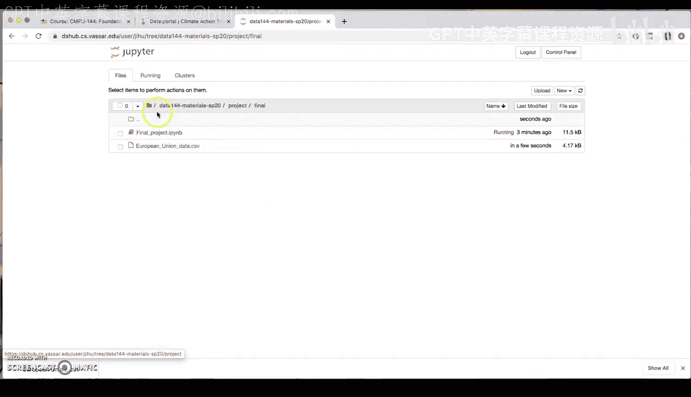
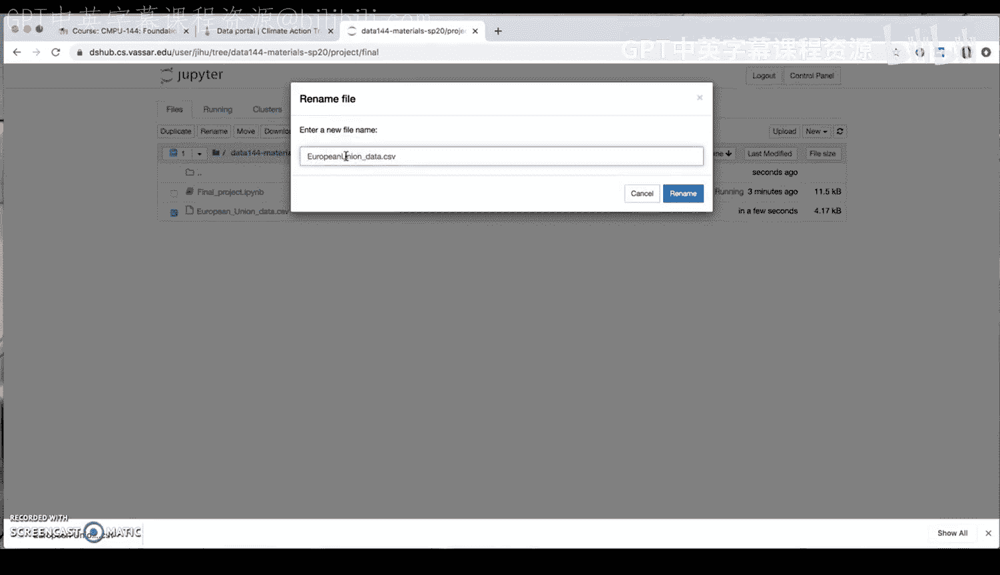
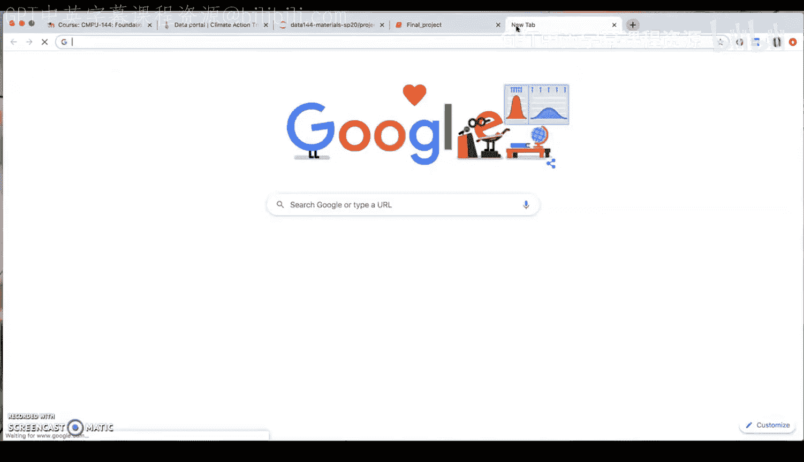
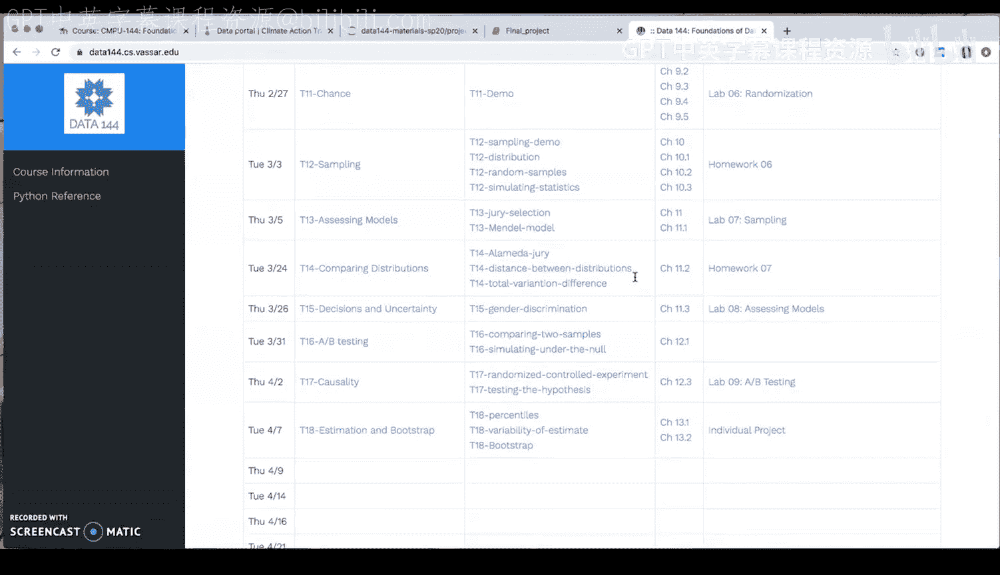
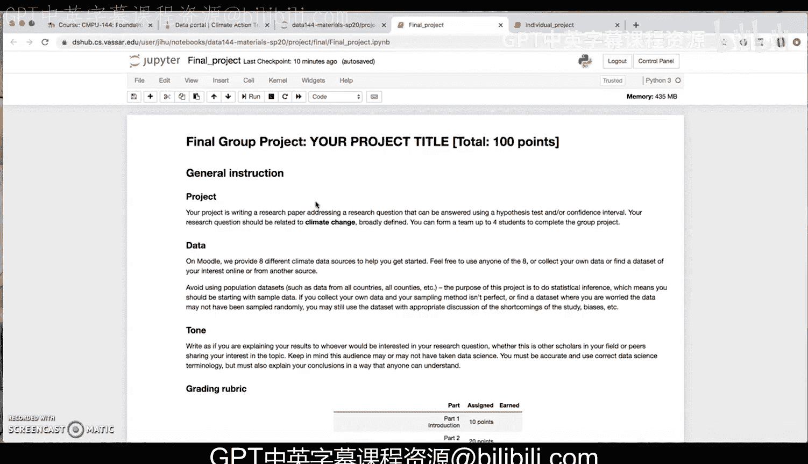

# UCB《数据挖掘和分析｜DATA 144 Data Mining and Analytics 2021》中英字幕 p47 [P47]lecture47-[Final project] Instructions - downloading dataset and uploading [BV1efBEBuEVg_p47]

Hello everyone， welcome to this short video to give you an idea of how you can work on your group project in particular。

 we want to show you how you can download the data sets varies from various sources that we posted the Mole and then once you have downloaded the CSV file how you can upload it to your workspace so you can work on it with your Jupyter notebook okay so this is sample final group project and you're going fill in all of the details by answering those part of the questions and all that and what I want to show you here is we're going show how you can。

Like you're going to write about your research question of course。

 details about your data and then we're going to show you where you're going to load your data later on okay so if you go to Moodle you will see that in our core site。

On our course site we started to populate this climate data sources section Okay。

 so we throw in a lot of material we have found， but of course youre always。

Able to to find the other ones that you want。 and just to give you a demonstration。

 I'm going to try to look at this emissions emission indicator。Data source， Okay。

 so if you click that data portal。You will see that this is a I mean this website is called climate action tracker okay and you will see that you can download different source of data of course and in particular for this data for this portal what they asking you to do before you can actually get the data I think is that you will select a particular control origin so for demonstration let's select EU and let's do electricity okay and let's do electricity activity per capita for example and you can choose more as you can see okay so maybe for for demonstration purpose I'm going choose to different indicator and let me actually just add one more sector there as well okay and scenario let's just see so you can do historic per data you can do projected current policy for demonstration I'm going choose historic data okay once you have chosen all of this you realize that they do。

DoA really nice line graph for you Okay， but for our purpose， of course。

 we not only just want to visualize the data， but we also want to work with the data to。To perform。

 for example， hypothesis testing， et cea， et cea， so for our purpose let's download the data。

And once you click that you realize that they have three different ways that you can get the data for us always try to get the CSV file Okay。

 so you can see that it is one of the options here on the other data sets websites make sure that when you explore and once you have selected all of the ones that you want。

 make sure that you download the CSV file Okay so if you now go to。Once you do the download。

 you realize that is in in your downloads， Okay in my downloads at least Okay。

 so for you now you can come back to your。Jupyter notebook space。

 okay and you click this Jupyter and you will see that you will have this project folder， right。

 you have the individual， which is the quiz tube replacement。

 and you will always also have your final。 so what you can do here is to click the upload。

 we did this once before the break。 Okay and let's just click the data that we select it。 Okay。

 and just to help you to navigate， you realize that we typically try to eliminate space。

 Okay in the data set name。 Okay， in case later we want to use them。 Okay。

 so make sure that you can either add it in the way that I did just now or you can click it and then rename okay so for example。

 I can come back and rename it and maybe I don't want the space anymore。 I don't want the underlying。

 for example， so I can do the rename Okay so now the data is in your workspace。

Okay， so what you can do now， as you know， we have done this many， many times right。

 so you go to where you're going to load your data。Any questions。And then so for example。

 I'm going to load my data is what table dot think， right？

What was it I might not be able to get it give me a second as you can do take a look I guess as you can see always you can always cheat based on I don't know I'm kidding not cheating but check out what you have done before to see what you can do okay。

 so for example， if I click my individual project。😊。

They're not showing you how to do things of course。

 but I guess just you get a sense of like the quick。Picy heat that we can do。 this is really slow。

 Sorry about that。 Okay， so I just want to see how you load the data。 I want to make sure， okay。

 it's table read table。 Okay， so on my that， I should have kept that。

 And then you have to set supply the name of the data set， which in our case， is European Union data。

 right。So you can put it over here。 Okay， and then let's take a look at。Part of the data， okay？

And then you can see， okay， so remember， we selected two sectors， I think。

 and then two indicators so。You will see that we have the electricity and the electricity activity。

 but I'm sure like you see that some of the roads are omted。 So as you keep going forward。

 you will see the other sector。 I already forgot what I chose。

 but you know what I mean and then the other the indicator and for country。

 I think we only select E right but if you want to do multiple countries comparison。

 you can select or regions I should say you can select multiple if you go back to the data right remember。

 oh yeah， we select electricity and buildings and then those two indicators So okay let me right so this is compare indicators。

 I guess if you go to this， you can select multiple multiple multiple country and region and then you can do a comparison over there if that's what you want to do so all right。

 so I think this give you a over a quick overview of what you can do but again。

There are many different data sources that we posted。 feel free to explore them。

 Also feel free to go to the other sources that interest you more。

 The key here is at the end of the day， when you download your data。

 you want to make sure that it' a CSE file so you are able to later upload it to your workspace to work work on with your Jupyter notebook and also make sure that you know what each variable is about okay so like what is the sector。

 what is the indicator and say scenario and country and all of this information should be accessible if you go back to the website that you found your data try to make sure that you know what each variable is talking about。

 of course right and what are each level is about and because that will also go into your final project right up that you're gonna talk about your data source data collection。

 what are the variables， the type of study， etctera， etc。All right。

 so I hope you find this useful and always feel free to reach out to us if you have any questions or concerns and we look forward to reading your project。

