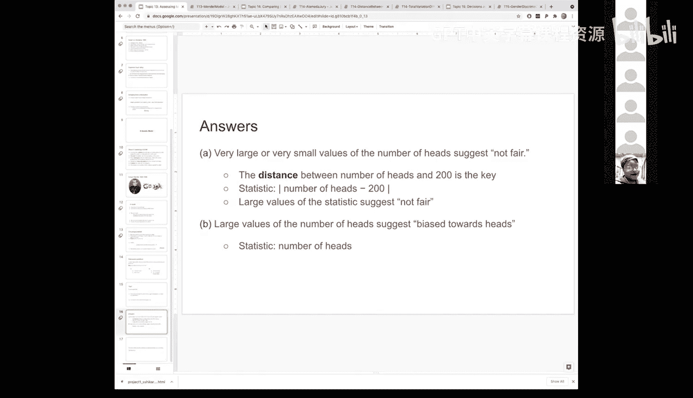

# UCB《数据挖掘和分析｜DATA 144 Data Mining and Analytics 2021》中英字幕 p48 [P48]lecture48-[T13 Assessing Models] Mendel Model--arx1nhXNUo.zh_en [BV1efBEBuEVg_p48]

All right， welcome back happy Thursday， so I want to kind of pick up where we left off last time and。

I want to talk about。This idea of when we come up with a model。

 So the the kind of the idea that we've gone so far is。

We have some data and we want to come up with a model for that and then when we've come up with a model for that data。

 then we want to figure out what are the steps where we can actually assess that model and see if it's valid or not。

🤧And this will kind of turn into kind of a general framework that we're going to follow for many different examples。

For different types of models of the data， but it comes it comes down to coming up with a statistic that will help you decide。

Whether your data whether the data supports that model or something else right so the kind of the question we're asking is does the data support our specific model and we want to choose a statistic in the statistic we choose is up to us。

 but the statistic is important to pick one that would actually support the model。

Or some alternate view of the world if that statistic doesn't support the model。

And so once we've come up with that statistic， then what we're going to do is we're going to simulate under the assumptions of the model so and we'll look at a specific example in a second。

 but we're going to simulate that statistic and then we're going to look at the distribution of those simulated values。

😊，And this is our model， this is our prediction of how that model is going to bear out and then we can look at our observation。

And see where it lies on that distribution and that should tell us whether。

That particular distribution， the observed statistic right so the observed statistic is the thing that exists in the world。

 That is the the thing， the actual。😊，Statistics that we're comparing to our model。

And if we look at that observed statistic and see where it kind of falls in our histogram。

 our distribution of simulations， that will give us an idea whether a model was valid or not with that in particular with that observed statistic。

Okay， so let's look at a specific example。🤧U。🤧And we're going to go back to time to Greg Ormenel and he was a monk that was really into gardening and is also in running experiment and doing observations and he's kind of known as the father of genetics and one of his famous study was he raised a lot of bee plants and in particular。

His model was， and they didn't know much about genetics and about dominant and recessive traits at that point。

 but he was growing these pea plants of a particular kind they had two types of flowers they could either have。

 they either had purple or white flowers and his model was that the chance of when you planted these pee plants。

 there was a 75% chance that the plant would be purple flowering and a 25% and regardless so purple regardless of the colors of the other plants。

And then。What we want to know is is that model or good enough and of course we know kind of now about dominant and recessive genes that we know we have an explanation of biological explanations for this model and this model turns out to be true is that purple。

Purple is a dominant gene and the white flower is a recessive gene。

But they didn't know any of that at the time and so let's assume that we didn't know that that the model is valid。

 can we use simulation to verify what he was seeing or that his model of his model。

 his view of the data is accurate。Okay， and so before we kind of look at this example。

 I want to take a moment and I want you to think about kind of how would you assess this model and so we kind of know the general framework kind of what we've talked about but in particular what。

What statistic， what statistic would you use and so let me let me pause the video here。Okay。

 so let's talk about how we would assess this model and again the framework for kind of looking at the model is is that once we've come up with our statistic we're going to run a bunch of simulations in display the histogram and then see where our observed statistic falls on there and so really kind of when we talk about assessing this model it comes down to what statistic we do we are we going to pick and and so for this particular。

😊，Instance。Really kind of the key statistic here is and because we're comparing to these purple flowering plants。

 we really are interested in how much deviation are we around or are we away and by I mean by deviation。

 how much smaller or larger than we are from that 75% okay。

 and so a good statistic for that would be the distance the distance away from 75%。

From there and so and that's simply right the distance is simply the the the percent that we get of the purple flowering plants minus75 and we're going to take because we don't。

We care about the deviation from that model， not whether it's necessarily larger or smaller we want to know in particular just how far away is it from 75% so it'll take the absolute value of that and that's just a standard distance metric from there and the idea here is is that now so that's the statistic is the difference from 75。

And so the idea here is is that if the model was if if the you know zero would mean that there's no deviation if the statistics the larger the statistic gets and because we're doing distance。

 it's not going to be minus it's going to be a positive number， the larger the statistics， the it is。

 it's that is more evidence against the model。And so let's take a look at that and we can run this。

 we can run this simulation。Okay， and so we just kind of have our boilerplate code up here and then so first now we want to go back in here let me just clear out all the output here。

😊，And now because we want to recreate Mendel's experiment。

 we want to look at the observed percentage and so when he did his experiment he grew 929 plants that's a lot of plants that's almost 100 plants and 709 of them had purple flowers okay so the actual observed percentage is going to be 709 over over 929 okay。

 and so he observed about 76。3%。Okay。😊，🤧And so now what we want to do now is we want to run our simulation so we have our so we have our observed value and now let's get our let's get our setup for taking our sample and because we want to reproduce the experiment what we're going to do is is that and we predict our model our model is going to be that we'll get a purple plant 75% of the time 0。

75 and something else a white flour 0。25 or 25% okay so what we're and because we want to reproduce that experiment we want to run our sample proportion and remember that's just going to pick randomly。

😊，From。Are predicted proportions in that actual proportion。

mFrom there and so that's going to give us。🤧The total number percentage for for a particular trial right so the thing to remember is is that this is one statistic from one simulation and when we run it because it's random every time we run it we're going to get a different value。

🤧And if you can see we do that if I run it， we're going to get slightly different values each time okay so then what we want to do is we're going to define a function to run this and actually give us the number of purple flowers so that is that is just running using our sample proportion and if you remember is we can see from above that returns an array and the thing that we're interested in is the number of purple flowers and so we're going to grab the first item of that array so item zero is going to grab this item here which is the percentage and if we want the actual number if we want the number of flowers you know we turn that percentage into a number of flowers we're going multiply that by 100 okay。

So now we have that function and then every time we do that， we'll get some number。好。

Flowers out of that。Okay， so now。Now we now that we have our statistic。

 we have our function that generates our statistic。

which would give us the number of purple flowers now we can run our simulation and this is the framework that we're going to come back to time and time again so it kind of it's worth spending a couple moments and talking about exactly what's going on and so in computer science speak this is actually kind of a design pattern it's called an accumulator pattern。

And how that works is that we're going to initialize some value outside of the loop and this is going to be our initial value and in this case what we're doing is that purples is going to be an array of observations。

And so we're going to initialize it to some initial value， in this case it's an empty array。😊。

Because we haven't seen any observations yet and so purple is going to be ourccumulator variable。

 we're going to save that that is going to be the name we're going to store all of our results。

And so we need to initialize it， give it some initial value outside of the loop。

And so then we have a loop here and this for loop is just we're going to do a for loop just to run the simulation a certain number of times for this example we're going to run it 10000 times and then in the body of our loop we're going to get the value that we want and so here we're going to get the new purple and then what we're going to do is we're going to accumulate that result we're going to add it to the array and this is so this line here this new purple。

😊，Is going to give us a new。😊，A new statistic from from our experiment and then this line here what's going on here is that we're going to add it to our purple array and so we're working in the confines of the numpy append function and what that does is that that takes in an array and so we're passing in the array。

The second argument is the new value to add to the array。

And then what it does is it actually returns a brand new array。

 it returns an entirely new array with the new value in this case new purple added to the purple array and so because the NP of pen。

 the nu of pen returns a new array we have to reassign it back to our purple array okay if we didn't do that that value that value that gets returned from this function would get lost and so this is kind of a paradigm and we'll see this kind of again and again and so so that's kind of what's going on you can just remember but this is the way that we add in that' this is the way that we add a new value to the purple array okay so we're passing in the array。

In and the new value and we're getting a whole new array。

 which then we assign back to purple and so at the end of that at the end when we run this loop。

When we run this loop。😊，Purpleles is now going to be in array with our observations and it's going to have one observation for every time we ran in the loop。

From there， okay？Any questions about that， how that works because we're this is the basic framework for us doing our simulation we're going to come up with a statistic。

😊，We're going to initialize。Our accumulator name in this case we called it purple we're going we're going simulate n number of times where n is some large number and we'll talk about later in the course like what is large enough right right now we've been we've been vague we've just said we just run this a large number of times we'll get more precise about what large what exactly is is large enough but for now just we're going to run this many times and then once we have that array then we can display a histogram of that and to display the histogram we got to turn that array back into a table and so this is where this line is coming from here right so we're taking right so if we look at。

If we just look at purples。We can see it's an array and then if we've got the length of that you can see it should have 10000 observations in it right but if we want to see them we have to convert them into a table and so that's exactly what we're doing here so the table this will create a brand new table for us an empty table with no values and then we're just saying we're going to take that brand brand new created table we're going to add the column and then we'll give it a name and then the the array for that so that's now going to give us a table。

And then not shown here and there's just a end there we're going to display that into a histogram right if we did that if we just left that off。

 we would just get the table and so now this is the distribution of。😊。

Flowers that we got from this and you can see。🤧It falls very。

 very much in line with with our prediction where we would expect about 75 flowers in our sample and and so again right so what we're doing we took a sample of 729 we looked at the number of we got the percentage of them that we're purple and then we multipied by 100 to get an integer to get the actual number 75 from there okay and so then now what we can do is we can look at the different from the statistic okay so what we're doing here is again we're just going to look at another table and we're just taking the difference now right so this is just giving us the number this is not our this is this is the number this is not quite our statistic yet our statistic is the distance away from 75。

And so we calculate the distance by taking the purples minus 75。

 that 75 we got from our model and take the absolute value of that that will give us the actual statistic。

🤧Okay， and if we expected the model to be accurate。

 we would expect a low discrepancy and that's exactly what we see right for many of the trials there was。

It was very close to zero， it was very close to it was so a distance of zero means that it was very close to 75。

And you can see it kind of trails off from there and now if we actually look at our so that's the distribution right so if and so what we've seen is this is what this is what we would expect to get from distances away from 75 if。

Due to random chance， due to random chance。And so now we can look at our observed value and see where it falls in that distribution。

And if we look at R， if we look at what Gregor Mendel actually observed。

 we'll see that we get about 1。3 and so where would that come on this graph。

 this would come at this graph somewhere around here whoops。So I where my arrow is。

From there and you can see that's kind of well within what we would expect due to normal chance normal process and so we would say that the the simulation supports the model that that 75% of the flowers are purple。

Any questions， any questions about that？Yes。Okay。Um。Very good， okay。

 then we will kind of move on from there。And so。Kind of along this same theme。

Along the same theme of figuring out kind of choosing statistics。For both A and B。

 what I want you to do is。Choose the statistics that will help you kind of choose between the two viewpoints so like the viewpoint for a is so imagine our data is we have this we have the data of 400。

tosses of a coin， so flip a coin heads or tails， we've collected the result for 400 trials。

And so that's the data。And。You want to kind of think about a statistic that would answer the question in the case of A is。

 is this coin fair， is this coin fair？Yes or no it's not okay so that would be kind of what would be a statistic for that and then for the other scenario be。

The coin is fair no it's biased towards heads okay。

 so the first one is just saying whether it's fair or not。😊。

The second one is asking a more specific question。😊。

Um if it we're asking if is if it is biased towards heads from there and so take a moment I'll send you back into your breakout rooms and then take a moment to think about what the statistics for a a would be the statistic for a would be and for B and are they different and if they are how are they different？

Any questions about the discussion before I send you off into the breakout rooms？O。All right。

 I'll see you in a moment。All right so before we come up with a statistic we want to think about what does it mean to be fair okay and so in this case we should define kind of where what we think of as fair and so if we're given 200 400 coin tosses if we got 200 heads that would suggest a fair coin okay so and that's kind of for both both cases A and B right a fair coin you would expect with 400 tosses because half of the times would come up heads half the come up tails we would expect 200 heads would be fair and so we can use that when formulating our statistic。

🤧And so。For the first question， A， right where we're answering the question of not fair。

Anything that's very large or very small away from the number of coin flicks would be an indication of not fair。

And so here is a good candidate where distance would make a lot of sense and so a reasonable statistic for case a is using the distance between the number of heads we get in our trial and 200 and so what would that actually look like again。

 it would be the absolute value of the number of heads minus 200。And the idea here。

 is that the larger the statistic， the more not fair。The coin would seem would appear。Okay。And so。

Because we didn't care about whether because we just were really cared about not fair。

 we didn't care in the formulation of A， we didn't care if it was bias towards head or bias towards tails。

 were really just answering the question of not fair。

And so any deviation either smaller or larger would be a representation of not fair。

 but in the case of B， we really were asking a more specific question。

And so good and so the idea here is the number of heads。

woWould suggest kind of some form of bias towards towards head so the statistic here might be actually just not looking at the distance metric but looking at the number of heads and seeing if it's you know greater than or smaller then and you know I think you' would also make the argument you know subtracting from zero right that doesn't really change anything it just changes the offset from there so if you were coming up with a statistic of the number of heads minus 200 without the absolute value I think that makes a lot of sense as well。

So do you have any questions， did you come up with any statistics that were significantly different than what I just talked about？

Conversely， do you have any questions about how I picked those particular statistics？Okay。

 so I will take that as this makes sense and so。

Fantastic。