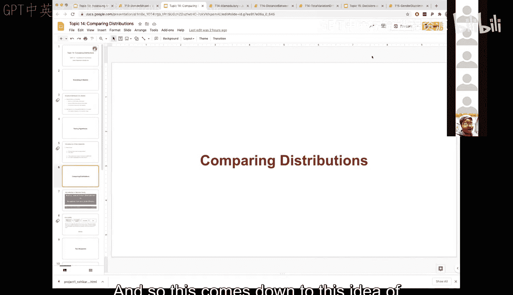
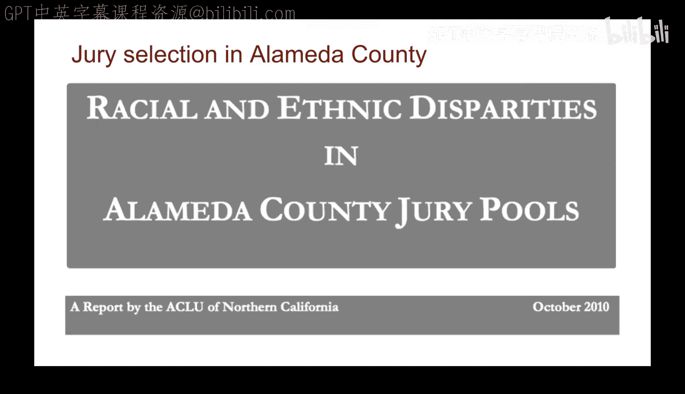
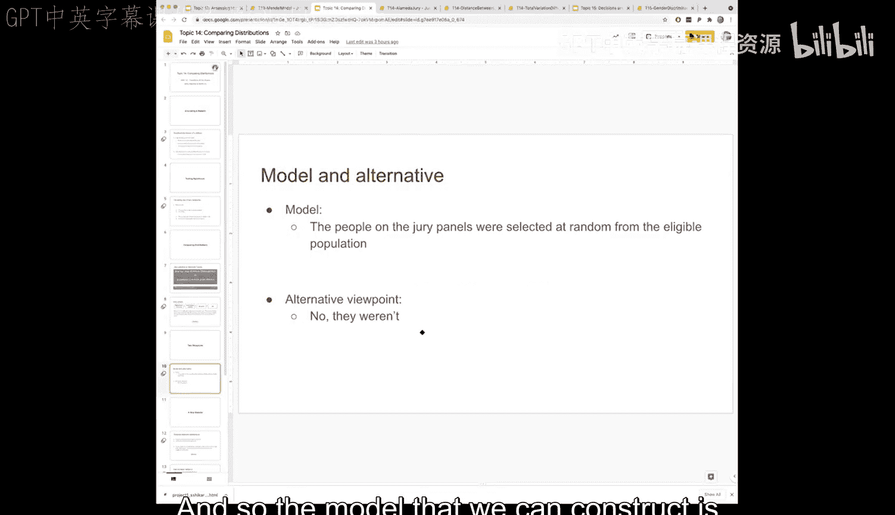
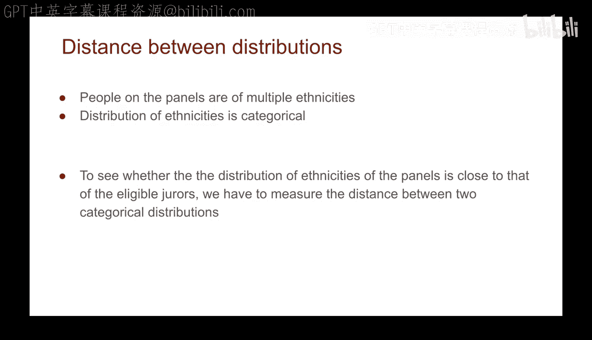
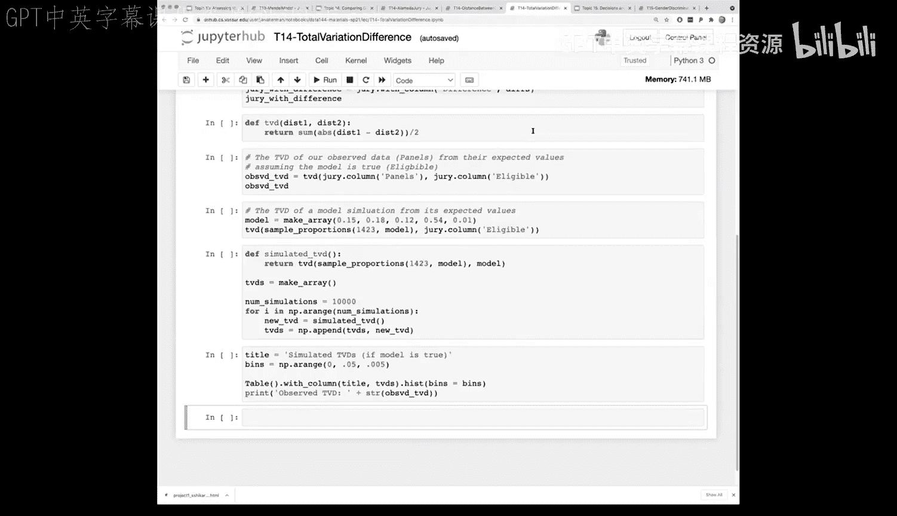
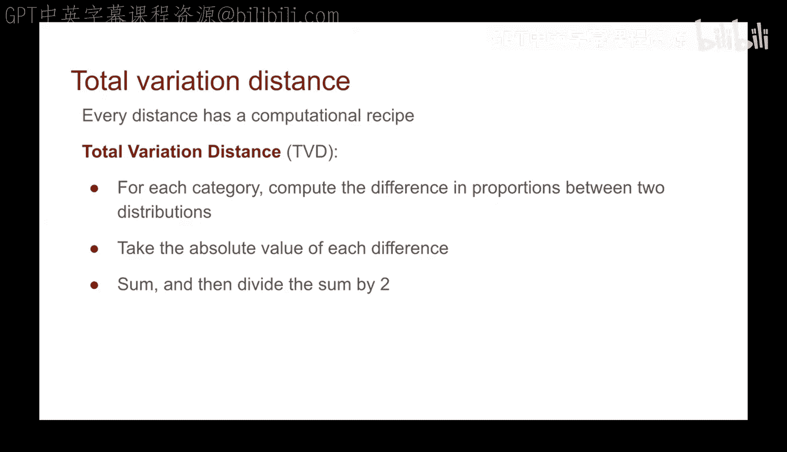
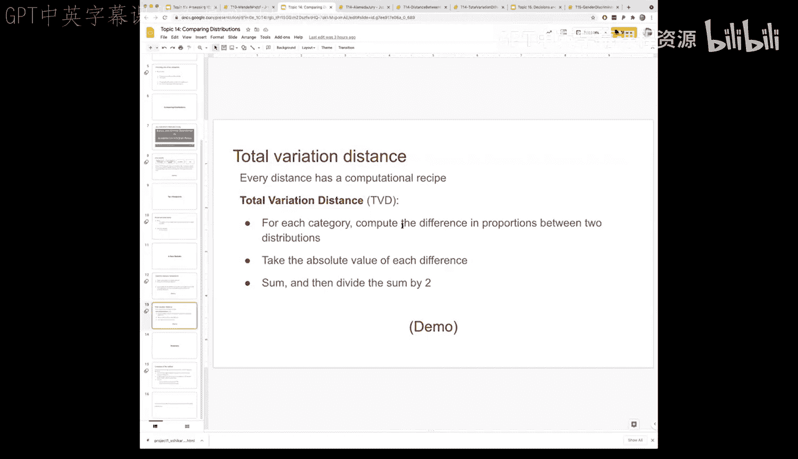
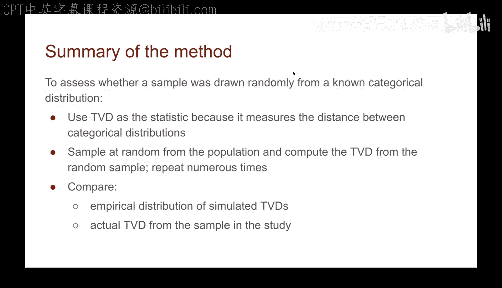
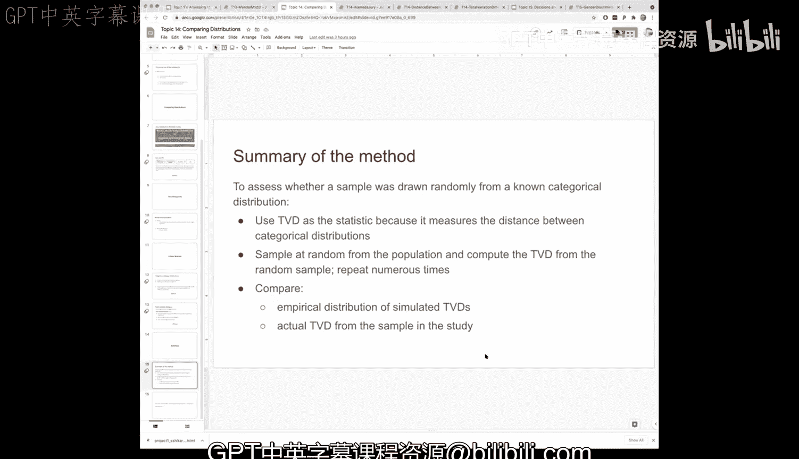

# UCB《数据挖掘和分析｜DATA 144 Data Mining and Analytics 2021》中英字幕 p49 [P49]lecture49-[T14 Comparing Distributions]-Satp9Pll7Xw.zh_en [BV1efBEBuEVg_p49]

And I want to talk about how we're going to compare distributions。🤧Okay， and so。Again。

 it comes back to coming up with a statistic that's going to capture this idea of how we can compare to two distributions because the heart of kind of these simulations are picking the statistic。

And so let's do this with a particular example， but let's kind of focus on some terminology and so when we talk about an empirical distribution of the statistics so this this this idea of empirical in the context kind of in this course empirical means。

😊，Simulated okay so this is you know so in general empirical is kind of the experimental value and in this case the experiments we're running are these simulations so when I say the empirical distribution of statistics statistic i'm referring to the distribution based on our simulation okay and so it's a distribution and then it's going to be all of the。

😊，Observe values of the statistic that from our simulation and how often they appeared right that's just our standard histogram。

And the idea here is。Um。If the number of repetitions in our simulation is large。

 if we do a large number of simulations， this is going to be a good approximation to the actual probability distribution of the statistic。

😊，Okay， and so。Typically when we when we kind of validate these models。

 we're going to ask kind of like a yes or no question so we're going to have a hypothesis。

And we're going to have that based on the data itself and so we've looked at a couple of examples of this in the past right and so and the idea about running these simulations is going to allow us to kind of decide whether one one of the viewpoints is the correct one and so we're going to formulate these questions such as chocolate has no effect on cardiac disease right so that's one view has no effect and then the other viewpoint is is that yes it does right so it either has no effect or it has some effect。

And the example that we looked at last class， the jury panel was selected at random from eligible jurors。

😊，Well， we didn't look at whether there was college degrees or not。

 but you can ask that question and the other viewpoint is no it has too many people with college degrees okay and so this comes down to this idea of that we want to compare distributions。

😊。

And so the example that we'll take a look at comes from this ACLU report from 2010 that looked at in particular。

 Aleda County in California。😊，And it looked at the jury panel versus。

The kind of what the law said versus what kind of actually happened and so this is a good case to look at because they spent a lot of time collecting data and and analyzing it so we can kind of grab their data and so to kind of understand what they did here it's helpful to。

It's helpful to first understand how the jury panels work in Aleda County and so the idea here is is that just by kind of being a resident in a county based on some criteria you're eligible for for jury duty right and that's usually required being of a certain age and。

🤧you know usually 18 18 or above and living in that area and so then from eventually we're going to take from that kind of pool of eligible juries a jury blue form but there's a couple steps in between and so。

The eligible jury right comes down from a list of eligible residents and then they get paneled and so what that means is is they're kind of brought in and then the lawyers get to decide whether they sit on the jury or not。

 or the judge can disqualify members of members from the panel from being actually on the jury， okay？

And so Allammeeda County had a or California code basically said that the jury panel。

 so the thing that we're going to look at is not the jury because we're going to look at the jury panel and。

The law basically said that the people who should sit on a jury panel should be a representative of the population of the area served by the court。

 okay， so it should have the kind of the jury panel should have the same demographics of the population。

 the population of that particular county。And so we're going to take a look using the actual data from this study and see if that actually has happened。

Yeah。All right， and so。So basically what they did was so the ACLU， they looked at actually 11 trials。

 they looked at 11 federal trials in Almediaa County and they actually kind of and for those 11 trials。

 there was 1453 people across all of the all of the 11 trials， were seated for the jury panel okay。

 and so they went and they actually were able to they went and determined the ethnic breakdown。

Of the people on the panel， and then they used census data to get the ethnic breakdown of the population in general。

And so grabbing from that and grabbing from that， we have the following tables here so they broke down their study kind of just breaking down the population down to Asian blacks so Latinos。

 whites and then other and so。And so here we are， we're creating the table and so the eligible column。

 this was the actual demographic population level demographics， okay。

 and and so these were basically the people who were eligible to be on these jury panels。

And that basically breaks down to the population。So about 15% Asian 18% black 12% Latino white 54% and other from there okay and so。

So this is the eligible population and this is this is what they got across for the distribution across all of these categories right and so this is the difference between kind of the example that we're looking at here so here we have a category we have multiple different categories in our column as opposed to the last example we looked at where we just had purple flowers right so now we have a bunch of different categories to look at and so the question we want to ask is is so so this is what they observed so the panel column down here this is what they actually observed across those11 trials and so the question we want to answer is from this source from this distribution。

😊，Is you know due to random chance， could we get these？

This distribution of of the population across these panels right so was was the actual thing we observed the panels was that due to random chance or was it some other you know systematic bias from there so that's that's the question that we want to answer。

And if we look at it， you know just kind of eyeballing the data。

 which is always a good thing to do kind of when we have new data just to kind of visualize it to get a sense。

 you can see that there's definitely some disparage there's some differences here right there are some differences across the categories white seem to be fairly represented represented but the other distributions they seem a little a little off okay and so。

😊，Now what we can do is we're going to kind of follow the exact same framework that we have before where we're going to come up where we're going to think about what the statistic is going to be and we'll come back to that in a second。

 but for right now for right now I just kind of want to look at the data a little bit from there and so for this model right this is the true distribution of people and that's we're going to save this model and then let's actually right run kind of let's do one experiment。

And so now this is kind of this is the distribution。

 the population distribution and so if we ran across 1423 and the reason why we're picking 1423 from there is because that's the actual number of jury members of the jury panel and so this will give us one simulated result from there okay and that's going to give us the breakdown and every time we run it we run it we're going to get slightly different results from there okay。

 but one one thing that we can do is is that we can just visualize we can just visualize so we're not we're not computing any statistics yet。

On this we're just kind of visualizing the data so we've done one chance based on the given source population and then if we simulate that and create a table here we can see that。

You know， and we can run it a few times right to kind of get a sense of you know。

 is it jumping around a lot and if we run it。Oops。We can see。

We can see the simulateimd value that we get。😊，You know， seems。

Kind of in in the ballpark of the eligible and for certain categories it seems to be a little bit different right and if we put all of them together in a bar chart that can kind of that kind of shows so here we have the dark the dark blue is who is eligible to serve on the panels and who was actually on the panels and are simulated and you can see。

Even with just one kind of one trial right we just this is just we just did one simulation。

You can see that they're pretty close to the eligible there's there's not a lot of difference between those。

 but there are for certain categories there's certain categories that there does to be seeing a difference okay so I think you know we're kind of onto to something that maybe there's something more than random chance going on here。

And so the model that we can construct is that the the jury panel was selected at random from the eligible population okay。

 so any。

And the distribution that you see of the observed。The observed distribution of panels was due entirely to chance。

 okay， so that is that is one model that we can have。

And then the alternative is no they weren't right again we would kind of give this idea of this hypothesis either it is or it isn't and so the model is either going to be valid or they or it wasn't right so it wasn't due to chance that there was some other forces at play there。

😊，Okay， so now we want to come up with a statistic that kind of captures this right we had this idea of this distance measure meant before when we when we started talking about the pea plants but because now we have multiple categories。

 we may want to kind of tweak that idea a little bit and so you know I want to introduce this concept of a distance between distributions。

🤧And so we're going to look at the people。On the panels they have multiple groups that they belong to and so another way of saying that is is that the ethnicities are categorical okay that you can belong not to just your you're not either a purple flower or not。

 you can be one of many categories from there。And so what we need to do is is we want to measure the distance between two categorical distributions and that is the problem that we want to solve and we want to come up with a statistic that is going to capture that。

😊。

And please stop if you have any questions along the way。Okay， so again。

 the question now is is that we're not we just don't have two things to compare to the number of purple we have a bunch of categories where we're doing kind of individual comparisons to and so we want some notion of how to capture that。

And so again， so this is just kind of the same setup before this is the same table from there and so。

Now what all I've done here is I've taken the same table that we had on the previous a demo and I just added a column I just added a column which shows the difference between each specific category from there right so I just took our table and then I've just added so I've taken our jury table added with column the difference this diffs and how did I get the dis。

 I just looked at the panel column and I subtracted it from the eligible column okay。

And so this is showing us the difference between。🤧う。

The eligible and the actual panels the panel themselves okay so but again this is not a statistic right so a statistic is some kind of a number that we that we want to get and so but we can kind of look at this difference and maybe kind of give some intuition about you know how we can come up with a statistic and the difference is I think the start of that right because we can see that that this group has a difference there's a difference here you know is there a way that we can somehow capture that。

😊，Well， one thing we can do is like if we just summarize if we just if we took the sum of all of the differences。

but it turns out that that would not work in this case and why is that well if we look at the sum you'll see that it actually the sum of the differences is is always going to turn out to be zero。

And why is it because if you think about the distribution of the categories， someone。

 the way we've kind of defined our said， everyone belongs to one of the one of these following five five categories and so if you took the sum of the eligible column。

 you'll see that it sums up to one that because everyone you know so everyone is going to be part of that。

And it's the same thing for the panels it's the same thing for the panels the distribution of these panels all sums up to one and so if we take this difference and we can see we we can take this difference and we can take basically the。

The the numbers that are smaller we're all of the things that have a negative difference or they're going to have a positive difference and if we actually look at them together if we take the sum of the positive differences we got 011 and 0。

13 right or 0。03 so that gives us 0。14。And you can see on the negative side you can see on the negative side we have 0。

1 and then 0。04 so we have minus 14 right so if we just took a sum of this of the difference column we would get zero。

So that's not going to help us， but what happens if we took the absolute value of the sum？

If we took the absolute value of the sum from there so that would give us a positive number right。

 but in some sense we're trying to measure kind of how far the distribution is。😊。

You know from one way or the other and we know that because the difference is going to have to sum up to be zero the difference column has to sum up to zero we know that the the columns that have a negative difference are going to be the same size as the column that has the positive difference and so that's exactly what we see here right on the positive side we have plus4 we have plus 0。

14 and then on the negative side we have minus 0。14 so if we took the absolute value of the difference here let's just actually just do this and so if we pull off if we look at the disc column。

Right？We can see that's an array and if we take a sum， if we take the sum of that。

We can see we get zero， I mean it says its it's some number but its it's 10 to the minus 17th that's just due to kind of floating point rounding errors from there。

 but the sum the sum is actually different， but if we take the absolute value of that。We can see。

We got to take the absolute that is not going to do what I want what I want is I want the absolute value so I actually want to pull out these columns I want to pull out eligible in panel so E equals let's see so so the so the we have we have eligible right and then so I just need the PE panel from there so。

Equals jury with dis difference。诶。With。哦。Whoops。I'm sorry， not with them， but just one column。不。呃。你。

And so if we take the if we take。The absolute， so we get ABS。Of。

IfSo it actually it just it's just the difference column minus P。From there。

 and we take the sum of that。嗯。We get， yes， of course we get no what I want， sorry。

What I want is the absolute value of each of the individual distances from there and I'll show you that I'll show you that in the I don't want to get too farfield and so I'll show you that on the next demo。

 but the point is is that if we take the absolute if we take the absolute of each difference。

And take the sum of that， we're going to get two times the amount that we want。

Because we're going to get the absolute value of the ones that are lower and the ones that it's going to be higher and so the statistic that we want is actually the absolute value。

 the sum of the absolute value divided by two and that is going to be our total variation difference and that is the statistic that we're going to use。

And so let me。Let me show you that。So this is going to be total variation distance will'll abbreviate that TD and so the total error is going to be the difference。

Between each of the categories in the distributions。

 so we're going to take the absolute value of each difference。And then we're going to take the sum。

 like I said， and since we've gotten the absolute value。😊。

We're going to get twice the distance value， so this is where the dividing by two comes from。

And I'll show you that here。And hopefully this will。Make more sense。Um。

So this is again the same difference panel that we had before and so this is the this is the。

And so we're going to write a function that will compute the statistic for this is what I was trying to do in the previous example。

 and so we're going to take two distributions disk1 and disk two so this is just a generic function to calculate the total variation distance okay and so this would work with any distribution is you pass in the first distribution and the second one and so。

😊，Again the statistic that we're want to want to take is we're going to take remember what we're passing in is is we're passing in these distributions their arrays。

 their columns and so when we when we subtract distribution one from distribution two。

 we're going to do an element by element subtraction so we're going to take the first element of disk1。

 the first element of disk two we're going to subtract the two of them together。

 then we're going to take the absolute value of that。嗯。

Because we're going to get back in our so we'll do that and we'll get back from this calculation。

 we're going to get back a new a new column， a new array。

 which is going to be the distance of each individual column。

 each individual column and then there now because so now since we've taken the absolute value。

 each column is going to be positive。And we're going to take the sum of that and then to kind of to get rid of the offset of the fact that we have。

The same number of positives is the same number of difference。

 negative differences will divide by two。Okay， so so that now that we have that function。

 now that we have that function， we can now。Look at our observed data right so here we're going to compute。

😡，The statistic on our observed data so this is the thing that we actually saw in in the real world this is not our simulation this is actually what we saw and so we're passing in the juries the panels。

Column right so that is actually what we saw and then we're passing in the eligible column from there and that gives us this statistic of 0。

14 okay and so the statistic on itself is is that doesn't necessarily tell us anything until we actually look at until we run the simulation of。

😊，We do our experiment we run the number of trials and then we look at the histogram。

 the distribution of。The proportion from there and so that's what we're going to do next and again it's going to follow the same。

🤧Framework that we've looked at before and so we have our function that's going to compute。

That computes a single statistic for us given the distributions and so now let's。

Look at the statistic of。So here's our observed statistic and here we're looking at what we would get with one trial of our simulation。

 this is kind of what we would expect。😡，From there and so again to keep it with the experiment to keep to keep it with the experiment we're going to sample proportions right so we're going to take a random sample based on our model and this is the the eligible this is our eligible panel and we're going to pull you know our 1423 and then we're going to compare it。

We're going to compute our statistic based on the eligible okay and you can see so this is the statistic that we observed in the real world。

 this is our simulated statistic and we can see if we run it a few times we can kind of get a sense now that you know this does this observed statistic does seem to be a bit of an outlier compared to just kind of a few runs a few trial runs of our sample here。

😊，But we won't know for sure until we run the experiment and we look at the histogram and that's what we can do down here and so here we're just writing。

A very simple function that will simulate one trial of the experiment right and so what we're doing here is now we're getting。

We're running our sample proportions for the same number。

That was used in the observation and then computing our TVD statistic on that okay。

 so this is going to be this this whole thing here will give us one statistic。😊。

With the proper with the proper number of samples。And then again。

 here is just our design pattern here， we initialize our accumulator。😊。

To an empty array we're going to run this for 10000 simulations and so here instead of just hard coding the number in right here we used we used we we gave it a name and that's a little bit kind of good programming coding style technique because one when you look at this when you look at this function down here the for loop you can see that oh okay this is very clearly the number of times that we want to run our simulation and if we ever want to change our experiment。

 the number of simulations we just change it in one place from there so that's always it's always good to give it a name as opposed to kind of hard coding kind of what is known as magic numbers into your program from there but the effect of it is is that we're going to create our array we're going to append we're going to collect our 10000 results and now we can actually look at it we can look at we can look at it。

And so。Here we're just setting up our histogram so here we're just setting up the bins for our histogram and then we've just taken we've just taken our column of experimental simulated statistics and turned them into a table。

 okay？And。If you remember， where did the。Where did our observed statistics show？Um。

 if you milk at it there was 0。14， where's 0。14 this is 0。04 so 0。

14 is like hanging way way way out here。And to really kind of to put that into perspective and so this is the distribution of things that we would expect to see if remember what our model was。

 our model was was that the distribution of jury panels were due to chance。😊。

If it were due to chance and computing this summary statistic of the。The TVD。

 this is where we would expect to see， we would expect to see somewhere in the you know kind of for most cases。

 almost all cases we never see a TD larger than 。04 and actually you know to actually see that and we can actually just change the bins here。

😊，And you can see。Where is 0。14 0。14 is out here right and so in this case it is is it is very very。

 very clear。Um。It is very clear that。There is something going on other than pure chance with that。

All right， before I kind of wrap up for today， is there any questions about that？

So this is the statistic and this is a useful statistic for comparing against distributions and so what what what in essence are we doing what in essence are we doing is where're basically because we have multiple categories and we really just want a summary statistic to capture the total。

😊，Distance variation right so how much you know we're looking at every category in by itself。

U and we're kind of accumulating those results， we're taking the distance of each individual category that we're comparing to and we're accumulating the difference。

😊，And then we're just dividing by two because the total number of。

The total number of things that are going to be greater is the same as the total number the distance that will be less than so when we take the sum so another way of saying this is that we could have done the exact same thing by just looking at the positive differences right because the positive differences are going to be the same as the negative differences we could have gone through and just calculated only looked at the positive differences and that would give us our TVD。

By taking the sum， by taking the absolute value。😊，By taking the absolute value of the distance inviting by two we're calculating the same thing a little easier。

 so that's kind of where that comes from but we're looking at each individual each individual category。

 we're looking at the difference for each individual category and then we're taking the distance of that。

😊，From there， does that kind of make sense that's kind of the heart of kind of the statistic and the intuition behind that。

 I want to make sure that you kind of understand the intuition of that。嗯。so any questions of that？

Before I wrap up。Awesome， good， all right， so kind of this the summary of what we're doing we've done here is。

And the question we want to ask is is that。😊，You know with our observed value you know could have been could have been just。

Drawn from a randomly you know from a sample and so when we have multiple categories。

 the sta we want to use is this this TV because we're looking at。

The differences in the individual categories and the framework you know once we have that statistic we're just going to follow the exact same framework that we did before。

 we're going to sample it random from the population we're computer statistic and in this case it's going to be the T and then we're going to repeat for some large number of times。

😊，We'll compare。The empirical distribution is simulated right so that's what we simulated the histogram from that to the actual。

TVD that we got from the sample and the study and where it falls on the histogram gives us an indication of how likely that was the actual observed value was due to chance。

From there。

All right。That is so。We have five minutes left and I'm not entirely convinced starting a new topic in five minutes is in our best interests。

So let me pause。😊。

