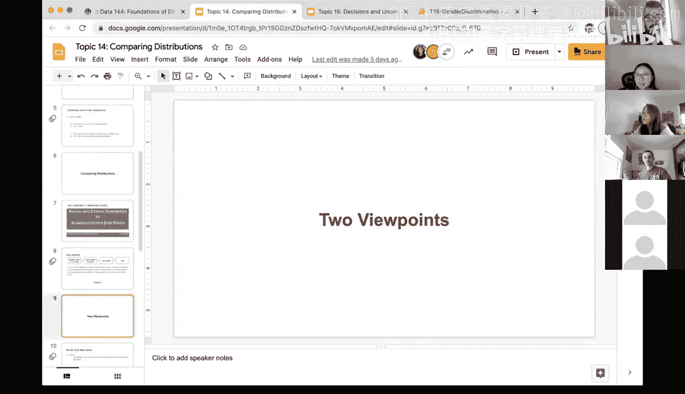
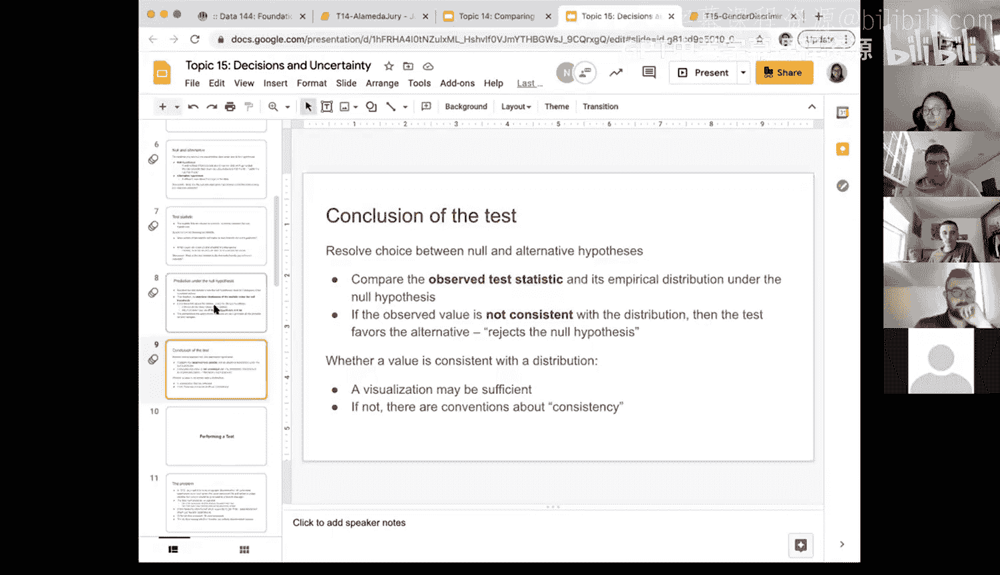
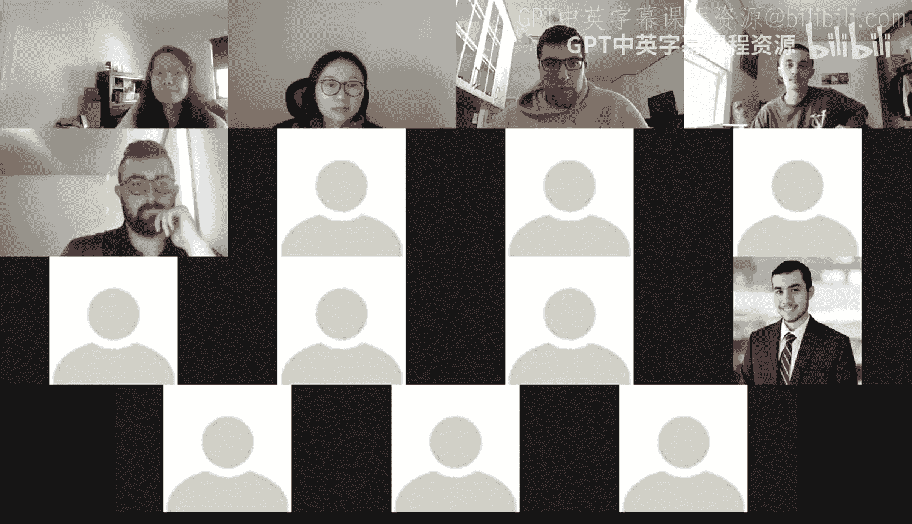

# UCB《数据挖掘和分析｜DATA 144 Data Mining and Analytics 2021》中英字幕 p50 [P50]lecture50-[T15 Decisions and Uncertainty] Terminology-aUsZtP7NroA.zh_en [BV1efBEBuEVg_p50]

Okay yeah， so we're gonna start on topic 15 okay so if you come to our course website okay so today we hope to cover decisions and uncertainty and if we get extra time we can start on number 16 as well okay but you will see that starting from here especially from last week if you remember we talk about assessing models we're saying that model is really any model is a set of assumptions okay and then we're coming up with method of how to simulate right data under what the model is saying and then use that to check against what we observe in the sample okay so we talk about like the ju selection example Mendes heredity model example and then I remember I believe Jason talked about how to compare distributions right and then in the Slack channel I think we had a discussion quick discussion earlier this week also about what is the total variation difference is doing and things like that so today。

We' try to synthesize all of them okay with a larger example that involves how we can actually simulate the data under what the model is making the assumption for so we'll revisit some of the concepts from last week as well but at the same time we're going talk about some new stuff okay so we'll get started okay so the first part here is we title this topic is a decision uncertainty mostly because well before we talk about how youre able to come up with simulation approach right to figure out how you can simulate data under what the model is saying and then of course based on that we're gonna say that oh the model seems consistent right with the observed data or does not seem consistent so we were using I guess overall pretty vague language back then saying that well consistent what is consistent what is not and today in this topic we're going to talk a little bit more about well what do we really mean by that how we can make decision once we have a set of simulation。

Stistic right and then we compare against the observed how extreme is extreme。

 how inconsistent is inconsistent Okay so we're gonna to talk about based on what we're gonna make those decisions and then you will see as soon as we start doing that whenever you make decisions based on any rule it's possible that you make mistakes okay and then we're trying to capture that in terms of by our okay because you can make mistake。

 any kind of rule will have rooms for you to make mistake right but then we definitely want to make sure that we will minimize that kind of mistake as much as we can so we can have a really robust test that we're talking about okay so this is like the overview of today and to start it off we gonna look at what we are we have been doing and then see what we can carry on what we're doing Okay so from last week we were choosing right between two point viewpoints of the role right based on the data in the sample in particular in the jury selection。

 I think a matter counted example we're talking about。The first viewpoint， right。

 where we think that。Jury selection is a random sample from the population right and then the other one is that they're not okay so those are the two viewpoints and we are trying to choose between them which one is more likely given what we see in the data okay and then last week we also talk about it's not always clear whether the data is consistent with one view or the other sometimes it's very extreme I remember that example about the jury selection in 1965 the one that I talked about if you remember like88 African Americanic man on100 person jury where the population breakdown of that race or ethnicity is 26% right so that was something pretty extreme that when we simulate the data we can see that well it is pretty clear that iss not consistent okay but sometimes it might be much harder to make the decision okay so that's why we're trying to talk about like based on what rules we're gonna to make the decision and how we're going to go about doing that okay and so this。

What we have so far okay so to start off we're going to again start with some terminology。

 so let's take the step one by one over here， okay just to make sure that we are on the same page okay。

All right， so here。The hypothesis okay so the hypothesis that we' gonna start talking about here will be pretty much the same thing as what we were talking about before the different viewpoints okay and typically we come up with two okay one of them is what we gonna call like the nu hypothesis okay the other one gonna to be what we call the alternative okay but I want to highlight that the hypothesis we are using a term here。

 nothing fancy is the viewpoints of how the data generated that people can come up with okay for the jury selection example the two viewpoints like what we're reviewing just now is the first one right is that no there's no general discrimination there's no racial discrimination right like it's a random selection out of the population that's the first viewpoint the other one is that is not okay and so when we have when we can come up with two hypothesis or viewpoints over here we're gonna try to come up with a test to figure out which one is more likely under the data okay so。

All those viewpoints hypothesis okay and then the test that we're gonna do is to pick the hypothesis that is better supported by the observed data Okay so as we're doing now as you could see as well as recall what we did so far is that we need to figure out a way right to simulate the data right simulate data based on maybe one of the hypothesis okay and then try to figure out how the simulated data looks compared to the observed data and then that's how we come up to the point of how we can do the compare and the make decision okay so terminology wise here we're introducing in the first new terminology hypothesis okay they're really just the viewpoints of how data are generated in the ju selection example we talk about one hypothesis or one viewpoint about it's a random selection there's no discrimination the other one is it's not a random selection there's some discrimination Okay so keep those in mind。

 we come up with two and then we're gonna try to simulate data。

Under one of the hypothesises as you can see as were always going be doing and then that will be what we're gonna compare to the observed data Okay so the method okay only works if we can simulate data under one of the hypothesis okay so if you recall what we did。

 I believe in any of the jury selection example or in the Mandeel example we have to simulate data under one hypothesis and then we're saying that for the jury selection example。

 if you recall we're gonna simulate the data under the hypothesis that it is a reant selection right so for that example of 26% of black men in that community the way that we're doing the simulation if you remember is trying to simulate a large number of samples under the assumption that 26% it's the percentage So we're looking at the number out of like say we're interested I guess in the number of black men going to be selected on 100 person jury under the assumption that it's a 20。

6ix% from the population so as you can see， the hypothesis will have to be one of them has to be made in a way that we can simulate data under that and that is what we usually call as the null hypothesis okay null hypothesis based on the term you can you can take it as nothing is going on okay nothing is fish or anything it's it's the status quo there's that's what we call usually as the null hypothesis okay so。

In our framework here， okay we're gonna determine or define the null hypothesis as a welldefined chance model about how the data were generated and in particular we need to generate the data under this assumption okay and when we say that we're going say we can simulate data under the assumptions of this model which is also saying that under the null hypothesis okay so to bring back again using the ju selection example our now hypothesis it is that it is a random selection okay it is a random sample so the way that we're able to generate or simulate data under the null hypothesis will be that it's 26% in the population so I'm going to generate right number of people out of that100 person jury based on that nu hypothesis of 26%。

So that's the nu hypothesis and as we recall we have two hypothesisses right one is the null the other one will be what we call the alternative and that is a different view about the origin of the data or how the data is generated and of course there could be different ways to term the alternative hypothesis even if you have the same nu hypothesis for example。

 let's just say we have a test we have a data set that we want to test about say suppose I select I collect information from where you all asking about how many hours per night you get to sleep okay and let's just say I get from each of you like 21 data point okay and then let's just say that I'm curious about whether people are sleeping likes say enough okay like enough meaning that let's just say whatever the study tells me that on average people better sleep eight hours per night okay so then for that kind of test。

That I will be doing， then the nu hypothesis will be that the average is eight。

Okay and then the alternative hypothesis， if I frame my research question is whether people get enough sleep or not right then my alternative hypothesis will be that whether people are I guess the average is less than8 okay because I'm curious about like whether it's sufficient or not and I determine eight as the sufficient number okay so that will be like one way to set up my alternative hypothesis right and it could also be that okay instead of thinking about whether people get sufficient or not I'm just curious about whether people get eight hours or not okay and then for that kind of research question。

 my non hypothesispo will still be the mean is eight okay but then the alternative will just be the mean is not eight。

Okay so one is that the mean is smaller than eight depending on how you phrase your research question okay the other one will be well it's not eight like does not equal to eight so those are examples of like different hypothesis you're able to set up but at the end of the day I want to use this example to highlight that the now hypothesis is always sort of like the status quo okay you are always you have to keep in mind that the now hypothesis needs to be one of the two that you can generate data based on。

Okay and then that's what you're going to set as the now hypothesis and the alternative hypothesis will be it be depending on how you're going to frame your research question just like the sleeping example that I was talking about okay but for us we're going to be very specific for every example that we walk through okay。

 like what is the no， what is the alternative and from there we can start doing our test？All right。

 I guess for this discussion question I was talking a lot already so maybe I will skip this one this is the no and the attorneyern hypothesis in the Ellammeda County jury selection example from last week okay so no hypothesis like were saying earlier is that it is a random selection okay and then the alternative will be that they're not okay based on the stuff that we talked about。

All right， so any quick questions here like the null and the alternative， how to set it up。

 what is the right one to use， what's the difference between those two。Anything general？Okay。

 like I said， the hypothesis are very much representing the viewpoints that we're talking about before。

 okay， but instead of now instead of before we're being a little bit little less formal now we're formally defining those for a hypothesis and then we are creating the entire procedure of how to do the hypothesis testing that we're talking。

All right， so good with that if we are able to come up with two hypothesis one is the null the status quo okay。

 the other one is the alternative that is。Different from the null and depending on how your phraser you can do it like different ways that we're talking about and now the next step。

 okay is the test statistic。So we've been doing this a little bit in all of the previous examples already。

 the ju selection Manel's modelto and stuff like that。

 So let's formally define it and then also discuss it in in the context okay so the statistic is the one that we're gonna choose to simulate okay and then we will have to be based on it to choose between the two hypothesis Okay this sounds a little bit vague at this point。

 but let's go over the terminology first and then come back to the jury exam a jury selection example so question okay before choosing the statistic and the first one is what values of the statistic will make us lean towards the nu hypothesis so like remember whatever statistic that you're gonna decide to do right will be helping us needs to be helping us to make the decision Okay so when you choose the statistic you better choose a one that well whatever like say values and like what values make us lean。

towards the alternative and then we want to make sure that maybe falling like the statistic falling into a certain range can tell us a little bit more about which one we're gonna choose or which one we're going prefer between the two okay and I would just say that prefer really the answer should be just high okay try to avoid like using like both high and low in terms of what values will make us lean towards the alternative because it's going be a little bit harder for us to make the decision Okay so let me check quickly in there is a chat question。

Okay， okay， so the question I'm going to okay， yeah， I'm going to read the question。

 are we going to be looking at ways to avoid P hacking？And。😊。

Harking while using the NHST model okay so I guess some of the terms we probably need some clarification So like if you can type a little bit more about the haing and the NHST model。

 please go ahead and keep doing that I can return to those a little bit later but then the first part of the question I will try to answer here so the question is are we're going to be looking at ways to avoid P hacking okay so some of you I don't know if all have heard about the term P hacking and we will see that even more so later we're going define what a P value is so you will see that we're going define what a P value is and then P value is pretty much like the decision criteria when people are deciding which hypothesis to reject or not okay and I would just say early on now and we can revisit this concept later is that because in a lot of scientific studies okay in social sciences as well actually that people know that while in order to have some。

Like say very strong conclusion to make you will have to pass like say use a particular P value and then using a particular threshold and then if your key value falls below a certain point you're able to make those kind of strong statement okay if not then is almost like the study is go wasted okay like nothing is really conclusive coming out of it and then what we're going to do about it so the question that was asked just now is that there's a phenomenon people cause P hacking it's almost like okay I'm going to do my study and then as long as I'm able to like say make a like a strong conclusion or significant result maybe Ive heard about those terms before。

Then I'm happy and then I will report whatever I have， but if I don't。

 maybe maybe that involves okay maybe I start to look at a different research question with the same data set。

 you know or maybe I can just keep collecting more data until my test becomes significant okay so those are issues actually right now a lot I would say going on in natural sciences as well social sciences and so we will talk I guess to some degree but like in terms of dealing with it I guess people just to be honest you know and a lot of times I would say that the insignificant test is also telling us something you know like say maybe that would just tell us that okay maybe this kind of research is not I wouldn't say not important but not significant so you can actually tell the future researchers knowing that this is maybe not worth your effort putting more effort into answering this kind of question right like my test already shows or my research shows that but in terms of I guess。

To make it happen and then people are following those rules。

 I guess it's probably going back to the core of how people。

 white people are doing science in the first place right and then why you're thinking about you know this so we will try to address some of this okay so I guess that's my quick answer to that question but again I think maybe not everybody knows about this kind of concept so I will try to revisit a little bit more and then tell you all a little bit more yeah so thanks for the question and the follow up I will come back to this especially after we talk about the key value okay because right now I'm worried about everybody knows what we're talking about right now but at the end of the day you will see that there are issues going on in how science is being done especially how statistics is' being used in scientific studies okay and then I think for us it's very important to keep in mind I guess for the very least for all of you doing your final project for example if you come up with something that is now like very strong conclusion you can make be it like we won't say that is wrong。

It is what it is right but you want to make sure that you have done all of the procedure correctly and if that is the case that if it's not a strong conclusion about certain certain research question you want to study about that's fine and I think we're all going to take it I think we will try to definitely avoid pe hackcking in that particular sense and then follow what we understand it' correct and then go from there。

Okay all right， I will continue for a little bit and then once we get to the definition of P value。

 we can spend some more time talking about all of this Okay all right。

 so coming back to here the test statistic， Okay， so again， we are posting this questions for you。

 especially like later on you might be the person to choose the statistics that you want to do Okay remember in the Manel model example I think from last week that there is multiple statistics that you can return right like say the difference between whatever the stat that you compute with 75 or like that value minus75 or like the s value of the 75 things like that So what we're trying to show here is that we want to design statistic right that we're able to show us or help us to understand what values of it will make us lean towards more of the nu and what are the other values will make us lean towards more of the alternative okay and then we better have a pretty。

Pretty easy breakdown of those two and that's why we're saying over here the answer should be just high try to avoid both high and low because then that will just make the things a little bit more complicated okay so with all of this in mind okay let me put you in a breakout room really quick okay I want you to revisit the test statistic in the Alameda Count sorry county jury selection example from last last week okay I know this probably require you to go to our website and then go to topic 14 just to have a quick look at at what we did but I think this will be a good effort and time well spent just to bring everybody on the same page and then think about what we really mean by test statistic and then I want you to refresh your memory and think about why back in that example so this is that example and I will give you the time to go to the breakout room to take your time to think through and then talk about it and then when we come back we're gonna resume and then talk about it as a class okay。

So let me stop sharing here and also pause。

Okay welcome back I think pretty much everybody's back i'm sharing the screen one more time here and I will also have the topic 14 slides next to me so next to this so whoever wants to maybe volunteer talk about what your group has talked about and then what was the test statistic and why we chose that that would be greatly appreciated so we can move along Okay anybody so my group thought that it was the percentage of black men。

In the county， and then basically you're going to see if the percentage of black men on the jury is representative of that。

Yeah indeed yeah， so I think let's see so the generic okay I guess I should yeah actually give me a second I was suggesting everybody to go ahead and look at the demo but then how about I would just open the demo really quick Okay so instead of running it I will just say that I think okay I can run it really quick anyway all right let me do that Okay。

 so this was if you remember what that。Demo was right so other than black we have Asian， Latino。

 white and other okay so we have five different categories over here and we made a table if you remember okay where we have one column of the percentages of the eligible okay that's what in the population and then that was what we're going like say if we were to sample anything is going be from that kind of percentage of breakdown and then we also have the percentages in the panel okay so what Sheelle was telling us earlier is that yes we going to look at the distance right between the percentages of I guess not only black in this case we're going to look at the distance of the eligible compared to the panel。

 the actual panel of all of the different categories and then that will tell us like sort of like the distance between this two categorical distributions and I would just also add that later on we also talk about how we're able to use this total variation difference distance if you remember this terminology。

What we did for the categor two categorical distribution is that for each category we compute the distance。

 we take the absolute value of each distance and then we take the sum and then divide the sum by two okay so that is when we say distance don't forget it's absolute value okay that's what distance should be non negative so we take the difference pretty much in Python we take the absolute value of that and then take the sum and then divide it by two okay so those are what we mean by I guess the total variation different distance right we use as a statistic and I think the reason okay so maybe we can talk about that really quick as well is that the reason why we choose that in particular is that we want to evaluate right how far this two distributions are and in particular we know that for each category we have the eligible percentage right we also have the observed percentage and then we know that the eligible is in our new terminology now should be the nu hypothesis。

Right like that is the status quo right if it's indeed a random selection。

 it should be pretty close right to this eligible percentage breakdown Okay and then what we're curious about right now is that well。

 what we observe in the panels is this new set of five percentages how close are they right to the。

Eligible percentages and then that distance can tell us how far away it is from from the null hypothesis okay so this is like I said。

 hopefully a reasonable and sense making example of what we mean what we mean here about the test statistic okay we really want to pick let me come back to here okay we really want to pick something that we are able to used to make decision right in particular we want to come up with statistic that some of the value is going to tell us that we will be lean towards more of the null and then the other set of the value is going to help us to lean towards the alternative okay for that total variation distance example that testistic I guess in general the smaller that value is the more evidence right for the null hypothesis okay because the smaller the distance the eligible percentage will be as you say the panels the actual observed percentages will be closer to what we。

Expect to see it was indeed under the null hypothesis so small what is it TVd will tell us more will give us more evidence for the null and then larger values of thatSvD going give us more evidence for for the alternative so this or a example and we'll see even more coming up in fact。

 I think all of the hypothesis testing as you can see now is that we have to come up with a test the two hypothesis first and then we have to design and pick a test statistic that makes sense in our setting okay okay so that's the second step I guess of doing hypothesis the third one over here now we have done this already。

 but I would just want to put it more formally in the procedure is prediction under the null hypothesis okay so this is what we mean by we are going going to simulate data okay under the assumption of the null hypothesis and then we're gonna to do that for a large number of times remember where you come。

qua histogram and then figure out how the observed data or the observed statistic。

Compared to the simulate statistics。 and we're going use that to make decisions。 Okay。

 so the procedure goes this way， just to， I guess， almost like a review for everyone here。

 hopefully is that we're gonna to simulate the test statistic under the null hypothesis we're gonna draw the histogram of the simulated values Okay so again。

 you have to pick a test statistic in the first place right and then you need to figure out how am I going to simulate it under the nu hypothesis。

 Okay， so we're going to walk through example soon。

 but just to keep keep you in mind keep that in mind， this is the procedure that we need to do。

 And then once we get a large number of simulated values， we can draw a histogram。

 Okay so that's what we mean。And this histogram okay going to display so look at the highlighted here that just to get the term right okay it is because it's simulated okay so it's going to be a empirical distribution okay and it is the simulated value is the test statistic so it is the empirical distribution of the statistic and more moreover we highlight here that it is the empirical distribution of the statistic under the null hypothesis okay the reason is because the simulated data itself right we simulate a data set under the null and then we compute the test statistic right so the statistic that we're showing the histogram we're showing over here it is about the statistic under the null but in particular is the empirical distribution of the statistic because it's based on the simulation。

Okay and if you recall some of the terminologistologies we covered in the past that for the statistic right we talk about the sampling distribution right or like the probability distribution that is what it should be in theory okay and but like we're saying a lot of times we might not be easy to get that theoretical result so we're rely on simulation based approach and as soon as we're doing simulation we call all of the stuff as empirical okay so that's why here just to highlight one more time the histogram that we're able to draw is the empirical distribution of the statistic under the null hypothesis。

Okay so keep this in mind okay and then what we're going take it is a prediction about the statistic made by the null hypothesis okay so again we simulate the data。

 calculate the statistic under the null hypothesis so whatever the prediction we're making is based on that the null hypothesis is true okay so that's what exactly that histogram is about and if you recall the histograms that we have generated before that is exactly what we're doing and then we're going to compare it right we're going have a histogram and then think about the observed value and then figure out where it stay。

OkayAgain， this prediction shows all the likely values of the statistic okay。

 not all of the possible values but the likely values because it's simulated okay it's possible that some value you never simulated but overall if you simulate large enough times you're going to pretty much cover most of these so we call it all the likelihood values of the statistic okay and also how likely they are okay if the no hypothesis is true so we highlighted again here is because this prediction distribution that we're getting over here。

sUnder the assumption that the now is true okay so how likely they are again。

 if you remember histogram right if we have the same bin width right so the height gives us a sense of how likely it is at each bin right so that's why that histogram not only tells us like the bins are telling us the possible values or the likely values of the statistic and then how tall each bin is in the histogram is telling us how likely each value is okay and then that overall can help us evaluate our hypothesis okay Lastly the probability is approximate we're talking about it that's why we call it empirical distribution okay because we cannot generate all of the possible and samples but if we do it large enough times okay as we know by now the law of averages right so we should be able to give a pretty good approximation of the theoretical results and that's what we're doing okay so this is our third step okay so first step come up with two。

Okay one is the null， the other one is the alternative second step is do you have to pick test statistic that you want to do okay first step is you want to make a prediction under the nu hypothesis in practice what that means is that we're doing a large number of simulations each time we simulate a new data set under the nu hypothesis we compute the test statistic and then we draw a hisytogram。

so these are the three steps so far okay last step is how to make conclusion of the test okay we already saying earlier like if it's consistent with the observed data then then what we're going to do if it's not what we're going to do so now formally we're going to say that how to resolve the choice between the no and the alternative hypothesis is how we are actually making the conclusion here okay so we compare right we compare the observed test statistic from the data and the histogram that we're able to generate and again the histogram is the empirical distribution of the statistic under the nu hypothesis。

If the observed value is not consistent， meaning that like it's far away from the bulk of the distribution or is' in the tellu。

 it's very unlikely to happen， that's what we need if the nowO is true。

 then the test is going to favor the alternative and we're going to reject the nu hypothesis。

Its so let's imagine， I guess imagine a histogram in our head really quick okay that we know that that histogram is telling us how likely each possible values are right and then also like listing all the most likely the possible values out there okay and then now comes along right like our observed statistic is here。

 but just say it's here okay if it's very much in the middle of the histogram okay then what that tells us is that well。

 if the no is true it's very likely right to simulate something like our observed data。

But if it's far away， like if it's not in the histogram at all， that's where our。

 I think the juryris selection example， the first ju selection example that we talked about before about 8 and 26% that pretty much tells us that it's not a random sample like we're going reject the null hypothesis okay but sometimes the observed data might be somewhere in the histogram okay if it's not in the middle if it's in the middle great we know that it's consistent but sometimes you might be in the tell so how far in the tell do we determine iss unlikely so that's what we're going talk about soon as well how we going make the decision but regardless the general approach over here as you can see now is that once we get that histogram right we're going to compare against our observed data and the observed data could be inconsistent with the distribution then we're going reject it if it's not if it is consistent then we do not reject the null hypothesis so we're favoring the null hypothesis okay so pretty much the general approach here is that。

are simulating a large number of test statistics under the null hypothesis。

 meaning that we assume that the null hypothesis is true。

 I want to know how likely my test sta are going to be okay and then with all those possible values with like with their probability in the bar in the height of the bar I'm now curious about how like where exactly my observed test statistics stand okay if it's right in the middle or like in the bulk of the distribution of the histogram then we say we say it's consistent。

 but if it's not then we're going to say it's not consistent and we're going to reject the null。

so that's the general framework and then of course you're gonna ask the question whether value is consistent。

 how are were gonna determine that right， we talked about well you can do a visualization like the histogram and then that may be sufficient sometimes okay maybe if not like say like I said if it's in the middle we say that it's sufficient but then what if it's consistent but what if it's the tell how far in the tell that we're gonna make the decision then this is where those consistency convention is going to come in so we're gonna talk about them one by one as well so but then just so you know after this point we talk about the four general steps of doing a hypothesis test we come up with the test come up with the hypothesis that's the first one the second step is you're gonna compute sorry you're gonna come up with a test statistic you have to pick a good one that can help you differentiate between the two the third is to predict make the prediction under the null and then lastly you're gonna make a conclusion。

Of the test Okay so if you have time to walk through in your head quickly about what we did in the Alammatta County jury selection example。

 that's exactly what we did。 We come up with the two viewpoints right we have the null and then we have the alternative that's how we call them right now right and then were gonna decide a test statistic right so in the end if you remember we just did the breakout room exercise we're going choose the total variation distance okay and then we're going do prediction under the null hypothesis for a large number of times so we're able to get a histogram of the empirical distribution of the statistic under the null and then we're gonna make the decision okay so that's the general flow and that will be the flow for every hypothesis testing that we're going do okay so keep that in mind and we try to revisit that jury selection example and so hopefully you can make some connections based on what we did already but now next we're gonna to actually introduce a new problem okay how to perform。

A test for a particular problem and then we're going to walk the step one by one just to make sure that we know how to do each of the step in a new setting。

Okay。😊。

Any questions before we move on to that new example？

Okay， all right， Okay， if not， let me。