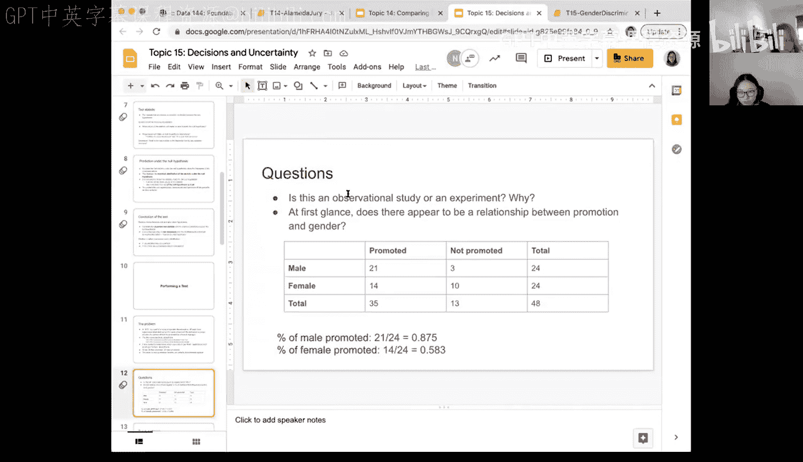
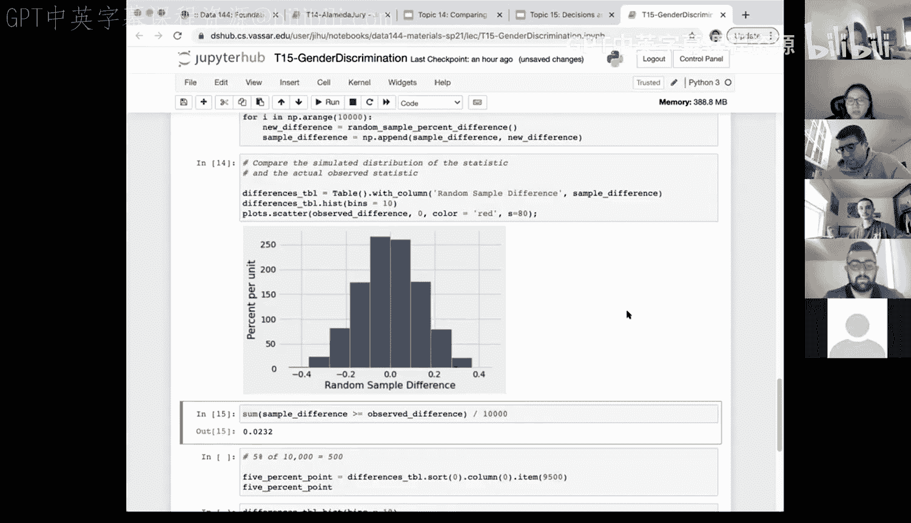
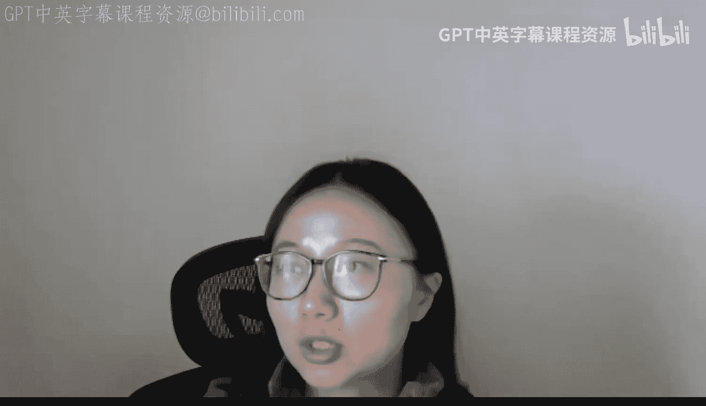

# UCB《数据挖掘和分析｜DATA 144 Data Mining and Analytics 2021》中英字幕 p51 [P51]lecture51-[T15 Decisions and Uncertainty] Performing a test-NgTobXt17LI.zh_ [BV1efBEBuEVg_p51]

A new one over here Okay all right so immediately after that slide we're starting this performing a test Okay so this is like I said a illustration of how a test is being done a test hypothesis is being done but then we're introducing a new setup over here so let's walk walk through the setup first and then we're going go to the demo to see how we can do it Okay so this。

Is I guess a problem actually as early as 1972 okay people were study gender discrimination okay in particular that study had 48 mail bank supervisors okay they were each given the same personnel file and asked to judge whether the person should be promoted or not okay so keep in mind here is the same personnel file okay all of the supervisors or mail。

At least in this study okay so keep in mind here that the files were identical except that half the supervisors had files showing the person was male and the other half had files showing that the person was female okay so 48 right in total so this is saying that 24 of them were male I guess applicants or male I guess in this case people to be promoted right and then the other 24 are female okay。

Then it was randomly determined which one which supervisor got the male applicants and which one got the female applicants okay the study showed okay。

 out of the 48 files reviewed 35 were promoted okay the study is designed to test whether females unfairly discriminated against okay I'm going to show you the breakdown like out of the 35 promoted how many were male and how many were female and that's what we're going to go about doing the test over here。

 but before we move on I guess quickly is this the observational study or experiment。

And can you give reasons why you choose which one you're gonna do okay and the second part I'm going to show it now the table over here at the first glance。

 this is the table okay off the breakdown so we have like as you can tell like 24 male applicants right 24 female applicants so total is 48 that's good the promoted okay 35 in total so not promoted is 13 the particular breakdown of the gender is that 21 male got promoted 14 male 14 female were not promoted and then sorry let me take it back 21 out of the 35 or male those are the promoted people and then 14 out of that 35 was female and the amount of not promoted is 3 and 10 okay so this are my questions for you all so I know this again relies on maybe viewing the table before after I put into breakout room but regardless two parts of the questions here okay is this observational study or experiment and why。

And second is based on the table that we're showing over here。

 do you think there is a relationship between promotion and gender and why you come up with that decision Okay。

 so let me pause。

Okay， alreadyright so the questions okay two parts。

 anybody has any thoughts about whether this is an observational study or experiment and why。

Feel free to speak up Okay， Sha， please go ahead thanks for waiting so we thought that。

TheI that it's an observational study because aren' there isn't a specific treatment that is being given to each group and we thought that there is a relationship I mean we can't say it's causation because it's not an experiment but we can say that there is a relationship between promotion and gender and the relationship I guess you're saying over here like say the two percentages for example。

 the two that I computed are quite different from each other is that right Yeah all right thanks everybody's agree。

About observational study and experiment over here。Ma I see Juliana says thumbs up， okay？Everybody。

Any adults。Okay interesting so let me actually reread the question I thought this is experiment but let's take one more look over here okay let's see so yes for observational study versus experiment we always talk about well we need to do randomization if you remember right we need to control all of the other factors as much as we can right and thens like Sha was pointing out earlier we need to have this what we call like a treatment group and the control group okay and then of course in the usual sense that we're talking about iss always like say you give a treatment to the treatment group and then the control group don't receive anything okay so let's look at this a little bit more closely over here okay I guess it does show maybe I was going too fast or it was not highlighted but it was I guess it' randomly determined okay which supervisor got the male applicants and which ones got the female applicants。

There is randomization that's what I mean like say we don't know like each supervisor doesn't know what kind of like I should say this each each supervisor randomly got selected a particular file okay there's no like say I guess for for particular like whether this supervisor has any particular I don't know like judgment or anything about things。

 so I guess that part is probably fine okay but let's look at whether other things are being controlled。

And。Let's see yeah thanks Jeff for the comment follow up over there so yeah so there' is randomization I guess of determining who gets to see what okay and also I guess here the files were identical except for the gender。

Okay， so when we say this， I guess it's pretty much you can imagine that the files theyre exactly the same except for the name Okay。

 or maybe not even the name I don't even know about the name is really just about the gender Okay so I think given both I agree this is probably not like a conventional treatment group and control group that we're used to see Okay because it's not clear about like a treatment or control what is the treatment what is not the treatment right but what's special here。

 I guess is that the two groups of files are indeed selected randomly Okay， as well as。

There are no any other like all of the information or I guess other factors are being controlled over here okay except for the gender everything is being controlled here and the problem as we know is trying to study gender discrimination right so so clearly like if this indeed turns out if we all agree but we can keep debating i'm fine with that as well if we think this is experiment then then whatever relationship that we're able to determine。

Will tell us certain things about the causality okay if it's not then then we know that it's just going to be a strong association okay so I will keep that for like keep it for that now in this style like I still think is more like a experiment just based on what they are trying to solve as was how the study was designed okay but just in the interest of time I will just move forward for now but we will keep that was open and you can like we can all chat on slacklack or after class today I guess for here I will still tend to think it more of a experiment because of the things that I talked about and then if we take that for now we move forward at the first glance over here the breakdown just like Sha was pointing out does tell us there's almost like a 30% difference right 30% difference in the percentages of male and female being promoted so for us the question becomes is that 30% due to chance meaning that well。

There's no gender discrimination going on， this just happens that we' got a really unlucky sample that the distance like the difference is so huge or I guess the alternative hypothesis right will be that there is gender discrimination going on。

 this is not due to chance， there is something going on that we have to test for。Okay。

 so let's let's keep that keep going just for the interest of time。

 but we can always come back about the observational study versus government and we can chat later as well。

 so here the two hypothesistheses I just want to highlight。

I just talked about it verbally just now but the no hypothesis okay will be that if we were to randomly select who get promoted then we have a difference in proportions as large as like 30% okay so meaning that well there's no general discrimination we would have a difference like that anyway or the alternative hypothesis is that no the observed difference about 30% is too large is not due to random chance right random chance or randomness is not the only reason for the large difference it could just be that there is real gender discrimination going on okay so let's let's work with this too okay and we know that well this is only the first step right we accomplish the first step of doing hypothesis testing we finally set up the two hypothesis okay and then we still have three steps to go so we gonna walk through that hopefully yeah before today's lecture ends I think we should be able to do it but I would just highlight here that notice how we set the no and then the alternative okay we always。

null that we're able to generate okay that we're able to generate data under form so the nu hypothesis。

 if I frame it in a different way that there's no gender discrimination， okay。

 then if I come back to this data。Or maybe even the problem itself， right？

If if there's no gender discrimination going on at all。

 then if 3 like out of the 48 being reviewed and 35 were promoted。

 it's just gonna be randomly 35 people right like they shouldn't be any gender like being considered at all if we think like I'm just asking I guess how we going to actually go about simulating under the null okay and we can let's pause for one one minute just to think about it for you all like how am I supposed to。

When I get the data I know it's gonna be 48 files in total right and I know the gender for each okay and of course in the observed data。

 I know how which ones are being promoted okay， but then now if we are asked to simulate onto the nu where the no is saying that there's no gender discrimination going on think about how you actually going to generate data under it okay we have 48 in total。

Okay， we're going to have a label of whether somebody is promoted or not， okay。

 and then we also have a label of their gender。So if you were to do it。

What you think you're going to do？This is a rhetoric question Don't worry about answering now。

 but we're gonna go to the demo in a second， but I just want to pose this question early on because I think that's actually the hardest part for this problem itself okay like the simulation that we did before is maybe like say if you remember like that 26% black residents in that county and then we're trying to generate it generate the numbers so we're using the generating from a categorical distribution right we have the breakdown so we're able to generate it here it's slightly more I think we're challenging and complicated right because we now have to simulate under the null that there is no gender discrimination going on and then the data that we have actually let me just come back to the demo right now here okay let me show you the data and then I guess restate my question one more time okay so the data is coming from this gender promotion。

CV file， okay and it has two columns， Okay， the gender， So F or M okay and then promote it Okay。

 whether yes or no， Okay， so the first few lines， as you can see。

 is all of the female being promoted， but then of course theyre 4018 in total and let's just double check that the data is is is telling the same thing as what we are seeing in the table and this is also a review okay so remember this is a table data table right。

 we're working with two categorical variables right so if you want to do any kind of summaries all right。

 just bring you back to the group method and the Pbu method really quick Okay so the group method and there's also the group method if you remember。

 but let's talk about the group okay the group mostly is only being used for one categorical variable at a time right we're trying to do summary about it say for example。

 if I want to know right the breakdown of the promoted okay what I can do is the data table do group method and then app parenthesis I put in quote of the name。

The the label of that column， so here you can see that I have a breakdown right 13 and 35 okay。

 so this is matching what I was showing you in the table， okay。

And of course we can look at the gender and we know that it's half and half right so if I run this line it's going to be 24。

 24 Okay so this is again， the group method being used on the data table and in particular for a categorical variable so you can do summary about them。

Okay， the pivotV method okay， so just to refresh your memory one more time。

 what if I want to look at cross tabulations of two variables Okay。

 so that's what the pivotV is doing Okay， and then we have the promoted column and the gender column Okay。

 so look at what I'm doing over here I use the pivotV method。

And I assigned it into a pe table and then in particular I want to know the percentages instead of just count right so that's why I'm doing like dividing each of the row by 24。

 so let me run this and show you what I did so if I don't do the Pi table sorry if I don't do the second line like doing one extra column I will only get this two by two table that's what Pi does it gives us the breakdown of each of the intersections to variables Okay like 1014 and 321 which is coming from the table in the lecture but then in particular remember in the lecture here I show you this probabilities right like the percentages so in Python what you can do is you see I'm trying to add a new column percent and then I'm getting the Pi table itself the column the yes column divided by 24 because each row the total is is 24 people for the two different。

So I'm able to get the two percentages Okay，50 a。3 and then a 7。

5 and that's exactly what we're showing。 So again， all of this are review really。

 and that if I want to know the observed difference of the two percentages。

 I can use the second one minus the first one Okay， the male minus the female。

 which goes back to the close to 30% observed difference that we're talking about before we came to demo。

Okay so hopefully this sounds all familiar， but if not this is a great review for us for how you're gonna do about summary statistic okay maybe marginally like looking at one variable at a time or like byvari like two variable at the same time so for categorical variables we use group and then pivot okay and then in particular we're using a pivot here just to show exactly what we want because we want the observed difference of the percentages okay so that's why we get the pivot and then get the percentage using the width column method okay。

All right， now the most interesting part， at least in my mind。

 is how am I supposed to simulate the data under the null， okay。

 so let me come back to the data really quick。This is the data table， okay。

 we have a column of gender， okay， we have a column promoted。Okay。

 so maybe let me just like put you in breakout rooms for two minutes and then come back like how do you think what are you going to do？

If I'm trying to simulate。A sample under the null hypothesis where the null hypothesis is saying that there is no gender extermination going on。

I'm showing you the data table， one column is gender， the other one is promoted。

How are you going to simulate a new sample under the null hypothesis Okay so this again， like I said。

 is probably the most challenging part， but I still think it's good to give you the chance to talk about it before I show you in the demo of what to do but as you will see once you know once you see it once I'm pretty sure like you know for this type of challenge in the future you're gonna do something similar resume recording okay so again in the interest of time I probably will just go ahead of doing the demo but just to remind you we're curious about how we can do a sampling right under the null meaning that we want to generate a new data set that promote it I guess the promoted column is randomly selected for each record okay so that's what logistics right like each record we know about the gender gender label but then we know that under the null hypothesis is saying that。

There is no gender discrimination right so the promoted whether somebodys promoted or not should not be related to gender That's what really that that no hypothesis is so put into our practice of doing like a Python programming over here。

 pretty much one way we can do it which is the one I'm going to do the demo for is that well。

 if the promoted column should not be related at all right about the gender then that is pretty much the same saying that I know I have 35 out of 48 of promoted right so I have 35 yeses and then 3 nos in this column Okay so what we can do is that well I can do a sampling without replacement right of the entire column of promoted。

And that later you will see that we call it like shuffling， okay， we're shuffling。

The labels of yeses and no of the promoted， and then we just put a new ordering coming up。

So and then under the assumption that no is true， meaning that there is no really relationship。

 so each time I generate a new promoted label， I'm just like randomly shuffling the labels of yeses and nos in the promoted column。

So again you were seeing action how we can do it and once you see it is not going to be something too challenging anymore I'm sure。

 but I think it's very important to talk through why we do that okay the reason why is that we know the no hypothesispo tells us there is no gender discrimination so for us to like implement that in practice what that mean is that well regardless of the gender column right if I'm only looking at the promoted column I would just have the 35 yeses and 13 nos randomly shuffled around okay shuffled around meaning that I don't like I shouldn't care about the gender for any record anyway like it could be any kind of arrangement of the promoted column let's put that way okay and to do that in Python。

We're going use the sample method okay actually we have seen this method before okay so in particular were going to highlight here we're going to do sample without replacement oh sorry let me put it back with replacement okay meaning that we're able to remember like we have 13 yeses right sorry 35 yeses and 13 notess over here so we're going do a sample like that with with replacement and then we're going to get the promoted column so let me let me do this shuffled。

What we call the shuffled labels Okay， so this whole line what this does is that we're doing a sample with replacement based on the 35 versus 13 breakdown okay and then we're able to get it。

Also the promoted column， so if you look at over here， if you do the count。

 you're going to get 35 yes and 13 notess， but what this is doing is we are adding the sampling right the sample method over here。

 meaning that we're performing a new arrangement。Okay of this promoted column Okay right now it's still in array。

 but then of course， as we know now we're going to put it back right using the width column method so we can create a new table what we call the shuffle table Okay。

 so the shuffle table going to have the same exactly same column of the gender as before Okay we don't touch it but then we add a new column based on the shuffled labels。

Okay， so let me walk you through one more time The table the gender is the promotion table was the original data right we have the column of gender。

 we have the promoted column okay what we're doing now with a shuffled table okay is that we're going to keep the gender column unchanged but we're randomly shuffling the labels of the promoted column we're still going to have 35 yeses and then 10 notes but now we're shuffling it right meaning that well I don't care about the gender at all I just want to look at a new like a new arrangement which is randomly generated right and then from there now you can imagine right now we can do the pivot vote again right we can do the summary and then let's look at after one simulation。

You can see that the percentage of female in this simulation is 67 isch% right。

 and then the percentage of male is like 80% if I look at the difference。Is what is like 12。5%。Okay。

 so this process。Is that we're using the sample method okay in particular we're shuffling the labels right the Ashlo I guess the each of the observations for the promoted column okay and then we're shuffling it so we can have a new arrangement that is independent of the label of gender okay and then once we get a new shuffled table。

Data table right we do the same thing as what we did with the observed table right we get the PV of promoting en gender and then we take the percentage difference and then we can see that in this case we get 12。

5%。And of course the next step right so this is like like determine the statistic right and then simulate the statistic okay with one sample now I put everything in a function in the interest of time I won't walk through like each line of the function but each line as you can see is like just coming where it's like condensing all of the little steps that we have done so far but we call this whole thing as random sample percent difference okay meaning that well I'm gonna create my shuffle labels and then I will get my shuffel table and then from there I'm going to do the pivot and then I could do the summary so I can take the like the distance or like the difference between the two percentages after one simulation okay so I'm going to run that and then this gonna take some time to run so let me just set it to run I run this function and now I'm going to run the function for 10000 times。

Okay so again， what I'm doing is that I'm simulating the statistic。

 which is the percentage difference of male and female get promoted。

I'm simulating the statistic under the null hypothesis for 10，000 times。Okay。

 so this if I come back to what we were talking about the different procedures here。

 where if I come back here is prediction under the null right I did the prediction and like what we're saying over here we're going to get a histogram right and we will let me show you earlier like over here here okay so this is a histogram。

Okay this is the histogram of the randomina sample difference if I'm sampling the difference。

 which is the statistic right under the null hypothesis for 10，000 times。Okay， make sense。

Makes sense yeah so this is the histogram that we're talking about and let me just see yeah it's really hard to read sorry about let me actually at the size maybe to 80 let me run in one more time it's still hard to see but anyway what i'm trying to show is that this little red dot sorry about it maybe I should oh let me put。

Anyway， this red dot over here， that's the observed difference of 30%。

Okay and what I'm showing you here is we know that the histogram is telling us right the empirical distribution of the statistic onto the null right and I did it for 10000 times and then we are saying that in order to make the decision right you're going to compare the observed test statistic which is about 30% right and then we're going to compare it against the histogram to show how whether they're consistent or not。

Okay， one quick way， well visually this is actually a hard call。

 I would say that well whether this is extreme or not， like if it's not in the histogram at all。

 then we know that it's so extreme that it's probably going to be inconsistent if it's more closer to the center we're probably gonna say it's consistent right but it's somewhere in the tell that it's hard to tell which were gonna carry on Thursday。

 but let me just show you really quick which is actually the definition of P value which we're going come back on Thursday as well is that the P value is computing in our setting is that how many of the sample differences that I'm able to compute right 10000 out of the 10。

0001s， how many are as extreme as the one that I have observed。

Okay and then I want to know the percentage so you see what I my coding here the sample difference is greater or equal to the observed difference and then I'm taking the sum books so this or binary right bulling right and then I take the sum divided by the number of assims are done so this gives you probability which is actually a P value okay so P value as you will now sorry I didn't manage to cover that but on Thursday when we come back and I hope we'll be able to address the previous questions a little bit more as well is that how are we going to make the decision as well as well what does really mean to have like P hacking and then why people are like I guess in the first place why people care so much about P value in the first place and then how they're making the decisions so I'm just gonna to end here but the demo is available for YouTube view so feel free to check it out like I said especially the shuffling step is probably new to most of us okay especially like why we're doing it how。

We are going to deal in in Python so I would highly recommend you to revisit this after the class before Thursday because on Thursday I guess we're just going pick it up from where we left and just going to continue talking about the other terminologists in the course okay but in the meantime take a look at what we had in the demo so to run it by yourself I think it's always a good learning and then good reinforcing of why we're doing this and how things are done。

All right， y'all take care I can I will stay over if anybody has any more questions。

 but if not I will see you later this week thank you Ma bye thank you all。😊。

