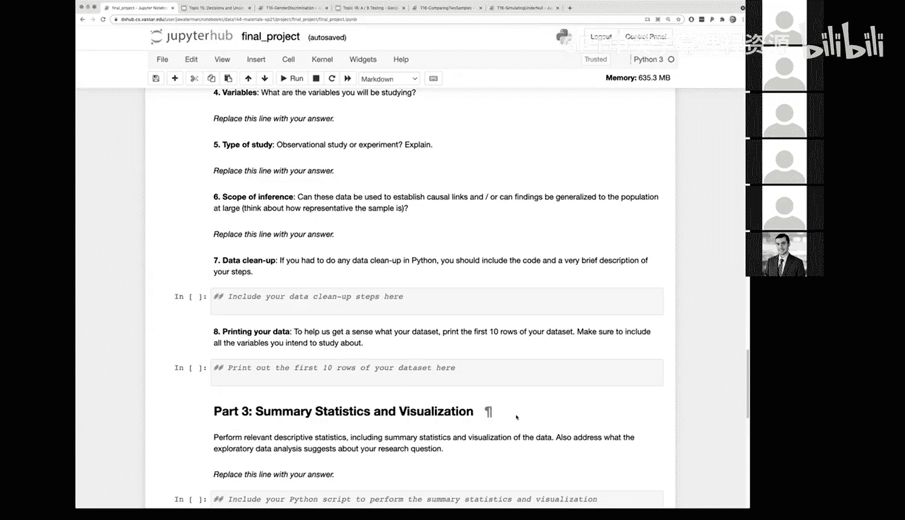

# UCB《数据挖掘和分析｜DATA 144 Data Mining and Analytics 2021》中英字幕 p52 [P52]lecture52-Final Project Announcement-NiWAn1h452A.zh_en [BV1efBEBuEVg_p52]

All right， all right， let's get started so before I dive in and talk about today's lecture。

 I want to announce that I think I sent I sent this out on。😊。

The Slack announced channel that we have the template for our final project that's going to be released so we're not going to do a final in this class like a kind of written exam we're going to do a final project。

And so。Basically this notebook here is where you'll do your final project and so if you notice the the notebook is is kind of。

It will allow you to kind of will guide you through the final project。And。

We want this to be kind of as open ended as possible。And so nominally。

 this course came about because of。This HHMI grant that we got this grand challenges for diversity inclusion and pedagogy centered around this theme of climate change and so this course is a cluster of about 10 courses throughout the college with the topic of climate change and so。

We've kind of curated some data sources for you that we've put on Moodle。But we also understand that。

 you know， the world has changed a lot since we kind of put this proposal together and we are living in the midst of a you know。

 COVID 19 pandemic。And you know I think I want to kind of nod to the fact that some of you may want to。

 I mean coVD to 19 has impacted all of us in many different ways。

 some of us you know greatly more than than than others and so。You know it。You know， so。

I want to I don't know if encourage is the right word。

 but if you're inclined to do a project about COVID 19 in kind of lieu of a climate change project。

 we're supportive of that。It's it's really kind of up to you whether you want to do that I kind of curated a couple of data sources that have been kind of tracking the pandemic since the beginning beginning and so if you'd rather do some impact you know some。

Some project related to coD 19 we're supportive of that from there but don't feel obligated to do that many of you may be covid 19 burnt out and the last thing you want to do is kind of dive down and study that and that is perfectly okay as well you know let's stay the course and kind of do the project on climate change but I want to be supportive of that if that's something that you're kind of personally inclined to do。

😊，And so the good news is is that the template will kind of guide you through regardless of what data that you pick。

 will guide you through kind of approaching this as a data scientist would about looking at the data。

 visualizing the data， cleaning up the data and asking some pointed questions about the data and doing a little bit of analysis。

And so we want to kind of throw this template out just to kind of know what you know what what we're kind of expecting and so kind of the end product so the kind of the immediate thing and the reason why I'm mentioning this now today is kind of your first task is is to form your team so there's 21 of us in the class and so we're going to do groups of three and so we'll have like seven we'll have seven groups。

And so。You know so what we want to do is sooner rather than later establish what those teams are。

 what those groups are and' happy we're happy for you guys to pick the groups yourself we can also facilitate you know doing some matchmaking as well。

 or if you just want to leave it up to random fate we will everyone that you know doesn't have a group by Sunday we'll randomly assign you to your group so。

Either way， kind of by the end of Sunday we'll have those groups and so once we have those those groups together those teams what I'll do is is I'll create a new Jupiter hub。

Log in for that team and so you know really we're trying to solve the issue here of how do you share data。

Across the different accounts and how do you kind of edit the notebook and so I think a reasonable solution is is that we'll have a team account so they'll have a password you know all the members of the group will have that password and that that will be kind of the joint place where you can work on your notebook together and and you can have multiple you can have multiple people logged in at the same time for your groups and so that's a good way that any data that your group is using it's there and it's going to be easy to share as opposed if you're working in your individual accounts。

How do you update Jupyter notebooks， how do you update data， all of that。

So that's what that's what we'll do， but we need your we need your team you know we need your team。

 the members of your team so I can set up those and then just as kind of like a workflow if multiple people are editing the same Jupyter notebook at the same time。

 you could run into conflicts， it actually handles it you know relatively well but the thing that I would recommend doing is once you've had your groups make a copy of the notebook and so you can have kind of one the one copy the final project you know notebook that's kind of the official version and I would what I would recommend doing is is that。

え。When you're doing work on a particular aspect of it。

 you know create a copy of the notebook and then you can work individually so you know create a copy of your notebook one of。

Copy of the notebook like with your name with your login like associated with it and then you can work individually on your own project。

 you can kind of use that as kind of like the scratch space and then。😊，When。

You kind of get everything working then you can kind of copy over those cells into the official notebook from there and that way that will kind of avoid conflicts and you can kind of coordinate you know someone who's doing kind of the final edits for that so that's kind of the workflow that that I would recommend for that。

And so we've kind of outlined the parts that you want and we've kind of put pretty pretty clearly how much those points are worth and then。

Instead of， so once you've turned in kind of your notebook。

 we're going to ask that you do a short five to seven minute video presentation of your project。

And you can do that， you can record that you know using zoom we did that last time we offered the course and I think it worked out pretty well and it's a good way to kind of present your work and thinking about visualizing the data and practice giving yourself practice giving a talk and condensing it down into five or seven minutes from there。

Any questions， any questions about this？And we'll have time to talk about this in lab as a matter of fact。

 if you're unsure about who you want to working on the group。

 use lab time either in person or remote。You can use that time you know to meet some of your fellow classmates and talk to your fellow classmates and let us know what groups you'll be working working in there so that's the big one that's a big one you know find your group and then you know professorfe who and I are happy to talk about project ideas you know different ways of kind of approaching the data especially if you're going to kind of do a COVID-19 project where we're more than happy to discuss kind of the nuts and bolts of the project but basically the goal here is is that you're just going to take this notebook and you answer all of the questions and have the nice thing about Jupiter notebook is it really is self- documentcumenting right you can the way I like to think of Jupyter notebook as it's an electronic。

You know， experimental library notebook， you know， hence hence the name Jupiter notebook right that you know when you run experiments。

 you can put your notes on the experiments right in right in the code itself。

 so it's it's basically self documenting code from there。

And so anyway so I wanted to let you kind of know kind of what's coming up there and so then after you' form your teams the first checkpoint here is a couple weeks from now so Sundayday five12 five May 2 and really what we're asking you to do at this point is just just really kind of think about the data sources that you're going to use and visualize them and so and think about what question you're going to want to ask so we're not really asking for。

😊，For any types of in-depth analysis or inference at this point。

 we're really just asking that you've kind of picked the data source and have a good idea of the questions you're going to be wanting to ask about the data and like I said we'll guide you through this you know and we'll definitely set aside some lab period you know sometimes in lab period to talk about this you know either remotely or in person from there。

😊，Okay。😊，Yeah， so I think that's all I want to say about the project for now。

Any questions before I kind of move on to our topics for today？

All right， excellent。