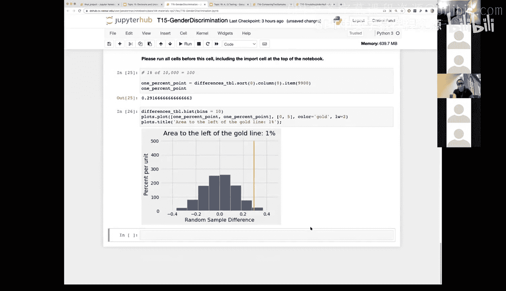

# UCB《数据挖掘和分析｜DATA 144 Data Mining and Analytics 2021》中英字幕 p53 [P53]lecture53-[T15 Decisions and Uncertainty] Statistical Significance-euAEofRO [BV1efBEBuEVg_p53]

All right， I want to pick up where we left off last time and。I want to talk about this idea of。

 so now that we kind of have this way of running these experiments and generating these histograms and comparing these simulations to our observed value。

 now we want to answer the question， does our observation you know have statistical significance？😊。

And so I want to put a kind of precise definition about what what what does that mean and so when we started looking at the distributions。

😊，Of our simulations， we see that a lot of these distributions depending on the statistic we have。

 you know they all kind of have this this tail right so you can see in kind of this idea of this random count we actually kind of have two tails on either side of the distribution and then metrics typically kind of dealing with distance because we're taking you know the absolute value to calculate the distance we usually see kind of these one sided tail distributions like if we're looking at the diagram in the upper。

😊，Right hand corner right if you remember this was the mentaldel experiment for the keys right and we calculated the distance from 75 because our model was 75% of the flowers we're going to be purple and so you can see the tail goes off into the right and then when we looked at the jury pool selections again we're using another a distance metric。

 this idea of total variation distance is TV and then you know as we have the tail kind of going off into the right。

😊，And so we can use this to talk about whether our hypothesis is consistent。

 the observed data is consistent or inconsistent that our observation is consistent or inconsistent with our experiments here。

😊，To be kind of precise about the technology terminology inconsistent means that the test statistic in the tail of the empirical distribution right so that is our simulation that's the simulation that we ran。

😊，🤧Under the null hypothesis right so the thing that we have observed the test statistic that we observed is in the tail it is kind of an outlier from there and when that happens we say that the test statistics is inconsistent under the null hypothesis and so what does that mean to be in the tail。

Well there's a couple of kind of conventions that are that are in use and one of them is is that we look at the tail and we kind of put a marker where the area of the tail is less than 5% so if remember our histogram is going to sum up a total area of one so if we look at the part of the tail that is less than 5% that's our first convention so that cutoff that cutoff is is 5%。

And if we say if it falls within that 95， that observation falls within that 95%。

 we say that the the result is statistically significant the second convention kind of the same idea about looking at the tail。

 but we just have a sharper cut a more strict cutoff we have that cutoff at 1%。

And then we would say if that is the case， we would say that the result is highly statistically significant。

 which means it is 99%， you know， not due to chance。🤧From from there， okay。

 and so we can look at this。You can look at a couple of examples and so if you remember from the simulation that we ran from last lecture on workplace gender discrimination。

 and so this is the result that we got this was the distribution that we got and if you look at the kind of the two lines。

 we can draw one at 5% which comes around a 。2 difference and we can also look at the 1% and you can see in the 1%。

 the tail the area underneath here。On the other side of that is going to be whoops is going to be smaller a further 1% okay and so we can use this now to become to have a formal definition of our P value。

😊，And so formally， what we kind of colloquially call the P value is its formal name is observed significance level。

And so what does that mean kind of precisely putting it the P value is the chance using the null hypothesis。

That the test statistic， the thing we observed is equal to the value that was observed in the data or is even further in the direction of the alternative and so in the gender discrimination。

 the alternative is off to the right。From there， okay， and so。

This P value of this line is basically the percentage。

 the percentage of that is going to be due to chance for there。So。

Now going back to that demo that we looked at last time。

 how would we calculate the P value in this gender discrimination example and so let me let's refresh our memory what that demo looked like。

And so。If we look down here， this was this is the result of。ning we're running our experiment。

 running our simulation and if you can see， so here's the histogram distribution that we got through through our sampling and then down here it's a little hard to see but where my cursor is。

 you can see that was our observed statistic that was our observed statistic。😊。

🤧And so how let's take a moment before we kind of look at the demo。

 how would we determine whether it falls under this 5% this P value there。

 so let's take a moment let's take a moment to think about that I'm going to send you off into the breakout rooms recording。

Okay， so let's talk about how we actually can calculate the P values here and so going back having a look at our demo。

 we can see so when we when we did our simulation we simulated we ran it。

 we computed the statistic 10，000 times 10，000 times and we used kind of this accumulator pattern and we stored the results of our simulation each each time we ran it。

 we stored it in this sample difference array and so the sample difference array。

 this is what we used to make this histogram here of all of our to get our empirical distribution。

From there and so we know that we have this value which we've shown on here and so now the question is how do we calculate that P value。

 how do we actually get that percentage and the easiest way to do that is。😊。

What we can do is so we have our difference so I'm looking down if we're looking at this this cell down here from here。

 so here's our array， so here's our array of all of the empirical observation that we've done。

So those are all the values that we got by running the simulation and so what we want to do is is we can compare all of those simulations to our observed different right so this is the statistic that we computed。

😊，From from the actual real life experiment that they did and so what we're going to do here is we're going to do so a sample difference is an array and this is a constant this is some value and we can we can use the greater than or equal to test so what that's going to do is is that this is going to return an array。

😊，This is going to return an array， one for every element or array for each of the individual tests。

 So it's going to do this test。 it's going to do this test for every item in this array and it's going to return a new array that just that has true or false So it's going to be an array of true or false whether you were greater than or less than this observed statistic okay and we know if we look at a sample difference that's greater than the observed statistic that's going to be over to the right Okay and so then what we can do is we can take the sum of that array of true and false And the way that works in Python it will count anything that was true as a one and every anything that's false as a zero。

 So that sum is going to tell us the number of this simulation， the number of element in that。😊。

In that array that were greater than or equal to the observed value。 It's going to give us the count。

 It's going to give us the count of all of everything on the on the right side of。😊。

The histogram there from the are observed okay but what we don't we don't want to count we want the percentage so we need to divide that by the total number of simulations that that we ran and in this case that was 10000 and if we run this we run this we get we get the value 0。

02 and so turning that into a percentage that's about basically 2。7%。

From there okay and so that's that's our P value that's our P value one little kind of programming note So this kind of this value of 1000 like where did we get that Well。

 that was because we knew we ran 10000 simulations How did we know that we ran 10000 simulations Well here's the we can go up to the cell where we ran the experiment this is like a hard coded number and kind of computer science we call those kind of magic values that they're just kind of hard coded in there and you don't necessarily need to do that that is I mean this is the right thing to do but one of the things that we can do is remember sample difference is is the array that we're pulling from and so instead of hardcoding 10000 in here one of the things that we can do is we can just do the length of sample。

😊，Difference。And this will compute the correct statistic again if I run this cell again。

 I'll get the exact same answer 2。67 this will compute the correct answer no matter what the no matter how many simulations that we ran so if we went back so the problem with kind of hard codingd this number here is that if you go back and say oh know what would happen if I ran this thing 20000 times and you forget that you hard coded this value of 10000 in here you'll you have to remember to change it in both places okay so that's just kind of you know kind of a good programming tip through there but as you said as I said。

 we kind of get the exact same answer okay so so that's the that's the P value that is the percentage that we got so how would we calculate the number of observations。

Excuse me for 5% well again， we have our array of observations and so you know taking note that that 5% of 10。

000 is 500 well to kind of find the actual cutoff point。

 the actual cutoff point at 5% we can just basically say we can look at the value at that item the 95th。

😊，🤧90 then the 9500 item in that list provided that we sorted the table right so here we are and again right the way we've defined our statistic the tail the tail is going outwards into the right and so larger numbers you know numbers larger than than our observation are going on the outside of that and so it's important that we take our table of differences is that that we sort it first so then we're going to put them in in in order and then we're taking。

The column from there， and then if we take the 95th。the 9500th item from there。

 that is the actual value， that is the actual value of the 5%。😊，Um。From there。Okay。

So if we take a look。嗯。Now that we have that value， that 0。2 value， now that we have a 0。2 value。

 we can display that on the histogram from there。And see where where we fall right so if you look at our kind of our observed value up here。

You can see that it kind of falls outside of that5%。

And so we would say that in this for this experiment， that the result was statistically significant。

 right that。😊，う。From there， but remember we talked about kind of these two different points that we took we talked about we talked about this 5% point and then we talked about this 1% point and so if we wanted to see where we fall within the 1% point we can redo the experiment that we the calculation that we did up above but 1% of 10000 is 100 so we can look at the value of that point and that that comes down to the difference of 0。

29 and so if we look at that in the same plot down here you can see that。While it's greater than 5%。

 it is less than our observed value is less than 1%。

🤧From there so this is going we kind of pick this this set of data in this experiment because it falls right in between that 1% and that 5% and so we would say that the result is statistically significant。

 but as we put it here in our terminology，It is not highly statistically significant from there。Okay。

 any questions about that？

