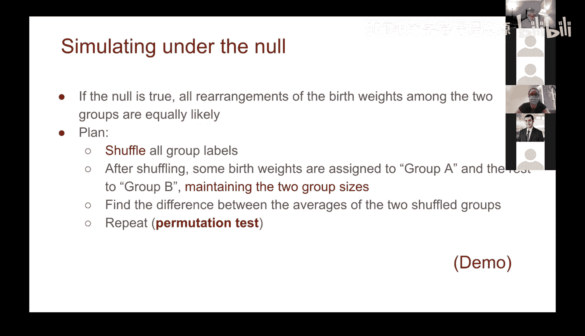

# UCB《数据挖掘和分析｜DATA 144 Data Mining and Analytics 2021》中英字幕 p54 [P54]lecture54-[T16 A_B Testing]-47cadVxrSpE.zh_en [BV1efBEBuEVg_p54]

All right， so what I'd like to talk about next is this idea of what's called AB testing and it's a way for us to compare two different samples。

😊，And so the idea here is and companies do this all the time Google is always doing aB testing and it's a way really of comparing two samples to one another and so if we have。

😊，Excuse me， if we have a bunch of sampled individuals from group A and we have a bunch of individuals in group B。

 the question we want to ask ourselves， so we've got a bunch of data from from group A。

 a bunch of data， a bunch of samples from group B， and we want to ask ourselves do those values to the values from group A and the values of group B come from the same underlying distribution？

😊，Another way of saying that is is that。😊，Is any difference we see from our statistic from group A and group B due to chance or is there actually some underlying difference between the groups so that's the question we want to answer do the values that we get from those groups do they come from the same distribution do solely to chance or is there an inherent different is there some is there some model kind of going on from there and and we can do this by by a technique and it's the technique we're going to learn today and it's called AB testing okay and so let me show you kind of some of the tools that we're going to use to do this。

Okay， and so。The sample that we're going to the demo that we're going to use here is it's going to come from a table about。

About births and so they collected a lot of births and basically the question that they wanted to ask was was there any difference。

From mothers who smoked while they were pregnant and mothers who did not smoke。

From there and so these are going to be the two different samples that we're going to look at in this group so women who smoke while they were pregnant and the nonsmoking group and so they took a lot of different they kind of recorded a lot of different statistics the one will' focus on for this example we'll look at birth weight okay and so to get that so here's our table of birth the only columns that we're interested in is whether the the mother had smoked was a smoker and we just want to look at birth weight though you can do similar analysis to other types of things like length of pregnancy。

And the other statistics that they calculated from here so so what we're going to do is we're going to take that table and we're just going to select the two columns that we're interested in the smoker column and the birth weight column over here and so。

😊，We can do what we can do is is we can to just kind of get some summary statistics of our table。

 we can just use the group function and if you remember the group function is going to if we pass it in a column name and it's going to group all of the individual this is a categorical column so it's going to group all of the smokers together with the nonsmokerrs and the default is is to perform a count so this will just give us a new table that has the count okay so for this experiment 715 of the mothers we're not in smokers 459 were smokers okay。

And so let's plot a histogram of that and so let's get a distribution of that and what's nice is is that we can we can use the group option to the histogram so here's our table right so this is just our smoking and birth weight table and just has the two columns in it we compute a histogram but what we can do is that we can let we can let the histogram function do all the heavy lifting for us and this will group this will create two distributions on the histogram based on groups so it's going to collect all of the non-smokers together it's going to collect all the smokers together and then it's just going to show us the distribution the histogram of both of thoses that's kind of a nice thing to know that the histogram will do for us and so if we show this and here we're just kind of you know visualizing looking at the data and get a sense of maybe whether there's something here or not。

😊，So in this case， we if we look at the smokers in gold and look at the smokers。

 the non smokers in blue， we can see that and this is birth weight and ounces and so you can see just by kind of eyeballing the distributions it does seem。

😊，It does seem kind of at a high level that the birth weights。

 you know the distribution does look shifted over to the left here from there。

 and so perhaps maybe that we are onto something that maybe there is a difference in birth weights from there。

Okay。Any questions like how any questions kind of how I got all of that data？From there。

 it's just all the techniques that we've kind of we've we've known we've learned you know。

 up until this point。Okay， so。The groups for this a particular experiment right so when we do a B testing kind of the first thing that we want to know are what our groups we have to we have to figure out what our two groups are going to be and this case is the pool that we're picking is the random sample of newborns right because that's not right the data that we have is just a random sample of。

🤧Of mothers and newborns it's not every mother and every newborn so what we have as a sample so and。

😊，So we have this random sample and so we're going to compare the birth weights of babies。

Of mothers who smoked versus the weights of babies who didn't smoke okay and so so those are the groups the the non smokers。

 the non smoking moms and the smoking moms then the question is。

Because we saw we saw looking at the distributions you know is any different in birth weights is that due to just chance alone right is that due to chance alone or is there some an underlying difference between the two groups so that's a question that we're going to ask were the results that we see do what is the probability that is just due to chance and so how are we going to do that so we're going to come up with our null hypothesis okay and the null hypothesis kind of getting around this idea of that this was done solely due to chance the null hypothesis the distributions of birth weights are going to be the same right so the null hypothesis is that。

Whether you smoked or not makes no difference on the birth weight， okay。

 so any difference that we saw in those histograms are just due to sampling dis sampling chance。

 so that's our null hypothesis。That there's no difference in birth weights the alternative hypothesis is is that。

😊，The babies of mothers who smoked weighed less on average than the babies of non smokers， okay？

So that's our null and that's our alternative so then now we're going to want to come up with a test the test statistic okay in this case。

 we have our two groups smokers and mom smokers and and really what we want to look at the statistic。

😊，And which goes you know to our alternative hypothesis。

 the sta we want is the difference between the average weights between the two groups。

 so we'll take the two groups， we'll take their average weights and we'll compute the difference from them to see if there's any difference between those two groups。

😊，And we'll do it this way。We'll take the group B average and if you remember group B is the nonsmokers which we think are going to have heavier babies and subtract that from the group A average okay and so then the question you know of the statistic large values of the statistic favor the alternative right so the larger the value of the statistic that's rejecting the null hypothesis from there okay so we're going to see kind of yeah so。

😊，From there， any questions about that？So kind of to do this AB testing。

 we need to figure out what the groups are。😊，And we need to figure out what is the statistic that we're going to measure once we have that。

 then we can and then we can we can， you know， once we have all that squared away。

 then we can actually go and do the simulation。嗯。All right， so now what is our test statistic？

Our test statistic here is going to be。This difference in birth weights so let's think about how we're going to do this and let's think about a good way of doing this program programmatically so first let's just kind of take take take the statistic by hand。

😊，And so what we're going to do here is we're going to get a means table， okay。

 and what's going to be in that means table is just。😊。

The average between the groups and we're going to take advantage again of the group。

Of the group method on tables and so if you remember how the group method works we give it a table and then we give it a column name we give it a label and if you remember our table。

😊，Um。Up here。Um。We're going to take the we're going to group by maternal smokers right so it's going to group all of the smokers that have the value true with all the values with all the members of the group where it's false。

And so this is our smoking and birth weight table， so this is the one up here。

Down here where we're just taking the smoker and birth weight columns。

And so it's going to group them into individual arrays and then it's going to calculate whatever function we pass in is this argument and so it's going to take the average of each of those groups for us。

 it's going to take the average of those and then it's going to make it as a table from there okay and so you can see just by looking at the table there is a difference of between the averages。

😊，From there right and if if you were a smoker your your birth weight average was smaller then if you were a nonmoker from there okay so let's just kind of finish this finish this and actually get our observed statistic which is going to be the difference in the weights and and we can just do this by subtracting from the columns right so let's just take our we take our means table and we're going to extract our column so that's just going to give us an array of means and we're just going take the first element from there the nonsmokers so means item one is the first element in that means array and we're going to subtract it from means item one the second element in that array and that's just going to give us the difference and you can see in the difference on average between the two different groups the non-smoker babies were 9。

2 ounces heavier from there okay but that again you know that could just be due to random chancemp from there。

Okay。🤧So。So those are the steps that we use to go from our table to the actual statistic since we're going to be we're going to be running this as a simulation we're going to be computing the statistic over and over and over again and makes a lot of sense to put that into a function okay so we're going to take all of the work that we've done up here we're going to bottle it into this function here and we're going to call this means difference of means and what's nice is that the way we've written this function it's a generic function that that can work with any table from there and so you can see we're taking three arguments we're going to pass in a table so that's going to be the table we're going to want to compute this difference of means on and then we're going to take a label and that is going to be the label that we're going to compute the statistic on in this case this is going to be our birth weight label and then we're going to take the categorical label the group how to group how we're going to do the group and in this case this is going to be for our example this is going to be the maternal smoker from there and so we're just going to perform all。

Steps that we did in the individual cells we're going to take our table and notice right because it's just a generic table it's whatever table we passed in so we're using the function name table and so we're going to select we we're going to select the two columns that we care about the label and the group so that's our reduced table and that's exactly the steps we did before and then here we're just going to use our group function to compute the average to our means table just like we did before but we're just using the generic function names that get passed into the function and then and then we compute them we return the difference here okay so now that we have this function now that we have this function we can run this on any any table that we wanted to compute this difference of means on。

And and so let's just as a sanity check to check to make sure that our function is working properly。

 let's run it on our code let's run it on the table that we've computed by hand right if everything works properly we should get the same value of 9。

2 up here。😊，And in fact， when we run that。We do okay， so now we have a function from there。

And so now that we have our statistic we have that now we can put the whole thing together and so how does this AB testing work this AB testing works in the following way and this is kind of cool。

😊，And so we're going to simulate under the null hypothesis hypothesis and remember what the null hypothesis is the null hypothesis is is that there is no difference between the groups there is no difference whether you're there should be if the null hypothesis is through there is no difference whether you're a smoker or a nonsmoker with regards to baby birth weights so what we're going to do to do the simulation is so we have our data we have our data we have our birth weights for all of the individual ones either whether you're a smoker or a non smoker a smoker a nonsmor but if our hypothesis is it doesn't matter if you smoke or not well what we can do is is we can just get ready for the fancy animation we can just shuffle。

All of the names of smokers and non smokers。We can take the labels and we can shuffle all of the labels and put them back randomly。

 okay？And if there's truly no difference， if there's truly no difference between the groups。

 the smokers and non smokers groups， A and B， shuffling the labels won't make any difference。

Will't make any difference from there and so that's exactly how we perform this millll testing we're going to take all of the labels we're going to take the birth weights we're going to keep them the same but we're just going to shuffle we're going to and so what I mean by shuffle is it literally just kind of put put all the labels you know in a hat and we're going to pull them and assign them to each of the individual birth weights now。

m from there okay， so like I said if if the Nll is true， the arrangements。

 these rearrangements that we're going to do isn't going to matter so。😊。

What we're going to do is we're going to shuffle to run our experiments and this is kind of the framework this is kind of like the key slide and this is how you perform aB testing and this is the framework that you'll use kind of for any1 type things that you do aB testing so you're going to shuffle all the group labels so all of the group labels we're going to shuffle them。

😊，And then what we're going to do is once we shuffle them。😊。

We're going to assign the birth weights to group A and group B。

 but we're going to maintain the group sizes right so we're going to keep that proportion of。

Of you know group A you know had had whatever the original size was for group A and the original size of group B。

 so we're going to keep that constant but we're going to reshuffle we're going to reshuffle those labels from there and then we're going to find the difference between the averages of the two groups and then we're going to repeat we're going to run our simulations and that's known as our permutation test and then we're going to look at the distribution。

 we're going to look at the histogram the distribution of all of those empirical values and we're going to see where our observed value falls from there。

Okay， let's put all of that together。All right so all right so how do we do this shuffling how do we do this shuffling so let me show you kind of a stripped down example of how we do the shuffling before we do it on the larger data set So here I have a table and this table this table just I have the letters ABC D and E okay and so if you remember when we have a table we can we can call sample and and whats a sample do sample will。

😊，Pick random rows from your table。 But the key here is is that it will pick them with。

With replacement it's going draw it's going to basically when you draw something out it's going to put it back in so in this case notice that we got wow I mean and this is perfectly you know normal due to chance but B was a very lucky number a very lucky letter right we drew that 80% of the time from there and so that's not exactly what we want but I mean again if we run this again we can see that we'll get different distributions。

 but we can see that we're going to get the same one right if we're shuffling the labels we actually want them shuffled we don't want we want the same number of truths and falses of smokers and non-smokers to appear right we don't want to change the number of smokers and nonsmokers for that and so what we're going to do here so instead of sampling all we need to do is sample with replacement okay with replacement turned off。

So if we set with replacements at the false， that's going to guarantee that and if we sample the whole table。

 that's going to guarantee that each letter shows up exactly once every every row will get。😊。

What will appear from there and you can notice that it's unique and if we run it again time and time again。

 each number each letter shows up exactly once okay。

 so that's what we're going to do to shuffle our label labels。

And we can do it just kind of with this line here so we're going to take our letters and so what we're going to do is we're going we're gonna take our letters table and we're going add a new column to that table we're going to call that the shuffle table and that's going be it's going to be the column with the labels shuffled okay so so we're taking letters we're going to add the column shuffled and what do we add it with we're just going to add it with random this sampling without replacement okay so this this this letter sample with replacement we'll return us the new table and here we're just taking the first column from that table right so because this this is the table that it will give us the table of letters and we we're just interested in adding because we need with with column we need to add a column so we're going extract the first column from that okay so that will give us a table with our original column with our original letters and those are shuffled and in fact our random right。

Any questions about how I did that？So we're just taking the labels and we're just we're just shuffling them around keeping the keeping all of the groups the same number of each group from there okay。

 so now we have what kind of almost all the tools in place。

All right so let' let's look at our baby table again。

 this is all the stuff that we did on the previous exam we did previous notebook we extracted out the smoker and birth weights and so now here here's where we're shuffling。

😊，Our labels and then we're adding them back our to our original table okay so。

Here we are so here's the first two columns is our original table and these are the shuffled labels and you can see right you know we only have true and false so you're going to get a lot of tables that you know don't appear to change but in fact we can verify that this column right here highlighted in blue didn't change this change this changed right so in fact we did end up shuffling the labels。

😊，And again here is our difference of means， this is the exact same function that we looked at in the previous demo and so we're just going to define that again and so now we can actually compare so we can compare we can compare our so what we're doing here is so here's showing because we've computed this table here right so this is the one with shuffled labels and so now we're just going to use this difference of means to compute our statistic。

😊，Okay so we're passing in the table and notice right the way this works is we pass in the table we pass in the next we pass in the column that we're gonna compute the statistic on that's going to be the birth weight and this is the label that we're going to use for that so for this to see the difference in our statistic for our shuffled label we would pass in the we pass in the shuffle label from there and we can see that the difference of means between the two groups is 0。

5 so half an ounce from there and if you remember what did we get originally so again just calling our same function that calculates the statistics on the original column the maternal smoker column and we can see that we get a larger one okay but remember again this is just one test this is just one test you know we're not going really have some confidence until we actually run this you know thousands of times okay so how do we do that again this is we're going。

嗯。😊，We're going to take this and we're going to take our。

Are different of means and we're going to put this together to do one simulation Okay。

 so this is going to combine us creating the the new table with the shuffled labels these are all the things that we've done before we're just putting together into one function and so here is。

😊，Where we're going to create so again we're passing in。

The same thing the same this has the same signature we're going to pass in this function is going to take the same arguments and the same types it's going to take the table the label that we're gonna to compute the statistics on and the group label for dividing up the groups exactly the same thing as our difference of means but what this is going to do is this is going to take our table and this is going to do the shuffling for us okay so this is going to do two things it's going to do the shuffling and computing the statistic for us and it's going to return a particular one statistic of a shuffled okay so here's we doing the shuffle and then we're getting the shuffle table and then we're just calling our helper function difference of means on our newly shuffle table that we're created so every time we call this function we're going to create a new shuffled table and then compute the statistic on it and so this is going to be one trial of our simulation。

😊，Okay， and so now we can run this， we can run this， we can pass it in。

Our table and then our you know this is the column we can be at the six。

 this is our grouping table and so we run this every time we run this， we'll get a new statistic。😊。

Okay。And you can see it changes each time， and there's some variants here， right？From there， okay？

🤧The final step to this， the final step to putting all of this together is let's run our experiments okay。

 so now we have the whole thing we have we have our function which will run one trial will compute one statistic for us。

With the shuffling now what we need to do is we need to run that a few times so we can generate the histogram and we do that using this accumulator pattern that we've seen before and so how does the accumulator pattern work we're going to take we're going to need to come up with a name to store our results and so we're going to call this the difference and we're going to initialize this outside of our for loop and this is just going to be the empty array this is this differences will hold all of our results。

And here we're using the for loop just to simulate 2500 times and you'll see why I'm choosing a lower number this simulation takes a long time because we're creating a new table for every simulation and we're doing the random shuffling from there and then。

😊，We're just going to call。A simulate one difference to generate our new statistic and we're going to save that as new difference and then we're going to append that to our differences array Okay so by the end of this we will have an array of 2500 elements each one of doing one of them trial and this is going to take a while I should have I should have ran it。

😊，If I was， if I was thinking ahead， I would have ran this and then explained what was going on through there because it's probably going to take about a minute or so to run。

From there so this is a perfect time to ask do you have any questions about kind of what what i've done here。

 any of the Python code， anything really。😊，We got a minute。

And I have it under good authority if someone asks a question。

 it actually speeds up the computation due to quantum effects。All right， I'm making that part up but。

But if we do talk， if someone ask a question， it will make the time go by faster or appear to make the time go faster。

 that is true。Or we can just take a moment and relax， that is absolutely fine too。は。 we're done。

 we're done， fantastic。Okay， so now we have our array of differences Okay， so the last thing。😊。

That we want to do is so we have our differences and so let's compute our difference of means here。😊。

And now and so now we have our table so now we have our column okay so we have are a column which we'll put in our table which we commute our histogram and so this right here this is just this is just getting in a variable our observed distance our observed difference so that's the thing we did up here that has the value this thing right here so this is the exact same line I'm just storing this in this variable observed difference so we can kind of print that out and display them so here is kind of the grand reveal from that where we're going to take we're going we're gonna get a histogram of our experiment so remember differences is just an array okay so to use the histogram function we're going to need to convert that array into into a table and so here we do it with with the table function right the table openclo brand that creates a brand new table that creates an empty table for us just like we did up here to create an empty array we call make array to make an empty table we're going to call the table。

We're going to call the table method from there and then what we're going to do is so that gives us a brand new table and then immediately we're going to call the with column method on that brand new table that we created and that is saying give us you know take that table our brand new sp a new empty table and we're going to add the column and then we're going to give it the name the label difference between means and then。

😊，Here is the data for that column this is just the differences that we created up here okay so then now once that is done now we have a table we have a table with one column that has our differences and since it's a table we can call the histogram on that and that's going to display the histogram for us so those are kind of all the steps that go in there。

😊，And now if we look at this， if we look at this， So this is what we would get and so this is again the null hypothesis。

 So if there was no difference between the groups so we shuffled all the labels。

 we took the smokers and the nonsmokers and we computed the average birth weights from them So this is what you would get normally to chance and and this kind of intuitively make sense right on average there shouldn't be a difference。

 but because of kind of how we selected things， you're going to see that you know it varies and and but where how does it vary right if you look at the tails of the distribution。

 you know really everything is lying kind of pretty much between minus three and plus three ounces and so what was the observed difference。

 what was the observed difference， the observed difference was9 the observed difference was9。

 So where is that right So this is one， this is two， this is three， this is four， is five， this is6。

 this is7， this is8， this is9 right I mean this is not you know scientific measuring but nine getting a distance of9 is。

😊，Orre out here。From there， okay， and so。This is highly。

You know so the chance for this experiment right the chance of getting an observed difference is for this experiment it was zero none of the items had an observed distance from there right I mean we can't say that it is impossible because you know we've only ran like 2500 simulations but it is it is pretty much as close to zero as you can get from there okay。

😊，So to summarize。This is kind of the summary to how to do these types of tests we're going to get our two groups so we're going all the stuff that we've done before we're going to figure out you know the question that we're going to want to ask and we're going to figure out the statistic that we want to compute that will either reject or confirm the null hypothesis and so once we have the statistic then the plan to do aB testing is is that we're going to take our table of data we're going to shuffle all the groups we're going shle shuffle all the labels on the groups because if the null is true there is no difference right the question we're asking is is are there any difference between the groups if if that is true then shuffling the labels should not matter so we're going to shuffle all the groups and then we're going to run we're going to run the experiment keeping the group sizes the same from there and then we're going to compute our statistic we're going to do that you know。

2500 times and then look at where our distribution falls fantastic that's exactly where I wanted to stop and we're right at time so。

😊。

We are done here today。Let me。