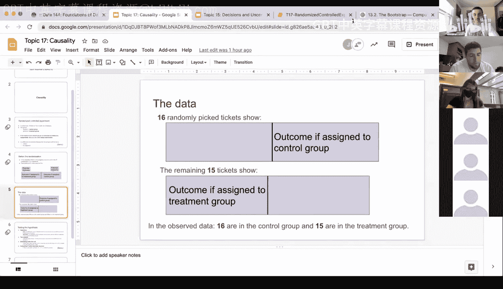
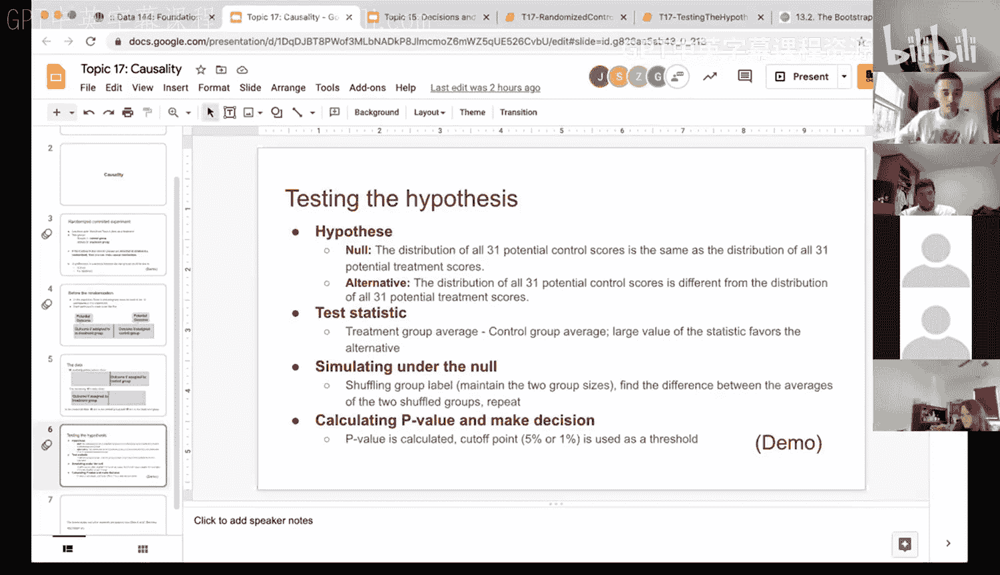

# UCB《数据挖掘和分析｜DATA 144 Data Mining and Analytics 2021》中英字幕 p55 [P55]lecture55-[T17 Causality] Testing The Hypothesis-f3bUVXrLdCI.zh_en [BV1efBEBuEVg_p55]

Okay， all right， so we will try to cover I guess two topics if we can Okay because the first one is causality is relatively short Okay。

 you will see that we're going to work one on one more example of causality and now in practice doing it with Python as well Okay so that involves as you will see understanding why it is experiment right and then that is why you are able to create causality statements in the end Okay but then more importantly we're going see an example where we actually have the data right we're able to set up hypothesis we're able to figure out like a test statistic that we want to do and then of course the actual simulation part and then the P value decision making process Okay so that's for this causality。

Topic that we want to cover so let's get started with that in the meantime， I guess we also going to。

Do some kind of quick review from before a little bit as well Okay so for causality here okay we are talking about randomized control experiment okay so the term now hopefully starts to make more sense of why we're not just calling as an experiment for short but like randomized control experiment okay we're gonna walk through this concept one more time and then see in example now okay so it's about low back pain okay there is a particular treatment that could be useful so it's bo bolutonium but to lead them I think doing a let is say Bta for short time not really good at pronouncing those hard word and okay so the treatment okay is this particular mat okay and then people are curious about whether it's going be effective treatment for low back pain okay so since we I think from early on in this semester we know about how we're able to go about during this comparison if you remember okay and then。

Dicular for experiment we're talking about two groups Okay now we I think we know by heart we have a control group and then we have a treatment group Okay and in this case。

 I would say the treatment is pretty clear okay it's going to be the BTA MA itself Okay so later you will see that well once we come up with the groups how exactly we're going to see how but once we come up with that then the treatment itself going be going to be the BT MA itself Okay so this does。

Like what I was preing it I do want to go back really quick to if you remember last Tuesday I'm just showing the topic 15 lecture slide really quick okay I wanted to bring back to that example if you guys remember about the gender discrimination right I was describing the setup and then we are looking at a table and then remember I asked a question about whether this is observational study or experiment okay and I think I guess maybe I was the only person thinking this is experiment everybody else sort of coming out of the breakout rooms you guys were saying it's more like observational study okay so I remember back then so I can think now it's a good time to revisit this really quick as well especially here I was say that I guess last time we were able to identify at least to some degree that it was randomly determined right so we do have the randomization this is a term that we're gonna start to use a lot more often now this is the randomization process of putting people in different。

Okay so this I think is one key aspect or key characteristic of doing an experiment but I do want to come back to this exercise or example really quick as well mostly because I think last time I was saying in this problem is there's no like a clear treatment that we're talking about right and I guess that's why it was a little bit challenging to determine whether this is actually experiment or not because as we are seeing in the causal in the causality example here now we're really talking about like you do have a treatment right and then you give it to the treatment group right and then the control group does not receive that treatment so it's a little bit I agree unclear I guess or like a little bit implicit in this example so if we really think hard about this gender discrimination okay we have two groups right one group clearly is just the male group the other one is the female group so here yes we do have a treatment and control group okay。

It's not that we're actually going to give the treatment to the people in the treatment group and do not give the treatment to the control group it's more about exactly what that we're testing for and that's how we design those two different groups okay so here we're testing about gender discrimination okay if you remember then that's why here even though there is no like medication or whatever involved but this is experiment because we randomized those observations into two groups and between the two groups pretty much the only difference between them is about the gender。

Okay so this is hopefully can clear up some of the confusion if you still have any especially back about this particular example。

 so I just want to say that for our BTA example that we're doing today well clearly there is a treatment so and we know that we're doing experiment and all that so it is pretty clear but going back to that gender discrimination example I just want to say that not every time you're gonna to get actual treatment going on okay but a better way I think or like a more general way to think about treatment is well I have two groups right and then I really want to I do the randomization or like randomly assign observations into the two groups so I will only have the difference about like the groups themselves like about I should say about the observations in those two groups they're similar except for the groups themselves。

Okay so then for the gender discrimination example they are all the same right remember the example itself they say like it's the identical the same personnel file right and the only thing that is different is about the gender of of the applicant or yeah of guess the employee yeah so in that case it is still experiment okay even though there is no clear treatment going on you are not giving a treatment to any of the group okay but you are still testing out about the gender aspect of things so you will still consider as a experiment okay so I hope the detour makes sense overall but let me know like in the chat or just like speak up if you have further questions about categorizing that gender discrimination experiment but here I yeah I hope for the BTA example is pretty clear overall that we're doing a experiment over here okay。

Allright， so coming back here okay we have two groups okay now one of them is control。

 the other is the treatment group and clearly we're gonna give the treatment group the BTA medicine。

 I think and then the other one is probably some kind of like non effect or like sometimes you probably have heard about the word placebo group okay so you're still gonna give the control group something okay just to make sure that you can eliminate any kind of like psychological effect that somebody thinks that theyre they're taking like medicines。

 everything seems to improve I think I mean I feel that all the time but anyway it's human nature。

 so I think that's another reason why people try to make sure that is that is happening okay so all right good now if I come back to this example。

 okay and just to refresh all of our memory one more time if the treatment and the control groups are selected random meaning that we're random putting observations or subjects in each of the group okay then if you're able to come。

With any kind of conclusion after doing the hypothesis testing。

 you will be able to make causal conclusions okay so this again。

In the past we know that if you're doing experiment right randomized control experiment。

 you will be able to make causal conclusions okay now we're making it a little bit more specific okay that what do we really mean by by a randomized control experiment okay now we have known all of the terminology the experiences and the yeah the exercises that we have done examples so here we're being very specific okay if I do have two groups okay and we are able to make sure that the observations are selected are random into each of the groups。

we also call it randomization or randomized then you can make the causal or conclusions okay so nothing very different from before we're just being a little bit more precise given what we have known already okay。

Alrighty， so now I have two groups okay so now I'm gonna start doing testing okay we're gonna walk through this example together okay but before we get that we know that like for any kind of testing based on the framework that we have been talking about like the hypothesis testing like a nu hypothesis and the alternative hypothesis where the nu is representing the status quo right the other one is the alternative okay so remember we always come up with two of course in later not in our course but in the future it might come up with multiple that's totally fine and but for us we restrict ourselves to talk about two one is the nu the other one is the alternative and then here because of the randomization step that we're able to enforce then any difference in the outcomes okay now between the two groups okay could be due to two types of resources okay sources I should say the one is the chance model which will be our null hypothesis if you remember okay or you will。

to the treatment which is usually referred to the alternative hypothesis okay so remember these are the two viewpoints right that we started talking about in the first place and then later on we turned those viewpoints into hypothesis where the non hypothesis is usually the chance model right that you're able to simulate data under from。

And then the alternative will be in this case the treatment that you will be able to test for okay so and one more time I guess just to repeat it one more time here。

 we highlight any difference in the outcome between the two groups could be due to and this is because we are able to attribute to either the chance model or the treatment model because we have done the randomization meaning that the two groups。

 the observations， they are very similar to each other except for the treatment or the control group assignment that they're doing okay and it is indeed because of that exactly because of that we're able to do this hypothesis testing and later on come to a causal conclusion。

So keep those in mind okay we talked a lot about different aspects and I'm sure I repeat myself multiple times on certain concepts。

 but just to make sure that we're on the same page and then we're ready to go to a demo together which hopefully will make things much clearer okay so this is the first demo in for a topic 17 okay so if you open that now but if you want to feel free and then were gonna do a randomized control experiment with the BT data okay so the BT data should be loaded for you in the space okay so there let me see yeah I don't know how many I I should know about I think wait yeah there are 31 sorry there are 31 observations in total okay and then the data set as you can see has two columns right the first one is the group assignment we have the control and then we have the treatment and then the result column。

Is a binary like a bullying okay if it's one， meaning that it does improve the outcome。

 the lower pain， a lower back pain， okay if it's cod is one， if it's cota 0。

 meaning that nothing is improved okay so this are the two variables here。

 both of them are binary in some sense right like the group is either control versus treatment and result as one versus zero okay but one means that somebody has seen improvement of lower back pain。

 zero is no improvement okay so this is how the data looks like okay and you will see soon that well remember before we're doing any kind of simulation right we always wanted to think about say if we gonna come up with the test statistic right in the end we always need to also get the observed statistic from the data set right so remember in our usual procedure of doing hypothesis you come up with hypothesis right the two and then you come up with the statistic that you think is the best or like。

The best to test out your hypothesis and then you're gonna simulate the data right simulate data under the null hypothesis for a large number of times right each time you're gonna to compute the test statistic and then in the end if you remember we get the P value for example or some other if you want like just maybe you simply compare them but P value is a good way to evaluate how likely the data that you observe is under the null okay and so like I know it' the last step that we do but it's also good for us to just to refresh our memory that whenever you get a data set even before youre thinking about how you're going。

Do the simulation for the hypothesis test， you should think about the test statistic that you want to work with Okay and then on top of that you should figure out how to actually get the test statistic from the observed data because whenever you do a simulation you have to do on the simulate data So it's probably the same set of process like same set of code in particular that you're able to get the observed statistic as on the observed data just like the test statistic that you're you will be able to get on the simulated data okay so for us okay so there are multiple things we can do especially now I guess this is also like a quick review as well now we're working with two categorical variables both the binary and so we should be able to do some summary about them and in particular you will see that we're trying to get the average treatment outcome between the treatment group and the control group okay so the way that we're gonna to get it So first of all。

 just to verify that we do have two groups and then we have 31 observations。

Total among them 16 were in the control group and then 15 were in the treatment group Okay。

 so if I do the duck group method right and then include the quote include the column name。

or the label name in the in the quote in the method group method then I should be able to return the counts right of each different group Okay so that's only for one categorical variable right if I want to do like crosstaulation if you remember the pivot method okay and in this case we do have group and result to categorical variables so if we use both of them here sorry yeah don't worry about those warning it should be fine like we would just work just fine it's just a data science package thing but the outcome should just look fine to you so here we have a crosstaulation right we have the group assignment okay like showing over here but at the same time we also have if you remember the outcome one is one is0 the other one is one for the result okay so this gives us a tally of the count of each crosstaulations over here but then of course we can always use the group method to get the average so this is the test staistic later on that we're gonna work on。

In particular I'm doing the as you can see the group okay the group method is being applied to the group column but then I'm summarizing right the result and in particular I'm summarizing in terms of the average okay so if you look at this output here I have the group two groups right control and treatment I'm having the result average of the control group is 0。

128 okay and the treatment group is 0。6 so this is one test statistic okay you can maybe work with other ones we can maybe do a breakout room soon to think about it what else you want to do but pretty much this one well we're interested in is that you remember if somebody has an improvement it's coded as one in the result column right if it's no improvement is coded 0 so if we're able to get the average result outcome right among the control group and then also among the treatment group and if I take the difference of the two which in the observed data is 0。

475 that gives me a sense。Right of how how like how different on average right the result is between the control treatment group and the control group we're seeing a I don't know it's hard to tell right whether for 0。

475 is large or not that's what we're gonna find out later on okay but this is showing us like in the observed data right on average we see that the average result of the treatment after of the experiment I should say of the control group is 0。

475 lower right than that of the treatment group okay so for us if we come back to the slide really quick like I said we will do in our experiment you will see soon that we're gonna do the randomization and then of course any kind of difference due to the outcome going to be either due to the transnce which is the now hypothesis right or the treatment which is the alternative hypothesis so for us we are one step closer to that right？

Now we know how to get that test statistic in place and then how to do it on the observed data Okay。

 so you will see that well from last lecture I think there is a。

Last lecture Thursday with Jason I mean there is a function sort of that we're able to get the difference of means Okay so here I'm showing it just because we can wrap it up as a function so it will be much simpler later on to try to get the difference Okay and you can imagine well now I have written this function then later on I will be able to put that as a function into my loop right then everything will work much faster but let's walk through this like function really quick but I just want to show you that the observed difference can be computed using this function right like it's a 0。

475 up here when we do a step by step iss going be the same down here after I use this function so the function if we come back here and。

You will see that it takes three inputs， okay the data table itself。

 okay the label which is the label that we're gonna be focused on in this case like the result label okay and then also the group label that is the label or like the column about the group assignment okay so what we're doing here as you can see is that we're gonna take the name of the table the column label of the numerical variable and the column label of the group level。

 which gonna return us the difference of means of the two groups so we can yeah let's just spend time to look at the few lines more carefully but definitely make sure that you revisit this to make sure that you understand why we're doing this and once you do this like once I think you will be complete pretty clear and pretty convenient that you're gonna use this all the time I think for all of the other simulation that you're going do okay so okay so what we do in this in this function as you can see is that yes we start up with the table right like in multiple columns。

S only two， that's great， but sometimes you might have multiple seemingly irrelevant columns for us in terms of what we try to do so maybe the first thing we can do is to reduce the larger table only to the two columns that we're interested in okay and the reason if you already thought about it is that here if you remember right like I'm doing like the botock stock group right and then use the group and then themp average and it's nice because I only have the result right result is the only numerical variable that I'm interested in and so i'm only going to get the average of those of those of that particular variable right but imagine you have some other ones and then you start to get so many different summaries that might not be necessary for you to know and I think that's the main reason why in this。

Particular difference of means function that we're writing we' try to reduce it the first step。

 as you can see， is reduce the table with the two relevant columns only okay because later on when you do the summary。

 that would be much easier to deal with。Okay， all right。

 so we get the reduced table Okay that's using the select method Okay we are selecting the two columns and then we're still gonna have a data table in the reduced object okay and then we're gonna do the group method okay so it's being done on the reduced object okay and then which is the data table and then you're going quote like you're going to supply the group label which is like control and versus treatment like what we did and then the second one is in our case is always sort of like themp average okay because we're looking at the difference between the two and then lastly we're returning like the second item。

Minus the first item and then we're able to get the difference Okay。

 so if you use this function like you're right at once right and then you can use it on the observed data grid and then later on you can use this function in the simulation when you're doing it for a large number of times then you can be you can be sure that every time youre getting the same same quantity like the same concept of the quantity that you're doing okay it's always the second minus the first。

宝贝。All right， hopefully that makes sense and like I said this is similar to a function that we did you guys did with Jason last week。

 but here we bring it back mostly because this could be really handy later on。

 regardless all of this is trying to help us to get the text statistic right and then compute the test statistic under the observed data and that will always be important for us later on to come up with the decision。

 especially you're going to use it for coming up with the P value。Make sense overall okay。

 Aly great Okay， now let's talk a little bit more about what we what are we really doing here for for doing this particular experiment for causality Okay。

 so here let's see。Let's just do like imaginary thought exercise over here okay so before the randomization okay you can imagine that like each each participants or there are 3 or1 of them okay in the experiment。

 each one has a ticket okay and then like it's two parts okay the one is that what if like the person or that the subject is assigned to the treatment group。

 the other one is the person is to the control group okay like say because at this point if you remember like the randomization if you remember like the process doing this is that you put all of the observations together right and then you randomly select which one to go to which okay so it's almost like you can imagine like a ticket like here everybody gets like two parts right you have either you could be assigned to the treatment group you could be assigned to the control group but we don't know which one it is okay and then for us you can think of this like as how before the randomization starts how。

Each person is is participating okay in this is and then of course after we do the randomization okay each person is only being assigned to one of them right and then you're gonna to receive the data after they either go through the treatment or the nontrement process okay so what happens in our study here is that amount 31 subjects or participants16 we're randomly picked the tickets to go to the control group right and then the remaining 15 were like whoever would not picked right going to be assigned to the treatment group Okay so in the observed data what we are seeing is that 16 are in the control group and then 15 are in the treatment group Okay it's 31 so it's you know it's odd number so you just gonna do your best like evenly divided okay so in this case we have 16 in the control and then 15 the treatment okay so imagine like now the tickets is almost like okay so for all of the ones being randomly selected。

To the treatment to the yeah to the control group it's going to be the one showing on the top and to the treatment group is the one showing at the bottom Okay so just imagine this going on like I guess it's important for us to think it through like how the randomization is really doing okay so like the ticket idea is one way to hopefully like help you to distill that thinking of doing randomization okay。

All right， so with all that in mind， let's get ready to test the hypothesis okay I will go through I guess if you remember the four different steps right we come up with a hypothesis okay we need to know what it is the nu what is the alternative and and also what else like think about the test statistic right and then also you will have to do the simulation under the null right and then lastly you're gonna to use the P value to do the hypothesis okay a testing I should say okay so yeah I think let's maybe take a moment for you all to go to a breakout room just to talk through I know already listed all the like the write up over there so maybe ask yourself not to watch it but just like think about the problem in hand that you are able to talk through talk through the process with your team members really quick in the breakout room members really quick and then we come back and then we continue with the demo okay so let's do that for a short。

Quick。

QuickOkay， welcome back and I think pretty much everybody's fact。

 maybe just a couple of of you coming back from the。

From the room and let me in the meantime start restart sharing my screen so we're going to see the same thing together。

 okay。

All right all right so since yeah， I hope everybody got the chance to discuss quickly what you think are necessary for testing the hypothesis so in that case I'm just going to show you。

 I guess the entire sliding one show but let's talk through them Okay like I said I think。

Overall they are similar to what we had done before。

 but I do want to bring our attention to the null and the alternative hypothesis here a little bit okay so the ones that we're setting up over here is that the null hypothesis is that the distribution of all 31 potential control scores is the same as the distribution of all 31 potential treatment groups while the alternative is saying that they're different okay so remember in the past when we're not comparing two groups okay we're just like saying like say the ju selection example we're really having the null hypothesis of like what we observe or I should say like the jury selection is representative of the population racial breakdown and stuff like that so you always sort of like have something that is there like about the population that you're able to compare to so in those cases the null is is different right whereas here okay when we're doing experiment like I said we have 31 observations in total okay and we were supposed to。

Rly select them into two different groups and stuff like that so because of that our now hypothesis okay we are framing it in this particular way that if we imagine like all of them。

 all of the 31 right like they are like they are either potential control scores or the potential treatment scores so the now hypothesis saying that for all of them either like one group of the control。

 the other one is the treatment group， the distribution of the score is going to be similar across the two okay whereas the alternative and that's the chance model right like it's whatever being random selected is just by chance the difference that we're seeing whereas the alternative is saying that the distribution of the 31 potential control scores is different from that of 31 potential treatment scores okay so this I just wanted to highlight because like I said this is in some way similar to the AB testing that we covered last week as well okay but then in this case we're doing experiment。

So we are thinking about potential scores。All right。

 and the test statistic hopefully makes sense to you now as well。

 especially just now in the previous demo， I showed how we are actually able to compute this statistic from the observed data okay and in this case the test statistic is the treatment group average minus the control group average and remember when we're picking statistic we want to pick a statistic that like say if it's large then it will favor right the alternative it's small it will favor the favor the null so in this case because treatment。

 if you remember like the result column if it's it is one。

 if somebody did see D improvement if it' zero is no improvement so larger value of the difference of the average here going favor the alternative meaning that the treatment is helping more than the control or like no treatment okay。

Alrighty， and then third step， which we're going to see how to do in the demo in a second， Okay。

 simulating on the null right， Okay， and then this one is going to be very similar to。

The previous ones that we did， okay， we're actually shuffling the group label so we're able to maintain the two group sizes and then find the difference between the averages of the two shuff old groups and then we repeat that for a large number of times Okay so this is what we mean by under the null right under the nu is saying that well the distribution of the control scores is the same as the distribution of treatment scores So that means under the nu if I want to simulate under the nu using using a data set that I have in the observed data then what I'm doing is I'm merely just like shuffling the group label okay because I'm controlling the group size and then whatever the differences we're seeing is due to chance and that's what we mean by simulating under the null Lastly we are able to compute the P value were gonna see it again in the example and then you can either use the5% which is what we call statistical or sigin level or like highly significant level1% we can see which one we want to use and then for。

For this particular example， okay so let's come back to that。

Hypothesis testing so that's a new notebook Okay， so take a look later on Okay， all right。

 so load everything Okay， and then I also load the difference of means that was the function that we talked through earlier。

 Okay， this is like you have a larger table and then we reduce it to a smaller table and then we're taking the difference of the means of the two groups right。

Alrighty， so this function， you will see that we're going to use it again。Alright。

 so the data set again， okay， I loaded one more time。 Okay， and I'm using the difference of means。

 That's the function that we loaded earlier。 So I'm able to get this 0。7475。 Okay。

 so that's the observed difference。 Okay if you remember okay allright。

 so now notice of course you can I think it's probably always easier if you are able to write something along the lines of one simulated difference。

 Okay that you're able to wrap it up in a function。 So later on in your for loop。

 you're able to just call it and then you can remember append the outcome to the array that you started with So in the end you're able to get a bunch of them。

 So you're able to do your hypothesis testing。 Okay。

 so here let's see so I'm writing it as one simulated difference。 Okay so this again。

 as you can see simulation is involved right So as you will see we're gonna do a sample method again and then do all of that。

 So in this case I'm also have I guess。Yeah I'm having three inputs over here right the table okay that's the name of the table and then the column label of the numerical variable which is the result column right and then the group level sorry group label which is the column label of the group level variable okay it's going to return me the difference of means of the two groups after i'm shuffling the label。

Okay， all right， so how am I supposed to do that？So the first step as you can remember is to create a array of shuffled labels Okay the way that we're doing it if you remember is that we are taking right with replacement without replacement sorry because we wanted to make sure that like the same like the group sizes stay the same right still we're going to have 16 control labels right and then 15 two labels so to make sure that it' is happening we're doing with without replacement。

Sly， okay， and then we also only going to select or in this case use the column method you only get the array of the group label。

 which is the shuffle depression。Okay， so one round of this line as you can imagine is that remember we have 31 labels of the group right that we start with right 16 of them are the control。

 15 of them at the treatment so we're like just shuffling them to have a new arrangement okay so every time it's going to give us a new arrangement that's what we mean by the shuffled labels okay。

This is， again， similar to gender discrimination example that we saw last week， okay？

Alrighty so once we get done that then what we can do is to get the table of numerical variable and the shuffled labels okay so what we're doing as you can see is that we're gonna to get a table we select the label which is in this case the input of the numerical the name of the column of the numerical variable and then we also going attach it with our shuffled label so that is going be a table of two columns the label itself sorry sorry the variable the result in this case as the first column and the second column is the shuffled labels so we're gonna get two of them and then of course then we're able to use our already in written function of the difference of the means so in the end we're able to return the differences of the average across the two groups so the steps again I think definitely worthwhile revisiting if you find a little bit like too much going on but in class we try to talk through them the reason。

Why we do this， But then a lot of times I think it does make sense for you to revisit And for us。

 let's see once we are done with writing that function， we can just take one round of it Okay。

 so this is giving me so again this is already simulation okay because we're taking a random sample like we're doing the shuffling label and then get one outcome here So it's about 21% Okay or 0。

21 if I run it again it's going be a different number okay so that's what we can make sure that what we're doing is indeed random over here Okay so let me run the usual for loop okay it's going to take a while that's why I wanted to set it to run I'm doing it for 10000 times okay so what I'm doing is that based on the。

The BTA data that we have okay I'm doing it repeatedly for 10000 times that's what we mean by simulating under the null right simulating under the null for a large number of times okay but each time not only that I created like a new data data table right with a resolved column and then the reshuffled group label but also more importantly i'm taking the difference right of the test staistic that I'm able to do because that's what well we need later on if we're trying to do any kind of testing okay so that's why I have that sta over there so just as before now we have a array right of all the simulated differences of 10000 of them okay so now i'm ready to do a historyogram。

Let's pause here to think about a little bit of what the histogram is telling us， okay。

 so distance between the two groups。Okay under the null and and let's see so center of drone zero。

 I guess that makes sense right because you're saying that the null hypothesis saying that the two distributions are are the same like regardless which group you are coming from okay and then under that we can see center as zero relatively symmetric I guess the most extreme on the positive side we went up to 0。

6 is right and then the negative side is like 0 negative 4 is and we know that notice to refresh your memory the observed difference is 0。

475 okay so looking at the graph， we know that's gonna be， I don't know。

 somewhere over here okay exactly where I guess it's better if we use the P value calculation right to know that how many out of all of the 10000 simulations that we have got some test statistics as extreme is what we're seeing in the data so the typical approach I think now with so many different exercises you probably are pretty。

Aamiliar with this now， we are， right？Comparing the simulated differences with the observed differences okay in particular because our observed is a positive value right so we're looking at the one greater or equal to that and then divided by so we do the sum。

 So just one more time， I guess this comparison who here gives us a array of the bullying operators right zero and on ones okay so for us we want to know how many of them are zeros So we sorry how many of them or once So we're able to do a sum over here so that're gonna give us the number of times out of that 10000 times we're gonna get a more extreme simulated difference Okay and then we divide it by well up here we know that it's 10000。

 So if you want to write out 10000 that's fine， but you can also use the lamb method that's returning you the length of the array that you're computing So this is more automatic I think so let's look at the P value Okay so in this case is00075 if I come back to our last step over here we calculate。

P value and then we should make decision so feel free to speak up or just type in the chat instead of I guess creating a breakout room for for a short question like this。

 given a cut off point of5% okay are we rejecting the now or not？Yes， no。

You can type in the chat or just speak up whichever is fine that you feel comfortable with。

Can you ask the question again， Oh yeah， sure， Go ahead。

Oh you mean repeat the question sorry about that yes I'm saying that we are getting a 0。

0075 p value okay， and now if I come back to the decision making process okay and remember we can have two different thresholds that we want to use okay。

 so my first question first part of the question is if I'm using the cut point of 5%。

Do you reject the no or not， given the P value here？And what does that tell us of the outcome？Anyone。

You can type in the chat like yes or no of rejecting so I guess if you think we're going to reject the null。

 you can type yes， if you think we're now rejecting the null you can type no。

maybe this is something we should maybe talk through one more time。How to make the decision。

 Okay so we have a no question mark， okay？Alright， okay， yeah。 again， I think maybe Okay， sure。

 I would talk through again。 Okay， so the P value。 Okay， if you remember， let me see， which was the。

Yeah， it was the decision and uncertainty right， so it's probably down here。Okay。

 here right we're talking about like said how we're making decisions in the end once we get the P valued Okay yeah so。

Alrighty， so if we come back here。And yeah， let's just use this one or like maybe it's better to come back I guess to whatever we're doing over here Okay。

 yeah， so let's use this current example， Okay， so the P value。

As we know is computing right out of all of the simulations that I've done， right， the percentage。

Out of all of them， of the simulated differences that we're seeing is greater or equal to or maybe in plain English as extreme as what we observe in the data。

Okay， so remember， this whole hypothesis testing paradigm is set up based on the assumption that we're simulating data under the null。

 okay meaning that we assume that the null is true， right。

 we're able to simulate the data and then that means we are simulating a bunch of statistics as well okay and then the P value is a probability okay it's telling us that if the null is indeed true。

How likely it is for me to observe something as extreme as what I observe in the data。

So imagine and that's what we're saying that we're trying to like look at like in the tellss right。

 like say if without the concept of P value， if you remember at first we're talking a little bit informally right。

 we're talking about okay I wanted to simulate a bunch of test statistics under the nu hypothesis because the null is saying that it is the like there's nothing going on in this case that you are the same okay and then I have a bunch of them。

 and now I have observed data point which is 0。7 0。

475 come along if it's in the bulk of the histogram that I'm doing right。

 that is what we mean by it's consistent with the null right consistent meaning that well。

 if my nu is true well it is very likely to come up with whatever I've seen in the data。However。

 if it's in the tell， okay， then we know that， well。

 it might be telling me that if I do make the assumption that my no is true。

It is still very unlikely to observe what I observe in my data。

And that's what we mean by inconsistent right telling us that， well。

 this might tell me that my assumption about that the nu is true might not be correct right because if I made that assumption。

 I'm not very likely to see what I have seen in the data， okay that's when the data。

 the observed data is in the Tau okay so that's before we started talking about P value if you remember that like talking about like consistent with the data。

 meaning that it gives evidence towards the nu， if it's inconsistent with the data。

 remember we're saying that it's showing evidence towards the alternative。

Okay so with P value what we're doing is that we can quantify how likely it is okay and the quantification happens in this way okay so this is the distance between groups if you remember okay for this experiment that we're doing okay。

And then what we're doing in the computational of P value， if you look at it one more time。

 the simulated diffs， if you remember that's the array right of 10。

000 so that's what's plotted in the histogram Okay what we're doing is that we're comparing each simulated difference against the observed difference right and in particular and comparing and I'm returning boole zeros or ones right it' going return to one if the simulated one of the if this particular simulated diff is greater or equal to the observed di okay and then so that's what we're doing by the greater or equal to signine over here okay so all of this when I do this line。

it's going to give me ones and zeros， okay， if it is one。

 then meaning that that simulation in particular gives me a simulated difference as extreme as the observed。

Okay， it it's going to give me a zero if it's not going to be as extreme as the observed， okay。

 and I do the sum of them， meaning that I'm only counting the number of ones， okay。

 meaning that I'm only getting the number of as extreme as my observed difference。Okay。

 and then in the end， I'm dividing because I want a probability right out of all of the 10。

000 ones that I've done， so i'm dividing that by the length， okay that's what the L。Is doing okay。

 and then that's what the P value is Okay， so P value。

 if I repeat it one more time is the probability that if my if the now hypothesis is indeed true。

Then I'm getting the probability that my like I will get the probability out of all of the simulations that I've done that I will get a simd diff as extreme as my observed。

If that value is really small， that tells me that well， I probably have evidence against the nu。

 right， meaning that it's very unlikely for me to observe something as extrem as my observed difference if the null hypothesis is true。

However， the P value is large。Well how large is large that's what we're talking about the cutoff okay so we're going to come back to that in a second。

 but just like to finish the thought here， if the P value is large。

 then that is probably telling us that well your now is probably okay because under the assumption that the no is true。

 it is overall likely for you to observe something as extreme as what you are seeing over here。Okay。

 so if I come back， okay， to this。Once we compute the P value right we're going to sort of like compare it to cutoff points so the two that we covered before is the first one is 5% okay that is what we call like statisticalo significant okay。

 meaning that if you're using a cutoff point5% okay， if your P value is smaller than that。

That means that you have significant evidence like statistically significant evidence against the null。

 Okay， and then so when key value is smaller than 5%。

 you're gonna reject the null because the nu is saying that they're the same。 Okay。

 but you're rejecting it because you have more evidence in favor of the attorney。 Okay。

 and then and smaller cut point is this 1%。 Okay， so you can use that。

 if you want to be a little bit like a little bit more strict in terms of rejecting over here。 Okay。

 so I guess now okay， this is a long over here。 So if now I come back to my question one more time。

 Okay， I know， so again， I would recommend。Revisit topic 15 like later after after the class if you yeah like say here like error probability and then how we're making the making the conclusions decisions it's coming from top 15 okay so you can review that as you see fit here I guess I will just repeat my question one more time we did compute a P value of 00075 Okay it is small okay meaning that out of like 10000 simulations I've done I only see 75 of as extreme as my data right and then that gives me a probability of 00075 Okay so my question is if I use a 5% cut off point as the threshold。

Then I will see that my 077 oh sorry，0。0075 is lower than that 5%， right。

 So if I'm using that as a decision making threshold。

 then I'm going to reject my now because it's smaller than that threshold。Okay。

 so this is saying if I'm coming back all the way to the experiment in the first place right。

 we're trying to figure out the causality right， we're trying to figure out whether BTs is effective or not okay。

 so in this case we reject theol at the 5% level， meaning that we're going to favor the alternative right。

 meaning that the treatment is indeed effective。Okay。Yeah， so with that in mind。

 if now I use a more stringent cut off point， 1%， do I reject or do not。

 I do not reject based on this 0。0075。Using a 1%。Sthreshold。So。

Maybe in the chat or if you feel like speaking up， feel free or if you think it's better to go back to your breakout room。

 happy to do that as well。We'd still reject right because it would be lower than the 1% level Yeah thanks Mike yeah。

 and thank Joham in the chat as well。 yeah， so in this case。

 it is gonna be still reject right because it's still also smaller than yeah thanks Matt it's reject Yeah yeah we're gonna reject because it's also smaller than 001 okay so again。

 if you go back to and then we come up with the same decision right like say we reject then all the effect like the treatment the BT medication is effective okay and things like that so but I just want to say that like the 1% cut off 5% cut off if you go back to topic 15。

 there is some like historical account of why this numbers came up in the first place and stuff like that okay so if you're curious and then want to get a review about them as well but for us honestly。

If you're taking a stat course， maybe not a asbelt maybe in high school， for example。

 if people do not explain too much about why small P value results in a rejection。

 then I think hopefully in this course you start to see like why that is the case okay especially we're doing it from the simulation point of view right like we are actually simulating statistic like the histogram that we're doing onto the null right then when you're simulating onto the null what you're doing。

 you're assuming that the null is true。RightYou're assuming that the now is true。

 this is what I get and I get it for 10000 different times right and then I'm able to compute the P value given the definition that we know。

 so I'm just hoping to convey this idea that the P value is really a probability okay if it's really small。

 it tells me that I have more evidence towards my alternative because a small P value shows me that it's very unlikely to observe something as extreme as my data if the nu is true。

If the P value is relatively large， then it tells me that you have some evidence in favor of my N hypothesis。

 okay， because under the assumption that my N is true， it is likely overall likely。

 I guess to see something as extreme as my observed data。Okay。

 so all of this is driven by we come up with the two hypothesisses and in particular the null hypothesis is what we assume is true when we're computing P value okay and then so the general rationale over here is that well I have my now I have an alternative right I'm simulating under the null。

 if I have so much evidence saying that after I simulate under the null and then do the P value calculation if I have a lot of evidence in favor of the null I do not reject it right if I have a lot of evidence in favor of the alternative I'm going to reject it。

P value is really just something that we try to quantify how we make the decision Okay and then of course。

 I guess in some way was it was good that when I first in the first round， I asked the questions。

 people confused because I think you guys were all thinking instead of like oh P value is small。

 so I'm gonna reject okay in a lot of cases like that's sort of kind of like like a recipe that people follow okay but I really hope that from this course and this few lecturers in a row that it's gonna be like very clear to you all that indeed we are rejecting right the nu hypothesis if it P value is small because that gives us evidence more towards the alternative okay and it's because we are simulating under the null and then so under the assumption that the nu is true if I have a small P value that shows me that it's very unlikely to see something as extreme as my data and then that is what we mean by evidence against the nu。

Alrighty make sense overall hopefully I know this is probably like getting longer than we this I thought will be。

 but I think it's good that people are reacting and then if youre confused feel free just to let me know and then we can always adjacent of course as well that we can always pause a little bit and then go over it one more time and like I said I think all of those like hypothesis testing framework gonna be persistent throughout the rest of the semester okay so the more that you see it I think the more that you're gonna get more familiar with all of this and then hopefully。

Any remaining concerns you still have can be can be resolved Okay all right。

 feel free to leave me messages and I will now。

