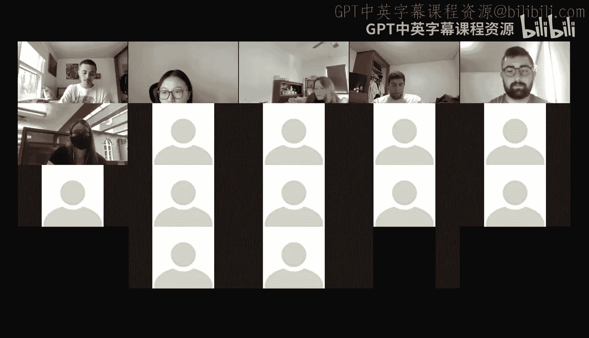
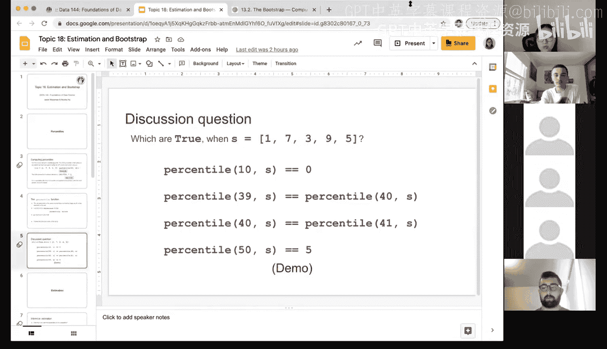
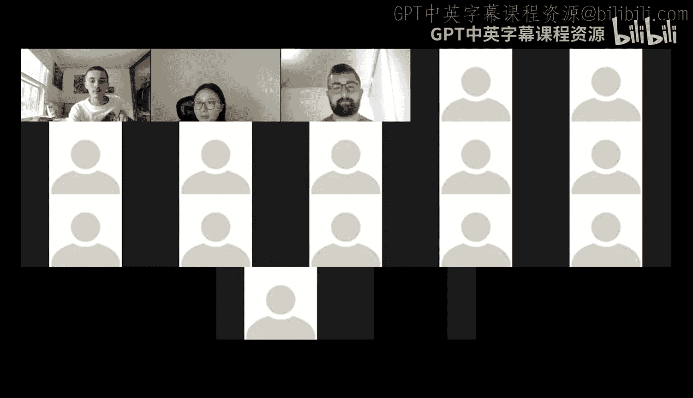
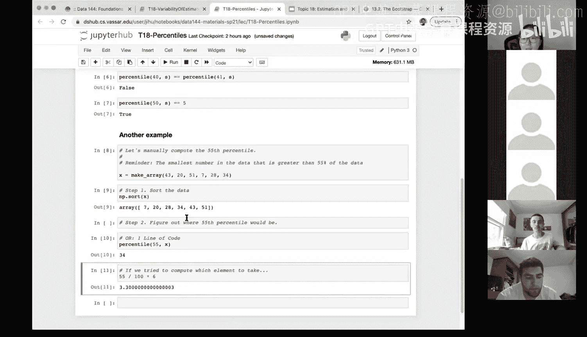

# UCB《数据挖掘和分析｜DATA 144 Data Mining and Analytics 2021》中英字幕 p56 [P56]lecture56-[T18 Estimation and Bootstrap] Percentiles-PQoqwdrYcQc.zh_en [BV1efBEBuEVg_p56]

New topic。 Okay， the new topic is what we call estimation and boostrap。 Okay。

 and let me share my screen， and then we can start。

哦，就钱。Startore from here Okay， all right， so that's the yeah。

 so causal remember we we walk through the entire process of doing an experiment and then how to come up with hypothesis and doing all of the testing okay。

Yeah， and yeah， thank you Li。 I saw your message Feel free to live early if you need to Okay thanks and already so then here the topic 18 is now we're coming back to some more fundamental questions in some sense that well now we know how to do hypothesis testing right we know how to do it in Python we know how to set up the hypothesis。

 all of the simulation that hopefully by now the P value decision rule also makes sense to you everybody as well but the thing is we do have other challenges ahead Okay。

 so one you will see soon is that well。A lot of times we all have the sample right that we're trying to test about Okay and like I should say in this way。

 a lot of times we're curious about the unknown parameter of the population right and then we only come up with a sample due to one reason or another we only have it so we need to figure out a way to to test it out right and then we already talk a little bit about this before like every time you take a different sample you will have a different。

Like test statistic or like a summary statistic that you're able to return right so we do know that every new sample gives you something new right and that's why we're able to come up with a distribution if you remember right the test statistic things like that Okay so here you will see maybe not today we probably will be able to get it on Thursday you will see that well what if you only have a sample how are you supposed to come up with different samples out of one sample okay so that's a legitimate question to ask and then there are ways to figure that out so before we get there I want to talk about a couple of concepts and then we're gonna do some demo in Python so we know in Jupyter notebook now so we know what they are and how to do it and then in the end we're able to bring everything together into what I call it the bootst method that well if you only have one sample what else you can do to come up with test statistic and then how you can do the test okay so that's just a preview I guess here let's talk about the first concept I want to get it through because this。

relevantlevan I mean not only just about the concept itself。

 but also like how to do in python and then later on how you're going to use it Okay so this concept is called percentiles it's pretty I think people know about this like one or another like。

For example， I think like SAT scores is really giving you as a percentile right not really just the raw scores is like you compared to others how highly you ranked among all of them and things like that。

 Okay so that's what people call like a standardized score， I mean， not only standardized test。

 I guess， but also the standardized score itself so percentile Okay it's defined to be okay if you have a numerical array。

 okay you're gonna sort it you know， increasing order first。

 okay and then if I'm looking at the 80th percentile is's gonna be the first value on the sorted list that is a list as large as 80% of the remaining elements in the set okay sounds a little bit complicated。

 but let's walk it through using this example， let's just say we have an array of 1，7，3，9。

5 okay five of them okay and the percentile in this case of the 80 It's 7 the reason is because if you follow the procedure that I'm talking about。

You have a numerical set right and then you have to first of all sort it okay increasing order so1，7。

 three9，5 I should have one， three， five，7，9 right in that order because that's the increasing order okay and then so I have five values in total。

The 80th percentile is the first value on the new sorty list that is as least as large as 80% of the elements in the set。

 Okay， so 80% out of five points or five data points is so 80 like 80 divided by 100 or 。

8 right times 5 is 4 Okay， so meaning that you need to find the value the first value on this list that is at least as large as。

Four out of the five。Okay， if I put it into this particular example here。

 okay so if I have a one3579 right I have four value sorry five values in total I'm looking at the first value that is at least as large as the first four so it should be my fourth value okay and that's what iss seven。

Sounds a little bit confusing， I guess， but let's see if like a few more exercise is going to make sense。

 but you might be wondering okay， what if I have a percentile that doesn't really correspond to an element like say for example。

 instead of doing like 80%， sorry， like 8080th percentile， what if I want to do 70 percentile？

Okay so if I want to do the7， what did I do I have to do like 7 divided by 100 right and then times 5 what is that0。

73。5 right 3。5 does not corresponding is not an index right like per se but but then according to the rule that we're doing it should be the first value on the sort at least a list that is at least as large as 3。

5 of the elements in the set so in that case it's going to be for the fourth one which is going to be a7 again。

Okay so this is just a rule of thumb Okay so try to think it through because we do have a percentile function in Python you're able to do Okay and so it's the percentile method like it's a function and then you supply the P which is the percentile between zero and 100 that you want to return and then the list or like the array of values that you're doing Okay so keep that in mind let's I hope just to get it across So we're able to sort it through carefully So this is the still the old list that we have Okay the array 17。

39，5 I have this four different discussion questions for you and then we can do a demo together just to make sure that we understand everything So here it's asking which are two So it could be more than one okay it's not multiple choice Okay we' just asking true or falses for the four statements here and I wont repeat it here but because I do want to put you in the breakout room so I would just say if you go to。

Tpic 18 is page5 okay and once I put you in the breakout room I think is there are so many different choices here I think it's better if you go to the slides and then look at it while you talk with your breakout room members okay so it's discussion question on page five and we'm gonna put everybody back into the old breakout rooms in this case let me do maybe like three to three to four minutes okay talk through all of them think about which one is which ones are true and which ones are false and why。

All right， good luck。

Okay， welcome back Okay， so I hope you all had a good discussions， hopefully few debates。

 everybody agree on with each other， but of course， if there's any。

Discussion that would be great as well So there again we know that when we're trying to figure out so all of this are polling right we're checking if it's true Okay so that's why we're asking like true or false okay so that's one thing to remind everybody and then of course here like I said is's not multiple choice。

 multiple of them could be true multiple of them could be false Okay so we're gonna see it together and for us just so you know goes if we go back to the definition right you always need to sort the data first okay in the increasing order and then think about the percentile and stuff like that Okay so instead of like talking it through like without any base let me just do it in Python and then we can double check that we all agree with each other Okay so the first one is the 10th percentile of this S going be zero。

True or false， feel free to type or just speak up。Okayy， I'm seeing some chats here。

Okay false Okay thank you thank you Al Yeah， so first of all。

 I guess one thing to to say is that whatever the percentile that you're able to come up with it has to be one of the numbers right in the original list in the first place So I guess for that at least we know that it's going to be false right and if I guess if I ask the follow up question what should be the value for it I think will be。

Will be one right because one is the 20th right And then if we go back to the definition here sorry let me do it over here Yeah。

 because like so if I replace this with 1 right the 10th percentile is the first value on the sort list that is at least as large as 10% of the elements in the set so 10 element is what 10% of the elements out of5 or it 0。

5 right so we're gonna jump to the right like the first value that I appear in the list the sorted list I' going do like serve the purpose for that So I think if we do yeah。

 maybe a quick way for me to check will just be returning this right。It's gonna be one Okay。

 and the reason is because we go back to the definition。 Okay， Aly， what about this one。

 This is saying that the 39th percentile is the same as the 40th percentile Okay I see some nodding Okay and great Yeah。

 so this is again， because it's always the first one right that will do So in our case。

 if I come back to this example one more time right。

4 percentile right So it's as large as the 4040% of elements。

 So if we do that it's what 40 divided by 100 times5 is two right So we know that it's gonna be like three right once we we do the sorting but then it will be the same as the 39th Okay because the 39th will be the one smaller like if it's gonna what is that value Well I cannot do the math right now what7。

39 right， 39 divided by five， whatever that value is should be that order that like that particular percentile that we're working with。

 but it's going to be like slightly smaller than the second value that we have but remember if it does not correspond to an exact element you're going to take the next element instead right so it's going to be three again I think in that case。

All right， what about this one， 40 and 41？The percentile now it starts to be at that like cut of point right like if it's 40。

 we know that's gonna two， it's gonna be a second value。

 which is three right but then if we jump to 41， though unfortunately I have to go to the next value which is five right so in this case I agree I think it's gonna be false because for the 40th is still three but then for the 41st it will become5 Okay just by the definition itself Okay the last one is the 50th percentile it's5 I guess that's good right it's in the middle right and 50th percentile tells us it should be the middle thanks Matt in the chat so that's true as well and this is Ash the 50th percentile is the concept of medium okay and we have been using that to some degree I guess so just to remind you the 50th percentile is the medium and then for us in this case because it's five values in total right so you do have a middle point but then if it's a sixth value array then we。

that well you have to jump to the next value Okay Alrighty， another example here。

 not so much as example just to show you like how you're able to like compute things like like manually if you want Okay so if I have array of 432051。

7，28 and 3 okay if I do that then we know that well if I want to get the 55th percentile then we have to sort the data first which gives you this new array okay sorted with increasing order and then we're gonna figure out where the 5055 percentile could be okay you can do one line of code okay by doing the percentile like what we're talking about。

 this is the function but then of course like I said。

 if we go back to the definition right I'm trying to find not the third1 but the fourth one right if I'm looking at the index。

 the one that I should be looking for so it's gonna be 12，34 and that's why it's 34。Okay。

 and this 55 divided of 100 times6， that's exactly what we mean down here with the definition。

Okay so like I said， this is not so much like an example of using function。

 the percentile function in Python per se， but this is still。

 I think helpful for us to think through well if you do have because we had a nice example five values I mean the first five odd numbers right so it might be easier to think about but if you are working with any array in this case while not great pattern like not clear pattern I would say among them so you have to think it through a little bit more allright sorry for the delay I think we're running out of time so I'm going to stop share and。

