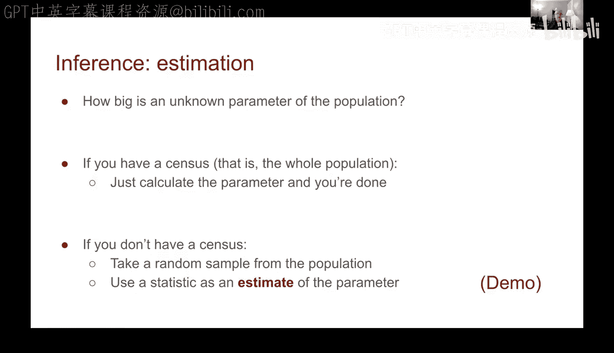
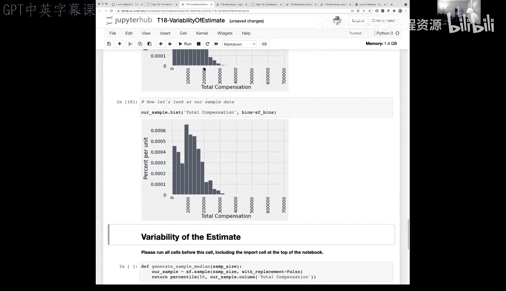
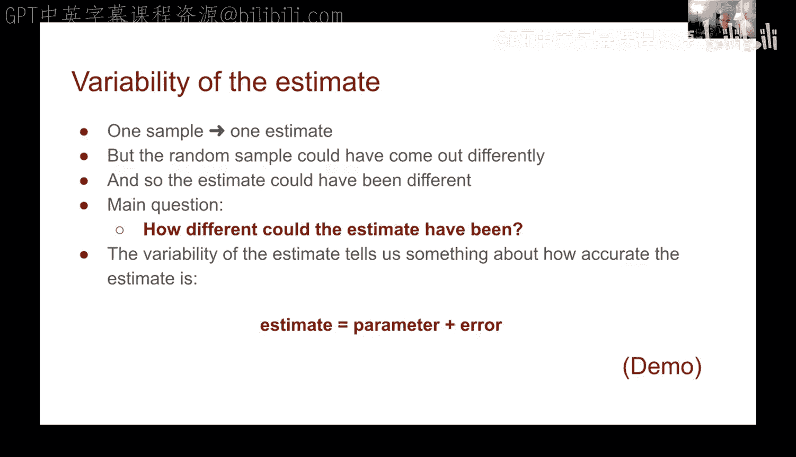
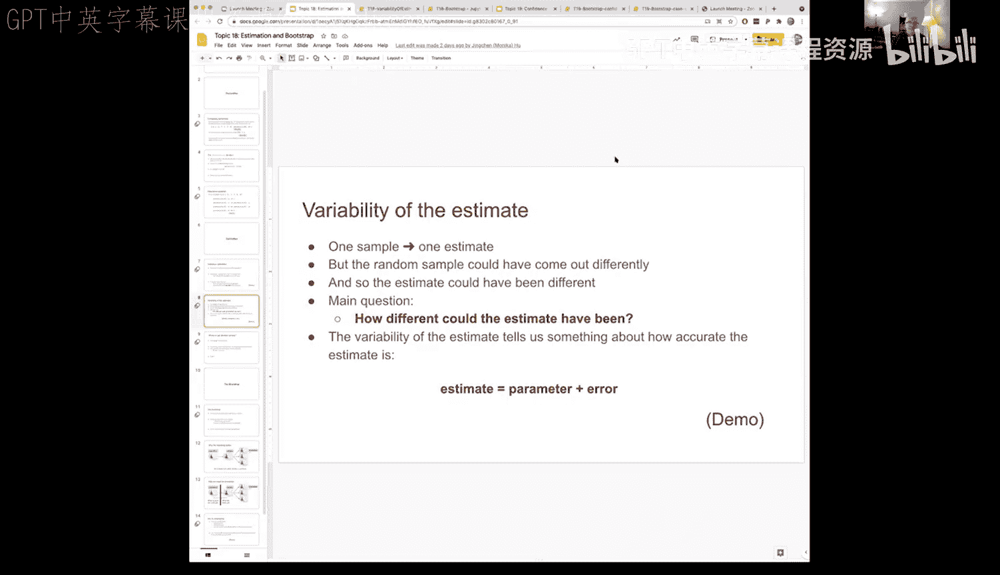
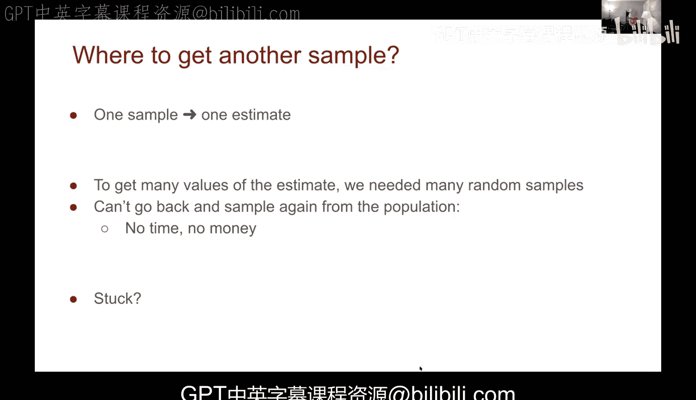

# UCB《数据挖掘和分析｜DATA 144 Data Mining and Analytics 2021》中英字幕 p57 [P57]lecture57-[T18 Estimation and Bootstrap] Estimation-abb7E4uDMb0.zh_en [BV1efBEBuEVg_p57]

Computer。And then I'm just going pause all right happy third we're going to pick up where we left off last time last time we talked about percentiles and today I want to pick up from there and really today is's kind of an exciting day because we're going to introduce this bootstrapping technique and this is a very powerful technique for understanding when we don't have when we don't have access to an entire population how do we the bootstrap technique will allow us to make inference on the broader population with just a large sample from the from the population and so it's a really powerful technique and so i'm excited we're getting that getting to that today but first I want to talk about estimation。

And so you know estimation is another form of inference right we don't have the entire population so we're going to do an estimate of that based on a sample from that and so some questions we can ask about about an estimation is how big is some parameter that we don't know in the population。

😊，And so if we had the entire population right if we conducted， for example， a census。

 if we had the whole population， well there wouldn't be need a need for estimation because we could then just calculate the statistic we're interested in and then we'd have it we have the absolute answer we'd calculate whatever parameter or whatever statistic we want and we're done but the problem with that is。

We usually don't have a census， right because that's really， really expensive， you know。

We only do a census like one every 10 years because it costs so much money and time to process all that so most of the time we're not going to have access to the entire population so what we're going to do and this is a very powerful technique we're going to take a random sample from that population we can't we can't get we can't get the we can't get the data from everyone but we're going to take a random sample from that okay and then。

We'll calculate， we'll take the statistic that we're interested in。

 and we're going to use that as an estimate for the entire population。All right。

 let's take a look at that。

All right so from here what we're going to do here is we're going to actually take take a look at this data about wages from San Francisco public employees and so in this example we actually have all of the data we have all of the data and we're doing that in this case because we really kind of want to see these techniques and so we can actually compare to ground truth and so here's this table here and the thing that we'll be interested in is we'll look at we'll look at salary we'll look at。

Salary from this and there's a lot of other information in here。

And so once we have that we can look at this total compensation， which is salary and other benefits。

 and we can see in San Francisco in 2015 who was making the most money and what their jobs were。😊。

And then if we kind of scroll over a little bit here we can just fit everything in we can see and this is like city city employees from some of the government offices and hospitals and you can see the chief investment officer I assume he's doing you know like finance and managing retirements and things like that he got the top total compensation and then there's other。

😊，Departments from there and by the same to we can see who's kind of on the bottom of that list and when we get down to this part the data gets a little kind of fuzzy we're going to see some really weird things like negative total compensation and so that comes from some oddities about if you were switching from one position to another versus calendar year versus fiscal year and and so kind of down at the bottom the data is a little less clear cut so what we're going to do here is。

😊，What we're going to do here is。Let me just rerun that again。

What we're going to do is we're going to basically remove any salary against some minimum and so let's take someone say working part time at least 20 hours a week working making $10 an hour for a year and so we'll calculate a minimum salary and then we're just going to take that total compensation and then just remove any salaries below that。

Okay。So now that we've kind of cleaned up our data pretty minimally。

 now we can kind of start computing statistics on that data and so let's just take the median income of this population。

And so again， I want to kind of emphasize the fact that this case we have the entire population data here right and so we have this you know we have the census data and so this thing this population medium median that's going to be the exact value and we're going to use this as ground truth to see。

How our techniques fare our estimate fares against ground truth okay so in this case the median salary was a little over 107000 right and that again that's ground truth right we can we can run this right we're not doing any experiments we're not doing any randomization this is a pure statistic computed from the population from there okay。

And so now what we can do is。😊，Again， in a typical case。

 we don't have the data from everyone and so what do we do， we sample， we take a large sample。

And that's what we're doing here in this cell here we're going to take a large sample and again think about when you do a survey you're not going to ask you're not going to ask the you're not going to ask the same person you're not going to have them fill out the survey twice right so when we do the random sample we're turning off replacement。

Okay and so what that means is that every sample is going to be of these 300 will be unique okay so we'll take that sample and here just as we're just showing just just a sample of our sample is just showing the first five things from there just to make sure that that the data is kind of what we expect right and again if we run this we're going to get different results each time。

😊，Okay， so now we can compute a statistic of our sample。😊。

And again we're just going to take the median salary the 50th percentile from that and we're going to see that that's going to be a little bit different from the ground truth ground truth was like about 10 and little over 107500 and this was 111000 so 1700111 right so they're kind of in the ballpark but they're not exact and that is is expected because we're taking a sample we're taking 300 out of the total table and how many。

😊，How many there was about after we？After we did that， oh， I didn't get the。I didn't get there。

 but I can we can just if we just do SF here we can see。There's about 38，000。Rose in that。Okay。

 so we're taking a small subset or a fairly large 300 out of that sample is fairly large。🤧Okay。

And so now we can take a look at the population data so again this is the true population which we normally wouldn't have。

 but we're going to use that for comparison' sake so let's look at the distribution of the of the population and so。

😊，We get this particular distribution here and now we can look at our sample data right and the idea here that we talked about earlier in this course is if that our sample size is large enough from the population the distribution is going to resemble the population the sample is going to resemble the population and we can see you know it does it is not perfect but it is a pretty good approximation of。

😊，Our population。Any questions so far？So the idea here is so we have this population and we're going to take a sample of that。

And then the statistic that we compute on that the sta we compute on that will be an estimate of that sample。

😊。

Okay。

Again， any questions？All right。Okay。🤧So now once we've done that， once we've taken our sample。

 we've gotten our statistic， now we can look at， we can look at the variability of that estimate and what do we mean by that right when we did one sample we took our 300 without replacement we got one estimate。

Right but as we saw， it's a random sample， so if we' taken a sample at some other time。

 it could have come out differently。And hence the the estimate would have been you know could have been different Okay。

 so the question we want to ask is。If we took these， if we took random， different random samples。

 how different？Could that estimate have been， right what is that variability of that estimate？

And that variability is also going to tell us about how something about how accurate our estimate is and the way you can look at it is is that the estimate。

 the thing that we're measuring from our sample is，😊。

Going to be equal to the true parameter the true parameter sometimes that's known unknown and well for our example we have that it's known but many times it's going to be unknown。

 but conceptually you can think of the estimate as going to be the truth， the ground truth。

 the parameter we actually want plus some error。Plus some error， okay。

 and this is kind of the thing we would like to kind of understand more about like how much is that error。

嗯。Okay， and so one way that we can do that is。We're going to put what we did before， okay， in。Um。

In a function okay， so we have our generate sample mean here and we're going to pass in the sample size from there and so this is going to generate one sample for us and compute the statistic。

😊，For us okay， and so again we're sampling the population notice the table that we're using is is the population table so the San Francisco table and we're going to sample our sample size。

 which gets passed into as parametermmar and again because we're sampling the population。

We're doing it without replacement we're doing it you know so each sample is going to be unique and then the statistic the statistic that we're interested in is the median which is the 50th percentile and so we're going to return that from the total compensation column because that is the column that we're interested in computing the statistic from so this function will generate one sample and and return that one statistic okay and so if we run that。

😊，We can see every time we run that， we're going to get something different。

From there and then the error kind of taking that that equation that we looked at in the slide。

 the estimate equals the parameter plus the error so what is the error the error is going to be the estimate。

Minus。The parameter， okay， so the parameters are ground truth。

And the estimate we're going to subtract the estimate from the parameter and the order is important here。

 the order is important here because you would like to know whether the estimate is if it's negative that means the estimate is too low if it's positive that means the error if the error is negative that means it's too low and that your estimate is too low and then if the error is positive that means your estimate is too high okay so the order is important for that。

So if we calculate that error we can see that's how far off we are and so we can see the error is positive so we know because we have the ground truth。

 we know that our sample was too high， right？😊，So if we took。

 the idea of looking at this is is if we took。The parameter and added our error to it。

 we would get back the estimate from there okay， so a positive error means that our estimate was too high。

Okay， so we have some error。But how how large or small or how unusual is that error and so today right for this population since we have ground truth we can just resample we can just resample it multiple times and see how our median varies right this is not。

😊，The normal this is not the normal case right because remember each sample we're going off and doing like a survey or getting that population that's the thing that's expensive But since we have since we have the full data since we have the whole population data which we usually don't have but in this case and computation is cheap we can run we can run our experiment right so remember this was the thing that we ran up above that generated one estimated statistic for us let's just put that in a for loop and let's do that a thousand times and then look at the distribution。

From there right now， so it's going to take a little time to run and then if we take a look at this。

😊，We can see right so what I'm doing here is print I'm doing the histogram of our sample so each。😊。

Each time we we did this for a thousand times we took a sample of 300 generated our statistic and now we're looking at the histogram of all of those and you can see i've marked with the scatter plot i've put our population median right so that's our ground truth the ground truth is the dot right here and you can see the distribution。

😊，And this is good news， you know， kind of follows this bell shaped curve around our samples are kind of clustered around the ground truth。

 so this bodes well， this bodes well for our technique。嗯。😊，From there， okay。Any questions。

 any questions about the demo？🤧And what I did there any any Python if I went too fast if there was any python that we did the good news is that these are all of the techniques that weve we've kind of known and come to love right so here we have the accumulator pattern where where we're justccumulating results so we initialize we initialize our our name that we want to store these things to the empty array and then we run this。

This loop a thousand times and we're accumulating the results using the nuy append from there。

And then once we've gotten that we're just we're extracting so so we have the sample medium the medians right that's an array and so to use the histogram function we need to turn that array into a table and we can do that with the table constructor and then we're saying give us a brand new table and then we're just giving it telling it the column as an array the sample medium and then once we have the table we can do the histogram of that and then this line down here this is just showing this is just showing the point there and so this is just doing a scatter plot so that's just showing us a point and that point here is the population so this is going to be the x value so where it shows up on the x axis and this is just the y value showing that I want to show show it down here at the bottom and then I just gave it the color and then I just said the size of the dot so that's kind of all that's going on there and then that semicolon here at the end is just to presses the output from the scatter plot if we take that off it just prints a message to the screen it just says it prints out this whole thing from。

So thats just the semigolon just says press that output and just give us the plot。Okay。😊，All right。

Any questions？Okay， I will move on。Please free feel free to kind of shout out。

 pop a message in the chat， let me pop up the chat window。

I have that going so if you have any questions。

As me， please ask me anytime。Okay， so we calculated the statistic。

We ran that experiment a bunch of times， a thousand times to see kind of the variability。Um。

And so now kind of comes to the crux of the matter， okay？

What we did to kind of get a sense of a variability was we ran that experiment 300 times we did another sample that's usually a very expensive operation right one sample one estimate but that was that was you know getting like a survey of like 300 from our population so if we want many values of the estimate we have to do many random samples and that's and that's expensive。

So。Most times we can't go back and sample again from the population because each time costs。

 you know， it takes time to do a survey， it takes money to do a survey， so are we stuck？

Are we stuck we're kind of in a bit of a dilemma here how do we how do we how do we kind of get more estimates of our statistic without reampling the population。

Okay， I'm going to end this video on a cliffhanger。

So because we're going to start the next topic from there so you know how how do we get how do we get our way out of this dilemma is the question that we're going to。

😊。

