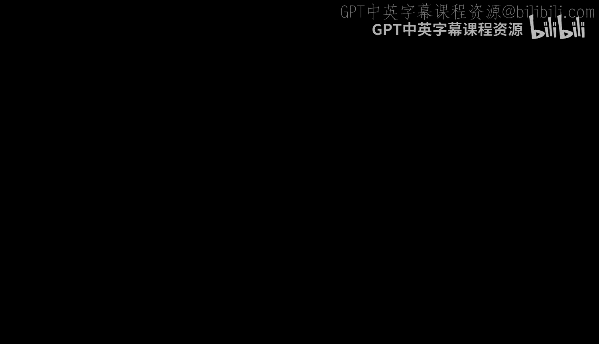
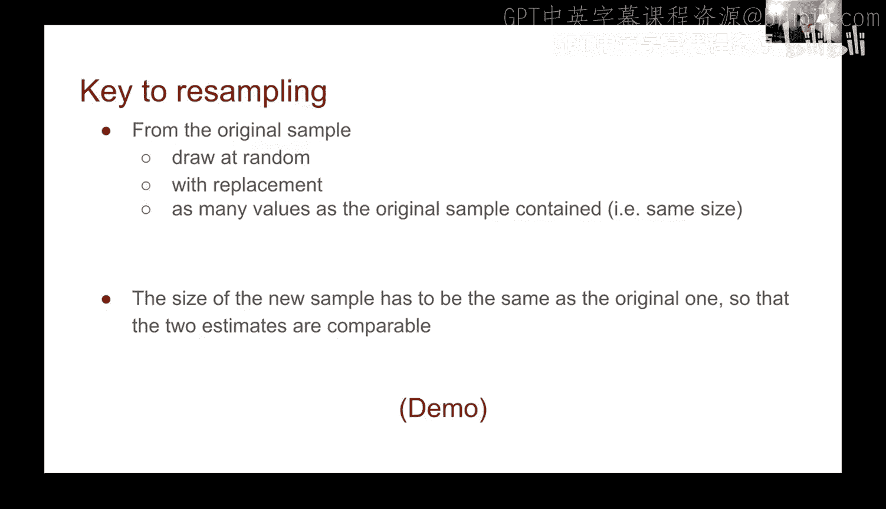
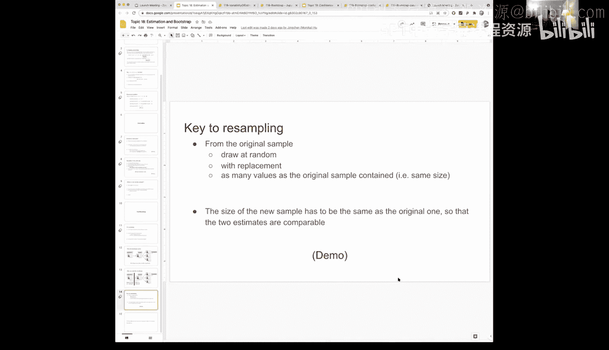

# UCB《数据挖掘和分析｜DATA 144 Data Mining and Analytics 2021》中英字幕 p58 [P58]lecture58-[T18 Estimation and Bootstrap] Bootstrap-TMSzc7udzJA.zh_en [BV1efBEBuEVg_p58]

All right。So hopefully I didn't leave you hanging for too long if you were watching the video。

 so are we stuck so how do we get multiple samples and to the rescue with this very powerful technique called the bootsottrapap。

And so how does this work？So。What we're going to do is we're going to simulate repeated random sampling。

And so what do we mean by that well so again all we have is that we have the population which is too big to sample take a c of and get the entire population so all we can do is sample and we just have the time and resources to sample that once okay so all we have is this original sample。

😊，And so presumably if we've done our sampling right've we have a large sample with respect to the population we're trying to measure and it's random okay so that's key we want to make sure that our original sample is large enough and truly is random so if it is large and random we can make the argument and we've made the argument in the past and we've seen this if our if。

Our sample is large enough and random enough it resembles the population itself and we saw as our sample got larger it became it resembled the population more you know the larger it was the closer it resembled the population okay so but if our sample is large enough and random it probably is a good representation of the population and this is that's the key that's the kind of the key crux here and so what we can do is since that sample if it was large enough probably it resembles the population we're going sample。

😊，From our original sample so we're going to sample at at random our original sample and that is the bootsstep bootsstep process bootstrap and and I think the picture you know kind of kind of drives this point home okay so we have。

We have on our right there the population and that is unknown right this this distribution here for a particular sta is unknown。

 but we can do a sample if that sample is large。It resembles the population。

 so what we're going to do in the bootstrap you know technique is is we're going to assume that the sample is our population。

😡，And what did we do back you know the previous part of the course that's what we did was we took repeated samples and so we're going to resample the original。

We're going to resample the the sample the first sample that we did okay and each one of these resamples is going to be now a new it' going to generate a new estimate for us okay and because the sample that we took is original enough to the population this technique will work out well this technique will work out okay and so again why are we doing this it's worth reiterating this point。

We wish we could get the entire population， but you know what's on the left hand side you know but all we got was this sample and so this we're going to treat this sample as if it were our population and we're going to take repeated samplings from our sample and so we're going to call them resamples okay？

😡，Okay。Okay， and so the key to making all of this work is is that。

The reampling must be from the original sample okay， so we've taken that one sample。

 we're going to resample from that and we must draw at random okay。

 so it has to be a random sample from there has to be a random resample。

And and this is important right this is this is very important we're going to do this with replacement okay and this is different than what we did when we got the original sample when we do the original sample right we did it without replacement we're not going to ask the same you know surveys twice of the same you know individual but here we're going to do it with replacement and why why we're doing this because。

When we do the resampling when we do the resampling we are going to resample as many times as the original sample contained okay it's going to be the same size so in the example that we looked at when we sampled the population。

 we took 300 samples， each resampling is going to be 300 so we're going to resample that population and if we did it if we did it without replacement。

 if we took the same number of if we took the same number of samples we took 300 samples without replacement。

Well if we kept drawing them out would what did we get we didn't do anything at all we just got our sample back right so if we did it without replacement we just get the original sample if we took all 300 samples so the key here is that we're going to do it with replacement we're just going to draw randomly from that。

😡，You know when we take a value we'll put it back and then we're going to draw again okay and we're going to do it as many times we're going to do it the same number of times and that is going to allow us to compare the bootstrap the resamples to the original sample okay and so that is that is kind of the ground where those are the rules。

Let's now。Take a look and while I kind of set up the demo， any any questions about that。

 I think the demo will help make it clear。

But I'm happy to entertain any questions。Okay。🤧Okay。All right。

 so we're going to stay with our San Francisco data。And this is just loading it in before。😊。

And then here's the number of rows once we've taken once we've gotten all the。

The non part time people， people， once we've cleaned up the data。Again， just like before。

What we're looking at here is the actual population， the actual population。

 so this is the distribution of the ground truth。😊，嗯。From here， okay。

 and thens that's the same result that we got last time， good。Okay。

 so then now so that's our that's our ground truth that's our that's our di populations and now we're going to take our random sample right we did this before。

😊，And again， so we're sampling our original population down here and so we're going to do it with。

Without replacement， okay， without replacement， so with replacement is false。う。

Okay so now that's our sample that's our sample and we can see I can't fit everything in there but you can see it's pretty close it's pretty close and so what we're going to do is is we're going to treat this now we're going to treat this sample as our population okay this is going to be our population and now we're going to calculate statistics from this okay and again down here we just calculated so this is the truth the population median ground truth and then here is the sample median right but from this statistic from there and you can see it it's again not a perfect reflection of。

😊，Of our ground truth， but it's pretty close。So now what we're going to do is。

We're going to have it write a little helper function that just samples one mediumn this is this is not this is not new we did this before and then we're going to accumulate okay。

 but the difference here is。😊，So is this is our one sample， right， okay。嗯。😊。

So yeah so what we're is this is just a repeat of what we did before and so this is getting the distributions from the truth。

 okay， so this is not the bootstrapping。RightBecause we're drawing from our original sample without replacement。

 okay， and so this is what we looked at before。😊，Um。

This is our population median the red dot is ground truth and this is the distribution from the population okay so that is all kind of setting the stage that is what we looked at last time。

So now we can use the bootstrap， okay？So。What we're going to do is we're going to sample our original population。

Um。Right， right， so our sample here。Let me make'm sure I get this right yeah so our sample this our sample is our sample from the original data。

 so this is the one that we're going to be using from from now on。And so this。Again。

 now because we have with replacement with true， this is going to generate a bootstrapap sample。

 this is going to be a resample。We're going to sample with the same size。

 the replacement is true so that's going to generate a new sample which then we can look at。Okay。

This is now one。This is one resample this is one resample so now we have three statistics okay that we're looking at again all of them the media median and so here the first one is ground truth。

😊，This was our sample median。😊，And。The bootstrap was a resampling of。

This of this data of our sampling data， okay， and because it's random with replacement。

 you're going to get a different result each time。😡，Because you're going to draw。

Of that over those 300， you're taking 300 samples， but again， because it's with replacement。

 you're going to get some variation around that。U from there， right。

 so I mean we can just run this again。And we can see we get。Different numbers in this case。

 wow we actually got the bootstrap sample medium was the exact same from there， but again。

 that is not always the case from there。😊，Okay。So then what are we going to do same technique that we did before so now that we now that we're now that we're resampling the population we have kind of the framework set up for that and now we're going to do that we're going to do that a certain number of times 1005000 10。

000 for this example just the book is using 10，000 from there just so I can run these demos fast I'm just going to do1000 and I want to make note is again we're using our sample we're using the original 300 sample that we got from the population data right notice in here in any of in any of these statistics you know SFPop right our original table was not harmed in the making of this was not used at all from that。

And so again， this is the same function， computing one statistic。😊。

From there it's going to do the resample and calculate our statistic our median from there and then once we have our helper function we're just going to do that a thousand times and then now we can look at the we can look at the distribution from there okay and we can see the ground truth the ground truth our population median is red so that is actually ground truth and here is。

😊，Here's the distribution。Of our medians right so that is the the distribution of the thousand trials and if we take our sample median from that we can see our blue we see that it's actually it's pretty close it's pretty close to that Okay so resampling if our original sample is large enough can give us。

😊，Could give us an estimate of the statistic that we're interested in right again you know in the in most cases we wouldn't know what the red dot is and so what we're generating is is we're generating with the blue dot an estimate an estimate of that statistic and how are we doing it we're taking an original sample and we're resampling that 1 thousand。

10000 times and computing the statistic。Um。From there。Okay， any questions？Yes。Okay。诶。Great。😊。

Fantastic， all right， so that is the bootstrapping technique。😊，And again。

This is an important technique that kind of will come up again and will the next the very next topic we'll talk about a use for that。

 but again I just kind of want to kind of。Reiteerate kind of at a high level what the framework is so once you know the framework coding up coding it up is straightforward and I want you to think about kind of what the framework is doing at a high level and so kind of when you do these exercises you can think about what's going on and not just copy and paste the code from a similar example so you know it's like oh all right here's a bootstrap here here you know I may just cut and paste that cell I just want I want to think conceptually kind of what we're doing with this right。

We're going to take an original sample of our population。

 the population is too big to measure completely， so we're going to take a sample from that okay。

 and that's going to be our sample。And to generate and so we want to basically get some estimate of some statistic on the population in this example here was the median salary okay we don't have the entire population so the best we can do is an estimate of that statistic。

😊，And so we're going to do that by taking a large and random sample of the population and then what we're going to do is once we have that sample。

😊，The bootstrap technique is going to be we're going to resample。

 we're going to resample that sample and so how with。With replacement。

And so whatever that sample size is， if it's 300， 500， however that original sample size。

 we're going to do that， we're going to do that， we're going to do that random sample and then calculate the statistic on that。

Okay， and then。We're going to redo that， we're going to redo that that resampling。

ths0 times or a certain number of times， and then from those resamplings。

 we get we can get the an estimate of the statistic that we want。Okay。All right。

 let me stop the recording here。

