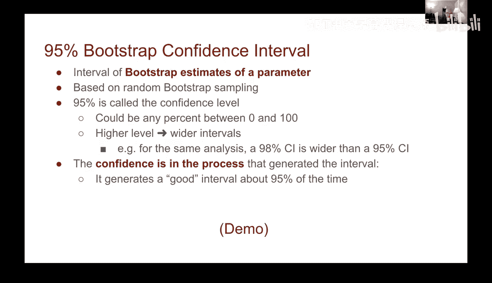
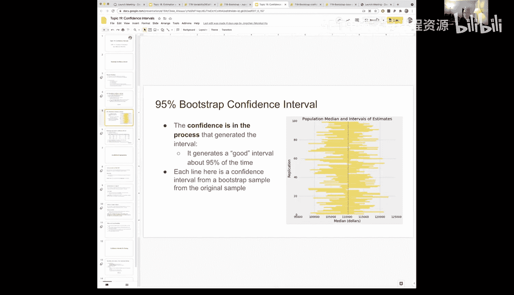
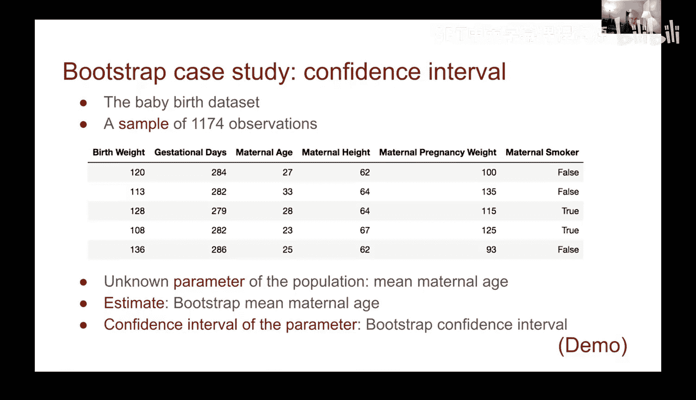
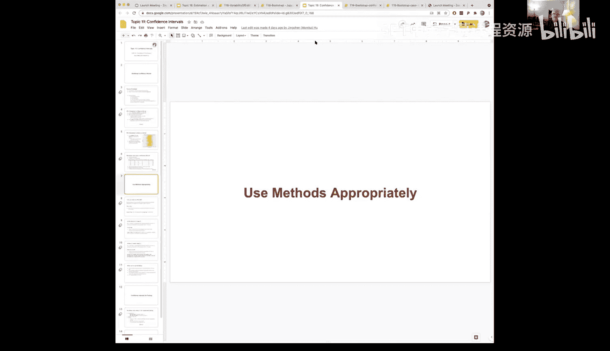
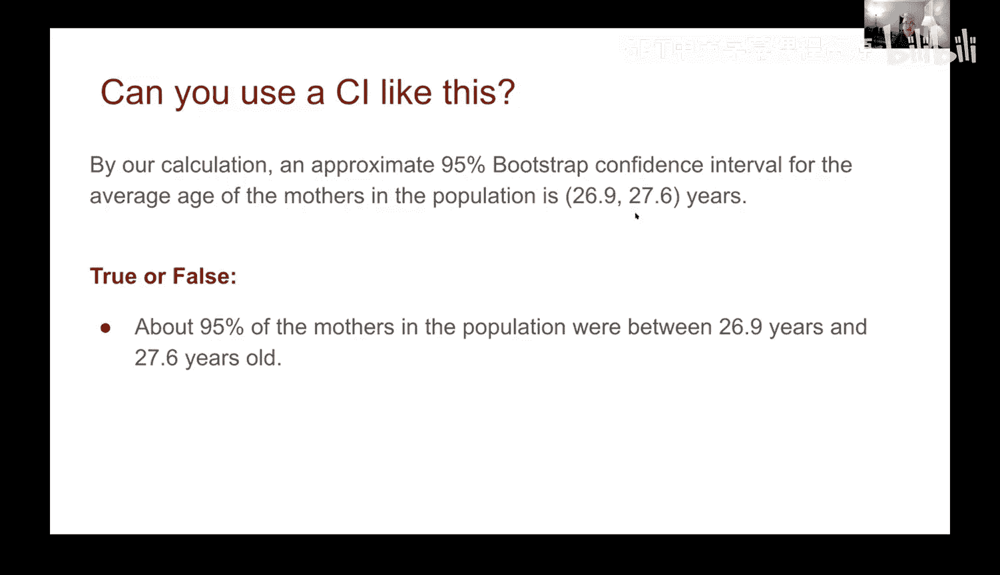
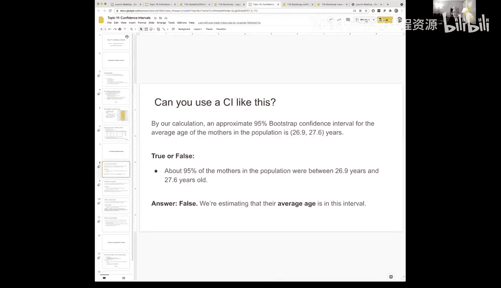
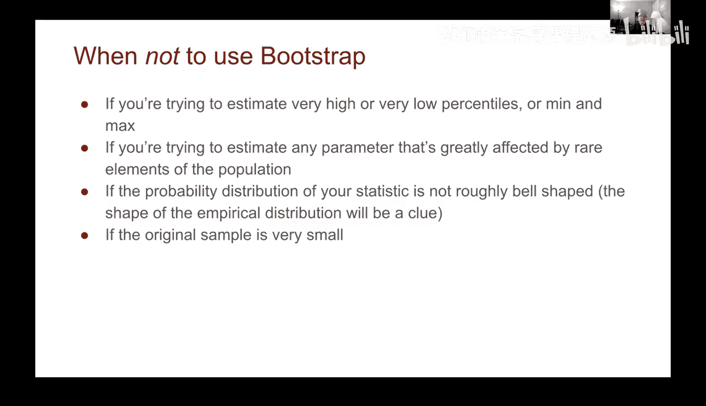
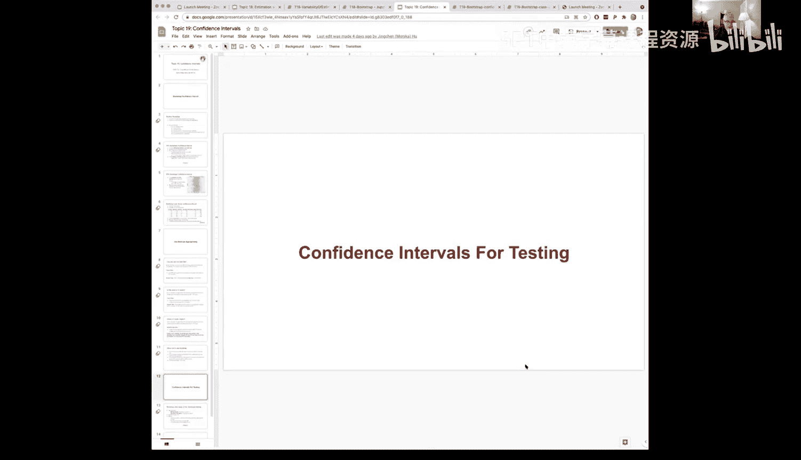

# UCB《数据挖掘和分析｜DATA 144 Data Mining and Analytics 2021》中英字幕 p59 [P59]lecture59-[T19 Confidence Intervals]-H9INJPvOt2c.zh_en [BV1efBEBuEVg_p59]

Okay， so now we have this bootstrap tool in our toolbox and now this is going to allow us to generate estimates of a statistic from a population and we'll do this through this bootstrap and this resampling technique。

😊，And so then when we come up with this estimate， the next logical question that we may want to ask is how good is that estimate。

 how good is that estimate， and this is where confidential interval roles are going to come into play。

🤧And so again， the bootstrap， right， we're going to sample with replacement and again the keys for original。

 we're going to draw it random with replacement and then when we resample it has to be as many times as the original sample contained so we can compare the sample to the resamples。

Okay， and so that allows us to compare the estimates from there。

So now let's look at a 95 bootsrap confidence interval， okay， and so what does that say？

🤧Instead of instead of thinking of returning a specific statistic as an estimate。

 what we can do is can we can return an interval of estimates on that parameter on that statistic okay and so and so instead of saying the estimate is x we can say that it ranges from a high of some value to from a low sum value to a high of some value so we're going to give an interval and the size of that interval is going to be based on this confidence and we'll talk we'll talk precisely what this kind of confidence in this 95%。

😊，Is going to be。And so and then there's there's nothing there's nothing magical about this 95% bootstrap conference interval。

 I pick 95 because typically we do p values of 5% so but it really could be any percentage between zero and 100 from here and so the confidence interval and again I know I'm being big I haven't just defined exactly what this interval is yet。

 but the higher the level。😊，The higher the confidence the wider the interval is going to be and we're going to see we're going to see this so i'm going to come back to this so if we had a confidence interval of 98 which that's going to be wider it's going to capture more of the data and so basically what we're going to say and we're going to see this in the demo is that when we say we have a 95% boots bootstpped confidence interval what we're going to say is is。

When we run our reampling， when we do our reampling， 95% of the time。

The the estimate the statistic is going to fall within the range of those parameters okay and so if we want to say you know 98% of the time the our interval captures the the the statistic。

If want to you know if we want to say that it's going to fall within 98% of the time。

 it's going to be wider we're going to have to capture more the of the histogram from there okay so that's why the larger the confidence interval。

 the wider the range is going to be。And so what we're specifically saying is is that 95% is our confidence in the process that generated the interval。

 so specifically what we mean is is that what comes at the end at this interval。

 it's going to be a good interval about 95% of the time and I'll be more precise about what good means in a second。

Okay。うん。Yes。Okay， so confidence intervals， Okay， so again， staying with。Staying with our population。

 our San Francisco data。🤧One bootstrap and so this is again our resampled because we're using our sample from our data and then。

We're going to make。We're going to do that we're going to do that a thousand times and then we're going to get a distribution okay and so now here's the thing so that all of this is the same this is the straight up classic bootstrap all of this code is exactly the same from here and so now we have our we have our distribution。

😊，And so here， let me。Let me just restart this and clear the output。From this again real quick。Okay。

 and so now what we're going to do what we're going to do is we're going to take and so we saw from from last time right when we we did this experiment down here。

 we got this distribution， we got the distribution of our。Of our statistics， okay？

so what we're going to say now is is we're going to look at that we're going to look at that distribution and we're going to look at the left and right and we saw it' kind of roughly bell curve shaped and so we're going to take this 95% from the middle。

Of our results and so we're going to take the left and the right and so since we're going with 95% the basically we want the 95% in the middle so what does that mean for the tails that means the tails is whatever's left over that's going to be 5% and it's going to be two and a half% on the left and two and a half% on the right okay so we're going to make we're going to take all of our medians and we're going to get the left and the right right percentile so we're going to get the left edge and the right edge from there。

And what we're going to do then is now is we're going to plot out that histogram like we had before。

 okay？And what I'm showing here in gold is that range from the  two and a half percent to the 97 and a half%。

 okay， and so that's our 95% confidence interval。And so because we have with this San Francisco data we have the ground truth and so we can actually know what the actual truth is and that is what I print out in the population median is colored in red okay so that's the ground truth and then。

Our sample meeting was shown in。In gold， sorry in blue。

 so that is kind of the the sample from all of the the sample medium from all of our runs。

And then the interval shows the confidence interval so this is oops sorry this is all of the runs that fell between two and a half percentile and 97 and a half percentile okay and so what we're saying is。

What we're saying is that。We believe that that our estimate is going to fall in that range。

95% of the time， okay， and so what is this process looks like？Okay， take a sample。

Use it many times to bootstrap and then use the middle of the bootstrap medians as our confidence interval。

From there。Okay， and so putting all of that together。

We get this process and so this is just this part of the down here this is the part that you want to kind of keep as your reference and this is the entire kind of bootstrap process from soup to nuts from A to Z from going from our original sample calculating our original sample here's our original sample mean and then we're bootstrapping from there right so we take our original sample from our population and then we bootstrap off of that the one bootstrap median。

Uses the R sample from there， we do it a thousand times we get the left and right percentile and then we plot out the confidence interval there。

 okay。All right， so what does this mean， All right， so now。

I want to kind of give a more formal definition of what we mean by this confidence interval okay and so this is the this is the confidence in the process that generated the interval okay and what do we mean by that we mean it generates a good interval about 95% of the time and so。

What this graph is showing what this graph is showing here is is that again with and this is from the San Francisco data set and so。

Since we have the entire population， we can calculate the population median and that is the line shown in red here。

 Okay， so this is ground truth line， the red line is the truth okay， and because。

Because we have all of the data， we can run the sampling process。

 not the boots spec process because we have all of the data we can run the sampling process just like we did before we can take。

We can take a sample， an original sample of the data without replacement。Okay。

 and with 300 examples and then we can。With that sample， with that sample， then we can。

🤧We can run that。We can run that a thousand times and generate one of these lines okay so each one of these gold lines is showing a sample。

 a 300 example and then we bootstrap that and then we run that and that the bootstrap process gives us this confidence interval that gives us this range right and we said it for this example to be 95%。

Um， and then and so that is one of these gold bars here is one trial， the 300 the bootstrap。

Generate the interval okay because we have the actual data we can do that process the entire process going from the original a new 300 sample then do the bootstrapap then generate a new confidence interval and for this for this graph here we did it 100 times okay so this is the equivalent and is this is not something we normally can do this was the equivalent of doing 300100 of these 300 samples okay and each one of those because we get a sample we go through the bootstrap process generates a confidence interval from there and so what we're saying about a 95% bootstrap interval' so by comparing to ground truth the ground truth。

What we're going to say is that this interval where the ground truth lies within this interval。

About 95% of the time and that's what we mean about what we mean that it's a good interval a good interval means that somewhere in that interval is the actual statistic in this case the actual median salary okay and if you look at these trials if you look at these0 trials you can see that the line the gold line is actually encompassing oh let me put this on present so you can see bigger sorry you can see that it actually falls in most of the time and if you look where are the places where it's an outlier we have it here right here so one2 it looks like maybe this one34 So again。

 this is all random so it's gonna to be about 95% of the time and so by you know by actually looking at ground truth we can see that it did generate the statistic。

 the interval the ground truth was within that interval about 95% of the time okay so that's what we mean when we say。

Our confidence interval when we say something has a 95% confidence interval。

 we believe we have the faith in the process that generated it， the process that generated it。

 we believe that is going to generate an interval a good interval that has the ground truth in it about 95% of the time okay and so now you can see how of now that you kind of get a sense of the definition。

 you can see that if we had a 99% confidence interval。😊。

Right that interval is going to have to be wider because we want to make sure that the ground truth gets captured you know 99 out of 100 times and conversely if we had an 80% you know confidence interval we're only trying we're only making the statement that our process will generate an interval that will have the actual ground truth statistic about 80% of the time from there okay all right so that was like kind of a lot to throw at you。

Any questions about this？Yeah。All right。U。Well， then let's look at another case example kind of to drive this point home。

Okay， so the next so what we're going to do is we're going to shift data from the San Francisco population data to we're going to come back to a data that we a data set that we've looked at before。

 this is the maternal data set we looked at again we saw we saw this data set when we talked about the smoking lead to smaller birth weights okay we're going to look we're going to take the same data but we're going to look at a different statistic and this so in this case。

In this case， right， we're going to same the baby birth data set and so this right now so this。

Is an actual sample okay， so this is different than the San Francisco data set which was the complete you know population of San Francisco public you know public city workers right this is a sample right sample because。

😊，What if you think about the population， the population is mothers。

 you know pregnant pregnant women right so the whole population is obviously not all of you know the pregnant women so this is a sample so this is going to be a sample right so we don't have ground truth in this case。

And then the statistic， the parameter that we're going to be interested in is is the mean maternal age so on average how old。

😊，Ourre them are these mothers， okay， and so we're going to do an estimate。

By bootstrapping the mean maternal age okay and then we're going to generate a confidence interval of that parameter from there okay then this is different because we don't actually have a ground truth but hopefully i've convinced you by looking at the San Francisco where we did have the the ground truth that theres that there's some confidence in the process itself。

Okay。So let's take take a look。And again this is our baby table and then the the thing that will'll be interested in this column here is maternal age from there and if we look at the histogram from that you can see that there's kind of a interesting kind of belt you know distribution from here it kind of kind of looks like a peaks like around。

😊，You know， somewhere maybe like around 26， 27， and then it kind of tails off from there。

And so we don't have to just eyeball it we can use the power of Python to give us the mean okay so we're just what we're doing here is we are just computing the mean from after we extract the maternal age column down up here okay and so our sample mean and again right this data is a sample is about 27 right so eyeballing was actually pretty good。

😊，Okay， so now。Let's get a confidence interval about the mean and so again we're going to follow the exact same paradigm we're going write a little helper function that's going to do one bootstrap mean and so remember this is our sample and so this is going to be the table and so we're going to do we're going to use the birth table and we're going to sample and we're going to sample because this is our sample we're going to sample all the rows because we want to resample right because there's not taking a sample from the population this is the sample from the population so this is going to be the resample this is what we're looking at right now is the resample of our sample and the birth our sample so because we're doing the bootstrapping resampling we're going to have replacement be true。

From there and then now we want to just extract the maternal age again and just like we did up here。

 we're just going to take the mean from that from there okay so this will generate one this will do the bootstrapping process right it will sample for the same number of times as is the rows right of our data and this is a nice technique using the number of rows as opposed to hard coding the number of rows in because for example maybe you decide you wanted to eliminate smokers right from that and created a new table of births right by using kind of the number rows no matter what the number of rows is it's going to follow any changes to the table。

From there so that helper funder generates one sta for us and again this is this just is just nothing new here。

 nothing new this is going to now that we have our one statistic right we're going to run our accumulator pattern to collect1000 of them and then we're going to look at the 95 confidence interval so we're going to take 2 and half% on the left 2。

5 and then 97 and a half from there。And then。😊，Once we have all of that then we can plot right so we have our bootstrap means and we're just going to turn it into a table and then take the histogram of that and then we'll just look at the intervals and then we'll look at the sample mean as well。

😊，From there。Okay。😊，And so now if we look at this， if we look at it。

 so the sample mean right so if you remember what the sample mean is。

 this was the mean that we took from our sample， that was the thing we got up here and so this was the sample that we got this is the mean that we calculated and then from the bootst process we've generated this 95% confidence interval。

😊，So we've gotten the high， the low and the high and。

And so what we're saying about that is is that we expect， you know， because of our process， again。

 we don't， you know， this is。Um， we don't know what the ground truth is。

 but we expect because we have faith in our process that ground truth would be between 2026。

89% and 27。58% that the ground truth would fall somewhere in this range， somewhere in the gold bar。

Okay。Any questions， any questions about that？Okay， so。

With great power and the bootstrapping technique is a very powerful technique with great power comes you know great responsibility and so it's good to know kind of what exactly is this technique doing。

😊。

Um， and kind of knowing that allows us to kind of， you know。

 make sure that we're using these methods appropriately。

And so I'm going to ask a couple of questions about the confidence interval。

RightSo kind of what we looked at， we saw that by our calculation。

Our approximate 95% bootstrap confidence interval for the age of mothers and the population is 26。

9 to 27。6 years okay， so another question I want to ask you is true or false。😊，T or false。

About 95% of the mothers in the population were between 26。9 years and 27。6 years old。

Is that a true or false statement？It's false。Yeah， and so it's it's if we go back。

 if we go back and actually look at if we look back。

At the bootst， yeah， if we look at if we go back to the beginning， right this。This was。

The histogram of the maternal age right so what was that question asking that question was asking 95% of the mothers in the population were between 26。

9 and 27。6 right so so another way of saying that are we saying about 95% of the mothers fall between heat you know between you know kind of where right where my cursor is？

And you can see that that is very clearly not the case right if you look at kind of the percent per unit right this is that that narrow band was about a year and each of these bounds are much larger than a year each of these bins and you can see that the percent per unit right is like seven for that so very very very obviously that that is not what we're saying so where is where is the confusion coming from here right the confusion is coming from or why maybe sometimes you may think that well the confusion is is that。

This is not we're not saying anything about the distribution were remember the distribution our confidence interval is over a statistic and what is the statistic we are we are estimating the average age in this that in that is in this interval right so we're not we're not saying that。

All that that。Um。That all mothers are between that， we're saying that the average of the population。

Falls within that range it's our estimate right so we're giving we're giving an estimate we're giving an estimate we feel like you know with 95% you know probability that the actual the actual statistic the actual population average age of the mothers is between 26。

9 and 27。6 right so that's the average age across the entire population not that you know that's just that's just saying that's just saying you know if if we gave a midterm and the average was 85 you know did。

You know you know， and if I took a sampling right， that's just， you know。

 it doesn't mean that all grades kind of fell you know， within that range。

 it just means that the statistic that we calculated。

Okay so I think that one that one I think was look this one I think is a little more subtle okay this is another question here it's the same thing right by our calculation the bootstap interval for the average age in the population is from there so true or false okay there is a 95% probability that the age of mothers in the population is in the range the average age is in the range of 26。

9 to 27。6 okay。😊，True or false。Let me I actually I want you to discuss this a little bit we won't take too too long。

 but let me send you let me let me create some breakout rooms。😊，For there and then let' let's give。

I want you to talk about that first， so I'll send you just for like about two minutes。

From there and then' we'll come back。Make a consensus。I think so yeah。

 what did you guys come up with？So。If the wording is the same。

 we're 95% confident that the actual value we're looking for is within that range。

And so you would go with true yes true and I see why you get this I see why you you get this and this is exactly why I kind of asked I asked the question and it seems very logical to kind of think about this you know I feel like this is a little bit about kind of weird semantics。

From there， but I bring this up to kind of drive home the point so the the answer is actually false and the reason why it's false iss actually it's actually very subtle okay and because。

😊，And when I kind of first all the question， my gut reaction， you know， you know。

 I think most people， their gut reaction is especially the way we've kind of the way I've kind of described it is is that。

 yeah， you know， that it means there's a 95% probability but。

If we if we look specifically at what the question is asking， right。

 we're saying that the we're asking about the probability that the average age of the mothers in the population is in the range and that that's kind of the fatal kind of flaw in this argument because the average age of the mother in the population。

 it's unknown。But if we knew it， it's not a range， it's actually a statistic there's nothing random about it and this gets to the fact of when we talk about a probability。

 when we talk about a probability there has to be some randomness involved with that like the probability of rolling a dice。

 the probability of flipping a coin， there's a random element in it。And in this case。

 the statistic is actually a statistic， it's unknown， it's unknown。

 but it is it is there is no uncertainty with it。😊。

And so this gets to the value of this is that probability that 95% is our confidence in the process。

m from there and so you know I feel like this was a little bit of a tricky question this was kind of I feel like is a little subtle as a little little slide of hand sort of there。

 but you know but it's good to kind of tease that out and and what do we mean where is this this this confidence where is this probability coming in it's the probability in the process not in the statistic itself。

From there。🤧And so what does this really mean right and so this gets down to the point of。

Just in the interest of that because we haven sent you into the breakout room so hopefully had good I won't send you into the breakout room for this from there right so so if it's if it's not the probability of the of the that the statistic falls into their range so what what what are we actually saying what we're saying is。

Remember right what what are we doing through the what are we doing through the bootstrap process。

 the boots strap process that if you think about it in terms of inputs and outputs as if this were a function right of some some black box。

The thing that kind of gets the thing that gets the input to this。

 this whole black box is our sample。The thing that gets spit out is an estimate of our statistic。

 it's an estimate of our parameter。😊，And so that's the thing that gets you know spit out of this whole process and so what we're saying is is that by our estimate the thing we spit out that the average age of the mothers in the population was within this range。

 was in this range we don't know what the truth is， but。

The average age because because the average because of the statistic is going to be somewhere between between these two and that。

😊，The process that we've generated that we've used to generate this right this whole bootstrapping process is going to be correct about 95% of the time okay so this is this is the so we're using a process to spit out this number this range this interval and that confidence interval that confidence is our confidence in the process it is the confidence in the process that that number that we spit out is correct 85% 95% of the time that the ground truth if we had some way of knowing it was within that range was was it was within our confidence interval 95% of the time okay does that。

Does that does that make？Does that that does that kind of resonate does that resonate with you guys？

Um。Or are there questions about that？嗯。The confidence is in our process。

 that the process that we use 95% of the time， the ground truth lies within that interval。

And that's all we're saying and we're not saying anything more than that。From there。Okay。

And we'll get practice， we'll get practice using this。From there， okay so。

So that's the technique and so then the question is right it's a very powerful technique but but again it's just the technique right you see it's just an algorithm you can just treat it as a black box and you can use it on anything right you will get an answer if you give it a sample you run it through the process you will get an answer you will get a call interval out。

😊，But are there cases is there cases where it's not a good idea to use the bootstrap right the bootstrap is not going to tell you hey maybe you don't want to do this right it's just an algorithm it's just going to spit out a number from there and so that's you know I think the thing I worry about is is that once we learn a technique you know we we you know so it's a model right we building this model and so there's going be conditions where the model applies and there's conditions where it doesn't and so it's worth highlighting the cases when using a bootstrap is not a good idea okay so。

Right you know noted it was not a coincidence that a lot of the statistics we were looking at for was kind of these these medians using bootsottrap when you're trying to estimate very high or low percentiles or min and max。

 it's not a good fit and you can think about why this is right if you just think about the process itself。

Where we're taking that initial random sample right and presumably presumably we have you know taken our sample large enough that we've captured the spirit。

 but if you have like a very long tail distributor or you have some outliers。It's very， it you know。

 if you have like a small percentage that are kind of dominate those sort of things。

 our sample may not capture them right our sample may not capture them or if you're trying to go for Min and max。

 you know that can kind of get us into trouble from there。

And then kind of you know kind of tangentially related to kind of what I said about that if there's if there's some parameter that is affected by rare elements in the population right if you have like one data point that is actually going to greatly affect right so like it was a very maybe bimodal distribution or something like that or you just had like a really big kind of black swan event type thing that really affected the actual truth right because then。

Then it really comes down to the fact of did you capture that in your original sample and in the resampling right if that you know。

 so even if you caught it in your in your sample， the resampling because you're sampling with replacement。

 there's no guarantee that if there's like some single event or some single data point that greatly influences is that it's going to necessarily be captured from there。

And。You know a good way to kind of you know a sanity check right so you know these these are good rules of thumb to go by but a sanity check that I hope that you always do when you're kind of doing the bootstrap is is is that you look at the probability distribution of your statistic right you're computing statistic and when you do the bootstrap you're going to do it a thousand。

1000 so you know however many thousand times look at the distribution of your statistic okay if it's bell shaped。

Thumbs up like we have some confidence that this is going to be good if it's not if it's not that's a sign that maybe the bootstrap isn't going to be you know going to be representative of that and then the last thing is if your original sample size is very small okay remember where this is all predicated on that the sample that we take is an accurate reflection of the greater population and that happens when that sample is large and random okay all right this is a perfect place to stop。

And we'll pick up kind of this idea of using confidence intervals for doing testing next time。

All right， we have a couple of minutes。

