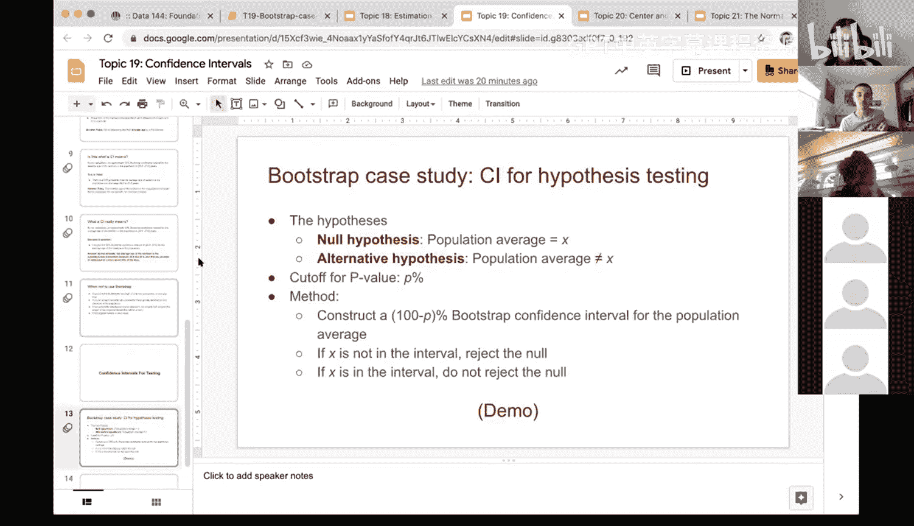

# UCB《数据挖掘和分析｜DATA 144 Data Mining and Analytics 2021》中英字幕 p60 [P60]lecture60-Confidence Intervals for Testing-uWbecLW7jm8.zh_en [BV1efBEBuEVg_p60]

Okay， yeah， so for today， we're going to review a little bit of， I think， boosttra， Okay。

 so we were on topic 19。

Last time so let me share my screen Okay we're on topic 19 last time where were yeah。

 where we started talking about confidence intervals Okay。

 and then of course the confidence interval down here Yeah。

 the confidence intervals that we have been talking about is under the hood of doing bootsrap okay so I guess it's a good chance for us to take a moment and then think about and review a little bit about what bootst is doing and then of course from that how to do confidence interval and we're gonna wrap everything into a case study which is one the second notebooks here Okay so。

Remember the bootsrap， okay， so if we come back here， okay， the bootstrap。Okay。

 if we do a quick review over here okay so Bot is necessary or useful。

 I guess it's necessary in this case that if you only have one sample okay but you want to figure out certain uncertainty or like the variability of your statistic and then if you only have one sample one way you can still create a repeat a sampling scheme is to sample a random from the original sample with replacement okay so that's what we mean by this line okay and in practice as you know in Python what you do right is you do the sample method with replacement and then we also make sure that remember bluet sample should have have the same number of values in the original sample okay so like whatever end that you're doing okay is should should be fixed as the size of the original sample and this two conditions here are done like I said by the dot method。

Do sample method and then make sure that you do replacement replacement is true okay so that I think is what we have introduced how Botrapap is done Okay and then also if we come back to top 18 the slides a little bit again just also talk about why Botap works okay so we have a population right unknown out there。

 we don't know what it is okay we have a sample that can be a good estimate right of the population so the bootstap works in a way that we are repeatedly sample out of the original sample with the same size okay so you're able to come up with a bunch of resamples okay so they will be slightly different of course from the sample that you have okay but they're overall similar to some degree and then let's just say we're interested in just like what we did before in the hypothesis framework let's just say we're interested in in a particular statistic like the mean of in this case I guess the compensation let's say we're interested in the mean of the total。

okay and for us the each resample right we're able to compute the total compensation。

 the mean of it right And then we do that again through a loop okay for a large number of times。

 And then from there we're able to come up with the empirical distribution right of the statistic。

 which is the mean okay and then from there we can do our hypothesis as usual Okay so this is a quick review is okay。

 but like I said， we will be doing a case study Okay how to use confidence interval like how to come up with a confidence intervals in the first place。

 Okay and then how to understand what a confidence interval mean and then lastly。

 how we can use instead of a P value， but use confidence intervals for testing。Okay。

 so this is the case study that we're gonna center on Okay but I just want to also just bring us back a little bit to like say the graph last time we covered what is a 95% booststr confidence interval Okay so in practice what we do like I said。

 you get a bunch of you get a bunch of re samplesles right and then from each resamp you are able to get a mean let's just say that's the stat they're interested in right let's just say we do it for 10000 times okay and then were gonna have 10000 resampled mean okay and then from there we are able to construct a confidence interval Okay so if we come back to what we mean by confidence interval Okay we are figuring out 95% confidence interval out of the 10000 mean statistics that we have computed Okay so this is where if you remember what the。

Perscentile is gonna be useful， right， Like the confidence interval we're trying to get the middle 95%。

 Okay， so if you remember last Tuesday， we talked about how to do the percentile and how to understand percentile in percentile。

 you first store the data right from the increasing order right like smallest to the largest and then whatever percentile that you compute is sort of like counting how many is below that value Okay so that is why if you want to get。

 So remember the boostt confidence interval right is based on all the boost samples and the statistics that you able to get。

 So let's just say we have 10000 means okay of the total compensation Okay and then we store them up right we store them from the smallest to the largest Okay and then if I get the cutoff point at 2。

5% at the lower end。And then 97。5% at the upper end。

 then with the percentile method right so then I will be able to narrow in into the middle 95%。

Okay and then that's how actually in Python how we gonna get that confidence interval okay so what this is telling us just to repeat and review a little bit is that this interval is the interval boostrap estimates of a parameter okay our goal is still about the total like the average compensation in the population okay it is computed based on random boostrap sampling okay and 95% is called the confidence interval because well you can do 989597 things。

 things like that， whichever you want to do and the higher the confidence level。

 the wider okay the confidence interval and you could imagine right like for 95% we get 2。

5% to the 97。5 if I want to get a 99% I do from the 0。5% right to the 99。

5% so thatll be able to include the middle 99 okay so this value increases the width of the confidence we're gonna increase okay not surprisingly okay and this as you。

See that will be related to how we're going to use the confidence interval to make decision Okay so if you remember for hypothesis testing we have those P value calculated right based on the repeat sampling sampling that we do and then we have those cut point like5% to mean statistically significant right1% to be highly significant statistically significant so those values can also be translated into doing confidence intervals and then confidence interval can then be used as a hypothesis testing tool okay so we're going to see that。

And lastly， it's very important okay to you understand what a confidence interval mean Okay so this graph。

 if you remember， is a example， okay of the median。

 I think a media dollars probably I think out of the total conversation as well okay and then what we really mean by confidence interval okay especially 95% confidence interval is that let's just say this red vertical line that's the population median okay and then every time right we take like every time we take a confidence interval from a bunch of bootsraps。

 we are able to come up with one oops one interval like as one of the lines over here is the yellow one okay so what this is saying is that a 95% confidence interval what that does for us is that if we were to repeat the whole process okay for coming up with a confidence interval for like 100 times they're roughly about 95 of them going。

Cover the true population medium。Okay， so this is why if you' remember， Okay， we try to highlight。

 can you use a C like this， right， Like what is the real meaning of doing a confidence interval。

 So it is very important。 So first of all， it's usually about either like average age or like parameter right of the of the。

Of the data not so much about like all of the data points okay so that's one thing very important to know about the confidence interval okay also is how to understand it's not about like a 95% probability that the average age or average mean will be actually in the interval is that if were able to do this for a large number of times 95% of the time that we're able to capture the parameter okay so that's why just to final review over here。

 which is what a Ci really means okay so in this case by our estimate the average age of mothers in the population was somewhere between this two values that we calculate from this set of boostrap samples and that our process of estimation is correct about 95% of the time okay when we say that this is saying that okay if I now go ahead do another set of 10000 boostrap samples and that I get another 95% confidence interval then I do another I do another if I。

Do that for a large number of times then about 95% of the chance I will be able to cover like using my interval right to cover the truth okay so hopefully this is a useful review but like I said now let's come to the confidence intervals for testing and then we will make sure that everybody's on the same page about understanding confidence intervals。

 how to do them and then one step further is how to do the testing Okay Alright。

So the example that we're gonna do okay really quick over here The example we're gonna do here is how to use C for hypothesis testing Okay and we are actually going back to I think the baby the baby data set about mother smoker and the agent so the no hypothesis okay is the population average is a particular value okay the alternative is not that value okay so this is the setup of the case study that we have okay so the cutoff point remember if we do hypothesis testing we can always use P value right let's just say we're using P percent it could be five could be one but generically we're going to use P so this is when you're using P value to do hypothesis testing okay however now we're introducing the new method of using confidence interval novo instead of P value to compute or to test your hypothesis so the way to do it okay is to construct a 100 minus P percent who strap confidence interval no for the population average okay so。

Into practice if p is5， okay， so let's just say you want to use the P value cut point of 5% that's equivalent okay。

 of creating a 100 minus5， which is 95% boostrap confidence interval okay if P is one。

 then youre doing a 99% boostrap confidence interval。

Okay so this is the method okay the first step to construct the confidence interval in the first place。

 so still even though you're not going to use the P value right like to do a hypothesis testing。

 but you still need to know the cutoff point for the P value that you want to achieve so once you know that value you're able to know what is the confidence level of the confidence interval that you're doing okay then the decision process goes this way if x okay whatever the value that you're trying to test is not in the interval you're going to reject the null。

If it is in the interval， then you do not reject the null。Okay， so remember in the usual case， okay。

 when we're using the cutup point to do P value， okay， if P value is really small。

 if you remember what we really mean by P value is that under the assumption that now is true right the P value tells me the probability of how likely it is to observe something as extreme as my data。

Okay so in that histogram， if you remember right it's usually in the tail right and we're trying to compute the probability that way to get the P value and then use the cut off point Similarlyly okay for confidence interval approach。

 what you do is that I still get the interval sorry I still get the histogram right from the bootsrap okay and what I do is instead of computing what is more extreme than my x Okay what I'm computing is I'm computing a equivalent to the cut point like 100 minus p percent confidence interval right and only check if my x value is in it or not remember if I'm doing like a 95% is a me 95% right if my x is in it。

That is saying that under the assumption that the no is true。

 my X is quite similar to what I can get。Okay， but if it access outside of the intervalology say it's over here。

 okay， then that would be the case that， well， under the assumption that the no is true。

 I will have a really low chance to observe my observed data。

So it is really equivalent to some degree about the P value okay but this is the alternative method that you're able to construct a confidence interval in the first place and then just make the decision determining whether x is in the interval or not not then you're going reject it because that's showing that your x is very extreme right and then if it's in the interval then you do not reject the null because that's telling you that under the assumption that the nu is true。

 it is likely for you to observe something as like as extreme as x。Okay。

 so this is the general like approach of what we're doing and like I said it's probably much easier to go through and using a。

Okay study， okay， so we're going to do this in Python， okay？And let's do that Okay。

 so this is going back to the baby dataset set。 Okay。

 we're looking at the mean maternal age of the mother Okay， so the data set is a little bit。

 I guess it's a little bit more than 1170 observations Okay so this is a sample Okay don't forget this is a sample Okay we don't have a population here So what we're going do is we're going to use a bootstap method to create a confidence interval and then from there make hypothesis testing decision Okay。

 so if you look at okay， the histogram of the maternal age of mother of the original sample。

 this is how it looks like。Okay and if we take a look at the mean of the sample itself。

 it's a little bit over 27 Okay so this is the data that we have Okay and like we know now because we don't have access to the population right the only way that we're able to make inference in this case is through bootsrap okay we're gonna bootstrap a large number of times bootst samples from the original sample from each we're gonna compute a mean right and then we're gonna construct a confidence interval out of that and then we're gonna see how we're gonna make decision okay all right so to do that always good practice so this hopefully starts to like make sense to you all that well if you're doing for your project as well。

 you probably want to write a few functions as well and you could even just borrow what we have covered in demos in homeworks or labs because some of the as you can tell like many of the functions work in a very similar way right like this one this is what we buy a one bootsrap mean of course you have to change。

The name of the dataset a little bit right but otherwise everything is pretty straightforward and similar to like's say if you change this into a different setting。

 but your goal is still to get one boostrap mean the function can work in a very similar way okay so I guess let's talk about the function itself first so this is again trying to get one boostrap mean so what we do right this is a bunch of nested function okay so let's take it slowly we work with the birth's data set right that's the data table right we do a sample with replacement remember okay and then we only gonna collect all of the values of the maternal age okay and then that gives us a array and then on top of that we do MP mean which is gonna give you the average and then this whole function itself can do one boostrap mean for you with this births data set in particular the maternal age。

Con okay so if I run that well， nothing will happen。

 I only really define the function Okay but just so you know， like I said。

 a lot of times like this general method works in all of the other context as well right so one thing if you want to like say for your project that I want to do a boosttrap confidence interval for I don't know what kind of data sets you guys are working but I remember there's one about penguin a different types of penguins So let's just say like I wanted to know about the bootst confidence interval of the I don't know the number of a number of particular penguins in area let's just say that right and then if I want to do it then this kind of approach is very general right you take the data set right you use the sample method to get at sample right and then you only care about like say in here maternal age but in there maybe just the number or the count and then you take the mean okay so I bring this up mostly because right now the function is written in a very specific way it's for the birth data set right。

And then of course， you also have to know that the name of the column that you're doing your bootsrap me with。

 but one way to really quickly make it more general just to I just want to do a quick， not a demo。

 but just like。Quick exercise I am creating a new cell in here so one thing to make it general is that right I can ask the user to input the data table right I can also ask the user to input the column label right in terms of what you which if what is the numerical variable that you're trying to work with Okay。

 so if I do that let me just add underscore so it's easier to do。

If I now replace data table of births right with data table everywhere。

 remember and then the column label that I'm doing right with the column over here and notice that the label now in this case needs to be a strain okay so if I do this then I can actually use this right now like use this function in any other context if I want to do a bootsrap for for a different data set and then from any kind of column over there that I'll be interested in okay so just keep this general ideas in mind。

 like I said， I think as you start to do more， especially getting to the inference part of your final project。

 I think this starts to make more sense of why you want to write a function as general as you can so later on you can pass right you can pass the data table in you can pass the column label this is very similar to what we have done if you remember about shuffling the labels right before we're trying to do a hypothesis testing over there we're trying to write it very generally okay you can just really passing the data table passing the different label so you want to work with。

In the end， this function can be used in many other places。Okay， allright， so that's about that。

 So let's just say that we're gonna use this one boostrap me method Okay the function that we wrote Okay。

 so what we do is we write a for loop Okay so don't forget you always need to start with empty array okay and then you determine how many times you want to do it and then every time as you can see we run this one boostrap meme function Okay so from there we get a new me and then we append it into the original so we're able to。

Okay， this is gonna to take okay pretty quick okay。

 so this all will have round the simulations for1 thousand0 repetitions okay and notice that here we define a left to be the 2。

5 percentile cut of point okay and then the right we're doing the 97。

5 percentile cut off point okay so getting those two values as you could imagine is providing us the confidence interval okay we want the middle 95% so I'm doing from the left 2。

5 from the right 97。5 so I'm able to get the middle 95%。

Alrighty so let's look at how it looks on a graph okay。

 so the histogram okay is very similar to what we have been doing right you do the simulation for a large number of times right each time you get the summary statistic or test statistic that you want to do right and then you graph it out。

What's new here， as you can see is that we're adding a yellow bar at the bottom Okay in addition to the middle mean point Okay so what we're doing is that we're getting the Bot means right in the histogram。

 but then we also remember the left and right the two objects that we're able to compute earlier we're trying to add them as a。

Oops as a bar down here okay so you're able to visualize it and we're also print them out right the our sample mean if you remember from up here without like before doing bootstrap is 27。

2823 ish okay so that's the sample mean and then if we do it for a00 times of the bootstrap sampling we're getting a 95% boostrap confidence interval for the mean which is about 26。

89 to 27。57。Okay， so well next， as you could imagine。

 we're going to try to use this to test hypothesis okay。

 but before going forward any quick questions about how we are doing all of this。

In the first place and yeah， like I guess why we're doing this as well as how we're doing it。

 like questions， comments or concerns。Okay all right， yeah again。

 feel free to speak up or just type in the chat and so also before we move on。

 just want to say that in the past right we didn't really use a confidence interval right we didn't cover what a confidence interval is we didn't know how to compute it but we do know if you remember if like a data like a data point comes along we're able to sort of graph it on this graph right and then trying to figure out the keyvalue so I just want to make the analogy here because what we're doing right now is not that different from before in the past we are able to come up with like I should say like a large number of bootst or simulated samples right and then we get the test statistics so we're able to get empirical distribution of it and then we're able to compare our observed statistic to all of this because all of this are simulated under the null and then we're using that as a decision making rule here instead of doing that P value computation we're coming up with confidence。

Okay， and like I said in the slide， we're saying that if x。

 whatever you're testing for is not in the interval you're going to reject it right。

 if it's in the interval you're going to do not reject it Okay and again。

 the reason is because if it's in here。Then that means that whatever the value I'm testing for under the null under the assumption that the nu is true it is it is pretty common to observe that right but then if it's not in there outside okay that is actually equivalent to a really small P value if we could imagine right if you do the computation actually then that gives us the hint or the evidence saying that under the assumption that the nu is true it is not very likely to observe my tested value so that will give me the evidence and the confidence to reject the null。

Okay so that's why if you come down here， okay， if we try to use boostrap confidence interval hypothesis testing。

 okay this is following very similarly to this general framework that we written down over here okay we're going to come up with a hypothesis the now the alternative。

 you're going to determine the cutoff for your P value and then from there you're gonna construct which we already sort of did right of the confidence interval and then the next or the remaining task is just to perform the interval perform the hypothesis testing procedure itself and make the decision okay so our method okay we're going determine cutoff。

 let's just say it's P percent right and then we're going to construct a 100 minus p percent boostrap confidence confidence interval and then make decision based on whether X is in the interval or not。

Allright， so let's just say my now hypothesis is that the population average mother age is 30。 Okay。

 my alternative hypothesis is saying that it's not 30 Okay， and then well。

 if you remember for the 5%， the 95% confidence interval what that we did， which is constructed。

 Okay， let me just run this one more time， Okay， which is constructed based on。

Actuallyly equivalent to a 5% cutup point right And then we compute it This is slightly different because you remember every time it a random draw right for the thousand different draws。

 So it might be slightly different from the thousand that we did up there but pretty close I would say and let's just see this confidence interval goes from 26。

88 to 27。57 Okay and 30， which is the x that we're testing is outside of this range right it's outside of this interval So based on our decision making procedure we're gonna reject the null and if you imagine where 30 lies well。

 it's gonna be way beyond I think where the plot is because the maximum over here it's 27。

6 ish right and the range only goes from 26。8 to 27。

6 So I have to say I think 30 is already beyond this page itself Okay so 30 is very unlikely as you can see out of this boost draft sampling So we're gonna reject the null okay。

The other one is what if I'm making my confidence little slightly longer。 Okay。

 what if I'm using a wider net and or wider net to cast these。

True value over here okay so if we're gonna do a cutoff point is 1%。

 which means that we're gonna to do a 99% confidence interval okay not surprisingly it's longer。

 slightly longer， not so much but longer than before okay because now we're covering the middle 99% instead of the middle 95% okay so that value increases you're gonna have a wider interval so it is more likely for you to cover right you cover the test sta because it's wider but in this case even at the 1% or 99% we start confidence interval level we're still going to reject the okay because 30 is still outside of this confidence interval that we're able to get。

Okay， so this is generally the procedure of doing confidence interval for hypothesis testing and in particular we're doing it through the Botrapap confidence interval okay。

 so all of this I hope starts to make more sense to you。

 okay why we're doing bootstrap in the first place and how we're doing it and then how we are doing car of P value with equivalent level for the confidence interval and then why the confidence interval works in the way that we're talking about here is for decision making for hypothesis testing。

So。

Any questions， comments？Concerns。How the data is how the process is done in the example， anything。

Okay， already， If not， I'm gonna。

