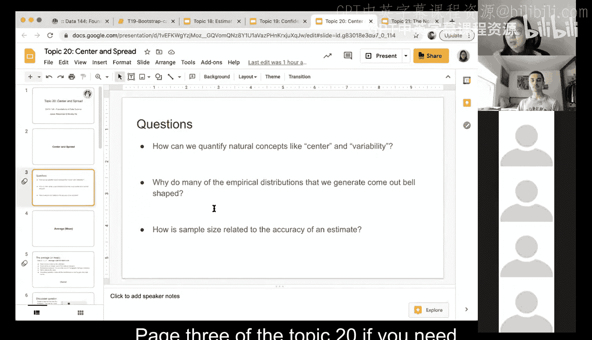
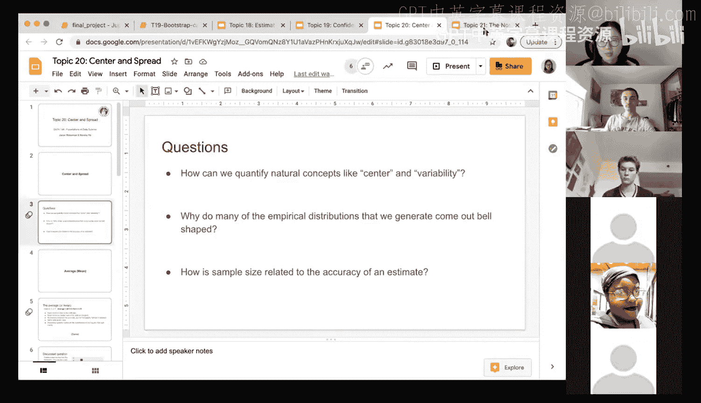

# UCB《数据挖掘和分析｜DATA 144 Data Mining and Analytics 2021》中英字幕 p61 [P61]lecture61-[T20 Center and Spread] Introduction-PMtPeO1uBY4.zh_en [BV1efBEBuEVg_p61]

A new topic， but like I said the lab this week will be able to go over a little bit of bootstrap one more time okay so you will get the exercise and like I said I think once you start doing the project I think it also starts to make sense to you as well because that will be the case that you start to think about how you're able to do hypothesis testing and then if only one sample is available then you will have to do a bootstrap away because you don't have access to the population okay。

Okay so the new topic topic 20 is center and spread okay so this many of you probably already know about like how to what what a mean is。

 what is average and what a standard deviation， what is variance okay so maybe it's not new to many of you and I just want to say that we add this topic here because for any kind of situation or especially later if we're trying to introduce the normal distribution that we also can be used to do hypothesis testing then for any kind of distributions that we're introducing。

 we will be interested in certain characteristics of it right like center is one thing because you want to know the typical value okay and spread well like how variable it is is another thing that we care about so we want to introduce this topic before we dive into even a little bit more about how to use other methods for hypothesis testing okay so this is the reason why we do this okay and。

All right， so just a few questions to all of you and then I will put you in the breakout room so so I can take a break as well so how can we quantify natural concepts like center and variability okay center okay like the middle point right variability is like the spread okay why do many of the empirical distributions that we generate come out bell shaped okay so this is if you remember well most recently we did this one right？

Sort of bell shaped okay sort of symmetric okay so this is another sort of question that we wanted you to think about And then lastly is how is sample size related to the accuracy of an estimate Okay so this is open endeded questions but I do want you to take the time and with your breakout room members to think about those questions so this is page three okay page three of the topic 20 if you need it when you go to the breakout room and now let me create the breakout rooms Okay yeah so I should say probably the first question will be most straightforward to answer at this point okay because the next two is what we trying to answer for you as well for not only for this topic but a little later as well Okay so any thoughts about how can we quantify natural concepts like center andvari any thing that come to your mind so far like we talked about a few like say mean okay I'm gonna say one thing mean okay as a center estimate and。

Do you want to share what you think about like other what we think I mean if you think about the range of the values you have and trying to find you know the midpoint of that I guess it kind of depends on the question you have and what context there is but yeah I'd say the range is Yeah no great so range if we all remember ranges like the maximum value minus the minimum value okay so that I should say yeah definitely to some degree tells us about variability okay and we're gonna review that coming up as well so that will be a good candidate okay for variability and I earlier I just let me will be a good candidate for center okay anything else that you have heard or we have worked on everybody I guess not just shot in the chat yeah anything else that comes to your mind when you think about center variability。

We have been using one quantity a lot。I tried to recall and and that is the median if you guys remember okay median is the middle point okay and that will be a good another good candidate okay for the center as well because that's also telling us like a typical value okay right in the middle okay and I would just say that sorry about the。

Sorry about that but I would just like echo what Zo was saying。

Because it really highly depends on the distribution or the data that you're working with okay sometimes one measure is better than the other okay like mean and median。

 we're gonna actually look at in what situations you want to use meanme over the median and what situations you want to use median over the mean okay that's one thing and that also range like I said。

 what shell was saying is a good measure for variability but there could also but I guess I should bring in this way each measure that we're gonna like talk about has this pros and cons and the pros and cons are determined based on like I think exactly what shellwa saying depends on what kind of distribution that you're working with okay so we need to keep those in mind and this again will be related to well if you're gonna to come up with your hypothesis right for your or research question for your final project you might also start to think about well what will be a good statistic that I should be looking at right and then even if like say if you remember let me just bring that up one more time this is the final project。

And then the final project like I said， you need to for this by the end of this week。

 you need to go up to part three right summary statistics and meization okay so summary statistics like just say if I want to know like the like a good estimate of the center of this distribution right then you might want to think about and that also write down your reasoning of oh in this case I want to use the mean of the medium because blah blah blah b blah blah okay so again this topic 20 is where we're gonna talk about in what situations one is better than the other ones but just keep us in mind I think that this is pretty relevant okay we're not just trying to talk about those concepts to you but more about how were actually being able to use it in practice okay all right so and then also we're gonna try to answer the question okay why do many of the empirical distributions that we generate come out there okay and it's not it's not like a miracle I want to how can I put it it's not like a mystery I should say oh yeah yeah go ahead。

I mean for this one i'm not entirely sure if this is correct。

 but when you take any sample of data you're going to get I mean you're going to have your average value and it makes sense that most of the values are going to be around that and then as you go out and farther away from the average you're going to have the outliers but they're not going to be as many of them so it makes sense that it be bell shape centered around your average。

That's a good point and I guess I will also have some counterpoints through that in the second。

 but I wonder like say anybody else like based on what She was saying。

 like why empirical distribution that we generally come up to be bell shaped。

 any quick comments and feedback to what she was saying？Okay yeah， all right yeah。

 So I think it's a good idea to think about what is likely。 And then of course。

 when we say is bell shaped so let's come back to this boost okay when we say bell shaped it's like more center around mean。

 whatever the mean is and then going slowly down is sort of symmetric okay so the only thing that I would just point out to what Sha was saying is that I think you are referring to the histogram。

 each of the data points that we're plotting in the histogram is a actual data point like a data observation and what we are referring to which you will become clearer。

 I hope is that were talking about the empirical distribution。

 not so much of the observations themselves of the test statistics。

Okay like we're talking about I say in this case what it is iss the Borap me right in previous cases。

 I don't know is like the median or whatever， whatever that we can come up with Okay。

 so a really important result that we're going to see in the next topic is that in the end for many of the empirical distributions of the statistics that we're interested in especially like like a quantity like me usually going to come out as something like a normal distribution Okay again we're going in the next topic and talk about what we mean by those terminology okay but I just want to highlight that。

There are two things right like the sample distributions are about the observations like it's about the distribution of the samples。

 meaning that we're talking about the observations themselves okay and for that just to like add to what you said is that it could actually be any kind of shape right it doesn't need to be like you know bell shaped per se okay because you can have like say all of the observations at one extreme and only one like a few at the other so that would not be something as bell shaped as we hope okay but it doesn't matter in some sense that even if you have a super weird distribution of the observations but if you're doing what we're doing repeat a sampling right of the test statistic out of multiple repetitions then that test statistic the empirical distribution of that going to usually come out as a bell shapeped distribution。

Okay， so well， I guess I already sort of answer the question to some degree。

 But then only I think after we get to topic 21， it's going to become more clear。

 hopefully about why things work in this way。 Okay， and then， of course。

 the last one is how is sample size related to the accuracy of an estimate。 Okay。

 so I think we already had a good sense of when you take a sample。

 you want the sample to be large enough。 Okay， otherwise。

 you might not be really representative of the population and then， of course。

 any kind of statistic that you computed based on the sample might not be a good estimate for the parameter of the population。

 Okay， but then， of course， we gonna talk a little bit more about。

 like say because this question is a little bit more。

Complex right is related to the accuracy of the estimate okay so we know that sample size needs to be large to make it more accurate。

 but then there is actually a mathematical relation let me just put in that way there is a mathematical relationship between the sample size and the actual accuracy and we try to quantify that and then so that can be a rule of thumb for us to determine how how large is the sample size right do we get a large enough sample size and if this is too small what else we can do。

Okay。😊，All right， so I hope yeah， so we're going to start with this question。

 some of them can be answered some of them not yet and to continue let me。

谢谢。