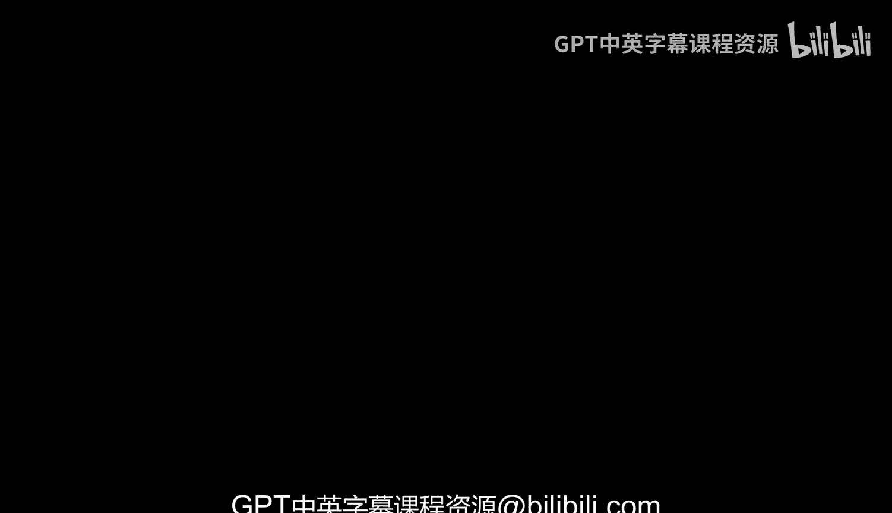
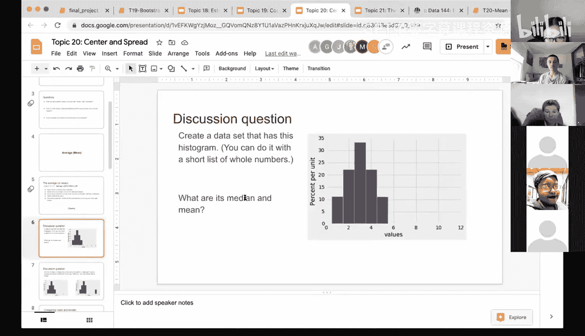
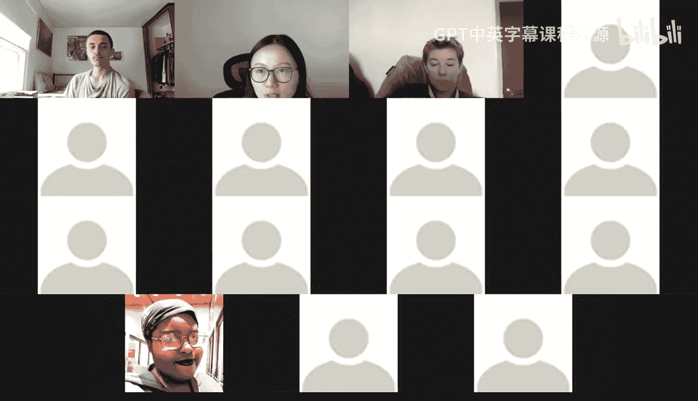
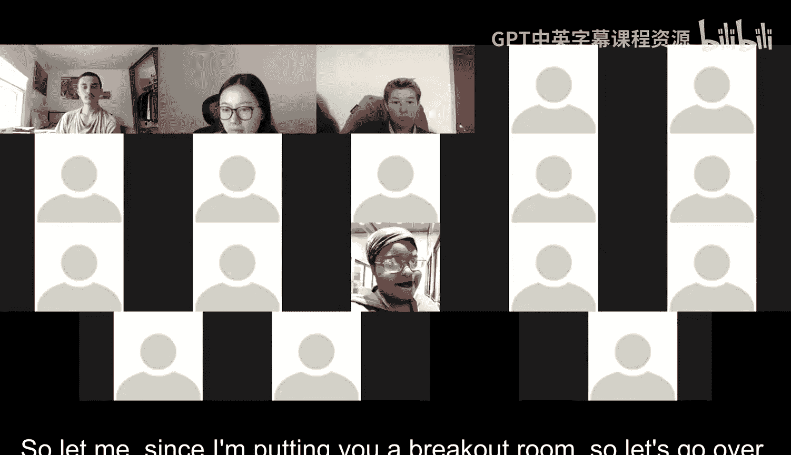
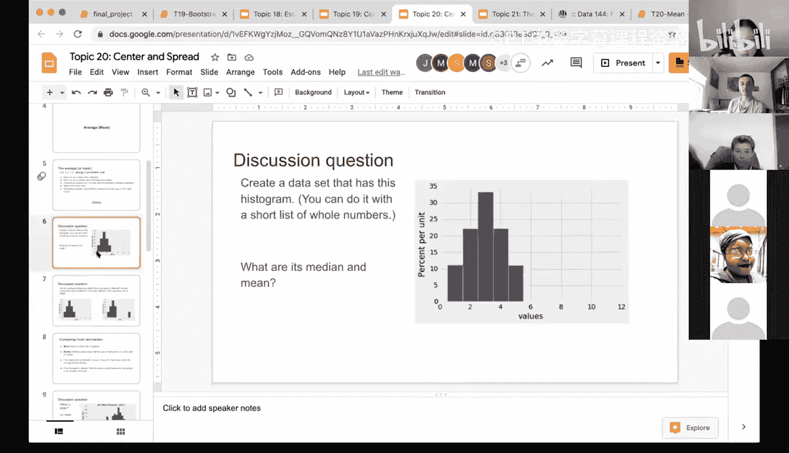
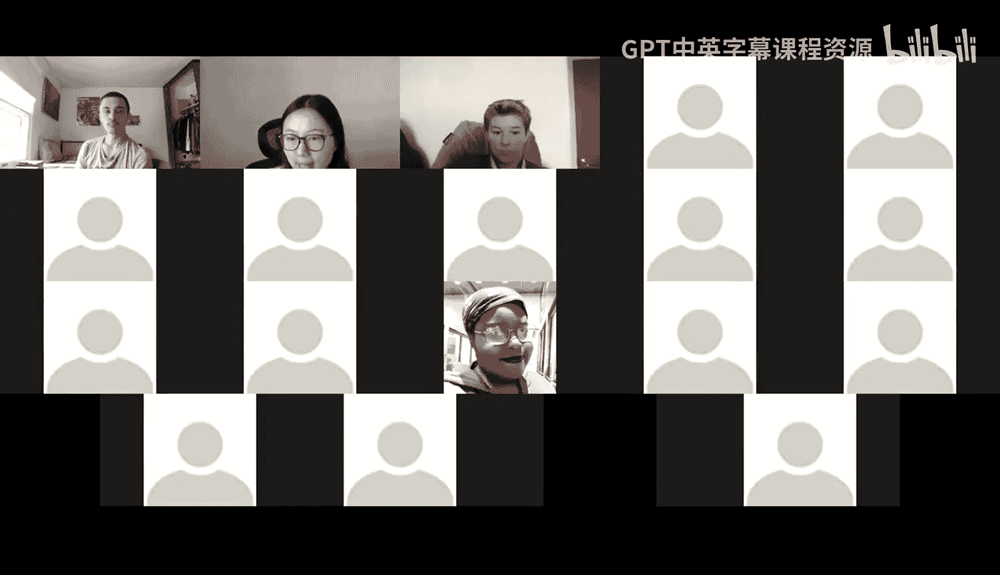
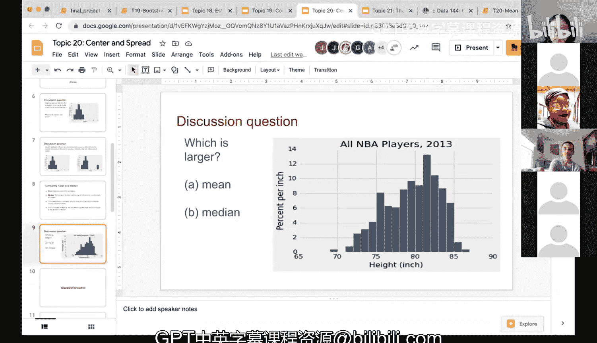

# UCB《数据挖掘和分析｜DATA 144 Data Mining and Analytics 2021》中英字幕 p62 [P62]lecture62-[T20 Center and Spread] Average (mean)-1CQd3y9Au0c.zh_en [BV1efBEBuEVg_p62]

Yeah， so to continue our discussion here， let's start talking about the average or the or like another way you call it is the mean Okay。

 so this is one way we're gonna measure the center Okay， all right。

 so this is pretty arithmetic at this point but we're gonna again I think it's important to talk through and then we're gonna see how to do in Python Okay so let's just say we have four data points Okay2339 Okay。

 the average if I do the math is 4。25 okay。

And just a few features of what a mean or average is it does not need to be a value in this collection Okay。

 it is the arithmetic mean okay so in this case， the mean is 4 25 it's not it's not any of the four values that we can see okay but that's fine okay and also it does not need to be an integer even if if the data are integers like what we're seeing over here okay it is the arithtic average it could have multiple decimal points and it doesn't have to be a integer even if the data is R it is gonna be somewhere between the minimum and the maximum okay but not necessarily halfway in between okay and then the halfway in between stuff this term we're talking about it's going to be more related to the median okay so remember the median iss the middle point right and it's the 50th percentile okay right in the middle okay。

The fourth characteristic here is that the average or the mean going to have the same units as the data okay so here there's no unit is just two。

 three， three，9 so okay but like for example the data set like the maternal age data variable that we work with in the baby data set the average is going to be age right so it's going to be in the same unit it age which is the number of years okay。

And also we can think of the average as a smoothing operator What we mean by that is that you can sort of collect all of the distributions in the one big plot and then split evenly that is sort of one way that you're able to think about how the average is being done like right now is only four values so it's kind of straightforward。

 but what if you have a super large data and then what we're working on is almost like a。

Smoothing operator that we're talking about here。 Okay。

 so we did prepare a short demo and this again。Could be useful in some cases okay。

 but like mostly we're trying to introduce you those functions or methods that you can do mean calculation Okay。

 so for our values remember we have two， three，3，9 Okay。

 so we make an array okay and we make an array so we're able to work with it Okay so。

The arithmetic mean， if you think about it mathematically， like what we do。

 we add all of them up right and then divide it by so in this case。

 we add two and3 and3 and9 and then we know that there are four values in this right so we divide it by the length of it So mathematically if you want to compute the average what you do is you take the song of this array and then divided by the length of the array which will give us 4。

25 like what we show in the slide okay but then of course there are more efficient ways to do it okay in Python if we're using this non if you remember like themp library that will be using。

 you can usemp average okay that will give you the average okay themp do me will also give you the average or the mean so whichever way you want is totally fine okay。

And then of course， if I wanted just to like really double check that my work is fine。

 I can always add up those values like I don't need to work with the values array anymore right I'm just literally doing two plus three plus three plus nine and then divided it by four。

 this is using。Python is a calculator okay and then that gives me 4。25。

 not surprisingly okay and one last way I wanted to talk about how we think about the mean is what we mean by the weighted average okay so I say here because it's average right mean is average。

 but more specifically it' a weighted average because you also need to account for how many times a particular item occurs in this set okay so for us there are four values right and then one over four times it's two right one over four times is9 and two over four times is three okay so another way to do the calculation is to do two times one over four plus three times two over four okay plus nine times one over four which again brings us back to the mean calculated okay so again there are so many different ways to think about it I just wanted to bring this up as well because in some cases it is also easier to think about this kind of weighted average when we're talking。

About the average， Okay， especially when you work with a small set like this。 Okay， Okay。

 so we can also， of course， now we have an array of all of the values。

 So how about we turn into a table so we can do some graphing Okay。

 the graphing might not be that interesting or exciting。

 I would say it's really just showing you the value in a histogram Okay， but we do see。

 so here is the percent per unit Okay， so don't forget the height Okay。

 is not the is not the frequency Okay， only the area the frequency right。

 the the height is the area divided by the width of the bin Okay， so we have if you remember1。

2 right， and then two， threes that's why you have a taller one up here。And there's one9 Okay。

 so this is how if I try to graph it， okay， that will be okay。

 another thing I wanted to I guess ask you and think about is what if I have 10 of twos。

20 of threes and 10 nines， what do you think might mean going to be？Let me repeat the question Okay。

 so in the original set we have what two， three， three and9 okay。

 and then we calculated just now is 4。25 okay， so now my question is instead of one copies of two。

 two copies of three and then one copy of nine I'm having 10 copies of two 20 copies of three and 10 copies of nine。

 what do you think。My mean going to be。Is it going to be the same as 4。25 or smaller or larger。

 what do you think arithmeically sort of like you don't need to do it like out by hand or Python。

 just like intuitiveally， what do you think？It should be the same right it's like the ratio of all the numbers are the same exactly yeah。

 thanks Mike and also Eli in the chat yeah so indeed especially if I come back to this right。

This is a weighted average right like here we have one over four2 over four and9 one over4 for all of the percentages right and then if I just expand four into 40 and then each is repeated 10 times then the percentages wouldn't change so the arithmatictic mean won't change either okay so just so you know if we do that then you will see that it's also going to give us a 4。

25 regardless of what kind of method function you're using and then the plot will just look pretty much exactly the same well it is let me put in this way it is actually exactly the same Okay because remember the height is not frequency Okay if it's frequency then it's going to be slightly different because we have 10102010 whereas it 12 and1 hover right here anyway so this is what we mean by the mean and then how we can compute it okay so。

No let me ask you the question Okay， so this is page six okay and you might want to take a look at it as well because I will put you in a breakout room in a second let's just say okay。

 the question says that creator data set has this histogram but don't worry this is given to you and what are the median what are its median and mean and why。

Okay I should say maybe not why and let me put in this way what are the mean what are its mean and media and how do they compare to each other Okay so let me stop share here really quick and stop working let me resume really quick sorry so there is one question so let me since i'm putting you a breakout room so let's go over。

So the first part first part of this is asking you on page six okay what are the mean and the medium okay the second question now is I'm shifting okay some values further away okay from the cluster of the data and then the question for you is that are the mediums of this two distributions the same or not and what about the mean when you say they're different which one is bigger and which one is smaller okay so take your time you do need to I think go to topic 20 okay page6 and7 so there are three questions two three graphs two or three questions is together and I will put you into a breakout room and。

Okay， so there are a few parts Okay， and the first part here and I guess maybe just to type in the chat what you think。

 whether they're the same or okay， I should say what are it mean a mediumn based on your guesses by reading the graph and。

What do you think you can type in the chat like me you coast to what media and goes to what so we can maybe get a cool quick poll over here so we can get the discussion going okay so this is。

If we call it like a symmetric distribution okay like say it's it's centered at in this case。

 I think three right and then looks like the frequencies even though like the height we know that it's not about frequency per se right but the area is right and then we know that that will give us roughly。

Some ideas of how to guess what the mean and the median are Okay so what do you think what do you think the mean is and what do you think the median is in this case？

Anyone？Allright， thank you IO yeah， don't worry about that question mark cross that you're good okay so mean and median okay both are three and the reason is okay so median is the middle point okay so I guess hopefully that makes sense to you because this is center at the three value and then it's directly like exactly symmetric so we know that median will be three and mean actually even though we're not like doing like the calculation arithmetic right now like by looking at the graph but since it's symmetric right like it's canceling out right you imagine like mean is the middle point right and then whenever you have like a two you have another four whenever you have a one you have another five in this case because there exactly symmetric so the mean gonna to be three as well so this is the case that it is symmetric so the mean and the median are the same and then we can actually also tell from the graph that it's gonna to be three so the second set thanks IO and the second set here is that now I have my original graph here okay。

A few values， so all of those five， all of so of are moved to 10， okay。

 everything else stays the same okay。What is the mean or roughly your guess and what is the median here and most likely they won't be the same。

 Okay， so maybe the follow up question is。If you think they're different。

 is mean greater or is media greater？Thats。Feel free to type in the chat or just speak up。

Because I can see everybody face it， so if you raise your hand I probably wouldn't be able to see so don't don't worry to speak up if you want to give any comments。

Okay， so maybe the easier one is medium steel at three。Okay， thanks okay。

 saying medium larger mean great mean is greater than in the right graph。 Okay。

 awesome for thanks yeah， Samantha and Sandy here。 So I was about to say if I compare this to you right。

 especially like just look at the right one the medium will still be three because it's centered right I mean sorry I shouldn't say centered even though it's not symmetric right it is still the middle point right and what I'm moving is only like the extreme values to make it even more extreme pretty much but it doesn't change the ordering right once I do a sort and you think about how you're gonna do the percentile function you sort it from the smallest to the largest and then find the middle point which will give you the medium but you wouldn't change for that matter for the right graph okay however you will change the mean and actually gonna make the mean larger right because well earlier I was saying that when you have a two you got a four to cancel out right when you have a one。

 you get a five to canceled out here when you get a two， you get a four to canceled out sort of。

All of your counterpart of the ones which used to be five and now are becoming 10。

 so not surprisingly， when you add them up and then still divided by the same number of records or data points。

 you will have a larger mean。Great intuition， it is exactly true that whenever you are having a not symmetric distribution。

 okay， let me put in this way if you have a symmetric distribution。

 the media and the me and the same。😊，When you have a non symmetric distribution。

 then median will still be the middle point right but the mean will probably be a little bit more affected by more extreme values okay so that's another reason like I said the beginning of this topic I was saying that both of them are good measures right for the center but depending on the distribution of the data that you're working with sometimes you might prefer one over the other okay so in here we have a summary slide okay so mean okay it's the balance point of the histogram okay median is halfway through okay halfway point of the histogram or the data so if the distribution is symmetric then mean and median are the same so you can use whichever sort of right to describe the center if the histogram is skewed meaning that is' not symmetric okay then the mean is put away from the median in the direction of the tail so if we come back to this example really quick one more time okay here so this is the case that is skewed okay it's not symmetric okay。

And we're saying that the mean， so look at the language here。

 the mean is put away from the median in the direction of the tell， okay， so the mean。

Use to be three right a median is still three here the mean is put away from three which is the medium okay in the direction of the tell okay the tell meaning that well in this case just like what is longer right like the tell to the right so just like what Samantha and Sandy were sharing in the chat the mean going to be larger and this is and is understandendable just like the statement over here because it's going to be put away from the median to the direction of the tell。

Okay， so if we think about this， then if you are working with a variable right that is skewed。

 then mean might be a little bit too easily affected right by the extreme values。

 okay and that might be a reason why you might want to report the median instead of the mean where you are working with a symmetric distribution。

Okay so like I said， if we come back to this example。

 what I mean by that is that well just like what we're thinking about how we can compute the mean right even though we don't know like the exact values and how many there are but what I was saying is that while the mean going to be because used to all of those values of 10 used to be five right and then it's balanced out okay but now those fives becomes 10 right and they are in some cases like sort of more extreme then the cloud of the data right the cloud is from like one to fourish used to be one to five but now all of the five becomes 10 so I was saying that those are more extreme values to some degree right and then this values is gonna to have a big impact of the mean but it would affect the media at least in this particular example okay and because of that we are actually going to use the media and I think more in the case where the histogram is skewed okay because the meanme might be easily affected in this case indeed。

Easily affected by those extreme values。Okay， and so keep that in mind， okay。

 and I will also just put one more discussion question。In this case， which one is larger。

 the mean or the medium？😡，This is the height okay， of eight inches。Of all NBA players in 2013。

Which one is larger？So I guess we consider well it is a sked distribution right and we know that if it is skewed then the mean。

 so let's come back to that slide， the mean going to be pulled away from the median in the direction of the tell。

OkaySo the tell is to the left。Yeah， so this， I guess the median't going to be larger。

 okay because the mean going to be put away further to the left。Slightly， okay， actually。

 they're pretty similar。 So in fact， we do have， I think， oh yeah， this one。 we do have a quick yeah。

 the data we are it's available。 Okay， so if we only get。

 So that's how we got the histogram in the first place。 Okay， and then the media。 Okay。

 use the percentile function。 Okay is 8。 And then it's very close。 the mean is 79。 Okay。

 so but like I said， mathematical like numerically， we're able to verify that。

 but also its like intuitively， hopefully starts to make sense to you that。

If you're working with a non symmetric distribution like a skew distribution。

 then the tail of the direction is going to be how the tail is put away from the median too and sorry how the direction I guess of the mean put away from the median so in this case it' going to be further to the left a little bit like no big big difference I guess 79 and 80 but it's still it's a non symmetric distribution so we see that feature happening。

可以。Okay， so that's about the mean and。

