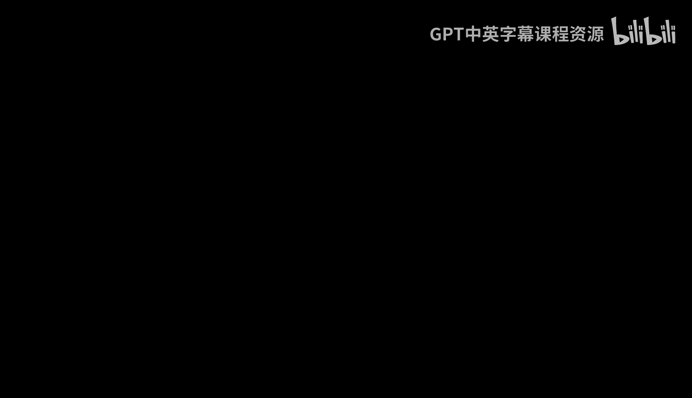
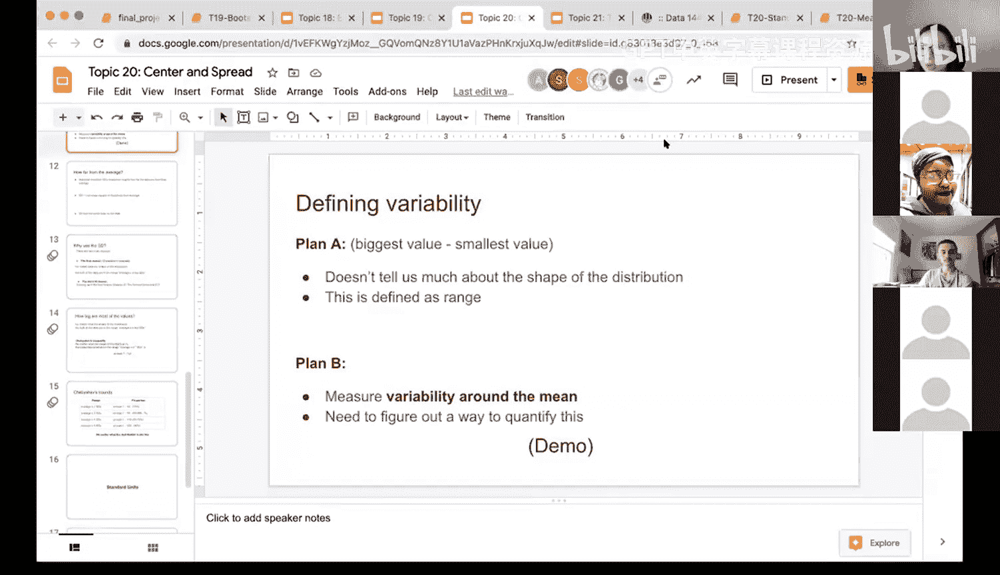
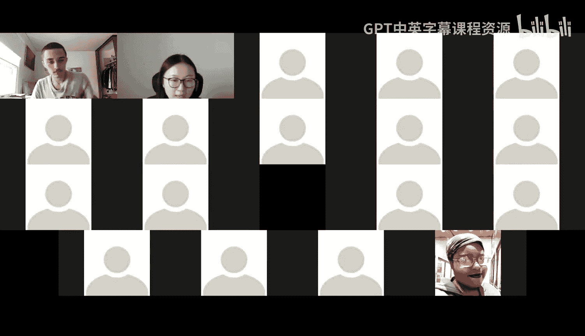

# UCB《数据挖掘和分析｜DATA 144 Data Mining and Analytics 2021》中英字幕 p63 [P63]lecture63-[T20 Center and Spread] Standard Deviation part 1-FcA7AGHxdkI.zh_ [BV1efBEBuEVg_p63]

Let me talk about the standard deviation， which is a way to measure the spread okay but we're gonna first start with thinking about what Shao was saying Okay defining variability the plan A is what Shao was suggesting okay we can look at the range okay is the largest value minus the smaller value or the maximum minus the minimum okay one drawback here is that it doesn't tell us much about the shape of the distribution in a sense that well imagine I have a bell shaped distribution。

 let's just say center at3 right earlier right and the lower goes to1 the larger goes to5 and a symmetric okay so the range there is what five minus1 which is4 okay and let's just suppose now I have a different distribution which have half of the points at one okay half of the points at5 okay the same number of points out there so the range was still before okay but the shape is so much different right from the symmetric that I was talking about so that's the drawback I think。

Of using a range directly okay because it does not tell much about even though it does tell us like the spread to some degree right like the largest like the largest minus the smaller like the range of the data but it doesn't tell much about the shape okay so another one which is much more commonly used is to measure the variability around the mean okay so like this measure like requires you to know the mean first okay like say if I get a set of data right I compute the mean and measure the variability around the mean and then try to produce it as a statistic okay so the way to quantify this okay let me show you in a demo and then I think we will be done for the day okay。

Allright， okay， okay， so we come back to this toy example 2339。 Okay， so allright， standard， Okay。

 so this is the table 2339。 Okay， the average， okay， we compute before is 4。25。

 we say it the object is we want to define like you see how we're gonna define what we mean by variability around the mean Okay so we're actually calculating deviations。

 Okay， let me show you what we mean by that。 So we have a column of the value， right。

 and then we compute the average， Okay， and then what we're doing is that we're computing what we mean by deviations。

 by using each of the value subtract the average value that we just compute。 Okay。

 and then we attach this array is and the new column into the original table。

 which gives this give us this value is still 2339 right。

 The deviation defined to be the value minus the mean is negative 2。25， negative 1。25， negative 1。

25 and then 4。75。Okay， so deviation okay is one way we defining it is just looking at the value minus the average Okay。

 one thing about directly using the deviation is that if you just sum them up。

 they become zero Okay and it's not surprising right because the mean is compute as the sum divided by like the number of records in here Okay and the deviation。

 well， if you like multiply this by four right and the value just sum up well the difference going to be zero by definition of the average in the first place Okay so。

I bring this up because yes， the deviation is useful okay but directly like summing the up we're using it might not be as useful because the sum is zero by definition because of the way that we define the deviation okay so what typically is done okay is we actually gonna square the deviation so deviation can be negative positive right and then that's why when you add it up it's kind of be0 because of the design。

 but instead of like summing them up， what if we take the square of the deviation okay which is what I'm doing and adding it into a new column okay it's called the squared deviation so it's 5。

 something1。51。5222。5 ish okay and then what we do is to instead of okay suming the deviation itself what we're doing is that we square the deviation sum them up and then take the mean。

Okay so that's what we mean by the variance of the data okay so to like do all of this in like you can always write it up like say that one function will be able to get it directly。

 but I just want to like talk through it one more time we have a set of values right we first of all get the mean from it we're able to get the deviations okay and then we take the square。

Of the deviations， and then we take the average of all of the squares to determine what we mean by the variance。

Okay so the squaring step is useful so we are getting rid of the negative or positive sign right because it could be negative it could be positive。

 but what we really want to measure is for each observation how far it is from me okay so taking the square can help us to make sure that all the distance right all of this or distances so distances should be non negative okay and then we take the average to get a good sense of on average right。

 how how big the squared deviation is for each of the record。Alrighty。

 and then when you get the variance， if you take the square root of that。

 you get what we mean by the standard deviation。Okay， and then you can use themp。

sD stands for standard deviation STD that will give you the standard deviation directly。

Okay so this is a typical measure okay and I think yeah so on Thursday we're going come back and talk a little bit about how we are like how we understand the standard deviationviation and some other properties around it okay som going stop share and yeah feel free to stay over if you have further questions but if you need to go feel free I think yeah we're a little bit running almost running out of time now okay。

