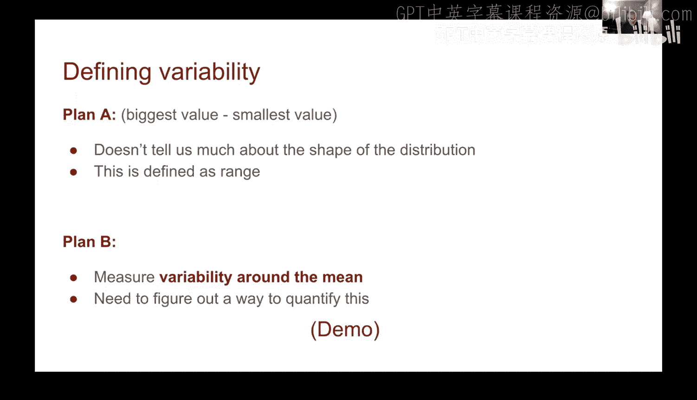
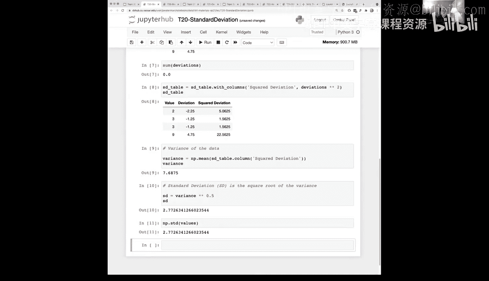
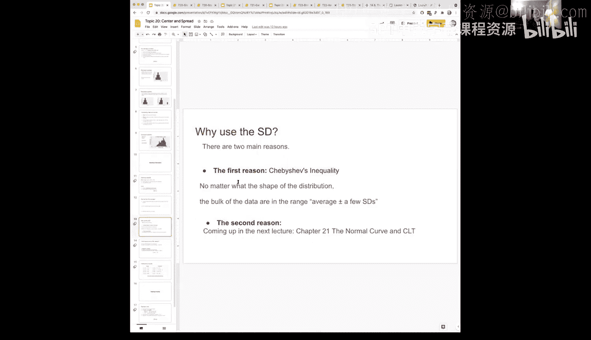
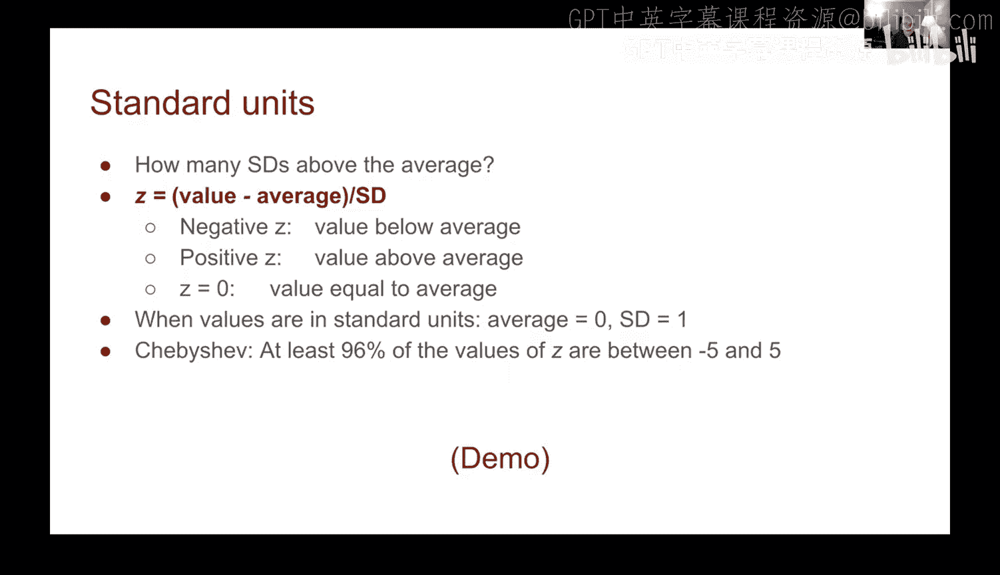
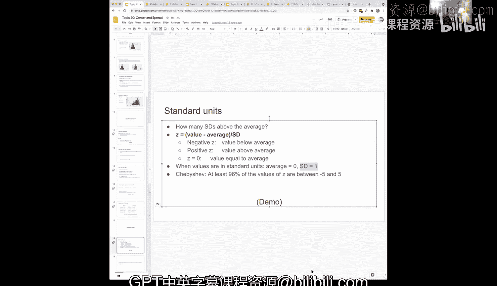

# UCB《数据挖掘和分析｜DATA 144 Data Mining and Analytics 2021》中英字幕 p64 [P64]lecture64-[T20 Center and Spread] Standard Units-CMo2OQaIxpU.zh_en [BV1efBEBuEVg_p64]

All right hey happy Thursday everyone I hope everyone is is doing well I want to jump right in kind of just with kind of a quick review so last time we talked about mean and this idea of the mean which is the average。

 which is the sum divided by the number of elements our in our list。😊。

And then we talked about this notion of。Variability variability in the data and what do we and we tried to kind of quantify what do we mean by that and variability in the data is how far are we from the average。

 how far are we from the mean from there and we looked at a couple of notions of how we wanted to find that right and we came out with this idea of just measuring variability around the mean and then we looked at a demo how to quantify that。

🤧And if we look so we take our array and we have just a simple array here with a couple of numbers in there and the average is straightforward it is the sum divided by the number of elements in the list and then we kind of started playing around with this idea of how much does this how much does our data vary from the average and so one thing that we can take a look at is this deviation so if we have the average value and we look at we subtract that from the value that would give us for each data point how far are we away from from the average。

😊，And if we take a look at that， we can see that more values that are。😊。

Smaller than the average so values that are smaller than the average will show up as negative right so in this example here our average is 4。

25 and this value two is negative and so it is negative 2。

25 units away from the average right if you take the value。😊。

And then the one thing that we noticed about this idea of looking at the deviations right because we're showing how far we are from average if we take the sum of the deviations no matter what distribution no matter what data we have the sum of all of the derivations are going to be zero right because all of these or the difference from the average they're going to have to sum up to be there so that's probably not the metric that we want to have to kind of measure variability and we kind of saw this again we saw this when we looked at categorical comparing categorical values and we kind of came up with this distance metric right where we're going take you know one thing that we can do is take a distance we could take an absolute value to get rid of the negatives but another thing we can do is we can actually take the square of the deviation and that's going we're going to see later that's going to have some very valuable properties and so if we take the square。

😊，From that， notice all of our negative values they become positive。

And notice as we get further away， further away from。

The average the deviation goes up right because we're squaring it so the farther we go kind of the the stronger the weight is and so so now that we have this kind of this square deviation so now the sum you know kind of makes sense。

😊，And。We can actually take the average of of the variances the average of all of these deviations and that's going to give us this variance okay and so now that's actually now a useful metric metric right because it's not going to be zero all the time。

 it is actually going to give us some indication of how spread out this data is。😊。

But remember because we did the square here， if we think about it in terms of units， for example。

 if we were measuring heights or ages， this variance because we squared it is not in the same units as our original measure so the final kind of piece of this is is that we're going to take the square root of the variance and that is going to give us back to our original units okay and so that this whole thing is known as the standard deviation。

😊，🤧And formally， it's the square root of the variance from there Okay。

 so we take the variance take the square root， we get this number for our our data set and。

This is something that we do so often nuI has this feature built in right so we we don't have to go through all of these steps we can just take our array of data and we can just run it through the nuI standard deviation function and。

😊，We get the same value， so that is。Basically what we would hope for for that and that shows that this shows this is exactly the calculation that the standard deviation function is doing。

😊，Um。Any questions， any questions about that？

Before we move on。嗯。All right， fantastic， great。

嗯。All right。呵。😊，All right， so why are we using the standard deviation the big one is is this Cheevvy Cheev's inequality okay。

 and we'll talk a little bit of we're going to talk about that next。😊，And what that says。

What Cheby says inequality says no matter what the shape of the distribution okay and this is important so no matter what。

😊，Distribution of data that we get。🤧The bulk of the data is going to be and we'll get more precise about this in a second the bulk of the data is going to live within the mean plus or minus a few standard deviations of the data okay and so and what's nice about this is is that。

😊，We don't have to know anything about we don't have to know the shape of the distribution this will apply to any data and really why this kind of works is because the standard deviation captures this variability in the data and so。

う。WeWe can basically have this lower bound on regardless of the data about where the bulk of the data is going to lie。

 and the second reason we'll talk about if we have time to get to it today is the applicability to this normal curve。

 this normal distribution and the central limit theorem which we'll talk about。

So there's a couple of good reasons why we use in particular。

 this standard deviation as this measure of variance。And so a lot of times when we have data。

 one of the natural questions that we're going to ask is where are most of the values。

 where do most of the values lie in our data？😊，And so。

Shevychv's inequality gives us a bound on that regardless of the data。

 we can capture this notion of the data is going to be contained within a small number of standard deviations of the data and in particular。

😊，Shevy hub in quality basically says if we kind of look down here that the data that we're going to have so if we look at this formula at least one right so so one would be the entire all of our data because we're talking about this as a percentage minus one over z squared okay so and z squared is。

😊，This standard deviation so the average plus or minus this z and we'll talk about what z is times the standard deviation okay and so that's going to say our data is going to that percentage of data is going to fall within that I think it's easier to see when we actually put some numbers to what Z is so Z kind of measured in standard deviation standard units from there and if we kind of see this for a couple of common standard deviations。

😊，🤧We're going to say if we take a look at our data right so we're going to look at standard deviations from the mean so plus or minus2% two standard deviations gives us or plugging into that formula one over two squared gives us four which is going to give us 25%1 minus 25% it's going to give 75% of the data okay so if we look at regardless of the distribution of the data of any data we know that 75% of the data is going to be plus  two standard deviations you know from the center to minus two standard deviations from the center and that goes up and so。

You know， kind of looking down at the bottom plus or minus5 standard deviations。

 this gets us 96% of the data right and then that's over that our magic number of kind of 95% from there so we know regardless of the distribution within five standard deviations either way of the mean we're going to capture a bulk of the data from there and the power like that the power is is that we don't need to know anything about the underlying distribution from there the data itself might actually that you might actually in so if we look at plus or minus two standard deviations if we actually look at the data more of the population it might be more than 75%。

m given。The actual data given the actual distribution。

 but it will never be less we will always capture at least 75% of the data plus or minus two standard deviations for any distribution but it could be more that's what I and that's what I mean when I say this is a lower bound。

😊，From that。Okay。And so。When we deal with these when we deal with these data。

 it's very helpful instead of thinking about you know like heights or ages because of Chevy Cheev's bounds right where we can kind of quantify in standard deviations a lot of times when we look at data。

 don' we want to put it in a form where we're looking at standard the standard。😊。

Standard distribution， standard deviation， and so this gives a rise to this idea of standard units。😊。

And so the standard unit， this will tell us how many。

How many standard deviations are we above our average and so to calculate that we basically take our data and so we'll have the average of our data and we're just going to take the value minus the average and we're just going to divide it by the total standard deviation okay and so the way I kind of look at it is kind of it's just normalizing the data。

😊，Across the standard deviation。And so same thing holds true when we were talking about the variation right a negative z means that value is below average。

 positive z means it's going to be above average and if z equals zero it's going to be equal。😊。

To our median our average our mean not median mean from there okay。

 and so when we take our data if we we do this conversion then it's just this conversion。

 the value minus the average divided by standard deviation。😊，When we do that。

 when we look at our distribution， the average now instead being instead of being the mean。

 the average now is going to be zero and the standard distribution of this converted data is going to be one okay and so when we move to standard units and I'll show you a demo of this in a second but when we move that when we move to standard units。

 we know just looking at it， 96 of the percent of the data is going to be between these z values is between minus5 and plus5 right because these numbers represent how far we are in standard deviations away from the mean。

And in this case when it's in standard units the mean is now going to be zero all right。

 I think we is high time for a demo while i'm setting the demo up。

 please let me know if you have any questions。😊。

All right。😊，So for this we'll look at our birth table again and again so because we're going to convert our data。

 it's just very useful to have a helper function and you can see that the helper function is doing exactly what we said we were going to do in the slides and so kind of looking this function in terms of inputs and outputs so what's going to get passed in is going to get an array is going to get passed in so this is going to be our array of our data。

😊，In whatever units it was feed inches years time whatever and so then we're going to convert that array to standard units and we'll return the converted array and so what we're doing is we're passing in an array and so here we're just using nuy to take the average of the array and we're applying we're subtracting and remember when we do a subtraction it's going to it's going to it's going to do elementwise subtraction so it's going to perform this operation this we'll calculate the mean and we're going to subtract that from every element into the array and we're going return a new array okay so this whole thing this part here is going to be array which is just now just the variance from the mean。

From there okay and then finally we're going to divide by the standard deviation of of the data that's our kind of normalization from there and again。

 the same thing applies when we do this division we're dividing by a number here and so it's going to apply that to every element of our new array so this is going to return the normalized or the standardized array okay now that we have that function let's take the maternal age from our our data set。

😊，🤧And all we need to do to convert it to standard units is just run that standard units helper function on on our data。

 okay， and so now。😊，If we actually take a look at that， we actually， if we take a look。

In the conversion to standard units， remember what we said from our slides。😊。

Once we've done that conversion。Our distribution now。

 the average is going to be zero and the standard deviation is going to be one because we've taken the difference from the mean。

And we've divided it by the standard deviation right so the first thing that we did that made us have the average and zero that we're subtracting from from the mean for each of the data points and by dividing by the standard deviation now we've made the standard deviation one Okay so that this。

😊，These properties here fall directly from how we calculated that and so no surprise here。

 if we printed out the mean。Notice even though we get a number look at look at what this is this is negative 7。

8 times 10 to the minus 17 right so this is this number this number here with 16 zeros in front of it before the decimal point right that is virtually zero and the standard deviation from there is one okay so all of that math checks out that works exactly as we would expect it to and so now we can kind of add that back to add that back to our table and so here's the age in years and then this is。

😊，🤧The age and standard units so how far is that age in the standard units in so in standard deviation away。

From that， okay。If we print that out now， you can see that。In our non standardized units。

 we have the average， we have the average of 27， and the standard distribution is 5。8。Okay。

 so if we take a look at the histogram， so this is just our original data。

We can see that kind of that bears out and so one of the things that's kind of cool and I think it's a good thing to always keep in the back of your mind is so what is when we're looking at the mean of a histogram what is that mean actually and so the way I like to kind of the book mentions this and it's very useful so if we go down where is so 27 is probably like right around where my cursor is here and and I like to the book really makes to mention that the mean is the balance point of this histogram right if we cut this out of cardboard or had like a 3D model of the histogram if we put our finger right in the mean or a pen or some something there or fulcrum right at the mean this histogram would be perfectly balanced which means the mass on the left side is equal to the mass on the right side and so and we see that and that kind of makes sense is that because we kind of have a little bit more。

Over here， the mean isn't completely centered on our unit there， but right at 27。2。

 if we put our finger there， the histogram is going to be perfectly balanced and then the standard deviation right in this unit is in years so one standard deviation is 27 plus 5。

8 and 27 minus 5。81 standard deviation from there， but now converting it into standard units。

We can see that the overall shape of the histogram is the same。But now what happened。

 now what happened is now it is very easy to see where the center。

Of our histogram is it's right at zero right， so we put our finger right at zero。

 that's going to be balanced。From there。 and so now you can see that。

We've been normalized into standard distribution standard deviation right so this is one standard deviation out two standard deviations out three standard deviations out okay from there and you can see and you remember if we go back to Chevyshav's inequality we know that 96% of the data is going to be contained within five standard deviations and but we know that that's a lower bound the data the actual data can be contained and less than that and you can see from here where does all of our data lie right so this is this is kind of all of of the data you can see that it goes out to a little more than three3。

 maybe1 or so down to minus2 and so we're well within that plus plus our minus5 standard deviations range。

From there。Okay， any questions about standard deviation， standard units variability？

Anything that we talked about。So far。

