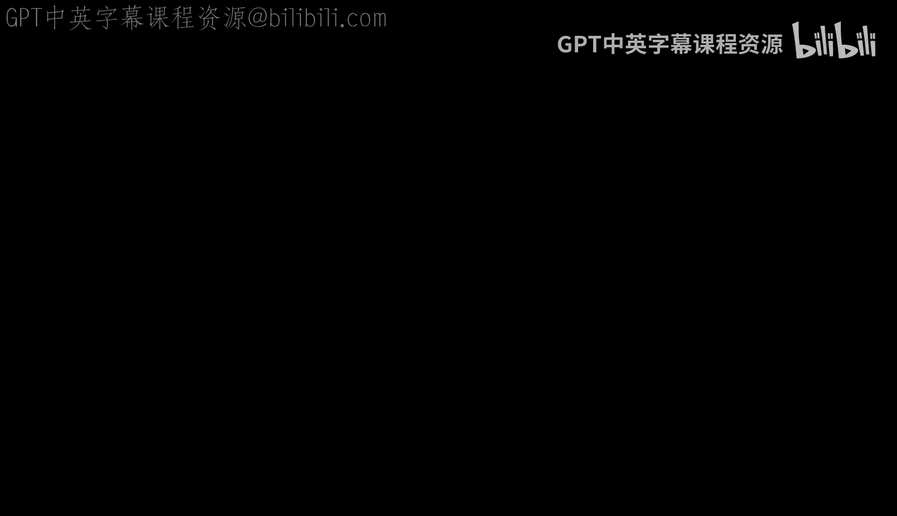
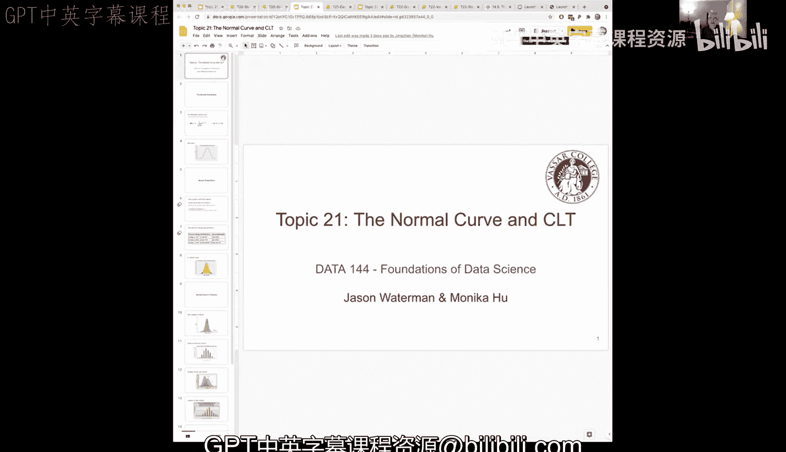
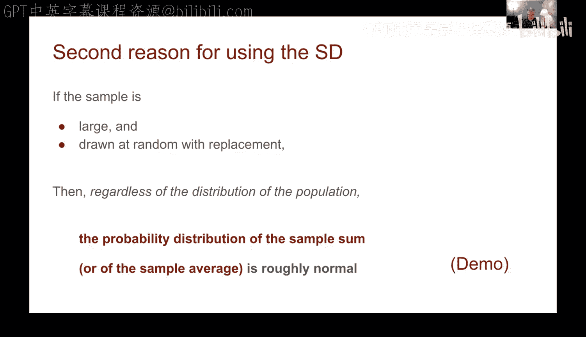
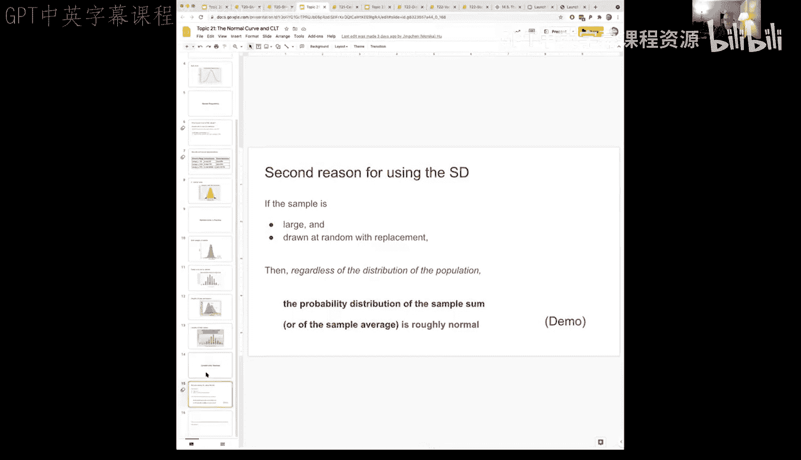

# UCB《数据挖掘和分析｜DATA 144 Data Mining and Analytics 2021》中英字幕 p65 [P65]lecture65-[T21 The Normal Curve and CLT]-ezvyA9URAFc.zh_en [BV1efBEBuEVg_p65]

Okay so the next notion， the next topic that I want to talk about is this as the normal curve and a theorem known as the central limit theorem which we're going to use use the remainder of this course and so first I'm want to talk about the normal distribution and here is the formula it's a beautiful formula but we will not use it at all from there we'll use the results from it and we'll look at pretty pictures of it but in case you know Vassar is famous for going to the source this is the equation that generates this standard normal curve and and what does it look like so this is the classic bell curve from there and so kind of couple of properties about it so one you can see that it is the centered it is centered at zero so it's mean is zero。

😊。

Z right so Z so this is in standard units so this is where where my mouse is is one standard unit。

 two standard units， three standard units and so on and so forth from that right you can think of this normal curve as a distribution as a histogram and so the area under this curve so area under this this entire curve is going to be one and it's symmetrical it's symmetrical around zero and we can see that。

😊，Um。From there okay， and so one other thing too that's kind of worth pointing out just kind of looking at the quality of it is that after a while you might be by looking at kind of normal distributions and we've seen normal distributions come up in the data that we've looked at in nature。

 sometimes like height distributions tend to be normal and we've looked at it as the results of running our some of our random sampling simulations。

And so。noticeice that kind of at the one standard deviation mark right there there's this point of inflection and the way kind of the book describes it I think it's kind of helpful is is that if you kind of look at the area in between plus and minus one it's oh。

😊，The area plus and minus one it looks like kind of an upside down cup right and then if you look at this area from one and beyond the cup is now kind of inverted right so it was between between minus one and one of kind of an upside down cup and then there's this point of inflection where it kind of starts changing from sloping you know it changes the slope to now kind of being this gradual kind of curve from there right so this point of inflection happens at the one。

😊，Standard unit， one standard deviation from the center from there。🤧Okay。

 so what is kind of what is special and what is what is so magical about the bell curve is。

🤧If we can say that a distribution is normal right we can now we can now have some tighter bounds than Cheyche's inequality and so。

No matter， so basically if we don't know the shape of the distribution。

 we we rely on chevby searchs inequality， which is the the data is。You know。

 plus or minus a few standard deviation from the data， however， if we know that it it is bell shaped。

 it's a normal distribution， we can now go from。Instead of saying most of the data is within。

 you know， a few standard deviations， now we can say almost all of the data and we're talking 99。

7% of the data， okay almost all of the data is in the range of plus or minus three standard deviations。

😊，🤧That is a much much tighter bound than Chevy headd's inequality right we saw you know 96 of the data presented of the data is plus or minus5 and now we're saying virtually all 99。

7 is within three standard deviations of the average okay and so kind of visualizing this。

In happy chart form you can see that if we know the distribution is normal we can have much tighter bounds right so within two standard deviations just relying on j size as we saw you know we know two standard deviations we got about 75% of the data if we know the distribution is normal now we can now we've reached our magic number of 95%。

😊，From there and。Drawing out the bounds to plus or minus3 right that gives us just for any old distribution that we don't really think about that is like 89% here virtually all of it 99。

73% of that from there okay so if if we know that the distribution is normal we can say a lot more about where the bulk of the data lies we have much tighter bounds。

Otherwise， we have to just fall back on Chey Jeve's inequality from there。🤧Okay， and so。

Kind of tying it now to when we started kind of thinking about。

These interval ranges right now we can say within plus or minus two standard deviations of our median right so you can see here so we're here and then if we go out shown in yellow out one out two on both sides that's going to cover  95% of the area so 95% of the data is going to lie within two standard deviations of the average from there。

😊，Okay， so。How do we kind of put this in practice well the good news is is that we see in nature there are a lot of normal distributions and so I've kind of shown the actual histogram of from our birth table the birth weight in kilograms and I've superimposed over that the normal curve for that and you can see the two track you know fairly fairly closely to that it happens in things like shoe size right。

😊，Hepes of men and women also follow this normal distribution。

And his craziest things as length of deer antlers， right。

 it just pops up all the time all the time in nature。😊，And。

Where does it come from and how do we make use of this。

 this comes down from this technique of the central limit theorem okay and this is also the second reason why we're going to use the standard deviation for computing variability and so what the central limit what the central limit theorem says。

So if we're taking a sample。From a population， if that sample is large。And。

Draaw it random with replacement， okay？Regardless of the distribution of the population。

 so regardless of what the actual distribution of the population is。

The probability of the distribution sum or sample average okay and really this is the two kind of you know what kind of can go related because right the sum of all the samples divided by the length of the sum is just the average right so you can think of this the average is just the sum divided by some constant factor so regardless of the distribution of the population so。

The sample。The sample average is going to be roughly normal， okay？And let me again。

 this is the sort of thing where。

The demo will kind of drive this point home and kind of seeing that。So again。

 while I'm kind of setting up this demo， any questions？Let's see this in practice。

All right so we're going to back we're going to go back to our flight delays。

 our flight delay data and so if you remember so this is our flight delay data and here's the histogram of that and so if you remember we're measuring the delay in flight departures in minutes。

And this is the distribution of flight times right you can see it's kind of kind of tails off and it is definitely not a normal distribution right from there。

😊，And so we take a look at that and we can compute right so we can compute the average delay。

 we can compute the average delay and that's about 16 16。

6 minutes from there and we can compute the standard deviation and so notice that the standard deviation is quite quite large compared to the mean right the mean is about 16 but the standard deviation is almost 40 and you can see that you can see this by this tail you can see this by how it has like this distribution has a very long tail。

😊，And the way， you know， I kind of like to think of it is is that the the data that is further away from the mean。

 even though there's not a lot of it right relative to there the data that's further away is pulling。

 you can think of that is these outlying data these large delays are pulling。

The standard deviation away from the meme。From there。Okay。

 and and so you know even though there's not a lot of them。

 but because the delay is so large you know， like they maybe had to replace a part on the plane and you were sitting on the tarmac for like two hours you know that that has it has an impact on the variability on the standard deviation and if you remember too right this kind of drives home the point that there is definitely a difference between the mean and the median right because if we look at the 50th percentile the median we saw that half of the flights。

 half of the flights had a delay of less than two minutes which is good news for you know for people who fly a lot from there okay so that's just a review of our data。

😊，🤧And so now what want to do is just write a little helper function and to calculate from a sample size so remember remember in this flight data in this flight data we have the population data so we have all of the data this is kind of our go to data when when we have all of the population data okay and so what we're going to do here is we'll just write a little helper generic function that will take it will calculate one statistic one sample mean from any given sample size okay and and how do we do that right it's the same thing that we've been doing for weeks now we're going to take a sample from our sample size with without replacement and then that's going to be our sample flights and then we're just going to compute the statistic on our on our delay column from there okay so we're taking our random sample and then we're just computing our statistic which in this case is just going to be the mean okay so now that we have that we can we can run for any。

😊，Sample size that we want so if we just run it with a sample size of 100。

 we'll see that every time we run it， we're going to get a different we're going to get a different value。

😊，🤧。From there and you can see that， you know they're not too too far away from our median our mean rather。

 which is around 16。6。Okay but we know because it's random you know we're going to get some variation across that so now let's let's use let's create another helper function that instead of just doing it once we're going to do it 10000 times okay we're going to do it 10000 times and get get a sense of the distribution of these 10000 value so each remember each one of these trials is going to be grabbing a sample from our population and computing the statistic on that and so our sample size again we can pass in as a parameter but then whatever that is we're going to do that 1000 times to get us our distribution。

😊，Ends over here。So we'll call our 10，000 sample means right with and each time we're going to be drawing a random1 hundred0。

That's our sample out of the population。So we run that and it iss going to take a little bit of time run because each one of these trials okay。

 but that's not too bad and if we take a look at that we're going to get an array how many elements are in this array。

Anyone？😊，100。🤧Well let's take a look for 10010000 and so the hundred comes in and the hundred is very important the hundred comes into the population that we're drawing from from our sample size so it's I think it's easy to get mixed up which is kind of why I ask that question so we're going to do 10000 trials in each trial we're going to draw 100 members from from our population from there so now that we have our 10000 right we can see we take the length we get it and now we're going to get a distribution we're going to get our distribution and。

😊，If you remember， our population average was 16。6 right and this is the known quantity。

 is this is ground truth。😊，From that because we have the entire population for this example and but we can see from the distribution right of these 10。

000 random samples of 100， you can see that what does the door now the actual distribution of this statistic。

😊，Is normal shaped is normal right it looks very much it's not perfect but it is definitely very normal shaped and where is it centered its it centered right around roughly our population average okay。

😊，So this distribution of。The statistic that we calculated from this random sample of 1010。

000 times is normal。Our original population data is not。

A normal distribution right it is kind of this one sided tail distribution and that comes down to the exact tenet of the central limit theorem is is that if we do a large enough random sample fill of a population regardless of the distribution of the population。

 which is this right here， regardless of the distribution our results are going to be normal with the mean。

😊，With the distribution centered around the population mean。From there Okay。

 and that's exactly what the central limit theorem is going is going to tell us。 All right。

 so now that we have this helper function， we can now actually look at how does the shape of our distribution。

😊，Vary with the sample size so we're still going to're to compare our distributions we're still going to run 10000 times we're going to run 1000 times。

 but the one parameter that we're going to change is is the sample size so instead of pulling 100。

Pieces of data from our population we're going to do more surveys so this example here we're going to pull 400 okay。

And so。If we run 400。Now we get we get again we get a normal distribution we get a normal distribution again it's centered kind of roughly around the population average the ground truth but look at look at what happened right and and this is a little it's a little hard to see this because of the way that the histogram right kind of already picks its labels but I want you to look at kind of the tail of the distribution between the two of these okay again both of them are centered roughly around the population average。

 but look at the tails right look at the tail of the10 sample one right it kind of goes out to just about 30 and it's you know maybe like around maybe like you know six or so from six to to actually 30 right there is actually a little bin from down there but now if you look at。

If you look at when we sampled 400。What happened to our what happened to our the range right or the variance of our distribution。

 it got a lot smaller look at the tail， look at the tail before here is out to 30 now it's 22。

5 and here was it was like six and here it is over 10。And so what happened， what happened。

 it's still centered around our average， but the variance。How varied， how far away we are from。

The population average， it got a lot narrow， like the shape of the bell curve got squished。

 it got squished。😡，From there okay， and so kind of just rounding this kind of you know driving this whole point home let's try one more。

Let's run it with 900 samples。900 samples and we see the exact same thing。

We see the exact same thing that our bell curve， our normal distribution， has gotten a lot tighter。

Not as drastic as before right from here went from 30 to 22。

5 so that's interesting but it got a little smaller it got you know to maybe like 21。

You know in the in the bound so that's interesting right we'll come back to this point we increased by more than double400。

😊，But and our bound definitely got a little more narrow。

 but it got less narrow so this kind of the kind of the intuition here is is that there's two kind of takeaway intuitions from from this demo that I want you to kind of come away with one is is is that as we increase the sample size as we increase the sample size。

😊，From our population our the distribution， our variance around the average gets tighter as we increase we're basically honing in。

 we're narrowing in， we're getting a smaller smaller variance。😊。

Around around the average and there seems to be some kind of sense of diminishing returns as the sampling is going up we're getting narrower but it's getting kind of less and less narrow from there so there might be a limit there might be a limit to how much sampling can can narrow the standard deviation of our distribution okay so those are kind of the takeaways from that。

😊，Any questions？是。

Same chicken heads and that's a good case right shaking heads is no in this case。😊，Um from there。

 good， good， good， all right， so。😊，Let me。May stop this recording。Um。

