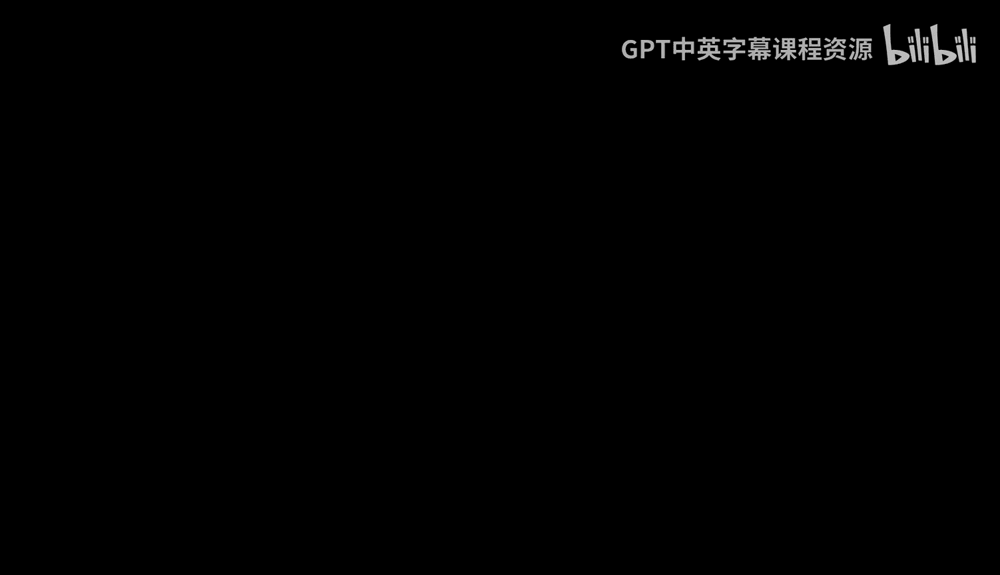
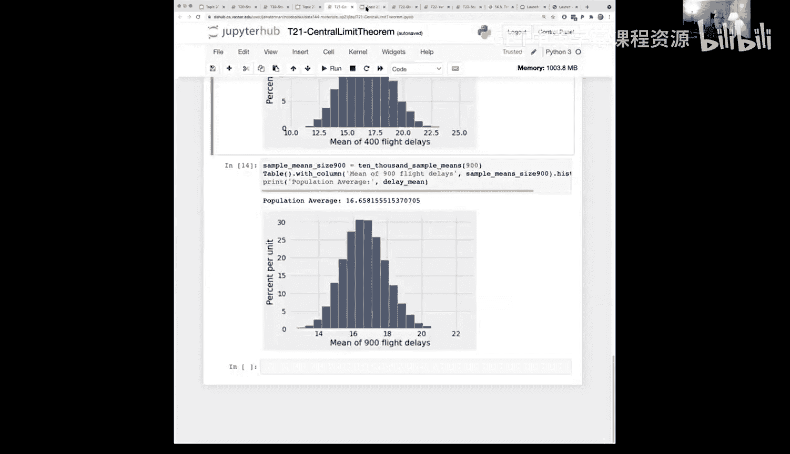
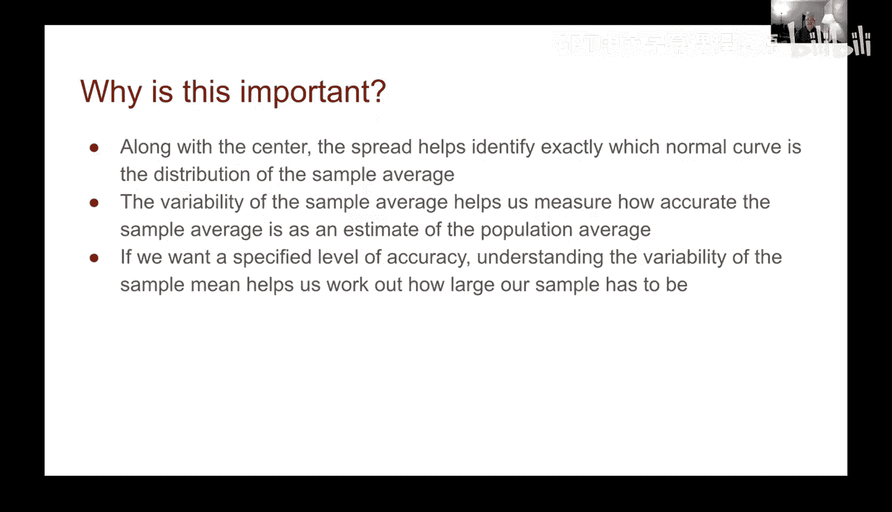
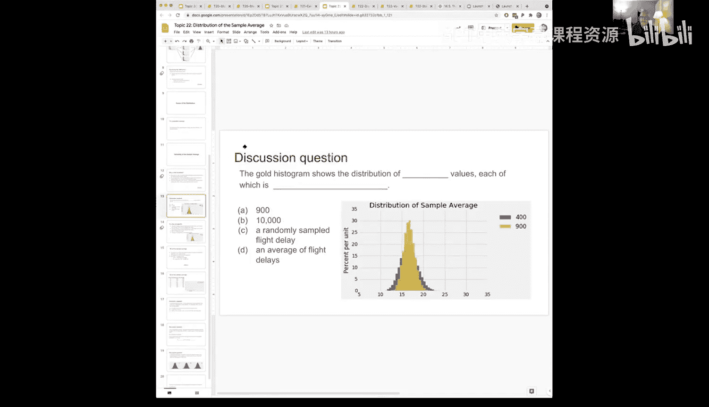
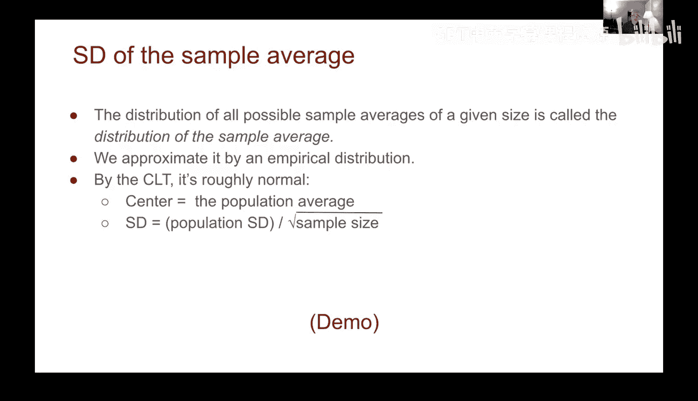
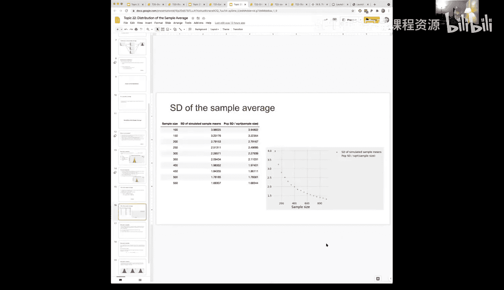

# UCB《数据挖掘和分析｜DATA 144 Data Mining and Analytics 2021》中英字幕 p66 [P66]lecture66-[T22 Distribution of the Sample Average]-eh8gQ4LU6VU.zh_en [BV1efBEBuEVg_p66]

Okay， so the next thing that I want to talk about。😊。

The next thing that I want to talk about is。This idea of having this distribution。

Around the sample average， right I'm going to drive home some of kind of the topics that we brought home from from our last demo。

Okay。So。What are some of the things that we want to kind of study and look at？

We talked about this idea of center。This mean and this idea of variability and so how far how far is the data from。

The center from the mean。And can we quantify that， can we be more precise with that？And， you know。

 why is it the fact that？Because of this central limit theory。

 why these are these distributions that we generate， why do they come out bell shaped， okay？😊。

And so these are kind of， you know， the first two questions are kind of you know， theoretical。

But they are and then but in the practical terms， so the one that I really kind of the focus on like because I'm a computer scientist。

I'm not a statistician， so I like to just know how do I get my job done and。

And hopefully what I hopefully what we can do today is kind of demystify some of the magic right some of this stuff kind of seems like magic and so the question I really want to focus on today is is how is the sample size related to the accuracy of the estimate because at the end of the day that's the thing that we want to know right we want to know we want to know right and we see this all the time right you know when presidential polls they say you know 54% knowlah blah blah blah bla right and they always say plus or minus right that's you know some。

😊，Measure of the accuracy of the estimate and so the question over the next couple lectures I hope to kind of you know show you how we get that plus or minus like how do we get that for a given sample size how is that related to the accuracy of the estimate that we're getting right though those are the questions and and it is my hope kind of you know in the next few lectures and in this course we take away some of the magic from that or it doesn't seem so magical from there。

😊，是。🤧All right， so weve seen from the central limit theorem， we saw that。

Regardless of the distribution。If we do random sampling provided that the the sampling is indeed random and our sample is large enough we're going to get we're going to get。

A bell shaped。Distribution， empirical distribution of the sample from that。 Okay。

 and so why is this a big deal， and this is a big deal， by the way， and why is this a big deal is。

 is because these sample averages that we get， right？

 And if we can say something about those sample averages， we can say something concrete about。😊。

The the the distribution and the accuracy right they act as a proxy for our population they these sample averages are going to be an estimate of the population average because remember the game the name of the game is is that we don't have the resources in most cases to sample the entire population or to survey the entire population right to get everyone so we're going to take a sample and we want to know how close。

😊，Would this average be to the actual population and we're going to kind of give you the tools to kind of help quantify that。

So first。I want to talk about， why is there distribution okay？So。

We have right we're going to take this sample， we're going to take this random sample。😊。

And once we have that data， once we have that sample， there's only one average。

It is literally the sum of our data divided by the length。

 all the elements in there right that is it that is that is it and so。😊，If we just have that data。

 why are we showing you all of these histograms？Um。Well， because we're sampling the population。

 we're sampling the population， and the sample could have come out very different depending on who we sample。

Right？And so。Because who we sampled is important to kind of how that sample comes out。

 a different sample， a different sample might have come out differently。Okay， and so what？

What we mean by that is is that when we take a sample average。

 when we take a sample average from a population， that is only one of many， many， many， many。

 many possible sample averages that we can take right and there's just many， many of them。😊，So。

If we actually wanted。A complete。Kind of distribution right we can imagine taking all possible random samples the same sizes is the one we picked like 100 20010 you know of 900 right there's tons of them you know imagine。

 you know imagine if you had a population of 10000 how many different ways are there to take a sample of 100 there's a lot。

Each of those samples， each every possible kind of combination of samples has an average associated with it。

And so we can think about this distribution of sample average as the distribution of the averages of all possible samples。

 all possible samples。😊，what does that look like？What does that look like okay。

 and so here here we have our population on the left all the way on the left side this is。

After a while you get kind of good it's actually knowing the population just from its distribution。

 right this is our traffic traffic delay data， right？😊，And so that is the actual population and。

We have。We can take many， many possible samples of that of a particular right in this case 400 you know and so imagine imagine if we took all possible combinations of sampling 400 and put them all together right so notice。

😊，Each particular sample of 400。😊，From there， right， it's it's a rough approximation。

 it's a rough approximation of of the。Of the population。And we can get a sample。

 we can get the sample mean from each one of those and that just becomes one point in our。😊。

Just in our histogram， okay， from there。And so you can see that。

WeWe're going to get this distribution from there。Okay， so。If。We。Have a large random sample。

We've seen。That that distribution， the distribution of the average is going to be roughly bell shaped。

So。The one question that we want to kind of ask ourselves is。

Where is the center of that bell curve and how wide is that bell curve right because we know we know。

嗯。We know that。Regardless of the distribution of the population。😊，If we conduct。Random sampling。

 we're going to get a distribution centered around the mean and the variance is is。

Going to be proportional。It's going to be kind of the variation the variation is going to be centered around the standard deviation going to be centered around the mean from there。

 okay？So。The center of the distribution is just going to be the average。 Okay。

 so the distribution of our sample average is going to be。Centered around the population average。ううん。

😊，Now the and so that that's like that's kind of the， you know， the way I think that's kind of just。

Not terribly controversial right that's a pretty kind of straightforward of result there。😊。

And so but now the variability of the sample average right so we're looking at the the histogram。

 the distribution of our trials。😊，Why is this important？嗯。Well， just like the center。

The spread is going to help us。It's going to help us identify。

🤧Which normal curve is the distribution of the sample average right so the center。

Goes down goes to the gets to the heart of the population。

Average and the variability right so the center is going to give us the number。😊。

That's going to be our estimate， so the center of our sampling distribution is going to give us the number that is going to be our estimate。

Where variability comes into play， that is going to give us an indication of how accurate。

 how confident we are in that that sample that we came up with that sample average is an estimate of the population okay。

 so the two of them kind of work together。😊，The the mean。

 the the center gives us the actual number that is going to be， you know， we're going to say that is。

The average height or you know the estimated height from our that we think the population has the variability of this distribution that we get is going to allow us to say how confident we are how how confident how accurate。

😊，That estimate is。And what's nice about this is is that as we saw。As we saw。

 kind of there's this relationship to the sample size and the accuracy。😊。

The sample size and how much variance we get in the distribution。

And as we saw as the sample size increases， the variance。

 the standard deviation around the median decreases。

 so another way of saying that is is that the larger the sample size。

 it helps us get a more accurate measure。😊，And so how do all of these things come into play？

Let's take a look。Let's go back to our flight data again and again we're using that because we have the entire population so we can really see we can see how our estimates do compared to the actual data and so this is everything that we've done before our population delay。

 our population standard deviation our population standard deviation and and our percentile from there Okay these are the exact same functions I didn't try to kind of pull fast one on us we're just taking one mean and this is our our function to do 10。

000 of those trials for a given sample size right and again。

 this is how many people how many how many surveys are we're doing how much are we plucking from the original and by the way you know so how many how many。

😊，yeah， and so different。Okay， and so now what I want to do here is。Okay。

 so what we're doing here is we're kind of putting it all together is just this is just a little helper function that's going to select from our sample。

 generate our statistics and just plot everything out and one little function for us okay because we're going to run this with some various sample size we're going to run this with like 100 400 and 900 from there。

😊，Okay and so there's nothing there's nothing this is very similar to the previous demo that we did we just put fancy titles on there and then but I want to draw you to this this part here so we're spitting out a little bit of some of the statistics here okay so our sample size and this is all comes directly from from this function here so our sample size was what we passed in right so how many samples we took population mean that's not going that's not going to change because that is the actual ground truth and you can see that the sample means it actually even with 100 from this particular sample remember every time we run this we're going to get slightly different answers for the the average of the sample but you know even with 100 samples in this trial did quite good but it's again it's going to vary every time we run that。

😊，Um。And so because we actually have the data because we actually have the data。

 we also we have the standard deviation of the population， this is ground truth okay。

 and because now that we have a histogram of of our of our simulation。

 we can also look at the standard deviation of the sample means that we came out with okay。

 and so again we're going to be a subject kind of roughly roughly so we know。

This this graph because we haven't normalized this so we didn't put it in standard units and so we know that the the sample。

The average is going to be around 16。6 so somewhere around here and then the sample mean right so one standard deviation is going to be plus or minus you know 3。

9 of four okay but one thing that's kind of interesting to take a look at is this ratio okay of this ratio of the population standard deviation so this again this is the the actual distribution the actual。

😊，How much the actual data varies the population data is and and normally we don't have this。

 but and compare it to the。Standard deviation of our sample okay and we can actually take a ratio of that and so if we take a look at that that's three9 so every time every time it runs I get different numbers right so we do that over here so we get this we get this notion we get this we get this number that's pretty much 10 okay and so what is this number saying so thiss what is what what this is saying is roughly。

😊，TheThe standard deviation of our output of our simulation is about one/10th the standard deviation of the population right so this is the population divided by R so if you take the reciprocal of that you know the standard deviation of R。

Of our results right and this again， this is this idea of how accurate our estimate is is about one10th the variance。

😊，One10 of the standard deviation110 is yeah， the 1/10 of standard deviation of the population。Okay。

🤧は。And so let's just run that again， I'm just going to run all of these take a little bit of time to run and let's look at kind of how and we know when we run。

 we know when we run with a larger sample size are the standard deviation of our output is going to be smaller and we see that right the standard deviation of a sample size of 400 what was it before it was 3。

9 and。Now it's down to like 1。933 all right， so what does that look like 1。933？And again。

 looking at the ratio from that， so this standard deviation and again。

 this is the standard the deviation of our simulation is an estimate of how accurate。Um。

 our result is it is before。We had this ratio of 10 like so 10% or sorry1/10， yeah。

1/10th of the population standard deviation now it went down to 120th。Okay。

 it went down to 120th from there。And so now what we're saying is that the standard deviation that we got was 120th of the population standard deviation。

And kind of following this out， if we run with 900， we get 1。27。2，7。And again。

 you see we get very close to the standard deviation is going down。

And it is now 130th of the population's standard deviation， okay。

 and so we kind of see here that as we saw kind of from the last demo that as our population increases as our population increases our sample size sorry as our sample size increases we're honing in we're narrowing the the standard deviation。

 the variance of our of our estimate。😊，The bounds right the plus or minus bounds are getting smaller and smaller and but now we see by looking at these ratios。

 the standard deviation of the general population comes into play from that because these ratios right these numbers of 10。

 20 and 30 they're not arbitrary as we're going to see。😊，In a second。Any questions？All right。

 I will take no news as good news。And so let's let's see this， okay， so all right so。😊，All right。

 let's have a couple of distributors this one this one I won't send you into a breakout room for but but let's let's take a moment to think about this Okay。

 all right， so what we've shown here is so this this is kind of from our demo。

From last time so the gold distribution the gold histogram shows the distribution of blank values。

 each of which is blank okay， and so you know the first blank well yeah take I'm going to pause the recording just take a moment and try to try to answer these questions yourself。

😊，Okay。All right， so the distribution right， so we're showing a distribution and so how many values are in this distribution？

😊，Well， if you think back， if you go back and think about the demo， what did we do？

So for the gold as we show from here for 900 we were taking for each trial that we ran our sample size was 900 so every trial we took you know a sample size of 900 and we did that and we did that and then we from that sample we computed our sample average right that gave us one our mean that was our one statistic and we did that trial 10000 times and the distribution that we're looking at is the result of all 10000 of those trials the 900 in the graph refers to the sample size so each trial each one of those 10000 trials the gold bar we picked 900 and for the blue we picked 400 okay so for the so for the first blank right it is it is 10000 values。

😊，Each of which is what？Well we're computing on those on that sample we're computing the statistic right and so that the answer is going to be D that statistic is the average of flight delays okay so。

For this example here， the gold histogram shows the 10。

000 of our average flight delay and you can see comparing looking overlaying the two histograms one on top of the other。

 you can absolutely see what's happening right again， the average。

 the peak of the curve is going to be our estimate of the sample。

 our estimate of the average flight delay。😊，From there and you can see that in the gold case。

 what happens is is is that it's getting it's getting narrower and it's getting taller。

 it's getting taller from there more of the samples are converging on onto。😊，A more narrow range。

Questions about that graph。Okay。All right， so。Now let's take a look。Um。

So this is everything I that I just said in in PowerPoint in you know slide form for there so you have a you have the answer and。

😊，Reference for that Okay， so now kind of let's we can now put this more formally right so I was trying to kind of with the last demo trying to give you some kind of just intuition here and that the idea here is is that the more sample size the more that we sample the narrower but there's limits and the limit actually comes from as we saw kind of bringing in this variant of the population itself Okay。

 and so。😊，The distribution of all possible sample average is of a given size that's called the distribution sample average。

 Okay， so that is。That is all possible samples， all possible samples of the population okay and that would be that would be even a huge undertaking right lets let's you know kind of put this in gun because that would be even a huge you know kind of undertaking right because it is all possible samples from there right you know in a practical sense if you would never do this okay you would absolutely never do this because you would you would be just easier to get the whole entire population right because this is all possible permutations of different samples and to do that right to get all possible all possible sample averages。

😊，You would need you would need every you would need the entire population anyway。

 so that is something you would never do in practice。

 but if you had that right if you had that distribution。😡。

You would have everything that you needed from there and so we're not we're not going to do that we're not going to do that。

 but what we've done time and time again， we're going to approximate that by our empirical distribution right we're going to say we're not going to have all possibleible samples。

 but were going we're going to we're going to approximate it by the empirical okay。

And by the central limit theorem， right if our sample is large and random enough， the center。

 the center is going to be the population average right that we've been saying that all along nothing from there。

 but now we can formally kind of put some some understanding about the。😊，Standard deviation of。

Our empirical distribution and so the standard deviation of our empirical。

 the thing that we're going to measure is going to be the population standard deviation。😊。

Divided by the square root of the sample size， okay。

 and so there's a couple of interesting things of this point。So。

Notice in this equation right so this is going to give us this is going to give us the standard distribution of of our empirical distribution right the one that we sampled from there notice that it has nothing to do with the size of the population the size of the population is nowhere in this。

😊，It is all kind of it is all captured in the。Population standard deviation， okay。

 and so what it shows us， what it shows us is is that。

Our standard deviation will go down will go down when we increase our sample size but but it is but there's a limit because it's going to be the square root of the sample size right so if we wanted the standard if we wanted you know to have。

The standard deviation， we would have to double we would have to more than yeah。

 it's not linear it's quad right so we'd have to do it by the square of the sample size。😊。

From there and。We are limited by the actual standard deviation of the population if the population is more varied。

 if the population is more varied it's going to。It's going to require a larger sample size to reduce the population。

嗯。😊，Let's take a look。Variability， yep。And let's take a look from here， okay？All right。

 so put this in context again， airline data。🤧All right， it's going to take a few moments to run。

While it's running。Let me know if there's any questions。🤧Okay， and so this is the graph that we saw。

And it's always good to know the code where our graphs came from here。And。

Right so that's this is just straight up application， there's no new code in this in demo here。

 but it's nice to kind of see that overlay from there。Okay。So I think I have time for this。

 I think yeah let's let's do this demo let's at least get started yeah let's let's do this demo。

And so so this， so what we're doing here is we are we're going to basically do a plot with so we kind of on the previous。

Diagram here we kind of look we just looked at two different sample sizes here and so here we're going to run we're going to run a bunch of them okay and this takes this takes like about five or so minutes to run so i've kind of i've prerun it because I want I want you to kind of see this table here from here okay。

And so what we've done here with with our data and because we have the full population we have everything and so weve we just did a bunch of these graphs right so we picked you know the other place we picked 400 and 900 and here we've done it for a bunch of different sizes okay。

And so what we've done is is we've taken that equation。

 we've taken thatqui because we have the population， we have the ground truth and so the blue。😊。

The blue is the standard deviation of our simulated sample means， okay。

 so that's the standard deviation of our empirical distributions， okay？😊。

And this is is the theoretical， the gold is the theoretical that is this equation。😊，あ。Right here。

 this is this equation here because we have the ground truth。

 we have the population standard deviation and we have our sample size that's just the input that we provided this is the calculated standard deviation。

😊，And then when we look at the two of them together。Aha。

They match right they they are very very close to one another they are very and remember this is the the the blue line is random it is it is random and so it's not going to be you know perfect。

 And if we run this you know another time will'll get slightly different。

 but you can see that this this holds for this whole duration of。😊。

Sample sizes from here and as we can say right so on the y axis this is our standard deviation and you can see as our sample size goes increases。

 the standard deviation goes down from there。😊，Exactly to that formula， okay？🤧And so。All right。

 this is actually a perfect stopping place from there we got through pretty much。😊。

