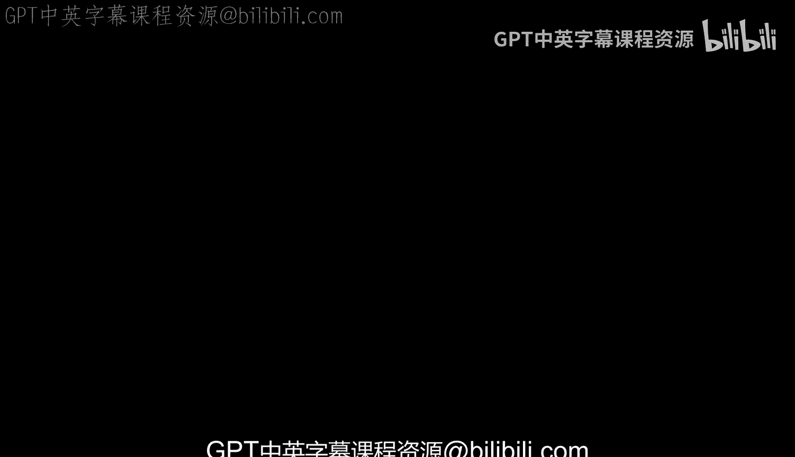
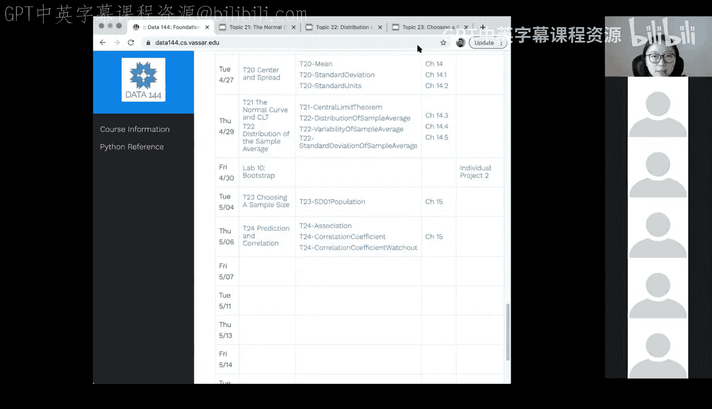
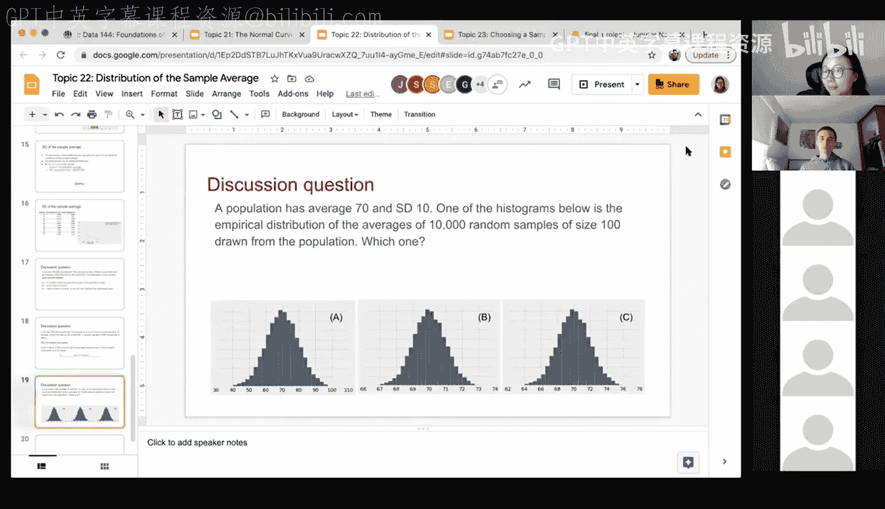
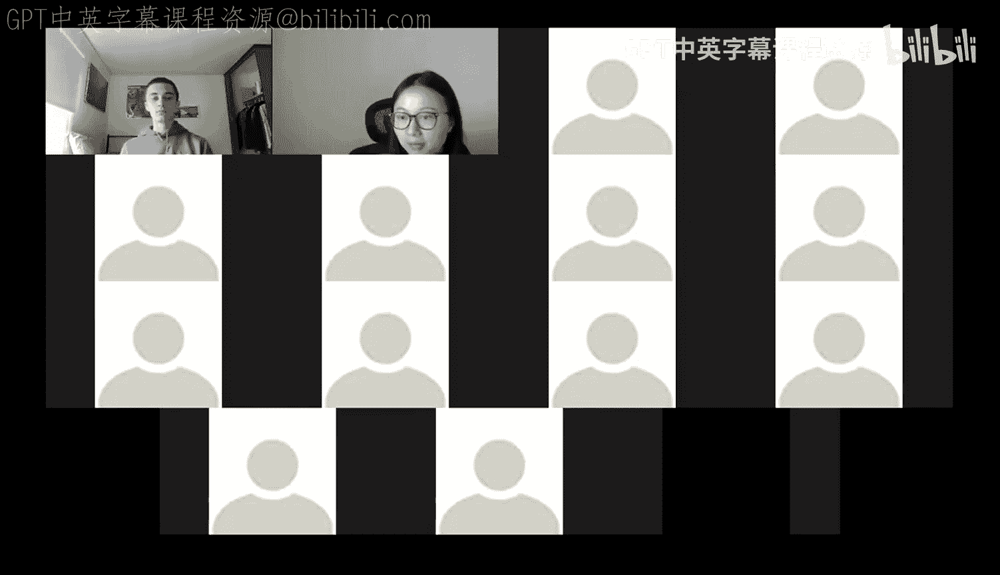
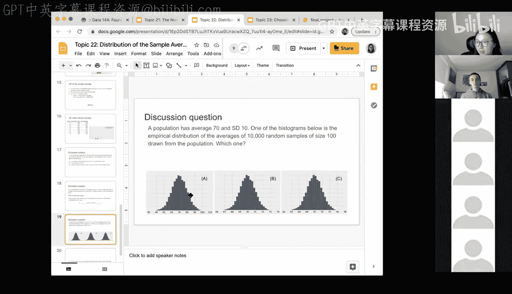
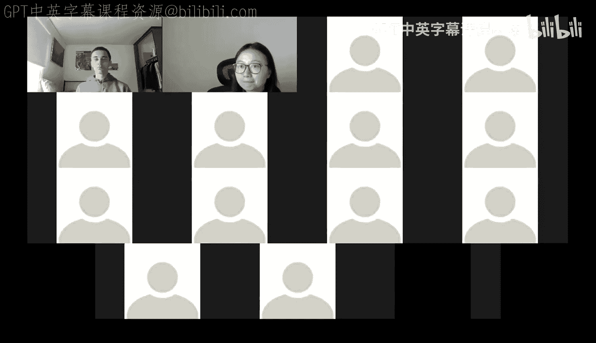

# UCB《数据挖掘和分析｜DATA 144 Data Mining and Analytics 2021》中英字幕 p67 [P67]lecture67-[T22 Distribution of the Sample Averages] Three Discussion Questi [BV1efBEBuEVg_p67]

Okay， let me share my screen。

So we're going to resume from topic 22 okay so that's the topic where we were almost on。

 I think last Thursday with Jason about distribution of sample average okay and if we come back here just I guess quickly going over the stuff that we talked about last Thursday roughly okay so we are focusing on the distribution of the sample average okay and then remember it is a distribution because every time you take a different sample you might get a different sample average okay and then if you do it for a large number of times as we know you might get each time different right that's what we mean by it is estimate so so there is a natural distribution Okay for the sample average and so this set of slide talks about why。

There could be okay so this is the example like you know this is say like the population right like every time you have a different sample you take the mean and you realize that the sample mean has a distribution and then in particular we talked about based on central limit theorem right this is going to be a normal distribution okay centered at the population mean okay so that's why we focus on a lot of times the inference about the average because we do have some really good property or useful properties like it follows a normal distribution that we can do hypothesis testing or confidence interval for okay so then of course then we talked about the variability of the sample average okay because every time you get a slightly different and then so naturally there will be some variability okay but more importantly I guess。

From last Thursday is that we realized the sample size is going to play a role the sample size is going to play a role when we're thinking about the variability of the sampling of the distribution of the sample average okay so this example if you remember is in the demo that we did two different sample sizes okay 400 and 900 okay for each we did I guess 10000 simulations right So so here we're doing the overlaying histogram of two different colors and then the 400。

 which has a slightly wider spread okay that is that is the sampling distribution okay or I should say the empirical distribution of the sample average when the sample size is 400 and then the goal color which is a little bit more concentrated with a smaller spread that's the case for the sample size of a 900 okay so what we have noticed I guess from the biggest takeaway from this is that both like first of all。

 the number the number of data points。Each of the histogram is 10000 okay because each one is representing a sampled statistic okay and then what we notice also is that for both distributions。

 they're roughly bell shaped okay and more importantly for this comparison we know that the larger the sample size the narrow the bell okay meaning that the larger the sample size。

 the variability of the sample mean shrinks okay intuitively hopefully makes sense because every time if I take a larger sample it's more like it probably will hopefully be more like related to the population mean like closer to it because I have a larger sample to estimate so this actually can be manifested as you can see if we compare different sizes and I guess one other thing is that both of them are center at the mean of the population as well okay so this is examples and then demonstrations of how the central limit theorem is working in practice okay and then for us it's important to note about how the sample size plays a role。

To the variability and that of course， we talked about is that was how we ended last Thursday ish。

Oops here is the standard deviation right of the sample average that we can actually compute it from a normal distribution as the population standard deviation if you have it okay divided by the square root the sample size so that's what we covered I think by last Thursday and then of course in practice I mean mathematically if you want to compute it。

 then you need to know the population standard deviation and then also the sample size and then if you look at this mathematically suppose the population standard deviation is fixed for a particular population right and then the sample size of 400 versus the sample size of 900 we can see that the square root of that is 40 versus20 versus 30 right and then what this shows is that the larger the sample size like the 900 case which which gives us a square root of 30 square root value of 30 here。

 the larger the sample size the smaller the standard deviation。

And that's exactly we're seeing over here。Okay， so this are very widely used results Okay and then in the demo I think you see even more different sizes than just as a comparison。

 but clearly you see that trend going on Okay so that's a recap okay and then for this to wrap up this topic we have a series of discussion questions Okay so there are actually three of them I would say so let me talk through them quickly and then I put you in the breakout rooms I will highly recommend you to go to the course website to look at the three different questions。

 especially the last one has a few figures but let's talk about them quickly and then。

Put you in the breakout room so you can discuss among yoursves Okay so the first part of the discussion question is they give you okay a population size okay500。

000 households okay they give you the annual incomes of this households the average in a standard deviationation okay they ask you the distribution of the incomes is what okay ABc okay pick one and explain okay then we move on to talk about from this 500000 households is the population right we're taking a rent sample by 900 okay and then we're asking you filling the blanks explained there is about 68% chance that the average annual income of the sample households is in particular range with two blanks down there to ask you to fill it out so you might need to take pen pen pen and a paper and they just do the math really quickly and the last one is we give you so this is not related to the previous two okay population has the average have a mean。

70 and stand deviationvation 10 okay they ask you that ABC， the three choices。

 one of them is the empirical distribution of the averages of 10。

000 random samples of a size00 so which one all of them have exactly the same shape pretty much okay so think about what matters here and then how you're gonna do the choosing between the three okay so remember all of the stuff that we recap just now about like sample sizes and then the normal distribution how to do this kind of calculation and then of course this is just a quick hint this reminds us the 60870 60 a95 and 99。

7 rule if you remember okay about the normal distribution so that will be useful as well okay all right so I will stop sharing and I will stop recording okay yeah so we have three questions in total and yeah since I guess yeah pretty much all of them I guess can be answered either verbally if you want to speak。

U or type in the chat so for the first one， the distribution of the incomes should be A or B or C and feel free to type in the chat。

Or speak up just unmute yourself and then share what you think we really appreciate it。 Okay。

 so I got a see in the chat， okay。Everybody agrees， disagree。Comments。Yeah， Samantha。

 do you mind sharing why you think C is the option？Sure。

 because it never really specified that the sample was like done randomly or it was。

So I just assumed like we couldn't assume a normal distribution。Yeah， yeah， well， good point。 Yeah。

 I will just also add that I think at this stage of the question is not about the sample。 Okay。

 let me close a little bit because here the city has 500000 households and then this 65000 as well as the 45000。

 I think they are the population parameter。 Okay， youre given because they are talking about the entire population of all of the households in the city。

 Okay， so then for us， we only know it average and its standard deviationviation。

 but it doesn't tell us anything about the distribution of the incomes here this is the population distribution。

 So I think it's it will be C Okay， so this is。At the stage of only talking about the population then if you remember what we had talked about before。

 whether it's the population or the sample， like the distribution of that could be anything right like could be I don't know like can be uniform or equally likely or like a normal or maybe I don't know how it could be anything a lot of times for income for example it will be a really high skewed distribution okay like with a really long right tell because very few people make a lot okay but then the majority is probably I don't know where but it's going be maybe around the mean or close to the mean so most likely okay the distribution of the incomes will be something pretty skewed and not close to normal but we don't know like we don't even need to know that I guess at this point for the ABC to choose between ABC but as we know what we care about is once we start to look at the sample mean right and then the central limit theorem guarantees that is the average the sample means themselves going to follow a normal distribution。

and center the population mean right with the standard deviationviation of that formula that we showed earlier so that's what matters more for us okay so so thank you Samantha and I just try to also add a little bit other discussion over here so it should be C and for us this is only about the population the population distribution can be anything okay。

All right， now we come down to the actual sampling part Okay。

 we're told that the sample size is 900 Okay， then the question is there's about a 60 h that the average annual income of the sampled households Okay。

 so be really careful about what they're saying Okay。

 they're talking about the average income right of the sampled households So put into our usual。

Wording， I guess， is the average sample average。 Okay。

 that whole thing is like what we've been talking about sample average。 Okay。

 so we know that it's going to follow a normal distribution right。

 roughly Okay with mean and the population mean as standard deviation with that formula。

 So what do you think about this two blanks。Anyone's willing to give it a try？

Either in the chat or speak up。We said 65，000 plus or minus 45，000 Okay。

 so I'm just typing the chat so。Eli's team， I guess， is answer is this pair， right am I right？Yeah。

 okay， thanks， yeah。Everybody agrees。Or do you？What is that is that is that yes。

 sorry Sandy or is that half of an emoji could't even tell， I guess that's a that's a yes， okay。

 anybody else， everybody agrees。😊，No disagreement。Okay， so Eli。

 do you mind like to maybe talk a through of why you chose those two numbers？Yeah。

 like with the like I is the empirical rule， it's 68% is plus or minus one standard deviation from the average so since the average is 65000 and the standard deviation is 45。

000 it iss just。Plus or minus 45，000 from the average。Yeah， so indeed， yeah。

 that 68% like we're reviewing earlier refers to， I think the 68 95 and 99。

7 rule percent rule right that we know that for normal distribution about one within one standard deviation you have 68% of the probability okay within two and within three is 95 and 99。

7 okay so if we focus the question okay so we know that they're talking about the sample average okay and the mean we know that the population mean is 65000 so I agree that given central limit theorem so let me come back a few slides ago okay by the central limit theorem we know that the sample average okay going have to center the population average so I agree for the first plan I think is 65000 okay because that's what the population average is okay and I also follow I agree with Eli's logic of okay 68 refers to one standard deviation So whatever issue comes in here is about one standard deviation okay you don't need to multi。

about you or anything I guess my only comment here is that if we come back again about the standard deviation okay so the standard deviation here notice because we're talking about the sample average okay that's what the question is right the chance that the sample average going to be in the particular range so the standard deviation that we're looking for should be the standard deviation of the sample average but not the standard deviation of the population。

Okay so what is given to us so let's slow down okay the question is saying that there are 5000 500。

000 households we have the standard deviation we have the population mean of 65000 and population standard deviation okay or 45000 okay and then the question is asking us okay about the distribution or certain feature right of the sample mean so we need to work on everything on the sample mean okay where the mean。

Is the population mean okay and the standard deviation actually needs to be the population standard deviation divided by the sample size square root of sample size okay so if we do the math quickly here I guess iss 45000 as the population standard deviation right and then we have 900 right square root of die 30 so you divide 4 45000 by 30 which I guess is。

1500 right， 1500 ish okay so does that make sense or because everybody I guess agreed with Eli's answer。

 so I wanted to make sure that do you highlight any follow up questions about this。Anyone？

Or it doesn't make sense or it doesn't make sense or you think that wording is a little bit tricky so you didn't get to the point earlier。

Eli doesn't make sense， the answer that I provided just now。有。

Okay yeah no thank you I didn't mean to put you on the spot I appreciate you offering the answer and yeah so I guess in this case just be a little bit careful and I guess another way to double check our work is if we come back to the previous question right if you chose C right？

Then we know that well， when you chose C， which I believe most of you did。

 then we are acknowledging that we don't really know about the distribution right of the population okay。

Again， this is the population mean and this is the population standard deviationviation so well you probably would never use this two together to do any kind of normal calculation okay because they do not follow like the population distribution itself does not follow it normal distribution so you wouldn't use themselves directly right but then for us it's indirect because of the fact that by central limit theorem we know that the sample average follows a normal distribution with the mean at the population average and standard deviation is the population standard deviation divided by the square root sample size so that's why you're going have 65000 here。

 but then here gonna be 45000 divided by square root of 900。Okay。All right。

 whatever the last one this is not related to that setup Okay。

 you have an average of70 and standard deviation 10 notice that they told you they are the population parameters Okay so this is again that we know about the population the mean and a standard deviation and then we're doing this histogram of empirical distribution of the means again。

 okay averages of 10000 random samples of size100 Okay， which one do you think is referring to the。

Histogram of what we're doing here and why。Would it be B Okay， so we got one from Samantha again。

 thank you， Okay， so Samantha says B okay。Anyone else？Okay， we got okay。

 somebody private messaged me Okay， maybe it was meant for everyone， but I got a A Okay。

 so we got two different answers now。Okay， we got another A， okay。Okay。So yeah。

 I'm just going to invite Sandy if you don't mind sharing what you did because I talked to earlier I invited Samha earlier and also the other A was primary message。

嗯。Because it's the empirical distribution of the averages and we got a large sample size so it should be normally distributed and so the inequities as like within the three distribution three standard deviation we should be able to cover the entire sample and one standard deviation is 10 so three standard deviation we should be up to。

100 and down to 40。And a it the histogram that describe what I said。Thank you， Cny Okay， yeah。

 thank you， sorry， yeah， Samantha， do you want to add anything about why you chose B。Well。

 originally my group did pick A， but just based on like you。

Explaining the answer to the last one I was wondering because you said the population since they give you the population standard deviation I was like oh do we have to use the formula again so the square root of 100 is 10 and the population standard deviation is 10 so 10 divided by 10 would be one and so even though I originally picked a at the last second I was just wondering if it could be B。

Yeah， indeed， I think in this case， it should be be just exactly the reason that Samantha shared Okay so I guess this is related to the previous question a little bit right so like here we're talking about a sample of an 900 so we use the formula of population standard deviation divided by the square root okay of the sample size to get the standard deviation of the sample so for us here again we need to read it carefully okay。

 the first sentence told us that the mean is 70 okay standard deviation of the population is 10 so both 70 and 10 there the population parameter okay and just like Samantha pointed out。

That it's standard deviation of the population is 10。

 but then we're doing sample sizes of 100 right so we need to do 10 divided by squared root over 10。

 which is one in this case to get the to get the sample standard deviation okay or the standard deviation of the sample mean sorry let me put that in that way the standard deviation of the sample mean and then just like what Sandy was saying earlier by the sheby chefs rule majority close to I guess in this case normal in particular so like almost like 100% of all of the data points should be within three standard deviations away from the mean that's why when you have sample mean the mean of the sample means at 70 and then the standard deviation of that at one so you should range from 67 to 73。

Okay。Yeah， does it make sense now， Cindy？Yes， yeah， okay。 Yeah。 Thank you both again。

 didnt mean to put anybody on the spot。 and I hope you don't feel bad of like say sharing wrong answers。

 And we really appreciate like having this kind of discussion。

 So I guess those two are definitely related。 Okay， I guess it's easy to make the mistake Okay。

 what standard deviation we're really using Okay， so I guess for us just to。Recap one more time。

 Okay， so when were working with the population。 Okay。

 it doesn't have to like we don't even know what kind of distribution the population should be。 Okay。

 it could be anything depending on the nature of the variable。 Okay。

 but if you are given the population mean and the population standard deviation。

 then if you are working on a distribution of the sample average itself。 Okay。

 not the sample or not the population or not the observation themselves。 Okay。

 we are talking about the sample average， the distribution of that。

 then we know by central limit theorem is's gonna to be roughly a normal distribution at the mean of the population mean and the standard deviation of the population standard deviation divided by the square root the sample size Okay so given that we worked out B sorry。

 the second question okay because we have the mean of the population。

 but then this standard deviation is to be divided by the square root of sample size and similarly here。

What I have to do what have to do that as well。 Okay， and one last comment about a。

 I guess another way。 So if like let me ask， I guess the follow up question， what a could be。Okay。

 like just say like if a is given to you like what could a B given this setup like we know the answer to this particular question is B right and C is I don't know just I randomly put it there。

 but what could a B given what Sandy shared earlier。Any thoughts？It is not。

 I guess the distribution that is not the empirical distribution of the averages。

 okay given given this question， but I guess it could be a particular population okay of 10。

000 observations okay and if you happen to have a population that is normal then a could be the distribution of the population itself。

Okay， but just like what we were saying earlier， the population could be any kind of shape right。

 like it's not necessarily like not necessarily a normal， it could be any other distribution。

 like I said for income， it could be a really highly skewed right skew distribution with the long tail to the right Yeah so this like I said could be like a very special population distribution that happens to be normal okay and then if we follow what Sandy said earlier then a could be a distribution like that because we know that the mean is 70 right and the standard deviation right of the population is 10 Okay so then by that rule。

 we know Chevy chef's rule， we know that well it should be between 40 and the00 Okay like the range because it's three standard deviations above and then three standard deviations below okay but regardless。

 I guess for this case because the question is asking about the distribution。

Of the sample averages okay， so we need to once again be reminded about the standard deviation of the sample mean it is the standard deviation from the population divided by the square root of the sample size。

 so that's why that's why you're going to have the answer B。Okay。😊。

Okay， make sense， everyone。Hopefully。Okay yeah， so take the time to revisit I think it's good I guess you get to talk with breakout room members to discuss what you think and I guess not everybody got it right in the first place right so it might be good to revisit and I will also say that because in our course a lot of times we rely on simulation right and then whatever shows up in the graph as long as you have done everything correctly then then you can usually always use that graph or any kind of probability calculation you can use in Python to answer any kind of question but I guess this kind of discussion questions that we talked about can also always be well I guess a good knowledge check right just to make sure that we do and what we mean by central limit theorem right is about the sample average is not about the population observations but the same time you could also be really handy I think to double check that you're working Python is correct it's not easy to spot right like say if we come back here really quick。

Sorry to drag on this a little bit more if we come back here really quick， let's just say like well。

 like for some reason， you come up with a okay in your in your simulation when what you're trying to do is actually only only the sample mean distribution so if you come up with a like if you look at the range of X that is probably telling you that something was not entirely correct in your simulation okay because we know if you're working on the sample like the distribution of the sample mean。

 then it should follow the normal distribution center。

 the population mean with standard deviation S of the population divided by screw the sample size so if you get something like B great。

 if you get something as a that might make you rethink and revisit how youre coding and maybe something was off a little bit okay so nevertheless I think make sure that you revisit this as needed and then always reach out whenever you have questions。

