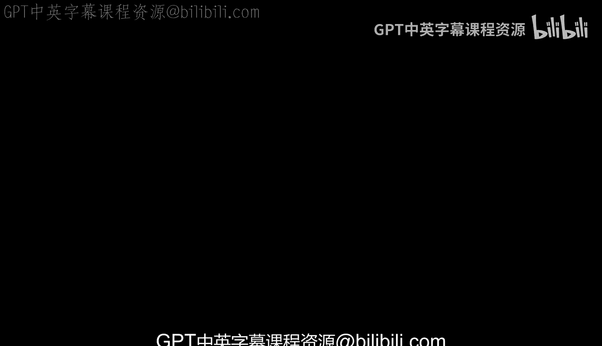
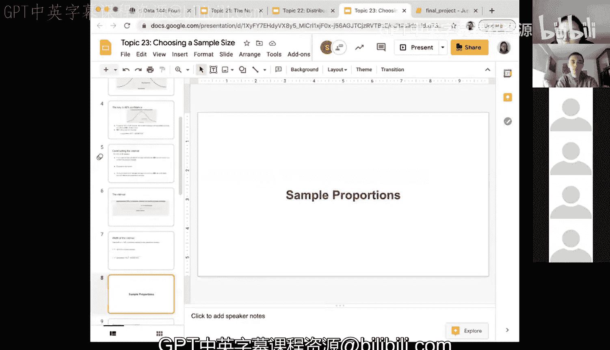

# UCB《数据挖掘和分析｜DATA 144 Data Mining and Analytics 2021》中英字幕 p68 [P68]lecture68-[T23 Choosing a Sample Size] Confidence Intervals-j2mNJy9JGz4.zh_ [BV1efBEBuEVg_p68]

Let's get to topic 23 okay so topic 23 as you will see is now we're getting into the task of okay。

 how to choose the sample size Okay， we've been talking about the effects of sample size in terms of the standard deviation right the variability the standard deviation of the sample means so now let's think about how to choose the sample size if you have particular tasks at hand that you're trying to achieve okay so to get us started let's do a quick review okay of confidence intervals and we talked about it multiple times before okay。

 but now reviewing it just to put into the context of why in some cases you want to choose sample sizes okay so let me put in this way a lot of times I guess the exercise or examples are given to you right you're given a particular sample size and you're supposed to work with that sample size and go about it okay but sometimes especially I think in。

Study design。 So imagine that well， imagine we are， let's just say survey designer， Okay。

 like let's just say that we want to design a particular survey and then we finally finish designing it and then we need to figure out how many copies of the survey we should send out okay so that's actually an example of how to select a sample size that can achieve what you want to do Okay so a lot of times well as you know now the sample size plays an important role in terms of how we are able to come up with our。

 I don't know in this case， like say the hypothesis。

 you want to you want to test for or like how yeah。

 let's just say the hypothesis you want to test for and then the sample size can play a role because if you're doing a hypothesis let's say for the sample mean and stuff like that And just as we know from the central limit or right like depending on the sample size。

 the standard deviation of sample mean going be different okay it's the effect of the standard deviation of the population。

Divided by the square root the sample size okay so the sample size plays a role okay so sometimes be depending on the goals of how what kind of goals you have in your analysis you need to determine the sample size okay so that's why we're talking about how to choose the sample size and then the first first part first recall or refreshing memory is about the confidence interval okay because let me put in this way a lot of times people might want to come up with a confidence interval within certain range okay and then that will be the case that well because confidence in your remember。

Is also related to the standard deviation right of how you are dealing with your sample means So okay without further ado。

 let's maybe do a review about what we have known already and let's see how we can link it to what we are trying to do here okay so this is the approximate distribution of sample average okay of a particular sample size n okay so you notice here this is a nicely nicely looking normal distribution okay centered at the population mean okay with standard deviation of the population standard deviation divided by the square root of n okay so that's exactly what we know by the central limit theorem okay so if I am able to graph it out for for the distribution again it's the sample average okay we're talking about the distribution of sample average then we know that it's centered at the population average with standard deviation of the population standard deviation divided by square root of n。

All right， so if I want to think about 95% confidence and then related to that confidence intervals。

 Okay so on the graph essentially what I'm doing， as you can see is that for about because for about 95% of all of the samples。

 the sample average and the population average will be be within two standard deviations away from each other。

 okay because of that， okay then if I think about the like the like the range that I'm working with okay I know the distribution of sample average is this curve。

 this normal curve that we're seeing over here okay center the population average with standard deviation by population S divided by square of n okay and then of course we can compute that right if we are given the population standard deviation。

 we know the sample size or maybe we don't know but we try to solve it， given other constraint。

 but regardless we have this relationship right we have the standard deviation of the。

This particular distance that we're talking about， it is the standard deviation of the sample average。

 which is the population as standard deviation divided by the square root sample size Okay so that two maybe you're wondering about where did that two come from this is just like if you remember the 906895 and 99。

7 rule right about normal we know that's going to be about two standard deviations okay for 95% so that's where that two comes from okay but more importantly I think the takeaway on this slide and the next we're going to go there in a second is that the result that we know here based on central limit theorem is that the sample average okay and the population average they're going to be within two standard deviations of the sample average away from each other okay for 95% of the time okay so again the standard deviation this highlighted colored as that we're talking about is the standard deviation of the sample average and that the。

And that we're talking about okay again， we still have the population standard deviation which is usually larger okay remember you are doing population standard deviation divided by the square root of the sample size so it's always going to be the standard deviation of the sample size sorry the sample average will always be smaller than the standard deviation of the population okay so keep in mind what do we really mean by two standard deviations away from each other okay that to you comes from the fact that it's 95%。

And that is because of the 68， 95 and 99。7 rule for normal okay。

 but also here we're talking about a standard deviation of the average as the distance that we are measuring。

So now if we think about constructing a confidence interval。

 Okay so here we talk about the confidence， the concept itself Okay and the concept and now to construct the actual confidence interval。

 what we're doing Okay and conceptually okay let's let's walk through this Okay so for 95% of all of the samples Okay if you stand at the population average。

 which is at the middle， as you know， okay， and if you look at look two standard deviations on both sides。

 Okay， you will find the sample average Okay so that's what we mean if I come back to this slide really quick one more time Okay for this sentence。

 the sample average and the population average are within two standard deviations away from each other Okay so like。

I guess geographically or like conceptually spatially if you think about it。

 if you stand at the population average and then look two standard deviationvations away on both sides。

 you will find a sample average okay plus this kind of distance is symmetric okay so that is the same as saying if you actually stand at the sample average okay from a particular sample average that you're able to compute and then if you look two Ss on both sides you will capture the population average okay so there's a pretty important concept here that we started off if you remember one we're telling okay。

I'm sorry here。哦。啊 sorry。有皮。Yeah， so if we come back to this slide。

 what this is saying is that we know the distribution right of the sample average。Okay。

 we know that it's going to be centered at the population average and we know that about 95% of all of the samples。

 the two averages are within two SDs from each other。Okay。

 but now imagine how we actually are doing of confidence intervals okay。

 if you remember what we did roughly before and now specifically if you imagine what you actually going to be doing for a confidence interval is that we only get one sample right we're trying to like we have a sample average right we know the distribution of it by central limitthereorem okay what we're trying to do is to construct a confidence interval around the sample average that will be helping us to determine where the population average is。

Okay， so let me put it in another way like if I look at this graph Okay I know in theory。

 my sample average should be centered at the population average right but maybe in many cases。

 we actually don't know exactly the population average is going be we only know that it's going be where the sample average gonna centered at right but we don't know what it is if you know what it is we don't even do any kind of inferences anymore right you can always just work on the population。

 you can take the mean take the standardvation everything is done。

 you don't even need to do inference okay it is because we don't have access to the population we have to do some kind of inferences like what we're doing Okay and then in specifically we know from the central limit theorem from this graph that the sample average。

 the distribution of that going be center at the population average Okay so。The task's almost like。

 oh， I know it's going to be center at the population average。

 but unfortunately I don't know where it is。Okay so in another way to think about the inference that we're doing is that oh instead of the unknown population average。

 what I do know is the sample average that I get from my sample right so because of the symmetric of the distance that we're doing over here okay if you stand at the population average within two standard deviations you're gonna see the sample average right then that is the same as saying if you stand at the sample average。

 which is what you can get from your sample and look to STs on both sides you will capture the population average。

so that's why when we are constructing the interval。

 what we're doing is that we are centered at this point on the sample average， which is what we know。

Okay， and then we create a confidence intervals for 95% in this case。

 like two standard deviations lower from the mean and then two standard deviations larger around the mean than that with that particular interval gives you a 95% confidence interval of the population average。

Okay， so keep in mind that everything is still built on the central limit theorem okay but the central limit theorem let me say this way like central limit theorem tells us theoretical where the mean is going to be and what the standard deviation going to be okay for the sample mean okay but that's only in theory right and then for inference what we care about is what we can say anything about the unknown parameter that we're trying to estimate like the unknown in this case unknown population mean that you might be curious。

In that case， what we're doing is that we're constructing the interval based on the sample average。

 which is what we know okay and then we're able to say certain things about the population average okay。

 so to sum up all of the stuff that I talked about just now is that here on this graph okay so approximately a 95% confidencetable for the population average which is unknown but you want to make inference about okay it's going to be centered at the sample average。

Okay and then within two standard deviations of the sample average okay so that's why in practice the way they you're doing it is that you're going to get your sample average from your sample right and you're also get going to get your SD of the sample average from the sample by doing population S divided by square root sample size okay and once you get that you're able to proceed what we mean by this 95% confidence interval。

Okay so this might be a little bit new to some of you even though we did talk about confidence intervals in the past。

 but here I think it's in a different setup okay in the past is we if you remember what we did。

 we simulate under the null when we're doing hypothesis testing right we simulate the test statistics under the null for a large number of times right and then we construct a confidence interval that way so here we are talking to talking through it more mathematically right I mean of course in theory if you have the population you can resample every time for 10000 times and then you can get a 95% confidence interval that way that's what we find but if you do not have access to any computing powers or maybe let me just put another way that in the past how confidence interval is taught in textbook for statistics courses this is pretty much like the recipe for that but hopefully now it starts to make more sense to you like the way。

We're doing a simulation okay and the way that we're doing now mathematically they really converge the same thing okay they're the same concept okay we're using the same concept in the past when a computer was not widely available this theorem central em theorem was developed and then people figure out how to construct confidence about how to do hypothesis testing from the mathematical point of view okay but just remember all of the simulation that we did is really similar to replicating in theory okay if we are able to do this for a large number of times of the results gonna follow the theoretical result as well okay so maybe try to yeah try to connect those two and then for us we really want to make sure that both make sense okay and all right so then if we come back now to my question at the beginning is what in what situation in my choose sample size or determine the sample size and how you're gonna do it is related to this with。

Of the interval okay so the total width okay of a 95% confidence interval for the population average going to be four times the standard deviation of the sample average okay because you have two right lower and then two upper so it's going to be four in total and mathematically it's going to be four times population standard deviation right divided by the sample square root of the sample size because that whole expression is for the standard deviation of the sample average。

Okay， so mathematically， this is what we have， okay？All right。So keep that in mind。

And we will。