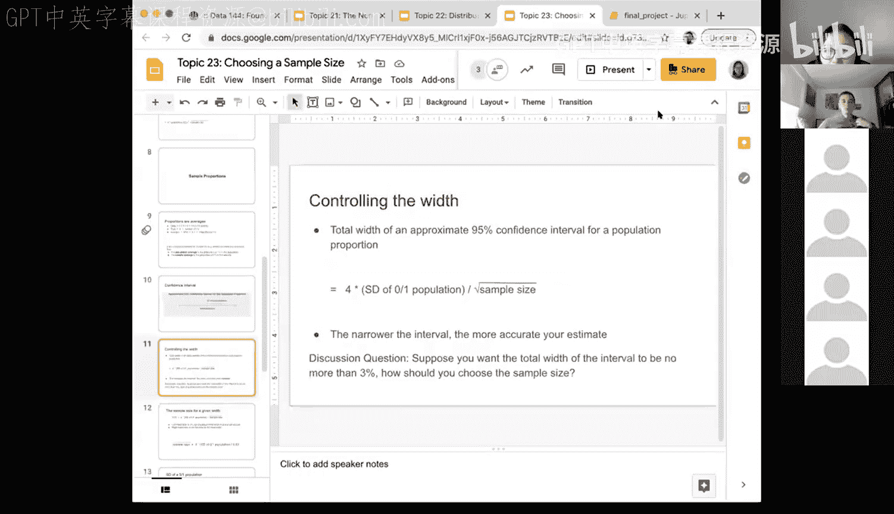
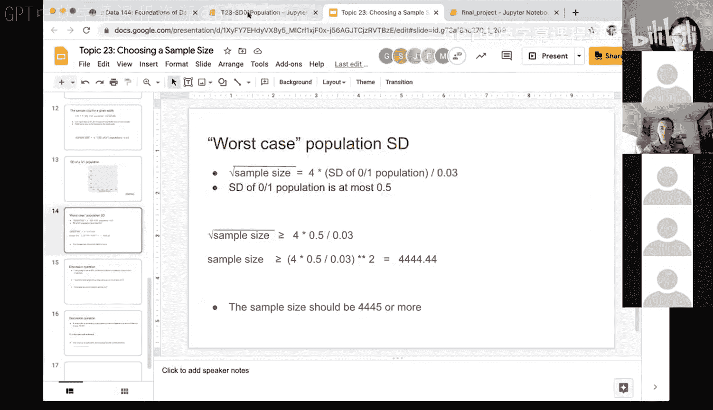

# UCB《数据挖掘和分析｜DATA 144 Data Mining and Analytics 2021》中英字幕 p69 [P69]lecture69-T23 Choosing a Sample Size]  Sample Proportions part 1-RSXtizySkC [BV1efBEBuEVg_p69]

We'll come back to that when we start to do a little bit more calculation related to sample size。

All right， so here we're gonna continue with sample proportions a little bit because proportions are another important parameters people or like in this case estimates and then parameters of the population that people care about okay like a lot of times like say if you do a survey and then you're asking about let me see like marital status for example okay so you might be curious about like amount the survey respondents the proportion of married people okay and then that is like say if you get the sample you take like for that marital status variable you get the proportion like of choosing married right over all of this so that gives you a proportion so a lot of times you can use the sample of course you make inference about the unknown proportion of the population okay if your sample is representative right so we want to talk through that as well because in essence proportions averages as well okay。

If you can frame your data in a different way so just now I was talking about marrow status okay a lot of surveys I think they probably have six different categories like married divorced。

 widowed and then blah， blah blah， like so many different six in total so if you phrase the I guess if you use the original way of how the data is coded then it's not really easy to see the proportion of married as averages okay but if I start to recode my data like it used to be like a categorical variable with six different levels okay but if I now only focus on the proportions about married okay then I can turn my categorical variable into a binary variable obbel okay of married or not married okay because every other categories can be put into the not married category okay so。

In that case， my proportions start to become averages。

 So the reason what I mean by that is that let's just say we have a data in that context。 Okay。

 so 10 entries of whether youre married or not， okay。

 married is 10 is one Okay not married is zero Okay so I have 10 entries here and then out of the 10 I think I have four ones Okay so four are married is and then six or not married Okay。

 so if you look at this as the data instead of like the different categories and then we are recording it into a binary what we mean only zero ones over here then the song okay is four which is the number of ones Okay so the proportion。

We know it's 40% right by just reading the data stream， okay。

 but it is really also just the average of if I take about the sum of four right and divide it by 10 that's the number of observations。

 so it is the average if I code my data into zero1s。Okay， so with this in mind。

 all of the stuff that we have learned so far about the means okay。

 can be transported into proportions as well。Okay， at the end of the day。

 we need to know about the mean of the average sorry the the I should say this way， the mean。

Of the proportions right the sample proportions as well as the standard deviation of the sample proportions just like in the past。

 we need to know the mean of the sample averages right and the standard deviation of the sample averages and from there we know central limit theorem we know the normal distribution and then we can do the confidence like what we described earlier okay so now for proportions if we know the mean of the sample proportions if we also know the standard deviation of the sample proportions and then the central limit theorem actually kicks in again because proportions are averages okay and then from there we're able to do the stuff that we know okay all right so lastly if the population consists of ones and zeros okay yes or no to a particular question then the population average remember population average is unknown okay but but is the parameter of interest so the population average in this context is the proportion of ones in the population okay and then the sample average。

A proportion of ones in the sample。Okay so again， we're back into the game of doing using sample average right maybe like construct confidence interval so we're able to say something about the population average that is' unknown but we're interested in okay and then everything like I said goes back to central andthe okay so similar to the confidence intervals that we're talking about earlier for the sample means okay here。

If you want to do a 95% computational interval for the population proportion you centered yourself right at the sample proportion okay and then you're gonna do minus two times standard deviation plus two standard deviation of the sample proportion so like I said the question now becomes right like well the sample proportion you probably can get it like 0。

4 just from the question earlier right like the zeros ones of 1010 zeros ones but then the natural question I guess for many of us will be that oh how much supposed to compute a standard deviation of sample proportion right because sample proportion like well we know that for the standard deviation of sample means is the population standard deviation divided by the square root of the sample size okay but now for sample proportion what can we do okay so。

For us okay what we are sharing just like the central em theorem as before okay is again。

 the width of the confidence interval gonna be four times the standard deviation of the population divided by the square of the sample size okay so this is working in a very similar way as before for the sample sample means okay and but then of course we need to figure out how to compute the standard deviation of the zero1 population。

 which we're gonna get into in a second in a demo okay but if we just focus on the width of the confidence interval for now okay and we just want to talk it through really quickly。

 if you think about the interval， which is the width with width of this expression over here okay the narrower the interval。

 okay the more accurate estimate is okay if you have the same right like let me let me just say this we have one confidence interval of length2 okay another one let's you say 1。

5 okay both of them are 95% confidence interval okay。

So the first one is wider right the second one is narrower okay， the narrower。

 I guess the narrower the interval， the more accurate estimate is because you're more confident sorry。

 it's the same level of confidence but you have a narrow interval right so you know that you have a narrow range right the population parameter are going to be okay so keep that in mind okay。

And I just want to throw a discussion question here and then put you back in the breakout room just to see if you can come up with some kind of idea going on here。

Suppose you won the total width， okay， just like the total width is the expression that I'm showing you up here in the middle slide。

 okay， to be no more than 3%。How should you choose the sample size？Okay。

 so don't worry if you can find out the actual like value of the sample size that you're choosing。

 this is more like conceptually to to make you think about。

How we are translating this with confidence into a with question with the sample size。Okay， so again。

 this is， let me come back to that， okay。This is page， let's see page 11， Okay。

 page 11 of topic 23 so I'm going to stop share and stop recording。

Okay all right， so yeah， so coming back to this discussion question， okay。

 we want the total width of the interval to be no more than 3% Okay so clearly as we know like just how the question is phrased I guess sample size is something you can choose okay in a sense that we can determine what we're gonna do with the sample size So so sample size is something going determine the width okay so so I guess if we know the standard deviation of a01 population。

 if we know that then if we set this to be smaller equal go to 3% right then we're able to solve what the sample size is okay so this I guess at the beginning is a math is a math question Okay we set let's just say003 which is 3% okay。

And the left hand side is that is the maximum total width that we will accept based on that Okay。

 the right hand side is the formula for the total width Okay。

 so so you're able to solve it and then like I said you can also just set it as like greater or equal to as the upper bound right so then you will solve in this case the smallest sample size that you will need to make this happen Okay so like I said at this very beginning。

 this is a mathematical question Okay and in a sense that。

If you have a target of the width are you're working with so again。

 the narrow the interval right the narrow the width the more accurate your estimate is and that's related to like I said some of the goals when you start like before you start collecting data determining how large the sample size you want okay so if you have a particular goal like in this case。

 the width of the confidence interval then depending on how you're doing your study itself。

 the sample size is going to be something you have to choose in order to meet your goal so keep in mind we can do this calculation。

 if we know what the standard deviation of the population is okay and sometimes it's given to you or if it's given to you great you don't even need to worry about it but if you are not given to it okay this is what we want to do for a demo okay just to get a sense of the standard deviation of a zero1 population。

Okay and so let's so the graph is what we're gonna replicate in a second in the demo okay but maybe before we go there。

 just to like pause at the graph a little bit So this is looking at proportions of ones okay which is the proportions of ones of the data okay and then this is the standard deviation that we're able to calculate okay after we get the proportion of ones so one thing I wanted to notice is that the standard deviation is actually a function okay in terms of the proportions of ones okay we hear we're just saying that well if you know it then you're able to do the calculation okay but like I said sometimes you don't know it when you need to maybe find the worst case scenario okay that will give you the most conservative sample size that you need okay in this case。

 the standard deviation of this zero1 population reaches its maximum of 0。5 at the middle point。Okay。

 so keep this in mind and let's go to the。Go to this standard deviationvation of01。

Demo before we break for today okay and then I will walk you through this particular one more carefully because this is not based on any particular data Okay it's really just based on simulation and then let's see how we can replicate that graph and what that graph is really telling us okay so here what we're doing is that remember we have like the two example that we get started here is that let's have a population of zero and ones of size 10 okay and then to create that well imagine you are doing an array right like you have one sorry if I want two ones okay then what I do is that I do one1 right and then all of the remaining eight gonna be zero okay and the way to do that as you could imagine is that if I determine the number of ones as two in this case then I can append okay two arrays together okay the first array is the number of ones all of them as ones so this is probably a new function to many of yoump do ones that gives you an array of how many ones that you want in the print。

Okay， and then another similar function here is MP dot zeros Okay。

 so whatever goes into the parentheses is the number of zeros that you want in your case Okay。

 so for us。Remember we're doing two ones so meaning that 1010 in total so eight gonna be zeros right and then when we print it out here it's the first two ones and then the remaining eight of zeros okay so this is like a building block okay how we can actually create a zero1 population depending on how many ones you have and how many zeros you have okay with size 10 okay we're just doing size 10 for now okay so to get a standard deviation of this of this population okay we can use mda STd right and then the 01 population that we do is 0。

4 is quite interesting in some sense right if you think about it because we know the mean 0。

4 right the standard deviation they're always the same I guess that will be a natural oh sorry never mind。

Let me take that back I guess here the mean too sorry point two we're not dealing with the previous example anymore Okay so so I guess yeah it might not be really clear this point about what the standard deviation of a zero1 population should be in this case so let's experiment okay what we're doing here is we wrap this thing okay the population of size 10 this example into a function okay and then the input i'm hoping to get here is the number of ones okay we want to experiment with that number okay so the totals are going to be 10 okay so what that means is that as long as you supply the number of ones that you want then we're going to create a population。

01 population of the number of ones are you specified and the remaining to be 0。 Okay。

 and what we return here is the standard deviation of that population。 Okay， so we run this function。

 Okay， and then let's experiment with number of ones to be all kinds of values in this case。

 So we have 10 values in total right so we can have zero ones right，1，1，21s。

31s up to 10 ones Okay so that's what I'm doing a possible ones like as MP do a range 11。

 So that goes from 0 to 10。 Okay， that is all of the integer values rate。

 that's possible for me to have how many ones I have。 Okay， and then I put into a。Put into a。

 let me just create a new just to print it out。Preut it into a table data table。Okay。

 so here is the number of ones and the proportion of ones okay just to get us started okay and for us this function that we wrote SD of 01 population。

 if I pass in， remember right if I pass in a number of ones， this column into it right。

 I should be able to return an array of all of the standard deviation of each cases。

Okay and when I do that， if I attach it back to the table， I might be able to see some pattern。 Okay。

 that's what we're trying to figure out like what would be the range of the standard deviation of this Okay so if I do that。

 okay so notice what I'm doing， I'm using the apply method I'm applying the function that I wrote before to the column of number of ones okay and then I use the dot width method okay to turn it back into to add it back to the to the data frame to add it back to the data data table so let's see what we have done okay so in addition to the number ones。

 the proportion ones， we also have the standard deviation of the proportions of ones it's kind of symmetric because you can see here okay so let's plot it I'm plotting it we'll return us to the plot that I show you in the slide so now I guess you start hopefully makes more sense why the Xx is here is the proportion of ones because that's the one that we're experimenting and the standard。

Is the Y axis Okay， so we're， I guess in this case interested in that if I have 10。

Observations of zero ones okay and I could have proportions of ones from zero to 100% okay and then we see that this standard deviation is symmetric right it's a curve going up and then reaches its maximum at the middle point。

Okay， so what this tells us is that for aity for a population of zero ones of 10 observations， okay。

 the largest possible standard deviation is 0。5。Okay， the smallest， if you look at it， could be zero。

 right for those two cases。And it makes sense because when you have no ones at all everything is zero right。

 the standard deviation is zero okay when you have everything is once。

 no standard deviation either because everything is the same okay so with all that in mind if we come back here okay so this is what is' told right that this is what the graph gonna to be so the worst case or the largest possible standard deviation it's 0。

5， when you have exactly half of ones and then half of zeros okay and this is actually true if you want to experiment with different number of observations as well。

 okay， if you do 20 if you do 40， whatever is always going to be at the middle point。Okay。

 so what this helps us Okay， so I will just wrap up here really quick okay is。

Remember we need to solve our sample size in this way okay we know the four okay we know 0。

03 that's the width that we want to control right and the only missing part okay is that standard deviation of the 01 population that we just did okay so what we just did is we got the worst case the maximum possible value that population standard deviation is 0。

5 okay so then you can do the math and solve the sample s in that way。Okay。

 we called it the worst case because when you have this 0。5 as its maximum。

 you are reaching the maximum， right， you are reaching the maximum of the square root of the sample size。

Okay and then any meaning that any value， so when if you have a particular population that the standard deviation is slightly smaller than 0。

5， then that sample size that you calculated with 0。5 is worst case。

 meaning that you are being a little bit too conservative okay but like I said。

 the worst case is also saying that because the standard deviation， the maximum of it is 0。

5 so as long as you have this particular sample size。

Then you will be guaranteed that your with will never be exceeding 0。03。So yeah。

 I will just wrap up here so on Thursday it's going to be some discussion questions with Jason to follow up with what we talked about。

 but feel free to check out the demo as well as all the stuff that we have talked about and reach out whenever you have questions。

 okay。

All right， y'all take care and I will。