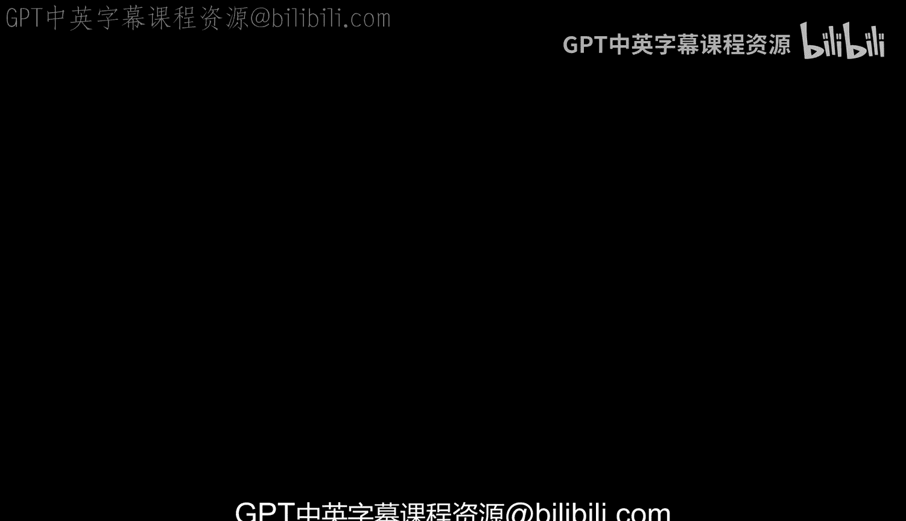
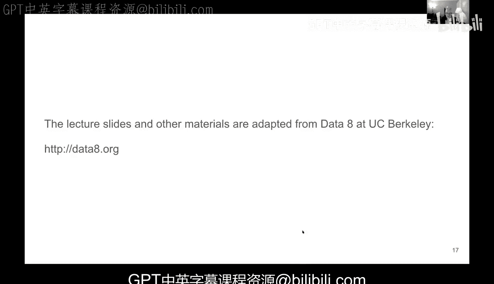

# UCB《数据挖掘和分析｜DATA 144 Data Mining and Analytics 2021》中英字幕 p70 [P70]lecture70-[T23 Choosing a Sample Size]  Sample Proportions part 2-rrf6ECnpO [BV1efBEBuEVg_p70]

倾。

All right， Luke， welcome， we're going to pick up where where we left off last time and I'm going to do a quick review of proportions。

😊，And then we'll finish up by answering a couple of discussion questions that we didn't get to on Tuesday。

So if you recall。One of the types of questions so kind of the data that we've been looking at before。

 a lot of the data that we've been looking at up until now is we've been looking at averages like computing means computing averages of populations。

 but a lot of times the data that we want we want to find out proportions the biggest example of that is is that for elections surveys like will you vote for candidate X and it turns out right if you kind of have the if you ask these yes or no questions。

 you'll get these binary data， zeros or ones， you know whether they answer true or false yes or no。

 but that collection， that proportion is really just an average。

From there so we can use the same techniques that we've learned up until now computing proportions as well。

 okay and so kind of keeping the same terminology that we've had before。

 the population average right that's usually the unknown quantity that's the number of people of ones in the population like the number of people that would vote yes for a certain candidate and then again we'll take a sample of those and we'll get a sample average that will be the proportion of ones in the sample。

😊，嗯。And we can do the exact techniques that we that we've done up until this point we can take a sample of our population once we have our sample of our population we can run a bunch of simulations。

 you know 1000，10000 of them and due to the central limit theorem we're going to get a histogram we're going to get a distribution of those simulations and they're going to be bell shaped bell curve shaped centered around the。

The median of the sample proportion， right because we're running the simulations on our sample。😊。

And we can conduct a confidence and role by looking at the standard deviation of the sample proportion。

 okay？And。We learned that we can actually can control the width。

of the distribution of the histogram of our simulations by how much samples。

 how many samples that we take。😊，🤧And this is dictated by our sample size。

 the square root of our sample size and so basically the larger the sample that we get。

 the more accurate our estimate of the population is going to be but you can see it's not a linear relationship right if we wanted twice the accuracy we can't just sample two times as many people because it's a square root we would have to sample four times the population to get you know a double increase in our accuracy and it's also dictated。

 it's also dictated by how spread out the actual population is， how varied the population is and so。

😊，🤧We can if we wanted a 95 sorry we wanted a 95% confidence interval。

 that is going to be four times the standard distribution of the actual population， okay。

 that's the actual population the standard of that。And。🤧And basically the more sample size。

 the narrow the interval and so we asked the discussion question。

 if we wanted the total width of our sample interval to be no more than 3%。

 how would you choose the sample size and the answer to that is just basically plugging in this formula here and so。

😊，The the left hand side of our equation here this is going to be our 3% that's the total width that we're going to accept and then the right side is just the the formula that we looked at on the other page and so。

We can use algebra and rearrange and we can get the sample size is just going to be four times the standard distribution of the population divided by the。

Maximum total width that you're going to that we're going to want to accept okay， and so。

But's what's the fly and the ointment with of this。

 what is kind of the problem with this calculation？Does anyone， anyone kind of， actually， yeah。

 does anyone want to kind of venture out a guess of why what is as it is now。

 what is kind of the practical limitations of this equation？

WhatWhat do we know and what don't we know？We know the sample size or what are we control over what are we not in control over right we're in control of the sample size we're in control of the sample size we're control we're in control of how much you know spread how much width。

😊，We want， but what is really the unknown here？Somebody wants to venture out or type in the chat。

🤧You don't know the real standard deviation or the real population that's right that's right right so this is the kind of sticky wicked here this is the fly the ointment we don't know the standard deviation of the population right that's why that's and so what do we do what do we do well it turns out turns out that turns out that we don't actually even we don't even need to know the standard deviation of the population and and why is because if we and we looked last time on Tuesday we looked at we did this demo we did this demo and we looked at by varying the proportion of a zero1 population right we took we looked at we looked at 10 and then we varied the proportion of ones and zeros and it turns out right because the population there's really only two choices here。

The maximum standard distribution of the standard sorry， standard deviation。

 the maximum standard deviation of the population is going to happen when when you have a 5050 split between between ones and zeros and this is independent of。

😊，This is the maximum and you know holds through for any size of distributions and so what we can do is if we don't know we don't know the standard deviation of the population but we do know that its maximum is going to be 0。

5 it's never going to be larger than 0。5 and so what we can do is we can kind of you know can we can use the standard deviation of 0。

5 as our upper bound and we know it's never going to be worse than that。Okay。

 and so now instead of actually needing to know the standard deviation of the population。

 it's going to be at most five and so we can just plug that number into our equation。😊，From there。

 And so now we have kind of all the variables that we want。

 And so now basically we can control for whatever。For whatever with that we want in the sample population。

 we know the sample size， we know the sample size that we can calculate。Um。

Before we kind of go on to our discussion questions， is there any questions about this？嗯。Okay， great。

All right。So。So for our first discussion question what I'm going to do is I'm going to use a 68% confidence interval to estimate population proportion okay and so this is different than the other than the other the other graph and in some sense it's good kind of keeping these things kind of straight right so for the previous example here。

😊，We were looking at the total width of a 95% confidence interval of the population right and so。

And so this is where this this factor of four comes from this factor of four。

 if we want to capture we want to capture the 95% confidence interval for our population。

 we're looking at。Two standard four times the standard deviation from there Okay。

 so this is this is so this this four comes from the fact that we wanted a 95% confidence interval from there and。

And so kind of what is that saying， what is that saying is is that kind of the at the end of the day。

 when we kind of crank through through all of this。

 when we look at when we run when we take our population sample，We get our distribution。

 we look at the histogram。And then we basically have our range。

 we have our range and what that's going to say is about if the actual because remember the thing that we're getting is an estimate of the population。

Prameter and so what we're actually saying at the end of the day is is that and we're going to give a range right so that is the kind of our confidence interval and so what we're saying is is is that。

😊，Through our technique， we believe that the actual the actual population proportion is going to be within this range that we've specified about 95 times out of 100。

 about 95% of the time our range is going to capture the actual proportion in the population right。

And so。And so that 95% confidence right that comes from this comes from where the four of the standard deviation comes from。

 okay？And that comes to straight form from the central limit theorem and basically going out two standard deviations to the right and two standard deviations to the left right and that's going to capture 95% if we went out three standard deviations that's like 99。

7 and if we went out one standard deviation to the left one standard deviations to the right。

 that captures about 68%。Okay。So。😊，So instead of using a 95% confidence interval。

 I'm going to use a 68% confidence interval， which means at the end of the day when we come up with our。

😊，When we come with our range， that range will our estimate。

 our estimate the range of our estimate will。🤧Be in the population the actual that will capture the actual population about 68% of the time okay and so。

I want the total width at my interval to be no more than 2。5%。

 so then how large must my random sample be okay so I'm going to send you I'm going to send you into the sky I'm going to make some breakout rooms。

Um。From here。嗯。All right and then so it might be helpful to just kind of pull up the slides when you go into your break breakout room from there or just write down the kind of parameters right so the parameters are 68% confidence and then the width is going to be no more than point2。

5% and then so how many how large must I sample be Okay so i'm going to open the rooms and give you a few minutes to。

😊，Work on that。It's to。You did it。So the importances of two。

This this part you're talking about this right here。

 yeah thats that's the Python notation for squaring。Okay。Yeah。

 so we're taking that whole thing and we're squing that okay thanks and the reason why is because the actual formula itself is this whole thing gives us the square root of the sample size so what I want to do is I want to square both sides okay so if I take the square of if I take the square of sample size that if I take the square of the square root of sample size that gives me the sample size and then that gives me this times that。

😊，From there so that's that's where that's coming from and we can see that in this formula here right we took the square root of the sample size and then we squared both sides and here's the star22 right that that's the Python operator for exponent so that's the equivalent of squaring that。

😊，FromFrom there， great。Okay and so again I had I had forgot to turn on the recording so let me just go over that real quick again this too comes from the fact that we have the 68% confidence interval so we want to go out one standard deviation on either side this 。

05 comes from the standard deviation of the 01 population this at the worst case scenario and then 0。

025 is going to be the interval with that's the range that we want and we're taking the square of that because we have the square root of sample size and that gives us the answer of 1600。

Okay。🤧All right， and then so now next question here is so this is kind of this this example here is really kind of you basically are picking you're picking the sample size to give you the percentage that you want right and and you know this this you see this all the time when we look at kind of polls like presidential polls and all of that stuff you know this is where they get like how many people want to vote for candidate X and then you know and it says like 27% but then you see down at the bottom right it says plus or minus three right that is coming from this is coming from the the width there right that plus or minus3 is is a characteristic of the sample size that that they came up with right and usually you have to dig down a little deeper right because there's two things that are kind of come into play there's the width。

There's the width of the the histogram， the sample histogram。

 and that is what is being captured in this 2。5% right so we're going to get this we're going to get this。

We're going to get this spread and we're going to get this range of values。

And but what's not usually kind of said in that plus or minus is what is the confidence interval for that range and typically it's going to be 95% for most of these polls。

 but you should you should but you know you should actually go and see what is that right because basically even with a 95 percent confidence interval。

 it means that that range， the estimate， the actual population value one out of 20 times isn't going to be contained within that range from there。

 so this is an example of where we wanted a particular accuracy or range of our sample interval where we pick the population but sometimes you just do a survey。

 you do a survey and you got as many as you did can we then go back and figure out what that range is from the population and yeah obviously。

And so so this question and again i'll send you out all over into the breakout rooms so here we've decided we're going to get 10。

000 we're going to estimate our population of 10，000 and then so again so now going back to using the 95%。

😊，Comvenent interval what is with the chance of 95， what is the estimate to be correct within？

And then so let's figure out what that range is from there， okay。

 so let me send you back out into the breakout groupss。And while I'm doing that。

 is there any questions about what we're asking for in this problem here？No， okay， all right。

 I will I'll send you off into the rooms。All right， welcome back。

Even though we're asking a slightly different question。

 it's still the same computation and still the same formula。

 it's just a little bit of just we're solving for a different variable in this case and so in this case right we have our sample size a 10。

000 and it's a 95% confidence interval so we want four here。The the standard deviationation。

Of the population of the01 population is still 0。5 we're taking the worst case scenario and here we're solving for x this is going to be our percent and we're going take the square of this squared right to solve for this we're just going to take the square root of both sides so we get 100 equals two so I simplified four times 0。

5 to give me two two over x and then just rearranging to solve for x we find out that x is two over 100 or 2%。

😊，Did anyone get anything different？And the correlate to that。

 do you have any questions about how I got 2% from that？🤧All right， awesome， all right。

 so that kind of wraps up our discussion of that。😊，And so I'll stop there。

