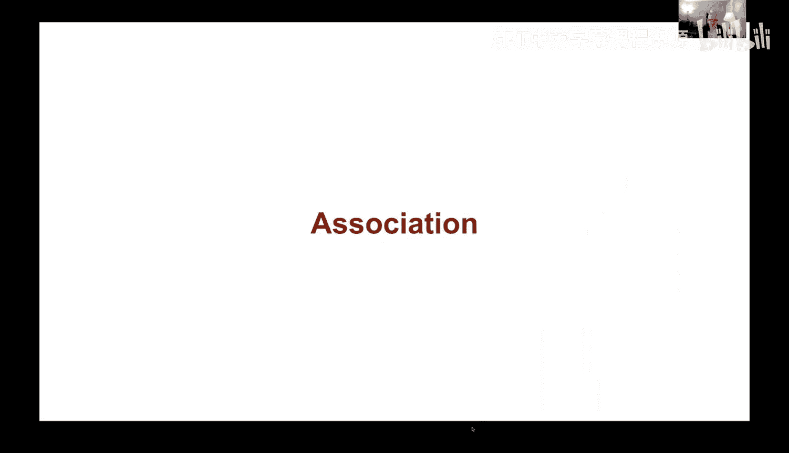

# UCB《数据挖掘和分析｜DATA 144 Data Mining and Analytics 2021》中英字幕 p71 [P71]lecture71-[T24 Prediction and Correlation]  Prediction Review-SJXMejN31Kc.z [BV1efBEBuEVg_p71]

All right so what we're going kind of talk about we're now kind of in the interesting kind of portion of I mean the whole course is interesting but that I'm biased but but no I think you know the why are we learning all these techniques is because we want to do predictions we want to kind of say something we want to actually infer and make predictions and so now we're going kind of start that journey and it's actually it's something that we've actually look at very early on in the semester so we're going to come back to this topic and so predicting basically means we're going to guess the future and we don't have complete information to do that so we're going to make a guess we're going to make a guess based on incomplete information and so one one way in the way we've actually looked at earlier in this course one way of making predictions is so if we want to predict。

An outcome for an individual， what can we do？We can if we don't we don't know we don't know we don't know we don't have complete information on that individual。

 but what can we do is we can look at similar individuals。

 we can look at similar individuals where we actually know the outcome okay and we can use those outcomes as a basis of our prediction and we saw this when we looked at the height Galton's height data set and just kind of as a review。

What we were doing here is。collected a lot of data and about parents and their children and their offspring and the data that we looked at。

🤧Was can we use the parent' height to predict the future height of the child presumably when the child becomes an adult and and so we settled on this on this of this predictor variable which was which we call the mid- parentent height and so it was just the average of the height of both parents okay so this is the kind of the variable so we took well we take the average of the parent height and we actually we're using that to make a prediction of the child and so we're not doing that here we're just looking at a visualization we're looking at a visualization of that and you can see just kind of by looking at the scatterpl。

 you see that there seems to be something here right as the parents。

 the mid the midhe the mid parentent height gets higher so does the height of the child and so。

What did we do to make a prediction of a child that is not in the data set right so this is our data and so we have we have another child come along who's not in the data so we don't know they're still a child right and so how did we go about making a prediction so what we did was if we were making a prediction about a child whose parent midparent height was 68 so what we would do。

 what we did was we took our data sets and we looked I think a half inch either way so we looked at the neighbors。

 we looked at all of the neighbors and we came up with an average we came up with an average of all of these known observations and that was our predictor that was our predictor and then we ran this through all of the all of the data that we had and so this gold line here this was our prediction this was our prediction。

From that and you can see one thing that kind of jumps out is is that so because we're taking the average of these new even though it's kind of scattered around these predictions you know kind of look like a straight line right we've got a little something kind of going on here but you know this relationship or these predictions certainly appear to be linear from there okay and then。

😊，And so like I said in this case the predictor variable is our mid parentent height and so now we've made our predictions and so one thing that we can do once we've kind of done that。

 we should evaluate how well did we think we did and so one way to do that is we can look at prediction errors and we found actually kind of something very interesting when we actually looked at the prediction errors based on sorted out by by the gender of the child and we see that looking at the darker blue line we can see that this。

😊，Our prediction tends to over predictd the height of females and under predict the height of males。

🤧And so。What we can do and then we can we quickly looked at so what happens if we had separate predictors right so a smarter prediction actually just didn't look at the midpoint it still looked at the midpoint the mid parent。

Mid parent。Yeah， midberenhe， but separated it by gender from there and we can see that we had a much smarter prediction from there。

😊，う。🤧And so and so this is known because we're taking。These averages in here。

 this is known as a regression prediction。😊，U。Okay。

 and so what we're doing for our prediction is it basically lies at the center of the vertical strip right so if we take any given prediction right let's look at 6068 again。

It lies roughly in the middle of the vertical strips of points right at 68， okay？

And so now what we want to do is is we want to look at more formally of whether。😊。

These variables act as a good predictor， okay， and that leads us to our next topic association。😊。

