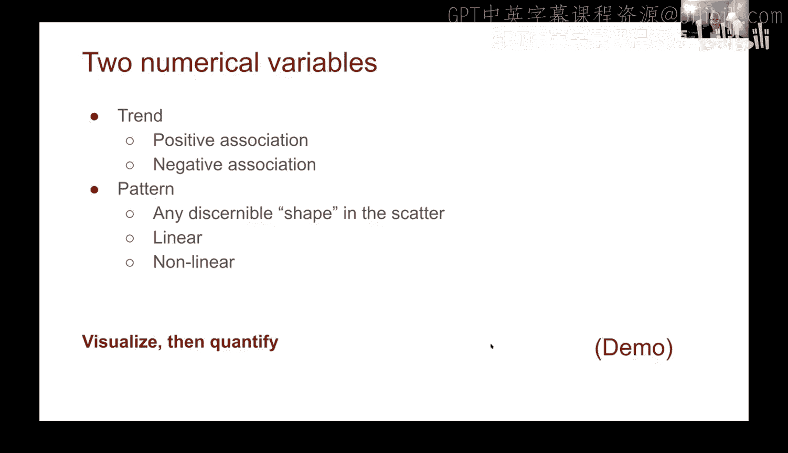
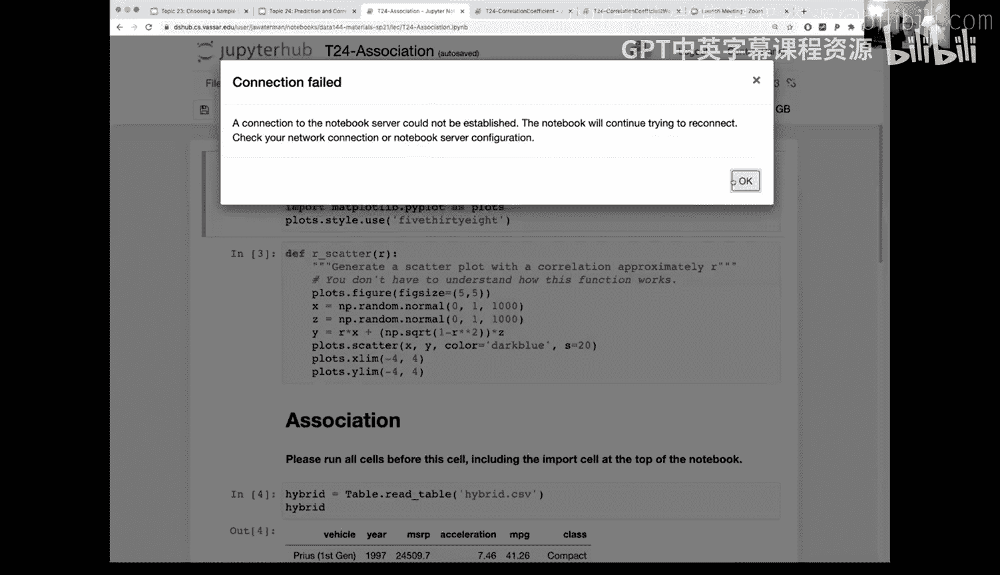
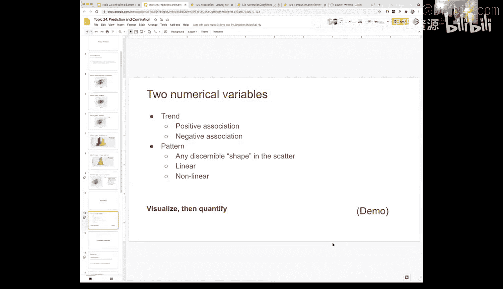

# UCB《数据挖掘和分析｜DATA 144 Data Mining and Analytics 2021》中英字幕 p72 [P72]lecture72-[T24 Prediction and Correlation]  Association-D7ccdCoVY4w.zh_en [BV1efBEBuEVg_p72]

Okay， so。Okay so let's say we have two numerical values like we did in the Galton data set one of the things that we can do is and this is always a good idea whenever we have a new data set we should just look at the data we should explore the data and if we're comparing two numerical values one thing that we can look at is the trend so as one variable increases what is the relationship to the other variable what is that trend and we can see one trend could be is that we see a positive association so as the x variable increases does the y value increases as well that would be a positive association but we could also have a negative association as the x value or just one of our variables if that increases if that causes a decrease and the other variable that's known as a negative association and so this is the kind of like a positive association。

😊，If you're kind of plotting x and Y right positive association it's sloping upwards into the right negative association。

 it's going to be sloping， it's going to have a negative slope it's going to slope downwards as it goes to the right and we can look at a pattern we can look at the pattern of the data as well is there and so what do we mean by pattern is there some shape in the scatter plots one of the easiest patterns and one that we' focus a good chunk of our attention on is a linear pattern is do they go up in a line you know from there but we can also have and we'll look at some examples of nonlinear relationships where there is an association there is an association but it is not a linear one。

😊，And so the kind of general roadmap that we want to follow is let's visualize and get a sense of kind of get a handle on what the shape of the data looks like。

 and then we can go on and actually quantify， we can put a number， we can put a summary。

 you know statisticaltistic a number to what we visualized。😊，Okay。

 please feel free to ask any questions while I'm setting up the demo here。😊。

All right。So there， everyone can see this okay。Please speak up if I need to make it bigger good I got a thumbs up all right so one thing we're going to do so i'm just going to write this this we don't actually need to know how it works what this is going to do is this is going to help us kind of understand association so i'm basically making some plots of different correlations from there so we don't have to worry about how that works。

😊，う。And so for this data， we're going to look at this data set of hybrid vehicles。😊。

From there and so it has the vehicle， the gear and then it has the price， the MSRP。

 the manufacturer suggested retail price the acceleration so how how fast it goes from and I suspect this is probably the this is probably the time this is probably the time to go from zero to 60 from there and then miles per gallon of all of these hybrids and then the the class so we're going to focus on numerical categories so we're going to focus on the MSRP acceleration in miles per gallon and we're going to just kind of explore and visualize the data to see if we can see any any of these associations okay。

😊，So that's the game plan so we have our we have our data and so acceleration oh so。😊。

That's I stand corrected， that is this is definitely not like the0 60 times because the larger the number。

 the faster the acceleration so。😊，🤧St correctect good on that one and so first we'll just look at。

The MS let's look at the MSRP so we're just looking at the histogram of all of the so we're just looking at the distribution and you can see there's kind of a big it's not terribly evenly distributed right it looks like kind of it kind of curves and tails off which kind of makes sense right these really expensive this is a car that you know costs over 100。

000 and so but you can see definitely there's kind of a sweet spot right around like 30。

000 for all of these these cars from there and then if we sort。

We can see that most expensive cars are lexus from there and then let's look at now so now that we're looking at the MSrRP now let's look at two variables together let's look at to see if if we can see any associations between how much the car costs the mrRP and miles per gallon and so。

😊，And so just as kind of just the standard format， the X axis is typically the predictor value so the variable and so then the MSRP is going to be our prediction and so then the question is you know if you had a given miles vehicle if you knew the miles per gallon can you predict the cost but we're not there yet we're just kind of exploring the data and looking associations and you can see there' definitely kind of is as right as so you know is this a positive association or a negative association you can see that the if there you know there's definitely kind of a trend whereas。

😊，As the miles per gallon increases。The cost decreases right so that's going to be a negative that's going to be a negative association the other thing to kind of know too is is that you know does this look linear I mean parts of it kind of look linear but it kind of looks like a curve right we kind of looks like it you know kind of as as we the miles per gallon increases it kind of slopes is kind of has kind of a little bit of a curve to it so you know but there's definitely some kind of you know there's definitely some association here and it's definitely a negative association and and that seems kind of you know interesting at first but you know some of the more expensive cars you know they typically have higher horsepower and so they're going to be less fuel efficient so maybe that explains some of that。

😊，嗯。😊，But if we look at the acceleration and the MSRP。

 we definitely now we see a positive association as the acceleration gets as the cars have more acceleration。

 they tend to be more expensive。😊，From there okay， so we could we don't have to look at all of it it is we can just focus on a class and if we just look at the the SUV class。

😊，🤧And we look at the MSRP and so now this is compared back back up here， we see kind of you know。

For all the cars， it wasn't terribly evenly distributed across the MSRP。

 but here it looks a little more even across the board。😊，🤧う。From there and again。

 we can look at if we look at the acceleration， we can see now。😊。

We can see now definitely a positive we can well still see a positive correlation and then if we look at。

😊，Miles per gallon。🤧We can see a negative correlation as well and this one looks more linear right we had up here the one that looked like a kind of a big curve。

 this was the miles per gallon and MSRP if we just looked at the。😊。

The SUVs this looks a little more a little more linear okay so one thing that we want to do when when we visualize the data right so notice the units you know this is in acceleration we just kind of have we use the default so applyed from8 to 18 this is in miles per gallons and so it makes it it makes it hard it makes it hard to compare。

😊，One one scatter plot to the other so the thing that we almost always do is we convert and we've done this and we've looked at this before。

 we almost always convert when we do these scatter plots we almost always convert to standard units okay and so if remember what what converting to standard units are all we're doing is is we're taking our data points and we're seeing how far they are each data point is away from the average of all of the data points divided by the standard deviation of our data points okay and so we're going to do this enough that it makes sense to have a little helper function and so this is just going to take in any array any data array and it's just going to convert to standard units for us okay and so now。

😊，嗯。And so here here's our plot before we converted and so all we're going to do here is just we're gonna to make a new table now we're going to take our our miles per gallon and our MSRP we're going to convert that into standard units okay and so the thing I want you to see here is and so this is the same data and it doesn't change the relationship between the data if I can kind of fit everything in here right you can see that the shape of the data is exactly the same here's all the data points all we're doing is changing the units and so we're just either either kind of elongating or squishing them together but it doesn't change the it doesn't change the relative shape of the data the data is all here but now now that we've converted to standard units right it's going to be centered on。

😊，It's going to be centered on so instead of just looking at the you know kind of in the middle here is kind of the mean of the data now because we're in standard units we're talking about standard standard deviation so regardless of the data that we have the center of the plot is going to be zero zero from here okay and so now this will help us when we start looking at these associations is's going to help us compare different graphs from one to another。

And so we can do the same thing here。And this is now looking at acceleration in standard units versus the MSRP okay。

 and so you very clearly can kind of see the the negative association here for the the graph on the top and you can see the positive association from here。

😊，嗯。Okay。😊，All right， any questions kind of about association？All right， great。Allright。

