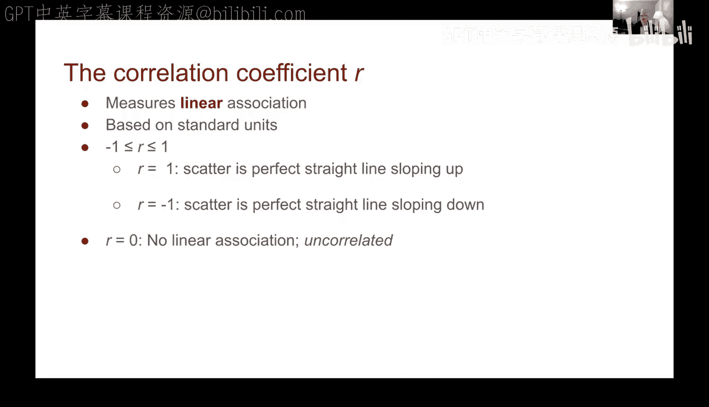
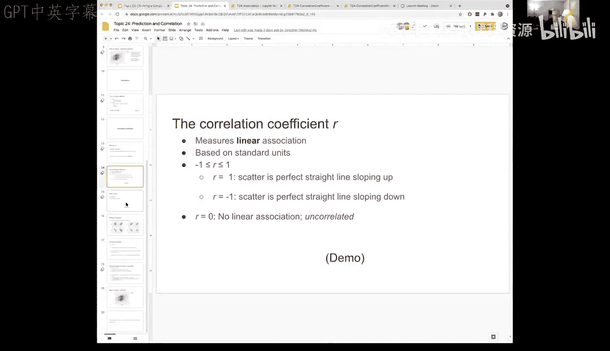

# UCB《数据挖掘和分析｜DATA 144 Data Mining and Analytics 2021》中英字幕 p73 [P73]lecture73-[T24 Prediction and Correlation] Correlation Coefficient-vOTH3UCI [BV1efBEBuEVg_p73]

Okay， so so now that we kind of looked at this this data， we can kind of see this association。

 let's let's let's make this more more formal than just kind of looking at things kind of you know。

 either they slipping up or they slipping down and to do that we can we have this correlation coefficient。

😊，And this is known as R right so our if you just refer to it as R all the statisticians will know exactly what you're talking about and so the correlation coefficient is so again this is going to be assuming our data has been converted to standard units okay and so what we're going to do is kind of take a look at the second app right so we're going to take the product of our X data so our x axis data and then we're going to take the product of of our two data right our x and y data in standard units we're going to multiply them together。

😊，And then the correlation coefficient is just going to be the average of that product， Okay。

 so take all of our data。😊，🤧A product of product of x times the product of y do that for all of our data。

 take the and then so have we'll have the product of all the of that and then。

Take the average of that and that gives us that gives us our our our correlation coefficient okay and and what that means is it is a measure of how clustered。

🤧Our scatter is around a straight line， okay， and we' I'm going to show you pictures of this that will make this this very clear。

And so because this is a measure of how clustered our data is around a straight line。

 so this is going to be， it's going to measure the linear association。

 linear association between the two data between the x and y。Um， for that， for for that data。Again。

 the correlation coefficient we've converted to standard units so it's going to be based on standard units and R will always have fall within the range of minus1 to positive one it will always fall in that range and so if we have kind of on the one extreme r is one that means we have a perfect correlation between x and x and y and it it's a straight line sloping up okay and I'll show you pictures of that so when r is positive that means we have a positive association。

 the line is going up into the right if r is negative。And again。

 with minus one means perfect correlation negative means it's going to be。

Sloping down as it goes towards the right。And then kind of the exact middle points。😊。

If we have r of zero， we say that there is no linear association that means though that that data is uncorrelated。

 okay it doesn't mean that there isn't a relationship。

 it just means that there is no linear association with that。😊。

And so let's take a look at that。😊，me just reload this。

Okay that's just our scatter platform here so here so how do we calculate R and so what I'm going to do up here is I'm just going to make some some phony data some made up data。

😊，And so I'm just going to have a table here， small table with。😊。

🤧six items in it and so here is our x and y data and so here i'm just going to show you this just take a look at the scatter plots of that and you can see。

😊，You can see the data here and so remember the first thing that we want to do is we want to cover because this is in our regular data units。

 whatever that is， but we want to convert to standard units。

Which is basically unit list from there so we can just run the same standard units function。

And then run that on our data， so then we're going to have x in standard units and y in standard units。

And then we can put our data fold that data back in。

 so here's our table original table X and Y and here we've just added the columns in standard units。

And then again， the point I want to show you so now we're plotting in standard units right so since we're plotting in standard units。

😊，The data itself， the relationship between the data doesn't change。

It's just the units that we're presenting our data in。🤧From there， okay so。

To get the correlation coefficient we convert to standard units and then we're going to take the product of that array and we're going to take the average of that product Okay so here we've calculated the product。

😊，And so now we can add it for all of our data points， so here we have the product。

For each of our X and Y pairs。And then finally， to calculate R。

 we're just going to take this column the the product of the standard in just taking the average of that we're going take the average of that and then we gets。

😊，This measure this6 point this 。61 and if remember r r is going to fall between positive one and negative one and when we have。

When r is positive， that means the association is positive。

 which means in general as x gets larger y gets larger and and we see this kind of for the most part we certainly see this for this data here but we have a couple of points there but in general as x gets larger so does y we have a positive association from there okay so we can just basically wrap up all of those calculations that we've done in a helper function and so what this helper function here what this does is that this takes a table and it takes two column labels X and y and then it's going to return near the correlation from that and so all it's doing is is first converting those columns the standard units taking the product and then taking the average of that okay so now we can instead of doing all of those calculations by hand we can just call our helper function and you can see when we passed in our table T with X and y we got the same answer that we do。

Doing it by hand so now that we have that。Now that we have that， we can actually look at。😊。

The data that we looked at before but now get a measure of how correlated the data is okay so this is just the same table here we're just looking at the SUVs and then now we can see what the correlation is between the miles per gallon and MSRP and we as we saw last time as the mile per gallon was going up the cost was going down so we have negative association and conversely a negative correlation of 0。

 minus0。66 and again if we look at the scatter plot from that we can kind of see that we can see that association。

If we look at the acceleration we see it's not as strong a correlation right because the magnitude tells us the strength of how clustered they are on a straight line and here we see a positive correlation and it's not is strong it's a little more scattered than this one here okay。

And so now we can use this。We can use this scatter plot that generates synthetic data that corresponds to a particular r value and we can see what this means so minus1 is the extreme that is perfect negative correlation and what does that look like that looks like as our data again converted to standard units it all falls on this line right and so if we gave if we had a value of two we would predict that we would get negative two if we had a value of three。

 we would predict negative three if we had a value of minus2。

 we would predict two right so there's this negative association in this perfect all of the data is clustered on on this line on this on this line with a slope of minus one here and so if we kind of back off that a little bit and see what what does。

What does it look like when the correlation is 0。9 what we're going to see？

We're going to see definitely a pretty strong data but it's fuzzier a technical term it's fuzzier around around this line right so it's not as tightly controlled but we definitely see that line here and then if we kind of back off a little bit we can see as the scatter as the correlation goes to zero our data becomes fuzzier and more blobbbiier right it is just getting more kind of clustered。

😊，Um。It looks more instead of a line that looks more like a circle。

And so if we take a look at that again a 0。5 right so there's definitely an association here but it's certainly less strong less predictive value from here and then we can also see too right so we've looked at all of the negative ones we're sloping down this works exactly the same way for positive。

😊，Correlations as well， and again， if you looked at 0。1。😊，You can see that the line is tightly。🤧。

Directly pointing up in that direction and then。🤧It's worth looking at what does a scatter plot of zero look like where there's no linear correlation right it looks like just a kind of a blob centered around zero from there okay。

 if we calculate the correlation and change up the xs because because we're computing the average of the product change switching the the x'es is going to have no change on the correlation and this makes sense right because we're taking the average of a product x times y is going to be the equivalent to y times x and so if we take the correlation of x and y。

😊，If we're going to get the exact same correlation that we did for y and x。🤧Yeah。Right， 。61。

61 from there， okay？Any questions about that？Thanks。😊。

