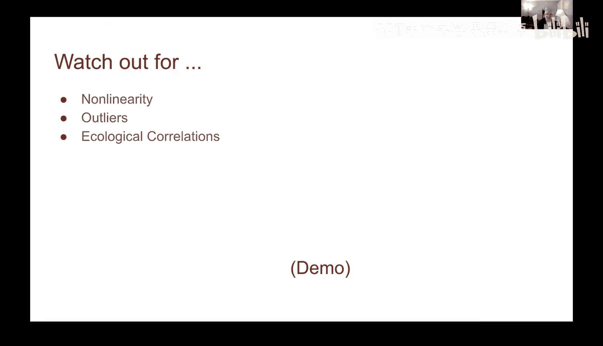
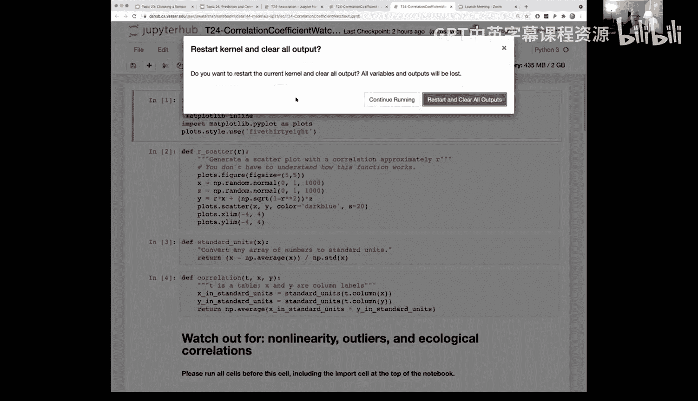
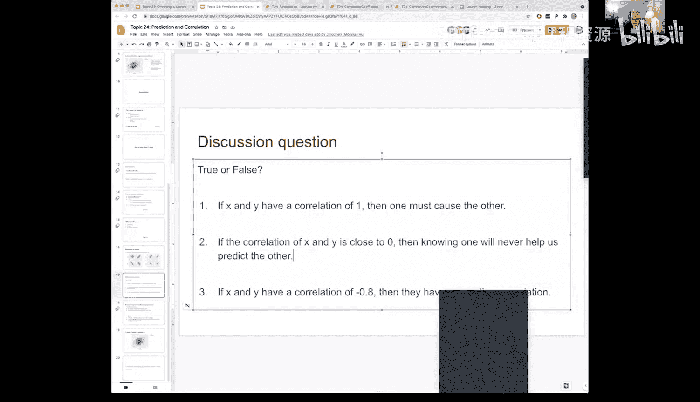

# UCB《数据挖掘和分析｜DATA 144 Data Mining and Analytics 2021》中英字幕 p74 [P74]lecture74-T24 Prediction and Correlation] Caution-aVCSOwkDTqY.zh_en [BV1efBEBuEVg_p74]

Okay。So now b。

Bront button。Wrg button。All right， so now now that we have this way of quantifying， you know。

 are there some limitations to this number right always when you put a number on it。

 let's remember kind of what that number represents what that model is and when does that model break down so here's the general things to watch out for the general caveats when when dealing with with R one is is that remember what this is saying right this is saying is there a linear relationship between the two data between between our x and y data and so we're saying a very specific thing that there is a linear relationship if we get if we get R of zero。

 all we're saying is is that there's no linear relationship there could very well be some other type of relationship but it's just not a linear one。

😊，Outliers can take what you know could be perfectly linear you know association and that can throw that off and then there's this idea of ecological correlations and i'll show you example of this in the demo and basically kind of what it means is that when you're starting to look at you should look at kind of。

😊，Where that data is coming from and you don't want to over generalize what that says about a population。

🤧And so let me show you again some of the pitfalls。

Or some of the things to watch out for in demo form。

Okay and so non nonlinearity okay so here we're going to generate some some data and so if you look at this data。

 if you look at this data you can see that there is definitely an association right and so you can see how I generated the data X is related to y y is going to be the square the square of x so there is absolutely a relationship between x and y but if we take this data and we run our correlation on it。

😊，Yeah。We get a correlation of zero， we get a correlation of zero right so what this is saying is that there is no linear correlation between x and y。

😊，m but there very clearly is a non linear relationship between the data set so like why you know you just got to keep keep keep。

You keep your eye out for that and usually right we we kind of recommend。

Always starting off by visualizing the data and taking a look at it right it would be very clear if you kind of visualize the data that everything that you would see that there's definitely some relationship and it's very clearly non linear。

😊，So if we look at outliers and so here again this is kind of artificial data or so you can you can you know without even doing the calculation we can see that this correlation is going to be one from here right is for whatever the input is the output is the same but let's look at that data again with an outlier okay so you can see that here's the data the only thing I changed was this last data point here from there。

 how do you think that's going to affect the correlation。😊，In this case。

 it has a very drastic effect right， it's saying with this。😊，This data point from here。

 we're saying that there's actually no correlation。And is that true or not？

It's tough to say it's tough to say is this truly an outlier is this was someone you know was the equipment failed when it gave this data point did someone type something wrong was there just you some other explanation for that and of course you know with five data points that's actually pretty hard to tell from there。

 but you know outliers can have an effect here's an example of an outlier say another outlier but this one isn't quite as drastic a change but you can see it is definitely affected the correlation。

And so the last thing I kind of want to kind of bring to your attention is these ecological correlations and so here what we're looking at is we're looking at the statewide SAT scores so this is going to be。

😊，If we look at this， so this is the SAT scores for all of the students for all of the state of Alabama and all of the other associated states from there okay and so we have some numerical column so we can we can naturally compare them and if we can compare their scores on the critical reading portion of the exam to the math portion of the exam。

 you can see a very， very high correlation。😊，Extremely high right if we calculate this we can see that it is actually 0。

98 so what that means is if you if you did well in critical reading you did well you know the prediction that you do well in math right and that is kind of borne out but even though there's such a high correlation I want you to think about what this population data is all right this is not this is not an individual student right this is taking the average of all students across an entire state of Alabama。

😊，And so， you know， I caution you to make you know， you know， kind of strong statements that， well。

 you know， the best way to get a good score on math is to learn critical reading， right because。

We're really looking at a very， very broad， you know， we're looking at an average across a very。

 very large。Population and so if you actually looked at individual students you're going to see a much larger variation in these in these scores okay so you know that's something that can be kind of aware of especially I want you to think about this when you're you think about when you're doing your projects as well and especially if you're looking at big summary data from there okay so that's just something to kind of keep in mind。

😊，Okay， so all right， I think we have enough time to do a couple of discussions and then we'll be able to wrap up for today。

😊，Okay and so for this for this group basically I won't send you into breakout groups。

 but let let's just kind of think about each one of these and just talk about than for a moment okay so for each pair so I'm showing you two I'm showing you two scatterpls again all of them in standard units so for which pair which one will have a higher value of R okay and so let me be specific so I'm asking for this just look at the you know we know when r is positive when r is positive it's going to be a positive correlation when when r is negative we're going to have a negative correlation just to reduce some ambiguity what I'll talk about when I mean by higher value I mean this the magnitude of R okay so which one do you think will have the higher magnitude for a so let's just look at a what do you think which one has the higher。

Our value。Which data set looks more correlated？Does anyone want to。

 you can say in the chat or someone can speak up？嗯。The right hand one yeah right。

 it is definitely looking a lot more clustered around around a line than the than the one on the one on the left Okay。

 how about B。😊，Left， left， left， left， left， left。We got lots of lefts， lots of lefts， Yeah， right。

 and then this one it's pretty clear between there how about but C now， how about C。😊。

Which one do you think will have the higher our value and let me be clear and B right both of them will be negative both of them will be negative and negative association because the slope is pointing down as it goes to the right but but the magnitude of B is going to be larger than the magnitude the one on the left from the right now what about C。

Okay， all right， so say this is this is now we're getting now we're getting， you know some。🤧嗯。

We're getting some some we're getting some both and I think this one is definitely out of all the ones we've looked at so far the most ambiguous from there I think the thing that so I would go with the left one in this case and the thing that kind of tips it in that favor is is that they roughly look kind of the same the main bb but the right one has these outliers here。

 these outliers which I think are' going to kind of drag down the correlation coefficient from there okay and then what about the last one here this one's tough？

😊，This one's tough。是。What do people think？Yeah， so I'm getting some lefts i'm getting some rights this one's close。

 this one is close。😊，You knowI think just looking at this one visually I think it would be I would think it's too close to call if I had to guess if I had to guess I would probably say the left one。

 but I think you can make an argument for the right one the reason why I would say the left is is look I'm really concerned about these outliers here on the either side there they seem to be kind of equally balanced on either side which I think is going to draw this you know closer to zero on there but this one I don't think I don't think you can actually make kind of a judgment call on this one。

 I think you would actually have to compute the correlation coefficients on that to do that。Okay。

 and so all right， let's just wrap up with this this discussion question here。

 there are just a couple of true and falses and then we can head out if X and y have a correlation of one。

😊，Then one must cause the other。T or false。I see some falses yeah so this is this is false right and so again right this correlation is this this measure of association we have not said anything about causality we haven't done any experiments on the data all we're saying at this point is is that there is an association we've not said anything about causation from there and as we saw right we can actually change the we can change the axes and it doesn't actually change the correlation okay if correlation of x and y is close to zero。

😊，Then knowing one will never help us， never help us predict the other， true or false。Okay。

 I see some trues I see some falses so this one's a little more kind of ambiguous so if and this comes down to the so I would go with false on this one and the reason why I would go with false is because the remember the correlation is just a measure of a linear association there could be there could be an association that's not linear。

😊，And so if that was the case and we looked at that example of the y equals x squared right that had a correlation of zero。

 but if we knew if we knew the model and we knew that it was an x squared relationship well knowing one will be very predictive of the other so I don't think we can say that we can't say that in all cases we can say that if theres a linear relationship it wouldn't be and then finally if x and y have a correlation of minus8。

 then they have in a negative association true or false。😊。

True exactly right and that comes straight from the definition all right sorry I kept you over a couple of minutes let's wrap up here this is perfect place to wrap up。

😊。

