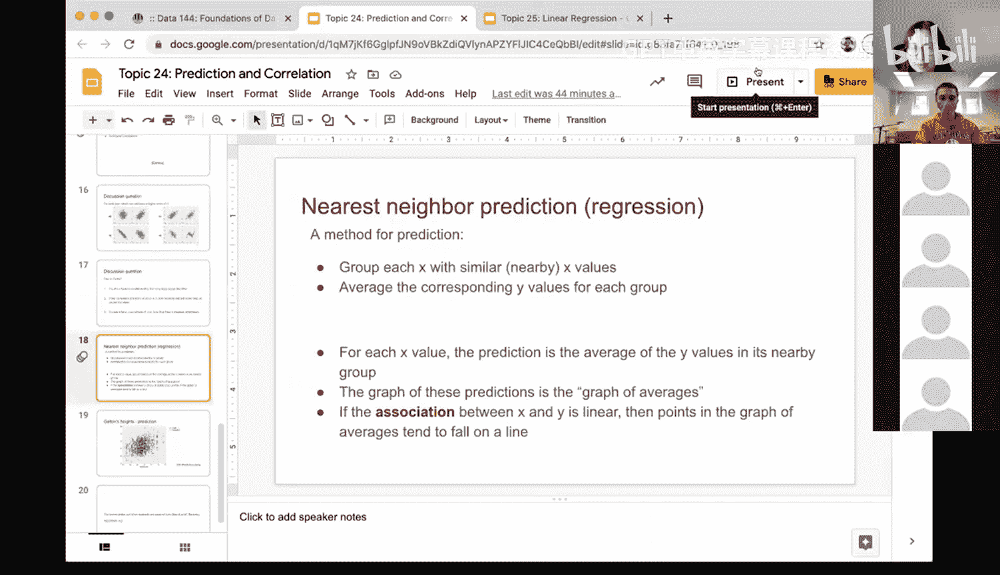
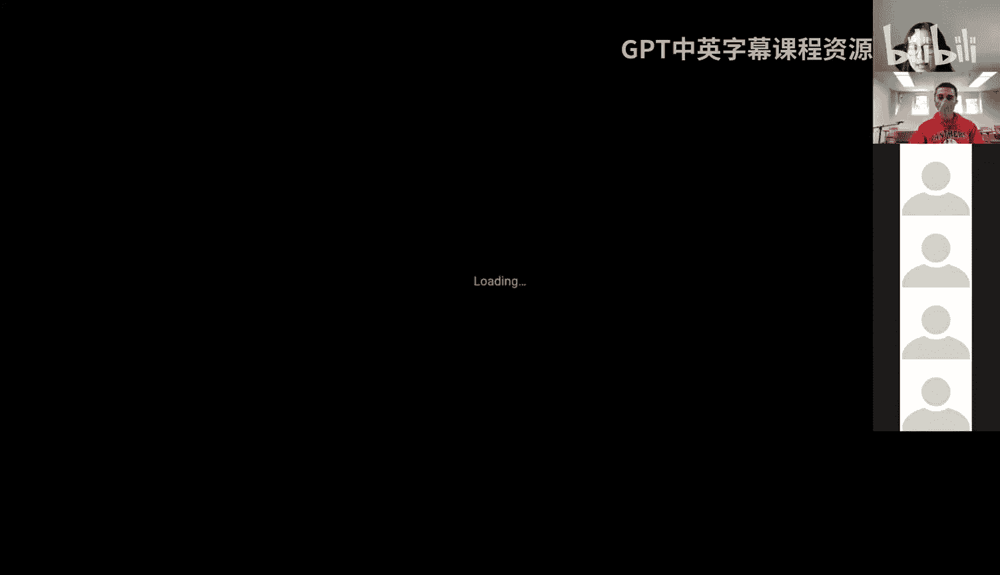
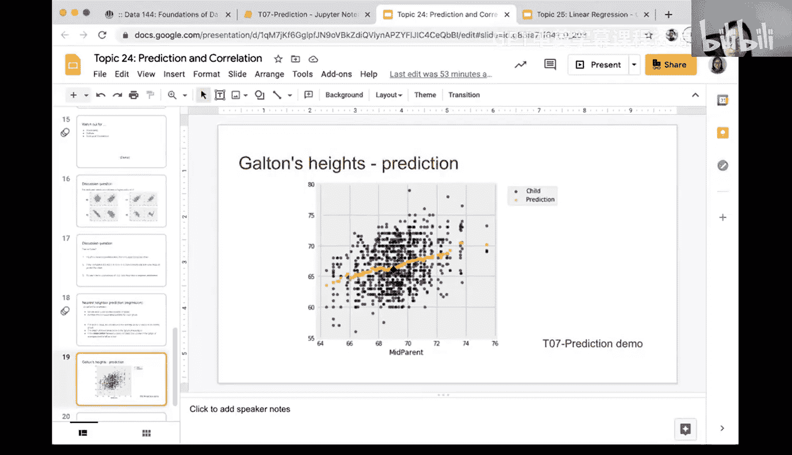
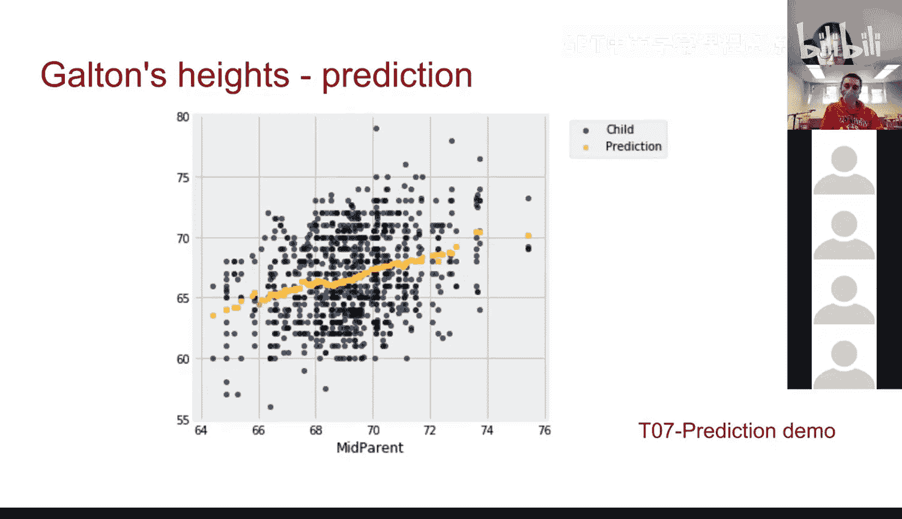

# UCB《数据挖掘和分析｜DATA 144 Data Mining and Analytics 2021》中英字幕 p75 [P75]lecture75-[T24 Prediction and Correlation] Nearest Neighbor Prediction-8p5f [BV1efBEBuEVg_p75]

明 okay。

Okay， so I think last week Jason went through most of topic 24 prediction and correction Okay but he told me that there are two additional slides that will be good to to discuss before we move to the new topic so I'm going start with that and this is if you remember what we had done before like I think is topic7 which we're going revisit in a second as well is how we're thinking about prediction back then okay so to refresh your memory a little bit we did what we call a nearest neighbor prediction okay so what happened before is with the Galton data if you remember we have the parents height okay we have so the father's height the mother's height and then also in the data we also had the child's height and to predict okay so you might be interested in predicting the child's height given the parents' height Okay so what we did is we I think we took the average right between。

So for each each prediction what we did is we find the average of the father's height and the mother's height and what we call as mid parentent okay we get that parenthe like mid parententhe okay and then what we did is that for a particular mid parentent height like 68 for example if you remember we looked at all of the children's height within 68 minus。

5 and 68 plus 05 okay so essentially what we did is that we collected all of the children's height when their mid parentent height are within a small range okay and then we took the average of all of the child's height as a prediction for somebody whose parenthe is is 68 okay so that's what we did before okay we call it regression and then later on in next topic we're gonna specifically talk about like what we call like linear regression so they're related to some degree and we think this is a good chance to review what we did before and then just just。

To refresh your memory about how we did through Python as well。

 okay we wrote a function and then did that prediction。All right。

 so to recap what I just said pretty much we group each x okay like the predictor with similar nearby x values。

 okay we're going average okay the corresponding y values for each group so in that golden children's height example what we did is x is the mid parent height okay so we group each mid parent height with similar or nearby x values which means that we have one unit interval like one inch interval that we looked at all of the records okay with x similarly to the x that we're considering and then we average the corresponding y values for each group that is the children's height okay that's the observed one okay so essentially we're using the。

Predicctor to predict the outcome， which where the predictor is the mid parent height， Okay。

 and the outcome is the children's height。 Okay， so for each x value。

 the prediction is the average of the y values in its nearby group。 Okay。

 and that's what we call it as the nearest neighbor prediction。

And so the graph of this predictions is what we call the graph of averages Okay pretty much what we had done So let me show you the graph really quick So this is what we did Okay so we have the like the actual child's height okay which is all the dots in blue and the predicted value which is the nearest neighbor prediction that we did okay so again the x axis here is the mid parent okay the y axis is the actual child height okay the observed ones and in blue and then the predicted ones in yellow okay so it is if now put everything into the context of we're talking about in this topic 24 we talked about association right like correlation between between two numerical variable So if the association between x and y is linear。

 then the points in this graph of averages tend to fall on a line okay and that's sort of what we have seen right not exactly a straight line but it's roughly along on the line。

Okay， and the reason again， is because when x and y are like highly correlated， meaning that， well。

 now if we put it back into。Well we'll be happy talking about that correlation coefficient right if they have a correlation coefficient absolute value of that very close to one okay。

 meaning that the association between this x and y is going to be very linear。

 then the points in the graph of averages is going to attempt to fall on a straight line okay not exactly straight but very close to it。

So this is just recap okay and I still think it's a good use of time for us to revisit that demo really quick because later on today we're gonna to use that nearest neighbor prediction as well so if you go back up to I guess back in early March we've been doing that prediction back then okay so this demo is what we did back then okay and just to show you what we're doing over here okay so this was the starting point we loaded the goldenton data okay and then we looked at the father's height the child's height and then we used so by the way。

 I know some of you are working on similar type of graphs for your project final project especially using different coloring so this again will be a good one to refer to if we're trying to do histogram with different groups okay so just just so you know because I know some of you are trying to figure out different coloring of your of your visualization so this will be a good one but anyway so this graph is showing us okay we have the father's height。

Okay in darker yeah in darker blue okay and then the mother's side is in yellow and then the child's hide is is the lighter blue okay so this is what we observe okay so the prediction that we did just like the nearest neighbor that we talked about okay is remember we have the father mothers and child so that's the three columns okay and then we first of all okay just to get a sense okay to get。

The child like just do a child height a scatter plot okay just to get a sense of how it generally behaves and then what we did。

 if you remember is now we add a parent average， which is what we call the mid parentent height okay because that is the one that we're gonna use to help us make prediction okay so so that's what we're doing and if we now do a scatter plot of this two okay so that's the sorry on the x axis is the mid parent height on the y axis the child's height okay so we generally see now we learn about linear like the correlation right so if you look at this graph one more time with the new set of concept that we have learned about correlation it is indeed showing some kind of positive correlation going on okay maybe not very strong but at least we can generally see a lying sort of like going through it with a positive slope okay so that gives us an indication that this two variables are probably indeed correlated okay。

And it's probably positively correlated and then that's an indicator of why you might want to use the mid parent or parent average as the predictor to predict the child's height okay so now to remember what we did okay so。

Remember we're doing the nearest neighbor prediction okay so what that means is if I'm having the 68 as the parent average okay and remember I'm going below 0。

5 going above 0。5 so I have one"ch interval that is the x value right the x is the nearby axis okay and we collect all of the records in this between this two bars and for prediction for any child's height within this bar what we do is that we collect all of those records take their child's height value。

 take the average and then that will be the prediction for every record in this range okay so that's what we did okay so remember we are using the where method okay the parent average that's the column and then we're collecting between those one little one inch interval okay so this is our actual set a small set of close to 68 that we're doing this prediction okay and then of course like I said you would take the mean。

Of all of the shell's height within this range and what you get is 67。

62 okay so that's the predicted value that we're going to use okay for for any child's height whose mid parent or parent average is in this range all right so then we do that as a function and then now we're able to reproduce the plot using the function that we learned before and this is exactly the plot that we have seen in this。

Flide。Okay so again this is one way of prediction okay we call a nearest neighbor prediction okay try to get a sense of why we want to do it in the first place and how it is related to some degree of the correlation that we have talked about okay so again if the X and Y the relationship or association between them is linear then the points in the graph of the averages that you're able to do the prediction tend to fall on the line okay and then of course the stronger the correlation I think the closer they're going be on a straight line that you're seeing okay so for us overall this is one way to do prediction and next we're going move to what we call linear regression okay which is a a more formal way of doing prediction than the people use that all the time and I'm sure some of you probably have heard about the term linear regression in the past and we're gonna cover that in detail when we get to the next topic okay so before I guess before we move on any questions about。

What we talked about here， the nearest neighbor prediction， how does it work in practice。

 and then whether it makes sense to you and how the code was working on overall， any comments？

Questions。Okay hopefully this is like fresh freshing okay because this was a few a few months ago I guess by now。

 but with the association and correlation idea， hopefully it starts to make more sense to you and before we move on I just maybe just like overall question to see if anybody has any comments you see that we call this regression okay and many times people are wondering why do we call regression regression okay I guess in terms of English if you think about the term so if we look at this。

 this graph， this is the prediction that we're doing okay what this is telling us if you now see here okay so for this dot okay let's just say for this let me maybe use the bigger yeah so for this dot okay this is the child height right for a particular record okay and that's the observed data and then for this particular child's height our predicted value is way below it。

Okay， in a sense， okay you might say that oh， this is not a good prediction indeed。

 I guess every do that's far away from the yellow predicted value might tell you that for that particular record。

 the prediction might not be really good。Okay and we keep that in mind because later on。

 when we learn linear regression， we also need to learn how to make sure that our linear regression model is justified okay and those are important things to you to consider okay but if we come back to the term regression itself okay I want to draw your attention to like not only the dot okay because this dot in particular you can see that it's above right the predicted value okay and then when you look at other dots like below this line。

 obviously below this curve， I would say the yellow curve。

 then you will see records that are actually the observed value are below the predicted okay so what regression means in this case。

 especially people also say regression to the mean okay the mean like the mean value。

 the average value is that if you look at this graph pretty much。

The prediction in this nearest neighbor prediction and later in linear regression as well is kind of we are we are like the predicted value is sort of like regressiongress to the me okay youre always gonna have deviation okay we've learned about ways to evaluate deviation between distributions and stuff like that and here this is a nature I would say of doing prediction in this way okay because we're using the nearest neighbor to do the prediction and when we do the prediction it was the nearest neighbors among all of them we took the me okay so there is this effect of regression to the me okay and that's the main reason why regression is called regression okay and when you're looking at any kind of plot I mean in this case we are having a particular style I guess or like the type the pattern of the dots that we're seeing over here okay and then you might be able to see like in your project for example you might not see something exactly like this one okay you might have other data like data points are like more scatter around or maybe not very。

clearly near relationship stuff like that but regardless if you were using a regression method like this。

 you will always see the predictive values kind of regress to me okay and so that's why people caught it regression in the first place okay so in case any of you are curious about the term that's the reason and so that's pretty much for this topic 24 and let me。

