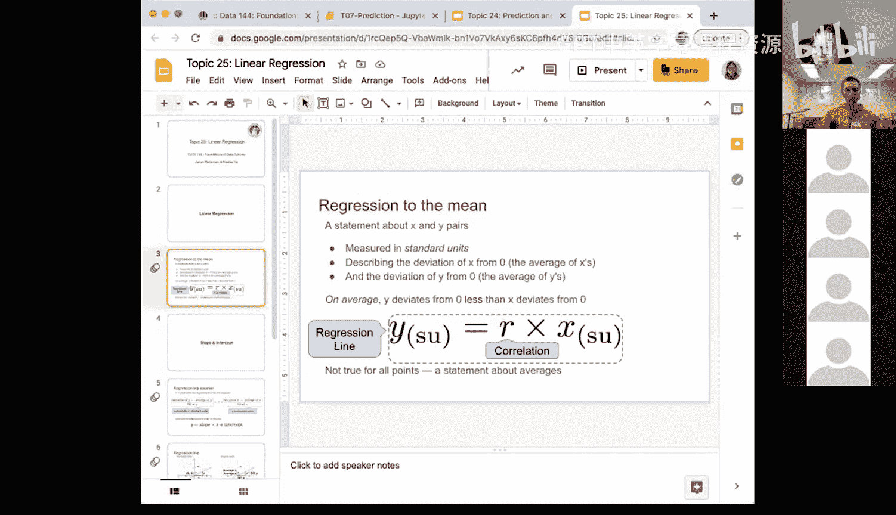

# UCB《数据挖掘和分析｜DATA 144 Data Mining and Analytics 2021》中英字幕 p76 [P76]lecture76-[T25 Linear Regression] Linear Regression-NnvAwdpHINY.zh_en [BV1efBEBuEVg_p76]

Now move to topic 25， which will be the focus for today。

傻呢。Okay， all right。Okay， so we talked about regression okay in the nearest neighbor prediction in the term wide is regression and the graph that we have seen how the prediction is done Okay and this topic we are covering linear regression okay notice that we add a term linear in front of regression okay so it's gonna be a formal regression you're gonna see that it's going to regressiongress to the mean okay but it's going re to the mean in a very specific way and we call it linear because you'll see that there is a linear relationship as how we are constructing the regression line okay so the basic stuff okay is regression to the mean like I said。

 okay the regression line， the linear regression line that were going present okay and you're gonna model is a statement about x and y pairs okay so you have two continuous okay numerical variables okay and then this regression linear regression line。

 you can think of it as a statement about x and y pairs。And in particular， okay。

 there is some subtlety here。 Okay we try to in order to interpret this regression line。

 it is always good to measure x and y in standard units。

 Okay so now if you remember a couple of lectures ago， we talk about standard units。

 Okay so for any observation like a set of data value。 Okay for one variable。

 you can standardize it okay by subtracting the meanme from it and divided by standard deviation。

 Okay so in that way， we're able to get rid of the units， you know。

 like say put put different put different variables on the same scale。

 Okay X and y like say x in that golden example is the parents height right and then y is the child's height。

 So in that case， maybe not too bad in terms of the units， you know， there are inches。

 Okay but still they have different ranges。 Okay so for us。

 we want to standardize them So they're all on the same scale Okay and it's much easier to interpret the linear regression line when we do that。

 So bear with me， let's keep that for now and then we。

And come back to the original units and then see how that affects， like said， the units themselves。

 how how they affect our interpretation of the line。All right。

 so if we now measure x and y standard units in their own okay and what this regression to the mean。

 the linear regression that we're doing here is describing the deviation of x from zero and the deviation of y from zero and here we focus on zero because once we do the standardization right the mean of the new axis in their standard units is going to be zero okay and the saying goes for y as well。

 So if you think about now deviation of the x and y from their mean they are pretty much x from zero and y from zero okay so really whenever we're doing this kind of regression。

 we're trying to explain the deviation of y from zero in terms of the deviation of x。

Okay and imagine like those kind of plot that we have seen right like it's scattered around and then if you look at one particular record。

 you have the x axis and the y axis okay what we're trying to say is that if you're gonna standardize both both pairs the x and ys in their standard units then the linear regression line is trying to capture trying to describe how deviation of y can be explained by deviation of x if a lot of that deviation of y can be explained by the deviation of x then you might see that okay the prediction or the linear regression will be fitted pretty well and also the prediction could be very accurate but however。

 sometimes you might have scenarios where linear regression might not work well and then that will be the case that you will see that the deviation of y might not be really well explained by the deviation of x so whenever we're trying to use a predictor imagine okay and even just in daily I guess in daily life if I look at outside of my window I'm wondering okay whether it's going。

R or not right so you're thinking about making prediction。

 using the information that you have okay and then you want to use good predictors okay because only when you use good ones that can have really high prediction power then your prediction might be more accurate okay otherwise it might not be as useful So in our setting okay so I guess coming back to this regression to the mean concept is that once we standardize x and y okay we are trying to explain the deviation of y through the deviation of x okay if x is a really good predictor。

 that explanation or interpretation might go really well okay and if x is not maybe maybe not so much okay so keep that in mind okay why we think about the deviation in the first place okay so average okay I know we talked about two types of deviation。

 but one thing is interesting is that y devs from zero less than x dev is from zero okay this might sound a little bit not very intuitive okay but let me put it into into the regression。

To the mean equation that's the linear regression line that we're gonna learn about。

 and I tried to tell you a little bit more of why that is the case Okay so the linear regression line that we will introduce okay later on we're going introduce it in the original units okay right now we're introducing it in the standardized units okay meaning that so that's what the S stands for okay standard units Okay so if you standardized y and X okay it turns out that linear regression line that we're able to build okay has this linear relationship Okay and what we mean by that is that the standardized y standardized units y in the standard units。

Well， equal to R。Times。The X in the standard units。

so there are many like complicated math behind all of this and we don't want to bother you about all of this。

 so here the really interesting and important idea for us to grasp is that it is this linear relationship that we're trying to express over here。

Okay， and then that is why we call it a linear regression okay but right now we're presenting everything in terms of the standard units Okay so that that's why we have parenthsesis SU everywhere for Y and X okay and R if you remember is our old friend correlation。

So what this is saying， okay， let me see yeah， yeah， so yeah。

 what this is saying is that if we are able to standardize x and y， okay。

 then the linear regression that we're going to fit is essentially this equation。Okay。

 and then of course you might be wondering， okay， like how can a computer correlation。

 we talked about it before， so you should know that and then how can we reexpress this regression line in the original scale so that's another thing we're gonna talk about okay but what we're doing here again is that zeros okay for x and y after standardized units they are theyre the mean okay so this regression line is on the standard units scale okay and we definitely highlight okay。

 it's not true for all points okay this is only on the average and that's what you will see later when we do a linear regression prediction it's not that the prediction gonna be perfect okay because at the end of the day。

 we're still talking about the means okay this linear relationship is about the means but every time for every record you will have some error going on okay and then what we're trying to do is that later in next lecture I think you'll learn what we mean by the linear regression is that we're trying to minimize。

Errors okay minimize the function of the errors so we can fit the best regression line， Okay。

 but once you do that。What you're essentially doing is that we're trying to specify a particular linear relationship between the standardized x and the standardized y。

 and in particular the correlation is the multiplication effect going on over there。

And the correlation， once you know x and Y you will be able to compute it so that might be really straightforward to do okay but remember this regression line that we're presenting over here is only on the standard units okay and what we're saying is that this is not true for every point okay in fact probably not for any point unless you're exactly on the regression line okay otherwise you're always going to get some error but that's fine okay because no prediction is perfect okay and what we're trying to express is the relationship between the averages of the x and ys in their standard standard units。

Okay， and then lastly， I hope once I present this line。

 it makes more sense of what we're saying in this sentence， okay on average。

 y deviates from zero less than x deviates from zero that less than is coming through this R。Okay。

 so R， if you remember the correlation coefficient is always between negative one and positive one okay and then the closer it is to positive one。

 the higher right the positive correlation right the closer it is to the negative negative one。

 the higher it is of the negative correlation but if r is close to zero then that's indicating like very little correlation going on so and also just to recall that correlation is talking about linear relationship okay and that's another reason if you think about oh why are we really talking about linear regression over here because R is measuring the linear correlation okay sorry the linear relationship okay so what we're really talking about is the linear relationship over here。

And the last then is because this will never go up above one okay so if you're looking at standing units standing units over here。

 then it's always the absolute value of this is always bounded above by one so if you think about it this is saying that the left hand side the y in S will deviate less from zero okay compared to the righthand side x DV from zero because there's a multiplication effect of less than one。

Okay， multiplying over here。Hopefully makes sense might still be a little bit confusing。

 maybe at this stage of all of the math that we're talking about。

Quick comments， questions。We'll give more examples coming up so hopefully and then a demo so hopefully everything will become a little bit easier but don't worry too much at this stage if you think that the regression to the mean the expression that we're giving just now a little a little bit complicated or challenging I think the key takeaway there is that we're expressing everything in standard units okay and that's how we express the linear relationship over there but then of course a lot of times we care a little bit more about in the original units okay so let's now bring it back to the。

