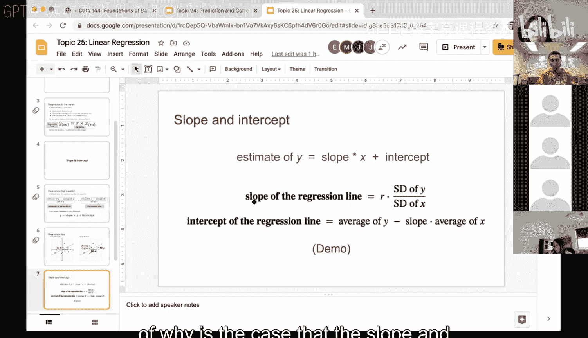
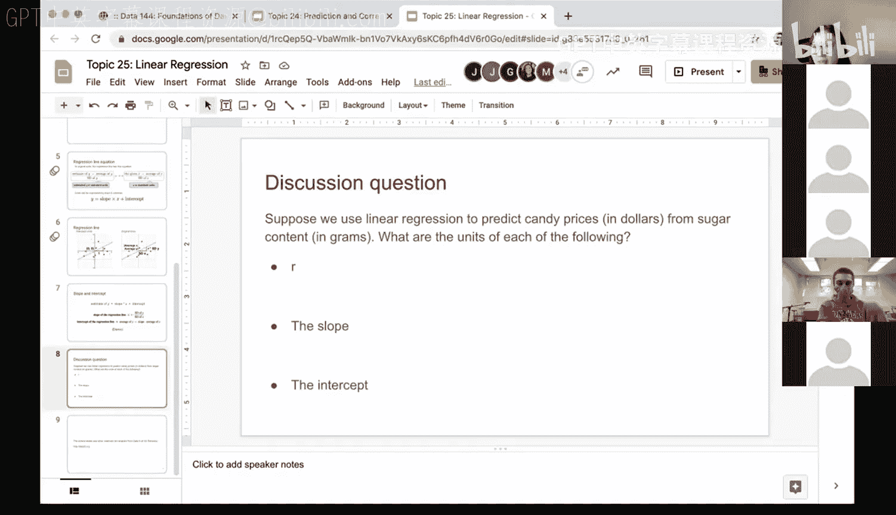
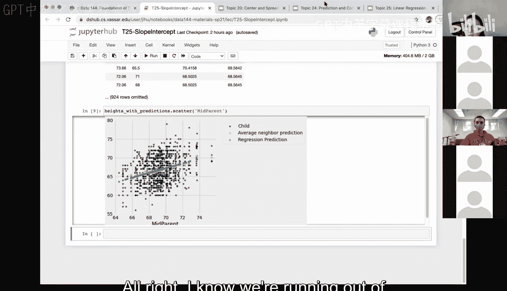

# UCB《数据挖掘和分析｜DATA 144 Data Mining and Analytics 2021》中英字幕 p77 [P77]lecture77-[T25 Linear Regression] Slope and Intercept-MptLBNuHadU.zh_en [BV1efBEBuEVg_p77]

And the way to do that is well， as you know， we can always mathematically write out that linear relationship in their original units as well。

 so we're gonna to see how that can be done and then to talk about two very important concepts in linear regression is the slope and the intercept okay so whenever you're fitting a regression line like you have a cloud of data a linear regression line going through it going through the cloud of the data so we care about how that straight line inter intersects with the y axiss okay so that will give you the intercept okay and then it will also we're thinking about the slope of that of that straight line because that also tells us I guess more importantly that one tells us how the change of X is affecting the change of y。

Okay， all right so so this regression line equation okay in the original units okay。

 the regression line has this equation Okay， so bear with me a little bit okay。

 does look a little complicated， but if you remember what we just did in the previous small topic on the left hand side we have Y in their standardized in the standard units right and x on the right hand side we have our times x in the standard units right so really right now what we did。

Is only to express the standard why an xing standard units using mathematical expression of how you can get them in the first place Okay so the left hand side remember is the y minus the average divided by its standard deviation so that's you know the y in the standard units okay and then the right hand we still have the R the correlation okay multiplies with the given x minus its average divided by the standard deviation of x so that's what this is going back to the linear regression line we shown earlier the standard units but right now we're putting everything in the original units okay and this is important because later on you will see that now if we're able to work with their original units we're able to compute a slope and intercept easily okay and then we can also interpret them in the original units and that in a lot of cases probably will be more a little bit more appealing。

Okay， so so that's what we mean just now okay， so this is the estimate y in standard units okay the x in the standard units okay and then the little R over here again is our correlation。

Allright， so pretty much the slope and intercept that we're going to introduce is just to trying to express this equation。

 okay， using a particular way， all right， so y okay the estimated y in its non standard units okay in its original units。

 okay going be what we mean by slope times the x in is original units plus the intercept。

OkayAnd this is because mathematically we know that if we're going to fit a linear regression line through a cloud of data point。

 like I said， okay， that straight line， the inter in the intercept of it with the y axis is going to give you the intercept okay。

 and then the slope a bit will give you the slope。And for us。

 once you know the intercept and the slope， you can uniquely determine that straight line going through the data point okay and then that is how later on we're going to do the prediction。

OkaySo again， the lines can be expressed by S by intercept and this is any straight line okay。

 even if you're not trying to fit a regression line that we're talking about。

 if you just like in math courses if you yeah if you ever try to just think about how do you express a straight line。

 you always just have an intercept in slope as well okay and for us is that we're trying to put this into the concept of doing data science okay and more importantly how the intercept and the slope can be interpreted in our context。

So this is， I guess what's new from there， but regardless。

 keep in mind that the regression line can always be expressed in this way。

 okay and for us we are focusing what x is what y is and also how the interest evidence slope can be calculated so we're able to start doing predictions。

Okay。All right， so in the standard units Okay so this is the regression line I'm talking about So again。

 once you do standardization， remember everything will be you know this line gonna go through0 okay and also all of the units as you're seeing over here like we're trying to use like1。

23 x right okay to show you the standardization and all of the dots okay over here just so you know like on the left hand side there are just the standardized values of each data points okay so we're showing12。

3，4，5，6，7，8 okay so we're showing a dots over here okay and then this regression line as you can see okay is center as 0。

0 is because we standardized x and y okay you will go through the00 line okay and the slope of this line of course is the R that we're talking about earlier okay it will be the regression coefficient okay so。

If you take like say this okay， so if you're taking sorry x as one unit okay then the height of that point will give you the R okay。

 which is the regression coefficient sorry the correlation coefficient okay so this is before we introduce everything on the original scale okay but in the original units okay now you see that we don't have you know zero zero anymore okay but it's going to go through the average of x and average of y okay that's what the regression line is supposed to go through okay and that's why on the standard units。

 if you remember because the mean the average x and average y there is zeros。

 that's why it's going to go through zero zero and then on the right hand side。

 if we come back to the original units okay so remember this is before doing any kind of standardization okay that's why if you think about the slope over here okay what you're doing is that well you have to think about the height。

Whenever you're looking at one standard deviation of x okay and you see that we don't write our specifically we write our star because it won't be exactly the correlation coefficient that we know if we're able to do it on the standardized units okay so again nothing really changes if you look at the positions okay of all of the dots they're exactly the same okay compared to the standard units and that is because and I think we demonstrated that before in the demo that if you do standardized units like the relationship between the two variables won't change okay you're really just standardizing it into。

Each standard units per format， but where they're going to stay。

 say like on a graph if you like on the right hand side we're pretty much took out all of the units right we're just like putting it in a particular way so we can mimic okay what we really mean by if we have a straight line okay in the standard units that we understand is the like are the correlation coefficient as the slope going on then it's equivalent to the original units where it go through the average of x and y okay but at the same time you're going to have a slightly different slope because we won't be correlation coefficient exactly will be a factor of it。

Okay so this is why so again， the left hand side is in the standard units that's how we introduce it in the first place Okay y standard unit equals to r times x standard units okay and that's what this left hand side is about right inside is from the manipulation that we just did expressing everything in standard units now using the original units okay and that's why in the earlier slide if you remember we have this a lot more complicated expression okay going on okay but at the end of the day like I said。

 it's really just reexpressing the standard units version okay using using the original units okay so this graph is trying to show you how they work in practice okay and then standardization doing the standard of turning variables into standard units wouldn't really change like the relationship between them okay and then that's why it's feasible for us to think about the regression line first on the standard units okay and then turn it back into the。

OralUns on the standard units， I hope everything is a little bit more easily interpretable。 Okay。

 because we have y equal to R times x。 Okay， go through the 0，0 point。 Okay。

 and then then that is how this straight line can be expressed。 Okay， However。

 once we come back to the original units， we got rid of the。

To access going on here okay because we don't really know what the values they are okay they are just in the general original units in this case and then it's still the same straight line okay and then we just need to be a little bit more careful about the calculation of all of the other items over here。

Okay， makes sense。 hopefully okay yeah， feel free to stop me typing questions in the chat and we have also have some chance to do breakout room discussion。

 Okay allright， so lastly， okay， the estimate okay of y like I said in the original scale right is the slope times x plus intercept so here we're giving you the slope of the regression line of using a mathematical notation Okay R times SD of y over SD of x Sd stands for standard deviation and the intercept of the regression line here。

 what we're saying is that it is gonna be the average of y minus the slope times the average of x Okay so with that in mindop with that in mind I do want you to maybe chat with your neighbors I'm going create a breakout rooms in a second and the task for you is that。

What we have covered so far actually can help us derive why the slope of the regression line is this and why the intercept of regression line is this okay so since we talked about it multiple times between the standard units and the original units okay and I was talking about it I really hope and you can take the chance and then think it through before we move on with the demo and then just to show you how this calculation can be done using Python okay but in the breakout rooms that we're gonna create in a second。

 please discuss with the neighbor so feel free to go to topic 25 okay so my question here is that this is on slide7 okay my question is based on what we have covered in the previous slides can you convince yourself that the slope of the regression line is indeed R times SD of y over SD of x okay and then also the intercept of the regression line is indeed the average of y minus the slope times the average of x okay so please based on your understanding so far about。

rationaling how it is constructed in the standard units and then later on in the original units。

 how can you make sure that this is indeed true Okay so once that's covered I think discussed then we'll feel all of us will feel comfortable going to the demo because in the demos you could imagine we have expression for them right so we can just right function to calculate them but it's very important I think to get the understanding。

Well， in the first place of why why is the case that the slope ban intercepted couple in this way okay so again it's on page seven okay so that's the question itself but the previous pages all of the expressions might be useful for you to discuss why and convince yourself that that is the case okay so I'm going pause record so let me share my screen again okay so the question for all of you in the breakout room is how to convince yourself that the slope of the regression line and the interceptor regression line is indeed okay the way that we have presented in them over here so anybody wants to volunteer to share with us all what you have discussed in the breakout room did you find it like were you able to convince yourself this is true and if so how did you do that or if the discussion actually generate more questions and definitely feel free to say it now because would you have a lot of time to I think explain all of this because that's the only topic for today okay。

Anyone？Why don't you give it a try？Sure， so let me know which slide I should go to maybe seven。

Oh yeah， or the yeah， the discussion or sorry the discussion question。Oh， okay， you went ahead。 Okay。

 already right。 Yeah， we can talk about discussion question。 Yeah， go ahead。 Oh。

 I thought you wanted us to talk about the discussion questions。 Oh， my bad。 Oh， never mind。 Okay。

 let me see。 Okay， was the okay， no， that's good。 So discussion question was discussed。 Okay。

 so maybe okay， that's great。 Yeah， we were just trying to figure out like what the units would be。

 So for our， Yeah， because it's a proportion， we thought that didn't have any units。 the slope again。

 because it's it's。😊，Multiplily by R and then it's the standard deviation of that's divided by standard deviation of Y I think then those two would cancel So we think the slope also doesn't have any units and then the intercept because it's the you know what we predict to be why it would be dollars the unit Yeah。

 yeah， let's see okay so let me yeah， let's talk about this first so I'm not sure sure if every group got the chance to discuss the discussion question but maybe we can talk about this quickly first and then we can come back to this line Okay so what S was saying is that this discussion question is suppose we're going to use linear regression to predict Okay so the outcome okay is in dollars Okay is the candy prices Okay from sugar content which is in grams okay and then the question is we're asked the units of each of the following Okay are the slope and intercept Okay so just like what Sha was saying it's important to you come back to see。

What are what is the slope right how the slope is expressed and then how the interce is expressed and then R okay so R so like the first part。

 okay R because it's the correlation coefficient okay and that should have no units at all okay and so for R I guess it's relatively more straightforward and just remember like if we talk about R remember we talk about it between negative one and positive one right there' is no like real units about them Okay so that's another reason or another way to think about it why we say the R does not have a particular unit okay let's see the slope okay the slope。

We come back to this okay so we know that slope is defined to be whatever we're as multiplying with x okay and then the mathematical expression of it is the R which has no unit okay。

 so that's probably we don't need to worry about it standard deviation of y overstand deviation of x okay so。

I guess Shao， what you were saying earlier is that because the standard deviationviation of Act and the standard deviationviation of Y got canceled as well。

 so there's no unit for S either， would everybody agree or there's any kind of concerns or comments about that kind of line of thinking。

What are standard units， what are the units of standard deviation in general？So the candy prices。

 which are the wises， okay， they're the outcome， okay， they're in dollars， okay。

 and the sugar content is in grams。Okay， so that's the x Okay so we know that the mean okay。

 the mean of y is going to be dollars right because this average of the candy price okay and the mean of the sugar content going to be in grams。

 What about their standard deviations。Do they have no units？

Or if they have specific units going on as well。Anyone？Or maybe this is indeed a good。

I know like I said， maybe not every team got the chance to talk about the discussion question and since we started on this already maybe just to make it more efficiently let me stop share and then yeah like I guess just the question is what are the standard like the units of standard deviationvis and then from there we can determine the unit of slope okay in this particular case and then of course you can also discuss about the intercepts so let me actually bring you back to the breakout room so let's say let's do this so let me stop。

Definitely looking forward to volunteer having all volunteers talking about this Okay so yeah we can start with the discussion question first and then move back to that to expressions so I guess the remaining question just now is。

😊。

Because slope okay we know is our times the ratio of the two standard deviations okay。

 so the question becomes what are the units of standard deviations of x and y in this particular question okay are they indeed canceled out or do they have their own units so the slope actually going to have a specific unit going on okay anyone。

Based on your discussion just now or maybe earlier。There units for standard deviations？Any one。

So or questions？All right， let me see kind of okay， all right， so maybe in the chat。

 if you don't mind Okay， if you think they're okay， let me just ask I guess a quicker question。

 So if I look at this， let me just look at why Okay， so why is the candy prices Okay in dollars Okay。

 so my question for you is that what's the unit of it。Is it no units or is it dollars？

Or is it anything else？If you don't mind if you can type in the chat so we can get the discussion rout and again don't feel bad if you got the wrong answer I mean this is really helpful and now I guess because nobody volunteers I guess this might not be an easy question so it's pretty important for us to talk it through so。

Do you think there's like you can type no units or it in dollars？Or something else。

You can type in the chat so we can get this rolling and we can continue the discussion， anyone。

 any thoughts。What would be the standard deviation of？Of candy prices。Why are we waiting， Let me see。

 I'm pretty sure we had a。I hope I can find it。Sampling variance。Okay。

 maybe it's here topic 20 okay where we talked about the mean and the standard aviation okay so that might give us some hint I hope okay standard deviationviation so maybe later on you can check that out as well okay。

How far， okay， all right， so standard deviationviation measures roughly how far the data from their average。

Okay， and it is the rooming square of deviations from average。 Okay。

 I guess the last item does show us。 Okay， so innovation has the same units as the data。Okay。

 so of course I mean this was like this is what was told to you so maybe you still have confusion of why exactly that's the that's the case so standard deviation。

 if you remember what we computed is that we compute the variances。

And then we take the square root of that Okay， and the variance is the square。

 if you remember the variance is that we add， so we look at each observation of x right okay or y in this case。

 let me come back to this Okay like candy dollars candy prices okay in dollars So this is the y okay。

 so in practice when we do standard deviation calculation。

 what we do is that first of all we compute the variance Okay。

 where we actually look at each y from its me okay， we'll look at the distance， Okay。

 we take the squared。Okay， and then we take the summon divided it by number of observations， okay。

 so it's the square like average of the square distance。Okay so if you think about that。

 then variance actually has the units of dollars squared it doesn't really make sense。

 but it's squared of dollars because of the fact that y has unit of dollars okay so the reason why people like standard deviations if we come back to topic 20 is indeed that not only is interpretable like telling us like on average right how the data are from their average okay but also it has the same units as the data so it's really easy to interpret。

Okay， and。Another way to recall， I guess is that if you remember the 68，9095 and 99。

7 rule that we've been talking about the normal distribution Okay so remember we're talking about like say within one standard deviation from the mean right we have 68% of the data and then within one standard deviation。

 what do we do is you mu minus sigma right to mu plus sigma so when you add and subtract mu and sigma。

 I guess that's another hint that they will have the same units okay so if the mean have the same units as the data actually standard deviation also has the same units as the data so I guess coming back to all of this。

 so if we come back to the slope here， okay so slope is R times SD of y over SD of x okay R has no units okay but then SD of y in our example has has the units of dollars and then SD of y has the units of gra okay so the slope actually has unit which is。

I guess dollars over over grant Okay， Okay， so the last one， the intercept okay。

 what shele was saying earlier is that will have the。

A unit of of the y okay which is the dollars in this case okay so because again the interest average of y minus the slope times average of x okay and so of course。

 I mean first of all those two they need to have the same units in the first place okay so that's another reason if you think about it that slope does have some kind of units going on because the average y is in units of dollars right average of x is in units of grand So in order to bring slope times average of x to have the same units as average of y slope does have to have the units of you know dollars over over grand okay so this's a little bit complicated like I said I guess this discussion did let me know。

 at least that the units of the standard deviation were not as clear as we hope to be so hopefully this discussion is helpful and then I guess lastly if you got the chance to discuss this expression of the two I hope you're able to recognize that。

The way that we're computing all of this is like the slope right， if we come back to here。

 right slope is what slope is whatever you multiply with x。Okay。

 so if you come back to this regression line in the original units。

 Okay and so you see that here are times or sorry like times S of y okay divided by SD of x。

 that will be the ultimate ratio that you are multiplying with x Okay So that's why slope So it's a little bit math going on。

 So like I said， lefthand size estimated y in standard units right right hand side R times x in S So but then we express the y and x in their standard units using your original units。

 Okay， so then you're left with like estimated y average of y S of y。

 So once you do the math rearrange the terms， you will see that the slope is indeed R times S of y over S of x Okay so that's what we're hinting in terms of Y this is the case。

 And then the intercept of the regression line is going again going back to。

To this okay to this expression and then we're able to get the intercept in this average of y minus slope times average of x okay so again hopefully it's not too tricky and I again I think it's important to think about everything in terms of the standard units first okay and then we come back to the original units using some kind of algebra okay and that's exactly how we compute the slope and the intercept where we come to this two formula okay and and then of course the discussion question I guess we jumpstar on the discussion question so that's useful for us to think through what are all of those items are so to wrap up for today I just want to do a quick demo to show you well in practice how you can calculate the slope and the intercept okay and then in Python and again in this slide we already talked about the mathematical formula for both of them so in practice as you will see in the demo we wrote functions of like calculating the R calculating the SD of both and then we can get the slope。

And then for the intercept we really just need to get the average of y and then the average of x once we compute the slope we're able to compute the regression we're able to compute the intracept as well so everything the theory is in the slides itself okay so in Python what we're doing is that we're based on we row functions okay based on this formula and then we're able to perform this calculation。

Okay all right， so without further ado let's come to this only demo for topic 25 Okay。

 this is what we call S but intercept that's how to compute it Okay so you see that at upfront Okay I loaded or I wrote four different functions here the first one is what we have seen before okay just to get the standard units Okay because it's important as you can see to get all of the computation going so this is again。

For any data that you pass into this function， you take the difference between every data point from its average and then divide by standard deviation Okay so then the output of this gonna give you the x in its standard units and the correlation is another thing that we talked about last time okay so again what we're doing is we have the table passed in the two labels that we want to compute the correlation with okay so what we're doing if you remember is that we get the standard units of label x times the standard units which is what we had written earlier of y and then we take the mean that we give us the correlation okay so this is from before the new things here is how to compute the slope and intercept okay and then what we're doing like I said is directly following this two formula okay the slope remember is R times SD of y over SD of x So what we're doing is we pass the table right the label of x and label of y what we do is that first of all we。

PR is the correlation from the correlation function that we wrote okay。

 and then the second is while we get the r times the standard deviation of y right over the standard deviation max。

Okay so nothing fancy iss really just following the formula that we covered and lastly the intercept if we come back to the expression is the average of y right minus slope times the average of x so once you have the slope right what you do is you get the average of y right minus the slope times the average of x and then you will get your intercept。

Okay the input again is T and the two labels Okay so again notice that we always try to do everything in terms of data table okay because while we're really talking about like two columns of our interest right and then we're trying to compute like say regression like linear regression flow by intersect so it's always good to put everything I think in terms of data table Al right。

 so let me load this functions。And our galton data okay so again here i'm naming my parent and then that's the child okay so again we don't deal with father's height and mother's height specifically okay we look at their mean because we are using that as the predictors so this is just a really simplified like X and Y going on here so we can see action how the tables are doing okay。

All right， so this one is what we reviewed earlier today that how to do the nearest neighbor prediction okay the nearest neighbor we now call it like NN nearest neighbor okay and that's not a regret like not a linear regression okay that is really just like the practice if you remember we get the mid parentsent height in a particular range right and then we take the average of them as a predictive value for the child's height okay so here were refreshing and using this like recalling this because we can use this as a comparison as what we're going do linear regression prediction as well okay so keep in mind and if you remember from。

This lecture here it' not on the straight line， right， The prediction is close Okay。

 when we do in the nearest neighbor prediction。 Okay， it's close to a straight line， but not exactly。

 okay， however， later on， we're doing this prediction with the linear regression you will see something slightly different Okay。

 all right， so this is yeah， whatever I did up here is just do in the nearest neighbor prediction Okay。

 so let's keep that first， Okay， and then now we know that now we have our x as the me parent right why as the child height Okay。

 all of them so we're able to in this case。Get the get the slope but intercept running。 Okay。

 and then what we do is again， we row the slope and the intercept functions up here。 Okay。

 so we're just calling those functions with on the height table right。

 and then we clearly label those variables that we're working with。

 So the X is the X label is the main parent， the Y label is the child。 So when we do both。 Okay here。

 we get a slope of 067337。 and then the intercept is 22。64 is。 Okay。

 so this is computing computing them。 Okay， and lastly， we can use this okay。

 the slope but intercept right to make predictions。 Okay， and what we do is。

So first of all let's see we first of all get the mid parents where they're a particular height okay and then what we do is that the prediction as you can see so I probably need to slow down a little bit here what we're doing is that we have the heights okay we get the regression prediction okay sorry we are adding it as a new column of the prediction regression prediction okay in particular we get the slope that we computed earlier okay we multiply that with the height of the mid parent okay and then we plus the intercept。

Okay so the prediction is exactly this line， okay， and that's why we're writing over here estimate or the predicted value of y okay iss the slopes that you computed times x plus the intercept。

Okay so for us， if we have computed the slope， which is about 0。64 and then the intercept。

 which is about 22。64， then we're able to use them to make predictions of all of the apparent that we have like in the table that we have okay and what we do is we use the width column method okay to add a new regression prediction okay and that prediction is done by slope times x plus intercept。

Okay， so that's what we mean by the regression so and the prediction， so let me。

Do that and lastly I want to show all of the two different types of predictions that we have done Okay so the darker blue is still the actual observed childs height Okay and then the nearest neighbor prediction was still is still in the yellow color Okay and the regression coefficienti and sorry the regression prediction that we're doing over here is is the lighter blue okay so。

With the remaining five minutes I want you to go back to your breakout room and discuss a little bit of the differences and I guess similarities between the two types of predictions okay so remember the yellow one is the average neighbor nearest neighbor prediction okay and that's what we had done before we reviewed a little bit today as well and the regression regression prediction is following the regression line that we have presented okay we compute this slope okay we compute the intercept and then we're using exactly this line this expression to do the prediction okay so here in this graph we have seen this two types of predictions okay they are similar to some degree but they're also different from each other okay so I will like you to go back to your breakout room and again yeah I guess yeah I'm not sure how easy it is because you have to run I guess this demo to replicate this exact graph so I'm not。

Sure how easy it is so maybe okay let me give you one to two minutes maybe just here to think about so you can still view it and then we can wrap it up as a way to discuss how the different predictions are working and how like do you have a press preference of the two and if so why that kind of questions will be pretty open ended okay so the question here is what are the differences and the similarityities between the two types of predictions？

What we're seeing on the graph and why do you think they are similar and why do you think they're different？

So maybe one to two minutes is and then we can wrap it up。Are you still sharing your screen？

Oh yeah I'm oh right right sorry maybe I was not clear yeah I was saying that I'm just showing the screen because once I put you in the breakout room。

 you won't be able to see it。Oh okay， yeah because this is right， you're right， so yeah so。😊，Okay。

 yeah， since there are only two minutes so maybe you left we can maybe talk about it so what stands out I guess between the two predictions based on what you're seeing over here。

Immediately like theyre they're pretty close right to some degree Okay that's one thing And again。

 we know that both of them are regress they regress to the me okay because both of them are based on mean it's mean based prediction Okay so maybe that's not too surprising and to me I think one thing really interesting I guess the similar is that they're close okay but not exactly the same Okay so difference over here is that the regression prediction like I was saying earlier is that it's gonna be a straight line。

Okay， and it's going to be a straight line because if you look at this。Relationship right。

s it's a given slope for any x right plus the same intercept everywhere okay so for any x。

 you have the same slope Okay plus the same intercept So it's not surprising that it's gonna be a straight line okay and that's indeed if we come back again to this discussion okay is that this is exactly like that linear relationship that we're talking about so in that sense。

 I think the prediction turns out to be a straight line it's no surprise okay on the country if we look at the average neighbor prediction okay we know that there not exactly the straight line right and maybe it's easier to read here okay there is some wiggling up and down okay so so this is again。

 the main difference to me that that is between the nearest neighbor prediction and the linear regression prediction the linear regression prediction will be a straight line okay whereas the nearest neighbor prediction might not be but they could be close。

Okay and if you remember what we're talking about at the beginning part of today's lecture。

 we're saying that if the correlation between x and y is pretty high okay we're pretty close to positive one or negative 1 okay then those points。

 the predicted points that we're going to do could be very close to your straight line okay but on the contrary for linear regression by definition is going to be a straight line so that's that's important to note and there is similar just looking at the I guess the magnitude like how close they are and also I think the main reason of why they're similar is both of them are based on mean prediction slightly different method of course but regardless we always see the regressiongress to the me effect right like say you can have all kinds of variability of the observed between the predicted but what the predicted is trying to predict for is on average how you're going to behave so that's why whenever you're doing prediction or even just imagine like a regression line going through a like a cloud。

Data cloud you will never match every data point right you can only do as best as you can and its it's no problem at all。

 Okay， the method itself is built on on average。 it's not about each particular observation Okay so as long as the averages overall work well then then everything should be good Okay all right I know we're running out of time so I'm gonna maybe end here and again feel free to stay over if you have questions about I mean today's lecture or the final project or your individual project too okay that is due later this week so make sure that you。

