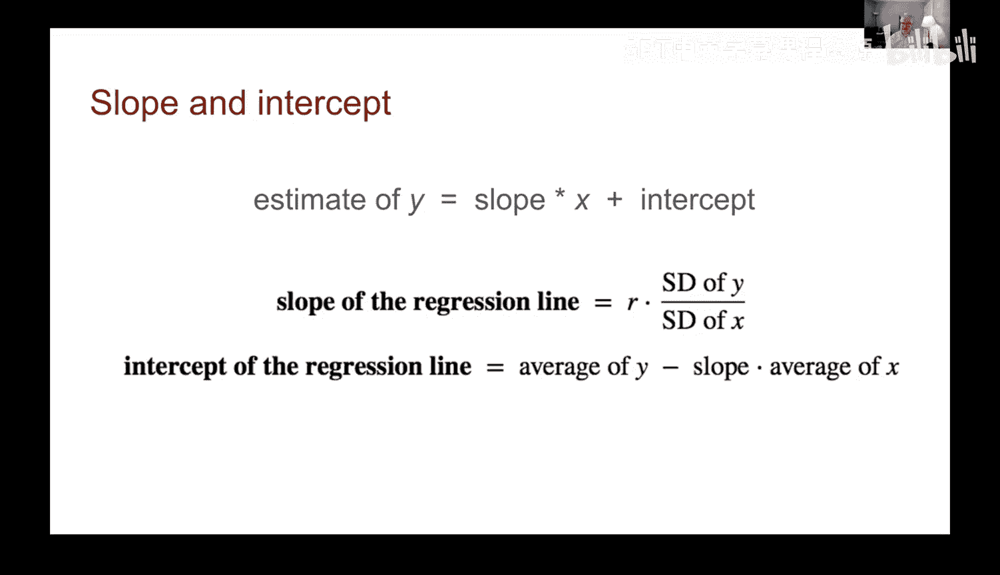
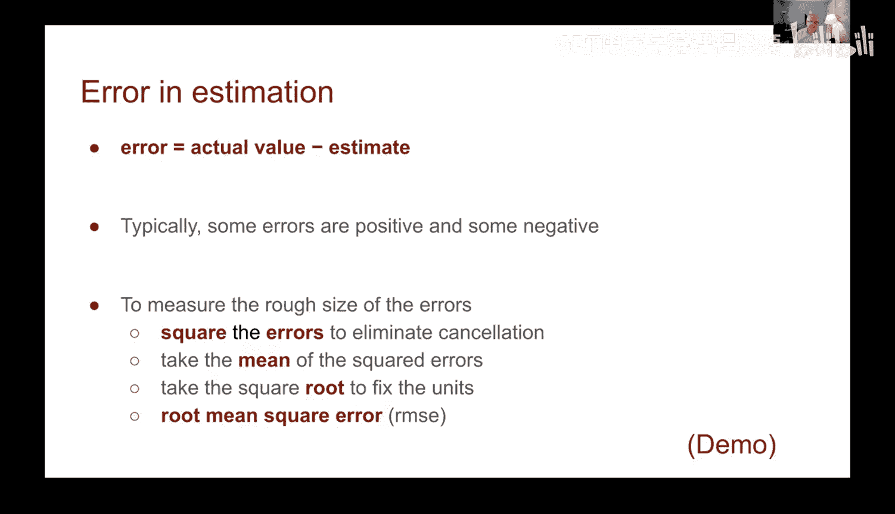
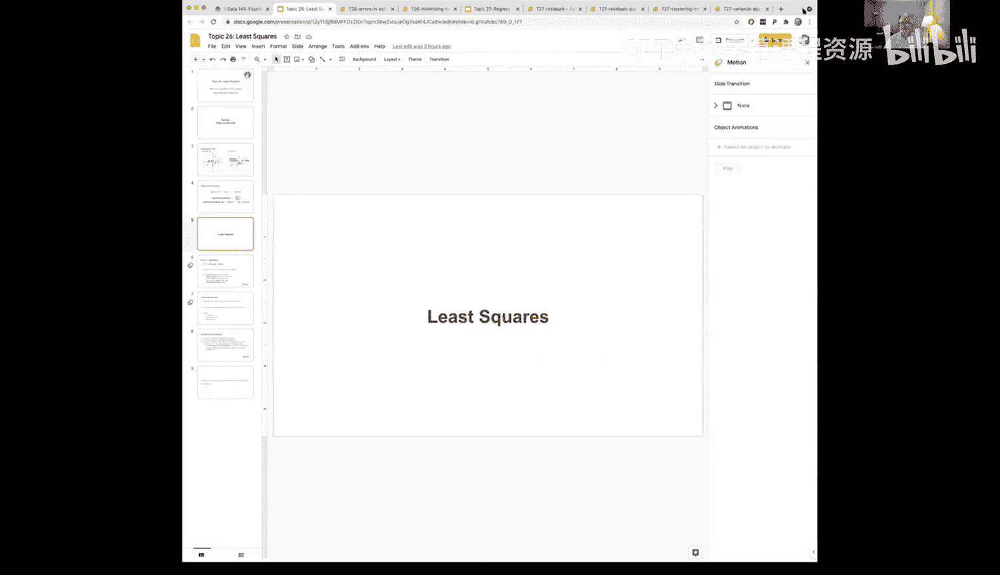
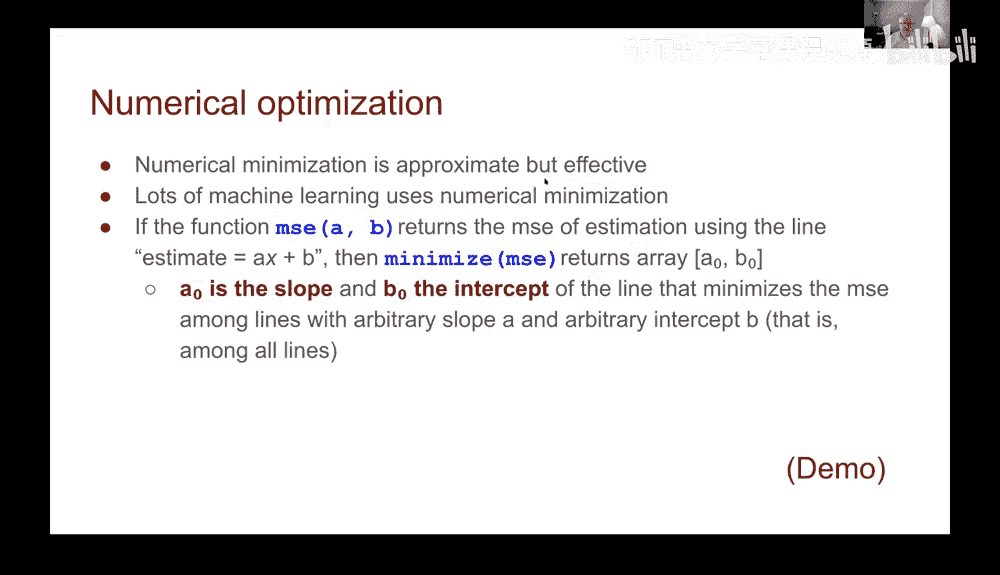
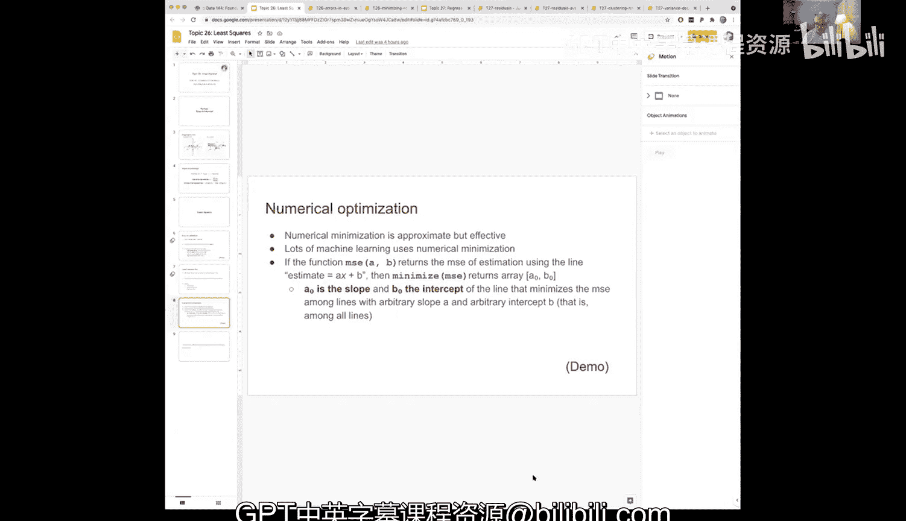

# UCB《数据挖掘和分析｜DATA 144 Data Mining and Analytics 2021》中英字幕 p78 [P78]lecture78-[T26 Least Squares]-2Sbquxi8Z8w.zh_en [BV1efBEBuEVg_p78]

It computeruter。

I。🤧Okay， all right。All right let's do a quick review from last time and we started looking at the regression and the slope in the intercept and so。

If we calculate our regression line and we do that in standard units， right？

We convert we convert our data into standard units and and we find what we look at is that when we calculate the slope in the intercept。

 we see that the slope。The slope is going to be R right so this is basically the change in y over the change in x and when we do it in standard units。

 one standard unit， you know the change in x is one and the change in y is going to be R。

And so the slope in this case， when our data is in standard units。

 our slope is the regression line and the origin， the origin in standard units is0 zero。

 so our intercept is going to be zero okay， and so when our data is in standard units。😊。

Our regression line is R and it's going to run right through zero。From there。And so。

But really kind of you know at the end of the day， taking a step back and looking at this right why are we kind of calculating this this R because we want to predict we want to use R to take some observed value。

 some predictor and then generate some fitted data to that so we're not going to be working in in standard units we'll be working in original units and。

And we can hold and this will hold just as well right we can get the slope and the intercept but we need to convert that a little bit right so kind of looking at the graph on the right and original units you can see that the change in y。

 the change in y is going to be r times the standard distribution standard sorry standard deviation of y and x the x axis is going to be the standard deviation of x okay and instead of having the origin be at zero it's going to be at the average of x and the average of y。

😊，And so we can use that information。😊，We can use that information to calculate the slope and intersect。

And so what we had from that is is that。If we want our estimate of y。

 we're going to take we're going to take the slope that we calculate。

 multiply it by x and then we add it to the intercept and that's going to be our predictor okay so kind of the name of the name of the game the big picture is is that we have some we have some value x that's our predictor and we want to use that to make an estimate of y。

And so once we have that x value， then we just multiply it by the slope， add that to the intercept。

 and that's going to be our estimate of y。Okay， so then now the question is how do we calculate the slope and how do we calculate the inner intercept well the slope the slope is going to be。

😊，The regression line multiplied by the standard deviation of y over the standard deviation of x okay。

 so that's just going to be our our correlation correlation coefficient multiplied by the。

Standard deviation of y over the standard deviation of x， okay， so that's going to be our slope。

And then our intercept。Our intercept is just going to be the average of y minus the slope times the average of x。

 and then we're going to use that to estimate our y。Any questions。

 any questions about kind of how I got all of those values？

Right， this is all review， so I'm not surprised you have question that you don't have questions。

 but I'm happy to entertain them if you do。Okay。

Okay so so now we have a predictor we now we have a predictor and whenever we have a predictor one of the things that we want to do is is this a good predictor is this is this accurate from that and so what we can do is now that we have our predictor we can calculate our errors and estimation right so we we have our data cloud that we've used to make our predictor to get our slope and our intercept which we'll use in our prediction and so now we can actually test we can test how well did we do we can do that for all of our data points and we can come up with some error estimates for that right and so what is the error the error is going to be the actual value minus the estimate。

😊，And whereas we see when we look at the data sometimes our errors are going to be positive。

 we overestimate it， sometimes they're going to be negative， we underestimate it from there。

 and so our goal really is is that how will we go about measuring the rough size right of these errors。

Well， if we just took if we just took the average of our errors。

 if we just kind of you took the average all of them。

 well because some errors are positive and some errors are negative。

 you're going to find that the errors are going to be zero if we just take the if we just take the average of them the positive errors are going to cancel out the negative errors so what we're going to do here is we're going because some of them are positive some of the negative what we're going to do and we've done this before is we're going to square the errors we're going to take the error and we're going to square it and so what that means is that in essence we're kind of any negative values。

 then become positive values when we square them and so then we're going to get a kind of a more accurate measure of that so now since we've squared them since we've squared all of them the units are now kind of in unit squared right and so then what we want to do is to get。

Back to our original units， we're going to take the well we're going to take the average right so first we're going to square our errors。

Okay， going that eliminates our cancellation and then we're going to take the average of the squared right and that is going to be a positive number because there's no more negatives。

😊，So it's going to be at least at least greater than zero or greater greater zero or greater than zero right if there was a perfect prediction。

 we wouldn't have any error and then we would have zero。

 but as long as there's some error it's going to be a positive number okay so we're going to take the average。

😊，We're going to take the average of the squared error and and now but we have units squared so the last thing that we're going to do is we're going to take the square root of that we're going to take the square root of that and then that gets us back to the original dimensionality of our units okay so all of these steps together is known as the root mean square error our MSE thats that is a mouthful but it is actually a very descriptive name of what we're doing so if you ever forget how to calculate the root mean square error all you need to do is start on the left hand side or sorry the right yeah the left hand side and work your way start。

Start on the right hand side I have a hard time telling my left and right by the way so sorry about that so we're going to start on the right hand side and work our way to the left right so if you start on the right the right hand side and you see error we're going calculate the error then we're going to square the error。

😊，Then we're going to take the average of that error that's the mean and then finally we're going to take the root the square root of that so what we're doing in the calculation is defined entirely in the in the name root mean square error The thing you remember you just got to start on the right and work their way to the left Okay all right so let's let's kind of see this。

Estimate there's this error metric in practice。

Do the demo， all right。So。As we are we are now building we are now building a nice collection of helper functions and again you're more than welcome to use these collections of helper functions and we're going to grow a few more of those today but it's actually a problem it's we' spending a little bit of time and just doing a quick review kind of what these helper functions are doing so remember when we calculate the correlation we want to operate our we want our data to be in standard units so the first helper function we have here just converts whatever our data is into standard units and if you remember what is the standard unit well all we're doing is we're taking our data and we're seeing how far it is from X from the average of x right so how far we how far is that data point away from the mean。

😊，And then we're just normalizing or dividing by the standard deviation of x okay so that。😊。

pututs us in standard units and remember so what are we passing in here we're passing in in array and so NI works on arrays we can do calculations on arrays here so what this is doing is so nuy average is going to take the average of our array and that's going to calculate a number and so that's going to be some number some constant and we can subtract a constant from an array and's it's going to perform that operation on every element of the array so it's going to return an array with all of the data points each of the elements of array subtracted by the average and then and that's the numerator and nominator that's taking the standard deviation of x which is a number and then it's going to divide and again we're dividing a constant by an array so it's going do that element by element and return a new array with the division done on each individual element so that that is how we can。

Calculate standard units and we can just pass in an array here the correlation again we're writing a very generic function here and so what are we passing into this function so we're going to pass in a table so we just give it the shorthand name T and then we're passing in two labels of the table right so this is a very generic function that can work with any table and then we can pass in any two labels。

 any two columns from there and and no matter what columns we pass in this calculation will work and if you remember。

What is the calculation for the correlation so what we would need to do is is its simply we're going to take our data and we're going convert it to standard units right so we're going to take our we're going to take our x column convert it to standard units we're going to take our y column converted to standard units and so once we have our data in standard units the correlation is simply the product of x and y in standard units and that's just the the average of the product from there and that's exactly what we're doing here we've convert to standard units here is we're taking the product and then finally we're taking the average。

Of that， and then that is going to return to us our correlation。Okay， our next teleer function again。

 same thing we're working just very generically， we will pass in any table and any two columns of that table。

And we're going to return the slope and。How are we returning the slope and the slope comes exactly from。

This equation this equation right here， so the slope of the regression line。

 so the slope is going to be r times SD of standard deviation y the standard deviation of x okay so this helper function is just a straight application of that formula and so how are we doing that we're using we're getting R're calculating R like we said we're going to get r and then standard deviation y standard deviation of x so we'll use the correlation helper function which we just wrote to give us r and then simply we're just taking r times the standard deviation of y divided by the standard deviation of x from there okay so that's a straight application of the formula and for the same thing for the intercept the same thing from the intercept we're just looking to calculate the intercept is the average of y minus the slope times the average of x。

And we got that here from there。We're calculating the the mean the average of y minus the slope we're using our output function times the average of x Okay。

 so that's just a straight coat up in Python from those two。

Formulas before I go on does that does that kind of make sense do we have any questions about how I derived any of those helper functions because we're going to we're going to use them time and time again。

 so I want to make sure that we we understand where this is coming from。All right。

 I will take no news is good news。 fantastic。 Al right， so we're going to add another。

 we're going to add another helper function to the stable and and so what we're doing here is this is just a simple function that's going draw。

😊，I's going to draw a line for us。 Okay， give in a particular slope and intercept。あ。From there okay。

 and well see that we'll see that from here， we'll see that being used down in here。

From there and then the last helper function we're going to have is is this that。

We're going to basically have a helper function that taking a slope in an intercept is going to plot out any error is going to show us errors in random points of our original data。

 we haven't talked about what that data is so let's come back to this。m，Okay。

So then the last thing that we're going to do is that we're going to write this helper function of fitted values。

 this is going to be this is going to make a prediction for us and again it's taking the same format that our helper function is it's going to take a table and it's going to take two labels okay X and y and so all we're doing here is using the existing helper functions that we have to calculate the slope in the intercept。

Just using from there and then we're going to return。Our fitted values。And so once。

Excuse me once we have。Once we have our slope and intercept。Now we can， again。

 by just using this formula here， the estimate of y is going to be the slope times x plus the intercept。

From there and that's exactly what we're doing here we're returning a times。😊。

X plus the intercept from there， Okay， so that's going to return。

Is going to return an estimate for all of the x values right again remember kind of the name of the game x is going to be the predictor variable that we're going to use and we're going to make predictions on all values or estimates for all values of X from there okay so now so now we have all of our kind of helper functions in place and so now we can actually look at some data and oh my gosh it's new day to day everyone this is a brand new data set that we have not actually looked at if you're getting tired of babies and midparent heights we have a short short respite from that and so what we have here is is that this is the 2016 election data i probably should update this now for the。

😊，The 2020 election， but what this is is that this is。😊，All of the districts in all of the states。😊。

U and。Its so this is going to be kind of an average average or median income across all of the districts for all of the states so every every state is developed divided into congressional districts some of them are kind of weird looking right and have no relation to anything in nature because the geandering but we have the median income from that and then we have the percent voting for Clinton and then we have the percent of those those people who have a completed college or have gone to college okay and so for this we're going to look at we're just going to look at two columns we're going to look at the median income and see how that relates to the percentage of that population that have gone to college from there。

Okay， so here's our table， so like I said， the only thing that we're going to look at is just the median income and the college and so we're not going to care about where where this came from。

 you know what state， what district we're just going to look at we're just going to look at our two volumes of media income and college。

Okay so we're going to drop all of the other columns the state district and the voting percentage so now we have just median income and college and so now right so now if we want to see if there's relation the first thing that we always want to do is just visualize the data let's just take a look at it and see。

What we got here and so if we do that and again what we're doing for this example here is that we're using we're using the college percent as a predictor for media median median income okay。

 we could do it the other way around we could say is you know but that's asking a completely different set of questions so for this example here so X。

😊，iss the percentage of the population that completed college and then we're looking at and can we use that as a predictor for your median income and so if you look at this right so what do you all think？

😊，Does it look like that there could be some linear kind of relation here between the two of them？唉。

Who do you think？Yeah， I' think so。Yeah I see some nodding nodding nodding yeah I mean it looks like there definitely seems like as the percentage of the population who have completed college the median income definitely looks like theres some there's some association here from there so you know I think you know we're kind of onto something so next thing that we can do is get the correlation of that。

😊，And I did not run any of these cells。🤧And all the time describing them not actually running them all right score okay。

 okay， so we run the correlation and we see there's actually a quite high correlation。

 quite high correlation you know 。8818。818 to you know 0。

82 from there and then that makes sense right and again right what's correlation is telling us how closely is the data clustered around around around a linear a line from there and so okay。

 so。😊，So now we can see that that's there and so now we can calculate， we can calculate the slope。

 the intercept， the slope in the intercept。😊，🤧Yeah。

And then and then we get that right and so and so let's let's actually think and so now we're right。

 we're dealing with。😊，Because the sloing intercept work in original units and so it's worth taking a moment and actually thinking about what what does this slope mean okay so we we calculated the slope。

All right and it's like around 1271 and so what does that mean So what we're saying here is is that you know for our for our predictor we're predicting that。

For every 1% increase in college in the population that has gone to college right so if we've so if we're looking at you know if we're looking at the increase between 40 and 41% right so for every increase every percentage increase。

🤧In the population college you know the population who have attended a college for every percentage we're predicting that the median income will rise by almost $1300 and so that's kind of what that's what the slope is saying so for every increase in x we're predicting an increase in y by $1300 from there okay so now now we have our slope in our intercept so now we can make a bunch of predictions for our data and we're going to use the fitted value for that function there so that's going to return an array for us and then what we're going to want to do is we're just going to add that back to our table okay and so when I will make a。

Demographics。Table and we'll look at the we'll visualize that Okay， and so again here is。

Here is our predictor and again what we're doing here is that we've calculated our slope in our intercept and that allows us whenever we have a data point。

 whenever we have we have a value for x we can make our prediction from there and you can see because it's our linear prediction all of our predictions fall on this line fall on this line and this line is defined by x times the slope plus the intercept from there okay any questions。

About what I've done so far。嗯。Okay， so going once。T twice。Okay， so now。Um。

We can actually now compute our error right so everything we've done before is kind of stuff that we've learned before And so now now that we have our prediction we can we can calculate our error and our error is just simply going to be our media income right because we that's the the actual values that we use in our data cloud to make this prediction so we have the actual values and we're just going to take。

😊，Are actual subjected by our predicted and that's going to be our error。Yeah。Okay。

 and so now we can just add that back in and you can see here's the actual income。😊。

Here's our prediction and then there's the error and again right so you know how you want to read these is if you take the prediction and add them and you add the error to it。

 that will get us the actual value。From there， okay so。So now here's a question。Here's a question。

 so now that we have our error column。What will we get， what will we get when we take the average。

 the mean of our errors？😡，I won't send you in a discussion group。

 but I want you to just think about make a mental prediction。

About if we calculate the sum of all of these errors from here。

Okay and so you know what are we asking right so we're asking so here's our predictive value and for here let me show one let's see let me pick a line that doesn't have a lot of points out here this is perfect right can you see can you see my mouse everyone。

😊，Okay right so if i'm looking over here kind of like maybe like around 10% and you can see we have a couple of data points from here and so。

What some saying is if I we take you know so here for these data points right you know our prediction isn isn't you know correct some cases it might be but in some cases right the here's the difference right and so in some cases our prediction is below the actual and sometimes our prediction is above and so what I'm asking is if I take the sum of all of those errors。

What am I going to get？You don't have to shout out the answers though you're welcome to。

 but I want you to really kind of think about what should we expect to get？🤧All right。All right。

 you're in locking in in your own head。What your guess is going to be？All right， well let's run and。

 let's find out。And we can see even though this is a number。

 even though it kind of spit back a number here， right it's important to look at what this is so e to the minus 13 so what we're saying here is that。

😊，Um。🤧E to the minus 13 means we're taking the decimal point and we're moving it 13 places to the left and so what we're saying here is is that this number is 0。

 12 zeros and then 6。 blah blah blah blah blah bla right is this is zero this is this is kind of you know as close as you get when you actually are doing real because and so why isnt exactly zero because of rounding errors and during during the calculation so the average error the average error is going to be zero and this is this should not be surprising and this this will always be the case for any linear regression like this。

🤧And so and by the way， and that is why kind of what we said was is that when we are trying to calculate the error。

 we don't use the average， we're not going to use the errors because we're going to get some of the thing the values the are above we'll cancel out the ones below so we are going to we're not going to use we're not going to use the the the mean because that's going to be zero and it's going to be zero for。

All lines going through。Or the regression going through。

 instead what we're going to do is this idea of root mean squared error。

 so we're going to take our error。😊，And so we're going to take our error and then we're going to square it。

😊，And then we're going to take the average and then to get the units back to normal we're going to take the square root right so remember the the two stars is exponent so this is squaring it and then squaring to the one half is the equivalent of taking the square root。

And this will give us definitely some some positive number， okay， and in this case。

 this is almost 94 9400。😊，Okay。So we can wrap all of that up into this demographic errors helper function。

Wwhich will allow us to visualize what's kind of going on here and so so what we calculated is we calculated this root mean squared error for all of the data points right so how far is it you know what's the distant you know how far is it squared take take the average take the square root and so just kind of as a visualization this demographic error it just picked four points along the graph to show you the errors on those particular points from there then this is just a visualization okay and this function is general enough it can work for any slope and any any intercept and and we gave the actual ones that we calculated right so the regression slope and the regression intercept。

From there okay and we can do that for any right so you know we have this cloud of data and we're trying to pick a line that goes through it。

And we want our estimate to be good。And so one way of kind of quantifying whether we have a good estimate or not。

Is by calculating this， this root means squared error。And。

We would like a line that minimizes the root mean squared error okay and so that's kind of the name of the game and is that is a way of quantifying how good our estimate is right so if we pick a line and we can pick right we can pick any slope and any intercept so there's actually an infinite number of possible ways of putting a line through this data。

And what we're saying here is that。The line that gives us the smallest root mean squared error is the one we want to go with it's the one that one we will consider quote unquote the best the best that we can do with this data fitting it with just a line here okay and so like I said we can pick anything we can pick any any line in any slope and any intercept and so here's an example not too far off from the the just from from this one from from our。

The one that we calculated so what did we calculate we calculated the was that we out the slope in the intercept here we go right it's like 1270 and like you know。

😊，20800 and so。Here's one that's not too far off， right， so the slope is kind of similar。😊。

From there and you can see the different line is going to have and it so for this this visualization we're picking the exact same points right and you can see once we pick a different。

😊，嗯。Once we pick a different slope and intercept we're going to get different values right so for here for for this line and slope for this data point the error was smaller but for this one it was larger this one looks a little smaller and this one looks about the same but this one looks you know much much larger from there and right and because we're taking the square of the error outliers we'll have a because we're taking the square you know the further you are the kind of more error terms that we're kind of introducing from there okay and so we can do this right we can even do something that's kind of kind of you know crazy and ridiculous from there right and this is just saying instead of having a positive slope here we have a negative slope through the data and a different intersect right you can you can see that this is probably going to lead to a very very high error from there。

😊，嗯。Okay and so what we're doing here in this function here is is that we are just calculating the root mean squared error for this so we've wrapped everything up and it's for this for this particular helper function we're tying it to the demographics data set because we're going to call demographics errors from that okay but we're going to take any slope in inter and then we're basically going to。

Show us this graph that we did up here， right because we're calling demographic errors。

Right right up here but then we're actually count calculating our root mean squared error okay from there and we're just doing the straight up calculation that we talked about and and then we're just rounding it out to two decimal points from here so this is。

😊，嗯。From there and then so you can see right this is this is。The the total root mean squared error。

 and we can do that for all of our。All of our data points okay。

 and so if we go back and look at the one that we calculated from the slope in the air step。

 you can see that from from the points that we've picked and granted this was not exhaustive but you can see。

The one with our computed regression slope and intercept has the lowest。

Error out of the ones that we've we've seen Okay， and that's kind of that that is that is not a coincidence and that is that is not some this is this is not some very subtle foreshadowing is is that the kind of spoiler alert is is that the regression slope and the regression intercept is going to be。

The data points that give us the minimum root mean squared error okay so that's that's kind of that's kind of the big reveal at the end。

 this kind of hints at it， but we're going to look at that more formally in the next in the next demo。

Okay， and so this kind of brings us to this concept of least squared error。

嗯。As we said。We calculate the root mean squared error。And so this line， this least squared line。

 this is going to be the line that minimizes the root mean squared error。

Among all possible combinations of slopes and intercepts， okay？😊。

This is also known as the best fit line the least squared line and the thing that we all know and love it as as the regression line and all of these things all of these terms can be used interchangeably and as we're going to see in the demo in a minute。

 the regression line the thing that we calculated the regression slope and the regression intercept is going to give us。

The line that minimizes the root mean squared。The RMSE for that and that is why it's called the best fit line and the least squares line it is the line that minimize the least squared room mean error from there。

Okay， so how are we going to do that so we could we could prove this。

 we could prove this with lots of math。😊，I'm a computer scientist。

 so I try to avoid lots and lots and proofs when I can kind of compute something numerically and that's the approach that we're going to take。

😊，And so we're going to look at a technique of we're going to look at a numerical technique called numerical minimization it's an approximation technique but it can be very effective so we'll see we're going to get very very close to the actual answer。

 but it's you know but many many， many many decimal places out it might vary by just like a tiny little bit。

😊，And machine learning kind of you know all of the stuff that Google and Facebook and Amazon is doing numerical minimization is a technique that is used very。

 very heavily in computing a lot of machine learning algorithms we'll look at kind of a very simple form of that and what we're going to do is。

😊，I we're going to compute we're going to write this function。

 this mean squared error function and we've already done that computation and it's going to be basically it's going to return the mean squared error。

And A is going to be the slope and B is going to be the intercept， okay。

 so this is the function that will' define it will take a slope in an intercept and it's going to return the mean squared error。

Okay， and then what we're going to do is is built into Python is this amazing function called minimize okay all you do is if you pass in the function that you define and it's going to basically use some some algorithms and it's going to find the parameters A and B that minimizes that gives the smallest value of that function and it's going to return you know for this because we have two arguments and this function that going to return A and B okay and so what that in kind of what that's saying is is that it's going to tell us for。

😊，For minimizing the root means square error， it's going to。

Tell us what the slope and the intercept would be that minimizes that function。Okay。

 sos easier it's better to see it in demo form than words。

And so while I'm setting up the next demo， please let me know if you have any questions。😊，Okay。

So standard things here right nothing nothing changed there with our setup functions。

 And so now here what I'm doing is just kind of showing you how this minimized function is going to work So what I'm going to do here is all I'm doing is is finding this function So again。

 remember the name of the game is is that x is our is our predictor and then y is going to be the result that we want to estimate So here we're making a relation and this is this is very most decidedly a non nonlinear relation okay and so what we're saying is is that so here I'm just setting up I'm generating a bunch of inputs from one to3 and the step is 0。

01 right so this is going to be like 1 1。11。2 1。3 bla， blah， bla。

 all the way up up to but non includingluuting3 so like 2。

9 and then I'm setting a bunch of y's and the y is going to be x minus2。😊。

Squared plus three all right and so you can see that this is definitely not a linear relationship it's going to be a parabola and then I'm just I'm just basically shmooushshing all of that in a table so we can plot that all right and you can see right here's our parabola it's a shifted parabola right and so you' we don't need the fancy python minimize function to kind of see where the minimum is going to be right since we're squaring since we're squaring this and then adding three we know that the minimum is going to be when this what's inside the parentheses here this x minus2 when that's zero right so when we square something when we square something is's going to get bigger right and there's no negative number like when we square so we know that the minimum is going to be when this whole thing is0 and that case that is going to be when x is equal to two。

😊，Right and then when x is equal to two， then that whole thing becomes zero and then y is just going to be three and we can see that right here right the minimum is going to happen when x is two and。

😊，Because we've added the constant three， it's there， so this is a shifted parabola from there， okay。

😊，So how can we use the minimize function right so if we didn't if this function was pretty straightforward to see what the minimum was because it's straightforward but we'll look at a more complicated one where it's going to be a little harder to figure out what the minimum is but so to have Python do the work for us all we need to do is put what we did in here is in a function and so we're defining this function f so whatever f we pass in we're simply returning this equation up here that we did so we're doing x minus two squared plus three okay and so now once we've defined that function now we can just call the minimize function and I'm just amazed at how quickly this runs right we'll get the results back instantaneously and it's going to return back to us and say to minimize this function is 1。

999999 right so not exactly perfectly two which is you the legit one but it is certainly out to many。

 many， many decimal places and as they say this is good enough for government work right？

This is practically two from there， okay？But let's you know this case， right。

 we could have figured that on our own， let's say if we have a more kind of funky look。

 fancy function that's's using a sign。And again， right， this will work with arbitrary functions。

And so here and so here we can see the minimum is probably like somewhere around minus 0。5 from here。

 but let let's let Python do the work and in no time flat。

 there's our function and then it will minimize and tell us a fantastic that's right so。😊，Negative 。

51 okay， so that is a setup to just hopefully convince you。

That the minimize function does what we think it's going to do。Now we can use this。

To show us that our regression slope and our regression intercept is going to be the minimum。😊，Again。

 we're going to load up the demographics data and we're going to calculate so this is kind of this is what we expect。

😊，This is what we expect to be our minimum because this is calculating the regression slope and the regression intercept and so here they are now there。

 and so now all we need to do is we need to write a function to run the minimize on。

And we already had that right we wrote that and this is going to take this is our demographics root mean square error function and so instead of printing it out we're just going to return the root mean squared error of。

😊，Our demographics， okay？So nothing tricky there， and so now this will return for us the root mean square error for any any slope and any interscept。

 okay？😊，All right， so now if you remember we ran this up here。

 this is going to be what we expect to be the minimum because this is our regression slope and our regression intercept and so we run that there we go well not not there we go。

 but that is that is what we expect if if our theories are correct。

When we run this minimize function and remember this is minimizing for all possible slopes and all possible inters so it is literally doing the computation to take every possible way of putting a line through that cloud of data and calculating the root mean squared error okay and I'm just amazed at like how how fast this runs right but what did it return it returned。

😊，Within small noise value， our regression slope。And our regression intercept。Okay。

 and again this is this is picking all possible lines instead of just looking at the handful of lines that we looked at so hopefully i've kind of proven the takeaway here right that too long didn't read is is is that the regression slope and the regression intercept minimizes the root mean squared error from there。

😊，And then this kind of shows that from there， okay。Wof。Any questions？All right， fantastic。All right。

 so let me pause， let me stop the recording。

