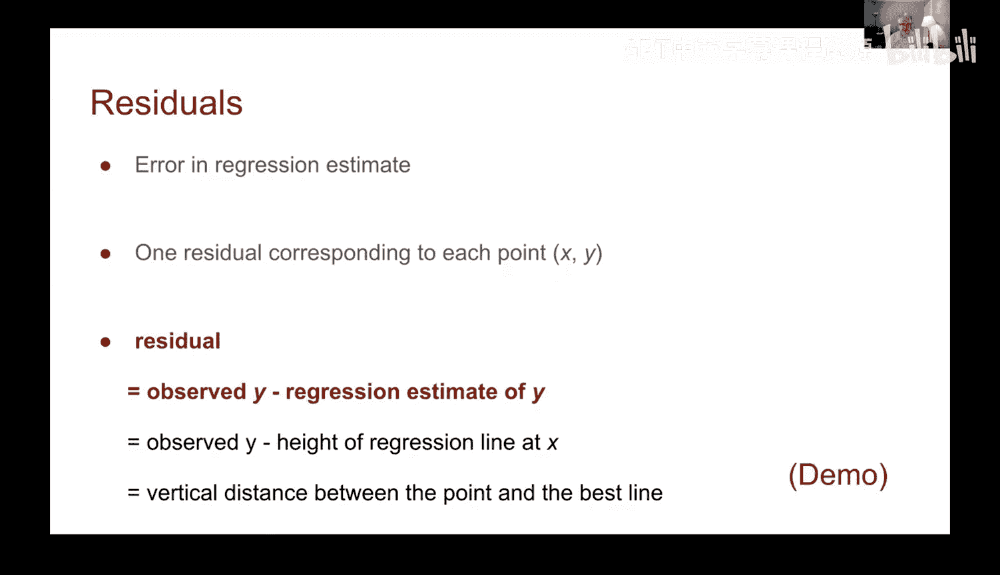
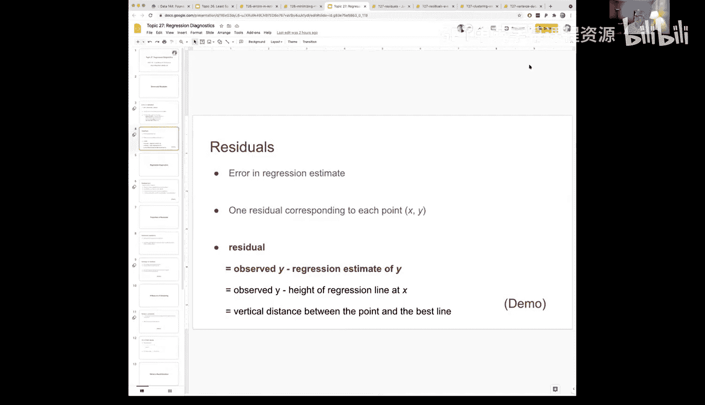
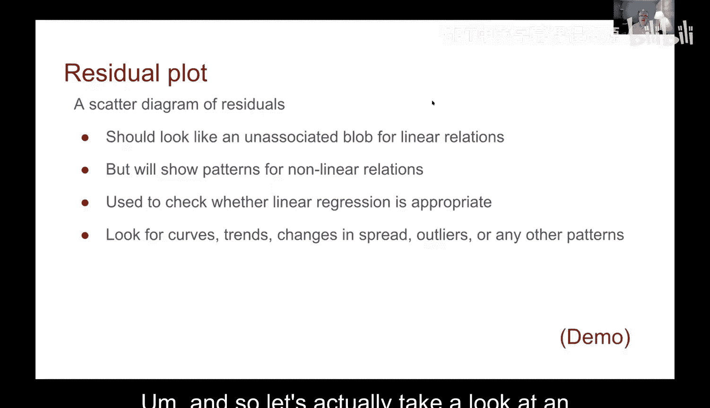
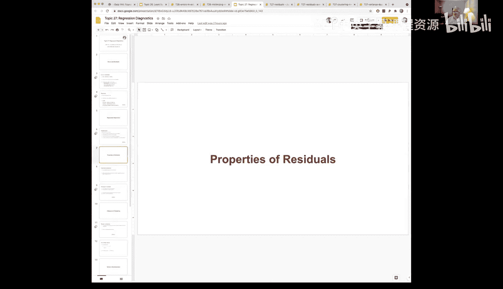
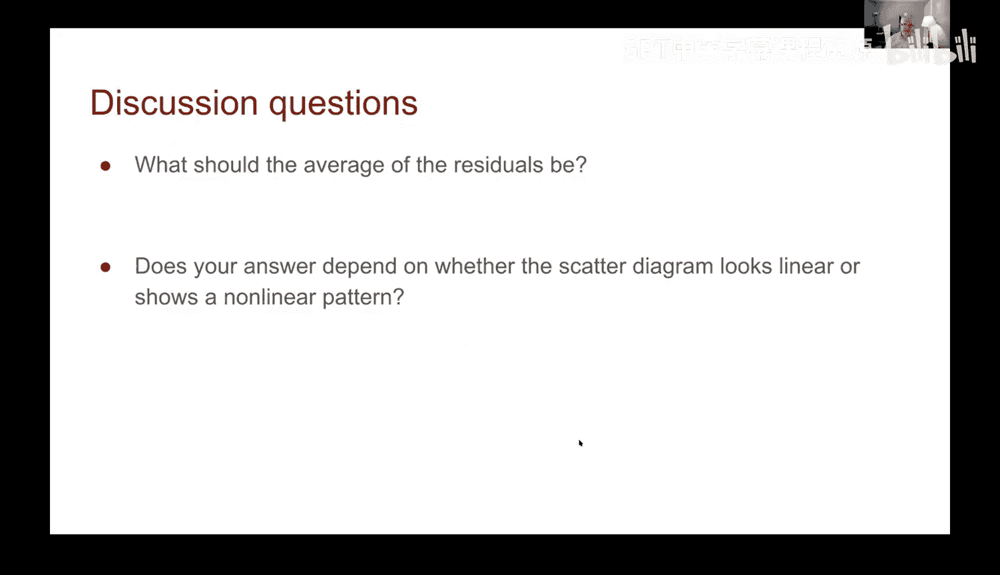
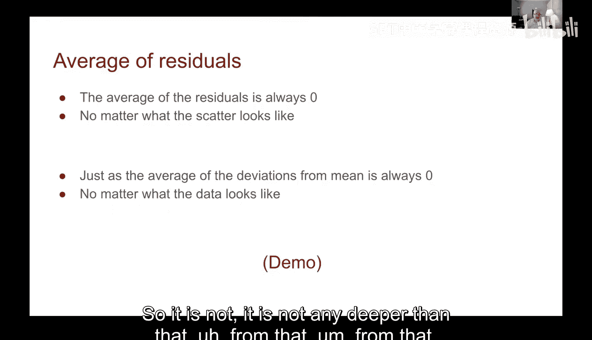
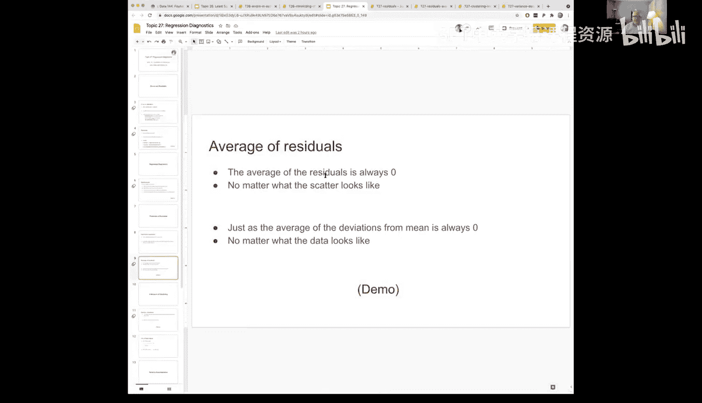

# UCB《数据挖掘和分析｜DATA 144 Data Mining and Analytics 2021》中英字幕 p79 [P79]lecture79-[T27 Regression Diagnostics] Residuals-CKWx5tRcBbE.zh_en [BV1efBEBuEVg_p79]

Okay。All right， so the next thing， so now we have this tool。

 we have this tool in the toolbox about this regression and we saw that it minimizes the regression is going to be if we're looking at minimize the root mean squared error。

 the regression slope and the regression intercept is the best we can do that is going to minimize the root mean squared error。

😊，Um。But let's actually talk about it， but the thing to remember is that this is the best we can do with a line。

And so this all hinges on the fact that the data has a linear relationship right and so at the end of the day we can just we can we can crank through the numbers。

 we can kind of you know turn the crank and we're going to get a slope in an intercept。

That will we will always get a slope in an intercept， we will always get some minimum from there。

 but that doesn't necessarily mean that there is a linear relationship。

It's just going to crank through and show and so it's always good to kind of take a step back and look at the errors and we're going to introduce this concept of residuals so we know about the errors because we just talked about that and we're going to use like I said。

 the root mean squared error。😊，From that and so the residuals is just another way of looking at the error okay and it really is is that we're going to look at the error in the regression estimate okay and and so for every for every data point that we have we're going to have one residual。

😊，And it is simply going to be the observed y minus the regression estimate of y okay so we're just basically kind of looking we're looking at we'll take a scatter plot of the the error from there okay。

 and so this residual。Is also going to be the height of the regression line at x okay from there and so we're basically kind of looking at the distance we're looking at the distance between the best line right our predictor and the actual point itself。

😊，And let me show you， and this is a case where a picture really is worth a thousand words。😊。

Um。🤧Okay， let's see do what did we add to our toolbox all of those look good right so the state all of those are the same so we added the fitted values to our toolbox right so this is going to return。

😊，Our our our our prediction using the regression slope in the intercept and then so finally this is this is new right the this is going to be this helper function is going to compute the residuals for us and again it's taking the same generic format of our table X and y。

😊，And all we're doing here is we're taking we're getting our we're getting an array of our predictions using our fitted values function and we are just looking at the。

The difference between the actual。Value we observed value and our predicted our prediction from that Okay so that's just that's all that the residual is and it's just the difference it is just the difference so you're going to get positive and you're going to get negative values from there。

😊，ButOkay， let's go back to mid parent Heights。🤧。And we're just using the functions that we already have to build up our table nothing new here so these are our fitted values right these are our predictions and then this is just the residual So this is you can see it is simply。

😊，It is simply the child right minus the fitted value from there。Okay， and so。

We can now look at the correlation and so if we're looking at the correlations so we're taking our height stable so we're looking at the correlation between the mid parents and the child right so and we should expect to see some correlation here so what's the correlation between the mid parentent height and the child we've looked at that before and that's like around 0。

32。😊，Okay， and then we can。😊，Again， this is and so what I'm doing here this will be very helpful this might be very helpful for you working on your projects and looking on visualization so what what did I do here so here's the table that I have right it has our four columns in here and so I've done the scatter plot but I've passed in the midparent column okay so when I pass in a column to scatter it's going to take that as our x value and it's going to plot all of the other columns is this is kind of the default if you just pass in the one here it is going to pass it is going to compare all of these columns it's going to do basically the scatter plot with X being our mid- parentent height right it's going to compare all of the other columns and this case it's going to be our child our fitted value and our residual and you can see right is this plot looks a little different than our normal one becauses because it's scaling right the default will try to kind of scale your。

😊，Pt accordingly and so you know this look this the top part looked a lot fuller usually but now our residuals right our residuals are just the difference and so they're going to be clustered around zero and they're not going to be that far from zero。

😊，But the scatter plotot if you give it one axis it will plot all of the other ones right and so you can see here's child and then fitted value and then residual so it's going to plot all of them from there and you can see right the the residuals are all around zero。

😊，And。Looking at the residuals can give you a good indication of how well this line is actually fitted and so in some sense。

 I wanted to show you this plot like this because so here's fitted here's our fitted value in gold right and really kind of what really is the residual it's basically if you're taking if you're taking your fitted value and you're kind of rotating if you're rotating that fitted value so it lies and scaling it appropriately so that it basically lies perfectly flat so you're rotating the whole thing so the fitted value has a slope of zero。

😊，And you can almost kind of see that right if you kind of look at if you look at the gold line and you just kind of tilt it down a few degrees。

 you get the residual line down there from there。And you can see it basically has the same shape and so when you kind of look at the plots。

😊，And so i'm just going to show you the plot individually here right so here here it is you know in its in its not squish skilled glory and then here's the residual Okay。

 and so what do you want to see you want to see if if。😊。

If the linear regression is you know if the relationship really is linear。

 your residuals will look something just like this and so what do you want to see。

 you want to see basically a unassociated blob all right that is a technical term。

 but it's going to be you know centered around it's going to be around zero and you're not going to see a discernible shape to it。

😊，From there and this is this is you know a good a good blob。From from there， right。

 this is a good indication that this relationship really is linear。😊，From there。Okay。Any questions？

Okay， so the residual plot is another tool that we have in our toolbox for seeing if this relationship really is linear and as we say right it' you know by looking at the scatter plot。

 the scatter diagram， the residuals。😊，For linear relations。

 the residual should look like an unassociated blob， you shouldn't see a discernible shape to it。😊。

It will， however， if you do haveline relationships， it will show patterns。

 it will show some type of patterns and that it will be a very so the residuals isn't showing you kind of any information that isn't there。

 but it's showing you in a format that makes it very much easier to visually discern any pattern from that and we'll look at some examples that aren't necessarily perfectly linear to show you kind of what those are。

 but this is a good sanity check to see whether the regression is appropriate or not。

And so what do you want to look for you want to look for anything that has any curves associated to it。

 any changes any any trends right if you see the kind of moving up moving down and then changes in spread right and so is for some part of the data is the errors more tightly clustered around zero for other parts of the data is it more spread out any outliers and any basically any other patterns that you see and so let's actually take a look an example where you might see some of that。

Okay， all right， so we've added now we've added our residuals helper function to our toolbox and that's just the code that we looked at in the last demo and so now we added a plot residuals as well from there okay let's pull back and look at the demographics。

😊，We saw that it was very highly correlated。😊，And if we now look at the residuals。😊。

If we look at the residuals。😊，Now you can see right and so let me pop back right let me pop back because here here was our our Galton data our mid parent height right you can see that there's not really a discernible shape it's just kind of unassociated here。

😊，You can see， right？I。You know there definitely seems to be a little more association from here right and so in particular。

 as we move to the right as we move to the right， the cluster looks like a little bit more spread out right you almost kind of if you look at the data almost kind of looks like a funnel。

 it's like a kind of an alligator's mouth， you know。

 an alligator's mouth pointing the to the right from there as opposed to looking at this right where it seemed the error。

 the error seems pretty uniform across all the different heights。😊，Here。

 it definitely seems like it's going out a little more from there。Okay。

 and so that's that's kind of that's something to kind of kind of。Kind of， you know。

Keep in the back of your mind when you look at these things from there right it's still highly correlated it's still highly correlated right remember the correlation was like 0。

81 but looking at the residuals it seems to be a better predictor you know in the lower college percentage than the higher college percentage and I guess you know kind of intuitively that kind of makes sense。

 you know。😊，嗯。I don't know intuitive I don't have any solid proof。Or theory is why that is。

 but that kind of makes sense to me。Okay， and so。All right so before we go。

 there's one last thing that I want to talk about so you can kind of look at it visually but we can actually kind of we can look at some numerical properties of that right and so I will leave we can kind of leave off with this kind of discussion question and so looking at the so again looking at the residuals what should the average of the residuals be what should be what should the average of the residuals be and does that depend on whether the scatter diagram is linear or shows a nonlinear pattern so you can kind of think about the two that we looked at the demographics one and the Galton data so what should the average of the residuals be and does that matter if the relationship is actually linear or not so take a moment take a moment to think about that I won't send you just because we have a few minutes left I won't send you in the discussion groups but I'll pause the recording。

😊。

At least。All right， while you're thinking about that。

 let let me set up the last part of the demo that I want to show you and that's where we'll end today。

😊。

Um。And so。So here is so here's our demographics right and we saw that there's a high correlation but you can see that the error definitely kind of gets a little more spread out from as we go on so let's take the average so we're going to take our residuals and we're going to take the average all right so lock in your prediction。

😊，And if we actually run this， we see that the average is zero okay and if we look at the correlation right even though the data is correlated right we're looking at the correlation between college and media income because said the data is correlation but the correlation between the fitted value our prediction and the residual is going to be zero okay this kind of makes sense right again from the idea with this error where we're picking this root mean square error so some of the residuals are going to be above and some of they're going to be below but when we take the average that's going to be zero and that turns out that this holds through this holds through that the average of the residuals will always will always be zero and that actually holds regardless of what the scatter what the scatter plot of the residual looks like。

And it's just in the the kind of rationale behind it is just the same that because of the。

For the same reason that the average of the deviations from the mean is always zero right because we're taking the average since we're taking the average。

 the average， the things that are above are going to be canceled out by the thing that are below。😊。

Otherwise， we wouldn't have the average， right， so it is not any deeper than that from that。

From that and that is we are out of time and that has a perfect stopping point I love it all right。

 so we'll pick up where we left off。😊。

