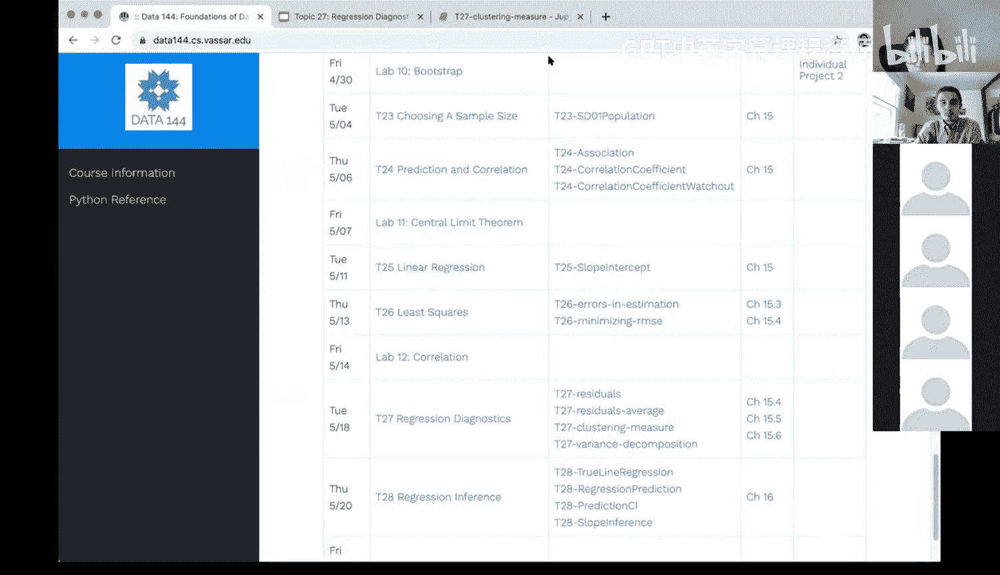

# UCB《数据挖掘和分析｜DATA 144 Data Mining and Analytics 2021》中英字幕 p80 [P80]lecture80-[Topic 27 Regression Diagnostics] A Measure of Clustering-KvqBusP [BV1efBEBuEVg_p80]

你常。

All right， so we talked about regression for a while by now okay and I would say that we started off talking about how okay let me get to that yeah。

 we started off talking about how to think about regression in the first place right like talking about correlation coefficient in the first place and then think about what regression is really doing the linear regression measure。

And so that's how we started with topic 25 okay and then we move on to talk about least squares okay so that's the theoretical foundation of why linear regression works okay so so make sure that you make that connection in your head and then I guess Thursday Jason started on talking about regression diagnostics okay so this is after you have done your regression okay so remember whenever we're doing regression there are a bunch of assumptions that we're making so we better check what we usually call diagnostics not only for regression in many other statistical data science models you will have diagnostics okay so the diagnostics are all centered around what kind of assumptions you have made。

Okay， so for example for linear regression okay let me actually this in the slide so we can do a little review of what we covered last week as well okay I guess the first thing is about the residuals right we define residual okay and then we have certain ways check residuals right like doing a residual plot that would tell us how roughly right the residual looks like okay and then for that the residual plot okay so just do recap here。

Based on the assumption that we have for the regression model in the first place。

 those residuals they should look like an associate plot for linear relation okay so you remember the ones that we have seen in the demo theyre just like randomly get around around zero so zero is another key value in this case right the average value of the residual should be zero okay that's also how it builds in into the assumption of the model but then of course the residual plot can tell us certain things like if you start to see especially we highlight here if you are able to find like curves trans changes in the spread outliers or any other patterns that might be telling you that the diagnostics of the residual plot might not be passed okay meaning that yes you can always fit your linear a regression if you want but might not be a good one to be fitted okay so that's always important so I would say that related to what you're doing for your project make sure that you check that if you're doing your regression。

okay and then whatever the diagnostics shows could be a limitation of your work Okay but of course。

 if you want to check in with us to see how you can prove it great。

 I'm just saying that right now I guess given the interest of time we wanted to make sure that you know you do need to check those diagnostics okay and then but all of our projects I think are working with a few variables so maybe they're not much we can improve in terms of modeling but at the very least you should address this limitations yeah there' residual or like I would say diagnostics that might not look satisfactory you will course you will term them as。

As limitations of your study okay so then we went on talking about properties or residual okay so this discussion question remember is while the average of the residual should be zero because that's what we how we really define how the linear regression is going right you get a cloud of data right you're trying to fit a best fit line going across it okay and then in theory if the line is working on really well then you probably have like I don't know half of the points are above the line right half the points below the line and the distance right the distance of what we're doing is what we call residual you remember okay and then that's how we're able to figure out whether whether the residual plot looks good and then that's also because the average of the residual should be zero okay and of course the residual plot tells you more than that okay about like any kind of nonlinear pattern so that would be other important things to you have to look for okay so I think we added here last Thursday like doing a demo。

Figuring all the residuals。in practice， okay， and then like like we're saying the average of the residual is always zero no matter how the scatter pot looks like。

 okay， and so that's a very important property of residual and then will be part of the diagnostics as we're saying。

Okay， so now we're ready to talk about something even more interesting than just looking at a residual okay。

 so remember when we first introduce linear regression we're having this predictor variable y right and then the outcome variable sorry predictor variable X and then the outcome variable y okay so what we're saying back then if you remember is trying to say that well if my x can be a really good predictor。

I should be able to explain a lot of the variation of my outcome。

 which is why by my X predictor okay so back then we talked about okay。

 that will be something good to be captured and then now we're ready to since we have talked about how to do linear regression and various diagnostics about it now we're able to actually quantify okay what we really mean by that okay so again the goal is you can see is that if I want to have a really good prediction I want to use a predictor that can explain a lot of the variability or variation in the outcome。

Okay， so right now like I said， we're ready to define it more formally as well as quantify it and you will see that again goes back to our oak Fri of correlation coefficient and that thing is really helpful as you can see okay so to get us started we're just going to do a really quick review of correlation hopefully everybody。

Is on top of the material okay so the correlation coefficient measures how clustered the points are about a straight line okay so remember there are certain ways that we actually like expression that we use to calculate the correlation but don't forget that the correlation is trying to well not only I guess here measures how cluster the points are but also just like the linear relationship between the two okay and we have seen examples if you remember that if like you can see a general like a positive trend of going on right like say for example in the data cloud so you know that well the correlation is fairly positive because of the positive trend okay but then the correlation the magnitude of the value of the correlation remember is trying to measure how close those data points are to the line that you're thinking about okay so you could have positive straight line going on imagining through the data data cloud but then if the data points are like kind of scatter away okay。

From that straight line then that tells us that the correlation is weak okay but if they are very close to that straight line that you're thinking about then that shows that the correlation will be high okay so again correlation is talking about linear relationship it's the value of it the absolute value of it tells you the strength of that linear relationship so that's what correlation is trying to capture and we know that we actually need to use the correlation which is the little R right to figure out the slope of the regression coefficient okay so don't forget that your correlation we first of all define it but then we use it more often than not I guess in the regression setting of how to figure out the slope value okay。

And then of course once you get slope， you can get intercept okay so so now let's see so like this statement is kind of big like I said it just how cluster the points are we know that if they're like pretty much on the straight line that the correlation is one or negative one right depending on the direction of the line yeah but now we're ready to quantify this statement okay and once more I just want to bring your attention that when we try to quantify this statement we're really trying to evaluate the linear regression model that we do。

Okay so you can imagine that if I have like a straight line going through the data cloud and then if the data cloud is you like you know like the data points are close to that line that probably gives you more confidence of the regression line right like you see that the residual are not too far away from what you have predicted right what have you estimate on the real line on the straight line whereas if the data points are far away you might be you know a little bit worried about whether they're like it is a really good thing that you're using this line so we're trying to use this as a motivation okay and then we're trying to link this to the correlation concept that we have。

All right， so let's look at a demo and let me show you what we mean by that and then we can continue with the next topic。

Okays hope let's hope this works。嗯。Okay， it does okay。

All right okay so remember what we're trying to say is that we're trying to quantify how cluster the points are about a straight line Okay and that straight line invariably is the linear regression line that we have in mind okay so put that into into the background and see what we're going get okay so now as you can see we've been doing a lot of different functions Okay so some of this you have seen it before like remember we use standard units and then from there we can compute the correlation right and then don't forget with that we're able to get the slope and the intercept okay so those are from I guess two weeks or two lectures ago and then most recently right in order to figure out the residuals we also have a function called fitted values okay so that's predicted values pretty much okay of what you have given your slope and the intercept and lastly residual is defined to be。

You know the predictive I think the observed value minus the predictive value so you wanted to make sure that we also have a function of returning the reivs okay so all of those you would load it and I will just say that also if you're doing this for your project you can pretty much copy and paste all of this okay but make sure that you know which function is for what and then use it correctly。

And the last thing we add over here is that we remember last lecture。

 we also talked about the residual plots okay so we can also write a function of doing that it is pretty standard in the sense that we are trying to create a table as you can see right and then use the scattered plot method in order to plot the residual okay。

Alrighty， okay so。For us to get a sense of what we really mean by the cluster okay so here the how cluster the data points are we're gonna to also define a new function plot the fitted value okay so the fitted value is the predictive value that you're going to see so we're gonna create a function like this it's also again you create a table and then you try to use the scatter method to do the plot okay so those are the basics again many of those have been introduced before okay we're adding more of our toolbox right like all of the different functions that we're able to do and a lot of times one is built on based on the previous one right like we need the standard units first to get a correlation right and then we need a correlation to get the slope we need the slope to get the intercept so you can see that all of the functions within them we're actually calling the previous functions okay so make sure that all of those concepts are connected。

Your all knowledge structure as well as how things are being performed using using this techniques okay all right so let's come back okay finally to the Belton height example so we can talk about what we mean by the measure of clustering okay so。

The height okay so here dont don't forget we have the predictor right the mid parent height okay the observed data okay the child's height okay the fitted value is after we have fit you know the regression line right and then we have the predicted or fitted value based on the regression line that's pretty much for any x you have you just find the value on the straight line that you're a fitting okay meaning that for a particular x value we do x times the slope right and then plus the intercept then that would give us the fitted value okay and then lastly from there we define residual okay meaning it's the observed data observed value or observed value here minus the fitted values of each value okay all right so now we have a table okay or four different columns the predictor。

The observed data y， okay， the fitted value y， and then the residual for each record。

and like I said here for this demo we're trying to quantify the statement right of how clustered the points are about a straight one so how are we're going go about it we' first of all going to plot the fitted value so this is the new function that I mentioned okay and it's nothing really fancy as you can see here right like pretty much you have the mid parent on the x axis okay y axis is the child's height either the dark the blue color for the observed data right or the。

Yellow one for the fitted value Okay on the Y axis。 Okay so what we're doing。

 So this is the straight line that we have fitted Okay so not surprisingly。

 the fitted value is lying on the straight line。 there are some like it's not it's not a continues because we're actually fitted for each record right so like say here between this record and this record between this fitted value and this fitted value there are no you know no mid parents height in between right that's why we don't have the line but a lot of times if you remember for the linear regression where we're just going through a straight lines is to just to demonstrate what it means okay but when you're trying to do the fitted value because the fitted value is based on the actual record right So if you don't have any records in this particular range then you would never get any points over there okay but regardless this dotted line okay should overlap with our regression。

Okay， and then here we're just trying to show you that this is another way to show this and remember we can always get this once we subtract it right to get the residual we get the residual part like what we did before Okay so this is we're ploting the fitted value because。

As you can see here we're trying to quantify how cluster the points are about the straight line okay and this straight line is being。

 as you can see expressed by the started line of the field of that okay so we're trying to put this two together so pretty much what we're trying to do is if you look at this plot we know that this started yellow line is the linear regression line thatre fitting right and then we're trying to quantify how cluster those actual data points are around this line。

Okay so we're putting everything into this visual and then trying to figure out what we do okay so let me show you something may be a little bit surprising and then once once we get through it we might be able to maybe go back to the math to see it does make sense in theory as well okay so what I'm proposing okay is creating or calculating the predicted values which is you know the fitted values I'm trying to compute the standard deviation of it okay I'm also trying to compute the standard deviation of the observed value okay without doing any calculation first I guess if you look at it which one do you think is going to be larger。

The standard deviation so the first one is the standard deviation of all of the blue dots。Okay。

 and that's the ob predicted standard deviation， okay， and then the observer stand， oh sorry。

The blue dots are the observed standard deviation right because that's the observed data we're trying to get the observed standard deviation the prediction standard deviation is the standard deviation of the fitted value okay many of them are overlapping okay as you can see okay so my question for you is that before we doing any calculation as you can see we're using themp dot STD function okay and so I was not surprised like it's not something really fancy but I do want you to think through which one do you think is going to be larger。

The standard deviationviation of the predictions， which is on the Fi value。

Or the standard deviation of the observed data， which is the yellow it sorry is the blue dot。

Standid deviationation， don't forget is measuring the variability， okay， so between those two。

 what are your thoughts？Either you can speak up or type in the chat， maybe you can just say， okay。

 I'm just going to ask which one is higher， the predicted standard deviation or the observed standard deviation。

you want。In the chat， maybe。Stand aviation is the viability。はい。And which one is more variable？

The observed。Yeah the observed right yeah thanks yeah so the observed as we can see clearly from the plot okay。

 but also just like conceptually imagine the observed data is whatever it is okay。

 the fitted value that we're doing again is the best fidget line that is going through the data cloud。

😊，Okay， so the fit of value is， as you can see， like I said。

 all of this are like duplicates right for all of those records they're all at this。

Okay so that's why you're gonna have many duplicated valuess on the straight line because in fact。

 while we're trying to compute the standard deviation of the two sets of data。

 they should have the same number of observations right it's just whatever the number of observations so as just discussed okay so the observed standard deviation is gonna be larger so not surprisingly so let's just compute them both okay one so the predicted one is 1。

1451。148 okay and the observed is almost I don't know3 times more okay three times as large as the。

Of the predicted okay so maybe youll be wondering why do I care about that again we're trying to quantify how cluster the data points are okay so standard deviation is one way to measure the variability as we know okay so now i'm going to show you a seemingly surprising result okay so if I do take the ratio of the standard deviation of the predicted values okay with respect to the standard deviation of the observed data value which remember we're saying that one is three times three more three times more than the other so like when we take that ratio is about 0。

3 is okay0。32 okay and the surprising result I'm showing you here is that it is very very close to the correlation。

Okay to the correlation of well we're not even feeding the line in the first place right remember the correlation we only need to know the standard units of the two variables the predictor and the outcome right and then we're able to get the correlation Okay so i'm showing you this for now okay if you're not convinced let me show you another example this is just a hybrid。

Car data set okay we have a vehicle type the make here。

 MSRP acceleration measure MPG and class okay and what we're doing here okay is well I'm fitting the acceleration okay let me see I'm using the acceleration of the predictor for the miles per gaplon okay and here you can see that it's a downward trend right the data points。

As you can see， well we don't have that many compared to before， okay。

 but also maybe maybe there are some deviations going on like if you were to do a residual plot。

That's over here Okay so again well the expectation is on zero so that's all good okay and it seems that if I look at it okay。

 this might be suggesting that the regression。Line might not be a really good one to be fitted okay so this is one type of like what we're saying that you should be looking for like curves or any kind of like。

Fanning effects okay， so here it looks like okay， if the acceleration is low。

 there are more variability okay， if the acceleration value is high。

 there is less variability of residual but we know that for the residual or like for a residual plot as a part of diagnostics we know that we want to we want to see a residual plot that we don't do not see any kind of trend okay。

 so this one might be suggesting a little bit okay but let's let's don't worry about that now because for the goal if you remember I'm trying to show you that the correlation。

Of the correlation value will be actually the ratio of the two standard deviations that we talked about okay so here I'm doing the standard deviation of the feedd value remember over the standard deviation of the observed data okay and when I do that ratio again it's very close but of course in this case the correlation is negative okay but the actual value of it is well in this case actually exactly the same earlier is a little bit discrepancy I think in the I don't know the 20th decimal point but this one they're exactly the same okay so the conclusion we're trying to show you here okay maybe you can like by this idea first and then maybe ask me questions of why later no matter what the shape of the scatter plot okay the standard deviation of the feed value is a fraction of the standard deviation of the observed。

Okay， and the way that we have done it as you know。

 in Python is that we're able to compute the standard deviation of the theta value right put it aside okay we're able to compute the standard deviation of the observed data。

 the outcome variable y and then we take the ratio and then regardless whether you have a positive correlation or negative correlation。

 you will get the ratio of this two as the absolute value of the correlation。Okay， and that is。

 so one other way to put it this is the SD of the fitted values is the absolute value of r times the SD of the outcome variable。

This I would say maybe come to a surprise like well why we would have like say the fit values we compute the standard deviation and then for the observe we come to the standard deviation how come the ratio exactly were very close to the correlation in practice okay the absolute value of the correlation okay so that actually will be a question that I really want you to think through even if you don't ask me I'm going to ask you I guess in this case and I do want you to take a moment and again I would do a breakout room for that and my suggestion will be if you go back to maybe the last two lectures slides okay to see how related the slope。

As well as I guess let me bring this way how are the correlation is related to the standard deviation and I mean the standard deviation of the two different values okay so I guess in particular 25 will be more relevant so I will just say that feel free to check that out and I will do a breakout room just to get everybody start thinking about all of this so I'm showing you the next slide which is just repeating the result on the slide instead of on the demo okay so what we have observed like I said is that this S the standard deviation of the theory values is a fraction of the standard deviation of the observed okay and in particular that fraction is the absolute value of the coefficient correlation coefficient okay so any thoughts like where do we see this before like say you know the ratio of the standard deviation seems to be like working together with the correlation coefficient where do we see that anyone？

Or like based on your discussion in the breakout room， did you have any？

Aha moment of why this is true when we demonstrated it on on the。On the demo， anyone？Okay。

 so the ratio， okay， we're talking about the ratio of the fitted values over the ratio of the standard deviation。

 okay？So if we come back to this one so this is topic 25 I don't know if everybody got the chance to get or maybe you remember the expression deepping your heart so this is where we have seen at least some kind of R and standard deviations working together okay and that's how we actually come up with the slope okay of the regression lines remember correlation coefficient is still relevant okay and then。

When we're trying to get the slope， okay in particular。

 we're using R times SD of y over SD of x okay， whereas right now what we're talking about is the SD of the fitted value over the SD of y。

So it's not exactly the same， okay， it's not exactly the same but we have seen before。

But I want to bring your attention that the SD of y here in the numerator is what we have here in the denominator。

 okay but what's different， like not only like the order is flipped。

 but also here we're talking about the SD of the fitted values。

 whereas here we're talking about the SD of the x， which is the predictor。Okay。

 they seem to be irrelevant， but I would just drawn to draw your attention to how we can relate the SD of x with SD of fitted value。

Okay， so remember the fitted value or like the predicted value that we have done。

 so maybe was there be other。Maybe yeah maybe we don't have like expression over there or remember okay we have here sorry just up here the estimate of y which is the fitted value okay we're using the interchange B okay。

 it is the slope times the x okay and then plus the interect。Okay。

 so if you if you think about it slope is going to be whatever a constant that you compute okay intercept is another constant that you will be able to compute from your regression line okay what this is saying and we're trying to emphasize when we first introduce linear regression is that the regression is only talking about on the meaning。

Okay， and then moreover。If this is a constant， okay， this is a constant。

The variability of x is kind of translated into the variability of the estimated y。

through this slope constant。Okay so that will be the main math behind okay like I said。

 is not required for you to really derive all of the steps and that's not our goal and we're not showing the steps either。

 but I just want to show you that we did in the past talk about the ratio of observed y over the fitted y but not exactly in that format okay we're talking about the SD。

 the ratio of the SD of the observed over the SD of the predictor okay what I was trying to say is that here okay it is telling us something related like how x is related to the fitted y or the estimate of y okay and then it's not a surprise I guess the bottom line I'm trying to go across here is that it's not surprised that this ratio is R the absolute value of R okay and this is one feature of how linear regression comes up okay and for us。

More importantly， I guess than this method or than this particular racial result that we're showing is that we wanted to make sure。

 okay， so the bottom line which we' going to lead to the next topic here is that we want to make sure that this ratio is high。

Okay， in a sense that well we know that if the correlation， well if the correlation is high。

 then the feed of value probably sorry the linear regression probably will work well Okay。

 we know that well they are closer to the straight line that you think you will go through it and that is manifested by the absolute value of R okay if it's larger and closer to one then we know that well the fittedta value will be not very far away from the observed value Okay and that brings down the residual right and then that gives us more confidence in terms of how the linear regression is doing Okay so here we have talked about this ratio is R absoluteps value of R okay and next were going to。

Talk a little bit more about well instead of working with standard deviationviation we can also work with variants okay so again variance is the squared of the standard deviationviation or like standard deviationviation is the square root of the variant and we're introducing here。

Mostly because like I said at the beginning of today is that for us we want to use a predictor that can explain a lot of variability of the outcome okay。

 so while S is standard deviation is one measure of variability but the math doesn't work as well if we work on the variance so I'm going to introduce the variance aspect of of this and then they're related of course because variance is just the。

Standard the square of the standard deviationviation， Okay， so let me。

哦。