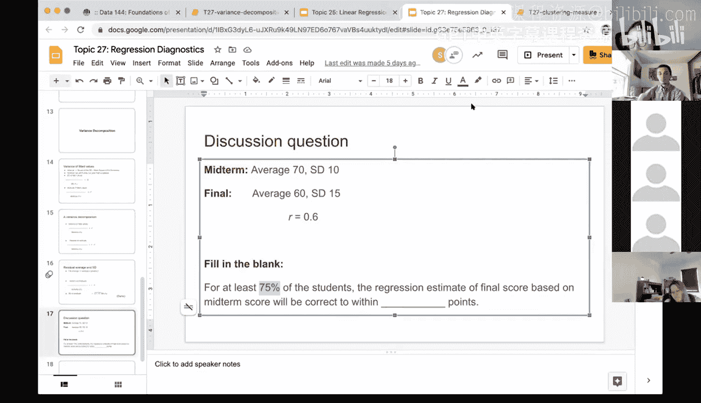

# UCB《数据挖掘和分析｜DATA 144 Data Mining and Analytics 2021》中英字幕 p81 [P81]lecture81-[Topic 27 Regression Diagnostics] Variance Decomposition-3mLSbiDe [BV1efBEBuEVg_p81]

New one， Okay， all right， so this part of the lecture is very related to what we just talked about。

 Okay， but right now we're trying to put it into a。

Into a various decomposition concept。So the variance of the fitted value， okay。

 this is what we know already SD of the fitted value over the SD of y is square is the absolute value of R right and then if we take the square on both on the numerator and the denominator and also on the right hand side。

 we get the variance of the fitted value over the variance of y which is r squared。

Okay so this is algebra okay and like I said， we focus on a variance because later on you can see that the math works out even better than the standard deviation。

 but they're highly related right they're just like a square root and squared relationship between those two and what we're saying here is that while we're just taking the squared everywhere so we're able to get the variance to theta value over the variance of y is r square okay so imagine。

Earlier I was saying that well， the higher the value of the absolute value of R。

 the better the our feeding is being done right because you can see that well the fitted values will be pretty close to the observed value okay so in other words we're now trying to explain all of this concept in terms of variance okay but then we have the square term over here。

Okay， and again， the higher the value of r square the higher the value of the absoluteps value of r。

 the higher of the value of r square as well， okay so at the end of the day we want to have a high value of r squared and what we mean by that put into plain English is that the variance of the fittedter value can be explained can explain a lot of the variance of the y。

Okay so this r squared inevitably going to be between zero and1 okay if r square is very close to1。

 then what we're saying is that the variance of theta value is very close to the variance of y right so whatever is not being explained of the variance of y is very little okay when that is very little what that tells us is that the linear regression is able to explain a lot of the variability of the y already。

Okay， so that's what we mean by， well， that's probably a good model to be fitted， okay？

On the contrary， if you have r squared to be very close to zero， okay， that is to say。

That is to say that the variance of the fitted value can only explain very little of the variance of y。

Okay in other words， much of the variance of y cannot be explained by the variance of the value if r square is small。

 close to zero， okay， when that happens， well， you probably want to find another better predictor because you do want to use your predictor that can be explained that can explain a lot of the variance of y。

Okay so that's the concept and then the reasoning behind okay so if I do one more step of math over here。

 okay， so the top is what we know variance of the values over variance of y is r square okay。

 it is actually equivalent to say that the variance of the residuals over the variance of y is1 minus r square。

Okay， so this statement， as you can see， is that we're saying the variance of y。Has two parts， Okay。

 it's one part of it is the variance of fit and values。 Okay。

 the other part is the variance of the residual。Okay they add up to they add up to the total that's why they had this math relationship okay so right now I'm telling you this is a fact okay but as you could imagine soon we go to the demo and then I will just demo to you again because again once we fit the regression line right I can compute the variance of y no problem I can compute the variance of fadeta value no problem I can also compute the variance of the residuals right once I get the residuals so I can show you that they do add up to like say the variance of theta values and the variance of the residual they add up to the variance of y。

And once we get that， like I said， hopefully it starts to make sense to you of why we really want to have a high level of a high value of r squared like I said。

 the variance of the fi values is what's being captured by the model okay if that is a big chunk of the variance of the outcome。

 then that tells us that our linear regression model is able to explain most of the variance of the outcome。

And we do want a model like that right like you do want to figure out like a predictor that can work really well so whenever I'm doing prediction Ill have high confidence of how good the prediction is going to be right as well how much the regression line can explain how the outcome is behaving okay so with that in mind let me just double a check we get to the part of the demo okay yeah it was not showing up let see。

Okay， maybe I just need to show everything here because there is a yeah anyway it's not the best practice of doing math using slides。

 but anyway， so here just just to bring us back to what we know already。

 the average of the residuals is zero okay and now we know the relationship right between the variance of residuals and variance of y that ratio is one of r square so what this is also telling us is that if I'm able to get the standard deviation of the residuals is going to be square root of one minus r squared times the standard deviation of y。

😊，Okay， so all of them are just like。Right now I think maybe along together in your head。

 but like I said all of those can be computed okay once we are able to fit the regression line we can compute the variance of residual compute the variance of why we compute the variance of the fitted values right so we're able to justify and i'm going just show you in a second why that is true and hopefully that can make you feel comfortable that whatever we're doing right now does make sense。

That you're able to use this kind of method in your project or future work Okay so as usual we load all of the necessary functions。

 it's a lot， but like I said， we're recycling them Okay。

 it just like the list just grows longer and longer because we're using so many different we're learning so many different new concepts and how to compute them and is's always a good practice to write them into function so we can always use them more easily Okay already。

 so the variance decomposition we come back to the Galton data set Okay。

 so this is already just like what we did before， right。

 we have the mid parent that's the predictor Okay that's the X okay the child column that's the y okay。

 the observed y the fitted value is the estimated y okay。

 the fitted predicted y and then the residual right is whatever the difference between the observed and the fitted okay。

All right， so let's do some plotting。Okay， so this is what we did before Okay we have the shell and that's how we were talking about the relationship between the standard deviation right like we first of all noticed that the standard deviation would definitely be larger for the observed compared to the predicted and then we're realize that that ratio becomes absolute value of the correlation coefficient okay so right now we're trying to okay like I said we already talk about some of the results like mathematically in the slides and now I'm trying to demonstrate it using using Python to justify it okay so what I'm doing here is nothing fancy just add a vertical line of showing where the mean the average of the observed data is okay so half of them not around half of them about around half of them below okay so the variability okay I plot the mean because if you remember how we actually compute the variance in the first place we're looking at how each observation is from its mean okay we take the squared of that and then take the average。

of all of the square values so that's why it's important to think about the average okay even though well we're going to use Python to do the calculation for us。

 but variance is trying to capture so variance for the child。

 the observed child data points there will just be the average square distance of each record to this。

Okay， all right， so with that in mind well。We don't need to do too much complicated stuff because remember the standard deviation is the square root of variance right so if I take the standard deviation and then squared that I will get the variance okay so the first part I'm doing is the residuals okay so remember this is the variance of the residual and I compute it its 11。

479 okay so that's this part okay the variance in residual part okay now if I'm trying to get the variance of the fitted value right that's the same as I do the standard deviation and then square that okay that gives me 1。

12 okay so that's the variance of the fitted value。Okay。And the last piece like I said。

 is the variance of the y which is the observed Okay。

 so let me compute that using the standard deviation first okay。

 so that's the standard deviation of the height the column of the ch right and then square that so let me do that okay that's 12。

797 okay and then just right above it I added I can do either way。

 I guess so right now if we try to verify if this is true we simply add those two together to see equals to the last one。

Okay， and the way to do it， well， just use Python as a calculator and you can see that it's fairly。

 fairly close。Okay， so this is what we mean by well。

I hope you can be convinced using this numerical verification okay but at the end of the day。

 as you can see that the correlation coefficient is really important right in linear regression okay we use it first of all。

 if you remember to compute the slope okay and now we start to use r or absoluteps value of R right to show how the standard deviationvation of theta value over the standard deviation of y is and now with squared of that which is r squared we're able to explain so let me just come back to the slide really quick we're able to explain。

😊，The amount of the variance of y can be explained by the variance of the fitted value okay and the one last thing that we did is that well。

 because the sum of them right the sum of the residual the sum of the variance of the fitted values。

是。the sum of the variance of3D values and that of the variance of residuals equals to the variance of y right and because of that we're able to now verify that the variance of the residuals over the variance of y is1 minus r squared and then that finally gives us this result。

Okay， so R， which is the correlation coefficient， it probably does not look as important as we thought。

 I guess when we first introduced it， okay， but now I hope you start to appreciate the important role it plays not only just to understand the linear relationship。

 how strong it is between the two two variables， but also at the same time of how all of the important pieces of linear regression that we need to know many of them rely on this correlation coefficient okay。

Alrighty so the last part here is really just to demonstrate that well now we know the variance of the y is the sum of the two right and then we can also work on the residual side right so the standard deviation。

 the residual is going be square root of y 1 minus r squared times the standard deviation of y okay so what I'm doing here I think fancy so R in this case it's 0。

32。Okay， and then if I'm able to compute right using using this result。

 okay I'm doing the square root of 1 minus r squared times the standard deviation of y okay。

 which is what we think the standard deviation is going be of the residual is going to be okay using the math okay but then we can also using yeah we can also be using the actual data the residuals right and then we get the standard deviation which is very close right like only I don't know the 20th decimal point is different everything else is is the same so I hope this does justify okay what we're doing here and why we can be doing this okay。

All right， so all of this， like I said， we tried to talk about them mathematically first and then we verify everything using Python with the data set and like I said。

 if you do it without the data sets you're going to arrive at the same conclusion okay because this is。

Put in simply is just what's behind linear regression okay and whatever whichever data you're working with。

 this kind of properties stay。So we're going to end this topic with a discussion question， okay？

So while this is fictionist because we don't have exams in this class。

 we have like those individual projects， but let's just say okay let's just say in the class the midterm exam has average of 70 okay stand deviationviation of 10 the final is the average of 60 and stand deviationviation of 15 okay I'm telling you that this two variables or the two yeah the two variables x and y so x is the midterm okay y is the final we're trying to see I guess if we can predict the final use in the midterm and what the other piece of information now you know is that while it is really the correlation coefficient is really useful right so I'm going to tell you that which is 0。

6 okay the question is filling in the blank for at least 75% of the students the regression estimate or final score based on midterm score will be correct within blank point。

Okay so take some time to think about it and well what we have covered today will be definitely useful。

 okay？But the same time here， you might be wondering where did this 75% comes from。

 I would just say that check about check out the Chey chef's rule that we talked about when we going to like normal distribution。

 okay because that's where we talked about well。About certain percentage points going to be within certain number of standard deviations right from the mean Okay so this going to be a relatively I guess maybe a little bit challenging question so let's spend maybe five minutes in the breakout room and let me。

Okay， all right， so I'm going to share my screen where we have this question okay。

Any thoughts anybody wants to share what you have discussed how to I guess well there are multiple stepst of this question okay so what we have learned today is useful and like I said I had a hint of doing the Chevy chefs in order to figure out that 75% so I guess that will be the last step okay so any thoughts any any suggested approach that we can take here。

The question is asking the regression estimate of the final score。Based on the midterm score。

 which is the predicted okay or the estimated the fitted value， okay。

 will be correct to within certain points。诶。Any thoughts？

Or like even if you didn't figure out like initially how you approach this with your team members。

Anyone。It's a multi step question， so we don't need to solve everything。One try， of course。

So if you have anything to share， that'll be great。

We knew that the 75% like had something to do with like the number of standard deviations。Yeahep。

 yeah， that's 75% yeah so I also just opened actually and this Chevy chef's bounce like I typed in the announcement earlier that is related to you know how many standard deviations away okay。

 so in fact， okay， it is just going be two standard deviations away okay so for that 75% Okay so this is what Chevy chefs told us before。

And in that case， I guess with Mike's help， we are able to at least phrase this question figuring out。

Two standard deviations， right， like within two standard deviations。So。

I guess my next question for everyone is that。What is the standard deviation deviation we're computing here？

We're a given， okay， the standard deviation of x， which is 10， okay。

 we're also given the standard deviation of y， which is 15。

Have we use any of those two standard deviations？Or we're trying to do something else。Any want。

So we do know the standardni deviationvation of x， okay， standardnivation of y。

The question is asking the regression estimate of the final score based on the meter score will be correct within in this case two standard deviations。

 okay， so what does it mean to be correct within what standard deviation？If it's correct。

Or like 100% correct painting that， well there there's no residual， right。

 the predicted value is perfect。Perfectly fitted with the or the fitted value is perfect for the observed data。

Okay， so。If we take that as well， being correct， like 100% were like absolutely correct。

Then we can probably figure out that what this question is asking now we know it's two standard deviations。

 that standard deviation that we're trying to compute here is like two times that standard deviation and then that standard deviation that we're trying to compute is the residual standard deviation。

Okay， so remember， residual is trying to evaluate how close our fade value is to the observed okay。

 and then when we want to say that we want to be correct within certain bounds。

 then it is talking about the standard deviation of the residual。

And now if we come back to what we have just learned the standard deviation of residual is the square root of1 minus r square times the standard deviationvation of y okay so mathematically I guess what you can do is that standard deviation of y is 15 right I can use 15 times square root of 1 minus r square where r is 0。

6 then that will give me the standard deviation of the residual and then I times 2 which will give me be correct within how many points。

Yeah you can do that by hand， but I'm just also going to show you here how you can do it by Python well we're religious using Python as a calculator here。

 we have our R to be。6 okay。The standard deviationvation of y is 15 so the residual standard deviationvation of residual as we know is the square root right of1 minus r squared times the standardvation of y so once we compute it it's going to be 12 okay and then the second part it's a Chey she's inequality and we realized that well for us is's going to be 75% is going to be within two standard deviationvation right so we simply do two times that 12 that we compute which is going to give us 24。

Okay。😊，Yeah， so I think this question is， you know， synthesizing a lot of stuff that we've learned。

 I mean most recently the various decomposition that we talked about。

 but also like going back to Chevy chefs in quality。

 I guess that's topic 20 when we first introduce how you're able to approximate those kind of probability。

Okay so keep in mind that a lot of the especially towards the end of the semester。

 a lot of them start synthesizing， so be prepared but also I hope because we list everything on the website with different links。

 so hopefully it's easy for you to also navigate all of the previous material as well。

Alrighty， so。