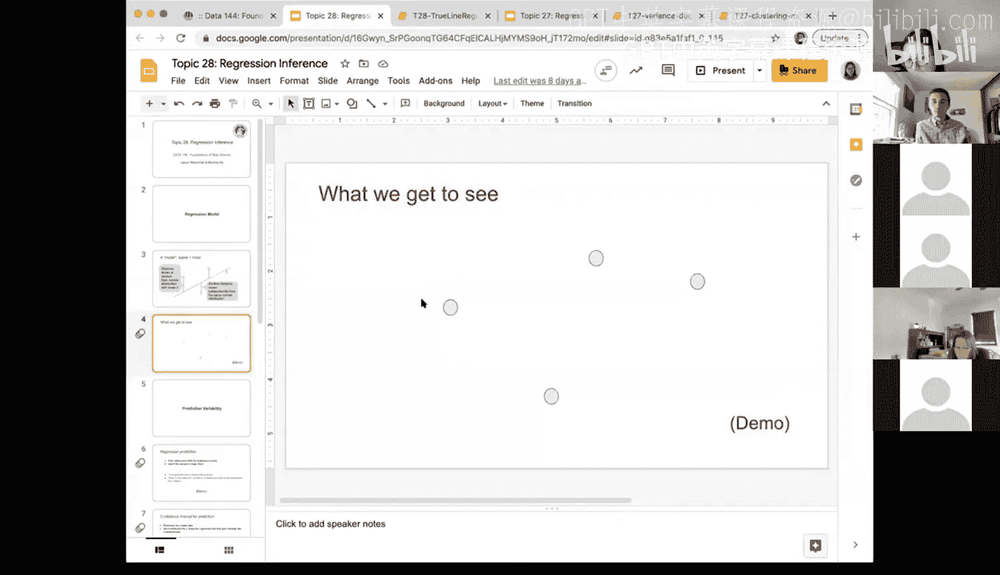

# UCB《数据挖掘和分析｜DATA 144 Data Mining and Analytics 2021》中英字幕 p82 [P82]lecture82-[Topic 28 Regression Inference] True Line and Regression Line-zbG [BV1efBEBuEVg_p82]

Okay， the remaining time I'm going to start with topic 28 okay and we'll hopefully make some progress as much as we can so on Thursday we'll have more Q andA time for for your project Okay so the last topic here is finally we're able to talk about how to use regression to make inference okay so remember the sequence like we're ending with regression we talked about why like how regression works in the first place right and then we introduced the list square methods。

And then from there we just talked about the diagnostics so the regression just to make sure that it's good okay and then lastly if you figure that okay it is good then I do want to use my regression to make certain inference and then this is the last topic okay and what we're doing here is you can see is that we're going talk about how to make prediction okay we can even come up with prediction confidence integral okay and we can also make inference about the slope which is the you know the value like the slope parameter that we're able to estimate and in this case。

You will see that we put it into into practiceice with a particular data data set， but all of this。

 like I said， could be very relevant to what you're doing for your project if you're doing a regression analysis Okay so make sure that if you do that for your project you do cover about like how to come up with the linear regression in the first place。

 how to do diagnostics and then lastly， how to do inference using the regression that you have come up with Okay so I think for today。

 maybe we should be able to cover the first subtopic here is thinking about regression model okay we've been talking about it and then we told you how you can do the calculation to get the slope and the intercept but we do want you to think a little bit more about what the regression line is really doing and in some way。

 I guess what is not doing Okay so let me。Show you this slide first， okay， let me just use。Here。

 okay， yeah。So the model of linear regression， what it includes as were saying is that well you have all of those data points right and what we're assuming is that right there is the best line。

 the least square lines right going through the cloud。

 the data cloud okay and it's minimizing all of the like the sum of the square okay so that's what we mean by the least square。

And think about it like what we're doing really is that we're going through this line okay and we are having what we know right of all of the residual okay that we are getting right residual again is defined to be the observed value minus the fitted value okay so with four data points okay we're getting well four residuals right and then like I said the least squared methods。

 the linear regression that we're doing is minimizing the sum of the squared of the residual。

And we know as part of them。Assumption as well as because of that assumption we do the diagnostics later as well。

 is that those distance or like those residual they should be from a normal distribution with mean zero okay so this is what I think a linear regression model really encompasses okay so it's a lot of stuff okay even though it's kind of straightforward just to fit the line but it does tell us a lot of stuff okay so what I wanted to think is that here okay what we're saying you probably have heard about the term signal and noise a lot in machine learning or even just in standard like statistical methods in general is that we're trying to capture the signal which is the regression line right as well as in some case that trying to get rid of the noise as much as we can but regardless for a model that we're doing you have the signal and the noise at the same time。

Okay， so the signal in our case is the regression line that we're trying to fit right the noise is the residual Okay so if I actually just tell you this four dots Okay I'm only showing the four dots okay earlier I was showing okay。

 yeah we can be so sophisticated trying to fit a line going through it， but really whenever you。

Working on problems as a data scientist， what you get is this right， you get four dots Okay。

 and you're gonna try your best to explain the variability。 Okay。

 and then we know that the method that we're talking about here is linear regression Okay。

 so I do want you to start to think that well， the regression line that we're fitting like how good it is Okay。

 and at the same time， what it is really doing Okay， so this demo。

Which will lead us to talk about the inference， Okay。

 but I do want to show you this because I think its pretty interesting and maybe willll。

Encourage you motivate you to think a little bit more about what exactly we're doing。 Okay。

 so as usual， we have a lot of functions to load nothing more than before。 Okay， just so you know。

 okay， we have the standard units correlation slope intercept fitted values and residuals Okay。

 Allright， so I'm introducing a new function here， which I really want you to I will explain it now。

 not line my line but to certain degree and then I will encourage you to check it out more in more detail later。

 what I'm doing here is that suppose I create a function here that if you tell me the true slope。

Okay， of your， you know， the slopes that we're trying to solve let's just say there is a true slope。

 Okay， we know it's the truth Okay， and there is also the true intercept Okay I give you those two values Okay。

 and also give you the sample size Okay and what we're doing with this function as you can see is that first of all。

 we're going to simulate。Some x value， which is the predictive values from a normal distribution Okay and then we also gonna simulate the errors。

 Okay， remember the errors， the residuals in our linear regression model is what they should follow a normal distribution center at the mean Okay so so we are able to simulate the errors as well so in some way if we're able to get simulated x the predictor and then the simulate errors if I use the true slope times my x plus the intercept the true intercept right and then plus the error I can get a new set of y Okay so what we're doing here。

 as you can see is that we simulate x we simulate y okay using the true slope and the true intercept Okay and what we're trying to show you is that how the sample size is playing a role in terms of how good the linear model that we're able to fit okay so you will see that once side around this model with certain true slope and true intercept and sample size we will see four different plots here Okay well I have the。

三？The true line that is with the true slope and the true intercept。

 Okay and then also what we get to see without any lines， just the dots。 Okay。

 were also gonna show you， well， with x and y， we can fit a regression line right so we are able to fit a regression line。

 So I do a third plot。 and then we do a fourth of looking at how close the true line and the fitted regression line is okay so the true line。

 as you know， is the truth。 Okay the regression line is the best guess that we can get。 Okay。

 or the best estimate that we're able to get。 So here this function like I said。

 I think is really interesting is that it can tell you， well。

 in some cases probably doesn't work really well。 and then that might be something that we need to keep in line Okay so here I'm doing two demos Okay in both cases。

 the true slope is to the true intercept is negativeify。

 Okay I'm just playing with the sample size like I said。

 what we're trying to the variable here is how sample size is affecting how close。

2 line and the regression one is okay， so let me show you the first one。Okay。

 so be prepared let's see so this is the shoe line Okay。

 and all of the dots are only 10 data points Okay， so the shoe line is going through like this Okay。

 and then without so for us。If you are doing a regression。

 this is what you're going to get okay you only get to get a data cloud okay and now the question like I said is that because with this 10 data points we're able to fit a regression line right the regression line is like this。

Okay， not exactly the same as before right as you can see like the slope and everything might little bit off if we put it together。

 we can see that well there is some pretty significant discrepancy here right。

 meaning that well if I get the state 10 data points。

 I know I was told that the true intercept is two our true intercepts our true slope is two and then true intercept is negative5。

😊，My regressionional I going to tell me something quite different。Okay。

 so this I just wanted to highlight is not a drawback of linear regression like the method itself。

 Okay the more important issue here is the sample size okay if the sample size is too small。

 you just have so many going on right you don't have enough data to support in some case and that's why we really highlight the importance of getting a large enough sample size okay so now if we try to do on 100 I think we will rest assured that linear regression is is fine okay so here first of all。

 right this is the true line okay there are a lot more data points going on okay and this is what you're gonna get what you're gonna guess to see if you yeah。

 just were given the data set and then we fit the regression line okay the estimate of the true line okay and see how close they are here。

So I'm sure if you're going to try it out， and like I said。

We don't have the chance to talk through like each line line by line。

 but the general reasoning behind or general logic behind of this function is trying to use the true slope and to intercept and a given data sample size we're trying to simulate the true line and then also do you estimate of the true line which is the linear regression line and see how close they are okay our goal here is to tell you that sample size plays a very important role so in this case I guess if it's if anything I guess related to any of your projects will be that if you are doing a linear regression or maybe any other thing that you're trying to do make sure that you have a well Ban sample in the first place right but at the same time make sure that the sample size is not too small because as you can see well even if we know the truth if you have a too small sample size the estimate of the best line the estimate of the true line could be quite far away from the true line itself okay so that could be worrisome but like I said if you have large。

sample size you should be good， so don't worry too much。

 but we're trying to use this as an example to show you that when sample size is small。

 how badly the estimate could be。Okay。Yeah， so that's all I have for today。

