# UCB《数据挖掘和分析｜DATA 144 Data Mining and Analytics 2021》中英字幕 p83 [P83]lecture83-[Topic 28 Regression Inference] Regression Inference-dcBLp1i8yW0. [BV1efBEBuEVg_p83]

Right all right happy Thursday so today is the last lecture we have today so honestly I feel a little bittersweed about that I think。

😊。

It's good that the semester is coming to the end， I think we all deserve a break after the semester after the semester we've gone through。

 but I'm sad I'm sad that things are going to be ending。

Just a little bit of logistics before we come in so we'll wrap up kind of our last topic talking about using regression to do inference and then Monica is going to come back and join us we'll give you some time if you have any questions about final projects or any questions along those lines as far as kind of the end of the semester logistics today's our last lecture we'll have our last lab on Friday。

😊，And your final projects are due Sunday nights。And so again， kind of as always。

If any of those deadlines don't， if you're not feeling great about any of those deadlines。

 if you need a little bit of time， come chat with me and Monica and we're happy to kind of accommodate kind of reasonable requests。

for that and so and then we'll also leave some time at the end for for you to work on to do your CEQs。

Okay， so let's let's pick up where we left off last time and so kind of as a as a quick review。

🤧AsAs a quick review from where we were last time， we started talking about the regression line as a model okay。

 and so the way I the way we've kind of looked at this is that we've had some we've had some data that we've collected from the population。

 we have those data points and then we've calculated the regression line from those data points and we've seen that if the relationship。

😊，Between those two points is linear， the regression line is going to be best。

 and I'll put best in quotes best in the sense that is going to minimize the root mean square error。

 that is the best line that you can draw through those data points。😊。

So that's that's you know kind of the interpretation that we've had so far another another interpretation that we can have is。

The regression line as a model。And what do I mean by that is that this is an explanation for our data。

 and so we say that that our data， the truth， the truth is this linear relationship。😊。

This slope and intercept。And that is that is the model for our data and the data that we see in the real world that that data is noisy and so if you think about the regression line as a model for generating data it kind of looks something like this we have the green line shown here this is our truth this is the actual model this is what we believe。

😊，The actual linear relationship between our data is。And to generate data。

 we basically will take this truth this greenline truth and we'll generate data。

 which is going to be noisy data and how do we generate that data is is that we're going to take points on the line on our line and we're going to create points that have some random noise added to it and this noise is special in the sense that we're going to draw at random from a distribution with an average of zero。

Okay， and so if we have this model， if we have this linear， if we have this regression model。

 we can generate data from that。And。And take a look at kind of that property as well and by the way right this is kind of this idea of thinking about this regression model that is the signal that is the truth and the data that we see is the data plus the signal plus the noise and by the way right what is this noise this noise is the residuals this noise is the residuals。

😊，From our regression and so in the real world， this is what we see right we don't actually get to see the line。

 we get to see the data points。😊，From there and so let's quickly kind of take a look at that demo again because we saw it last time。

😊。

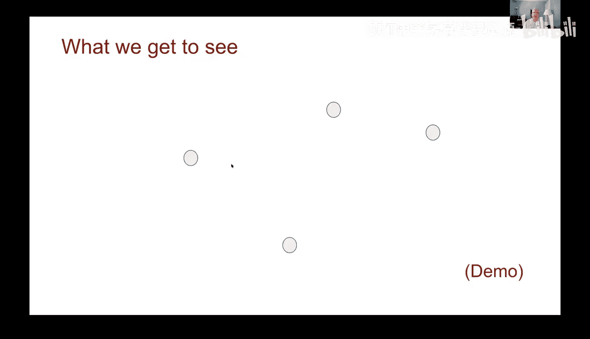

That down here。And so inside here we have all of our standard toolbox functions and then we wrote we looked over last time this idea of this drawn compare and what this function does is this gives us this allows us to pass in a line with a slope is the first argument and the y intercept and then it's going to generate using that algorithm that we just talked about。

 we're going to take that slope that line with the slope in the intercept is truth and it's going to generate and for this first example here。

 10 data points along that line with the random noise generated at random with a mean zero。

And we can actually， we can actually compare the points to the truth。Okay。

 so here's the green line is the line。The truth that we generated these data points this is what we get to see right we don't actually get to see what the underlying model is that's the model that we're trying to infer from the data and so if we have this data here and then we do our regression we calculate our regression line from there。

And so that is our estimate， the blue line is our estimate of truth and since we've generated this data from this we know what the truth is。

 we can compare the two of them and you can see with 10 data points that it doesn't it comes close but it is not the actual line itself right and if we run this again。

 we can get a different set of data points and the line will be a little different。

But we can see if we run it with more points， if we run it with 100 points。

 so now you can kind of see even just by looking at。😊。

What we get to see you can see definitely more of a trend we have more data points and so our estimate。

😊，Presumably is going to be better and so here's our estimate and then we compare the two of them and you can see you can see that they are very they are they are closer than in this case。

 but there is definitely still some difference here there's definitely still some difference between our estimate and the ground truth and then finally if we try it even with even more points then we're going to start to see kind of a pretty pretty pretty strong convergence here right you can see that pretty pretty much with  a thousand0 points that we got for this example。

😊，The two lines are very， very similar。Any questions about kind of this model。

 this regression model before I move on？Yeah。

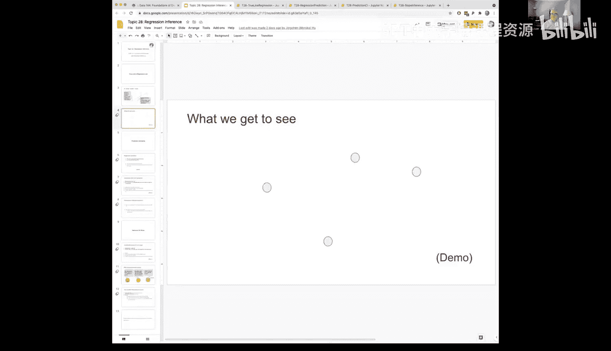

Okay。So so now we've kind of so we've kind of laid this groundwork for this idea of our prediction is going to have some variability built into it right because we're looking at we're looking at data sampled from from a population。

We generate this so then we generate this regression model and then we have we generate our prediction so one of the things we would like to know is how accurate how confident we are in that prediction。

 what are the confidence intervals of that prediction and another way of saying that what is the variability of this prediction。

And so we're going to look at techniques， how we can do that。😊。

🤧So if we have if we have a regression in line we can make a regression prediction so if the data if the data come from a regression model and the sample is large right so this is kind of harking back all the way back from when we started talking about sampling right if the sample from the population is large。

😊，The regression line is going to be true close to the true line and we saw that in that demo right as we increase the sample size our。

Our prediction of what the true regression model is was getting closer and closer to the true line。

And so。With that model right to do our prediction and this is not new right we've been doing this for a while now if we're given a new value of x remember x is our predictor。

 so if we're given a value of x， how do we predict what y is。

We're going to use the same technique that we've done before we're going to find that point on the regression line。

And then that is going to give us our prediction why。

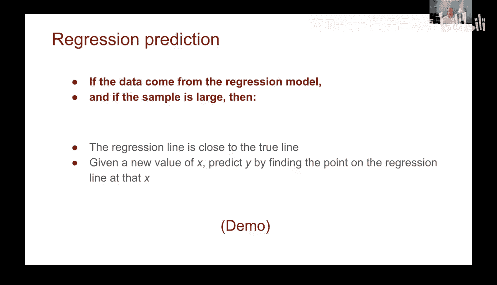

And we can kind of， we can see this。So this is so this data here is our baby data set and this is we're going to look at we're going to look at gestation days so。

And compare that to our birth weight。And so if we get this cluster， we get this cluster points here。

 and so the longer the gestation， there definitely seems to be kind of some some trend line here and so and this is going to be birth weight and ounces here。

And so we would like to see if we can predict。Given how many gestation days。

 what the birth weight of the baby is going to be。And so one thing that kind of jumps out here is that most of the data kind of falls between 200 and I'd say about 340 and we have a couple of outliers here。

 we have a couple of outliers here for these were you know babies that were premature and so let's get rid of the outliers and let's let's just focus on the on the data set between 200 and 340 and thats that seems like most of the cases here so if we just look at that using the wear clauses。

You take the scatter plotot of that you can see that that our data it's the same data it's the same shape of the data。

 but because we gotten rid of some of the outliers the data looks a little more spread out okay and so we've drawn our best fit line through that data point as well and you can see that there's probably it looks fairly likely that there is a linear relationship the longer。

😊，🤧The gestation of the baby was the it looks like it definitely increased birth weight from there okay。

 so so this is going to be our model。This is going to be our model and so now we can write a function that will do our prediction for us okay。

 and so what we have here is fairly standard from similar structure to all of the other functions that we were looking at we're going to take a table。

🤧And then we're going to take our X our predictor and our y and then we're going to pass in right so this is going to be the columns the x and y are going to be the the columns for our predictor and our prediction and then we're going to give a new X value right so this is a new value something that hasn't been seen。

😊，Before and we're going to predict we're going to predict y from this given x value and so how do we do that well we do that by computing the regression line by calculating the slope and the intercept and those are the functions that we've defined up up above and we're simply just going to take our new value multiply it by the slope and add it to the intercept and that's going to give us our prediction so once we have this function now we can make any prediction and so looking at the function here so we're giving the birth table and then our predictor is gestation values and we're going to try to predict the birth weight and here we're going to predict what the birth weight is for 300 gestation days。

And so we predict that if a baby is just dating for 300 days。

 its birth weight is going to be about 100， 130。3 ounces。🤧Okay。

And so here we can take a look at this， we can take a look at this and basically all what we're doing with our predictor is're we're moving up to the line and I've shown that as the yellow the line there and we're seeing where that point intercepts the line and that's going to be our predictor。

😊，🤧Okay， and this is hopefully this is this is kind of review for us right this is kind of what we've been talking about。

😊，For a while now。And so now the question is。The data that we have right。

 that is a you can think of this all of these data， this data cloud as a sample。

 as a sample from the population。And so how good， how good is this prediction can we make some some stronger statements about our confidence with that and so the technique that we're going to do。

The technique that we're going to do is is we're going to。

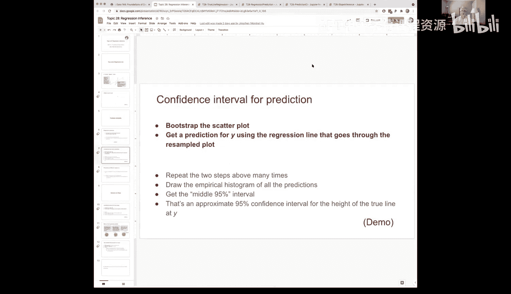

We're going to come back to our old friend the bootstrap if you remember the bootstrap we're going to。

Apply the exact same technique to our scatter plots and this all this is actually kind of kind of cool this is kind of cool and kind of amazing and it's really kind of based from the exact same premise that what we did before So if you think about what our what we did in our original bootstrapap is is that we had。

😊，We have the population and the population is too big to sample we don't know。

We don't have the resources to sample to survey the entire population， so we take a sample。

 we take a sample， and if that sample is large enough， that's a representative of the population。

And to get our confidence intervals， what did we did， what did we do， we resampled。Our sample。

With replacement right， the replacement is the key here is is that we're going to resample。

With replacement that's going to give us a new bunch of data and then we can move forward with that and that's exactly what we're going to do that's exactly what we're going to do here so we have and if you think about it right what is what is the the scatter plot that we have the scatter plot that we have is a sample from a population if that sample is large enough。

😊，It should be representative of the larger population and so what we can do is we can actually bootstrap the scatter plots and so what that means is we're going to basically resample our our table with replacement so we're going to sample we're going to take we're going if there was if there was like a 500 samples in our in our data we're going to resample with replacement 500 times and that is going to give us a new scatter plot it's going to give us a new scatter plots。

🤧And then when with that new scatterner plot we can generate a new regression line we can make a new prediction and let me let me show you a kind of where what that looks like right and so again using our the same data set here what we can do is。

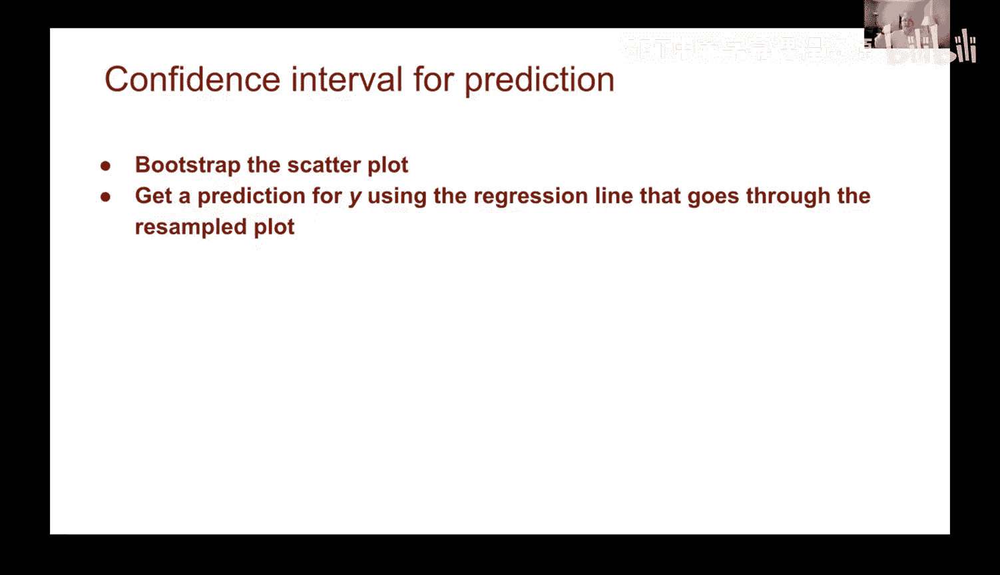

We can resample and so here's our table here and so what we're doing here is i'm just setting up some things to do some to show the plots of the scatter plots of the resample。

 but really what we're doing here is we're just calling the sample function on our table and the default。

😊，The default is is to sample as many times as there were rows in the table。😊。

And to do the sample with replacement okay so this line right here is the key this is where we're doing the reampling so we're taking however many samples we had in our original table we're resampling them with replacement and then we're creating the new table here and if you can see if you take a look at that is so this gives us a new scatter a new scatter plot and you know it has the same general overall shape as our original scatter plot the one thing you might notice is it looks in some sense a little less dense。

 a little less dense than here and then that's because we're doing resampling with replacement。😊。

And so we might be picking the same data point multiple times。

 and so the graph looks a little less dense because。

It's you know one of these points here like say the point over here that might have you know got selected a couple of times。

 so it's still the same number of overall rows in our table。

 but it looks when we look at a scatter plotot it looks a little less dense。

 but you can see it still has the same overall shape but you can see each of the plots are slightly different from one another。

And so now， now that we've bootstrapped， now we have。

We have as many scatter plots as we want and what we're going to do is we're going to do the exact same technique that we did with the bootstrap earlier in the course now that we have a new scatter plot what do we do we can make a new prediction。

 we can make a new prediction because by creating the new regression line for our scatter and then once we have our regression line we can then make our prediction and that's exactly what I'm doing here。

And this code here and so。It's the exact same thing all we're doing is is we're taking our table here so i'm just doing it four times for our four samples and then。

😊，🤧And so then and then so here's our reamp and then here's our prediction act right it's the same function。

 but I'm passing in our resampled a resampled。😊，Table from there and again making the prediction at three and we're going to see we're going to get slightly different answers each time for this。

 so our prediction will always be at three but we're going to get slightly different predictors okay。

😊，So that's kind of that's kind of the underpinnings of what we're going to do and and hopefully you can kind of see where we're going to go next with this so now that we have a bunch of now we have a way of generating as many scatter plots we have that we want by resampling our original so now we can make the predictions so what are we going to do we're going to do the exact same thing that we did before we're going to run this we're going to run this0 thousand1000 times and we're going to generate we're going to accumulate our results we're going get a and then look at the histogram of our predictions and that is going to give us a measure of our variability which then will allow us to generate confidence intervals from our prediction so that's kind of that's kind of。

😊，The big takeaway for today is is that we can use the bootstrap technique works for scatter plots we can we can resample our scatter plot generate a new regression line。

And then make predictions。We can we can look at the predictions and look at the histogram of the predictions。

 and then we can get a sense of our variability。😊。

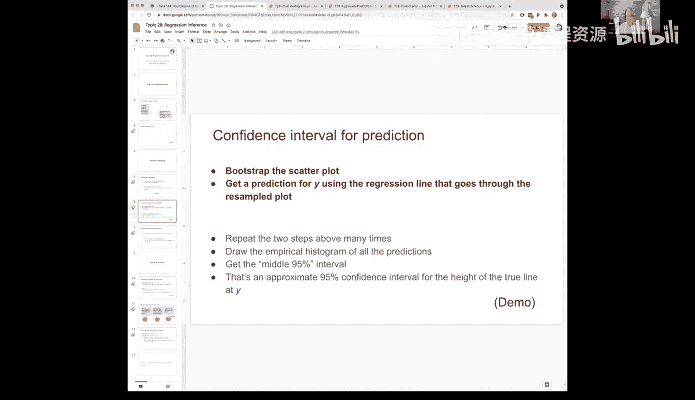

🤧So like I said， we can repeat these steps。Look at the histogram and then for example。

 if we wanted a 95% confidence interval， we'll take the middle of that histogram and that is going to。

Give us our confidence for our prediction。

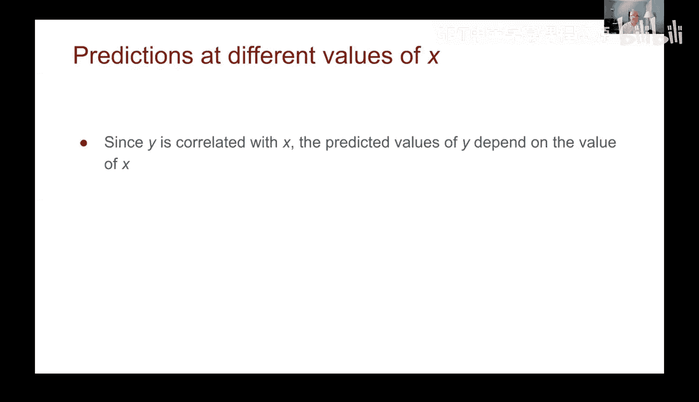

And let's put all of that together。And see what that looks like。

And so now all we're doing here is we're basically taking。

All the things that we talked about before and we're just wrapping it up in this one function here and this hopefully is hopefully all looks familiar to us because it's the exact same technique。

So what we're doing here is。We're initializing right so our function is going to be taking in our table。

 our X and Y labels here is our new。😊，Here's our new predictor the thing the value that we want to predict and then this is just telling us how many times we're going to run our simulation okay so。

😊，We make our array and all we're doing here is we're resampling grabbing our prediction and storing that in this array so we're just building up our array of predictions in this case we'll default run it a thousand0 times and then what we're going to do is once we have our array of predictions we're just going to take the 2。

5 and this 97。5 percentiles that's going to be our left and right the thing in the middle is our 9095% confidence interval and then all we have to do left is just display our results。

😊，Okay， and so now。Now that we have our boots predictor。

 which again because weve we've written it in this generic way can work with any table。

 so here we'll reload the births table and then we'll again we'll look at gestation days versus birth weights。

Okay， and so then this is again so。The value that we want to predict。

 we want to predict the birth weight with 300 gestation days。

And so now since we've run the simulator multiple times， we're getting a histogram。

And I've shown the confidence interval for that in yellow down below the 95% confidence interval。

What we can say is so the mean of this is a we predict 127。

1 ounces oh sorry no no no this is the I'm showing the confidence interval here right so we predict。

That the birth weight will fall between 127。1 and 131。3。With confidence of 95%。

 so we suspect that the 95 95 out of 100 birth weight will fall within that range and there I've shown the width as well。

And so any questions about that？This is kind of exciting。

 this is kind of exciting that we can do this。So now not only so what what have we done。

 what have we done， weve we have the ability to now to make predictions。

So if you give a new value of something that we haven't seen in the data set before。

 we can make a prediction using our regression model。And， and that's cool。 Like， that's like， that's。

 that's， you know， progress。 But what's really cool is is that now we can。😊。

We can we can say we can now kind of have confidence intervals around our prediction and we can now say with 95% probability。

🤧Here's the range of our prediction okay so now what we've done is we've quantified the variability of our prediction and that's great right？

All right， any questions so far？

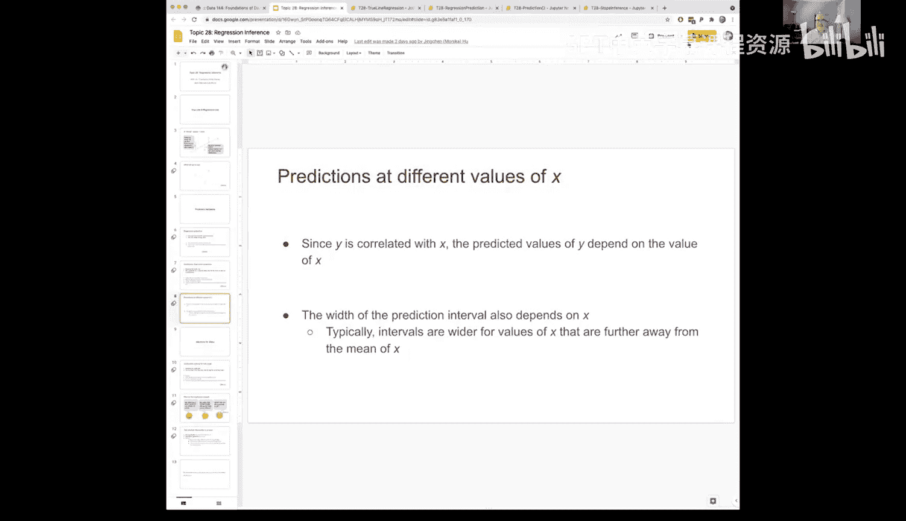

🤧So so now。We can have predictions and so since y iss correlated with x。

The predicted values depend on the value of x right that makes sense the width。

Of the prediction right so what is the confidence interval the range of our prediction also depends on x whoops sorry and what's interesting about this。

 what's interesting because what you know if we think about what we did。

 we generated new scatter plots， we generated new regression lines and you can actually look at all of the different regression lines。

And one of the interesting things about this is that all of the right regression lines that we generate are going to go through the mean of our。

😊，Of our predictor Okay， so we have all of these lines and they're all but they're all going to go through the mean and so typically because of this。

😊，Intervals。That are further away from the mean of x， you're going to have a wider range。

For predictions near the mean。You're going to have tighter bounds from that。

And so that's just something to kind of be aware of。

The the confidence right the prediction interval you're going to have actually varies on where X is and so and it turns out that linear regressions models they tend to be better predictors at the mean or near the mean。

 they tend to be they have less range and as you go further away from the mean。

 the greater variability you have in your predictions。😊，From there。Okay， so。Any questions so far？

Okay， so we looked at variability of of our predictions。

 we can actually do the same thing for the slope， we can actually kind of do some inference for the slope and we can generate confidence intervals on how well。

😊，Did did our regression capture what we believe is the true slope and so again we're going to stay right from our playbook。

re going to boots we're going to bootstrap the scatter plaque。We're going to find the slope。

Through our bootstrap and ladder rinse repeat， okay？

We're going to draw histograms of all the generated slopes。just like we did with the prediction。

 right， but we're not just doing a prediction for a particular value。

 we're now actually generating histograms of all the generated slopes。

And then we can take our middle 95% interval。🤧And so this is going to give us our confidence that the slope is actually the true line。

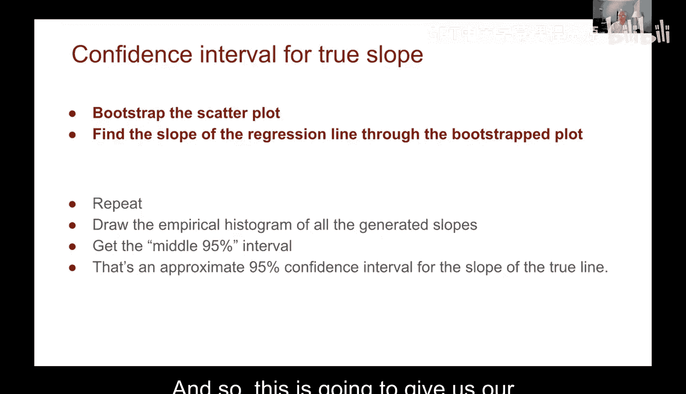

🤧Okay。Let's take a look at that。O。So again， same same tool， same。

Same playbook here and so here what we're taking a look now is the same data same data。

 but I've just plotted out the slope okay so this is this is our slope that we've gotten here。😊。

And so now what we're going to do is so instead of bootstrapping predictions。

 we're going to bootstrap our slope and the code is going to look extremely similar。

 the only thing is instead of is really just the function that we're going to accumulate here right we're going to accumulate just like we did before。

 we're going take we're going to resample we're going to resample our our scatter plot with replacement but the only thing different than what we saw last time is this function right and so what we had here for what we had before was we've made our prediction based on some value that we wanted to predict here we're just returning the slope。

😊，We're just going to return the slope here and we're going to accumulate an array of slopes。

Once we have that， we can take our confidence intervals the exact same way。By looking at the 2。

5 and the  97。5 and then。We'll here because we can look at the slope of the original as well。

 and then we can display everything okay。And so this is going to take a while to run。

 I'm going to run this 2，500 times。う。And so。Now we've generated a confidence interval for our slope。

🤧And so。Right we know in this case right if we have the data。

 this is the slope of our actual regression line that we got。

 but when we do the reampling we get this range， we get this range from about38 from 0。38 to 0。

55 it's actually kind of a wide a wide。Range there， so you may be asking yourself。

 why do we want to do this， why do we want to do this。😡，Um。Well。We want to have some confidence。

 we want to have some confidence that。

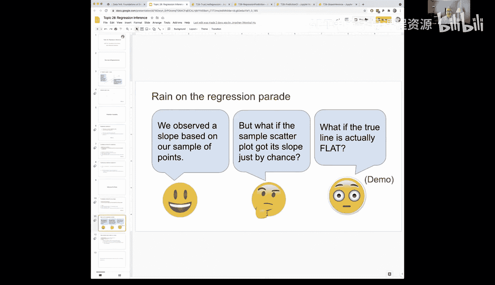

Because remember， at the end of the day， we're just kind of cranking through these numbers and is going to generate something。

And so we observed a slope based on our sample points right and so if we have a bunch of sample points we'll always get a slope。

 you know the the algorithm is just going to kind of crank through and it will always give us a slope。

😊，But what does that slope really mean？😡，Right？Is it possible is it possible if the scatter plot just got that slope by chance right this is the eternal question that we ask when we ever have when we ever have a sample。

 was that value that we got from from the sample was that due to some underlying model or was it due just by chance？

So what do we do？And what happens if the line is actually flat， okay？Yeah。

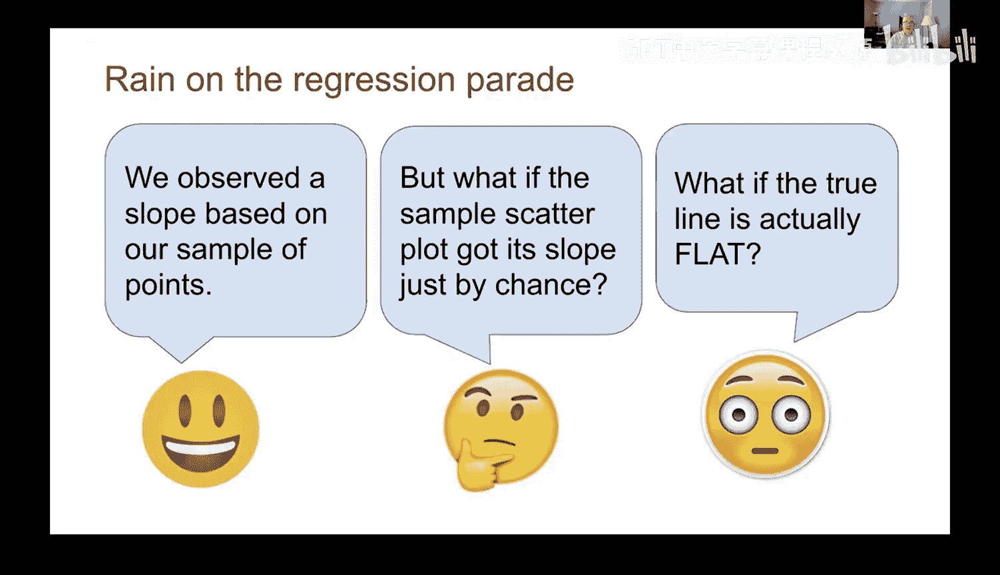

Here。So。Let's take a look at。So this is just our drawing compare before， okay。

 so this is the function that we had last from last time where。We can give a slope。

A y intercept and then a number of points Okay， so now same same same same function。

 but now what did I do notice。I put in a slope of zero， okay， so this。

 if you remember right this is our regression。😊，This is saying that there actually is no relationship there is no relationship so x has no predictive value but notice right we can even with slope zero here's our true line and it's shown at 10 because this is our intercept right so。

😊，And so remember， what do we see we see this right， we don't see this true line， we see this。

From there and if we go through when we run our estimate we generate our regression。

 notice we actually get， we get something that's flat， we get something that's flat。

 but it's not zero， it's not zero if you compare it to the tree line which is zero here。

 we actually do get something。😊，And so。We may want to ask ourselves。

 right because if the slope is really zero。Then， you， anything we see is really due to chance。

And so how can we test or see if there's a slope？Well。

We can do the exact same thing that we did before we can。

We can decide we can basically set up the null hypothesis， okay。

 our null hypothesis is is that the slope is zero， the true line， the slope of the true line is zero。

😊，And so if this is true， if this is true， if our hypothesis is true。

 that means whatever slope we see is going to be due to chance。😊，Okay。

And then of course the alternative is is that the slope the slope of the the line is not not zero okay so let's look at actually another piece of data。

 let's look at another piece of data from the same data set。

 but here we're going to look at the births， but we're going to compare the birth weight。

We're going to try to predict the birth weight， but this time instead of using the number of days gestation days here we're going to use the age of the mother。

 the maternal age okay， and so if we go and just compute that slope we can compute that slope we see that it's small it's actually small but there is a slope here right there is。

😊，This slope here and if we look at。If we look at this。

 you know there is the average looks like right a little under 120。

 but there and there is definitely some small slope so the question we may we want to ask ourselves。

Is this a real effect albeit small but real or could could this slope， could this slope be？😡。

Due entirely to chance。And so hopefully now you can see why we talked about this idea of generating a histogram of the slopes because we have a null hypothesis。

We have a way of generating histograms by resampling so we can generate a histogram of the different slopes。

 so what we're going to do here is the same thing that we did when we tested in the null hypothesis back with our data with like the mean or some other summary statistic。

 we're going to run the regression and we're going to see if if zero。

 if the slope of zero falls within our confidence interval。

If zero falls within our like say 95 or 99% confidence interval。

 well then we cannot reject the null hypothesis。So let's do that with our data here and。

Here we're going to run the bootstrap slope and we're going to and it takes time right because we're going to do it 2500 times and so。

Here now we've generated， so remember this is what we got from our data， 0。08， small but not zero。

 and here now we've generated the confidence interval for our slopes。

And we can see that 95% of the times it's going to fall from negative 01 to roughly 2。

7 and we can see this down here now the important thing。

 the important thing about all of this is where does zero lie。

Zero lies well within the confidence interval。So what that means for us is that we cannot reject the null hypothesis。

The slope that we've seen here， this 0。08 could very well be due entirely to chance。From there。Okay。

 and so that's why we want to look at the confidence interval of the slope from there。Okay。

 so wrapping up。Wrapping up。

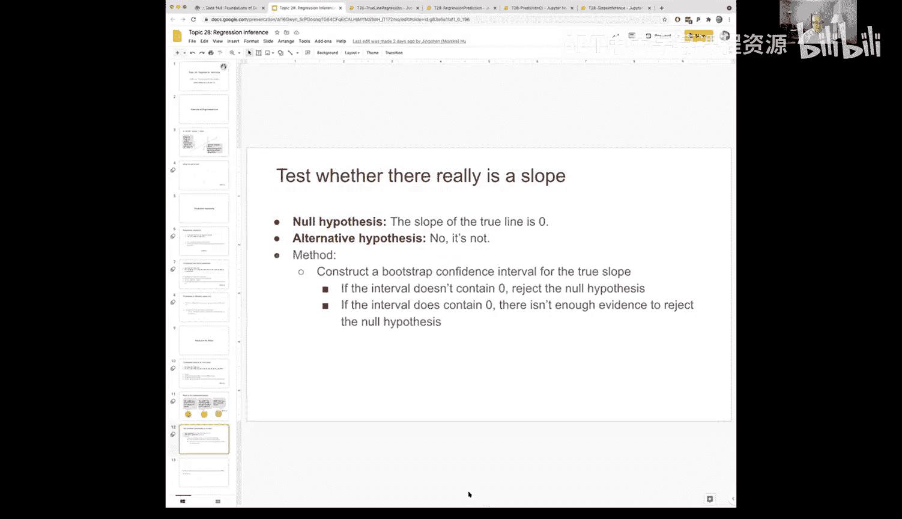

嗯。This is basically just saying what we just looked at in the demo。Our know about that this is。

The slope is zero， the slope is zero， there is there is no predictive ability。

 the slope is zero alternative is。😊，No no， it's not。What do we do， we test。

We bootsttrarappped the confidence interval for the true slope and how do we do that by resampling our scatter plot。

 you know， 100000，10，000 times， look at the confidence interval， if it doesn't contain zero。

 then we can safely reject the null hypothesis。Otherwise， we can't。

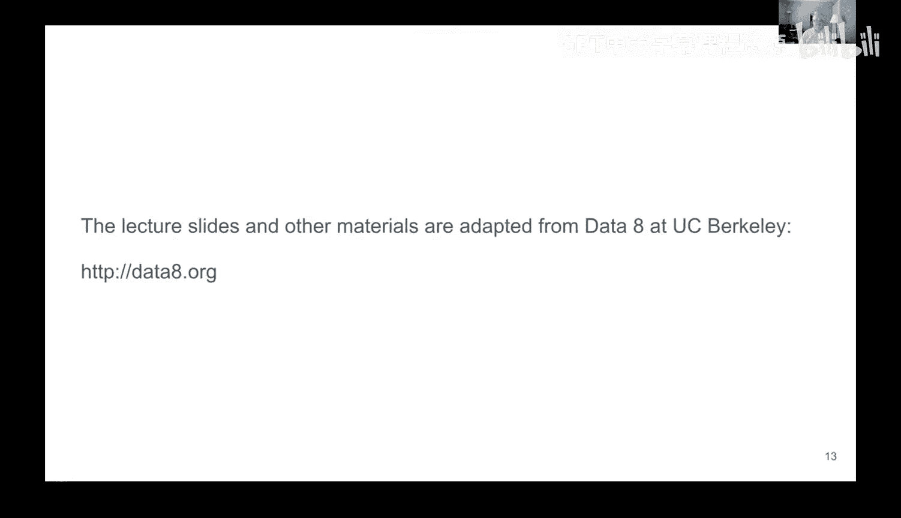

All right， this is kind of exciting。We。Have made it to the end but don't run away don't run away I know when I say we make it to the end you all run away let me bring in let me bring back monica and she'll join us。

嗯。All right， Monica should be joining us shortly， so while we're waiting for Monica， any questions？

I can stop the recording here。