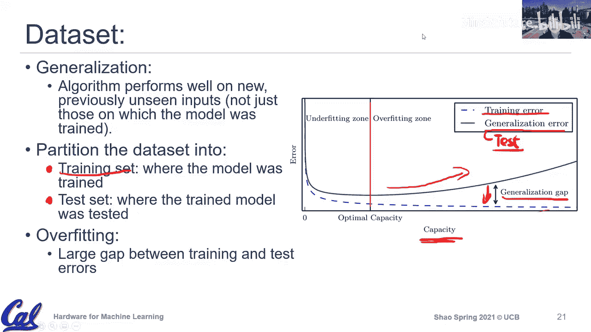

# 【加州大学伯克利】机器学习硬件技术课程 ｜ UC Berkeley ｜ EE 290 ｜ 2021 p02 P02 Lecture 2 Intro to DNNs -BV1XfM4zKETU_p2-

Okay good afternoon everyone and welcome to the second lecture of Hardware for machine learning it's great to see you all here and hope you all enjoyed your weekend and ready for the second week of the semester。

😊，And typically at the beginning of every semester we like to basically do a news splash or actually talking about some important moments that's actually impact or have a very significant influence on the hardware front and in particular on the hardware for machine learning front so in today's lecture we're going to do a very brief overview of deep learning and in particularly deep neural network architecture and since we're talking about that and this is also a hardware for machine learning class。

 I' like to actually use this today like time right before the lecture to actually talk about another class with a similar goal that happened roughly see actually more than 10 years ago so the class I'm actually going to talk about is actually one of the class at the University of Toronto happened around at 2008 so this was like around the time。

GPU computing， especially general purpose， GPU computing has gained actually a lot of momentum back then。

 So one of the classes that was actually introduced。

 there is actually a parallel computing class in particular actually doing parallel computing with coulda to actually accelerate your algorithm onto this emerging parallel hardware architecture。

 There is some like analogy actually here in thinking about our class。

 we are also like 1012 years later， instead of treating GPU as an emerging hardware platform。

 we are really thinking about even more specialized hardware platform。

 building dedicated domain specific accelerators for machine learning and also seeing how the specialized platform can actually be used to accelerate this application。

 So back then， it's a gra level， I think it's also grade level class， but fairly open ended。

 So there is some basic。Introduction of Kuda and how you can actually use Kuda to actually accelerate your applications。

 and then there is a project phase where you can actually pick your favorite applications to actually see how it can be mapped onto GPUs。

So back then， a grad student， I'm actually not sure whether he's a grad student or undergrad vaccine。

😊，Hy at U of P and the project that he is he was interested is actually to accelerate convolution neural networks on GPU。

 So again， this that was not a machine learning class。

 that was actually a hardware class and really thinking about how you can map computation onto this piece of hardware。

 and then Alex Krevsky as a machine learning student back then it's actually interesting to see this very computational challenging applications and whether it can be actually mapped on GPU。

 So that was his class project。 and after one semester of exploration after getting comfortable with Kuda and trying to map one of the convolutional kernels onto Ka he actually got very positive results So you can still read his report actually back then very。

 very interesting actually to compare that report with Alex paper， he wrote later that。😊。

She described the Alexnet architecture and also talk about the positive results that he got using GPU as an accelerating platform。

 so you can still read that paper and the conclusion was very positive。

 you mentioned that this actually he was able to actually map。

This particular kernel onto GPU and get a very impressive suite up。

 which turned out to be actually one of the early。Indications to show that GPU can be the parallel architecture of GPU。

Can be a good fit for machine learning applications and one of his next steps that to expand this to a multilayer network and then then potentially to see whether we can deliver what was supposed to be a very computational challenging problem between machine learning turning and inference most of the time has has been actual thinking about on CPU and transition to GPU。

 So after that then we had have the Alexnet paper and already posted on the course website。

 this will be the rating for this week， it's a little bit old。

 but it's actually really important to get at historical perspective of how Alexnet was designed and how it was started。

 but it's also interesting to see one of the early indicators of machine learning。

 especially deep learning can be potentially successful and we talk about the three dimensions like data algorithm and very importantly。

So we actually see that hardware aspect even as the early success of deep learning because of the GPU architecture。

 because Alex has to actually take this programming with KUa class so that he understand the GPU architecture knows how to interact with GPUs。

 he was able to actually map this computation onto GPU and get very successful result so thats after that the rest is the history and we see a lot of activities as we talk about the excitement in the deep learning side。

 but I think it's really important especially with this particular moment of deep learning and see this kind of hardware and application connections and also interestingly 1015 years ago that's when a lot of universities start actually talking about GPU as an alternative computer architecture and thinking about how we especially。

Programmers should be interacting with GPU now like 15 years later。

 a lot of universities also start thinking about it's not only just GPUs and GPUs。

 there is also another category of hardware substrate that actually being widely deployed in a lot of computing platforms。

 we also need to think about how we can actually take advantage of that。So again， for this class。

 no matter whether you are coming from a more algorithm background or more hardware background。

 a lot of this kind of successes， especially when you think about domainspec hardware for emerging applications actually require both understanding and using your understanding can be actually very useful and also very influential to think about what you can do。

 given this architecture， given the hardware and also given the algorithm that you are interested。

So with that it's a great way to actually introduce today's topic as I mentioned。

 this will be our intros or intro topic or intro overview of the machine learning and deep learning discussions will talk a little bit more the about the general concept machine learning what the underlying principles or core components machine learning and then we'll zoom into the deep learning deep learning part and see how deep learning as a particular machine learning algorithm what are their specific behaviors again。

 this is a fairly general open overview we mostly want to use to get familiar with the terminologies we do have a new lab I'll talk a little bit more halfway through the class coming up so you will use that lab as a great way to actually get more comfortable with the deep learning。

Framework and also get more comfortable with different terminologies in the deep learning community。

So with that， let's get started。So first just a quick review， so as I mentioned。

 this is radio bridge class between hardware and for machine learning and we hope to by the end of this class。

 all of you will be able to actually built your favorite hardware for important machine learning or even other categories of applications。

 all of our class info is course info is actually on the class website。

 you haven't things that already bookmark can all the information lectures slides and also recordings and also readings and where to submit reviews and labs and project info。

 all of them will be posted on the course website。So with that， as I mentioned earlier。

 this will be our overviews lecture about deep neural networks if you already have the machine learning background this will be just a very quick overview to remind you some of the core concept in machine learning this is basically one lecture but squeezing a lot of maybe 182 or 188 concepts and but if you are not too familiar with machine learning that's also okay we also want to use this lecture to actually get everyone on the same page and especially different terminologies that are actually being used in the machine learning community can also get you familiar with all the different terminologies here。

So first before we get into specifics a lot of discussion like I also hear people talking about maybe similar things or different things but they are using actually are using different acronyms so at the very beginning of today's lecture just want to set the record straight making sure that we are using the same type terminology I just give a very brief overview about all the different different terminologies to describe the field you may hear people talking about artificial intelligence machine learning deep learning sometimes they mean the same things sometimes they mean different things we'll talk about what exactly they mean and in this class context what they mean and what are the similarities and what the differences and after that using machine learning as actually the overall framework to talk about what are the important component of a machine learning algorithm and or application and then we'll actually zooming to。

😊，Deep learning to specifically talk about different terminologies。

 different mechanisms used in deep learning， and if we have time we'll talk about AlexNed as a great example to connect all the different pieces together if we don't we'll do the Alex Ned example at the beginning of next lecture this Wednesday。

So with that， let's get started。So first， as we mentioned。

 there are actually all the different names， actually。

 especially when we get to this AI machine learning， deep learning field。

 everyone has different names and sometimes they use a name to describe the same thing or different things。

 what do these names mean actually。😊，So different people have different ways to actually categorize those The one that I like most is actually from the IrishIS tutorial we' also see the IrishIS work later that's one of actually very influential tutorial in our community actually introducing people about the general idea of hardware for machine learning So they also have a very nice way actually to illustrate the difference and similarities between all the different across all the different terminologies here。

 So we'll start from artificial intelligence that's why is's actually the I guess one of the coolest one sounds really fancy right When we talk about AI and there's like intelligent there that sounds really cool So think this is a really very general term and it's really just talking about the general science and also engineering efforts to actually creating intelligence machines So this basically set up a goal that we want to have some。

😊，Intelligence in our machine。 What are the science and engineering principles that we need to design there。

 So this is mostly just a general goal of where we want to be。

 but it doesn't actually specify how we get there。 So this is just a general way of thinking this is an important part and we want to make our machine more intelligent。

 but it's fairly broad， it doesn't really specify how we exactly get there。

 What are the different mechanisms or different different approaches that can actually get there。

 So this is a very general term， I typically avoid using this。

 this is really just tell tell you where you want to be。

 but I think especially in this context in this class。

 we are really interested in how we get there we are really studying the science and engineering of achieving that。

 So when we get to actually more specifics。 The terminology that we see more often it's actually machine learning。

And deep learning。So what exactly is machine learning ML or deep learning So machine learning is really。

 I could say a more narrow subset of our general discussion about artificial intelligence this is this is one of the definition I think I like it to describe what exactly what we want to do and we'll talk about another definition that actually has more concrete really talking concrete components to talk about different pieces of machine learning algorithm So this is basically a field of study to give computer ability to learn so we there is a learning in this name right so this is not only just saying oh the computer need to have intelligence but this is actually we want the computer to learn without being actually explicitly program It's not like we tell certain things about the computer to tell certain rules to the computer to ask a computer to execute those rules or program。

Here we actually want to enable some learning so that our machine。

 the machine that we're interacting with can actually automatically in some way learn the decision making process not only just execute the programs or the rules that humans specified we'll talk about a little bit more more specific or more detailed flow and the example later。

 but this get to a little bit more concrete right this is not just the general goal of building intelligent machine。

 this actually specify that first we want our machines to learn and second instead of actually telling exact rules that the machine need to execute or the exact programs the machine need to execute we want to we want the machines to actually learn those rules or learn those programs automatically without very being very explicitly taught by by the programmers So this is actually the general。

Or specific field of machine learning。And then what about deep learning right。

 So a lot of the buzz that these days when we actually talk about machine learning is actually very centered around deep learning and in fact。

 even in this class， we are generally talking about hardware for machine learning。

 because machine learning is this very specific but also general field。

 a lot of the recent excitement， especially some of the development we discussed last week is actually mostly centered around deep learning part。

So what do we mean by deep learning， Again， this is also a fairly broad field。

 right We talk about all the skills and applications in in lecture opportunities in research and development。

 all of those different activities going on。😊，But what do we mean by deep learning so deep learning specifically I think one word you will catch here is a deep part right so of course still learn right if you have the machine learning aspect to actually learn the decision making process that we mentioned earlier without being explicitly programmed。

 but it also have this deep part， what' talk bit more of the different names actually associated with the deep learning idea。

 but the deep part is very important in the sense that typically you will see a hierarchy or network or a hierarchy and typically deep basically more than one or two layers。

 deep layers and by using this hierarchical structure that we are able to actually grab not only simple features from our or simple features。

 simple representations from our data but also build up to this more complex feature and representations。

So that we can actually make decision based on this hierarchical information so this is basically at least in our context。

 when we talk about artificial intelligence， machine learning and deep learning that what I discussed those are what we mean by those three words and a lot of today's machine learning。

 mostly especially on the development side， heavily influenced by the success of deep learning。

 there are also other machine learning algorithms are also being heavily used actually in practice。

 so machine learning is already a pretty big field， but a lot of the recent excitement。

Is actually generated by deep learning and most of our class will actually be focusing on the deep learning part。

 but in today's lecture we actually start from machine learning， just a general。

 the machine learning principles， what are the different components in building a machine learning pipeline because deep learning as a subset。

The machine learning algorithm also shares some of the similarities and we'll also talk about。

The differences later。So those are the different terminology。

 let's get make sure we are on the same page and well avoid using artificial intelligence in this class if possible and we more likely specifically using either machine learning and or deep learning to discuss what we actually mean。

😊，So those are just on the terminology front。So maybe another more intuitive way。

 at least this is my mental model when I actually think about different pipelines or different types or different categories of algorithms and especially really thinking about the differences between machine learning and also deep learning side。

 So the way I like to think about all the differences。

 especially when people talk about building AI system。

 what are the different categories of AI systems， So I would say the very early the earliest one or the most early development when people actually thinking about adding more intelligence to to our machines so that they can actually make make decisions automatically。

 a lot of those early development are actually very centered what we call。Rubbased system here。 So。

 for example， if you think about。Example of the chess playing， example， ABMs D blue。

 where they are actually able to where computers are were able to actually win the work champion in chess playing。

 So that's a really good example of what we call the rulebased system。 chess is a very。

 very good playground in the sense that you can actually specify there are limited number of rules。

 you can actually specify all those rules to the to the computer and the computers can actually evaluate how what's the implications of different move of different moves according to the rules that actually in the system。

 So this is actually very very good example of the early days artificial intelligence system or just the general when people actually trying to add more intelligence to normal machines。

 is's basically specify those rules in our system and that the computer to actually evaluate different scenarios to see whether they actually follow。

Specific rules or not。 So this is a very good example of the typical rule based system。

 if basically say you get the input。Designers or algorithm designer designers already figure out。

All the different rules in the system。 and the computer need to do is really just evaluate those rules and to figure out what are the good decisions or bad decisions。

So this is what we call a rule based system。And so far it's actually not a lot of learning right。

 we as human actually figure out what need to be specified and tell the machine again still follow the instruction So a lot of time when we actually get to the learning side。

 a more traditional or classic machine learning and pipeline or flow again。

 we take some input right we are still making doing a decision making process。

 take the input and ask machine to get the output。But in the decision making process。

 we actually enable some of the learning。 Remember machine learning actually have some learning there。

 right， so the machine is actually able to learn from some features and to make a decisions to think about how those features should actually mapped to the final output。

So in this scenario， we actually designers or program or algorithm designers or typically actually。

hand engineer some features。 Well talk about see some of the later examples before we actually pick oh。

 Some of the features may actually be very useful。 For example。

 you were doing like housing price production we know that the location matters a lot。

 the square feet of the house also matters a lot。 So we actually hand engineer some features that we think are actually very relevant to the decision making process。

 and then the machine maybe can learn maybe the relative weight all those features or whether those features are relevant or not。

 And then to map that features that we collect that we engineer as algorithm designers and map to to the output。

 So that's typical more what we call classic machine learning pipeline here。

 So some automation here right So instead of specifying the rule directly， we actually pick some。

Feature that we think will be relevant to the decision making process。

 And then the machine is actually learning those rules。

 automatically figure out what the rules actually supposed to be in this learning process。

 So there is some learning here。But typically also rely on quite significant feature engineering from the designers to pick the right features and because it's so rely on feature engineering。

 well we'll talk about even learning today also rely on feature engineering。

 but because you rely on this handpicked features， typically it's actually a small set of features。

 it's very hard to scale it's very hard to actually reason about manuallyly about all the different features so scalability is a real challenge and to actually think about all the different dimensionality of the data and how to map the data to the decision or to the learning process。

So with that motivates a lot of success of deep learning here so deep learning we talk about you will always see this hierarchy based structure right what does this hierarchybased structure trying to do we're not going to go to the details but again at a very high level a way to think about that is that this hierarchical structure is basically trying to actually figure out those features automatically so instead of rely on the designers to actually hand designign those features by using layers of abstractions or layers of network during the learning process the network itself is actually figure out some of the important features that may actually very be very hard to actually detect by human or at the human level but the network was able to is able to actually learn those features automatically and use those features to make again still mapping features。

To output， but then this feature part， a lot of extracting the features。

 figure out what will be good features are part of the learning process and are actually encoded in the deep learning flow。

So if you think about again， there are a lot of terminologies in this field。

 but I feel like those three flow charts are actually pretty least pretty useful for me to actually build my mental model to think about what exactly going on for the different learning approaches or different communities。

 what they are trying to do and what are the pros and cons actually in different approaches。

 so this is just a quick summary at a very high level， what are the different component。

 what they try to do and what's the benefit especially going to the deep learning we talk about the scalability part and also this kind of automatic structure of features using this kind of hierarchical layers doing this automatically to simplify the decision the learning process or what I like to call the decision making process。

😊，So before we move on any questions， comments。Again， feel free to use。

Just unmute yourself directly or you can also type your question in the chat window。

 I'll also be looking at the chat window during。Here in the lecture。Okay。

 so we talk about this kind of general overview here， a very concrete example。

 especially when we get to a deep learning side， so a lot of cases is' still actually very hard to actually like decode all the different layers and what they are trying to do but at least for some of the computer vision for some of the algorithms it's actually feasible to see what the network trying to do here so this is one of the very interesting example that we actually see whats a very simple network only like three hidden layers here like。

😊，Like one thing we mentioned before with deep learning you always see this kind of layered approach right so that's a deep part this is not particularly deep and we're talking about three hidden layers。

 but one thing with deep learning just you see this kind of hierarchical multi layerer structure。😊。

As we mentioned earlier， so instead of manually actually engineer features。

 which require a lot of like manual process here， so always deep learning actually a lot of feature extraction actually being done automatically and not only that they are actually also built。

😊，pon each other so you can actually use some simple features so for example the first hidden layer figure out edges and then the second hidden layer can actually use a result from the first hidden layer to actually get get to the corners of the images and then finally we get to the third hidden layer to actually figure out the exact object whether it's a car or it's a person or it's an animal there so that's basically very simple very straightforward object recognition。

 pipeline taking the input the images as the input by extracting features from very simple features actually detection to more complex features。

 the object detection so that we can actually figure out whether there is a car or person or an animal in the picture。

So again， whenever get to the deep learning to a very important part。

 the first part is actually the deep part， you will typically see this kind of layers of structure build up howeverically you use previous layer sometimes you also see bypass layers so different layer network architectures are still being proposed every day so that's very very important with the network architecture itself and the second part the very important the learning part is actually automatically extracting features and also build on the previous features being extracted build on the simple features to actually get more complex features so that's a typical discussion typical network structures that we're looking at when we talk about very specifically again。

 deep learning。Okay， so hopefully by far we understand all the different terminologies people are using from artificial intelligence。

 machine learning to deep learning right so names can be very confusing especially in this field but we do actually interact with all the different names so it's also important to make sure that we clear up the terminology and we all talk about the same thing。

😊，So a little bit more on names， just even within the deep learning itself there have been actually many different names actually showing up with when people are actually trying to describe basically structure that we mentioned earlier deep periodical structure that automatically track features that part that type of learning process。

 there are actually multiple different names and if you are interested。

 you can also look into I put some example here， some of the names actually some pretty cool senetics that could be also a cool name connectionism。

 that's another name in some sense I feel like one of the success of deep learning should also be attributed to the name。

 deep learning， the deep learning really actually hit the wave and actually get to the wide adoption again。

 partially also become the hardware because of the hardware also more mature。

 but in some sense deep learning is also。😊，Pretty good name that actually capture the structure really well and also very easy to actually communicate what are the core components。

 what are the core features of deep learning， but cybernetics is actually a pretty cool name if you're interested and those names are basically describing。

😊，Similar things and just a quick note here， I think we talk about deep learning as a good name。

 but the success is also related actually to the hardware。

 the hardware is finally was mature enough actually in in the 2000 actually support this kind of large amount of computation so that also contributes to the popularity of deep learning and one thing to be note here we didn't actually talk like I typically don't like to actually use a neural network concept when we talk about deep learning so I avoid using that and you may also see in our deep learning discussion our name or the algorithm itself of course still inspired by a lot of neuroscience discussion and neuroscience approach but。

But I would say I more actually in some sense decoupd from the neuroscience approach purely because we actually don't have a lot of information about the brain there' still。

 it's just fascinating about the complexity， the brain and there's still very important research actually going on to actually see whats how brain actually works。

 how brain actually how we actually process information。

 make our decision right so that's a lot of the original motivation， artificial intelligence。

 but in most of our context， especially in our discussion。

 and I would also recommend you to actually at least try to separate those two。

 see the connection because were talking about the learning and decision- making process。

 but a lot of what actually being built today， mostly build on our understanding about the algorithm and generation the algorithm specifically although it's inspired by by by the。

New science fields， but the connections is more。I guess it's more on the vague side but not necessarily a direct connection yet there's a quick note here when we talk about how deep learning is actually connected with neuroscience。

Here。So with all the different names and we talk about when we come to the learning it's always always important to talk about not only just the hardware。

 although with focus on hardware but also on the data set and also on the algorithm side right so before I get to on the algorithm I just briefly。

Talk a little bit more on the data part。So we already discussed。Data set is very important， and。

Like we talk about hardware is an important contributor to the success of deep learning。

 but also just the amount of datata that actually become available is also very important to the success。

Of deep learning and we'll talk about briefly talk about Iagenet last time right as one of the pretty comprehensive data set that actually be used to evaluate a range of different algorithms and Alexnet was one of the early one of the first like deep learningbased algorithm that actually compete really well in an imagenet competition here and in particular in your first lab I'll talk a little bit more later。

 but it just released in your first lab， the data that you will be interacting with is a smaller one just because ImageNet is pretty comprehensive is a really big we're talking about gigabytes of data hundreds of gigabytes of data there so we want to actually use a smaller data to get everyone started those the one that you will be using is what is called C410 data where it's still pretty significant we have tens of thousands of images。

super small 32 by 32 images with 10 different categories like AddB like basically object perfection。

 but this will be a small data set for you to use and even in your future practice if you want to actually test some of your ideas really quickly like even these days we still recommend our sequence to actually start with C410 before they start doing imageNe which could be actually pretty time consuming on its own but C410 is a very small and very easy to use data set here。

And you will get to play with it in your first lab so we talk about hardware， remember the triangles。

 hardware data set and the algorithm itself right so when we talk about algorithm that's basically what we mean here by model complexity。

 one of the most important features of the algorithm or the model complexitiess basically what we call model size right how big is your model we talk about this hierarchtical features right。

 you have also many connections and you have different nodes or neurons in your network。

 So all of those that basically contribute to your model set。

 you have deeper models like more layers it will be likely to be a big model and then within each layer if you have actually a pretty big dimensions like a lot of connections and also a lot of neurons that will also increase the model size and typically will also increase the amount of computation。

Requid and if you remember the open AI picture that we show in our first lecture that' basically showing this increase in model size。

In todays in today's hardware design and and we see Alexnets the paper reading that we'll do this week very。

 very important in the development deep learning is's actually still not too complex right so like remember the open AI picture like Alex N is actually almost at the bottom right so they're like especially with more recent development the network gets actually a lot a lot bigger and a lot harder as we train so this we're talking about the beginning。

 but things actually get a lot more complex and。you think about the model size and there's also people like to actually map it to the different complexities of different types of the brain。

 we are still not as complex as like super far away from the complexity of the human brain and again back to what way briefly talk about that earlier the mechanism behind human brain。

 whether it's actually similar or different from from the de learning or whether delar mechanism is actually similar or different from the way our human brain works still really under debate some people really folks on the similarity here。

 but some people also say we really don't know much so that's also another discussion but just thinking about the model complexity we'll also talk about underfitting and overfitting the capacity of model later in the training process so the model complexity is also very important and then especially when we get to the hardware front。

They will also have different implications。Hardwarere。So with this。

 this is basically a quick overview of again first different terminalities that we'll be using the similarities and differences of different machine learning pipelines from the root based system to the classic learning based system and also to the deep learning system and again we'll be mostly focusing on the deep learning part one very important features is basically hierarchy of layers and also extracting automatically extracting features and Bu up from simple features to more complex features。

 we briefly talk about the data set being used and the importance of data set and the model size we'll talk about exactly building blocks of the machine learning pipeline and the deep learning pipeline later so before we move on any questions comments。

Or anything that you want to share。Great， well， again。

 feel free to just unmute yourself or use the chat window directly。

So okay on the logistics side before we move on， lab1 is posted。

 so Abe already posted the lab one on the website and also on the graycope。

 so if you go to our class website you should be able to see the PDF of the lab1 already so this is more machine learningbased lab exercise but also have the hardware component in predict it will actually cover the quantization which is a very important hardware relevant feature or metric in in the machine learning process we'll talk a little bit more in on Wednesday's lecture but you already have enough information to at least get started。

 take a look at a coabab assignment and also take a look at the training and inference pipeline that we are using as I mentioned earlier we're using C410 as the data set and we have a fairly simple actually deep learning network。

To actually do the object recognition there we mentioned every week。

 every lab will be two weeks or will release， so it's already released today and the lab will be due not this Friday。

 but next Friday so you have two week weeks to work on the first lab。

And also reading for this week is posteded depends on is really up to you some people like to actually finish the paper before the lecture。

 but we also receive comments from last year that some people actually like to read the paper after the lecture either is's fine but make sure you submit the reviews by Wednesday roughly we roughly have like one paper per week。

 but it could also be less than that especially we have guest speaker and joining us we'll have guest speaker in a couple weeks soon so but we'll have a reading every week and this link we will be reading the Alexnet already introduced the paper some of the background already and also the context of really thats not only the network itself but also be able to actually use GPU to train the network and also get very good results on imagenet competition so you have all the information。

To start reading that paper already， so get started。

 I'll also post both background questions for you and also some specific question that could be helpful to actually guide your paper reading process the paper review submission it will be using Google form that's also on the website you can also find that information on the website。

One quick note a couple of you actually reach out after the class and wondering whether like we have a pretty substantial piece of this class is actually doing project and some of you are wondering whether we can actually do joint project for example。

 some of you if you are taking 252 this semester the computer architecture class for Grkiden。

 there's also project piece or 241 B the advanced digital circuit class also have a project piece there or the PayPA class that also have a very substantial well the class itself is basically a very substantial project on its own so it it's fine completely fine and if you are actually taking those classes I would actually encourage you to actually consider joint project so that you can actually work on a bigger part a bigger because you are combining two classes together。

😊，There's more opportunities to actually think about different ideas and how they actually interact with each other and also instead of working on two separate smaller projects you can actually work on a bigger project can focus on your time especially this semester to those project so it's okay to do joint project and if you do plan to do joint project do that the teaching staff know that this will be a joint project and which class that you're considering。

To combine to use this project for for not only this class。

 but also the other class just let us know， but this is if you are consider considering this we would definitely。

Encourage this， but we like to have a discussion really help you to actually think about the scope of your project。

 not only just for this class， but also for the other class。

 I just have three examples 252 to41 B and the PayPL class those are the typical classes that has some overlap with this one most of all of those are actually more on the hardware side if you are also interested in using another class。

 not the one that I mentioned but also do a joint project that's also fine let us know either send a PSA private note or you can also use a paper reading this week。

 I do ask you what are either specific things that you like to us know or just send us email either way is fine but do let us know which class that you're considering and how do envision that you can work on the joint project。

Okay， so those are the announcements。Any questions？Okay， very quiet， okay， no questions。

 I assume you understand everything。Get started on your lap one they。

 should be fairly straightforward and they should be a fun exercise just to get your hands dirty and be more comfortable with the software framework and infrastructure。

😊，Okay， great， if anything come to mind feel free to reach out to us and I'll also be around after class。

 so feel free to also talk to me or Abe with any questions that you have。😊，Okay， great。

 so with that we the general discussion about all the different components will actually get to the machine learning part。

 the pipeline of the machine learning algorithm this part will actually get to a little bit more specific What are the different components and and why they are actually important and you will see actually later and we actually spend most of our time on the machine learning part。

 the deep learning you will see actually later will actually just be a specific instance。

 it has a lot of similarities with the machine learning especially the machine learning pipeline despite the differences that we mentioned this hier approach and also automatically extracting features but it does share quite a lot of similarities in the way we think about different components we'll focus on that in today's lecture and also you will have time talk a little bit more on the specific example on the deep learning side and how Alex met is a very representative。

😊，network architecture for deep learning。So machine learning。

 So now we clarify our terminologies and and get to the machine learning discussion， right， so again。

 our three triangles hardware data set and algorithm right。

 So we are at this point focusing on the machine learning algorithm part So what do we mean by machine learning。

 What's a typical machine learning pipeline， What exactly is a machine learning algorithm trying to do。

What I like most that I think actually helped me a lot to at least build my mental model in thinking about machine learning algorithm is this kind of three component view of a machine learning algorithm。

What do I mean by this three components here？So basically the way to think about a machine learning algorithm again as as we mentioned earlier。

 the goal is to learn right you want to learn something。

 we need to see what where we want to learn right what we're learning things from right so the first part of this machine learning algorithm is that we are really learning from some kind of experiences some kind of experiences。

 either we perform or some kind of experiences that people actually collect， like for example。

 the data set we mentioned earlier right so we know all those different images as input and someone have already actually look at those images and know what exactly actually on those images。

 whether it's a bird or it's a car so those are the experiences So we're learning from we're building on actually human experiences from the data that we're looking at or from the activities that our human or our machine actually interact。

iss the data or interact with the input so we are really learning from that experience so the first part very important is really experience we need to learn from something right so whenever we talk about machine learning pipeline or machine learning algorithm very important question is that what's the data set what we are learning from right so that's always very important so the first part is actually we want to learn。

But we are really learning from some experience。So that's the first part， okay。

 we know the data set that we have right we are learning from those data sets。

But whenever we're doing a learning right， we talk about or what I like to call actually doing a decision making process。

 That's actually a particular thing right we want to learn。

 we need to learn a particular process or need to actually learn a particular task。

 So that's what I say a second or another very important part of the machine learning。

 there need to be a goal， what we want to achieve right so you we build a pipeline。

 a machine learning pipeline build an algorithm。 It's supposed to actually deliver something。

's supposed to actually execute or fulfill some function， given an input。

 it give me an output that so that I can make certain decisions。

 So this is what we call the task of the learning algorithm right based on the data I have andm performing a certain task。

 and this task is basically pickinging the input get to the output and make the decision。

 So that's actually the task that I'm。Foring using the machine learning algorithm I learned from the experience to perform this task。

 that's a second part of the machine learning algorithm is that to learn from experience and respect to some task that we like to perform more decision we like to make and another important part is that there need to be some performance measure right so like one thing you may notice with computer architecture。

 what we like to say is we are a quantitative quantitative field and all the architecture would like to talk about metrics and also quantitative approach but even in machine learning right。

 so now we're performing some task， but we need to know how good we are at performing that task right not all the algorithm can do the can do the same task perform equally right so there need to be some performance measure to actually measure how good we are to learn based on the experience。

To perform this task according to certain metrics。So。

 so if we think about the machine learning experience。

 theys basically trying to actually construct a computer program to actually learn again， first part。

 they experience the data set we have with respect to certain tasks。

 This is a goal that we want to do right we want to learn something。

 learn particular functions given the input and generate the output。

 and we also like to actually measure how good we are at performing this task。

 So those are actually the three most important thing when we think about any actually machine learning algorithm。

 So this may seem to be a little bit to abstract when I actually talk about the three components。

 Let's use an example what I mean what I meant by that。

A very good example like I think all of us have interacted before is spam classification right so in your emails。

 what are the spas what are not I still actually I think most of the time the spam classification is actually pretty good they're doing a really good job but from time to time from time to time I still need to actually go to my spam folder to pick an email that I'm actually supposed to supposed to renato spam。

 but somehow being classified as a spam but let's use this as an example to see。😊。

What we mean by by a machine learning algorithm and what are the three components here right so spend classification is a machine learning there are different spanm classification algorithm so let's we look at spend classification as example。

The task that we want to do by having this spend classification program。 What is the task。

 I we talk about the task is one of the most important。

 one of the three components that we mentioned earlier。

 So the task is basically what we put here is to predict。

Whether our email is spam or not right so it's doing a prediction given the email as input。

 it gives us a binary result whether this is a spam true or false。

 whether this is actually not the spam so the goal of the machine learning task or the goal of the algorithm is ready to perform。

This task， so this is what we want to do。 This is a task。Itself， right。

 we want to actually predict whether our email is spams or not。

And we want to do that we actually need to observe some of the behavior。

 need to learn from our experience or learn from data right so that's the second part whenever we talk about machine learning algorithm is the experience part。

 we need to have some observation have some experience so that we know or some data set as we mentioned earlier so that we know what kind of emails are more likely to be classified as spas and what are not。

So the experience is basically the data that actually or the observation that we made to actually observe users could be a single user could be all the different users。

 whether they actually classify certain emails as spam or not right so that's the experience。

 that's also very important we really think about machine learning pipeline。

 we actually need to use that to actually build our data based or the if you think about imagenet example that's also another data。

 not for spam classification but for object recognition。

Right so those are the two things that we need to consider what is the task and what are the experiences we have and finally we actually need to to observe how good we are and a lot of the training process is really really using this performance metric to see whether we can improve our performance over time right or over the training period right so this is a performance metric and metric here is basically the number of emails that are actually correctly predicted so I make certain predictionions you will have a really good spam classification algorithm almost all my prediction should be correct but we don't have a good spam classification algorithm is basically what I mentioned earlier I still need to go to my spam folder to actually figure out filter out some of the emails that I do want to read。

So that's basically the three components and a little bit more on the performance side and the goal with training。

 we talk about training is basically over time， we hope to see an increased performance wherere actually getting better。

 Maybe at the very beginning， our algorithm， not so good。

 but over time by actually observing more data and tuning our models。

 our performance metric can actually can actually be improved。

So those are the three components when we think about machine learning and algorithms， the task。

 what we want to do， experience what are the observations we have， what are the data set we have。

 and performance， how we actually quantify how good we are。

Doing this particular task and the hope is that during the training period。

 we are actually getting better。It makes sense any questions on comments？It this clear？Okay。

 so if this is clear and let's look at。A simple example， so now we are not doing spam classification。

 let's do a tu classification program so here is this in this case we are radiologists or we are doctors we're looking at different pictures or different images of tus and we actually need to mark whether those tus are are benign that fine there will not be it will not cause cancer or malignant basically that can be dangerous or can cause cancer。

😊，So that's basically you are doing a humor classification algorithm to actually decide whether it's a benign or malignant tumor。

 so in this part and we want to actually develop a machine learning algorithms to actually better predict this decision so in this path in this machine learning algorithm in this process。

 what is this task that we want to learn for this。What's the task T that we mentioned earlier in this setting。

Is that like to calculate the number or the fraction of tunes that correctly classified as either benign or malignant or actually watching doctors to actually label tunes as benign or malignant or the task is actually classifying tumors as either benign or malignant or none of above。

Okay， so okay， thank you， Vis， Bun， Dan Xin Yuu， Sha and Avin， all of you chose chose C。 Yes。

 I'm too sure。 Thank you。 So yes， C is the right answer。 So here you we think about the task。

 if we actually write this algorithm， right， the task is basically to do this prediction， right。

 So whether this is actually a ben eye cancer it's okay。

 or this is actually a dangerous tumor that we actually need to be look closely into this。

 So that's a task is doing this class classification。How about a。

 what's the age trying to do actually to quantify the number or the fractional tunes correctly being classified as benign or malignant。

 is this actually part of our experience or is this a performance measure。

 the metrics that we like to use for this machine learning learning algorithm？

Performance self performance， Oscar and Buang also said performance metric。 Yes。

 all of you got it right， So this is a performance and also them right。

 So this is a performance metric。 So this is basically metric to quantify how good we are right So we'll actually see later。

 when we get to a more specific example。 This is basically the cost function that we will actually see in machine learning pipeline。

 And we are basically trying to optimize our model to actually so that we can perform better in this performance measure。

 And in particular， in this case， basically doing the prediction correctly right hopefully most of the time。

 this is a very， very serious decision prediction here。

Now be here watching doctors label tumors as benign or malignant。

 so we already talk about the past while you talk about performance。

 this is basically the experience part right so this is experience or the data whenever we talk about machine learning algorithm is also very important whether you have the right data and a lot of time actually a lot of algorithm developers or like startups。

 they are actually one of their most important thing actually collecting the data。

 especially for the medical field because it's actually so sensitive the risk is so high and they really need to actually leverage the professionals experience theyre so collecting a large number of data that can be used to train the model is actually very important So watching the doctors to actually label the tumors is actually the experience part and that's basically the data that will be used in the machine learning algorithm。

So this is basically what I meant earlier， the task again。

 whenever think about machine learning algorithm is first。

 what's the task that you are going to actually provide right what's this program trying to do given the input。

 what is output what's the decision where you want to make so always think about the task first and second is also what's the experience always ask either you're interacting with like a pitch of from a certain startup or an algorithm developer that want to train certain models to perform certain task like whether you have the right experience。

 whether you have the right data set actually to use to actually make this prediction so data is always very important and then when we actually get to the training part one thing will actually see is basically the last function or basically the performance measure is how good you are actually how good we are and how good the program program。

are actually doing that task and we always need some kind of measure to tell us okay。

 you are not doing actually so well， you need to try something else or oh actually you're on the right path。

 this is actually working fairly well maybe actually continue to see whether we can actually even prove so you need some constant feedback。

As any part of the learning process right we need to someone to tell you whether we are on the right track and this performance measure is basically a way to tell our training algorithm how good we are at this point。

So that's basically a very good a very like structure of the way to think about the machine learning algorithm。

 I personally find it is actually very useful again there are like different ways to think about it。

 but I feel like this is a very clear way to think about different component and not being spending so much time on actually the details but actually getting a good overall picture of the machine learning algorithm。

😊，So again， just a quick recap here， basically if anything you want to communicate。

 basically all the ML algorithm can be basically formulated in those like the three dimensions first like experience is basically what we say data set right you need to have the right data set to train to train your model and second the performance measure the metrics right so that's basically the cost function sometimes you also see people call loss function。

 this is basically metrics to tell you how good we are at this particular training stage and whether we need to actually do something and whether we already our goal or we actually not there Yeah。

 so this is the measure a performance。And when we talk about tasks。

 there are actually typically two components。 Both are actually very important。

 The first is basically the model itself。 right， We're building a model。

 it could be a linear regression model， it could be a deep learning models convol of deep learning your network。

 or sometimes you have all the different network architecture architecture。

 So there is a model itself。 And second is also an optimization method。

 We'll talk more about the optimization method later but basically given the last function。

 given the metric that we are seeing。 either how good or how bad we are performing this task at this particular training time。

 This optimization method is actually help to tune the model a little bit more。

 Try that's basically the giving you the feedback and try something different to see how good or bad you will perform。

So that's basically whats the optimization method trying to do。

 Take the feedback from our metric and then change。

 adjust our models and do another task to see whether we actually improve or actually actually decrease So that's the optimization method that's basically change or adjust your models during the training process so that we can actually do better this task So again。

 the three component experience， basically the data set we're talking about the performance measure how good we are is basically the cost function and that we need to think about in the training part and then we'll never talk about the task is basically not only just a model architecture。

 whether it's convolution fully connected， but also an optimization method to tell us how to adjust to change and how to adjust how to team our model during the training parts that we can actually find。

A good， a better model here。So again， I mentioned earlier， so this is a very good taxonomy to use。

 especially when you you are like other people approach you with how the different new machine learning algorithm or terminologies before getting into the details always think what are the three components and what's really new。

 whether it's actually something where youino， or there's some really new idea in either of the dimensions here。

So that's basically like the general components of building a machine learning algorithm。

 let's use a very simple example to actually see see those inact in what's exactly we here so that we haven't got to the deep learning yet。

 let's just use machine learning as example and one of the most commonly used still very useful actually is algorithm very simple but very useful is this linear regression model So what would be a good let's use this housing price as as a way to see whether a linear regression model can actually be used to do this prediction here So here the data set again the three components right so the experience the data we have is basically the housing prices。

Porland， Oregon and here in particular we have a different different size of our house and also the prices of the house this is actually I think this is from end machine learning lectures more than 10 years ago right so I think the housing market has changed a lot and this is also in Portland right so we would do this in Bay Area it should be actually it will look actually very differently。

😊，But yeah so this is the dataset we have right so here we think about experience is basically for each of the points in our data we basically know for particular X dimensions is basically the size of the house and Y dimensions is basically the price here right and then we may have so here multiple training examples here。

 not only just one data set and we have all the different points to get give us a more representative view of the housing market。

😊，So that's a， that's a data set that we want to do， right， so。

Let's get's actually let's talk about the task a little bit more before we get to the performance measure here。

 so the task here， we talk about doing the housing price prediction right we want to have a reasonable guess we are thinking about getting a house if we are thinking about getting the house these days where you want to have a rough estimate of actually how much the house cost in your neighborhood right so let's assume that here we assume there is a correlation between the size of the house and also the price of the house right so the task is basically the input is this data set and then experiences this data set。

 the input is basically the size of the house and the output the task that we want to perform is the prediction what's the price for this house that I actually need to to prepare if I do consider by this particular house right so that's a task that we want to do want to do this housing price。

Prediction。Here， so we talk about this this is a task， the performance measure。

 the metric to actually tell us how good or bad is our our prediction is basically the delta between our prediction and the true value we do have this data set here。

 right， So our prediction and true value and see how far they are and our goal is basically to make our prediction as close as to the to the true value so that we can actually get an accurate prediction here。

😊，So the cost function or the performance measure that we want to use in this context is basically means squared error。

Here the Hx is basically the model that we have， this is a linear regression it's basically our predicted value and the y as we mentioned earlier is the real housing price actually in this neighborhood for each of the houses that we're interested right so the cost function is basically the differences of our prediction versus the true value and the goal is basically to minimize the cost function to make the cost function low as low as possible to minimize this mean。

Squared。Arr here right， so that's a performance measure right to measure how good we are over the training period。

 we basically want to minimize our error minimize the differences between our prediction and the true value。

So we already talk about the task earlier， the task is basic given the square feet of the house that you're interested and predict the house price here right。

 so in this case we talk about the task is always to part the model itself。

 how we would like to do the production and optimization method that is basic how we would like to actually adjust this model to actually achieve lower to actually achieve better performance measure or in this case to lower the mean squared error in our cost function。

Here， so in this case， a model， as we mentioned earlier， is a simple simple linear regression model。

 So here we this picture， you we look at this picture。

 this looks like maybe can be potentially fit with a linear model right with some。

like the w0 is basically what the intercept at in the intersection at the y axis and the slope is W1 here and x。

Is the size of our house right， so we use a linear regression model to capture the data and the optimization method that we want to use and most of times basically gradient descent we'll talk a little bit more later when you actually talk about the the optimization method。

 but they basically trying to use optimization method。To minimize the cost function or minimize。

The mean square air is so that we can actually get a reasonably good model to actually predict the housing price in this neighborhood。

So basically in this context in this linear regression context。

 the three component that we mentioned earlier， the data set is basically the house like the existing data that we have based on the existing observation the cost function or the performance measure here is basically the error that error of our production right how far we are of our production compared to the true value of the house and here the path that we want to do is doing this price production。

 the model we use is a linear regression model it looks like at least close to a linear relationship and the optimization method that we want to use to really figure out the value。

The value of the weights of the system or w0 and W1 is basically using gradient descent to actually minimize the cost function in our system。

So those are basically the standard components in La regression in a machine learning。

 and we use La linearar regression model as example。So。Any questions？Okay， great。

 so just a little bit more where we talk about data we mentioned a data set is actually very important another terminology you may hear people talking about another way of characterizing machine learning algorithm is what they call what people call。

😊，Like supervised。Or unsupervised machine learning so supervised and unsupervised is actually more more like a way to actually describe what kind of data they actually have so so this is actually very specific talking about the experience part the data part or supervised basically in the data is typically associated with a label or a target for example in our spend classification example we know whether it's a spam or not or in the housing price example we know the exact price of the house right so that's basically supervised where each piece of data in our data associated with a label here。

Unsupervised is basically the data where you' you don't actually have labels there。

 you just have the data you are trying to actually figure out some of the internal structures of the data itself so a good example of unsupervised learning is actually doing clustering so you get a range of data you don't really know the internal structures of the data but by doing actually looking at the data and figure out whether they're clustered and how many clusters are there and what are the different clusterings of the data so that's basically unsupervised learning so this is actually typically more describing the data that people have。

 of course different data set would also lead to like different different machine learning models。

 different task that you can perform as we mentioned earlier but this is a more intrinsic description of the types of data we have whether it actually have a particular label or whether there's actually no particular label there。

And related to the data another thing you may hear people talking about the reinforcement learning is actually getting a lot more popularity here。

 it has a lot of similarity to what we discussed earlier。

 but again also on the data part instead having a fixed dataset what we called like we said either CFFR or imagenet so here is' really doing a lot of interaction。

 it's reinforcement like you do something you perform certain actions and to see how the environment。

 what are the reactions from from the environment right so instead having a fixed data。

 this is actually more describing the interaction from the environment。

 the reward that you're getting from the environment。

 so this is also very related to the data discussion that that we mentioned earlier。

So that's all another terminology with supervised and unsupervised learning here。

 and another important part with data set we want to highlight here is clear。

whenever we see the data set you also see that when you actually go through the skeleton of your lab one word provide you that you don't need to worry about that。

 but I would strongly recommend you to actually read the code。

 you will actually see we actually have part the data set into the training set and and the test set so the training set is actually where the model is actually being trained so that' the data actually being used to train the model but we also want to make sure that the model that we actually developed the machine learning algorithm that we developed can also perform actually reasonably well on new data that actually previously oneen data。

 so we typically also allocate a separate part of the data as test set So after the model is trained we actually see how how well the model is actually performed on the test set so the goal is really to hopefully our model is can be generalized as the name suggests。

To perform both really well on the training set， but also really well on the test set basically the new data it hasn't seen before。

 but in a lot of cases what really concerning in when we think about machine learning process you may also hear people talking about overfiing。

 which is very important or briefly talk about that here。

 but we'll also cover more later especially when we talk to actually both cost function and also optimization functions。

 if if our model is so actually tailored to the training set we mentioned earlier。

 this is what we actually used to train right so you will have done so much fitting。

 trying to fit our model really well on the training set。

 there is a risk of overfiing in the sense that we think about the training error error and also the generalization error here generalization is basically。

The test error， where the the error on the data that we haven't seen before， right。

 so you were actually so tailored to our training sets。

 So it's possible that you were looking at the training error， the blue curve here， it actually gets。

Better over it actually gets better with more complex models or that's the complexity or the capacity of the model。

 right with more complex model， it gets better， but there is a risk。

 very important risk is that because it's so tailored to your training data。

 it cannot be generalized to the new data or the test data。

 So you will see actually an increase of error for the test data。

 So this is basically when you see people here talking about like generalization error or generalization gap。

 it's basically if theres so much overfitting to your training data set。

 but it actually cannot perform as well。 on the testing data that's always an issue there。

 So we'll talk about later in both cost function and also optimization method to think about some of the mechanism introduced to really minimize the generalization gap so that we can actually perform better both on exist。

Data and also on new data。So with that we'll end the lecture here and we'll continue our discussion on cost function and also optimization methods next time it's great to see you all here I'll be around for a couple more minutes if you have any questions and we'll see each other again this Wednesday take care bye。

😊。

