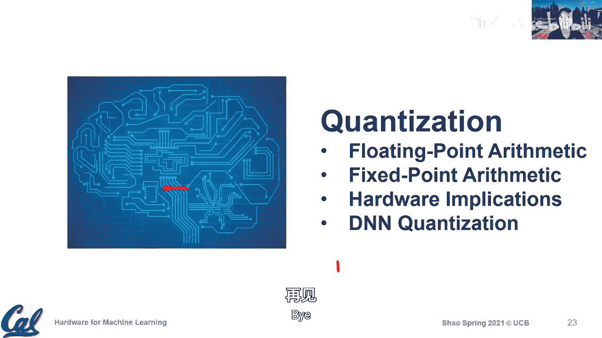

# 【加州大学伯克利】机器学习硬件技术课程 ｜ UC Berkeley ｜ EE 290 ｜ 2021 p03 P03 Lecture 3 DNNs 2 -BV1XfM4zKETU_p3-

Yeah。

Okay， good afternoon everyone， Great to see you all here Wele to hardware for machine learning This is our third lecture so in today's lecture we'll finish up some of our discussion about machine learning pipeline and also in the complex of deep learning and also start our discussion on quantization so since we are talking about deep learning and also specifically we' be talking about low process deep learning process and we also mentioned in our first lecture this is a very exciting area with a lot of activity going on and one of the activity in this area is actually a lot of startups actually coming up with new ideas and and make a very interesting case for their particular proposal so in today's I guess newssp part of the discussion is actually one of the very interesting acquisition。

😊，App made early last year， roughly exactly actually one year ago。

 this is one acquisition made by Apple of a start AI startup called Explor dot AI。

So this is actually part of the spinoff from UW University of Washington and a lot of at least as a starting point。

 one of their earlier research and also one of the foundation of their work is actually focusing on the topic of today is basically doing low precision machine learning and in particular whether we can do binary using binary data and using what is called XNR net。

 that's why the name is actually called XN AI， so using extremely low precision machine learning conation techniques。

 whether we can still execute machine learning and also improve the efficiency of machine learning algorithm so the original XNR net was published almost four years ago and that initial idea got them started on this XO company and overall not lot of detail。

AtThis point， especially after the acquisition， but overall you can see the focus of the company is actually looking at doing low power。

 high efficiency， highly efficient machine learning algorithm that can be deployed。😊。

On the edge device。 So that's another example of some of the success and also realized success in this area like we have startups actually being acquired or doing really well in this area。

 This is one of the companies there at the same time we also it's also good to remind ourselves there is also some of the failure cases we also observe some already。

 so not every star it's not like oh every startup will do really well。

 There are only so many companies can actually acquire and there are this is also a super crowded area both in the algorithm side in the system side and also on the on the hardware side So definitely a lot of opportunities very different from other like startup stories you have a very interesting idea。

 make your pitch there could be a very exciting business opportunity at the same time also realize it is a very busy area with a lot of。

😊，talented people working on interesting ideas on both hardware and software and really when we actually think about doing some commercialization for our ideas。

 also think about what's our niche was our specialty to get into this market。😊，But again。

 just a reminder in some sense， this is a very interesting and also actively research area with a lot of activities and if you do have an interesting idea。

 there is a very high possibility that we can actually deliver something really cool in the market。😊。

So that's the some of discussion to start our today's topic in thinking about deep learning and quantization。

😊，So quick review from last lecture we talk about different terminologies people use when we discuss this field in particular。

 people are using an artificial intelligence machine learning and deep learning what we really mean when we think about that right so we use machine learning as the starting point to get to see what are the different components of the machine learning pipeline and in particular we talk about whenever we think about building a machine learning algorithm。

 there are always the three components we mentioned the experience。

 we always want to learn from experience or experience is basically the data set that we are using to learn and or to observe how how the system actually behave。

😊，And also in the learning process， we also need some performance metrics to actually tell us how good or bad we are。

 So this is basically the cost function。 Overall in the training part training period。

 we want to actually lower our cost so that our efficiency our performance or accuracy can improve So that's a second part。

 the third part of the machine learning pipeline， basically the task itself right we pick some input generate some output that will be the task that we want the machine learning system to learn and and more specifically when we talk about task。

 there are actually two parts， one is a model itself。

 So we talk about a different machine learning model using linear regression model at the starting point we'll also talk about the different learning model today。

 So that's basically the model itself at the same time。

 there is also optimization method It's basically how we can actually our model to lower the cost function that we discussed earlier to get a more accurate。

Model in the end so we won'll get to the task and we always need to think about what's a model。

 what's a model we're using sometimestime in the declared income people also say what's a network architecture。

 what's the structure of the network and also what's optimization that we use to train to lower our cost function to improve our network。

So in our terminology， we typically see deep learning as really a subset of machine learning share a lot of similarities。

 but a lot better at handling like highal data as we mentioned here here and also is able to automatically extract features and build this kind of hierarchy hierarchical network to actually extract the complex features from simple features and we compare with the deep learning model like one of the very unique features that we have multiple layers。

 multiple deep layers so that's where the main come from So that's what we covered last time this past Monday in thinking about the structure。

 a typical pipeline of machine learning algorithm today we're going to do a little bit deep and we also talk about the data set like the Cnet and also imagenet we're going to have using the linear regression example that we had before go through the cost function optimization function and model。

A little bit more and also see how they actually fit in the deep learning context。So with that。

 let's get started。So this is a model we discussed last time。

 so this is a very straightforward linear regression model where we use basically the size of the house to predict the price of the house so the input is basically the size of the house and the output that we like to predict is how much I need to pay for this house right so we have some data set here basically looking at the market data given the size of the house。

 what's the price for the houses that recently sold here and there could be all the different training。

 all the different examples or data points， all of those will be our training data set。

And we mentioned another part basically the performance metric。

 how we evaluate how good our model is， is basically cost function， we use mean squared error here。

 basically looking at power protection。😊，Our prediction of the price and versus the grant choose to see what's the differences and the goal is basically to。

To lower the air， we won't have a low error as low as possible。 So this is a cost function。

 This is a metric that we're using in the training process。 And the model I was mentioned。

 this is a linear regression model。 So we have a very simple linear model。

 If we just use this to approximate the trend。 Maybe we can actually use a simple linear model to fit。

To fix the data based on the size of a house， we know what the price is。

 So this is the model itself and the optimization method we mentioned is just how we actually train our model so that we can lower our the loss function or the cost function lower the error rate during the training process so basically what we want to do is to solve this function to solve this function so that using a particular linear linear regression model our error rate can be as low as possible and that will be basically what the optimization method trying to do So typically in most a time the optimization method is basically doing gradient descent is basically trying to find where the gradient is0 and that's likely to be the minimum or sometimes there is also local minimum or global minimum we'll talk about that later but we basically want to find the point where the gradient。

I zero or close to zero so that we can actually minimize the error function here。

So that's a different component here， just when we think about a machine learning pipeline。

 we always need to think about the data itself， the cost function， the model that we'll be using。

 and also the optimization that method that we use to solve to solve the cost function。😊，So。

Following this discussion， let's do a deeper dive looking at。

Looking at some as a more specific example， specific discussions when we think about cost function and model and also optimization method。

😊，Looks like I cannot。ok， well let's keep going on。Is there a question here？Okay。

 so let me see whether I can get rid of this。No。Okay， never would mind。 Let's continue， so。

We talk about that let's first talk about cost function so we mentioned the cost function is basically the performance metric that we want to use to evaluate how good or bad our model is and whether we need to actually do an fine tuning so basically this is a way to actually quantify the error before between our prediction and also the expected it result so in the linear regression model we basically use this mean square error so basically in this case。

嗯。This is our predict。This is our project value and this is the observed value。

 this is the expected value and then we do the differences。

 we know how good we know how much we are off there basically the goal is for all the data here for all the M the that points that we have we want to minimize the error as much as possible so this is a very typical minimization or optimization problem try to minimize a particular function。

So whenever we talk about cause function， another very important part of the cause function discussion is basically how we can actually reduce the opportunity reduce the chances of overfitting so we started some of the discussion earlier last time。

In the sense that we want to reduce the generalization error so so that we are not only minimizing the training error。

 so talk about the training error and also the testing error right so during the training process we are actually minimizing the training error right but one thing in that optimization process is that by actually optimizing our data or weight so tailored for our training data set it's likely in the sense that our model is overfitting for the training data set so that it cannot be generalized to other pieces of data that we haven't seen before right so that's always a concern whenever we talk about minimization minimizing the training error So one thing to actually to reduce this kind of overfitting here is what people call regular what does regular trying to do here。

So in general， it's trying to actually to add another preference in the cost function in our performance metric。

 not only trying to minimize the error rate， the training error。

 but also trying to pick a simpler model。What do I mean by that。 So let's say in this example。

 the picture on the right。 So the red dots are basically the data points that we have right we want to find a function that can actually fit the data that we observe that's what we are trying to do and we have two alternative。

 One is this grain function which is a simpler function。

 not like maybe quadratic or but not very high order function。

 a simpler function but can fit the data reasonably well， or a very complex function。

 the blue one that that fits the data perfectly， but the challenge here is that if you have a very complex model that fits your training data really well。

 very likely you will end up with actually high testing error。

 basically when you actually see new data that you haven't seen before but if your model is so tailored to the data that you have seen。

It's likely will be overfitting for the data that you have seen cannot be easily generalized to the new data。

 So the rule of thumb is that whenever there are two models or two to theories that are actually comparable to explain the current data。

 we always prefer to actually pick a simpler model because it's actually more likely a simpler model can be generalized later。

 So that's what regular is trying to do is to actually remove this kind or reduce the chances of doing overfitting and also adding this preference of picking simpler model into our cost function。

 So during our opt we are not only optimizing for lower training error rate。

 but also optimizing to find a simpler model。 So that's what regular is trying to do。

Does that make sense， any questions here？Again， if you have questions feel free to unmute yourself directly or use the chat window here So that's specifically what's the goal of adding this regular term into our cost function so that we are not only minimizing the training error rate。

 but we are also telling the training telling this metrics that we are using in the learning process that we prefer simpler model so adding that preference there So specifically how do we actually add that preference。

So one way of adding that preference is what people call weight decay or sometimes you will also hear people saying this L1 or L2 regularization。

 so in general that's basically follow the line that we talked earlier that we want to have simpler model so here using this weight decay term is basically expressing the preferences of using actually smaller weights。

So sometimes even0。 So by expressing that we wantt have a smaller weight and sometimes maybe some of the term can even be0。

 we are less likely to get a very complex model that can be maybe too tailored to our training data set。

 So by using this weight decay either L1 or L2 regular we basically tell the training procedure that we want to have smaller weights in our model in our training setup。

So it depends on which one you use a different people actually have different preferences。

 it really depends on the use cases， we could actually either do a L2 regularization using the square term or using the L1 regularization basically just minimizing the absolute sum of also weight so either is fine is basically in both cases we're expressing this preference of。

Choosing smaller simpler model with smaller weights， so to reduce opportunity of overfitting here。So。

 that's the first。That's the first part of when we think about cost function。

 you will hear people discussing1 or L2 regular it's actually nothing too complicated other than just this very simple intuition that we want to pick a simpler model with smaller weights to reduce the chances of being a developing a overfied model to our training data。

😊，So that's one part of the discussion with cost function。

 So another part of discussion with cost function again。

 a lot of discussion here is basically trying to reduce the testing air。

 trying to reduce the chances of developing a model that's actually to to overfi it to our training data。

 So another very powerful technique， actually used work worked actually fairly well also in the part of the training process is what people call drawpot。

So what do we mean by dropout So this is basically in the training part instead of actually every time we train the entire model all the nodes in our model。

 so in the training process from time to time in different training batch we actually can randomly drop out some of the nodes basically in this example we just zero out。

 we don't actually consider those nodes so you can basically thinking in the sense that we're training of course every time we actually choose different nodes to drop but we're basically training different subset of models in the training process and the goal the goal is actually to find again in the process of searching for smaller model right simpler models So this is also we get a simpler model and also by training all the different combination because depends on which node we drop we could actually have different nodes left right and different nodes。

Neft will actually form different network， it's actually different from the original network。

 the full network that we have here。So here we are instead of training a single network。

 we are actually also we are actually training what people say an ensemble of networks because depends on which node you drop。

 we will actually end up with different networks and then in our training part we are actually finding the weights that would actually work well in all the different sub networks So again this is another part of actually finding again again first is actually doing a simpler model and second is actually finding the weight value that actually work well for a range of different or ensemble of networks instead be too tailored to the single network that we are training that can be hard to be generalized later so both of the dropropp discussion that we have here we'll hear people talking about dropout or discuss in the context of L1 or L2。

Regularization， in both cases we're basically trying to say we want a simpler model and to express that in the training process。

So too short to in the dropout， you just pick the notess to drop randomly Yeah so so when you look at the dropout literature。

 there is also a very active work in this area， one of the early paper is a one actually I cited here So the basically idea is actually during the training part for different batches you will actually have different mask the mask can be randomly generated and some people have also clever tricks to actually generate different masks but by generating different masks you will actually be masked out different notes differently in the training process so in this part we do actually pick the notes actually to drop randomly and some of more advanced work will actually go into this to see how which which node to drop and how much of the node you can drop and some people also get into the research by doing doing some drop out you will also actually introduce sparsity there。

 So So there is also a。Big space there。 But at the same time。

 you cannot drop out too many nodes because then you have a too skinny model and that get really easy to。

 you， you may actually get to the underfi region that cannot capture the data。

 So there is also a range， but it should be picked randomly。

 and the different batch should also be different。Does that make sense？So。

 so Xin Yu is the duration of the node being drop out one cycle or one design choice parameter。

 That's a good question。 So here when when you say one cycle， I assume you mean like one epoC。

11 batch will actually get to the training part there。

 So typically this is every batch or basically well actually get to talking about the we'll get to the stochastic gradient descent later。

 So instead of training on all the data， very in a lot of discussion， especially when we use SGD。

 we actually break down our data into batches and train each batch individually。

 So for the duration of being the drop out is is one batch。 not one cycle， but it's a one batch。

 but you could also make it let say two or three batches。

 That's another hyperparameter that you can choose。

 but the minimum granularity is actually one batch in the training part。

So yourselff is wondering does the model take longer to train since you're removing models nodes from network So that's a good question So the question is actually really depends so first it' actually we are actually also training a smaller model instead of the big model because we're actually dropping some of the notes some of the observation is actually turn out to be easier to converge than actually training the bigger ones from scratch but at the same time we're also training multiple models together right so by picking different nodes we may actually be training different models so I think it depends I don' I don't see at least I'm not where a verdict to say what whether it actually takes longer or shorter to train。

 but I do remembers in literature basically with this it's actually easier to converge here。

So A is wondering is how is inference affected by dropout in the training。

 do we use out nodes when doing inference？ Yes， so so in inference use， we still use out nodes。

 So finally， so training is basically the cost function。

 we are still talking about the cost function here right So this is part of the training when we actually do drop out to improve or to to as part of the cost function to I guess improve our metrics。

 this is a metric that we are using。 this is only used in the training part in the inference were still use the full model。

 So that's why the training model people also say this is basically an ensemble of models because during the drop。

 we train different sub modelss。 So inference still doing the full model one the side effect of doing drop out people observe is that we use drop out in the training training process。

 it's more we are more likely to get。The sparse model， because in the dropout。

 what we're doing is basically zero out some of the nodes right。

 and then maybe some of the nodes are actually indeed that very useful。

 So it's more likely we're actually getting more zero weights in the final trained model。

 So one implication in the inference could be we get a a more sparse model。

 but in terms of the network structure， we are still using the full model because we're doing basically in the random sampling right。

 we don't know we don't have the exact sub model。 So it's still the full model， but。

Very lucky you will get a sparse model。Very good questions， any other questions？Okay， great。

 so this is the two I guess three part of the cost function discussion。

 The first is basically with overall goal is to minimize the training loss or the training loss there at the same time to add this preference of choosing smaller choosing simpler model and not being too tailored to the training data so that we can so that the model can be later generalized with new data to very common to use techniques people have been discussing。

The first one is regular by adding that term to pick smaller weights。

 people also call it weight decay。And another one is the one we just discussed doing dropout。

 so basically sample a subset of the nodes and training in effectively an ensemble of network。

 but as Aby asked earlier， when we do the inference we still get the full network。

 it just sum of the node maybe zero， we get a sparse network there。Okay， great。

 so that's the discussion we have on the cost function。😊，So finally。😊。

So another component in the training part is basically optimization right so that's optimization is basically given this cost function all we want to do is to actually minimize the cost as much as possible during the training part so that's our design optimization goal so how do we actually find this optimization。

To minimize this goal， so this is a very standard constrained optimization problem you will give the network certain constraints and also say this is the objective function。

 objective function based our cost function to minimize the cost and then the training part during the training is our optimization method is basically trying to find ways to actually reduce the cost。

So when we talk about cost an optimization to minimize the cost， most of the time。

 almost all the time we are basically talking about the gradient descent method it's a very simple intuition will not get too much into that but overall basically when you see the slope of your data distribution or the slope of the network of your cost function to minimize the air to minimize the cost function。

 what you want to do is basically follow the slope or gradient to ingredient descent go to the point to actually where your cost you actually minimize and during the optimization and just you start from somewhere and then over time moving to the value of your curve where very lucky you'll get a minimum point to your cost function。

 so that's basically the overall intuition here。I guess doing a little bit more specific discussion here。

 as we mentioned， optimization is basically trying to minimize the cost function and here more specifically。

 we didn't mention before by minimizing the cost function is basically updating the weights right so the cost function is our objective and what we can do in the training parties by changing the weight value right by adjusting the weight。

 we remember the linear regression model that we have。

 we have like to to term there to term there like W0 and W1 that we need to figure out what the exact value there。

 So those are basically the weights of the network and by doing optimization function is basically find the weights that actually can minimize the cost function。

 So that's basically the goal here。As we mentioned for gradient descent is basically iteratively moving in the direction of the steepest descent。

 as we mentioned earlier by the gradient right so let's say if we have a quadratic function。

Here and our gradient will be basically a linear if we took the gradient of our gra function。

 we'll get a linear function and what we want to do is basically to get to the value where the gradient is zero so during the training part we start randomly from somewhere what we want to do is basically follow the gradient or basically follow the scope slope of the curve so that we can get to the value of our curve to find a minimal point。

So this is basically gradient descent。 We already actually briefly discussed this earlier。

 So in reality， in most of the training procedure， instead of doing gradient descent， more。

 more often actually almost all the time。 what we are doing is actually stochastic gradient descent。

 So what do we mean by that。 So instead of actually we talk about the large amount data that we have available。

 if we actually do gradient descent for all the data that we have available and trying to minimize the cost。

 a lot of time iss actually very hard to train because theres so many different pieces of data and they are all actually moving in different direction。

 it's really hard to find convergence to actually satisfy for all the data that we can actually satisfy all the requirement。

So in a lot of time， instead of training on the entire data。

 what we do is actually we break down the data into different subsets or batches。

 sometimes you see people say batches， you hear people say mini batches。

 but basically what they are doing is to break down the large data into smaller pieces and and then in every training part instead of train on the entire data set and make an update。

 we actually train on the subset of our data or our batch like seeing you us earlier whether it's one cycle。

 I mentioned it's basically one batch right so this is where batch coming from。

 we have our data instead of training on the entire data and update after we go through the entire data。

 we actually break it down into smaller subsets or our batches and we actually do one path training on one batch and then after that batch we actually update our weight based on the observed data。

And then we move to the next batch。So with this it actually turned out to be a lot easier to converge because we're not optimizing for all the data that we're seeing。

 we're looking optimizing for a subset of data， but the batch size is also a tricky parameter or hyperparameter that you will see people here youll hear a lot of discussion there。

 how to pick the right batch size the batch size is too big。

 and then the stochastic gradient decent doesn't make much sense because as big as your original data set。

 but if it's actually too small， then it's actually also hard to converge because you are only update。

 you' are doing like very very small update based on the limited amount of data you see and then its also may take actually a while to converge if the batch size is too small and batch size is also another parameter has a lot of hyper parameter has a lot of hardware implications one thing you will see that。

C parallel hardware in most of the time， you want to have large batch size to actually leverage the parallel hardware that you can get a lot of parallelism there。

 but at the same time we talk about if the batch size too big and then the stochastic part gradient decent is almost the same as。

G listen， we're looking at a large amount of data。 So a lot of paper or research that you may see。

 especially from Google or from Nvidia， what they are trying to do is to see whether we can push the batchside to be bigger。

 because that's actually more likely to have high hardware utilization there。

So that's a summary of the discussion when we think about optimization， again。

 the goal is actually to minimize the cost function by updating the weights。

 the intuition here is basically follow the slope by using gradient descent and one term terminology that we introduce here is basically batch size。

 this is basically in every pass of the training in one pass of the training instead of the entire data set we're actually looking at a subset of the data set and we'll also update the weights after this subset。

So that's suggests a general discussion about optimization， this path of a tree updating the weight。

 I want to bring a mention on one thing that you will see in part of the optimization。Discussion。

When we talk about optimization is momentum here。 So this is also。

 you may also see that in if you made the pass of the Alexnet paper。

 you may also see that in the original Alexnet discussion。 So momentum is also a metric。

 well not necessarily a metric， but more like an integration similar to the regular integration that we use to actually reduce the chances of overfitting。

 So momentum is another term that we added in the optimization path。

 So the goal here is that we like when we talk about gradient descent， right， So we basically said。

 follow the slope to find a value that's likely to minimize minimize your cost function。

But a lot of time， especially when we talk about optimization， doing concerning optimization。

 is that we don't want to be stuck in local minimum， right， So we want to from time to time。

 we want to actually jump out of our local minimum to actually explore larger areas so that we can actually get to hopefully get to a global minimum here。

So momentum is basically a notion introduced in the optimization。

 We'll hear people talking about momentum。 The first thing you need to map to is basically talking about optimization part。

 not the cost function anymore。 Were getting to the optimization part So how we can actually successfully find the global minimum。

 So here momentum is basically a term that we add to force or at least encourage the optimization process to jump out of local minimum and to try out other area of the curve。

😊，So what do we mean by that。 So maybe in this in this example， as illustrate the here。

 So this is our class function。 we mentioned earlier。

 the overall goal is we actually mini the class function here。

 So what momentum is trying to do is that during the process and minimizing the class function。

 we add a little momentum to the direction of moving our to the direction of updating our weight so that we can actually if we get to a local local minimum region。

 we can rely on or leverage the momentum to go a little bit further to see whether there's other potential actually better minimum region than where we are instead of being stuck here。

So let's use an example to illustrate this。So let's say by default， right。

 So by default during the training process， were basically。Like compute gradient。

 And then we basically update our weight based on the the gradient here， right。

 And learning rate is basically another parameter you will hear。

 when youre talking about optimization functions。 We have the gradients how much that actually contribute to the weight update。

 right， So you will also see that as another parameter is basically how fast or how slow you update the weight。

 So that's another parameter being and multiplied here。

So learning rate multiply by the gradient or the negative gradient is basically how much we are actually updating our weight。

 So that's basically the standard optimization pass。 right。

 we get the gradient and then scale that by the learning rate。

 and then we get our updated weight here。 So that's basically what we're doing。

So what momentumm trying to do here is to add another component in the optimization part so that we are not only actually getting updating by the gradient。

 but also based on where like of velocity or the way we have been updating gradient before trying to push that a little bit further to actually get to the new weight。

So what do we mean by that。 So in this example， let's assume this is our cost function and we start from here right。

 So during the optimization process， every step， what we do is basically we get we follow the slope。

 right We follow the gradient update。 and then we start from here follow the gradient update。

 we get here and the slope is a little bit shallow。

 but we still follow that and then we get to our local minimum， right， so when we get to here。

 one in here is the gradient is0， right， So if we actually follow our original procedure。

 we basically don't do anything， we are stuck here， right， So here is basically our finalized weight。

 but we do know this is not actually the global minimum。 This is only local minimum。

 we see the cost function， actually we move further。

 there could be actually we could actually potentially even lower the cost。functionunction。

 even more。So here， what we are doing is that instead of just updating our weights purely based on the gradient。

 We also add this based on the momentum。 momentum is basically where we have been here。

 So in this case， we look at the momentum。 So far， we have been basically moving to the right。 right。

 The green curve。 the dashed green。So the dashed， the dashed green。

 green line here is basically momentum。 right， So so far we have been actually moving to the right。

 right， So even my gradient is 0， what I like to do is still push to the right a little bit more。

 right so far， moving to the right seems to be the right decision， right。

 So although the gradient is 0。 But I think I may actually get stuck in my local minimum。

 So let's also move to the right a little bit more。 And maybe we can actually see other potential。

 also good good points。 So that's basically what momentum trying to do even the gradient。E0。

 we keep moving follow the past movement so that we can actually see a little bit further and less likely to actually being stuck to the local minimum。

 So here if we look at。Look at the momentum， the SGD with momentum。

So you look at SGD weight momentum here。 So instead， we're still doing weight updates。 right。

 so that part doesn't change。 But besides the gradient component that we had before。

 we also add this momentum component is basically following the weight update that we have seen before and trying to move a little bit more steps to see whether we can jump out of local minimum。

So Dima is wondering， I seem like momentum could cause optimizer to pass a global minimum entirely。

 Do implementation keep track of the past minimum or is that a is or is that not a common problem。

 That's a good question。 I think one thing here， you may notice there's another hyperparameter。

One thing we see is that there's just always another hyperameter。

 another hyperparameter is also how much factor you take into the momentum， right。

 So if the momentum is too dominating， as Dima mentioned。

 it could also basically move too far and then we actually pass the global minimum entirely。

 but if we actually adjust it， well， that's also another art。 but like just adjusting this。

 the scale of momentum， it's also possible to actually make sure that we we don't go too far or we go too far。

 we can， the gradient can actually correct correct us。 So if we do， let's say this is a global。

Minimum， but we actually move because the momentum is pretty high。 we still move forward there。

 If the curve is smooth， even when maybe we move to the the other direction。

 the gradient is actually trying to push us back following the gradient again。

 So there are two different factors here is how like the learning rate is like how much what's a contribution。

 the gradient and also what's a contribution of momentum。

 And to adjust that this role hyperparameter is also important to maintain that。 But overall。

 momentum also decay， right， So if we we， we actually indeed， if the curve instead like this。

It's actually in the training part， we get a。Global minimum， and then it's more or less flat。

 which is actually more likely， right。 So we get a training loss function。 And then over time。

 it's basically flat or going down very insignificantly。 And then in this case。

 it's actually just even if we push further the momentum wouldn't actually hurt us to completely pass the global minimum。

 So I guess two three parts to the answer。 the first part there is another hyperparameter。

 this row parameter to say what's a contribution of momentum。

 that's a hyperparameter can and can affect whether the specific behavior will occur。 Second。

 it also depends on the shape of the curve。 we it's actually a very hill curve that even with global minimum。

 And then we get to another uphill again， gradient may actually be able to bring things back back to the global minimum if it's actually a truly global。

Minimum， and finally， if we are actually making to the right direction and the last function actually keep decreasing that momentum is mostly just following the curve。

 and in that case， if we do find the。At least close to global minimum going a little bit further wouldn't affect。

Wouldn't affect at least significantly to the， to the training process。Does that make sense。

 the overall flow？Okay， great， So as you already noticed， like even in the optimization discussion。

 we recently， we already introduced two more hyperparameter。

 like we mentioned the batch size as another one earlier。

 and here we introduce two more the learning rate and also momentum， this role factor for momentum。

 One thing you will notice that machine learning not only the parameters。

 the ways we'll see a little bit more later。 but there are also a lot of hyperparameter associated with network structure。

 and how we actually find all those hyperparameter is also very important to actually make sure our model converge and to actually train quickly。

 So all of those are also important discussion， typically either related to。😊。

To the cost function that we mentioned earlier or related to the optimization procedure that we just discussed。

 because both will actually affect either the objective。

 that function that we use or the steps that we are taking to minimize this objective function。

 those hyperparameter actually can be very important when we get to training efficiency。

 how we can actually train that quickly。 And there is also a lot of research and also research and development is basically trying to find those hyperparameter very efficiently。

And some of the research basically using another machine learning model to find low high parameters。

 so also very interesting discussion there。😊，Okay， so those are the optimization methods I think we mostly for the like the four component data cost function model and optimization right we talk briefly about data model we'll talk about deep learning a little bit more we'll see different model structure later。

 but in general the two very important part affect training is basically the cost function that's objective function that we are using one besides actually minimizing the air。

 one thing is actually we want to pick a simpler model just follow yourtuition is follow our intuition right a simpler model can typically be easier to be generalized so that's a discussion different optimization also some of the research in thinking about how to devise a good cost function the second part another part is optimization method we talk about the gradient descent but also s gradient descent that we mentioned earlier。

With batch size the hyperparameter and also talk about the momentum to actually keep us moving forward and to avoid being stuck in the local minimum。

 So those are some of the both hyperparameter， but also important training procedure that involved in the the in general。

 the machine learning discussion， but also very importantly in the deep learning discussion。

So just a very quick discussion here transition from machine learning to deep learning I wouldn't get too much into that this is a pretty complex topic on its own I personally don't think I have a good handle on this either what actually really triggered machine learning to deep learning I think one thing I know for sure is that hard hardware helps with more powerful hardware hardware。

 I think it's a lot easier and possible to train large machine and deep learning model but overall we think about comparing different machine learning and deep learning methods overall I think one of the challenges at least when we think about data is a high dimensionmenional data we actually see so many different types of data。

 different categories of data it's actually really hard to actually manually figure out the data features and deep learning because it automatically can build up extract features and good up from simple features。

To more complex features， it actually can fit this kind and it is interacting in this kind of high dimensional data a lot better。

So even our course is actually most focusing on the deep learning part。

 but I want to first see theres something pretty fundamental for both machine learning and deep learning and second is even a lot of non- deep learning algorithm are actually still very commonly used and in a lot of our even in our like social networks or even data analytics or data analytics。

 a lot of the procedures， of course machine learning is getting very important。

 but we also have some of the sorry deep learning model is actually become a lot more dominating。

 but there are still a lot of non deep learning model being used。

 we definitely still want to see the similarities between those two。

 but as a transition so here we are going to transition more to the deep learning specific instead of on the machine learning front。

So before we move on， any more questions or comments anything you to share here？对对。Okay， great。

 so so far we discussed the different components， we mentioned the four components of machine learning。

 and now we are going to transition to deep learning。

So deep learning or more specifically deep neural networks is basically one of the dominating models that has been actually widely used in a range of different application domains we talk about a lot of excitement in today's both algorithm itself。

 but also hardware these days is basically because of the success of deep learning model and specifically deep neural network model as like the principle that we want to build in this class deep learning is really a subset of machine learning model and one very unique feature is basically the deep aspect part of the name we basically have multiple layers。

And then another important feature we'll see a little bit later is it has both a linear transformation and also non nonlinear transformation。

 What。 Well， most of the computation will be basically in the linear transformation。

 We' talk a little bit more there。 We will also talk about some of the。

Non nonlinear function that are being used in deep learning， but two important。

Components of deep learning is basically first， we have been talking about this deep and hierarchical network and second is basically a combination of both linear model and the nonlinear model。

So when we get to the deep learning again， there are a lot of terminologies here。

 so the first thing I want to do is more just like make sure that we have the same terminology in describing what we mean by our deep learning or deep neural network and different components of deep neural networks。

😊，So specifically when you get to deep neural networks。

 we typically say there are different layers right we mentioned you will remember the example that we saw last time every layer is actually extracting different features and build and build more complex features there。

 so it's always a layered approach and every layer is basically one part of the deep neural network。

Sospec there could be like two I would say two unique layers。

 basically the input layer how we actually take the input data and the output layer is basically where what are the final outputs we generate from the neural network deep neural networks and then between input layer and output layer。

 all the layers in between that's what people say hidden layers。

 So those are not directly interacting with external input are not directly interacting with external output So everything is actually part of network itself。

 So those are basically hidden layers so earlier network has is very shallow is not too deep。

 So we basically have one input layer， one output layer maybe a couple hidden layer that's basically a pretty standard network these days we're talking about handss and even hundreds of layers right so besides the input and output layer we actually have a lot more hidden layer。

In our network。So when we say input and output layer is basically layer interacting or either interacting with the input or interacting with the output。

 majority， especially for D network is basically hidden layers。😊。

Depends on how which terminology we use whenever we see a layered network。

 we may have different terminology to describe the nodes of the network or the edges of the network The terminology I like to use is actually weights。

And activation。 So one thing you may notice we say although deep。

 a lot of deep learning is actually inspired by neuroscience。

 but we try to actually divide it up like isolate not necessarily isolate。

 but that we separate those two in our terminology。

So when we actually say each node of the either the input layer or output layer or each node of the hidden layer。

 we typically say activation。 So those are basically the reason it's called activation。

 we'll see in the later example after nonlinear function is being activated from the previous layer。

 but typically we call this either data or activation。

 it means the data itself right so if this input layer is basically the input data or input activation。

 if the output layer is output data or output activation， and we actually have different data。

 different input data， we may actually have different activation in the pipeline。

 So this activation is basically input dependent depends on what inputs that were processing。

The edges of the network is what we call the weights of the network in where neuroscience termlogy will be synapses。

 but will mostly just be using weights here so the weights are actually intrinsic to the model right so the weights is basically the edges of the network that will the weights are the value of the weights is basically used to weigh different input values here so the weights is actually intrinsic to the network once we have a trained model during the training we basic training。

 the weights once we finish the training we have a trained model we have the weights right so the weights of the model is actually trained finalized and unique to the model will not never change and during the inference what we' are doing is basically take different input value or different input activation value and to see how the activation data actually going through the network the activation data is input dependent weights。

Are not input dependent。 It's only model dependent after we train， the weights are actually fixed。

 So in most of our discussion， will very， rarely actually use neurons and synapses will be basically typically use activation to describe input dependent data and weights to describe the weights of the network that is actually intrinsic to the model。

 It does。So those are the different terminologies to describe the structure of deep neural networks。

 as we discussed， deep multiple layers。 And whenever we talk about the network。

 always nodes and edges， edges are the weights intrinsic to the network。

 nodes are the activations which is data dependent。

 So those are the terminologies we use when we talk about deep neural network layers。

And in a typical deep neural network layers。 So we mentioned earlier。

 earlier ones are typically very shallow。 So a couple one input one output。

 and then a couple hidden layers。 But now for more than complex network。

 it can be very deep so we can have pens or even hundreds of actually hidden layers here。

 So all those hidden layers can be used to extract from low level features to mid levelve features and to all the way to high level features。

 specifically， we talk about the nonlinear function and linear function as part of the discussion for deep learning willll see a little bit more later。

 but typically， especially when we think about computer vision to mostly commonly used linear function basically convolution。

You will see a lot of discussion on con layers and fully connected layers or F layers。

 so con layer we' basically doing convolution we'll talk about that next week and fully connected layer is basically doing matrix multiplication so in general doing linear algebra and we'll see more next week just what is underlying computation and especially how they actually be implemented on hardware。

 but those are the two mostly commonly used layers or operations in linear transformations in deep neural networks。

We'll talk about the nonlinear transformation in a minute。So as an example。

 we talk about some of the shallower layers， but so that's some of the more early stage network。

 actually a very good example。 And it's really cool to see with so many simple layer with so few number of simple layers。

 we can actually do something really cool。😊，So one of the early success of deep neural networks is basically the net from Y La comb to do a digit recognition。

 So this is basically when you hear people talking about Mist data set。

's so we talk about imagenet see for us to like more image object recognition based data set。

 an Amist is basically digit recognition data sets。

 a different way the writing 0 to9 and trying to figure out whether we can recognize the digit very very efficient effectively。

So Yang La K's earlier network is basic called the net。

 So it's a very simple five layer network doing a couple convolution and then a couple fully connected layers。

 So take the image as input and output probability of whether it's a0 or1 or8 or 7，8 or 9。

 So that's basic one of the early success。 It' still very cool and also very useful right doing digit recognition scan your your mails So this is very useful or phone number。

😊，And this is one of the early success to see a very simple。

 actually a Laette like like model can do interesting things。 So in your lab 1。

 we also have actually very similar basic Lette based model。

 not too deep pretty 5 to5 to 7 layers and see doing a C far object recognition。

 So we'll see how a pretty simple model actually can still be very useful。

 even when actually interact more complex data set。😊。

So that's an example of both the net as a network architecture， the model architecture。

 and the Amist data set for digit recognition。So again， like use。

 some of the terminology that we use for machine learning， right。

 So deep neural network is really just telling us the model part。

 remember the four component data set， cost function， the model and optimization method。

 deep neural network， What is specificifies what's the model structure right instead of simple linear regression。

 This is actually layered deep like multilayer network doing either either fully either linear non nonlinear layers combined together。

 it only describes the model structure， but still we still need to think about the rest the component。

 right So the data set part again， it data， It problem dependent。

 what are it experience dependent right， what are your observation。

 What do you want to train and you may need to actually find different data set here。

And cost function is actually pretty similar to other machine learning models。 Overall。

 we want to minimize the cost， or want to minimize the prediction error rate， right。

 And then during the training part， we basically want to do doing back propagation to actually see how how the cost function is actually going through layer by layer。

 So it's not only just a final cost by doing back propagation。

 we can also propagate this air air air cost for from the final layer all the way to the earlier。

 either hidden layer or even the input there。 So back propagation is basic how we propagate the air through the deep learning model。

And then the optimization we used is still stochastic gradient de。 So the learning rate， batch size。

 momentum， those discussions still part of the deep neural， deep neural network。 So again。

I really want to highlight there's actually a lot more similarities than differences。

 although we are focusing on the deep neural networks。

 but there is also a very a lot of the component actually from the a lot of machine learning discussion in general。

 does the network is where or the model structure is where what's unique about deep neural network just again reinforce that part。

So we talk about a lot of the linear transformation we'll see more next week specifically convolution and fully connected layers。

 So there are the tools of the most commonly used layer type in in deep networks。

 I do want also want to briefly talk about some of the non nonlinear function。

 which is actually very important， especially with the success of deep learning so that we can in particular。

 be able to actually propagate the gradients because we only see the cost function at the end of our output layer。

 right so in the intermediate layer or the hidden layer， we don't have a cost function。

 So very important part of deep learning is actually to do back propagation to propagate the air from the final output all the way to different layers that we can also adjust not only just the final layer。

 but also earlier hidden layers and also input layer。

So doing that propagation is actually very important to propagate the air or the gradient from the final layer all the way to the earlier layers。

 and a lot of the nonlinearity or different choices of the nonlinear function is basically have also very important role in the gradient propagation here。

So， so one of the most commonly used nonlinear function these days is basically a rectified linear unit or value。

 So this is very commonly used。 The function is actually very simple， it's basically doing a max。

 So if the value is actually less than zero， we basically just clam it at0。

 but is the value is actually greater than0， we just keep the value。self。

 so this is actually very commonly used。 So this is almost one of the most successful actually nonlinear unit in today's deep learning。

 We see some other。 There are different variations of value these days。

 like leak key Ra instead of actually get into 0， we basically scale。 get to a small value。

 but not exactly0， so that we can still keep some of the gradient there。 And also exponential value。

 That's basically instead of。😊，Typically， most of the time， we are looking at above1。

 above 0 is basic tips of value， but you will also want to keep some gradients when the value is actually less than 0。

 so that we can still learn， right， So if it's actually flat。 There's no gradient。

 we cannot learn anything。 So a lot of the innovation is trying to see if the value is actually negative。

 what can we do to learn。There's also some other variations of Rlu。

 Some of you may also see like R R 4 or R 6。 It's basically x somehow like the the second weight function So instead of going all the weight of x。

 if actually is too big， we also cap at another value。 So that's like R 6。

 or sometimes people do R n where n is also programmable to see what the max value is。

 But in general， So a lot of today's nonlinear function is actually R based to actually model or to capture this kind of nonlinearity in the model or basically this kind of activate or triggering moment。

 right， So if this is actually about certain threshold， we actually do certain things。 If not。

 we actually don't do certain things。 So that's what exactly R actually captured。Here。

 and what's nice about Ralu is also it actually keep the especially is actually the value is actually greater than0。

 We actually keep the value of x， we don't actually cap it at one for6oid and and 10 H。

 we actually let the value keep the value， So we can also keep the gradient。

 One thing you will see a lot is what people call gradient vanishing problem because the gradient need to actually propagate through layers。

 If the gradient is actually too small， and then get to the layer or the earlier layers when we do the back propagation。

 get to the earlier layers。 We don't have any gradient anymore right。

 So the only thing if we remember the update procedure， we update our weight based on the gradient。

 right， So we see the gradient we do something。 If the gradient is actually0。

 we cannot learn anything， we are stuck there。 we are stuck there。

 even though we are not at any local minimum， it's just because gradient already。Disappear， So。

 what's nice about Ra is it captures this kind of activation activity。 At the same time。

 it also the maintain the gradient。Especially for the region， greater than zero。

Another side effect of or also good side effect of value is also it introduce a lot of zeros。

And we'll get to some of the discussion you may see one thing。

 especially hardware designer really leverage to actually generate efficient hardware is to reduce activity as much as possible。

 So in that case， if the value is actually zero， it basically means no work we need to do right we are always looking forward to generate as much zero as possible and value is actually a very good way。

😊，To produce a lot of zero， so even selective value， we automatically clamp it to zero there。

 so it's also makes the model a lot more sparse and also get a smaller， simpler model there。

And also very easy and efficient to compute。 So this is basically the nonlinear models or layers being used。

 So we remember the earlier picture。 we see some calm layers and we see some nonlinear layers。

 and a lot of time。 So most of the time， Ralu actually works really well。 So amazingly， Ralu。

 it just like a layer that works really well。 And most of time， you can use Ralu。

 I would just use use Ralu。 unless there's something else that actually and help you significantly。

 but in the majority of the time in the model that we have seen so far。

 Ralu actually as a very simple model also works really well on hardware also works turn out to actually work really well as a model as a layer type itself in the training training process。

😊，So those were basically the nonlinear layers being usable because it's so simple。

Will not spend too much time， especially on hardware implications were mostly spending time since convolution。

Fully connected layers。Actually take the majority of the computation time and has a very so designing efficient hardware for those are actually very important。

 And for hardware designers， like Ra is' great news， just like so easy to design。

 and we don't need to put in a lot of hardware。 So that's also so we won't spend a lot of time on the nonlinear function。

 but we should also be aware there is also nonlinear function or layers in the D architecture here。😊。

So finally on the part we already talk about this earlier， right。

 so the training and inference right， so the training is really take the data and looking at the cost function and update our weight so that we can fit our model better based on the data that we see。

And so far most our discussion actually focus on the training part having the four steps or four components and all of them play a very important role using the data to train the cost function is a metric that we evaluate the optimization method the way we update our weights and model actually describe the weight the model structure that is being trained right So inference is basically instead of doing both the forward and backward。

 So when training， you also hear people say both forward and backwards。

 the forward is doing the prediction right， So given the input predict our output once we make our prediction。

 now we get to the backward path based on the prediction。

 we look at how far our way from our prediction to the expected value and that's basically our cost function and based on the cost function。

 we actually do the backward path to update our weights and hopefully to minimize。The cost function。

 so this is the forward and backward。Training paths involving all the four component。

So inference is actually， in some sense， a subset of training。 So it's actually a lot simpler。

 We already some of the students already asked for example。

 the class function and the optimization method actually doesn't really matter in the inference part。

 the inference part is really just taking the data， taking the model， do a prediction right。

 So that's only the forward pass that we discussed。 getting the class function。

 getting the error and then backpro the error updating the weight that's actually not part of the inference。

 So training basically train the model， once we know the weights， we finalize the weight。

 and then when we get to the inference， it's actually a lot simpler or only doing the forward pass。

 taking the data， doing the prediction than we are done right hopefully our model is trained successfully our prediction is pretty good。

 but and then when we see the test error rate is basically using the train。

Model to see how good we are at performing a test performing a task that we haven't performing a test on a piece of data that we haven't seen before right so we have new data and see how good how well we actually do at how well we are performing on that piece of data so that's the difference between training and inference and specifically using the four components that's how they actually fit together。

So let's basically we talk about the machine learning and deep learning and next we're going to actually use Alexnet example to go through to review some of the concepts that we have seen and discussed before。

 before we move on any questions， comments or what we discussed so far。

Okay so Alexnett is actually the paper that we are reviewing this week。

 some of you already send out your review through the Google form thank you。

 it's good to see your feedback and get also your understanding of the paper to see what you think again the review question is more just the guideline to navigate the paper。

 what I find interesting about the paper not only the paper actually pretty influential in the sense that's one of the most earliest success deployment of deep learning and using GPU the computing device。

 but it also captures some of the topic that we discussed really well in terms of different components of the machine learning pipeline or specifically deep learning pipeline of how this AlexNet model and training procedure fits in there。

So we'll briefly go through this。 So this is still not too complex architecture here。

 So this is basically the Alexnet architecture here。

 it's also showing the dimensions of convolutional layers and fully connected layer also pulling layer。

 So it basically a subsling there。 So all of those are actually part of the Alexnet model and Alexnet model it's still actually actually being used so it's especially compared with some of the more complex model。

 It's actually still pretty efficient in doing prediction。 the model size a little bit high。

 So they're actually more efficient model these days it has three fully connected layer。

 whenever never get to fully connected layer that also increased model size there。

 but at the same time， it actually does the job pretty well and in a lot of evaluation less commonly used today was in mobilenet and resnet are a lot more。

Commonly used as a network architecture to evaluate hardware。

 So mobile both mobilenet and Resnet are part of the ML curve benchmark suite。

 but Alexnet is still a very important metric just to see how general have those basic layers and see how general your architecture your hardware actually perform for the Alexnet model here。

 So just following the component that we discussed so far let's also do a quick review of the Alexnet model here。

 So we talk about the model architecture itself。 So for the cause function here instead using the meansqua error rate。

 So here Alexnet you read the paper， they basically actually use cross entropy loss function。

 So here because Alexnet is doing actually imagenet prediction So instead actually predicting an exact value is basically predicting a probability。

Or the likelihoods， this particular object is is a particular category。 right。

 So it's basically output a probability。 And based on the ranking of the probability。

 we say this is a cat or this is a dog， right。 So what we want to do is to say whether the Alex net prediction is correct or not。

 So instead using mean squared error rate， if you read the paper there。

 basically using this cross entropy loss function， which is also very commonly used。

 especially when we actually predict this。C data associated with different category that's actually cross entropy loss function is actually being used very。

 very frequently。 So it's basically in general， say if I'm predicting a one。

 whether the right answer is I'm predicting this category。

 whether the right answer is also this category， if I'm predict predicting I'm not predicting the right the this particular category。

 the answer should also the expected answer should also be0 for this the category that we're not predicting。

 So this is basically comparing the probability that we're predicting for the expected category versus the predicted category。

 So that's why it's called cross entropy loss function。 So again。

 it's basically trying to capture the differences between prediction and the expected value here。

We don't have time to go through this if you have time to go through the Alexnett paper you will see actually the optimization function just you will see actually a lot of like like terminology that we saw before being used here just very quickly this part is the gradient and we also talk about learning rate as a part of a part of the function here and also talk about the weight decay trying to decay the weight prefer smaller weights and also we want to actually add momentum to the discussion and the exact value the momentum is also a parameter here so those are basically the different component we use to discuss the optimization method and we still use Alexnet as a competing way to see how good different hardware perform on different on AlexNe。

So we'll stop here， we haven't got to quantization。

 I'll post the slide there so if you' are interested， you can take a look at those slides。

 which could be useful for for your lab one， but you should still get started on the lab1 because there's also some setup and some training some setup up and also some Pytorch tutorial to do。

 but you should already be able to actually go through the Pytorch code。

 see what it's trying to do after we talk about the different training and inference flow so go deep into the exact quantization procedure next time and this week will just follow finish the machine learning for components。

 the pipeline and also its implication on deep learning side。

So we'll end here and today great to see you all here and hope you have a good time so far。

 enjoy your semester and I'll be around for a couple more minutes if you have any questions or comments that you'd like to ask me with that and take care everyone else see you next week。

 bye。😊。

