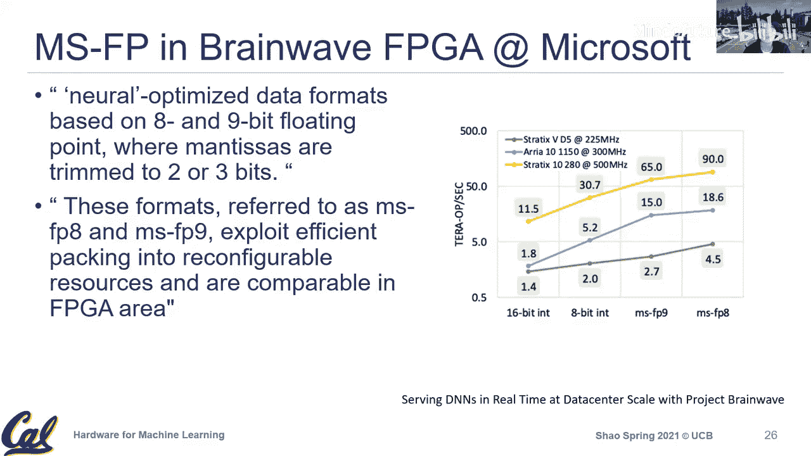

# 【加州大学伯克利】机器学习硬件技术课程 ｜ UC Berkeley ｜ EE 290 ｜ 2021 p04 P04 Lecture 4 Quantization -BV1XfM4zKETU_p4-

Great good afternoon everyone and great to see you all here and welcome to the fourth lecture of hardware for machine learning so in today's lecture we're going to continue some of our discussion that we started last time about quantization。

 especially the implications on the hardware front。😊。

One thing that one of the reasons that we want to actually spend time talking about quantization。

 we talk about some of the startup activities really actually making quite influential quite an influential impact in this community in thinking about really efficient deployment of machine learning model especially for edge devices so now because quantization has proven to be a very effective way of doing machine learning。

 especially during the inference part， we'll talk about some of the quantization of aware training also in today's lecture。

 so if you look at today's hardware landscape， we talk about some acquisition its happening to actually acquire smaller startups that can deliver efficient machine learning models but even in the hardware space is there are quite a few actually different different version of the hardware being built and deployed these days with quantization。

😊，support So one of the major ones we also talked in our first lecture NVD Nvi GPU。

 which was actually not original design for B learning。

 but has made very influential impact for the overall community really enabled this wide adoption of machine learning so one of their most recent architecture。

 the MP architecture of course there are always a range of features one of the pretty important feature is the third generation of the Tensor core architecture。

 so Tensor core will also talk about the architecture Tensor core next week。

 so that's basically a dedicated hardware unit that is designed for machine learning for machine learning。

 especially matrix multiplication computation So as part of the new features in the third generation of the Tensor core architecture。

 one of those things that NVDdia。Produce is the acceleration of a wide range of data types。

 so talk more about the data types today。 and one thing is very important。

 especially when you either look at different companies and especially hardware companies and when they mention certain things about their performance of their hardware。

 one thing that you will see a lot is a number like the flaps or basically floating point operation per second that' basically a very important metric that being reported these days and with this introduction of quantization and also hardware supporting quantization。

 one quick note is that when you see this either ops operation per second or flos floating point operation per second。

 always look for what exactly the data type that they are discussing here。

 a lot of the recent generation of the hardware using and。S NP architecture as an example。

 they actually cover a very diverse set of different data representations from floating point all the way to binary representation which is really impressive just thinking about the type of things people can do and even with binary just single bit of information。

 you can still do some of the machine learning models there so because of this demand and the efficiency there there that has has driven a lot of the hardware development。

😊，To cover all the different data representations here So one thing that's really important when we look at actually the performance metrics。

 a different hardware always look for what exactly the data type that we are looking for and that can make a very different that will actually get dramatically different numbers So for example you we look at a100 which is the most recent GPU that typically actually deployed in data center for machine learning they we look at their floating point at P1616 bit floating point numbers。

 it reports 78terot labbs per second so which is pretty significant right so that's already a lot of computational power but we go all the way to binary representation which is also introduced in the NP architecture we notice that the the unit has changed right that floating point operation。

there we dropped FL so basically just operation per second and even for operation per second。

 we're count each binary operation as one operation here and then we get to almost 4000 operation per second compared to roughly 80 operation per second when we were talking about a floating point so just purely this data representation could also make a huge difference when we report hardware numbers so always be very careful when you see we evaluate a piece of hardware we'll see a new piece of hardware being introduced in the market and when they make a claim about their hardware performance。

 especially when you just represent present operation per second even that number is pretty impressive you always need to ask a follow-up question what kind of operation are you talking about here。

 even for floating point we'll talk about some of the recent adoptions and recent variations of different floating。

Poin representation， even when they say floats， that could also mean different floating point operation。

So not only just in the startup field， just in the hardware field in general。

 this has become a very interesting and exciting area and it is really important when we evaluate hardware performance。

 always be aware what kind of data representation that they are talking about here。

So that's basically a brief just state of art， architecture support。

 work quantization will cover a little bit more of what kind of different representation means why it matters。

 and some of the tricks people are using to actually make sure their model can take advantage of this low precision architecture。

So with that， let's get started。So just a quick review in last lecture。

 both basically in the lectures last week， we covered the basic understanding of machine learning and also and also deep learning more specifically last Wednesday。

 we mostly covered on the deep learning front and whenever we talk about machine learning model and we always say there's three components and we need to learn from experience that experience is basically the data set right and we need a metric to tell us how good or bad we are performing and that's basically the cost function that is being used in the training part and we think about the task specific task this machine learning and its model is to trying to perform there is always a model itself what kind of architecture are we talking about how complex is this architecture but also the optimization thats actually being used in this architecture in the reading last week we read the Alexnet architecture and hopefully you will see all the different。

Components， even in that early day of work of deep learning。

 all those components optimization method model itself。

 and also the data set and cost function being used are our important component when we think about a new machine learning algorithm。

 including a new deep learning algorithm。And we also talk about deep learning specifically a model hierarchy there and one of the most important parts is this hierarchical and deep layers and extracting features and there are both linear and nonlinear models included in the deep learning part。

😊，So in today's lecture we're going to do a deep dive in really thinking about data representation the reason it is important we already cover that a lot of the hardware platform already actually explore different hardware support for different precision that can be deployed and we'll see that different precision。

 different data representation could also change the amount computation we need to do and the amount of storage that the amount of data that we actually need to store and move pretty significantly。

 so with that in mind it is actually very important。

 especially in deployment to understand the implications of quantization why it matters and what are the common techniques that we use to make sure that we can deploy low precision algorithm so with that that's basically the core topic of today and if you haven't started already why it's basically designed。

to both get you started in running deep learning models using a state of large framework where using Pythtorch in this exercise。

 but also using quantization， a very important hardware driven technique to change the models but without significantly sacrifice the accuracy。

Again， if you have any questions or comments that you want to share。

 feel free to just unmute yourself or leave us a comment in the chat window。

Let's get started So just a quick refresh will'll start from the floating point representation and get to the fixed point representation that are more commonly used in deep learning。

 especially inference and then we'll get to the deep learning quantization steps so just a quick refresh when we think about scientific annotation we'll start with decimal and then we'll move to to binary representation whenever we see a value there are always different components here so from like especially with a complex scientific value here。

 the first thing we notice is that there is always a component。

The exponent piece and the base we start from right to left a little bit counterin just start from this way with that actually dictates basically the size。

 relative size of the values how big the value is so because we're doing a decimal value that's basically the value that we're interacting in our daily life so basically the base is 10 so that's basically the base 10 is the redx of the number here we're using a base 10 representation for decimal values and when we get to the binary value。

 the base will be two。And the exponent is basically the exponent on top of the base right so what exactly the range and that's basically because it's the exponent on the base so that's very significant really determine the range of the value the rough range or the value we're talking about so those we have two parts that basically using the reds basically tell us what's the base when we're talking with the decimal or binary those are the typical base that we're using and then using the exponent to tell us the relative range of the value that we're talking about。

AndThen moving to the left， we also need to know we get to the range the rough range。

 but we also need to the exact value here so typically when we think about the exact value again also two parts here。

 we're talking about decimal representation so there's a decimal point that actually separate the integer part of the value and also the fractional part of the value so here is a decimal point that are actually being used to represent the value because it's a floating point so we do we do have both integer and decimal part。

Another component is menessa， so sometimes you also hear people talking using like significant。

 so both significant and mentea mean the same thing here。

 so that actually specifies the exact value that we care about so in this part in this case the right hand side specified the range tend to the 23 here the left hand side the exact value the base the exact value that we want to represent is 6。

02 with the base 10 representation before multipies that with 10 to the 23 here So that's a pretty straightforward way of representing base 10 value here as you have already seen in either 61 C or similar intro to hardware or to computer system class in most of the time when we actually really represent numbers in computer hardware we typically use binary representation which is actually very similar to the way we。

To use scientific。Preentation for a 10 number。So two of the biggest change here。

 so instead of base 10 because of binary representation our new base or our newris is2 here。

 so we're talking about two to the exponent instead of 10 to the exponent now and again instead talking about decimal point that separates the integer and fractional part。

 we are using binary point to support actually the integer and fractional point here。

And we still have the exponent and Mantisa are again significant here so in particular once we actually want to represent a particular binary number in our system。

 especially a floating point number we always need to store because binary point well basically specified binary point and the base is always two right so that doesn't change。

 but what we always need to store especially the mantisa or the significant what exact value there and also the exponent of the value tell us the range there。

 so if you look at any so any floating point representation。

 either the standard actual floating point representation or some of the newer innovation actually in this area。

 especially in the deep learning area， a lot of variants is how we can efficiently store the mantesa and exponent how many bits do we actually allow。

To either Mantea or exponent and one thing you will notice is that especially to the Mantea or significant this part。

 we have limited number of bits there， so instead of store in full precision what the exact value really is if we only have a limited number of bits provision to store that we are basically making a tradeoff there we're losing some of the accuracy but by storing a subset of the bits。

 we can be a bit more efficient in our data representation so a lot of the differences in floating point representation。

 we'll see in a minute is actually mostly focusing on how many bits we're allocating to the mantea or significant and how many bits we're allocating to the exponent part。

So just a quick refresh thinking about the value representation a little bit lower level than we typically handle。

 but this is important when we get to some of the discussions in today's deep learning hardware and how they choose their data representation。

😊，So this is basically what we discussed earlier， so in general。

 when we actually need to represent a floating point here。

 we always need to think about how many we need to always need to store as well what we mentioned earlier。

 the exponent part， either two to the negative one that we saw earlier or two to the 23 that we also saw earlier。

And also the significant the left part or the manisa bit that we also discussed so those are always the two two parts that we always need to store whenever we talk about floating point representation we did miss one component but also very important is a sign bit here so whenever we see a value so far our example are always using positive value but it's possible that we also use negative value right so this sign bit we always need to actually allocate one sign bit to actually represent。

The sign of of the number， the value that we're representing here。

 So that's basically the three component here。 So there's not a lot room to play with in the sign bit part right so either way we always need to have one bit that please do the sign bit so a lot of tricks in this field we are only talking about basic here。

 but we will see a lot of tricks people are doing well also'll talk a bit later。

 but we'll also have a guest lecture from Microsoft later this semester in talking about the new Microsoft floating point representation there and we'll also talk about Google's B float floating point representation。

 One thing you will see that we'll always need one bit to do the sign bit but a lot of discussion is basically。

How we do actually either the exponent， how many bits we allocate to either the exponent or or the significant or the mentea part。

 which could have an implications on the hardware。Efficiency here。

So briefly talk about the standard IE floating point representation and then we'll also talk about some of the more recent events there again the principle we' see I mentioned earlier even when we see like flops right floating point operation here typically I think when I started looking at in this field roughly five or6 years ago it's still like standard maybe FP32 is pretty standard that the number representation that we're looking at now but this field is actually changing really quickly right so now FP32 is like over provision we are really talking about 16 bit floating point and even lower bit floating point representation to see whether they can be be used more efficiently so again this is definitely a moving target so I don't want to only teach you specific representation will only teach FP13 or F 32 or FP16。

The standard one， but just in general， what kind of tricks are people playing with in these area is typically the bed ways of those two components。

So many of you have seen this already so I don't I wouldn't go too much into too much detail here so one of the standards so this is still standard representation is actually employee 32 bit floating point representation as the name suggests we basically have 32 bit to actually represent the value a floating point value as we discussed earlier we always need this signine bit there's nothing we can do here。

 always need to have a sign bit here but for this particular allocation we basically allocate8 bit to the exponent we have8 bit basically two to the we'll talk about the bias notation later but we use that to actually represent the range。

 how big the the value it can support and then we allocate 23 bit which is pretty significant right the majority of the bit is actually allocate to the significant。

 basically the exact value so that we can。most， if not all the bits that actually required。

So the number it actually represents to convert a floating point representation to the particular value that we're looking at to convert to even additionalimal value we're looking at。

 so this is a conversion here it is a bias notation here so instead of directly doing two to the exponent here instead of having another sign bit here allocating another sign bit here to see whether it's a positive or negative exponent but basically always use this bias notation。

 so it's always positive number being represented here。In the exponent field。

 all the bits are actually used to represent the exponent value。

 but when we actually do the calculation， we actually minus this bias there so that we can capture both positive and negative。

ponent here so that's a bias notation used in aroppoE floating point standard We not get too much into the detail here。

 but again the high level bits here or high level the key message here is this data representation is pretty biased or focus a lot on the significant the menisa part to actually make sure we have high accuracy and also cover a reasonable range of exponent so that's the floating point 32 episode 32 representation which is still standard in a lot of in a lot even data science application where we do need enough precision to make sure our computation can be accurate。

So even when we talk about floating point representation early on there has been there was a lot of discussion in FP16 already basics 32 bit is still expensive right whether we can trim it down to a smaller number of bits to be more efficient so a lot of the FP16 discussion was originally first started when we think about embedded system so if you look at early DSPs like digital signal processors。

 those are actually one of the earliest adoptions of FP6 so that's before deep learning so we're talking about 1020 years ago。

 when those DSP designers are thinking about floating point operation especially for embedded system。

 they realize the challenge it's the same observation we're making right we use 32 bits to represent every value it is fairly expensive because we need 32 bit to do computation。

 we need to design 3 bit functional units。We also need to have enough capacity to store all those values each of which is represented with 32 bits so in early DSPs again FP16 is actually fairly widely used in early DSPs you look at early digital signal processor they basically a lot of their vector unit we're using FP16 this is also FOE standard here。

Again， as the name suggests is 16 bit， we always have。

 there's not much we can do with a sign bit right， so that's still there。

 but we trim down both the exponent and significant bit there and we trim down the significant bit bit pretty significantly So if you recall before for the for the 32 bit floating point。

 we have 8 bits for the exponent right so now we trim down 3 bits there。

 So we get to5 bit and for the significant for the 32 B representation。

 we have 23 bits there to actually cover the exact value there。

 now we are trimming down to actually 10 bit。 So it's 23 to 10 right so it's less than half of the original bit ways because we want to fit everything to 16 bit value So thats so we are talking about the quantization。

 we're talking about this trade off this tradeoff has been actually while at least understood or explored in the hard。

😊，Community when we did the 16 bit floating point for the DSP designs and we need to make them。

 it will be lower precision in the computation if it still be can be used for the application it will actually lead to significant hardware saving there So this is one of the early efforts in doing cheaper computation there with more efficient hardware implications and it will follow the line of a lot of the deep learning quantization research and some of the new pieces of hardware being proposed in this space they are actually using the same trick and but it just instead of this HP standard。

 everyone is have the same agreement in how the floating point operation should operate we opening up a new area where everyone is actually proposing their unique floating point operation and and not only just hardware itself who also talked us。

Something some of the software stacked later， so it's both hardware and the software stack to make sure this low precision or smatic can be pushed forward。

So just some of the background since we're talking about the conation here and another important bit when we talk about floating point point representation is that the inventor of AE floating point and Professor K is also a touring of work winner is also a Berkeley faculty in the computer science department here。

 so there's definitely also again very strong Berkeley impact in this field when we get to data representation here。

😊，So just a last some background on the floating point arithmetic when we get to the DN part I'll also introduce some of the more recent efforts in really not thinking about standard floating point representation but some of the customization different hardware vendors and also software vendors are experimenting and also proposing in their product。

 so before we move on to fixed point arithmetic any questions。

 comments that youd like to share with this class。Okay， well， if you have any questions again。

 feel free to unmute yourself or just use the chat window to share your thoughtss。

So that's a basic floating point operation well before we get to quantization。

 we'll also talk a little bit more on the fixed point arithmetic and then get to the hardware implications there。

😊，So we talk about floating point operations basically the significant part to represent the exact value and the exponent part to represent to represent to represent roughly the range there and the point the binary point or decimal point is floating because depends on the exact value right we basically always the first bit of the significant is always one right so the point the exact binary point is actually floating because it depends on the exact value when they choose different ways represent this value so fixed point is basically as the name suggests we're not actually floating the binary point sometimes people just use integer point or integer arithmetic directly because that can in most of the cases that can be treated the same as basically integer arithmetic there with as long as we remember or。

As we know where the fixed point is and that will change as we discussed here。

 the slope of the exact value here。So I get to fixed point my way like the way I like to think about fixed point arithmetic。

 as I mentioned earlier hardware is really basic integer。

 we're really doing integer arithmetic but we need to keep a notion of where the binary point is right so a very I find what I find pretty intuitive an intuitive way to think about fixed point arithmetic is this slope。

😊，Is a slope and biased notation here and you will see actually the reason why this is actually fairly intuitive both thinking about number of presentation and we'll see later when actually talk about exposing this to software there is also a pretty direct actually software link here so we'll get to that in a minute。

So what we mean by that if we think about the value actually being really represented is in hardware or in our representation is x so x it basically the value that we're storing here so that's the number that's a bits that we're storing here but the number or the value it represent could be different than the value itself so what we mean by that we'll see a couple example here。

 basically because it's not just integer， there is a binary point somewhere depends on where the binary point is。

 this value being represented in x could be scaled differently or there could be even a bias added to that so that to interpret this value we actually need to convert it back or adding consider the slope and the bias in the data representation to actually reconstruct。

It's real value true value it represents which is value y here so that's what we mean by soap and bias representation we'll see a couple examples and hopefully that will make things clear basically the computation is still in teacher computation most of the time actually all the time we're basically doing in teacher arithmetic but one thing to keep in mind is that the value that we're storing not exact may could be different to the value it actually representing here because there is a scaling being done here。

So what do we mean by that let's look at a couple simple example here。

 So let's say we have a three bit here to use to capture X here。 So in our memory in our hardware。

 we actually have three bits to capture the hardware。

 So here is a three bit here we also keep track the true value that it represents here and one thing we notice here because depends on even for the same representation depends on where the binary point is。

 it could actually shows up as different value here。

 So let's start from a simple example where S is one。

 there's no slope right so S is one and the bias the z value here is basically0 in that the value actually being represented in x is basically the value actually of y here。

So in this case， if all the three bits。🎼So this is x， this is y， right。

 So if all the three bits here are0， So the three bits that we are storing representing x is0 and y is also。

Feral here。But if that take the extreme， if all those three bits here。

Representing x is1 right so this is basically a binary value of 111 and then we just convert it directly to a decimal value。

 it will be 7 and the y the value of y is the same as the what value of x because we're not doing any。

Scaating here。So it's basically here， takes the value of x that becomes the value of y here。

So let me think okay， this is fairly straightforward right why are we making this a bit more complex we're talking about there could be actually a skating here what do we mean by that so let's look at a slightly more complex example here。

😊，So in this case we still have three values here， so x still have three bits here。

 and we are interested in the true value it actually represents。

🎼So here instead as the skating factor is one。 so now the skating factor is actually one over4。

 So what do we mean by that， So instead when we have the three bits here we say it's。

🎼Each a bit is basically represent2 to the0 is basically1，2 to the one is 2，2， and  two to the2 is 4。

 That's basically our standard binary representation。 Now， because of skating。

 we have a skating factor here is actually scaled by two bit here。

 you can think about the let's say the three bit here， right， So before in the first case。

🎼Our binary value is here right so now that's so this basically the first integer bed the second。

The first integer， the second integer the third integer bit。

 so every bit actually represents integer value for the scenario a we're talking about here。

The scenario B we're talking about here， so for the3 bit of X。

The binary value is actually here so instead of in the end。

 so now we have a binary binary the binary point， not binary value， my apology。

 the binary point is actually moved to the left so that's why the skating factor instead of one it is actually to the four right so even in our data representation we only store three bits but we need to be aware there is a binary point somewhere right so in a scenario being compared to a our binary point is actually being shifted to the left for two more bits so what that means is that my skating factor is instead of one what I saw before is actually one over one over four right one over two to the two。

Over four here so for the three bits it represent here you will do the same exercise if everyone is zero。

 my value is still zero right no matter what the scaling factor is it doesn't change my value here but one thing to note here let's just look at the extreme if everyone is one all the bits or one。

 but it's actually in this format。In the format B where my binary point is here。

So the value is actually represent instead of seven is actually seven over four because my scalingkating factor because of my binary point is in a different place。

 so my scalingkating factor is one over four in this case。Does it makes sense， questions。

So basically when we think about x point representation。

 we still have theteger doing the integer arithmetic。

 but the scaling point here is basically tell us where the binary point exactly is。

Let's do another example。Could we see a different scenario here and let me move this。🎼Right。

 so in the scenario C， we're still again， we're representing three bits here for x right。

 so now instead of shift to the left for two more bits for the in the B scenario。

 we actually shift to the right so before。🎼So for the a case， it was here right。

 so that was the original binary point。 So now for the scenario C， our binary point is。

Actually here we're shipped to the right for two more bits。

 so here you actually see the benefit of doing the skating in the sense instead of actually using five bit if actually don't do the skating we need to use five bits to actually store the value now because we are using skating where basically doing a skating here with actually only need to use three bit to actually represent a five bit value in this case by storing this instead of storing all of my data。

 we see a lot of data later especially when we talk about array of data vector data instead instead of storing all the data using five bit we actually only need to do three bit for。

Or beta。 And then with a small piece of metadata been stored for the skating factor here So here。

Basically shifted our binary point to the right for two position again zero is the same。

 but for all the one case instead of doing all the one here instead of just111 the value is actually really represent is actually with20 in the end is actually representing a five bit value so it's actually 28 so that's basically this one notion with fixed point arithmetic fundamentally is doing integer arithmetic but if they're using this scalingating factor it could actually doing represent even smaller value or bigger value but we need to track keep track of the scalingating factor here。

The last example here just following the same principle here will just to not only have the skating factor but there could also have a bias there so instead of start everything from zero。

 we could make things a little bit more complex we actually it was a typical data distribution is actually very shifted。

 we could also capture that by using our the value here as a bias to actually shift the representation again everything also shift accordingly。

So the reason I spend a little bit more time on this is this is because this is actually very similar to some of the quantation exercise that we're doing。

 but just fundamentally when we think about fixed point arithmetics。

 it is doing arithmetic here either way， no matter what kind of magic we're doing。

 we still have three bit for each piece of data need to be stored in hardware to represent X but there could be this strip bit could be used to represent either a wider range or smaller range and could also be biased based on your data distribution。

Make sense， any questions or comments before we move on？Okay， great。Again， if you have questions。

 feel free to either you can also send me an email or post on Piaza afterwards to have a discussion。

So okay so that's a quick background fixed fixed pointrithmetics so we talk about in general v point and fixed point arithmetics one thing I again I already mentioned earlier and just want to reiterate again in some of those tricks that we have been doing either for scientific application or for embedded application especially for low precision ones but for a while it was not really introduced for like mainstream like CPUUs or GPUs because of the limited application。

 it actually support with the low precision what's really interesting is actually get to the point get to the area of deep learning interestingly it's actually very air tolerancele in the sense that even we cut the precision actually pretty significantly we can still actually perform the functionality that it required which is very so I always feel like deep learning is almost。

the ideal application people are looking for， especially hardware designers are looking for a very parallel。

 we'll see some of the parallel implications later in like next week in our discussion。

 very structure， very easy to actually understand the computational patterns will also cover that next week。

 but as a very early first stage， this is also very air friendly or approximation friendly some of the techniques as a hardware designers know especially designing low precision hardware like we know those for decades but we just didn't have an opportunity to introduce that into our hardware because the applications cannot tolerate this low precision。

 but very interestingly it's actually especially it learning actually very hardware friendly and especially low precision。

😊，Weare friendly that has triggered not only some of the like low precision hardware introduced in the market。

 we talk about the Tensor core precision mode and also some of the other either Google or Microsoft what they are offering for both your software stack and hardware。

 it also opens up a really interesting field in analog or mixed signal circuit design。

 where there could be even more aggressive low precision techniques used in hardware design。

So those are also techniques people studied before deciding not applicable for the majority of applications and have to drop those explorations now that whole area also become very active because there is a very promising category of applications that can actually benefit from that that that kind of approximation techniques so besides talking about those specifics is how it works。

 but also just a little bit context that some of this kind of no precision hardware design。

 people have been doing that， people try to do that explore that and the reason it was not very successful at least before deep learning is not necessary on the hardware side but most of the time actually on the software on the application side so now we see a lot of this kind of hardware design both in the digital hardware we'll talk more。

Later and also in the analog hardware design will also cover that towards the end of the semester。

 the reason we're seeing more both in research and also in commercialization activities is not because people didn't realize this trick before like we know this trick we know all those tricks but before application developer told us don't try those tricks those are too risky I wouldn't use your hardware because those are too risky but now they are saying oh。

 if you can actually gain in the hardware that I can do my job actually a lot more efficiently both faster and not consuming a lot of power。

 I'm willing to give it a try so that really turns the table change the conversation so even now when we see this kind of low precision。

Hardware design and also I mentioned earlier like analog and mixed signal hardware design。

 of course we also need to understand the hardware。

 the component exactly what how it works right what has a new insights or new idea in those hardware at the same time always be aware the software。

 the application component whether the application can be that tolerate can toleraterant can actually tolerate that low precision for the specific deployment scenario so that's always this application question always very very important So this field of low precision hardware design has been around has been and there are ways to do that and reason it was not widely adopted before deep learning is not really on the hardware side it's actually more。

On the application side， just a little bit more history before we get too deep into the quantization techniques。

😊，Okay， so we talk about the different ways of doing computation as we discussed。

 this has been studied and explored for other fields for like what we mentioned earlier embedded system DSPs。

 but now actually this entire field become active again because the deep learning drive these days。

 so'll talk a little bit more on the hardware implication。

 why it is important and also specifically how this actually applies to the deep learning quantization。

So for the hardware implications， so many of you have taken either 151 or 251A or similar digital logic design in your undergrad or early grad schools and one of the topics basically how we can actually build fast multipliers most of the time we talk about fixed point or integer multipliers。

 some of you may also have experience designing floating point multipliers there。

 so in general we'll see a more specific example later。

 but in general when we think about deep learning。A very important component of the functional unit is basically a multiplier here and the way you get multiplier it added。

 we should actually say both， I will list it。😊，Multipliier here because multiplier can basically can be built from adder right so by using an array of adders we can actually build a multiplier and that's how we actually do the fixed point arithmetic and we get to the floating point arithmetic we still need to do a multiplication there。

 especially for our mens or significant bit but we also need to actually accumulate the exponent together。

Exponent and together we do multiplication and then a very important part is actually doing normalization to renmalize the value so that we can fit the specific format of the way we store are both or significant and exponent here。

So typically floating point operations are a lot more complex than the fixed point arithmetic here。

 especially for like multiplier， like we see there is a common multiplier here。

 but it also has other unit， especially this normalization unit can be significant and addition even like the difference is even more pronounced fixed point addition is a lot cheaper compared to floating point addition。

 so a lot of the really on reason people are driving from floating point representation to fixed point representation is because of the potential。

A benefit in designing simpler hardware and when its simpler。

 it's typically more area efficient and also more power efficient here。

So this is at this point it's a little bit dated， I know there is actually an updated version coming up very soon。

 so hopefully we can get another more updated version there。

 but whenever we you may also see different versions of this data in other lectures or other classes or other talks but basically this is for a predict technology and it's a little bit old at this point we're talking about seven nanometer technology in some of the recent mobile processor statistics right so this is many generations we're talking about 45 almost six。

 seven years ago but just in thinking about computation here。

 computation here like a good example it also have different data here but let's maybe look at。

The 16 bits so the 16 bit fixed point addition versus 16 bits a floating point addition here so it's both data both data representation are using 16 B right so the data representation is the same data the number bits being used is the same by the way how each bit is actually being used is different in fixed point and floating point representation here and in this case when we look at energy per operation here。

 when we compare fixed point and floating point operation here we're looking at like almost8 to x more 8x energy difference when we look at floating point number versus integer number here。

In teacher arithmetic here so that's basically just a more quantitative motivation to actually think about the differences of using fixed point versus floating point arithmetic and then when we get to area here it's even more pronounced here we're talking about more than 10 x differences here so those are actually a more quantitative motivation just to think about the whole push to actually go to simpler hardware go to fixed point representation is because of the hardware simplicity and the potential hardware benefit。

And another data point we can compare is basically the 16 bit floating point versus a 32 bit floating point and here we see also see a 3x differences for doing multiplier design right so that's basically I mentioned the push to 16 bit floating point in the embedded system here and this is we look at the area that's also56x differences here So those are the reasons just when we think about even even we think oh both are 16 bit like saw we saw saw earlier but the underlying computation is actually different so that has actually different implications on the hardware so the reason iss not only just cut the number of bits of course first and cut the number of bits for either within floating point or within fixed point the lower a smaller number of the bits the better from the hardware。

ive and also between fixed point and flow point fixed point like we talked about the8x energy difference earlier right so there could even the number bits are being used is the same the storage is the same but the data by the computation is different so that could also lead to different area and energy implications here so I'm looking so again this kind of tradeoff is also very data dependent I'm actually looking forward to get more updated data to see how significant this is and again。

When you actually in your practice， when you have a different technology， the。

 the differences could be actually different than the one we're looking at。 right， So maybe again。

 still 16 point fixed a floating point is still a lot more expensive than 16 point So16 point floating point。

 It still could still be very significantly more expensive。The 16 bit integer。

 but maybe depends on again this is maybe depends on the technology were using youre using maybe 8。

8 bit floating point we'll talk about almost a lower precision that we'll see later maybe 8 bit floating point is actually not that expensive in that case then thats also become again this is very dependent on technology depends on your flow so what I want to highlight is that use your technology。

 your your flow characterizeize your technology carefully so of course we have this general principle the lower number smaller number of bits are better integer point it typically more efficient than flow point but for this kind of tradeoff。

 especially when we start people start thinking about doing training as well especially lower precision training whether 8 bit floating point is better or worse than a 16 bit integer data representation that could be actually different and also interesting。

De point on its own so again， want to highlights this is actually very data dependent。

 but in general， a smaller number of bits are typically more efficient。So we mentioned。

 like we mentioned earlier， like both multiplication accumulation are important because when we actually do doing deep learning computation。

 we'll see more later， especially next lecture and the lecture and next week we'll see actually how it turned into hardware but a very important we'll talk about procession。

 we'll talk about functional unit， a very important hardware unit actually being used or being built is's basically is Mac unit or。

Multiply， multiply， accumulate and accumulate unit， and fundamentally it's basically a multiplier。

 a multiplier， and an add。So typically just one thing。

 the reason I want to bring this up is just when we talk about low precision， arithmetic。

 especially in the deep learning context。A lot of time we're talking about the bitways are key used here。

 So when you hear people talking about it。Preession。

 they are basic talking about 8 bit weight and 8 bit input， and typically。

That also mean the output is88 bit， which is fine， I think those are accurate term to describe the data。

 The reason I want to bring this up here is that internally when we actually think about hardware design。

 not every bus or not every wire or not every wire in your design is actually8 bit。

The rate for that is first we actually let's say the input is n bit and let's use and consistently after the initial is a multiply and accumulate right so when we actually do the first multiplication。

 even we're taking8 bit input the output is actually 16 bit or two times n bit。

 we actually double the output right that's just how multiplication works right， so we actually have。

Actual bits or overflow bits， actually in our multiplied results。

 So that's basic already an increase internal number of bits here。 So we get to two and here。

And then wait， another operation match， right another operation we're doing is actually accumulation。

 So typically， this accumulation is actually even higher than2 than 2。 Let's say if n is 8。

so we are having eight bit input weight and8 bit activation， we have a 16 bit。

🎼Partial result from the multiplied result。 And then we actually need to do this accumulation iter to B for hundred。

 sometimes even thousands times to make sure that we have an actual number bit to actually account for the accumulation。

 right， So when we， even we are adding 16 bit。To by sex in bed。🎼Together right。

 so we are actually getting a 17 bit number right because there could be actually overflowed here。

 So to actually account for this potentially impact in our design typically we actually add another n bit here。

 So a very safe option here is to do 16 bit and then we do actually 32 bit accumulation。

 So if we have a register here。 So this register is actually 32 bit instead 8 bit。

 even we say this is 8 bit arithmetic， we do accumulation。

 this is actually a 32 bit register being used to do accumulation here。

 So this is a little bit more conservative some of the hardware that you will see this days instead doing 32 bit。

 they actually do 24 bit。So it has actual instead actual 16 bit of M they do actual eight bit of M to do the accumulation again。

 this is also data dependent dependent data that you say when I did the experiment I think 24 bit is actually pretty safe for a lot of eight bit representation at least for computer vision applications depends on how aggressive that your design you want to do so sometimes people also go just do to to do 24 bit a safer option is to do 32 bit to accommodate accumulation so then when we actually finish all the accumulation we quantize back to our8 bit output。

So this is a typical flow right so one thing you will see that even with it8 bit arithmetic。

 the internal， especially the Mac part， is actually a lot higher than8 bit so those are we are still doing higher precision arithmetic here。

 not as high as floating point and sometimes as I mentioned we can cut some corners here but that so the internal of our hardware could be actually a higher precision than just the input to our data input data precision。

M this。Any questions or comments？Okay， so that's just a little bit more information on the precision front and most of the time when we say8 bit。

Hardware as we discussed， were basically only thing in the input。

 but the internal side could be of higher precision。Right， so some on the logistic front。😊。

Before we move on handling more bits to low level so far on the logistic front so lab one was posted is's still by the end of this week many of you have already started hope you have a fun and we use Pitor A also put a like tutorial or Piytorrch。

 a link to a tutorial of Piytorrch so you are less familiar with that feel free to use that to get more comfortable and that basically get more comfortable with Pytor understand the like standard terminologies and the lab itself is about the low precision arithmetics that were covered we're covering in today's lecture。

😊，And paper rating is also posted。 We have one paper per week。 It's up to you when you want to do it。

 The deadline is due on Wednesday， midnight， Wednesday。

 I believe bes as a very good suggestion to actually also post the paper early so that people have time to actually work on it So I posted the paper for this week。

 again， on the low process quantization very related to the lab yesterday on Sunday。

 but moving forward， I I will post the paper reading every Wednesday after Wednesday's lecture for the next week。

 So you can if you want to start early on Thursday or Friday。

 just always check out check out the plus website to find the paper reading link there。

We have a couple guest lectures coming up next week and the week after so next we will get to talk about the hardware design we'll actually have a very interesting guest lecture from AWS who has has also been building generations actually so last year we have them there that was their first generation of AI engine and now they also have a more updated version of their hardware engine or AI engine in their data centers so they will talk about their infentia basically their hardware design for for deep learning and some of their deployment experiences I'm looking forward to that lecture there's not a lot of information about influential design so mouse I'm personally very excited and looking forward to what our guest speakers will share so that will be our first lecture guest lecture next week。

And the week after we'll also have a guest lecture on more advanced quantization techniques from Amir Guamami who has been at Berkeley for the past few years and has done some very interesting work in doing like edge deployment and model optimization with a lot of focus actually on some of the quantization techniques that we cover today as we mentioned earlier。

 of course there are a lot of hardware ideas actually been popped up， especially recently。

 but a lot of the bottleneck is actually in the application side so Amir can share some of the deployment experiences but also what are the challenges in today's deployment in really low precision hardware so we have two。

Guest lectures lining up for the next couple weeks。 And that also that will also be our second lab。

 So the second lab will be posted next Monday。 So the second lab will also be a little bit more involved compared to the first lab。

 So we'll have more inform。 I'll share more information this Wednesday。

 But by having guest lectures here， hopefully it's also a lighter load。

 And then you can actually focus on on your on the second lab。Exercise there。

So any questions either are the plan， lecture plan moving forward or the reading discussion reading submission or the lap one or maybe even lap two？

Okay， well again， if you have any questions， I'll also be around after the lecture today and also feel free to send me an a an email or post either publicly or privately on PSA。

 that's all we will also see your message there regarding anything that youre interested。Okay。

So with that with that setup， we get to the core part of today's topic really thinking about how quantization is actually being deployed in the deep learning context。

 so let' get to the final component， the D quantization part。Just a little bit motivation。

 I don't think we need to spend too much time on this it just like we also cover quite a lot of this in our first lecture and so the models getting more complex and models are getting also much bigger so there's a lot of motivation to have simpler hardware。

 simpler data representation so that we can save the storage requirement and potentially even simpler hardware so that we can do the computation a lot cheaper。

😊，So with that quantization comes in very naturally right we talk about remember the data that we saw earlier with the 45 nanometer technology。

 the differences and in both energy and and area and that's mostly even on the computation front right and then on the storage front using different data representation。

 especially different bitways could also save us in the memory capacity。

 we can use our limited capacity more。😊，More flexibly at least in thinking about how we can store more data there so that's basically why quantization is actually being used here in in our discussion so the quantization we already have quite a lot of setup up earlier so as I mentioned earlier this is not really a new idea right so we have been talking about this for generations and we have been using this also right so this is just we finally find the application that is so hardware friendly that we can actually apply those or expose those to the application part。

😊，So the quantization， especially for the fixed point。

 quantization is basically a fairly straightforward adoption。

 really using our fixed point representation to the values actually being used in the deep learning context。

😊，So we are basically still using what we call the slope and the bias way of representing fixed point here when we think about computation。

 so this is is actually fairly similar but we look at this versus our like fixed point representation earlier。

 this is really just push the also also scaled by X right so we'll just use this one the equation one here has a standard to be consistent this is pretty commonly used in a lot of deep learning framework soll just use this format just to be consistent with a deep learning framework to represent。

Data representation， but again， this is very similar to what we discussed earlier so instead of using y were using R especially the real value right the true value actually this particularor number of bits are represent and the Q is basically。

So this is our。And this is Q Q is basically what we talk about S S or x before， right。

 so that's actually the value actually being stored in our memory。

🎼And it will use square right so this is S here， this is the scaling factor。

 it is the same scaling factor and we will use just comes site here。

 so for the this is basically zero point why these used for bias that we discussed earlier just offset our range here so when we actually look at I forgot this where we get this is probably from and like In oneal Intel's library。

We do actually quantize representation， those are basically the parameters being used。

 what is a scalingating factor， what is a bias or zero point and what is a quant value actually used and using those value we can actually reconstruct the real value that we do want to represent here so this is basically the same representation that we discussed in our fixed point representation just in the deep learning put in the deep learning context。

A little bit more about the deep learning context here we'll see more actually next week。

 but I want to get this across so that you are ready for the lab one。

 we'll talk about more detailed computation later when we do actually deep learning but we already cover a little bit right so the core computation is doing multiply and accumulate right so basically we think about doing a matrix multiplication here。

 we have our weight matrix input activation matrix and then we're doing a multiplication。

 the multiplied result is our output activation activation matrix。So to get each。

My color is not very helpful here。 Let me change a different。🎼Color you。So for。

For to get the first pixel。On my output。Actation， the computation。

 which is basically the equation showing here， the computation it doing is basically doing a multiply for for the corresponding。

Lals between weights。🎼So the point， the circle multiply with circle， triangle。

 multiply with triangle and square multiply with square。

 and then doing an accumulation over a partial partial sum。 right， So the multiply。

 we do a element wise multiplication。For the corresponding values， so。

🎼Point with point our triangle multiply with triangle square multiply with square。

 and then doing a big sum across all of those。 and then the accumulated sum result is。

the pixel of the output right so that's basically the computation we're doing and the goal of doing fixed point arithmetic is that instead of doing floating point arithmetic for this multiply and accumulate how we would do actually fixed point using fixed point arithmetic for the multiply and accumulate。

There so what we can do here so let's rewrite this equation that we just saw earlier right so this is an equation that we just saw earlier again this is remember the little triangles and squares I drew earlier we're doing the multiplication and then doing the sum for each element of the output activation。

And the equation that were trying to use here is basically instead of doing the real numbers here。

 we're doing the context number here。🎼So the first step here is basically rewrite this instead of using the real numbers here using the quantized number here all so how do we do the rewrite here so let's start from the equations on the left side right so instead of doing the real output activation we can actually change it。

 we are basically using the skating point skating factor of the output activation multiplied it with the Q the quantized value of the we also have the of the output activation。

The particular number index that we're looking at is I and K， right？🎼And then。Minine us。

🎼The zero point or the bias of our output activation。So this is basically the equation on the left。

🎼RightSo we just replace the real value with the quantized value here。

 We can do the same trick for the one on the right。 So we still keep the sum equation here。And then。

What we are replacing here the same operation for the weight。

 we have the scaling factor of the weight。🎼And then the quantized weight here。

 the index is I and the J minus the zero point of weight here。 So this is our weight component。

 right， multiply with the skating factor of my input。

🎼And then the quant value of my input and the index H and K and minus my0 point of my。Input。

Accavation here。So that's basically a simple rewriting that I just did from the floating point value to the quantized value。

 right？Make sense。Questions？Okay， so with this， what we can do is that in the computation。

 what we want is to actually the computation basically to get the output right now we want to get the contactized output instead of the true output So what we want to do is basically see what's the value of my output activation again for this index。

🎼Yes， right， so the first thing what we are doing here is basically we need to scale this by my output activation also I move this component to the right so I move my bias component。

To the right right so I move this to the right side of the equation。

 also move the scalingkating factor to the right side of my equation。Right， makes sense。

🎼On the right side， this is what we have here。 right， We still do the sum trace there 1 to M。

 One thing we notice is that。The two scaling factor is actually independent for the summation right。

 so we can actually move the two scaling factor out so instead one here。

 what we can do is basically scaling by weight。Like skating factor or the weight and the scalingating factor of my input。

AcSo it takes those two parts out。Right， makes sense。

And then we keep everything the same right so we still have the context value of weight of I and the J。

inus my zero factor of weight and then times my contact value of input activation for index and K。

And minus。My  zero factor。For our zero point for my input activation。Yes。

🎼So let me change a different color for clarity right so this is basically the new quantized value here at the same time what I like to do is actually you will also do the same thing in your lab one is's just like let's not worry about the zero point let's just typically will just assume the zero point is zero actually instead of making things too complex to do this kind of shiftive behavior you will do some characterization also in your lab one to see whether this kind of constant bias or constant shift is useful。

Let's simplify the equation so that we don't need to worry about the zero point。

 the zero shift for now。Then what we have is to get our output， quant output。I best I have。

It can remove this zero point， but keep。That the scarating factor here。Or still do accumulation。

And now all my accumulation is actually。🎼Quantized accumulation for my weights and my。Input。

🎼So this will be my quantized accumulation so if you look at this， this is basically what we will do。

Basically， doing the integer， multiply， multiply。🎼And accumulate， right。

 And then the value to actually reconstruct the real value。

 we need to scale our multiply and accumulate results accordingly。

 based on the scaling factor of my weight and scaling factor of my input and scaling factor of my output。

So this may look a bit complex， feel free to once you read the paper。

 hopefully it will clarify and I would actually strongly recommend to start the lab if you haven't started already started the lab you will do characterization。

😊，You will see how this actually being put in practice。

So you don't need to make the note I also write down my equation here if you want to check this later so this is basically the core quantization process and the trick here is really figuring out the scaling factor here so that's basically the more tricky part there's also a lot of research in this space I wouldn't get too much into that just how to do that but I would highlight that typically there are two ways to do the scaling factor。

The first part is basically use the max value in the range。That what we see earlier。

fiiguring out the minimum and the max value and then scale them back to the8 bit range and that's basically how we decide the skating factor。

 this is pretty commonly used and in a lot of times actually surprisingly they are reasonably good。

But also a lot of research in this area to pick the scalingkating factor more systematically。

 you will see will also ask you to actuallyconsider instead doing just mean and max。

 whether you want to do mean and max plus a minus maybe necessary standard deviation。

 whether that will be good or bad， that could also be an alternative。

Way of to actually pick the threshold there， so that's one of the design parameter that you will be explore in your quantization process to do。

To do either simple meme or max or do。Or do some adjustment based on that we don't have time to go into this。

 but this is some of the things I mentioned earlier we see some of the new innovation here in doing a low precision there let's let me do this Ill actually I would cover the B floatat and the Microsoft flowing point operation in my next lecture so that you will also will still discuss that but at this point you have all the information you need to get your lab one started。

Okay great good to see see you all here， hope you had a good weekend and enjoy your let's say this is third week of the semester。

 so I hope everyone is doing well if you have any questions either regarding the lab or regarding the lecture or the project feel free to stop by our office hour or just stick around I'll also be around for a few more minutes for questions so good to see you all take care and I'll see you Wednesday。

😊。

