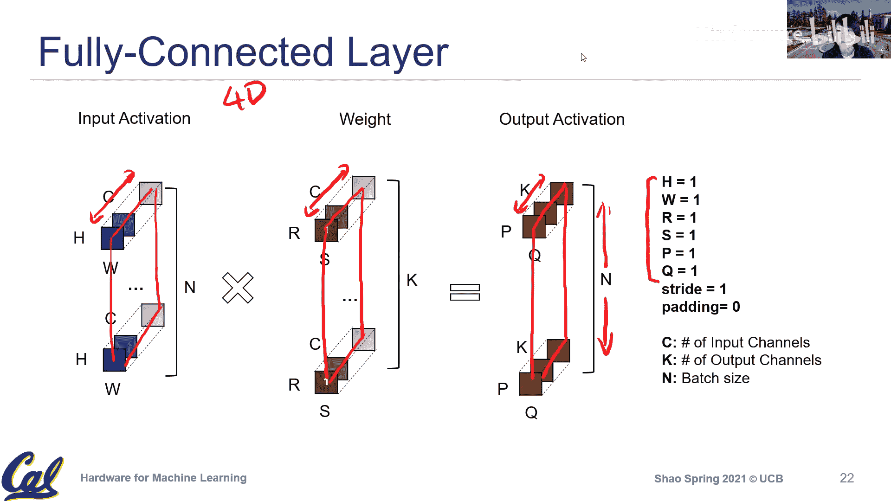

# 【加州大学伯克利】机器学习硬件技术课程 ｜ UC Berkeley ｜ EE 290 ｜ 2021 p05 P05 Lecture 5 Kernel Computation -BV1XfM4zKETU_p5-

Okay， good afternoon everyone and welcome to EE290 hardware for machine learning Today we're going to have our fifth lecture of this semester we'll actually go to the lowlel operations the primitives of deep learning and how they are actually used in different computation and especially in the deep learning computation patterns so in today's before we get to today's lecture we'll briefly talk about some of the related activity actually in the GPU space when we think about not only just the hardware or just in general the application but really thinking about how application actually interact with hardware。

😊，So we talk about， especially in the first lecture。

 talk about how GPU actually becomes a dominant hardware and really enables a lot of efficient deployment and also successful deployment of deep learning。

These days， so one was a very important factor for GPU's success， of course we have great hardware。

 very parallel and to support a lot of parallel operations at the same time， but equally important。

we think about the success of GPU， especially success of NviDAs GPU is their software ecosystem。

 how they really enable people to not only using GPU as a graphic just a graphic card but also enables people to actually use GPU as their underlying platform for scientific computing so since we're talking about ecosystem one of the most important successful factors for NVDS GPU is the coDa story unified device architecture that' look up so that's what couldUDa stand for as a name suggests it's really trying to unify different generations of NVDAs GPU architecture and then really expose easy to use and and fairly intuitive programming interface so that like graphic designers and even programmers and even known like HPC programmers can actually。

Use GPU for their own application that really enables the whole generation of GPGU general purpose GPU computing and make it that really paves the way to for the GPU's adoption in the machine learning area。

So since we're talking about kuda， just a little slide story about the starting of Kuda。

 So it's related， not directly related， not directly related， and we think of Quda story。

 but around the same time when when NV is really thinking about how we can actually develop a programming interface back then a grad student a grad student actually at a Stanford was also a story how can we make a GPU for the hardware design or graphic processor more programmable but also thinking about the programming interface to GPU。

 So that's basically Ian Bo in his PhD thesis， it develop this group GPU system to really make it easier for programmers to think about GPU programming and also map computation onto GPU。

So after his PhD， he actually joined NVDdia and starts looking at how we can actually extend this kind of infrastructure in the commercial GPU space and also develop a programmable interface。

 So that really eventually with， of course， a lot of people are involved in the in this endeavor eventually that actually leads to the development of Quda。

 So Ian still at NVDdia。 So he is actually leading I think one of the VP at NVDdia these days and leading the also the NVDdia's data center business。

So again， a lot of very important factors back to similar to our Alexnet story， I would say Alexnet。

 the way they actually start thinking about GPU and applying deep learning。

 using GPU to actually accelerate deep learning computation。

 And then here the coulda story when not only thinking about hardware。

 but also thinking about building the ecosystem and how to enable more programmable interface to use the hardware architecture。

 a lot of those very exciting development and completely change and transformed the way we think about computing。

 the way we think about hardware actually started from academic research。

 So we talk about the Alexnet example and also the coulda example。

 a lot of time academic research is typically a little bit ahead of time。

 trying to see what the industry is offering and also think about what's really missing in the industry。

And some of the really influential academic research not only actually create a really interesting idea and change the way people think about this particular either system design or hardware design。

 especially in the system research hardware design or different mechanism。

 And there is also a possibility to lead to commercialization of possibilities。

 and we talk about the Xor do AI that being acquired by Apple that also started from U do right So this is another example make very significant impact in the wide adoption of GP GPU general GPU programming。

 and that also started from academic research projecting， really thinking about if GPU。

 this kind of parallel computing is important not only for graphic computing。

 but also for other area， how can we make it more flexible。 So some。Hisory。

 but also related to some of the lower level primitive that we'll be discussing today。

 so the kernel computation we'll be discussing today is's more like a boundary between an application and hardware we are not directly mapping account layer to hardware right we are actually mapping the primitive operations and a lot of the mechanism the hardware is designing is not really executing the entire application is actually executing a particular primitive so we'll actually in today's lecture talk about what those primitive are and what are the different ways。

Of executing those primitive。So with that， let's get started。😊，So in。Last a couple lectures。

 we talk about the typical machine learning pipeline and in particular our Mondays lecture in our Mondays lecture。

 we talk about different data or value representation specifically the floating point and fixed point representation and we also have a very special focus in really thinking about hardware implications we remember the table we talk about its a little bit older generation technology。

 but technology of course depends on technology but generally the trend is that we can actually reduce the number of bits actually required in computation and also data movement。

 we can potentially save a lot of both performance and also energy So with that motivation that's actually why there is a lot of research in the area of doing quantization or low process and DNA exercise try to actually make sure and interestingly deep learning。

Is a very like we like to say deep learning is a very hardware friendly application。

 We'll see more the parallel nature of deep learning in today's lecture。

 but when we talk about quantization， it is also very hardware friendly and hopefully you already see that your lab one you haven't started get started now but hopefully you already see that in your lab1。

 it is actually very tolerant in terms of different precision or different low precision optimization that we can apply it there So in today's lecture will first finish some of the discussion we started last time on the quantization。

 especially first we'll briefly talk about some of ongoing research there is still a lot of actually active research in this area it's not only actually doing quantization So most of our discussion is actually doing after the model is actually trained we take the trained model and then trying to quantize it last specifically。

So the exercise will be you will be doing in your level one trying to actually reduce the precision to see how whether that actually affect the performance performance here in the sense of accuracy of the model and then people start wondering okay if actually in the end when we actually deploy the model it will be the low precision model。

 whether we can actually introduced that in the training process so that we know that when it's actually be when it will be finally deployed。

 it will be actually using the trained model I'm sorry the quant model so that's whats basically the idea of quantization of where training is trying to do。

It's basically try to actually expose this kind of quantization both weight and activation quantization expose that in the training part so that when we calculate the cost function we know that when it's actually finally being deployed。

 it's already using the low precision data， so this is a way of bringing that information to the training and with the hope is that if we know actually even we're training with floating point number。

 but we know that when it's actually deployed， it's actually using low precision data representation。

 potentially it will actually we can directly train actually a more efficient model so that's I a lot of research some very positive results also coming showing up actually because we have this additional more additional information there and we'll see more when we actually get to sparsity。

 like we talk about sparsity also exists。In deep learning， especially with this operator。

 So with sparsity， there's also a lot of effort to what if we actually bring the sparsity also into the training process so that we know that eventually we actually prefer zero values。

 we also prefer low precision values， whether we can get that more naturally。

 So in some of the successful examples， we actually see better training model and can be even more can be even more friendly to quantization in the inference part。

 So that's also some be aware some of the some of the research in this part in this in this area。

 not only do in post training quantization， there's also some training well quantization of where training effort going on here。

So just as one piece of information， just thinking about the scope and what are the other related topics in this area。

One more note here when we talk about floating point operation， we mostly focus on the standard。

 we talk about the IPE standard FP16 and FP32， more recently there are also a lot more research and also deployment actually in this area in the sense that not only thinking about push out the way to fixed point we talk about the integerrithme especially when we think about training。

 there's still a desire to actually keep high precision so that we can observe have we can observe more information in the training in the training process and keep more information around so there's a lot of discussion in terms of what would be a good floating point representation for deep learning not only just for inference but also for training and one issue with directly using FP16 is the small range。

 we talk about FP16 we only have five bit for the exponent。

Right so with that we have a very limited range， we do keep quite a few of Matisa bits to actually keep the precision。

 but we only have a limited range So a lot of effort is trying to actually increase the range that we can cover allocating more bits to the exponent while were still maintaining a reasonable precision here So one of the leading effort and also pretty successful and has been actively deployed in a lot of hardware devices we'll talk about Google's TPU tensor processing unit and they training TUus starting from TU2 already deploy the B float this particular floating point format and Nvidia's latest tensor core GPU also support B float format here。

 So well not get too much into this but we compare B float with the regular I16 both still。

have 16 bit so it's still a 16 bit representation。 but what has changed is really which bits are actually used for exponent and which bits are actually used for Mentea。

 So here for B float we actually use a bit for exponent and five bits and versus five bits in the 16 that are actually used for mentesa。

 So this is a rebalance of getting more range。 especially for activation you will see both in your lab one。

 and if you have actual time also maybe change instead using a simple the net like architecture changing to a more complex architecture and do the same characterization。

 and you will see actually especially for activation。

 you actually prefer to have a bigger range that you can actually cover all the different activation values。

 So having having more bits available for exponent are actually helpful to actually cover especially for activation covers the range。

So that's another flow point format actually being widely deployed in today's bothlecttenorflow software infrastructure and also on TUs and the GPU。

 like hardware platform， especially if the designers are considering training in the design part。

So that's another format that's actually being widely deployed and still like we mentioned earlier。

 there's two things that we can change for floating point format there's other like how we handle the overflow like there are lots of details there。

 but in general we think about bit allocation right it's really just a balance of how many bits we're allocating for exponent and how many bits were。

Allocating for Meisa。So another interesting proposal also being deployed in Microsoft data center in on their FPGA platform is a Microsoft floating point format。

 this is actually more of family of floating point formats actually also trying to trim down the number of bits actually required to represent to represent floating point still with a focus so that we have enough range we have enough bits to cover the exponent to have enough range and see what's the minimum number of bits actually really needed for the metista for the significant to actually cover the accuracy。

 so this format was introduced a couple years ago in their more hardware oriented discussion in their brainwave which is also their FPGA based hardware accelerator for deep learning and recently。

Theres also a new result actually coming from Microsoft that' they their floating point format。

 this customized floating point format also gets very good performance in a wide range of models。

 we will actually have a guest speaker from Microsoft actually cover their floating point format。

 some of their successes and some their exploration in this space and how this particular floating point format。

 is being actually deployed in their FPGA based hardware accelerator here so again。

 not necessarily related to the fragment we were discussing before the lecture but at the same time we do see a lot of activities。

 especially for those companies who are actually designing both hardware and software。

 there's always the desire to actually get lower precision and then a lot of time as we mentioned last time not really a hardware decision it's really how good。

The application actually can tolerate this kind of low precision arithmetic and there has been a lot of efforts in especially big companies trying to push both for their own flow poll and format and demonstrate and not only efficient hardware implementation。

 but also this can be。Effectively we exposed to the software flow， to the application flow here。

So those are some of the discussion that we want to cover for the quantization topics related to what we covered last time。

 any questions， comments before we move on。Okay， great。 Again， if you have any questions。

 feel free to just unmute yourself or leave us a comment in the chat window。

So then we get to today's discussion， we're going to talk about the DNA kernels， again。

 this is more thinking about the low level parametersitives that are actually required doing in both deploying software。

 infrastructure， runtime system for deep learning， but also building hardware for deep learning。

So this is a first week reading we talk about Alexnert， hopefully when you actually go through that。

 one of the most important， maybe two of the most commonly used kernels are you will see there is basically convolution and also matrix multiplication or fully connected layer as the name suggest with some pooling layers covered。

 so we'll cover all the three， these major layers in today's topic。

So we don't need to go through this， spend too much time on this at this time if we think about one of the very indicator of success or deep learning is really starting from convolution and neural network and in particular in the computer vision。

😊，Area， we see a lot of very。Very impressive results， actually。

 especially from early computer vision exploration， how convolution is actually especially。😊。

Convolution based neural networks are actually being used for a lot of computer vision tasks。

 so now it's not only just computer vision we see a lot more like natural language processing recommendation model。

 even like a medical imaging， a lot more areas are actually adopting a deep learning based approach just looking back the history is one of the earliest success is and very impressive success is really how deep learning in particularer。

 how convolutional neural networks are successfully deployed in the field computer vision。

 like some of the examples that we're using for your lab one the CFFAR is also the CFFR data set is also more computer vision driven data set in really doing image object classifications there。

😊，So that's basically one of the early success of convolution in the computer vision field。

 so we'll start from convolution just given this is a very important kernel and we'll also see fully connected layer or basically matrix multiplication can be factored as a special case for convolution。

 so we'll just using we'll just use convolution as as a way to both introduce the space some general optimization principles and some of the parameters people are using to describe the dimensions and or other the shapes of the computation。

So with that， let's start with convolution。So this is actually this one actually pretty similar to your lab one example with a couple convolution layers。

 some pooling some gr and also some fully connected layer and then eventually will be able to do a classification in term of what's the object so convolution is actually the computation of convolution is actually widely used especially in computer vision applications we see we also see that in other domains but computer vision is probably one of the application domains that adopt convolution and use convolution quite extensively with a lot of imagebased analysis so with that let's take a look at how we actually what are the parameters in convolution and how we actually perform convolution。

So we'll start with the basic 2D convolution or basically the standard convolution that we are familiar with。

 so as we covered before the terminology we be using is basically input activation weights。

 input activation to describe the input data or the data from the previous layer weights is to describe the parameters that we learned in the training process and the result of after convolution is what we call output activation that will be fed to the next layer so those are the terminology that will be using to describe the three opera that we see in convolution。

So we'll start from the standard convolution here where we basically have a small kernel and we come off the different parts of the images and to get an updated image so just to make sure we're on the same page brief a very quick just overview of different parameter that will'll be using here and to be consistent we'll always use whenever you see blue in our slides or in your discussion typically it represent an input activation whenever you see green it typically represent weights and whenever you see red typically to represent output activation so also for easy for illustration purpose we always associate color with each of them opera here。

So we'll start with input activation。 This is basically you can think about the input image that we'll be using to go through the convolution computation。

 So whenever we talk about image， there is always height of the image and weight width of the image。

 So always two parameters H for height and W for width of the image。

And we get to the weight parameter we also have two parameters we use in this class well typically use R and s to describe the dimensions of the filter or the weight。

 so for example， in this example we are doing a three by3 convolution so R is3 and S is three so typically R and S are also the same we also have some in some cases we do like one by3 or3 by one convolution。

 but in most most of the cases we do the same R and S are typically the same so here we are doing a3 by3 convolution。

And then after the convolution， we also get another image， so this is our output activation。

 So instead of using H and W to describe the height and width here we use P and the Q to describe the height and the width of the output of the output activation of the output image。

 So those are the basic parameters that we'll be using to describe the dimensions of the different operas that we consider whenever we do a convolution here。

So what exactly is operation that' actually involved in convolution。So here。

 this is basically a standard convolution。 We apply this filter to our input image， right。

 and to get the result of our。The screen for each of the element of the output， for output。

 each element of the output， we basically can our weight with the input activation。

 The computation involved here is basically multiplication。

 And addition we already talked about last time the core computation is basically multiply and accumulate。

 right， So now we see what exactly going on for multiply and accumulate。 And again。

 the reason we go to this level of detail is because this need to be mapped to hardware。 right。

 So that's why we're talking about really low level detail here。So in this case。

 so to get the output element of a， we basically do 9 multiplications。

9 element wise multiplication so that we can actually multiply the input here。

 we use the lowercase letter， ABC D here， multiplies with the weight here。

 So here we use numerical 1，2，3，4，5，6 here。 So after we multiply those together with 9 multiplication。

And then， we do。We also do8 addition。Add to actually calculate each output right so this is for a。

 and then we need to move on for B and C。 So this is basically what kind of computation is going on here and we focus on multiplication because we're doing a elementwise multiplication the number of multiplication here for each of output is basically the same as R time S basically the kernel size right because we're applying this kernel to the input and every element of the kernel or every element of the weight need to be multiplied with the corresponding element of the input activation So for each output activation for very straightforward to the convolution。

 we do9 multiplications which is basically the size kernel size。Makes sense。Otrous。Okay。

 so that's basically doing the9 multiplication here。 And for each element here with those parameters。

 So next one more parameter that we're going to introduce here is what we call straight or str here。

 So this is basically use to describe how many roles or column that were moving between different convolutions or between each step of the convolution。

 What we mean by that。 So in the previous picture， we are calculating the output a， right。

 So we start from。Here， the right the leftmost of our input activation and the data it actually used is this part。

 right， it's a  three by three region， because our weights is 3 by3。

 What's right is trying to do is that， okay， this is the first step of convolution， right。

 So now we actually need to shift our kernel or sometimes they shift The window our window is shift to perform the next computation。

 the next convolution here。 How big is my shift is basically what is what's right is trying to say here。

 So stride is basically the number of roles or columns that are actually traversed in every step here。

 So in this example in the next step。When we actually need to calculate B， the second element。

 we shift our window by one。 So that's why the stride is one。 So now instead starting at a。

 we start at B。 So this is str basically describe the step we're taking to calculate the next convolution here。

 So this is pretty natural right stride is one is pretty natural in most let's typically the way we think about convolution。

 but sometimes we also see like stride is actually bigger than one。 So for example， if strip。

 that save if stride。Is2。 So in this case， instead move to the green place green position。

 we actually will be moving to the yellow position。

 So we will calculate for the second for the next step is will actually be the three by three window in the covered by the the yellow line instead of the instead of the the green line。

 as we showed before you were talking about stride is2。

 So this is what stride in trying to describe how big is our each step。

 that will determine the conclusion order in our lower level representation execution there。

Makes sense。Questions。Okay， so that's the second。 We talk about the standard parameters。

 and stride is a second parameter that we introduced， Basically talking about the step。

 How big what's the delta that we're taking between between steps。 That's the first First。

 that second set of parameter。 So were following stride is one。

 So this is a we slide is one in the second step we move to B。 And then stride is3。

 straight is still one， we go to the third step and then we move to C。

 So that's how straight is actually used to describe convolution。 So we think about convolution。

 not only just those parameters。 Also check what is the value of stride。

And then until we get to the lower right corner of our output。

So one thing I will see is another term that you will when you will actually run into when you see people describing convolution is what they mean by。

Valt convolution。 So valid convolution is basically in another term is basically what people typically say no padding。

 So we'll talk about padding in a minute。 But valid convolution is basically take the valid set of input。

 So here my input is5 by5。 So this will be my input to the convolution。

 And then after convolution typically when we do valid convolution。

 the output will be smaller than the input here because it will if the R and S are bigger。

 and also R and S are bigger。 So typically the output activation will be smaller than the input activation。

 Basically P and the Q will be smaller than H and W， So we' actually get a smaller output here。

 So this is basically what we mean by valid convolution。

 and the size of the output are size of the output is dependent on two factors。

 we mentioned the first is basically the size。Of R and S， right， So here。

 because we're doing a5 by5 convol， and we have to start from here to do a B for this window to produce the first A。

 And at most， we can cover。Three windows here， right。So that's why we take a five by5 input。

 and my output is only three by3 because we only use the valid data in the input data。

 So that's what people call valid convolution。 So it depends on the size of the weights R and S。

 It also depends on the strip factor。Here， because we mentioned if we' are actually jumping around well it's basically doing some kind of subsling and our output will also be smaller than the input right so valid convol is basically all the inputs that I'm using are valid。

 I'm not actually adding fake input my to my computation。

 all the input I'm using is valid there so and then typically when we do valid convol will get a smaller output activation compared to compared to the original size。

So this is what people mean by valid convolution。So also value convolution is good that we only use a valid input。

 but sometimes we actually do want the input and output are the same size so that we don't actually need to trim the size or we don't actually get a smaller image We actually have the same roughly the same amount of information here so that basically get to another parameter that actually being introduced here is' basically padding It's doing another way of convolution that the value convolution is actually doing what people call save same convolution we'll get that in a minute。

So Xin Yu is asked just out of curiosity can the straight stride of rows and column be different That's a very good question。

 So in a lot of like framework， especially if you look at the early on framework for example。

 like cafe， which is less popular these days， a little bit ox already compared to Tensorflow and Pytorrch when you look at their framework。

 you will see actually even when they describe stride， they will see dry。Have stride H and stride W。

 So in this case， we can actually set different stride for。

 especially as exactly what's seen us for the input for the height and the weight。

 So if they can be different。 but in most of the cases。

 if not all the cases in the realistic deployment。 those two are typically the same。

 similar to what we mean what we when we discuss R and S， just in most of the cases。

 they are typically the same and that's also applied to stride H and stride W describing the role stride and columns strip。

 they are also typically the same。 but in general from the hardware。

 both hardware implementation and also the infrastructure point view。

 we typically want to make it flexible。 the designers can actually choose their parameter for example。

 for some of the hardware that we are designing， we also expose both parameters to be flexible so that they can be considered。

 So it's possible， they can be different。most of the frameworks they actually can be set configured they're friendly。

 but in realistic， when look at the examples， they are actually typically。

 most of the time they are the same。Very good question so and similarly we will talk about padding in a minute。

 that's another parameter， but since we already get here。

 we just mentioned that briefly when we get to padding in a lot framework。

 you can also configure the height and widths or the role and the column padding get and you may also especially from hardware designer point of view。

 you may also want to do that to make sure your hardware is flexible。

So Oscar is wondering in general would having different strides from H andW be because they are trying to convert non square images to square output activation。

 that's a good point So I actually forgot to mention even a lot of time when we talk about images there are typically square but there are sometimes nons square。

 but it's a fixed parameter， I don't think I'm not I'm actually not sure actually because in most of the cases that at least I have observed different strides are typically the same I can see if there is like some kind of information that can be sample differently for rowwise and column wise you basically when we talk about str it's doing a sampling right instead of capture all the information we actually jump around there could be actually some of them trying to make sure it's a square image but if that actually being used I think there should be something。

More intrinsic， just the role wise this data distribution is actually different than the column wise data distribution with that maybe we actually want to do the sampling differently。

 That's my hypothesis。 I'm actually not sure because in most of the cases that I observe strides are typically the same for H andW。

That's an interesting question we can take a closer look there。

 I would say it's less it matters less about actually keeping the image at square overall we are actually trying to distill information from the different region the image right so there's no strong push to actually make sure there are there square and also in the hardware implication this is still under debate whether square matrices are actually performed better than nons matrices in general。

 if it's actually more balanced， it's better if it's really unbalanced like people talk about like Ta skinny that are typically harder less hardware friendly So there is some hardware im there but typically if it's actually roughly square shape or not significantly different the hardware implication the hardware differences is actually not too significantly So I'm not sure whether it's actually trying to I think the。

Of trying to make a square is less important， especially from algorithm developing pointW。

 but the major reasoning on that front should be their different data distribution or statistics from H andW dimension。

Does it make sense？Okay， very good question we should also think more on that and especially when we see more data。

 but in general from a configuration point of view both of the norm can be configured so that naturally we already mentioned briefly so we start from valid convolution and we say it's typically smaller but we also say in a lot of cases we also see same convolution。

Where input and output are actually the size the sizes of input and outputs are the same。

 So to achieve that the method we are using is basically another parameter introduced in describing the convolution is basically padding here。

 What does padding do is to actually maintain the input and output to be the same instead of actually only use the valid data as we saw in the valid convolution。

 what if we actually pad our input with actual roles and columns of zero。

 So that our input activation is bigger。 And then when we do convolution following the same convolution principles。

 we can actually also get a bigger output and this output can be basically of the same size as as the input activation here。

So in this case， we still get a five by five output。

 so another term people use is for to describe this is basically same convolution to have our input and output are of the same size here So to achieve this。

 there is another parameter here is basically padding right so here is to describe the number of roles and columns of zero that we are adding to our data here So there are different ways to do padding some of the like a very straightforward way is really just make our inputs bigger right as we illustrated here by adding more data so that we have basically a bigger input so that we can we can get the same sized output as the original size but there could be a lot of hardware tricks actually to do this to support this kind of operation。

of time， especially when we think about efficient implementation。

 just we actually even the data is paded， we don't really paded until we actually move data to to either registers or small SM that actually very close to do the compute and and here it's actually very easy to pad because we actually just add a bunch of zero there right just by adding zeros there so that we don't actually inflatulate the data until the very end of our memory hierarchy。

 So that's one way to do that efficiently， we'll see more later when we get to the hardware front And another way actually can this can even be done even more efficiently is that even we pad it because we actually add a bunch of zeros there。

 they won't actually affect the final outcome right so we can do the addressing very carefully so that we still do。

Let's say convolution of this box。 Right So now our convolution start from here。

 But we can do the addressing very carefully。 So instead of going through those。

 use this region with zero multiplication， we actually focus on we only index the data。

 the valid data region so that we never need to actually add those zeros in our memory hierarchy。

 but we can actually perform the operation there。 So that's those are more like hardware tricks to support padding as mentioned earlier。

 either just to padding at the very beginning to get a bigger data or pads at the very end so that we only grow the data size to the as a register or the local S level。

 which will not be too expensive。 and a more。Optimization on that the alternative approach is actually do the indexing carefully。

 so that we just skip all zero computation and only focus on the band region。

 So there are a lot of hardware mechanism to support that。 So with that。

 even it looks inefficient because we're adding a lot of zeros。 It actually turn out to be okay。

 So this is not a big hardware overhead。 but then we do get this nice feature that our output can be of the same size of our input so that we can do same convolution。

 just a lot easier to reason about。 And then we don't lose too much information。

 we still get those partial information like this example。 We still get some information。

 but not losing too much there。Having the same size。 So that's another parameter。 So besides str。

 we introduce another one patting so that we can do actually same convolution here。Questions。

 comments。So Dima is wondering would zero padding sometimes create a fake edge feature。

 sometimes on the output activation， especially if the kernel it is at some early layers of the network So of course。

 so this edge feature basically we're adding those zero there。You will see those edge cases。

 we're basically adding0 here。 The hope is that we can still leverage some of the value data as what we show here。

 this ABCD example。We can still show some of the valid。

Data here to actually get to get some other feature there。

 so there could be some edge effect and it's not actually as ideal as what we did with a valid convolution so you will see a lot early like signal processing they typically do valid convolution we actually see more this kind of same convolution what we get to the deep learning side。

So especially if the kernels are some early layer of the network。So Dima。

 why do you think the early layers of the network and the effect will be more pronounced？

I guess I was thinking like the early layers are sometimes detecting。

More simple features like a vertical edge or horizontal edge and then。

Because there's there's likely to be an edge because the。

Image values are some or the interim values or some value the output is zero that might。

I'll cause some artifacts later on， but later but。And future in further layers。

 it might not be as simple。 I see。 Yeah， I see what you mean。 if there's some simple features。

 especially we're doing edge detection in the early layers。

 this could introduce some of the artifact， at the same time， especially from my experience。

 early layers are also bigger。 So the early layers were're talking about。

 even with like those low resolution images， were're talking about at least 2。

24 by 224 and could even be bigger 500 by 500 pixels。 So the additional one，1 row and one column。

 the effect is actually pretty small。 I was actually， when you asked this。

 I was more thinking about maybe to the later layers， because the images is already pretty small。

 And then adding another。Adding another roles and column with zero information could actually bias or change information。

 but for early layers because we are dealing with a much bigger images that effect fact could be could be less pronounced I can see the edge effect I definitely agree that there it would be interesting to see how exactly it is actually affect the behavior。

I see the early layer argument at the same time， I think the later layers could also suffer in some cases because of likely because it relatively just even one pixel out of seven pixel is pretty significant there。

 Another thing I would say overall the artifact of padding is actually pretty small。

 even at the early layers， since we're talking about early layers。

 because early layers is also where we likely to do more subsing。

 So see the pulling layer later and we also already talk about driving。

 So we are actually very likely to actually to jump around to of course， sample the information。

 but not actually doing the exact step to get that much of the overlap。

 So the early layers is actually because there is enough information there is's actually more tolerant。

 if that makes sense。 So overall padding the effect of padding。

 especially there could be some artifact but overall in the deployment， the effect padding。

Especially the negative effect padding is less pronounced when we think about the deployment here。

Yeah I guess that's more like a general discussion it's open I can see both sides it would be interesting to see how this is actually being how the real effect。

 but overall I think patting actually the negative effect is at least typically negligible。

 especially when we talk about， especially there's still a subsampling going on at the beginning of the layer networks。

Thank you。😊，Great， so， so that's the second parameter that we're talking about here。

 So now we actually increase the dimensions。 we talk about the simple case。

 those parameters that we can use to describe standard convolution。

 Now we are getting to more complex phase where we actually talk about how things actually interact with each other。

 when we're in a realistic setting， or when we talk about like especially computer vision or in general。

 the deep learning context here。There's also different terms for this。

 I like to call this 3D convolution， mostly the tensor becomes three dimensional three dimensions here because we actually add another dimension。

In both input。Actation and the weight。 So I like to use the letter C here。

To describe number of input channels。 So now instead of just an image， just。

 just a matrix at what we saw before with height and width。 Now there is another depth information。

 good， a simple example is basically when we think about RGB image。

 there's always like three channels， R G and B，3 channels。

 And then in deep learning the first layer is typically is still three channels。

 But then the later layers， it can actually get to tens of or even thousands of channels here。

 So thats basically is additional dimension is used to describe the depth of the image or the depth of both input activation and also the depths of weight here。

So here， when we actually introduce this first parameter， we see that both input activation。

And weight become three dimensional three dimensional here with the actual dimension to describe the depth of of the image。

 So with that how computation， how do the convolution work。

 So the output activation in be notice is still the same。 We're now changing。

 This is still just a single dimension like just one depth is still one with only heightened width of the image。

So in this case， when we do computation again， when we actually try to get。The value of a here。

 so before we basically say it does the multiply and accumulate for the first。

For the three by three in the input activation with three by three from the weight right。

 What happened with the introduction of this new depth channel for input channel for input activation and weight is that when we actually still compute each element of a right before we say to calculate a with 2D convolution。

 we need to do R times S。Mulplication there， right。

 Because what 3 by three element multiply and then do accumulate What has changed when we get to the three dimensional case with the introduction of the new channel。

 the new parameter C is that when we do convolution instead of con with the just3 by 3 image here。

 it also move along the C dimension。 So we actually con this entire volume。This entire volume。

Of input activation with this entire volume of weight to actually get a single element of output。

So again， in this case。To actually compute a single element of output the capital a here。

 we not only do what we saw earlier the R times S computation。

 We also need to traverse along the C dimension。 So we need to do this C times。

To actually get to our final output。 So now by introducing this input channel。

 what input channel dictates is first， the size of input and weight a array， the size of the race。

 basically multiply by C and also the amount computation is also multiplied by C。

 because for each of the output， we actually need to multiply and accumulate not only along the R and S dimension。

 but also along the C dimension。Makes sense， let this see how this input channel actually changed the computation。

Okay， so that's basically the first three when we really get to the three dimensional space when we think about convolution。

 So now we see the storage requirement gets bigger and also the number of computation it gets more right we have a C times more computation I mentioned earlier。

 this can be like 128 all the way to 2048， even bigger。

 typically a power of two number and just very hardware friendly and also nice to have。

So the first channel is 3， but typically， this can be a fairly big number just to have the have enough different information to be encoded as part of the input channel。

 So that's the first parameter we， we observe when we get to the three like when our inputs and weight becomes three dimension。

You may wondering， okay， now our inputs and weights are three dimension。

 and another term that you will see people talk about here is also tensor。

 So instead of we talk about array or matrix to describe this lot of time people actually start using tensor to describe input activation weights and also activation。

 So here there are different ways to interpret tensor。 when number we say tensor。

 especially in this class， basically tensor is a multidimensional array。

 because think about tensor as a multidimensional array。

 So here it's actually become relevant because we're not talking about 2D array。

 which we can just say matrix， right， So now we actually get three dimensionmensal array for input and weights。

 So now sometimes we also say this is input activation tensor and also weight tensor because it become three dimensional。

Here， so now input and weights are three dimensional there。

 but output activation is still a two dimensional array， right。

 So what if we also want to actually have more information in the output activation because like output activation will be used as the input to the next layer。

 which should also be a three dimensional tensor。So in this case。

 another new parameter that we introduce here is what we call K similar to C。

 So K is actually used to describe the number of output channel here。 So what it does。

 one thing you notice here from here to here one thing it has changed here is that our output output activation also become a three dimensional tensor here because the introduction of the K parameter to describe the depth of our output activation。

 And then the K of the output activation， Basically the output activation will become the input activation of the next layer。

 right， So the K will become a new C for the next layer。Will not get into that。

 So let's just focus on the single layer case。 So we have K being introduced to describe the output activation。

 also a multidisal three dimensional tensor。 So how do we actually get to the K different output channels。

 So one thing， another thing that has changed when we actually get to introduce K is K is also applied to weight。

 So before we are seeing weight is a three dimensional tensor。 So now weight actually have。

4 dimensions here before the R And S that we have seen before。

 Now we have the input channel dimension， the depth of the weights。

 Now we have also this output channel dimension to describe different weights or sometimes you also hear people say different filter or different groups of filter here。

 So what it does is that for each element of the output as we discussed earlier。

 That part is still the same to calculate a， we still do to calculate。The A。

 we still do R times S times C multiplication。 That's still the same， right。

 But now let's say we are not only having just a single， just a single dimension or single。

To the array of output activation， we also have another output channel。

 We have pay number of output channel here， right， So you will say we use a prime to describe still the first element。

 but of the last output channel here。 So a prime to calculate a prime。

We still also need to do R times as times C computation。

 But what's different here is that the input activation is the same， right。

 because input activation doesn't have。Okay， we still use this volume。

To calculate either a or a prime， what has changed is that to calculate a。

We change to the red color for a to calculate a。 the volume that we were using is this volume。

When K is actually 0。 So this is K is 0， we actually use the first group of weights or first filter of the volume of size R S and C。

 But when we get to a prime here， instead of using the first filter。

 we are actually using the last filter here。So in this case， the current K is the capital K minus1。

 So this is the last filter that is actually being used to calculate a prime， let me also。

Highlight this with red yellow color。 So this is the volume actually being used to calculate a prime。

 So with the introduction of K output channels。 three things。 Well， two things change。 really。

 the first is， as we discussed， output activation also become a three dimensional tensor。

 We use K to describe the depths of output activation。 second is weight dimension also change。

 weight become a four dimensional tensor， not having only having input channels。

 but also having output channels to describe different filters and different groups of futures are actually used to calculate different output activation along the output channel dimension。

 the K dimension。Does this make sense what the output channel parameter does and how that affect the computation of our convolution？

Okay， great。 So now we get to more dimensions。 And we see overall computation is still the same。

 We're still doing the RSC computation， but then by having K different filters or K different output channels。

 we can actually populate also K different output output channels。

 So another way to think about this， you can also have different featuress。

 different groups of filters for like tracking different features， right。

 and then not and then with different filter tracking different features。

 you can also see whether you can find those features in the current input activation when we in the different output channels here。

 So now we can actually capture a richer set of features using from the same input activation volume。

 but with different featuress， we can see whether we can find new。😊。

Whether those features actually exist in the current image to actually capture a richer set of information。

 So that's the second parameter that we see when we get to multidimensional convolution is K。

 the number of output channels here。So finally， one more parameter that you will also be aware。

 you also need to be aware and they also see people use when they actually describe convolution is basically turn every the net effect of this is basically turn every tensor into a four dimensional tensor So we already covered this part right what does the weight part the four dimension of the weight so this part doesn't change this part stay the same what's new here is the new parameter being introduced the batch size where they talk about the batch size very early on we describe the data set right so batch size basically especially in the training setting iss used for each training iteration or each training epoC the size of the data that actually being used in the stochastic gradient descent here so with batch size introduced in the convolution。

As what we discussed earlier is basically give us more information about how many or how many what are the the different pieces of data actually being used in our computation so what it does is actually only changes the input and output activation。

 it does not change weight， weight is still our model。

 the CN&P parameter that we discussed is basically we mentioned earlier having a richer set of models to track different features。

 now this end or batch size here is basically we actually group more computation。

 we group more pieces of data actually in one batch or in one computation to get more parallelism here。

 but it doesn't really change our model structure。So what N does is basically as we discussed。

 it basically having more pieces of input being used simultaneously and corresponding will also get more output here。

 so everything is still the same we're basically having more input activations being used to do convolution to perform convolution and as a result。

 will also have more output activations， bigger output activations actually being used to describe the size of our output。

So with that， one thing youll see actually， especially when you look at different framework with a fourdimensal data layout。

 sometimes people talk about how data is actually being layout in memory or how data is actually being organized in memory they will use this terminology especially you look at NVDS。

 well get to GPU like GPU architect will look at QDN and that's also a paper that you will be reading for next week or Tensorflow or Pytor in general。

 they will basically talk about how the different data is actually laid out in memory。

 we'll talk more later there， but the point they are whenever they say data layout they basically use those different letters here in HWC。

 that's basically what we discussed in today's lecture and is the batch size H is a height of the image。

W is the width of the image and C is the number the depths of the image or the number of input channel here。

 And sometimes you will see people talking about their data layout is's either NHWC or NHW is basically trying to figure out what which dimension is the innermost dimension that actually laid out in memory。

So there could be different ways of actuallyoring。 That's basically a way to talk about how this four dimensional tensor。

Is stored in memory， whether C is the innermost dimension where the consecutive entry in our memory is basically along the channel dimension at the first。

What is the first method trying to do， or in this case， like W is the innermost dimension。

Where a consecutive memory entries is actually being described。

is actually used to lay out different W here or different horizontally the different pixels in memory don't worry about that。

 we'll talk about that memory layout later， but with this terminology you should be able to at least see understand what other computations and how different framework is actually used to describe how different frameworks are describing those computations in their internal structures。

Any questions about those different dimensions and how they are used to do the convolution here？Yeah。

 I guess the the is。Like how generically or abstractly do you think about this， you know。

 we've used the analogy to the multidimensional images throughout。

Is that how you think of this operation or do you think of it as kind of a more general thing that applies to more other kinds of data as well？

You mean more general to describe other types of like operation could be even different from convolution。

Well， I meant the convolution operation itself so we've kind of described both this generic mathematical operation throughout had this running analogy to you know its application to this image data and I guess the paired questions are kind of you know。

 is that the extent of applicability like is that the one really useful use case in the sort of paired part is you know。

 is that how you think about it in that application terms or in the kind of more generic math ones？嗯。

So。I'm not sure whether I understand so your distinction between the generic what's the distinction you're thinking or how you are trying to different differentiate between the convolution case and the more generic case Yeah。

 I mean I can imagine you can imagine a description of the last half hour that didn't include you know mention of pixels or channels or training example like just the straight sort of this is this 40 by 40 mathematical operator。

 which it sounds like maybe I'm sort of implicitly getting my answer of it' it's really look at it through this sort of image processing lens is probably the more helpful one。

I see so so the operation that we discussed earlier are general approach generic operations to describe mathematically how convolution is done we'll see a couple more examples like not only just the standard convolution but also even how fully connected layer can also be used to expressed in the same way and also depthwise convolution can be expressed at least in a similar fashion this this our description is pretty specific to like we use pixels as you mentioned and also images there mostly because they are actually more intuitive to understand and we use that and and also convolution neural network are also really applied to computer vision but those pixels or more image centric definition only really applied to input layer or the first layer so even when we think about convolution neural networks。

 even handling image data after the first layer。where we can still say this is an image with three RTB channels。

 but later on when we actually get to more complex layer dimensions and also features。

 it's actually really hard to construct to say this is that image of course visualizes but that becomes a more generic convolution operation with multi-dimensional data instead of very specific compared to the first layer we can actually say this is a three dimensional image with RTB channels there。

 so we use the image terminology to get more comfortable and it does match well at least for the first layer but in general those operation can be any convolution operation we also see some convolution operation even applied to non-image data sometimes not very rarely so but maybe even speech data so that can also be applied those entire convolution sequence can also be applied to other discussion not very pixel or imagecentric。

Great， thanks。Okay， so as a question also mentioned。

 we'll also see some other type of computation later， so this is more。

 I guess also what Dan was talking about， so this is actually a pretty generic way of thinking about convolution just mathematically with those four dimensional data。

 how we actually evolve here， but' also see some other example of how this can also be generic enough to actually capture other operation。

So one thing you will see， this is as example here。

 but we'll see more actually next week when we actually talk about how things are actually mapped to hardware is that we like to use this nasty loop to actually describe the computation and also use nasty loop to actually describe how the hardware really execute the specific those very low level computation that we just discussed here。

Just as example， like before we have a lot of animation and also a lot of annotations to actually describe those computation order there so here this is basically a loop our loop nest version of that discussion here so in general we basically when we do any kind of execution for convolution we basically need to do looking through all those dimensions to actually get our final output and some the discussion we already mentioned earlier。

 as for example we talked about a lot how we actually calculate the first element of our output activation that's basically the innermost layer layers of our nesting loop where we go through our S and the C to calculate each output activation here for for each。

Of the element of the output activation。 And then we also need to calculate every element we only。

 So this step is only calculate for a， right， the first element。

 but we also need to look through all the other output activation dimension to calculate every element。

 Every element in output activation。 So that's our outer。

Loop loops to actually go through the output activation execution order here。

 So this is a very intuitive way to actually see the loop execution to actually represent the general execution order。

 when actually talk about how we implement this in hardware FSM。 A lot of discussion。

 Sometimestime you also hear people discussing data flow is basically talking about different ways of organizing this loops with a different execution order but still get the same result。

 So we'll see more later here， just if you like loop using a loop using nest loop orre using program to describe what we just discussed。

 although we just discussed with different parameters here is a loop nest based implementation。

So we briefly hinted here when Dan asked' this question one thing I like to start with convolution。

 another reasonience because although this is specific to the convolution operator but this way of thinking about convolution can also it's generalized can be generalized enough to actually cover other layers including fully connected layers。

 so a lot of sometimes people typically treat it as different layers which is also fine if you like two ways of thinking about things which is fine。

 I prefer actually using the convolution terminology and then really just treating fully connected layer as a special case。

What do I mean by that？ So it still has a lot of the structures and using the same number。

 same parameter that we discussed earlier with convolution。

 But one thing it really one of the few things， it really changed。

 it's basically a lot of those parameters become one。 So instead when we think about convolution。

 like for example， we typically think about three by three kernels。

 and we also talk about different layers of the network with different sizes of height and width of their images。

So what's happening when we actually think about fully connected layer is just all of those actually collapse or turn into one。

 And the only actually non one parameter。 those only parameter that are actually not of the value 1 is basically the depth。

Of or the number of the input channel and the output channel and the batch size here。

 So those three may see the number of input channel K。

 the number of output channel and the batch size and those are still or there still could be one。

 but in most of the cases， those are actually not one there， but the rest of parameters are one here。

So in this case， instead of doing like what we discussed those7 nasty loop doing convolution。

 now the operation become a lot easier because if the loop bump is one right there's not a lot of traversal。

 we don't need to do an traversal here。 So what it end up with instead of what we said earlier four dimensional tensor in this case this become really a two dimensional tensor or two dimensional matrix for input activation and also a two dimensional matrix for weight。

 and then we get a two dimensional matrix for output activation。

 So in this case we basically fully connected layer。

 So the reason people treated differently just sayo it is doing matrix multiplication instead of versus convolution we're doing those convolution there。

 but by actually collapsing all of the dimension to one。

 we see naturally actually using the same terminology the same discussion。

We can also represent this computation。 The reason I like this a little bit more is because this actually make hardware a lot easier as long as you support a more complex version of the convolution。

 and then by setting out of those parameter to be one。

 we can actually also execute fully connected layer directly。 that's one way。

 I guess when school in doing this。 but theyre also alternatively。

 people just like doing matrix multiply more。 and want to do matrix multiplication directly。

 So they will set a special case for matrix multiplication to do fully connected layer。

 which is also fine。 And we also see another way instead of converting。

As instead of fully connected layer become a special case of convolution。

 we could actually also lower the convolution to fully connected layer。

 so then every operation becomes a matrix operation see we'll talk about that in our next lecture。

So with that in today's lecture， we'll talk about in particular focusing on the convolution different parameters involved in convolution。

 especially when we get to four dimensionmensional multidimensional tensors。

 how the convolution actually works what are the different parameters how we interpret those parameters and how we can actually use the same way of doing fully connected handling convolution for fully connected layer next week we'll actually get to a little bit more detail how this actually map to hardware。

 we'll talk about briefly hinted， maybe convolution can also be converted to matrix multiply or there are also other ways to actually convert convolution into elementwise multiplication by doing FFT and FFT like operations we'll discuss that more next week。

 so great to see you all here and we' see I'll see you again next week so take care bye。

