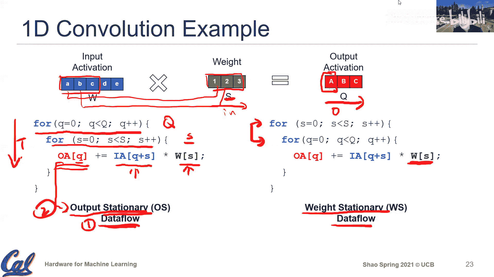

# 【加州大学伯克利】机器学习硬件技术课程 ｜ UC Berkeley ｜ EE 290 ｜ 2021 p06 P06 Lecture 6 Dataflow -BV1XfM4zKETU_p6-

Okay good afternoon everyone welcome to the sixth lecture of hardware for machinech learning today last week we talk about the layer execution and different convolutional parameters。

 today well start some initial discussion how those execution actually map to hardware and introduce the concept of data flow when we actually describe different kinds of hardware especially in the deep learning concept and then later this week we'll actually talk specifically to some state of art and deep learning hardware what are what kind of hardware structure do they have and what are the design considerations。

😊，So before we get there in today's newssp since we're getting into a little bit to the hardware aspect。

 it's actually an interesting way to remind ourselves just some of the also early excitement about machine learning not that long time ago that roughly 10 roughly 1015 years ago。

 there was a very influential project starting from Stanford and then actually starting from Stanford and Google in really actually thinking about very important task to find CA in millions of YouTube videos。

 so this was led by Professor and， he many of you already know him。

 he was very important influential person in the machine learning community and also promote a lot of very good teaching and online education materials through the Coursera platform。

So back then while he was actually doing this kind of research and thinking about doing like cat identification at Google。

 I still remember that's roughly the time like 2009 or 2010。

 roughly the time when I started Gd school and he actually visited Harvard and give a talk on that project and the day when he was there。

 the entire the biggest auditorium in our CS department was completely packed it's actually super hard to even get into the auditorium and that's when he was there and giving a related talk talk on the related topic it basically how we can actually how they were able to use machine learning to find。

Cat by scanning through millions of YouTube videos， which is very important task。

 And related to that， I think there is also， we talk about how hardware really enabled machine learning。

 And some of the intricacy in really getting GPU involved。

 We mentioned Alex Smith was really a development of Alex Matt was an early pioneer in this scope。

 And you look at some of a media history。 And there is also interesting and also important episode where medias chief scientist Bill thatdy actually also interacted。

With Andrew when Andrew was actually working at Google on this project。 And one thing。

 Andrew mentioned that they actually need tens of thousands of CPUs actually to do the task。

 purely because of computational requirement。 And this is not that long time ago。

 I was looking up for the news。 And this is actually， this happened like exactly 10 years ago。

 And then back then，da was saying， okay， there must be a GPU way to do that。

 We don't need tens of thousands of CPU to do this。

 We need to find more powerful and scalable execution on GPU。

So with that rest is really history at this point and we see a wide adoption of GPU for machine learning and the titles task that we're interested actually go far beyond recognizing cat through millions of YouTube videos and they like all the different things that has started there。

 but we do see the complexity of the task and even in the early stage because we need to actually goes through millions of videos and we still have a lot of both image and video recognition tasks these days and those are still pretty computational throughput intensive that we need to actually analyze large amount data simultaneously and all of this actually pose very unique challenges but also exciting demand on the hardware side。

 how do we actually provide efficient hardware so that we don't need to actually pay。

A lot of money is to get inefficient hardware in this sense。

 so with that that I can motivate a lot of GP development and also some of the related topic in what we're going to cover this week in really thinking about hardware the hardware aspect。

 how computation is being executed and hardware and how we can actually better support them and some of the hardware。

 the commonly used hardware optimization in this space。So with that。

 well again identifying your cat is still very important。

 there's still a lot of work in this field but it's really good to see where our field was roughly 10 years from today。

 so this is a still emerging area with a lot of activities going on and we can see the type of hardware actually being used to support those tasks already changed pretty dramatically in the past 10 years。

😊，With that let's move on to today's topic， so last week we talk about both quantization and some of the commonly used layer structures in deep learning from convolutional network and we also briefly talk about fully connected network and also fullying nonlinear nonlinear year activation layers and vegetableization。

 all the different layers and we highlighted convolution is one of the most important kernels we spend quite a lot of time actually going through all the different parameters which is very useful when you actually both designing your hardware and also underpend how the different layers actually mapped to your specific type of hardware in the end。

 so those are the parameters that we'll be using when we talk about convolution and we also talk about even fully connected layer which is also very commonly used layer type in today's deep learning context can also be formulated。

In the same way， of course， the data reuse pattern is different。 The amount of reuse is different。

 But by actually assigning some of the parameter to be one， we can actually use the same。

Structure to describe both convolutional layers and fully connected layers。

 which is actually very useful。especially from the hardware perspective when we need to design hardware to support at least both of them there。

 so we talk about all the different parameters there。

 so in today's discussion will first talk about some of the other ways or some of the ways to actually directly to calculate to actually execute convolution operations we'll start from the direct convolution but we'll also talk about some other optimizations。

 some of those were actually pretty important， maybe five 10 years ago。

 but because of the way the hardware has changed， they actually become less important。

 we'll also cover some of those optimizations before we get into the data flow discussion。

So with that， let's get started。So just a quick refresh。

 this is a convolutional loop nest that we discussed before as we discussed last time。

 just a quick refresher， we will always use the blue color to represent input activation green color to represent weight and red will be used to represent output and activation and there are a few of different parameters as I labeled here to describe height and width of the image。

 height and width of the convolution of the weight kernels and height and width of the output activation and the depth of input activation or input channels and the depth of output activation and then the batch size so those parameters are very commonly used parameters and we will use those letters consistently in our discussion so that when we see a particular letter we know what we' are talking about。

So for to execute a convolution we discussed last time is basically executing a range of multiply and accumulate for different element of the output activation。

 so we can actually simplify this execution or we can actuallyize this execution using this seven nested loops。

 so you will see when people discuss their hardware you you will see this kind of loop nest representation a lot well also this is a more software representation we'll also see the implication of this execution order when we get to the data flow part of the discussion later in today's class。

As a general execution flow， we see basically in to execute a convolution layer for the entire given input activation and a weight and to generate output activation。

 We basically first iterate the output activation， the N KPQ N KPQ dimension of the output activation so that then we get for each output activation we have this convolutional window by going through each of the convolutional window by the size of RSC。

 because we need to con with each of the weight of RS and the C。

 we can actually get the final result for this piece of output activation。

 but we need to do that for all the output activation there。

 So this is basically the execution or the type computation that will do to perform the convolution。

 This is just a general setup。 is。Baically tell us what need to be done。

 What is a computation really involved to execute a convolutional layer。

 but it doesn't actually really specify how we would actually execute it and in fact。

 there are different many different ways to actually execute convolution。

 So we'll first talk about some high levellismic optimization to actually perform this computation。

 but in different manner well also talk about the data flow in later part today's structure is also perform this computation but in different order and we can see the impact of those ordering in in the hardware cost。

 So you'll see a lot of discussion around the loop nest because that actually represent what is the computation need to be done。

 and second， in the in the data flow discussion it will also specify how this computation is actually done in a particular hardware。

So let's first focus focus on the first part。 What is a computation need to be done。

 if this is a computation need to be done， what kind of grsmic optimization that we can do to do this a bit more efficiently。

So the first one。It's actually very straightforward that's also what people call direct convolution if you also look at some of today's library like QUDNN is K as library or GPU's library to support deep learning deep neural networks you will actually see this terminology their direct convolution specific directly execute convolution and by the QDN is also the paper we'll be reading for this week。

 so that's also give a really good overview of different ways of executing convolution in hardware。

So when we talk about direct convolution is actually just take this computation and actually executed on hardware。

 And we'll see actually later in today's discussion。

 this is actually one of the most commonly used way of supporting convolution these days。

 and especially more recently with the emergence， a lot of very specialized hardware for convolution。

 we can actually do direct convolution very efficiently。

 So before there was a lot of discussion about we cannot do direct convolution very efficiently because it's deeply nasty loop。

 So that actually lead to some of the things that we'll be talking in the next couple slides。

 basically alternative way to do direct convolution， which lead to actually pretty good results。

 You we were thinking about the hardware like 10 or 15 years ago。

 But then more recently because of the changes in hardware。

 we talk about tensor core being added to GPU and a lot more。

Specialized hardware added to do this kind of complex indexing and execution。

 So today's hardware actually doing direct convolution very efficiently。 So and in fact。

 in most of today's hardware and convolution is actually being mapped directly。

 So we are actually doing this very straightforward way。

 but this is a computation we do this computation this way。

 So the first option and doing direct convolution， it was viewed not very efficient we're roughly 1015 years ago。

 you may also spot that when you actually review the coD paper， but more recently。

 actually when we especially talk to today's hardware we're talking on about today's hardware。

 Direct convolution is actually very efficient。 and with a lot of hardware optimization on top of that on top of that。

 We'll see more in later part of today's lecture but this is actually one of the most commonly used way to do convolution。

So if this is one of the most commonly use way， what are the other options。So the first one。

 this is actually still being used pretty widely， and this is also very important optimization is actually converting convolution to a matrix multiply。

Or gem operations through what we call the image to column conversion。

 You will see that maybe in in MEap and terminology。

 some of the Python library also have this function。 This is actually。

 and you will see more in the Kian paper that we recommended for for this week。 So this。

 the idea here is that instead of performing a convolution like what we have here in the。

What we have。Here in the top part of first half of the slide， doing a regular convolution。

 and we can involve this week with the input activation to generate the output activation。

 The specific computation involved is basically going through this。

This two by two kernels and then moving through all the different input activation to generate specific output activation。

 and we mentioned those nasty loop terminology， we need to do all those indexing to actually perform convolution So back then people are actually concerned about the complexity of doing convolution and for doing this kind of small but very specific data access patterns。

 but for a while， especially in the GPU context， it has been actually optimized for for matrix general purpose matrix multiply operations because that's actually one of the most important kernels in a lot of scientific computing community。

So Ge is actually one of the most optimized kernels， especially in the GPU context。

 So a natural way to think about executing convolution is that the accuracying here。

 the developing the software library here for convolution will be actually complex and we have a lot of experience in actually doing matrix multiply。

 So whether we can actually convert matrix multi sorry convert convolution into matrix multiply so that we can actually use our existing infrastructure。

 which we know it works really well on our both our hardware platform and also our software ecosystem。

So that was basically the original motivation。 So what it does actually。

 to convert convolution into a gem operation。 We'll see most of the we actually keep the weight and output activation stays the same。

 Most of the changes， actually the specific image to column change。

 actually happens to input activation。 So one thing you will notice here instead of in this example。

 both of my heart。 weight is the three by three。 We wanted to actually convert this to avol convolution to a matrix operations that we can actually follow the straightforward pattern on doing matrix multiply。

 we grab a role and grab a column， then we can actually compute the output。

 So that to support that fashion， that specific specific computation pattern。

 There is what some people call like lowering operation or flattering operation。

 all of which is basically describing。This image， this aim to call process。

 Basically instead of going through this image you buy this this kind of pattern to go through this windows。

 we actually formulate or lowered this image directly so that each of the column is basically one convolution window。

 but we can actually go directly to one column that will actually get us all the convolution。

 like all the input activations needed for this convolutional window to generate specific output。

So just a quick example here， like as what I highlighted。

 the first window convolutional window for the input activation is A B D， E， right。

 those four elements。 So instead indexing through this kind of Z pattern。

 we basically indexing an entire column， the first column by putting A B D E on my first column。

 So then when I do actually matrix multiply I can take one row of my weight。

 and then the first column of my input activation， I will get the first element on my output activation。

 And then we do this column by column basically for each of the convolutional window。

 we put all the convert all elements that within that convolutional window onto each of the column to so that we can actually do convolution。

 still perform convolution， but actually in the matrix in by。

To implementing radio matrix multiplication。But there's also a problem here。

 anyone spot anything Rp has changed in this process when we're actually converting each convolutional window into a role of the matrix here。

In this in2 car operation， the output activation is now a no longer square。

The output activation is no longer square， it become so Oscar are you thinking about it become a one dimensional vector here？

Yeah。It is it is the case we definitely reform you need to actually change that。

 but if you think about the memory layout right so even it's a two dimensional two dimensional matrix when it's actually layout in memory。

 it is still layout in some of the one dimensional pattern there， so its still the same element。

 so we are still talking about ABCD， but it's really just the way it's layout in memory。

 whether it's layout as a two dimensional vector or it's layout that's one dimensional vector。

That has changed that has changed but the data is actually the same。

 so it is changed in a way we actually the way it's accessed， but fundamentally。

 you will think instead just thinking instead thinking about the shape。

 what about the capacity or the memory requirement for different for different input。

 does that has that actually changed when we do this computation。

So Xin Yu said more memory needed yes， so more memory needed and A extended under a data redundancy in our output to input activation and Tsha also mentioned that yes。

 so as we discussed before so before our input activation is the three by three matrix So if we look at here where actually end up with a four by four metrics here just by converted because each of the window convolutional window is actually four and specifically you will look at。

I highlighteded slightly here， if you look at the way the value is actually presented in each of the convolutional window。

 We see B here。 we see D actually show up twice and we see E here。 and also believe F and I am here。

 So to actually doing this conversion， this input call conversion so that our data actually layout in this column fashion。

 our input activation actually need to be duplicated to actually support this transformation。

 So Oscar you were right， the formats change slightly， but for weight and input output activation。

For the green and the output activation here is still the same memory requirement that we're talking about right。

 but willll actually view this memory layout differently。

 whether it's a two dimensional actor or one dimensional actor。

 but a more fundamental change that actually changes the memory requirement of our our hardware。

 especially from hardware perspective， is input activation actually gets much bigger and。

And that will actually， if you look at the worst case， which is E， is being duplicated four time。

 So we'll see actually more in in both the coion paper and also in your lab too。

 you will see you actually need work how the input call actually work and what is the average duplication factor here。

 So in call， one of the most important implication of course。

 we get a more familiar gem matrix multiply layout。

 but the input requirement is a lot more significant。

 and in some early days when we actually also design hardware with the input call in mind。

 we also need to make sure we actually provision for provision hardware resources。

 were not actually provision this one。 the original one。

 we actually need to provision the duplicated version to make sure that we can actually support this computation。

 that actually lead to some of the inefficiency。In hardware design。

 So this is another reason I mentioned。 those are popular optimizations。

 If you look at the Kudon paper， it was actually also very important in the GP optimization。

 but over the years， because of those this kind of inefficiency。

 people either try to avoid it or try to do this on the fly instead of really duplicating this in hardware。

 because because of the additional memory requirement and the memory overhead here for input specifically for input activation。

 the rest for other opera， they stay the same。So this is a second alternative。

To do convolution is to convert it to something we are very familiar with question。

 But there is this。Important aim to call inefficiency here in doing in performing the gem operation。

So that's the second one。 The third one is actually using leveraging convolutional convolution theorum to actually convert it to an FF to use FFT based way to perform convolution so this you will also look into our would actually strongly suggest all of you to just take a look at at least QDNN library and you can see those pragma you can actually specify when you invoke convolution through QDN。

 you can actually specify whether you want to do a direct convolution。

 you want to actually do a gem convolution or you want to do an FFT based convolution so all of those are actually available in libraries like QDN So this is also another actually very powerful optimization or see more details later it was actually a lot more popular again55 to 10 years earlier and become less popular because the type of optimization that we have done for。

Harware， also because of the change of the software。

 actually interestingly is making the benefit actually less pronounced。

So basically we'll talk a little bit more， just the high level the idea of optimization and also talk about some of the characterization people have done in performing characterizing FFT based col。

So basically just a quick refresh I'm not going to get to the details in this lecture。

 but the fundamental foundation for this transformation is basically using the convolution theorem where the convolution in the time domain is basically what we have been doing here is actually the same to the pointwise or basic elementwise multiplication in the frequency domain So what it means is that instead of doing convolution that as what we have been talking about so far getting weights apply to input activation to get output activation。

 what we can do is actually convert this to frequency domain by performing FFT on both weights and input activation and after this conversion instead doing a convolution operator as we show here we can actually convert this into a elementwise or pointwise multiply so instead of the R and S and the C。

Convolution that we talked before。 Now we actually just need to do an elementwise multiplication。

 which is actually a lot cheaper。 So by doing that we get the output and then by doing an inverse FFT。

 we can actually get an output activation， get our get the same output that we were hoping before。

 So instead going through this way， just doing a convolution。

 we go through an FFT phase first and then do the FftT phase and then do elementwise multiplication to get our output and then do an inverse Fft to actually get the final get the original output activation。

 So the reason or the motivation， This is actually can be important can be useful。

 is's really we are concerned about our people are concerned about the convolution overhead where we actually especially come up across。

You remember。Before over the RSC dimension， right， the height。

 width of the kernel and also the weight and also the depth of the kernel。

 we need to actually come of all those dimensions to get our output so we can actually do this in a cheaper fashion where pointwise multiplication is a cheaper than doing convolution even and we also can perform FFT。

 actually fairly quickly， especially fast forward transform a lot quickly。

 they could still be overall beneficial to our even with both FFT and reverse FFT。

 This could still be computational beneficial to our overall computational efficiency。

So that's basically the overall idea here。And clear this。

 I have another figure to also illustrate the idea。 I will not go into the figure in today's lecture。

 but if you have time feel free to look at it， just build up more intuition in terms of how FFT can help with convolution here。

So I mentioned earlier this was actually was actually one of an important research topic。

 maybe five 10 years ago， there is actually a library developed actually using FFT based convolution and get pretty good interesting results back then。

 but actually get less popular these days because we are doing a lot better with the convolution。

 but also because some of the intrinsic limitation with FFT based convolution。

So we look at some of the results here， so here they basically they have this way of printing showing performance where green is green basic means better than baseline。

 while red actually means basically worse than the baseline of comparing FFT based convolution to a regular GPU baseline doing convolution here。

So what they plot here is for different problem size， different problem size on the y dimension。

 problem size and also the output activation size here。

 and then different figures is basically different kernel size。

 or basically the R and S kernel that we talked about here。

One thing we notice is if you look at is have actually very different red and the grain distribution here right so if you look at like 13 by 13 in convolution or 11 by 11 convolution。

 it has a lot of grains， meaning they actually get better performance。

 but if you look at three by3 and maybe even5 by5， we see significant well quite significant。

 we see red in most of the corners there， meaning that we are actually getting worse performance there。

 Anyone have any guesses why we are getting good performance with FF based convolution for 11 by 11 or 13 by 13 kernels but not as good as as but worst performance for many of the three by3 or5 by5 kernels。

So Xin Yu is wondering the overhead of FF T。 Philip is also wondering the FFT overhead。 Yeah。

 so that's the right direction。 So definitely， I think we talk about there's benefit。

 and then there's overhead， right， So we always have the overhead。

 So if you look at this all the overhead part is basically， whenever it gets the worst performance。

 It means that overhead is actually a lot more pronounced or the benefit is not as significant as what we see there。

 right， So anyone like that's the right direction， how is the overhead or potentially benefit is actually related to the kernel size that we are observing here。

I'm not sure， but is it that the one' doing the FFT and you're doing the matrix multiply？

With that because you need to do it like。You're not going to。

 you're going to have the same like dimensions for like a bigger and smaller kernel because you still need to cover the same frequencies。

You mean comparing to the FFT based convolution versus a matrix multiply based convolution。

 whether the dimensions are the same like when after when doing this without using FFT and doing the convolution you of a small kernel。

We need to do fewer computations， but with FftT， I mean， you have the same。Frequencies。

 no matter what exactly exactly。 that's basically。 So that's basically the R and S factor there or how expensive the convolution is right。

 So asma mentioned， the FFT cost is the same。 We always doing an element wise multiply there。

 because that's for the fixed frequency But for the convolution cost is different。

 our 3 by3 convolution is a lot cheaper compared to 11 by 11 versus 13 by 13 convolution。

 So in that case， if our convolution cost is not very significant but the overhead。

 as Xing and Philip mentioned is actually pretty domin。 And then we're not getting much benefit。

 but we're paying a lot of overhead for small convolutional kernels like 3 by3。

 And versus 11 by 11 or 13 by 13， asma mentioned， the benefit is actually very significant， right。

 we are actually cutting a lot of the convolution there。 And then that actually offset the FFT the。

Any worse FFT costs there？So that's a reason。 and I was say like 10 years ago。

 even with like AlexXnet， we still see actually some bigger convolutional convolutional kernel like 7 by 7 or even 11 by 11。

 So we are actually talking about all the different sizes of convolutional kernels。

 So that's why they also present all those results and it looks very promising for those big kernels。

 but unfortunately you look at the way people are building networks。

 we are actually more likely we are actually building smaller networks if you especially you when get to the rest that。

😊，And post rest now generation， most of the networks。

 actually three by three instead of like large seven by seven。

And we rarely see any 11 by 11 or 13 by 13 networks。

So with that the benefit of FFT really shine when we actually have large kernels and at the same time。

 if you look at the algorithm development were actually moving towards smaller kernels。

 it's even one by one convolution actually being used a lot these days so in that case the benefit of FFT is also that significant not only because of hardware involvement but also because of the software has changed in terms of like the types of kernels or types of layers actually commonly used so I still recommend if any of you interested to read this paper it's very interesting when the very detailed characterization to actually think about how we can do convolution differently using FFT but at the same time it's actually and couldnt still provide the FFT based convolution so you can still invoke that but in general especially if the。

Where it's actually designed for smaller kernels， where actually in most of the cases。

 we're not using FFT based convolution anymore these days。

But then it's an important optimizeimr and you never know whether maybe another five or 10 years later we say。

 oh， somehow 11 by 11 become very attractive for some other reasons。

 but this is a good example to see some of the optimizations is related to both hardware like in the gem case we talk about the doing direct con is actually a lot cheaper and then in the FFT case we talk about the kernel size is actually favoring the smaller kernels making the FFT based case less appealing。

😊，So another related topic is actually in terms of doing convolution talk about the convolution。

 doing a matrix modification and FFT evolutionvolution。

 and then another related topic is also doing a transformation。

 people call it winowgrad transformation is actually very similar， the internal of spirit。

 very similar to FFT transformation in the sense that we convert the computation to a difference set or we reassociate。

The computation into a different set of operations and intermediate result。

 which can actually potentially lead to a cheaper number of computation and reduce the number of hardware the number of operations that actually required。

 This is another example， I think this one is still， this one is actually less clear。

 I would say FFT is definitely not actually commonly used at these days。

 Winowgrad is actually it's back and forth。 And people still talking about it。

 and it actually have good performance and and performance， even for small convolutional kernels。

 So it's still being used there。 at the same time， especially from hardware perspective instead just supporting direct convolution。

 we also need to support will briefly talk about the associated operators。

 but another set of operators to support this Winowgrad style access pattern。So this part。

 it never get a lot of attractions。 but some of the hardware。

 like will talk about NDLA in that structure。 they actually adopted。

 They have a feature that you can enable Winowgra convolution in hardware。

 So we see some adoptions here。 at the same time， there is also the the additional cost to actually supporting this kind of computation。

 decided a different addressing pattern。 we'll talk about that in a minute。

 So this one is actually not clear。 So we may actually see more adoption later or if we actually do direct evolutionvol fairly well。

 even three by three， it's actually very easy to do。 And then one by one。

 we also we mention that it's also become very commonly used these days， we can do that really well。

 Maybe we don't need that。 or if actually 3 by3 or5 by5 it's actually really important。

 and the Winowgra will see the reduction in a minute It's also significant。

We may see more adoption there。 So this one is actually， I would say less clear。

 at least from what I have been observing over the past couple years， this is less clear so far。

And but definitely more promising than FFT based convolution。

 but it depends how it actually compare with direct convol。

 given a lot of optimization we have done in the direct convol setting。 I'll briefly talk about this。

Here， using this example， like this paper actually have a more detailed explanation using the equations here。

 which I I also recommend people。 if you' are interested， go through this paper there。

 I find this example actually more intuitive compared to this equation。

 So I will mostly go through the example here。So basically， as weve discussed。

 this is doing another real association here， but instead of doing an FFT transformation。

 it actually converts the computation that we need to do for convolution specifically doing element wire screen multiply and accumulate here once we actually do a regular convolution for the left hand side here。

The left hand side here， we actually need to do six multiplication，6 elementwise multiplication。

 and then four addition， right， two for each of the output。

 So we need to do four addition for to perform this computation。

 The idea of Winow grad is to actually rewrite the computation into the right hand side here where for each of the prime for each the element here。

 instead of we actually have a specific way of of doing real associating the values or intermediate values here。

 So in this case， we rewrite as showing here on the right hand side and then each of the element here the M1 M2 to M4 is actually a realas of the input showing as D here and the weight showing as G here。

 So basically instead。SoCalculating directly， calculating D， multiply or can with G。

 when instead calculating。I mean actually is a different color。And a different way。

 we instead of calculating this element。A those elements。

And perform computation on top of those values here。

 And it turned out to be actually doing the same computation and more significantly is that we can cut the number of multiplication here。

 So the goal is actually cut the number of multiplication here。So specifically。

 you will look at our input activation here for D， like a computation we need to do for our input activation in this case is D。

 We basically only need to do addition here right， so either D0 subtract D2 or D1 actually add D2 so we basically have four addition to do。

 but there's no multiplication here。And for the way the transformation we're doing can think about this as a maybe FFT transformation。

 but a lot simpler for the transformation that we are doing on weight with still so there is no transformation for G0 and the G2。

 we do have some transformation here。For G0 either add them together or subtract and then add and in this case we still can find common common expression here G1 plus G2 here oh sorry G0 plus G2 the common expression here is G0 plus G2 so in this case we actually only need to do three addition here I categorize addition and the subtraction together。

And then we also need to do two multiplication by doing this divided by two operation here。

 But the one thing with weight is that we can actually pre compute others。

 So instead of provide the value of G at this form。

 we can just pre compute all those specific in this specific format。 So we in the run time。

 we actually don't need to do this multiplication here。 So even those two multiplications， we can。

 this can be done， actually in the pre。Processing。Part。

And then the real computation actually need to do is actually on top of the M to actually calculate the final output here。

 So here to calculate the M， we actually need to do two real multiplication one multiplication here。

 the second multiplication here。 Oh actually， it's a four real multiplication and then。

All those need to actually be multiplied together。To calculate M1 M2 and M3 and4。

 so those are the four multiplication I need to do。

And then I do four addition here to to actually compute those。

So those are the real computation I actually need to do and this can be done in the preproces if we look at the multiplication。

 So here this is also very specific for multiplication instead doing sex multiplication before we now doing for multiplication。

 which is reasonable saving here。 So this is pretty low level that's another thing we need to actually change it and then real associated this and then to perform to get some multiplication saving we'll see later so another reason I'm。

Let's excited about this is we also see like multiplication or computation in general is actually not the main overhead of the in doing hardware execution so a lot of overhead is actually associated with data movement So even the savings true we do actually reduce the number of multiplications there but that's mostly associated with multiplication compute overhead but not necessarily data movement overhead there so that's another caveat associated with Winowgrad transformation here so you may see some of the hardware actually adopted some like even likeD adopted some of the like the run hardware also adopted in early days。

 so that's real hardware optimization being used but the benefit it would be interesting to actually really evaluate the benefit because it cut the number of multiplication but still you still need to do this real。

Asciation and you actually need to store all those intermediate results to support the computation so that transfer which can also be expensive in a similar fashion as what we talked earlier about SFT overhead。

So this is more up to debate， I would say， but be aware。

 keep an eye on this for the Winowgrad transformation and see whether that can。

 And you will also see that in some of the hardware offerings to see whether they can be actually used。

 but more often these days the convolution that fairly efficient。

 it will still see gem based convolution。 actually also very useful and and people can actually do gem based convolution by delaying into call as data as possible so the overhead was not that significant。

 So that's another。 So the first two are still very commonly used。

 I would say FFT in most of the cases are not as efficient as other method but for Winow Grds it's still an open space to see whether we can find other useful implementation or not。

So that's basically our discussion on different ways of executing and convolution any questions and comments on this part before we move on to the data flow execution。

Okay， so we talk about。Different ways of executing it mostly from the algorithmic part we'll move on to see actually what kind。

 even just for mostly books on direct evolutionvol to see what kind of tricks or what kind of hardware highlel hardware optimization people applying here。

 Overall， I would focus the discussion on the two core principles that we'll discuss today。

 First it both are actually very commonly use not limited to hardware accelerator。

 you will also see that in your any of your architecture or digital system class is basically locality and paraism。

So what do we mean by that many of you have already seen this a lot data movement really matters and we want to actually lower our data movement cost as much as possible。

 so that's why locality is a very important design optimization in any type of hardware。

So how it actually impact in our execution deep learning deep learning operators。

 So we already talk about that a lot of the core operator is doing this multiply and accumulate here right。

 so for every multiply and accumulate here， we actually need to read our weight and input activation and we also need to actually read the previously accumulate partial sum right and then we add this to our partial sum to get an updated partial sum and then doing this iteratively through our execution to actually get first get the final sum final output activation and then go through all the different output dimensions to get all the final activation。

So here we actually for each of the math unit， we actually need to do three read and one。Right here。

 So that's a memory access here。 So for the three read and and one right operations。

 if all of them actually need to go through D， that's actually very slow and also very expensive right。

 So that's basically is four acts of them computation。 we actually need to do to go through D。

 and we all know if the D because far away from our memory hierarchy。

 all of those are actually very expensive。 So the goal of locality is see whether we can actually add some intermediate story storage stage so that we can store at least some of the results early to cut some of our trips to D。

 So that's why locality also play a very important role in the context of deep learning hardware。

 So it is in general， very important principle， It is also important in the deep learning setting when we think about hardware。

 So a lot of those principles may sound actually very familiar to many of you。So in locality。

 I like to actually highlight， especially in the deep learning context。

 I like to highlight two types of locality here， this is mostly just making sure we're on the same page in terminology。

 you may actually already see that in other your system or architecture class already。

So the first one is actually temporal locality here。

 So this is actually very similar to the way we actually discuss our cache hierarchy。

 If the data is actually accessed more frequently or more likely to be accessed again。

 We want to move storage in the cache and especially in the cache that closer to the core so that we can actually fetch a piece of data much faster。

 right So temporal reuse。 that's basically a way to describe the temporal reuse pattern。

 It's basically in the same piece of data are likely will be actually accessed more than one time more than once。

 So we want to actually put it closer to the consumer to the core。

 either the core in the traditional learning traditional architecture contacts or the Mac unit that we just discussed for the deep learning hardware。

 right So we want to put it closer to our compute unit。

 So the next time when the same piece of data is actually accessed again。

 we can grab it directly either from our input register。From our registers or from from our buffer。

 So this is basically temporal reuse here。 Another reuse is actually a spatial reuse。

 So this is actually related to the parallelism discussion we'll see in a minute。 and basically。

 this is the same piece of data is actually reused by multiple consumers or multiple Mac unit in our context。

Because we'll see in a minute in parallel hardware design， in a lot of cases。

 will actually have multiple hardware units being active the same time， right。

 And and because a lot of the reuse patterns， especially in the deep learning contexts。

 It's actually very likely the same piece of data。 It's not only will be temporarily access by the same consumers。

 but will actually be be needed for across different consumers。 So in some sense。

 this is like a broadcast pattern， if this is a terminology that you are more familiar with。

 or basically acquiring， you're actually sending data to multiple consumers here。

That's another reuse that actually one piece of data is actually shared across by consumers。

 And for this， you want to have your either your worrying or your network in your hardware。

 Sometimes when people you hear people talking about the learning hardware。

 their network architecture also become very important。

 that's basically because you want to support this kind of spatial reuse pattern because there could be one producer in the multiple consumer similar in the network fashion。

So we'll see more in a minute， but we'll talk about locality。

 those are the two very commonly used locality Both exist in traditional computer hardware。

 general purpose hardware， but also in deep learning hardware these days。

So with a little bit more on the temporary use is as we mentioned this data will use the Vm。

 so one type of a lot of optimization is basically trying to add memory or add buffer hierarchies so that we can have faster access with two closer to close to memory that is actually closer by without going to D which is further away So here I'm showing one level of memory access。

 but you could also have multiple levels of buffers so memory thats one memory hierarchy is actually very important and a lot of optimization especially in the deep learning hardware context is probably even more important because general is very straightforward all one all3 that's basically your cache hierarchy here you can actually do a lot of tricks will see a little bit more you could actually even for different operate you could have their own memory hierarchy so the space is much bigger there could be more。

You could tailor towards your specific application for memory hierarchy here。

So another part is spatial reuse that's actually very related to another principle we mentioned earlier。

 Also very commonly used in general， architecture discussion is basic parallelism。

 the whole multi core revolution is basically also about parallelism right So this is the same spirit and what if instead just thinking about one Mac unit。

 one compute unit。 What if we actually have have all the parallel Mac unit to support more higher throughput in our hardware。

 and this is actually a lot more common in today's hardware extremely parallel hardware for for parallel computation like deep learning。

 because it actually have a lot of parallelism with all the different loop dimensions there。

 So parallelism is actually also another very important principle。

 when we think about optimization is to have parallel execution unit。

And organize in them in an efficient fashion so that we can actually use a throughput。

 leverage their throughput that makes them fully utilized， so related to parallelism。

 another very important metric you need to ask both yourself as a designer or when you evaluate some other design from other companies is what is your hardware utilization right so it's very easy to build extremely parallel hardware。

 but it's actually a lot harder to actually make sure your hardware get fully utilized so to get so the typical parallel computing problem or getting hardware fully utilized become important again in this context。

So related to that why spatial locality actually matters is when we actually have parallel hardware。

 our memory pressure is actually not only the capacity we talk about the layers。

Of memory hierarchy earlier for the temporal locality。

 But now when we look at the bandwidth that we require to our memory system， right， So every A U。

 every Mac unit need to have read three pieces of data for the computation。

 So now we also have a lot very significant memory requirement to our from our memory system。

 not only just capacity， but also the bandwidth requirement here。

Like any general parallel computing scheme here。 So that's why spatial locality is important in the sense that spatial locality or spatial reuse can we can actually leverage that so that we can in this particular case。

 read only do one read from our memory hierarchies that to alleviate the bandwidth pressure that we discussed earlier。

 but actually leveraging the spatial locality to feed all our parallel hardware to make sure our parallel hardware is still achieve high utilization。

 So this is when we talk about parallelism one thing easy to do is to actually duplicate your AO use but the harder problem is how to make sure all your AO use are or how all you mac are fully utilize and one of the important trick people use pure play is to leverage so whenever you。

People have some different wiring structures or some network structures in this scope in general。

 but one of the principle major principles that they are leveraging is basic spatial reuse if one piece of data is actually requested by multiple consumers we can actually our memory bandwidth requirement is significantly alleviated so that we can actually keep all of them busy realistically so this spatial data reuse patterns is also very important to get high performance especially for parallel hardware and most of deep learning hardware is parallel hardware it's very。

It's very rare to see a sequential a single Mac and hardware because of the low performance there。

So those are the two principles， locality and parallelism， locality。

 both internal of temporal and spatial locality and parallelism is another important way to get high performance。

 but also have memory implications and spatial locality is actually very important in a lot of general optimizations to achieve high utilization there。

So any questions about the two general principles of locality and paralleluralism？Okay， great。 Well。

 if you have any questions， feel free to post your question in the chat window or just unmute yourself directly。

So on the administrative side good job everyone on finishing lab1 I think most of you。

 if not although you have submitted lab1 already it's a good job La two is out today it's already they've already posted on the website this is a lot more involved than lab one so if you think you can actually start if you you didn't actually spend too much time on lab one be prepared to spend more time on lab two because we'll actually get to the hardware design part of setting up the infrastructure and actually designing your own module into。

Using the leveraging in the hardware infrastructure there so definitely start early you can already do all of setup at this point for those of you who don't have the instructional server account。

 you may also need to actually get the comp set up so start early。

 get the infrastructure and go through the synthesis process so that you know the typical the thing that you need to do and then you can actually be specifically focused on the hardware part and in the hardware part。

 you will actually be designing one one of the major computational unit as we see earlier。

 the parallel processing elements or parallel Mac unit that actually appear in a lot of state of art deploy learning in hardware so that should be a fun lab you will be able to design it in in hardware and in using our hardware infrastructure you are ready to start and it will be very likely。

I'm almost certain and you'll take more time than like one。

 so start early and if you have any questions feel free to let us know。😊。

So I think that's the only thing on the administrative side， any questions， comments do people have？

Okay， so sounds like no question。 That's good news。 And can start work start lap 2 early。

 There should be a fun laugh。 I'm looking forward to see what you。

 what you find while you're going through lap 2。😊，So we talk about the two principles and now we'll actually get to see specifically how those principles are used in today's deep learning discussion。

 specifically here we'll introduce the terminology data flow which you also heard a lot。

 when you will discuss different architectures or more specifically in the data in the deep learning context will explicitly define what we mean by data flow in our context and introduce some of the commonly used data flow for output stationary for today's hardware implementation both output stationery and weight stationery here。

Yeah， so Vis is wondering the project party that will be well exploring options to actually help people interact with each other。

 especially for the project aspect A and I as I've mentioned。

 we're still discussing that in the we likely we'll release more detail this week very good question。

So just before we get to data flow， one thing that's actually very important in most data flow discussion is actually we talk about the the first principle is basically data reuse。

 right so and one thing in particular， you probably already realize we talk about the colvol execution of the different operators is a lot of reuse opportunities actually exist in this application。

 which is actually great news for hardware designers， because we know we know data reuse very well。

 we know parallelism very well for to apply both of those we need an application that have a lot of parallel。

 have a lot of parallelism so that we can actually apply parallel hardware for it and hopefully a lot of reuse so that we can actually design custom memory hierarchy for it。

And an turn out convolution or in general convolution bothvol as convolution specifically and also even matrix multiply fully in fully connected layer。

 all of those operators in DNN actually have very good data re patterns。😊，So what do we mean by that。

 So first specifically， like just a quick remind we talk about again， we are using the same picture。

 the same color， the same dimensions again， right， So to calculate to perform a convolution operation with a specific parameters。

 the total number of matrix matrix multiply and accumulate operation that we need to do is basically what we wrote R CP P QK here。

😊，You don't need to remember this and basically for each of the output like a here。

 it need to do RS and the C accumulation across this volume and then we have PqK number of output activation right so this is for each of the output and then we have PqK output activation that's why the total number of max is basically PqK we ignore n for now but you can also add n to this structure。

And as the batch size。Al， so when we think about radiouse。

 it's basically how much data is actually reused to perform。

This RSCPQK number of multiply and accumulations here right。

 let's go through each of them we talk about they all have a lot of reuse right exactly how much。

I see input activation here。 So our input you look at the size of input activation is only H WC。

 but they are actually needed to perform all those computation。 R I C P Q K computation。

 So roughly the number of time it will be reused is just the total number max divided by the size of the input activation here。

 because P and the P and here P is very similar to H until is close enough to W。

We ignore the padding and we ignore the padding and str parameters for now right So roughly we have we're talking about the RSK number of reuse factors。

 So input data will be reused by a factor of RK here we can actually keep doing this if you have time feel free to go through this for both weight and also for output activation again。

 were output activation Pq K size and each of data to be will be reused by RSC times So in general。

 we look at all the data here。 they will be reus quite significantly。

 Of course it's also parameter dependent for example， if R and S is very small。

 only one by one convolution maybe the input and output reus in now that's significant compared to the weight reuse。

 So it definitely also depend on specific parameters。 but in general。

 were talking about a lot of reuse opportunities for all the。

Three operas that we're discussing in the convolusution context。

To support those so that's where the data flow already comes in to actually see how we can execute the DNA operations。

 specifically the convolution operations that can maximize hopefully reuse increase our improve our reuse opportunities。

 So in this context What we know is that there are a lot of reuse opportunities and different execution order here execution order includes both computation order and also data movement order by having different execution order。

 we may actually have different reuse opportunities and with different reuse opportunities。

 we may have different finally different hardware performance here。So here， data flow。

 specifically in this context， when most people talking about data flow in deep learning is basically to describe a specific execution order for the deep learning operations or for the convol operations。

That was designed in either this piece of hardware or in this software framework to define a particular order。

 both including the computation order and data movement order here。

So it's really a definition of how computation and data movement is executed on this piece of hardware for this operator。

😊，Dataflow has other implications in general computer architecture design。

 Many of you may also be familiar with a data flow hardware that was also introduced 2030 years ago in really thinking about more data flow execution or graph like execution So that is actually less applicable there's some connectivity here but specifically whenever you have order you could also envision that as a graph like structure that defining the order right so they are related but here in the data flow in the deep learning context。

 deep learning hardware context， we specifically talk about data flow。

 were still talking about the conclusion the7 loop that operation that need to be done are CPQK number multiply an accumulation need to be done。

 but really thinking about what is a specific execution order for it。

 to execute that and we use data flow。to actually as a way to differentiate different first different execution order and with different execution order。

 there could be different hardware implementation order。There， so this。

 that's why data flow is a way to differentiate different hardware without different types of hardware may have different execution order of executing the convolutional operators。

 but it's actually a lot more limited compared to。Another way of using data flowing computer architecture。

 the data flow execution in a more general purpose setting in the earlier hardware design。

 that is a lot more general in really thinking about a pure graph like execution。

 which is also very interesting hardware on its own。

 but we are talking about a very specific context of data flow execution in the deep learning in the deep learning execution here。

😊，So we talk about the execution order of data flow right。

 So how do we actually represent that It's already pretty mouth just when I try to describe it execution order in deep learning in the to execute the convolutional operator there。

 So B to make our communication more straightforward and also more explicit。😊。

Whenever we talk about data flow， we'll always be using this loop nest representation to describe the data flow or specifically the execution order。

 So whenever we see a loop nest， that loop nest represent a particular data flow or whenever we see we discuss a particular data flow。

 there should be a loop nest representation to represent that data flow。 So those two are。

 we're using both the data flow， the terminology and the loop nest representation to describe this execution order。

 And so those two are equivalent in our context， well see a bit more later。

 how they actually match with each other， but we will be using loop nest to describe data flow deep learning in the deep learning hardware context。

Is that clear any more questions， any questions？It may seem a little bit abstract。

 we'll see a couple example specifically just to see what we mean there。

 but again two things I want to highlight first， it is a very limited definition of data flow we're not talking about general purpose data flow architecture we're talking about data flow internal execution order in the DN pipeline here and second whenever we discuss data flow we be using a loop representation sorry a loop representation to discuss the data flow to have a more straightforward representation instead of stay to abstract here。

So let's look at an example here， what do people really mean when they talk about dataflow is it's a really cool name to make the architecture also sounds fancier。

 but it's actually very basic， very very simple， it' it's a cool name people use to add more science to the deep learning hardware。

 but it's actually a very very basic principle here。😊。

So here is we want to use a 1B conclusion to discuss what they mean by data。

 people mean by data flow， and here we also associate data flow with LoN representations we discussed earlier。

 we like to use LoN to discuss data flow here。So in this context， again。

 the same color should be very familiar， a blue input activation， weight， weight， green weight。

 and the red output activation。Here， so to execute this。

 there are two ways actually to organize the loop representation here。 And well。

 basically for each one of the simple way or straightforward way as what we have been doing here is basically for each of the output。

 And then we need to go through in this case，1 by3 or one by S convolution。

To calculate each of the output there。 right， So this execution order。

 I just described verbally or highlighted using the using the pointer here is basically the execution order is actually used in this loop nest。

What we mean by here is we use four to the for loop to express a temporal order here right so basically the outer loop here we go through the Q dimension。

 basically this dimension， this is the outer loop here。And then in the inner loop here。

 we go through the S dimension， which is actually going through as the weight here。

 So this is a particular way of executing the loop。

 And this is how we actually use those too nasty loop to describe this execution。

We also say this is also what people call this the so called output stationary data flow。

The reason people call that is basically respect to our reuse pattern is basically the question。

 the data flow discussion trying to capture， we talk about the computation， that execution order。

 right， so with execution order is basically trying to tell us which piece of data or which opera actually stay stationary in a sense doesn't change during the execution。

 So that was a stationary trying to trying to describe here。So in this example。

 if we look at the innermost loop over time， if we think about over time。

 which piece of data stay the same， right in consecutive cycles， which is our innermost loop。

 the only thing actually change is the loop index is S here。

 which actually goes through the weight dimension， If we look at the address in here。

 having different inner loop index S， will change which loop， which weight will access。

It will also change which input activation we access here because that depends on which weight we access here right so we have some association here。

Right， but what doesn't change is the output activation。

 because it's only dependent on the outer loop index。 It's not dependent on the inner loop index。

 So in this loop nest output。Stay the same during the consecutive execution。

 So that's why people call this output stationary data flow。 So three part。

 the first part is data flow is basically again， execution order。

 So we use a loop a loop nest where Q is the outermost loop as is the innermost loop to describe the data flow。

 This execution order。Second， which is stationary is basically which opera stay the same during the execution and becauseQ isultermost loop as is the innermost loop。

 so output is actually stay the same during the execution so that's why it's an output stationary data flow so that's what people mean actually whenever they talk about output stationary data flow we'll actually see some example in today's hardware that describe that that this is basically the loop nest actually describe it。

And similarly， weight stationary data flow if you have time feel free to actually go through the execution on your end。

 this is another way also to correctly actually execute this1D convolution and the only thing to change is basically as the inner and out loop is actually swapped where the queue is actually the innermost loop and S is outermost loop so in this case weight becomes the element that actually doesn't change during the consecutive cycle during the execution so that's a weight stationary data flow so it's a very straightforward concept。

 I think that people just like fancier name to describe it so if anything when you see those names first data flow is really just talking about execution order in which order is actually executed that's why we're using a loop nest because it is a natural way to define data flow and second this whole stationary concept is basically to say which operator。

It actually doesn't change during the execution， and this is related to the temporary use locality we discussed。

You this opera is。Doesn't change。 We can actually add temporal buffers to or build custom memory hierarchy to reuse that。

 So that's why it matters。 We'll see a couple more example there。

 how they are actually being used and how we actually add custom memory hierarchy to support both and which stationary and output stationary tool of the most commonly used。

 data flow in today's hardware。 But in general， the principle of data flow just the execution order and the reason the differences is basically which opera is actually stay the same during the execution。

 which could lead to different register or memory hierarchy patterns。Okay， so we'll pass here。

 we'll continue our discussion， we'll have a couple more examples just showing how those two data flows are actually reflected in hardware and we'll also go deeper this Wednesday using both TU console processing unit from Google and NVDdia as our NVDLA from NVDdia。

 open source hardware from NVDdia as to driving example to see how they are actually using different data flows to describe their hardware。

😊，Okay， great well good to see you all here and time to get La two started。

 you have all the information you need to start La two and I'll see you again this Wednesday。

 so take care bye。

