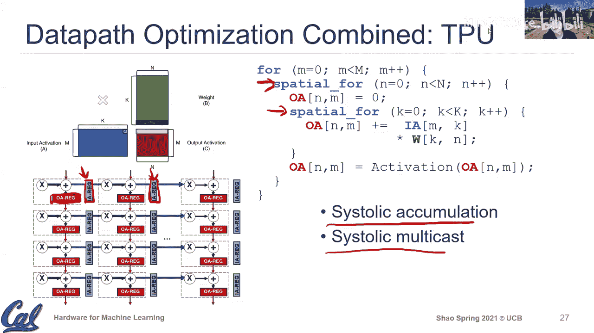

# 【加州大学伯克利】机器学习硬件技术课程 ｜ UC Berkeley ｜ EE 290 ｜ 2021 p07 P07 Lecture 7 Accelerator -BV1XfM4zKETU_p7-

Okay good afternoon everyone， welcome to hardware for machine learning today we're going to have our seventh lecture of this semester where we're going to talk about some of the hardware implications of executing DNA operators on hardware and some general hardware design principles and how they are actually being reflected in today's deep learning hardware space so since were going to talk about accelerators as there have been a lot of discussions in thinking about accelerators or domain specific acc these days。

 a lot of companies as we discussed earlier have been really thinking about building from big companies to small companies to startups。

 even building specialized engine for emerging applications and machine learning is one of those。😊。

Another thing whenever we talk about building accelerators or doing this so-cal domain specific acceleration of architecture。

 one thing there is that this is not really a new idea。

 one thing you'll see a lot in the computer hardware design or computer architecture history is that a lot of ideas。

 especially successful and important ideas， actually keep coming back again at the game。😊。

Accellerators， especially specifically in the context of building customized silicon for specific application or for a domain of applications have been actually showing up in multiple multiple times you look at hardware history and one of the early examples of domain specific accelerators or hardware accelerators。

 is specifically coprocessors， especially floating point coprocessors even when we actually look back early days。

 a lot of hardware design or like processorors actually didn't have a floating point engine because not everyone actually need to run complex floating point calculation So then back then for a lot of demand actually running floating point operation actually from cat tools or EA designs where they actually need to do a lot of accurate calculation So back then if the customer actually require a floating point floating。

runningunning floating point operation very efficiently。

 There is actually a separate separate card actually specifically。 it's called maskco processor。

 but it's a floating point accelerator there。 So one of the earliest ones。

 if we look back Intel's history。 one of the early accelerators is actually387。

 we basically 386 is their main processor。 It doesn't it didn't actually have a processor have a floating point pipeline。

 and 387 iss actually the one have the floating point pipeline for interested customers and client to actually get the floating point accelerator。

😊，And some interesting history is that so the generation the 386387 generational In processor is actually very influential and especially for personal computer and personal use and that was also the generation of the processor where Linux was actually designed in the early days。

 so we see a lot of connections not only just thinking about general computer architecture history and general system development。

 but also along that history we already see the domains specific or specialized accelerator there。

 so this is we are talking about accelerator in the context of hardware for machine learning where people have been building generations and specialized hardware for machine learning but in early days one of the emerging application is actually floating point or mass calculation and one of。

The early examples of of accelerators is actually just a floating point processor Coproor。

 so since we're talking about that just also interesting a little bit more on both the historic side but also already thinking this notion of domain specificific accelerationcc or hardware acc iss not like completely new idea come out of nowhere it's one of the principles that we have been using for generations and then just this day there's a such demand computational demanding applications and require a large volume that really moivates a lot of more recent development of the accelerators。

So with that in just a quick recap， we have been talking about going down the stack。

 thinking about the low level primitive of DNA operations and on Monday， this week。

 we talk about how those actually primitive is actually being mapped on hardware and specifically the notion of data flow that has been used to describe the execution order。

 including both the computation order and also the data movement of order of the execution so starting from data flow which have different order execution order definition。

 well in today's discussion will think about the hardware。

 how we actually realize the different execution order。

 especially the innermost execution order from the data flow in hardware and what's the implications on both performance efficiency and also scalability。

So with that just a quick recap and some of the discussion to finish some of the discussion we had on the data flow end so as we discussed this past Monday。

 we talk about we use data flow to describe the execution order and very natural way to to illustrate what we mean by different data flow is basically using the loop nest representation by having it's very specific for for execution because a lot of the convolution operators or fully connected layer。

 matrix multiply operators can be actually expressed in loop N and by using a combination of both temporal for and spatial for we'll see a little bit more today what's the implication。

 especially on the spatial foresight we can actually leverage both data locality and also parallelism just a quick recap specifically we。

Does two types of data flow。 And that has that both of which are commonly used in today's active deep learning hardware design。

 When you see one thing we like to do is really thinking about the principle of the hardware designs instead of specific instance。

 So one thing we hope， like all of you will be able to do in the future。 when you need to。

 for example， evaluate a new startup idea is that don't get confused by whatever the fancy terminology that theyre they're using。

 but really thinking about what are the fundamental operations and how things are done in hardware。

 So in particular， to very commonly used execution order， especially in lowle hardware design。

 is what we called the up stationary data flow。Here and with stationary data flow here。

 as the name suggests， output stationary disagree means the output actually stay the same during the execution for example。

 in this loop nest representation output we're accessing the index of the output here Q does not change in the innermost loop。

 so that's why the output stay the same， but both input and and weight the addresses。

 the breaker index that were using， they are changing in the innermost loop。So similarly。

 when we talk about weight stationary data flow， we can also use this loop nest to represent that as the name suggests weight doesn't change so we look at the weight index here and it is independent with the inner loop so we can actually reuse and we mentioned the core principle is reuse option locality so that we can do temporal and spatial reuse and parallelism right so if there is a reuse we could actually save some memory traffic so weight is being reused here。

 that's why it's a weight stationary data flow。So this is just a quick two company used example here。

 what brieflyley talk about their implication on hardware and what revisit。Later again。

 when we think about specific examples of today's deep learning exccelator。

So let's start with a very simple processing unit or processing element PE design。

 This is a very simple and in some sense， naive in the sense we just say， oh there is a Mac unit。

 remember we' talk about the multiply and accumulate unit before and we need to read weight and input activation and then also a partial sum to do a multiply and accumulate and then update our output activation。

 so this is a basically fundamental operation that we need to do So why data flow matters why it actually have some implication in hardware。

That's because that will actually change some of the memory hierarchy to actually give us more opportunity。

 especially when we think about data reuse。So the the way data flow actually affect hardware design。

 like using our example that we have discussed， to example that we have discussed before。

 we can see two just a very brief in in using our P E。

 the simple P E design to see how data flow actually change the way we think about P E。

So let's start with the output stationary data flow again， as the name suggests。

 my output index doesn then change and during the inter loop execution。

A more intuitive way of looking at the X the addressing pattern of different array is actually being ploted here from one of the Irish tutorials。

 They did the authors there did a really good job in actually illustrating the specific access pattern。

 So we use their access pattern here。So in this case。

 we see the access pattern or the indexes to each individual array。 So this one， the first one。

 we use the color consistently is for output activation。

 blue is for input activation and green is for weight。

 So now we see that it is the output stationary data flow because during the execution。

 X axis is time。And one axis is the addresses that we are accessing here。

 So for an output data stationary data flow over time， my access。

 my accesses to my output array actually stay the same。 So specifically this index。

 we use Q represented here represented by Q here does not change。

 we are loop through the innermost loop， whereas is for。

 So that's why we have four index indexes being generated here。

 So that's basically more like more straightforward way to look at the specific address patterns here。

 because the address doesn't change。 there are actually opportunities。

 instead of actually keep accessing in this case， my output activation buffer four times。

 but actually using but actually accessing the same address。 We talk about temporary use earlier。

 right， So temporary use basically the same piece of data being accessed。Again and again， right。

 so whenever you are temporary use， there are opportunities to actually add temporal buffers so that we can cache those data。

 So a very important feature of an output stationary data flow is that we will have。

A register that is actually dedicated to store output activation in particular in those cases when we actually access the same piece of output data。

 a lot of those hardware have this register here to actually cache output activation。

 so that's what people mean by having an output stationary data flow and specifically when we think about hardware design。

 basically having this register here。Is that clear any questions， comments？

For our stationary data flow and the implementation。Okay， so this is output stationary data flow。

 What about way stationary data flow。 There are a bunch of hardware actually being designed using a weight stationary data flow。

 Again， we'll start from the simple P set up again with dedicated buffers and the simple Mac unit。

 Now you see the pattern here。 We are basically creating custom memory hierarchies and different data flow will just affect how we actually create those memory hierarchy to reduce data data accesses to bigger buffers。

So with a weight stationary data flow， again， will' not go through the example。

 this is the same loop nest that we have seen before and because it's a as the loop nest indicate it's a weight stationary。

 it's a weight stationary data flow， let me see。Actually， I need to actually。 So， well。

 this looks nice is's actually not a waste stationary data flow。 right， So because we， we look at as。

 the weight is actually changing here。 So this is actually not a waste stationary data flow。

 I'll update the slides later。 But for waste stationary data flow， what's the。😊。

What the look next should do， actually。 So if we should actually move。

The book as to be the out outer loop。And the loop。Heill to be the inner loop， right。

 And then in this case， when we do our。Indexes。Weight actually stay the same because the inner loop is actually going through Q and the weight is actually independent of Q right so for weight stationary data flow weight actually doesn't change over the execution。

I'll change the roof nest after the lecture， but so this is actually a weight so north so when we look at a waste stationary data flow。

 the two properties is actually weight doesn't change and all the other indexes are changing。

So as it reflected in the access pattern again， were doing the over time and。

Index here in the Y axis。And here what's stay the same is when we look at the weight access here。

 we are actually touching the same weight because innermost is a key loop。

 even we are changing which output that we're accessing the weight is actually always stay the same we're reusing the weight so were actually accessing the same piece of weight during the during the data execution again。

 there's temporal locality here and what we want to do is to create small weight register to cache this value So a very important feature of when people say weight stationary data flow is basically they have this weight register that's being used to cache to catch the weight which will be reused over time So that's basically what people mean by weight stationary data flow and its implication on the hardware front。

My apologies on thety of the slide I'll update it later， any questions or comments。Yeah。

 is you kind of one out or is it？Pretty even or sort of swapping between them even make sense based on context。

You mean the one as the size of the register here， Oh， I in between the two data flows。

Right that's a really good question。 So those are actually if you look at the reuse pattern right so this is this weight register is being reused Q times right and versus the previous example is being reduced as time So there are different reuse So the first part is they will be reused differently and that also affect the reuse factors of of the tradeoff and this factor is very problem dependent right if you have a bigger dimensions in the in your output and in the Q dimension and then there are more opportunities to actually reuse weight So there is first is problem dependent second is actually bit width related So we think about also adding。

Output activation register here， remember our earlier discussion when we talk about quantization right。

 so even weight is like 8 bit so this weight register is all typically 8 bit when we think about text point representation and this output activation register is typically at least 24 and sometimes can also go to 32 bit。

And the same as our read and read accesses to our output buffer。

 So the accesses to the output buffer is actually a lot more expensive compared to the weight access。

 So there is besides a problem dimension that will affect the reuse pattern。

 And the second part is just the big weight difference that will also affect how much how expensive it is to actually go to Sm。

 And then we can cut the SM access by having a register here。

 the saving could also be very be more significant。

 So if we look at the design a lot of times actually output activations。

 output stationary data flow is being used to actually mostly used to save。

SM accesses because a wider SM there and some of the examples willll see some of the sparse example unless specifically I as one of the sparse accelerator that we have seen that being designed recently and one of the major limitation is by basically we don't have this output register here and then all the accesses actually need to go to the output buffer there will be a lot more expensive and that eventually hurt the efficiency。

So more often than not these days， you will see actually a combination of those two。

 like have some like maybe not single entry with buffer， but multi entry with buffer。

And also have a multi entry register of output activation。

 The addressing become a little bit more complex compared to the simple addressing were we're talking about before。

 But then you kind of get the benefit of both。 we have also have some earlier work recent work in this space。

 just really considered the benefit of having of capturing both weight reuse and output reuse。

 So this is a fairly simplistic example， we' are basically thinking about first single entry register and only add it to either weight or output in a lot of especially efficient design as people getting more experience。

With design efficiency。 So typically to get to a efficient design。

 you actually want to have both buffer on both end。

 but you may need to actually size those buffer carefully。

 so that you do get the benefit of reducing the SM accesses。

 but also not making this too big or too complex making the indexings and also management to complicated。

 So in today's hardware， especially when we think about efficient hardware。

 it's more like a combination of both。 You will only looking at a single register case。

 as we discussed before， always be aware the output activation register can be potentially give you a little bit more saving because the bit is higher than you want to cut the SM access。

 So when you evaluate the tradeoff。Do remember the wind buffer， this access is only8 bit。

 but here it's like 32 bit。It's a more expensive access。

Very good question and it's actually a fairly complex design space and a lot of tricks digital designers actually playing here when you think about Tensor core and also some other accelerators is basically how to balance or reuse here to get reasonably good get an efficient design to balance those two accesses。

😊，Good question， then， any other questions or comments？Okay， great。

 so those are the like topicss related to what people call waste stationary and op stationary data flow and we discussed it's fairly straightforward。

 it's really looking at which level which which piece which opera is actually being cached as what then asked earlier for actually today's more if we think about efficient design。

 they're typically actually a combination of two and data flow is in particular the terminology we use here is really talking about the innermost。

😊，Data flow， right， so， but then we like Apple stationary or waste stationary。

 But then we have more complex hierarchy to actually capture the reuse better。

 And then there could also be multile data flow to actually to both represent and also describe this kind of optimization there。

And one thing when you think about data flow， so far we just say register。

 but when you're actually in your own design process， we mentioned earlier。The register。

 we are actually talking about different beds in our opera and they could also lead to different overhead in our SRM design and also overhead in accessing the SRMs。

 so also need to balance those two in particular accumulation buffer design is really important in the design process so this buffer is very important and typically a lot smaller but wider so trigger to balance the energy and the area overhead here。

Okay， so those are the just finished summer discussion we started in thinking about data flow and their specific hardware implications。

 and we'll do even deeper and to look at slightly more complex structures。

 what are the typical regular structures in today's deep learning acceleration and what do they have and also what are the common or optimization strategies are being used。

So before we get to accelerators just just want to talk a little bit more in thinking about why accelerators。

 why do we care about accelerators so this is our convolutional loop nest we talked about before with seven nested loop and we also talk about were fully connected layer or matrix multiply it's basically turning a lot of parameters to one and then we can use the same notion terminology to describe a fully connected layer。

To make things a little bit simpler in our today's discussion。

 instead of talking about all those parameters， we actually just mostly focusing on parameters that are actually related to matrix multiply or to fully connected layer and focus on the matrix multiply multi instead of convolution just so that we have fewer dimensions and it's easier to see how it's actually mapped to hardware。

So with that， when we talk about matrix modification。

 Those are the letter like terminology that you will see actually more often these days。

 we still use the same color for weight input and output activation。 But then one thing。

You notice it we'll use the more commonly used letter notation as M and n is for the size and of the output activation and then the reduction dimension thats actually being reduced is K。

 So we're doing a M times K for input for one of the up and then K times n for another up and then the multily after the multiplication。

 the final matrix is the m times and matrix。 So we'll be using those terminology in our following up discussion because we'll want to just be more explicit operating in thinking in thinking about matrix multiplication as a simple example here。

So I think about matrix of multiplication a lot many of you have done a lot of tuning or just using matrix modification as a driving example in evaluating your hardware like this look nest should actually be fairly familiar to many of you we use the same way of thinking about this is basically for each output activation and then we go through our convolution or reduction dimension and we mentioned that the reduction dimension is okay right it's okay is actually be multiply and accumulate to actually produce one of the output here So this is basically the loop nest representation to represent the computation of matrix multiplication。

So how this actually mapped onto hardware， just this very simple three nest loop This is。

 I think I was using the 151 risk5 core we design last semester。

 you just compile this map more directly， you will see that not only doing a lot of like load and store and accumulate operation at the same time we also have a lot of actually other instructions being used to do those indexing to actually increment those indexing and also branch instruction to check whether those indexing actually still within bond or not So the core multiply and addition is actually very small and we spend a lot of time actually managing doing the indexing of the computation。

So this is actually actually one of my favorite papers in really thinking about understanding the sources of inefficiency in general purpose computing and motivating the case for more specialized unit。

 specialized hardware， if you're interested， feel free to take a look and also a really solid work to quantify a lot of inefficiency that we observe in hardware。

So in particular so this is an energy breakdown of different computational stages for a video decoding application here so we can ignore the different those are basically just different application What I also did is actually to break down the energy for different component of the pipeline。

 so where did my energy actually spend to support this computation。

So when we think about doing computation， the functional image is actually the most important one。

 right， So we want to do multiplication and and accumulation。

 So that's basically the core operation that we want to do。 But at the same time。

 in order actually to do those computation。 We think about either a general five page pipeline or even more complex order auto of order pipeline。

 There are a lot over has involved actually doing a lot of housekeeping work。

 like loading the instruction。Decoding the instruction。

 all the pipeline registers that we are adding reading and writing from to and from register file。

 all of those are actually part of the computation there So one of the most two of the most actually important overhead when we think about sort of inefficiency of general purpose computing as I highlighted here is basically we're doing a lot of instruction fetch。

 fetching a lot of instructions， decoding a lot of instructions instead of actually really doing our work which is just doing the computation in our functional unit so all of those overhead are very important for general purpose processing right to build a general purpose processor we want we spend a lot of time in talking about instruction format we can decode those instructions。

 understand what's the programmer want and then execute those instructions but to have this complex format we need to actually support instruction fetch and。

A very fine grain instruction because each instruction is actually very primitive instruction fetch instruction decoding before we actually get to do any computation。

 So all of those are overhead and theyre actually pretty significant compared to the energy we actually spend in doing a functional unit。

So Vi is asking， why is fetching cost so high compared to decode， That's a really good question。

 So here， instruction fetch is not only just a batching unit， but also include oh， actually。

 two things here。 instruction fetch not only the fetching unit。

 but also include the rate instruction cache。 So it's reading from instruction cash doing doing instruction fetching there。

 So that also include the cash access energy here in this case。

 I think I may actually note this one annot this from instruction fetch actually include both fetch and decode。

 but this actually represent dec。I didn't notice the cache so this is not decoding stage this is actually decache access it's actually reading from the data cache so this part is less significant。

 likely because there is also reused， you can actually read from register instead of just keep accessing your cache so in this part is actually including instruction cache access instruction fetching and instruction decoding and the second column is actually data cache access here so in this particular case we actually see instruction handling the instructions in the general purpose setting can be fairly significant even compared to data access cache access and also functional execution in this case。

And so the second column is actually data cache access。 It's a decoding。

 but decoding is actually also part of the first column。

 So here the instruction access instruction related to instruction fetching and decoding and eyecache access is actually fairly significant because there are a lot of small fine grain instructions actually being executed。

 they are important to support flexibility and functionality and there is also risk and versus six debate to actually figure out how easy it is to actually map computation onto hardware。

 but at the same time we think about all those housekeeping job。

 they are actually causing energy and those energies are not directly contribute to the computation that of interest to us。

So this is just thinking about the general。Trend of moving to specialized accelerators。

 why they are important， one of the important factors actually we are getting rid of a lot of those unnecessary。

Supporting functionalities， which are important for general progress processing， but less important。

 you will only care specific a small subset of instructions or operations。

So if for high performance course， normal input。 yeah， so if also add more， it's not only just eye。

 there could also other all the computation or the option operations associated with instruction there are actually part of the the costs here。

 So those are very fairly important for our functionality。

 but also can be fairly energy inefficient or the source of inefficiency when we actually really want to trim down all all those bs to get to an efficient execution here。

 Very good question， and the other question or comments here。Okay， so those are just， again。

 this is a really good paper if any of you have time。

 I didn't include in our reading list because we already have a pretty long reading list。

 but if any of you are interested， this is a very systematic way of thinking about inefficiency and also going step by step。

 start from more general purpose operation likexD style execution to even more specialized operation to lower a lot of time actually to lower the instruction fetch and instruction decocode overhead here。

Okay， so that's just some of the overall discussion about thinking about a source of inefficiency of general purposeverse processing and why we like to actually go to more specialized approach to improve the efficiency here so that's so thats those are the general source of inefficiency and we notice that especially with instruction handling they are actually fairly important and and can be fairly inefficient when we think about execution that lead to some of the optimization that you see a lot or shortcuts people are taking when it gets to accelerator design so we'll talk about some of the core optimizations people are using here。

So one of the overhead that we observed here is earlier is because for to execute a lot of those fine grant instructions and also general courseverse instruction just handling those instructions can be very expensive and contribute to a large portion of the inefficiency of our processor pipeline so very important general optimization we'll see in a lot of hardware design。

 hardware aelerator design is that instead of those like super fine grant load store and compute and branch all the different kind of instructions typically in most of the cases we are talking about a lot coursesor grant instructions so those are also when we think about IA or the primitive in domain specific sellerator those are most of the time courseser grain and also very domain specific so only applications in this domain can actually use those instructions。

is they're not in this domain。All may we most of the time may not be able to actually use these instructions。

 so especially in the context of in general， in most the domain specific applications and is in particular in the context that keep learning accelerators。

 the key operations or keep primitive iss basically doing data movement。

 we need to move data into our accelerators， into our hardware and then perform domain specific computation onto our hardware So those are the two general kinds of instructions that people are designing for their hardware and typically at a very course granularity。

So for example， the reading that we'll be doing for next week is Google's TPU or Tensor processing unit The paper that we'll be reading is this one from the first generation TPU and then there has been actually three more generations currently already the fourth the fourth generation of TPU。

 but a lot of similarity， also a lot of differences， but the first generation TPU。

 especially this paper talk a lot about their general design principle。

 so this will also be our reading for next week， and we'll see this paper。

 one thing you can you may need to pay attention to is that what are the fundamental operations here right so we're not talking about like some of the like low level I say that we were discussing that you have seen in your computer architecture class。

Now， a lot of the Is most like first， there are just a few very a small set of Ias。

 We're not talking about tens or hundreds of different instructions， very simple。

 a very small subset of instructions and theyre very coed。

 Were not talking about for each like one cycle operation， Most of time。

 each of the instructions are a multicycle operations。

 So once you fetch an instructions and maybe pay the cost of fetching and decoding once。

 and then you will actually spend a lot， tens even hundreds， sometimes thousands of cycles。

 just executing those instructions。 and a lot of the lowle control of actually looping or deciding the execution order。

 all of those are actually handled in hardware without incurring the overhead of doing fetching and decoding again。

 So for example， in the context of like TP U， I say， what has been disclosed in their paper。

It's just very simple， like we see， there are basically three different data movement instructions reads from host memory to the buffer to the buffer input and output buffer of our TPU and then read the weights into our weight buffer and then store right back write our final output activation back to the host memory so three data movement I sayss and then two very corresponding current compute essay both matrix multiply and con and this is doing multiple like 128 by 128 or even 256 by 256 in the first generation is doing 256 by 2 phase multiplication actually for one instruction so a lot of operation actually happened by just doing by just decoding one instruction。

And then we also talk about nonlinear operation in deep learning and there is also a corresponding nonlinear operation here。

 So one thing you will see is that a lot of these Is instead of very low level as what have have seen what we have seen in computer architecture classes Now those Is are fairly for first。

 much higher level and they are actually correspond better to the application we have in mind like either matrix multiplier or con or convolution very very related to the primitive that we have been discussing so far and second very coursear grade。

 we're not talking about single cycle， even pipeline not even we are not talking about single cycle。

 not even like a handful of cycles typically they take sometimes that even hundreds or tens of hundreds of thousands of cycles there。

 So those are actually long latency operations and involve a lot。Of like a low level。

 like multiply or multiplication or additional or different notes store data movement instructions here。

 so very high， very coar grain， very high level， which is very different from the way we think about I say in a general purpose computer architecture study So that's basically used to actually reduce the overhead of instruction batching and decoding as we discussed earlier by using this coursear grained instruction here。

So this is the example of TPU。 and we look at this is actually very similar。 we mentioned earlier。

 this is actually a lot similar to compared to application。

 a lot of the parameters are very related to the application in mind。 So， for example。

 NDLA also have a very similar instruction format。 And this is just a quick overview of the hardware that we'll be using in your lab tool Some of you have already started lab two good job there。

 And then one thing you will be using is this Gemini infrastructure that we have been developing here。

 is's also deep learning or more general like matrix operation accelerators that can be used for。

For deep learning execution。 and in general， if we look at I say， again。

 a very small set of operations involved we're not talking about。

A lot of different instructions and typically related to data movement。

 So moving and move out and also compute。 that's actually how we really execute and computation。

 And again， here， when we do compute is not only just doing one map or using the single P example that we have seen before。

 theres one multiply and accumulate。 Were talking about doing array of multiply multiplication accumulation in hardware。

 And one of the task that you need to do in your lab tool is actually to design this parallel array to do multiple multiplication accumulation。

Together， so a lot again， a lot closerer granularity and also very much closer to the application compared to the low level primitive that we have seen before。

 and one of the major source of efficiency。 We think about why they are efficient is by consolidating a lot of options we actually can now can spend most of our energy and also littency in doing the true computation instead of wasting both cycles and energy in doing fashion and decoding。

 just figure out what type of operations that we need to run。

 So there's no free lunch here right so if we do want to really focus on the compute。

 we need to give up something and the things we give up here is basically those general purpose operations and also this fine brand instruction granularity that we can control any any of the execution。

 now we are actually we are。Designing hardware to support this kind of course or grant execution。

 But it happened to if it is actually works really well for the domain that you have in mind。

 those are still a good match。Here。So that's related to some of the instruction fetching and decoding overhead we discussed earlier as a result。

 a lot of the hardware that you will be using in the context of domain specific accelerators is again。

 two features， the first one， a lot coarser right we're not talking about fine grain instruction anymore very coar grain and second。

 the IA is actually a lot closer to the application that you have in mind。

 like we're talking about multiply and the convolution。

 doing nonlinear long nonlinear activation function directly in hardware。

 So those parameters are more related to the application that we have in mind。

So that's thinking about some of the IAs that actually being used to lower the instruction handling overhead in general。

 and so one thing I want to briefly mention here that we't are not only seeing this actually in hardware even for some compiler optimizations or runtime optimization。

 we see this so-cal notion of operation fusion actually quite a lot in both general compiler optimizations and also in the context of deep learning there。

So one of the more from application novel， one of this very commonly used almost like a standard compile pass these days is basically merging convolution。

Convolution activation function pulling together， much as CRP or convolution relevant and pulling where they are always done together。

 right， so now instead of actually invoking each layer individually。

 we can basically automatic group them together to actually do those most of time data transformation or uping the data in place instead of shuffling the data around during the layer transition。

 So those as a general software optimization also bring a very significant benefit。

 now become one of the most standard optimization these days to actually get better efficiency and this kind of merging multiple operations together to reduce the overhead。

 you youll also see that in hardware design。 and so this CRP pipeline is also very very standard in hardware design to minimize。

The data shop data marshalling overhead between the layers to reduce。

Those to reduce those unnecessary necessary overhead。

 So there's the same principle in a different context。 We are mostly talking about hardware contacts。

 but in terms of emergingrging multiple things together。

 we also see that in a more software context this days。Okay。

 so those are one of the first category of optimization is really focusing on making the decoding。

 fashion， decoding， instruction handling in general instruction handling logic as low overhead as possible and that leads to actually two implications when we think about accelerator design first having course grant instructions we can do multiple thousands。

1 hundreds， even thousands of operations with one instruction and second。

 those instructions are designed to be fairly close to the application that we have in mind instead of the low level parametermeter that we have been interacting for general purpose pipeline。

So before we move to other optimizations， any questions or comments that you have on this part？

If you have any comments， feel free to just unmute yourself or you can also use a chat window。Okay。

 well， if anything comes up， feel free to use the chat window。

 So first we talk about how to actually chat window。

 So we first talk about how to actually lower the instruction handling overhead next。

 let's move to data pass， right Data pass is really we want to get the execution done where we get the computation done and in general。

 want to get the computation done as efficient as possible and finish the computation as fast as possible。

 So this related to some of the design principle we mentioned last time like parallelism。

 how we actually design parallel data pass。 We also mentioned the instruction actually course right once instruction is course。

 there are actually multiple operations can be going on in parallel， right。

 So now is how we can actually design parallel data path to actually support all those computations in a also efficient manner。

So with that， me see。This one just a quick recap with weve discussed last lecture。

 we like to use data flow to describe the execution order。

 and we will use loop nest as a representation to show how the differences of the data flow and in particular。

 we haven't seen use too much yet， but we'll be using this a little bit more today is using when we get to loop nest。

 there are two different ways of mapping for loop actually in hardware the first is just for this this is actually very similar to what we have in。

 So I think so far using this temporal for loop to indicate the temporal execution order here。

And another things worth getting into the data pass design， especially parallel data pass。

 Another notion will be using is a spatial。4， that basically means this particular for loop will be markedped spatially across multiple parallel execution unit so that they can actually run in parallel。

 So temporal 4 is still run sequentially over time。

 a spatial or use spatial for to represent execution that actually can run in parallel in one cycle in parallel。

 So So the parallel is actually expressed spatially here。So using this terminology or representation。

 you way back to our matrix multiplication example where we multiply an input of n times k dimension with a weight of k times n dimension and get an output activation and K is the dimension that is actually being reduced。

So， in this case。Data pass optimization a lot。 most of the time。

 when we talk about data pass optimization， iss basically get parallelism。 right， so now you。

 you get a very course grade instruction。 There are so many operations that can happen in parallel。

 right。 And now how do you actually design your data pass to support all those parallel execution here。

😊，So let's see what we can do to map maybe some of the the loops actually in parallel in parallel so that we can actually get more parallel data pass execution here。

So the first optimization， I think actually very commonly used in a lot of hardware design。

 in almost all the hardware design these days is basically a map。😊，The K dimension。

For this reduction dimension that we have seen before， spatially。 So we call this spatial K mapping。

 What it does is that basically convert this four loop with looking through the K index or looking through the reduction dimension with a spatial four。

 So whenever we turn something into spatial， that means like all those executions。

 All those operations inside this loop will be will be happening in parallel。

 So let's see what's actually inside this loop in the in the deep learning here。

 So this is K is the dimension that being reduced。 So what we are doing is basically input activation and width multiply them together。

And accumulate to the same output activation。 right。

 so we don't have a index K here for output activation。

 So all of those partial sum will be accumulate to this output activation。

 So this is basically doing multiply K number of modification。

 And also K pay a small one number of addition and then save to our accumulation accumulation buffer or accumulation register here。

So when we have a spatial K mapping where we need to actually do a multiple multiplication and also multiple addition。

 and then finally do a read after write accumulation operation to implement this parallel hardware and specifically to implement this parallel reduction behavior。

The first way to do this to do this implementation is basically using adder tree。

 So because we are basically multiply and accumulate multiple elements and then all of them will be actually accumulate to a single register。

 So basically whenever never try to actually map this reduction dimension onto hardware。

 one of the very commonly used optimization or implementation。

 not even optimization implementation is basically using an add tree to actually support this operation。

 So you see this a lot in today learning accelerator。

 either N VDLA or then now the can break on startup that we briefly discuss earlier。

 So all those hardware using this other reduction tree to actually perform computation。

What are the benefits of using this adder reduction tree。 One thing its actually。

 if you look at our the diagram here， one thing that's actually very efficient with this reduction tree is that especially if the depth of a tree is not too deep。

 we actually don't need to add a lot of pipeline in register here。 So entire。

 we basically everything can be done combinationally， and then until the final step， right。

 So basically getting the multiply results， and then going through other than bunch of wires。

 and then after one cycle， we get get a final output。

 So we actually don't need to add a lot of registers or pipeline registers there。

 which can be a very efficient design in general， especially if the depths of tree or the width of tree is not too。

Too high。 it also have limitations。 So， for example。

 if the tree is actually in indeed actually fairly deep。

 we have too many partial sums and all of them need to be accumulated together and then eventually we still need to add actually planning register there just because we cannot go through let's say8 or 16 add sequentially pure pure combinationally in one cycle。

 and then still pipe planning registers will be added。

 So that will be eventually limiting scalability of the hardware。

 So if we are not talking about a lot of partial sums not a lot of K need to be accumulated。

 this is a really good way to actually just map all the computation spatially with a fairly efficient other tree。

 So this is the first source a parallelism doing looking at a K and mapping K spatially and for this spatial K。

The first implementation is basically doing an adult implementation here。

Any questions before we move on？For the parallel design。Yeah， is that accumulator at bottom。

 is that just for the case where K is greater than the number of parallel inputs？Yes。

 that's a good question。 Yeah。 So let's say we have 16 here。 but the K is actually。

 let's say 64 or even 2 36。 That's actually very common。 So in that case， we didn't write it here。

 But you basically need another temporal K， let's do a K prime dimension to go through this temporal。

 So even we actually finish this reduction for the 16 k。 but over time。

 we still need to accumulate because we just have a lot more K。 a lot more elements or partial sum。

 need to be accumulated。 So that's for example，0 like even 2 56 is very small。 So instead standard。

 we think about convolution。The reduction dimension is basically we discussed last time or times S times C。

 right， All of those need to be reduced。 Let's think about a simple layer。

 So likes do a  three by three convolution And then with 1024 for input channels。 So with this。

 this is almost like 9 k elements need to be accumulated。

 So it's almost in feasible to actually build a parallel doing 90 accumulation in one shot。

 So theres will still be some temporal operations。 That's why therere still doing accumulation here。

Yeah， so it's always typically always doing a read and write operation here。Good question， then。

Any other questions？So wecur is wondering so beyond 64， it become invisible in hardware。

 wouldn't that be possible。 No， it's not in。 it's just the tradeoff is slightly different when you actually have。

 I use 64 at the rough example， it typically also depends on technology here。

 So once its actually become too white。 let's say like 128。

 And then you basically will produce like 64 partial sums here。

 What you you will produce more partial sum here。 And then your otherer tree。

 three is basically log n right， So the other tree will be deeper And then it's very easy to actually build。

 let's say in our example， we only need to do three， this is our critical path。 right。

 So basically three additions in one cycle this is very easy in especially today's technology。

 But then if you actually need to do the critical paths become。

 let's say16 adds or 32 additions or even even。More additions in a lot of time。

 you actually still need to add by finding registers there。 So if this is long。

 you basically end up adding。A lot more pipelineing registers for all the partial sums。

In your tree node so it's it's still feasible right we just have deeper per pipeline there it is still feasible it just a trade out become different It's not that straightforward we can ignore all the registers。

 we still need to consider the register cost inside the tree and how that actually affect our overall design It is feasible it just you will see more register in the tree instead of pure combinational tree that we are showing here。

Yeah， also very good question， we'll see a slightly different design next that have a slightly different you will see actually more registers in the next one and which is very different from this pure compositional reduction tree that we're seeing here。

😊，So this is the first way to do spatial K。 again， K is this reduction dimension。

 so doing a lot of parallel multiplication and accumulation here。

So another one is what you will be actually seeing in PPU。

 So the one before we talk about is BNL and an NVDA using this add reduction tree in their design。

 Another way still thinking about this spatial K。 We're still mapping this K dimension spatially another way it will see actually in both TU。

 and also Gemini in in in your lab too is what I like to call like systolic accumulation。

 or I guess broadly， this is typically viewed as a way of building systolic array。

 We'll see another dimensional systolic array in a minute， specifically for the reduction discussion。

 This is what we mean by systolic accumulation。So again， the computation is exactly the same。

 The loop we actually didn't change the loop at all， right。

 We're still talking about how we can actually do。The space okay reduction to actually get to our output。

So in this case， we're still mapping the computation， the parallel modification in hardware。

 We're still building a parallel data pass。 But one thing you see here， instead of the clean tree。

 we don't have any register just a pure combination of tree that we designed before in our other tree。

 we're seeing a lot more register here in almost every step we' are seeing register here。

So in this case， the accumulation actually doesn't happen in one shot。

 The accumulation actually happen over time， but still in parallel， but happened actually over time。

 So in this case， the accumulation actually happened during the。

Always reading from a register and writing to another register。

 And then reading from another register and writing to another register。

 So every time we are actually reading from we all the every pipeline steps we at。

Partial sum register there。 And then every step to perform this a key multiply。And a。

 we are actually accumulating from the register to another register。 So there's no this long chain。

 this chain of combinational pass anymore。 It's always a register to register operation。

 So it's a very pipeline approach there。 And the critical pass is much shorter。

 It's always just at most doing one modification one addition。 That becomes the critical pass。

 We always read from register and writing to a register。

 We don't have those long chain of combinational pass anymore。

But then by doing this sically so that we can actually accumulate。

 accumulate in accumulate vertically as the data is actually propagate through the accumulation through the output register。

 this could actually be in some sense， more scalable。

 So no matter whether we are building like accumulating K as8 partial sound or accumulating like 128 or 236 partial sum。

 it's always the same， right， because we always need to go through this acc chain。

 do more do this kind of register to register operation here。 So if you think about an TPU design。

 the paper that willll be reading next week， Google's TU dimension。

 the first generation is actually 256 by 256。 We'll talk about the other 256 in a minute。

 one of the 256。It's basically the special K I mentioned we're doing accumulation here。

And that basically can go a lot bigger because it's actually very。

 very scalable with the sto array implementation。 It's always basically whenever we add another stage。

 every stage is actually identical， always is register to register operation。

 we don't need to worry about the long critical path there。 So when we get to the bigger design。

 we see a lot of this kind of register based。Accummulation， register based reduction showing up。

 And that's also still important because there are like。

 we talk about TPU for data center and even for like。Cus。

 when we talk about this large scale parallel hardware， we need to be a lot of reduction。

 and this is a lot simpler when we think about scalable hardware design。

 but one of the downside for this time for design that whenever you do accumulation。

 you always need to require one read and one write operation doing register access here。

 Even it's still， even sometime you will actually do smaller number of them。

 they can actually happen combinationally， but we typically always pay the register cost here。

So Josh is wondering given that we need to build an sra for each of the output register would this hardware be less compact than the advisor style design。

 So first， so typically this register is actually just a flipfl instead of Sra so because typical just single entry so we actually don't need to build Sra for this register typically it just a flipfl register but Josh you're right。

 this is actually basically less compact we compare with the design that we had before right this is and now all the design that actually basically added a lot of registers here in our design compared to the previous one that we had iss almost purely combinational there well if the size is not too big。

 it's almost a pure combinational design So it is less a good observation。

 this one is less compact but very scalable if you have this special design you can actually go much bigger like the TP example 256 by two big。

And I think later they size it down to 128 by 128， but even for that。

 it basically just duplicate this longer instead of adding pipelineing registers。

But most of the time， we are talking about single entry register here。

 So it's still just a flop being added there。 outputput buffer typically will be in SM。

 We'll talk about that later。 we get to the memory optimization so far， mostly data pass。

 either just flps registers or like multipliers add that we see so far。Good question。So so far。

 we must talk about this one level of parallelism， right， this reduction dimension。

 another source of parallelism that we see in data pass optimization where we can turn another loop into a parallel loop。

 This is basically turning this into another turning a temporal4 into another spatial four so that we can get more parallelism。

 So this is the second source， the spatial N dimension。

 So theres a quick reminder N is basically the width of the of the second matrix here。

 So in this case， we will do this in parallel。 We basically grab one row of the weight。

And then get one element of the input activation to produce one row of the output activation。

 Well talk about how those two， the previous spatial O K and this spatial N combined together。

 But to simplify the discussion。 Let's just focus on a single spatial And just one of the dimension becomes spatial。

 All， so now N become spatial。 So we do try to explore。Paraleism here in this design。

 So in this case， as we discussed before， we'll grab a roll of weight here in green， right。

 So here still in green is weight And then to produce a roll of red。

 a roll of output activation here。This is weight。 And then input will actually to produce the single role of output activation。

 We only need one single input activation， a single blue here。For input activation。

 So this is try to leverage the parallelism across the width of the matrix。

 both the second opera and also the result opera here。

So once we try to actually leverage this parallelism。

 you look at the computation or the data access pattern here。

 the reuse opportunity we see here is actually to turn to this input element here where we only need to grab one input and then share this input to multiple consumers。

 remember the producer consumer relationship we discussed last time。

 So here is one element that actually needed for all the data pass。

 all the data pass unit because they will need to be multiplied with this element to produce a corresponding partial sum。

For the output activation here so in this case just a simple like illustration here。

 this is one way of leveraging or implementing the spatial N dimension I like to call this like doing direct wiring here to support multicast。

As the name suggests， basically because this element of input activation is actually needed for all the computational unit。

 we basically add wires as a now turning originally blue， turning red as I'm drawing here。

Basically adding wires the after we read from data and just wire them directly to our functional unit here。

So this basically adding wires directly。 And again。

 this is also the design actually used in a mediaA。

 It's basically wiring your data directly to the completion units actually require this input design。

This input element。And then we can perform multiplication and then doing accumulation。啊Later。

So with this， one thing we notice here is that we actually need to build physical wires。

 right to actually。Communicate。This input data or input up to all our computational unit。 Again。

 typically like I wrote8 to 16 here。 This is more probably more specific to， let's say。

 T SMC 16 nanom technology。 We have more experience here。 So for that。

 this is actually fairly comfortable by actually adding， adding wires to to。

 let's say 16 destination here directly。Again， one of the scalability challenges is how much do you need to buffer。

 whether you can， let's say instead 16 destination， let's say you have， again。

 let's 128 destinations， do you can use actually still use those long wires。

 Can you actually afford those long wires， just getting the data in one cycle to out of your consumers or functional unit。

 It's fairly feasible for a small number of consumers that we're talking about 8 or 16。

 But then when we' talking like 128， let's say 8 bit multipliers are actually being built。

 and then you need to actually wire all those long wires of your input activation to those destinations。

 things actually become a lot trickier and challenging， especially on the physical design end。

 and you may also end up need to actually add some buffer there because it takes too long to reach those destination。

So there is also a scalability issue again， for smaller design。

 NVL is actually designed for to be an HH processor， so for smaller design。

 this actually works fairly well let's just do everything to this multicoing combinationally。

 but there is also challenge with scalabilityities when we get to bigger design。

 whether we can still ship our data completely computationalal。

 combinationally using long wires here。So Yong Xan is wondering in this case。

 would there still be registereds to store the output activation or would the data be written back to an SRA That's a really good question so I actually separate this like the spatial K and spatial K and spatial N here to separate the accumulation part and also the multicast part basically just one more note here。

 spatial N here is always related with multicast。So we'll see a lot of wiring related discussion and spatial K because K is a reduction dimension。

 this part is always related with accumulation。Station here。 So that's always related。

 So I didn't specify that here。 right， So here you can also imagine。

 let's say spatial can and spatial and combined。 you will actually use a similar scheme like the other dimension。

 we are actually doing our reduction tree with register with a output register here or doing a sstolic accumulation also with output register here。

 So that part is orthoal。 those two parts are ortho no。 We can see either implementation。

 the output register here。But in general， especially efficient design。

 It's actually very hard to see just on this， like there。

 there have been quite a few questions about registering and Sra here。 right。

 just just in general discussion， where think about。Let's say。

 weight and input activation and output activation。 And then we have our functional units here。

 right， so it's actually very rare in today's design where any S run actually being connected。

With functional units directly， This is actually very rare these days In most of today's efficient design。

 there are always。Some kind of registers， actually in between just for more efficient accesses and filter out SM accesses as much as possible。

 So in most of the like especially data pass related optimization when we get to efficient design。

 you will see actually most of the time it's actually registers for both weight accesses or partial sum。

 especially partial sum accesses， most of the time this days we are actually doing like output activation here most of the time where accessing or register here。

 because just doing SM access is too expensive it's always a lot wider bitways and accessing SRM is a lot more expensive。

 So most of the time we are accessing registers。 So when you see unless there is some particular reason when you' see a hardware。

If they're not doing register access， actually doing direct memory access without a lot of reuse。

 we need to actually ask。Sorry， if there are reuse opportunities， but theyre not using register。

 they're doing direct memory accesses there， direct SRAM access。

 you always need to ask both yourself and maybe also the company who pitched the idea to why they are not using registers there because in most efficient design。

 adding registers is a fairly efficient way to reduce SRAM accesses。So to your specific question。

 so first in this case， there is no assumption of how output is actually written。

 It can be written handled in any way， but for efficient implementation。

 typically the output always go to a register or multiple entries of register or register file so that it can be reused later very rarely it goes to a asM buffer directly。

All right， very good question， any other questions？Before we move on。Okay。

 so this is a spatial N dimension。 We talk about how we can actually do this computation with direct wiring here。

 So similarly， when we talk about spatial dimension， Oh。

 actually before I move So when things actually combined。

 just a quick note with both spatial4 for N and also spatial4 for K dimension。

 a good example is basically the NVDA design is basically doing this。

 So Yong Xian to your question earlier， right， So in this case。

 let's say we have a direct wire multicast for the spatial N dimension and then we have output register for the spatial K dimension with other tree。

 So it depends really， depends on how they interact with each other。

 if we look at spatial N directly it doesn't have any assumption there。

So by combining those two mechanism spatial 4， for N and spatial 44K。

 this is basically how NVDLA actually put together their design here。Just very briefly。

 We'll talk about spatial。 sorry， spatial for。 If we actually do sstolic。

 we didn't get the chance to actually talk about spatial4。

 There's another way instead of doing instead of doing the direct wiring iss actually also doing a more systolic operation by adding another register here。

 I see that input register actually being added。😊，So that we can propagate。 Remember。

 the input need to be shared。 right， So now instead of adding wires there， we still propagate this。

 But again， through register operation。 So another sstolic operation actually being used here。

 So whenever we have stolic operation， just more register showing up。

 So now not only this also registered， we also seeing input register。

 And when those two combined together with both sstolic accumulation and sstolic multicast。

 that's basically our T P U design。😊，So that's how we actually do parallel data pass。

 We talk about reduce the decoding overhead by having this course grain instructions。

 And once we have course grain instruction， there are lots of parallelism here。

 right So how we design parallel data pass。 So we talk about two sources of parallelism。

 spatial okay for the reduction dimension， spatial and for the parallel computing dimension and both of them have different ways of implementing that and by choosing different implementation using this taxonomy。

 you can see how stage of art accelerators actually being designed。

So we'll just pause here on thinking about accelerators we talk about both instruction action optimization and database optimization we'll finish our discussion next week with memory optimization in thinking about accelerators so great to see you out here。

 I'll see you enjoy the long weekend I'll see you next week Take care bye。😊。

