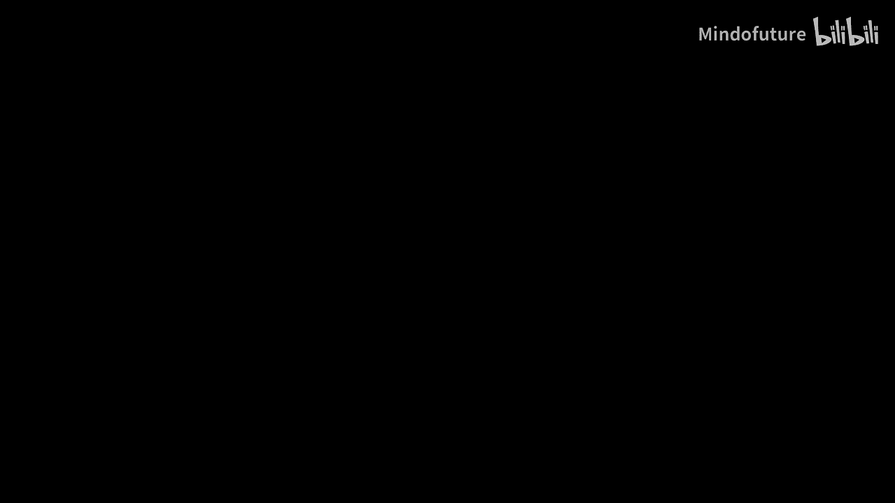
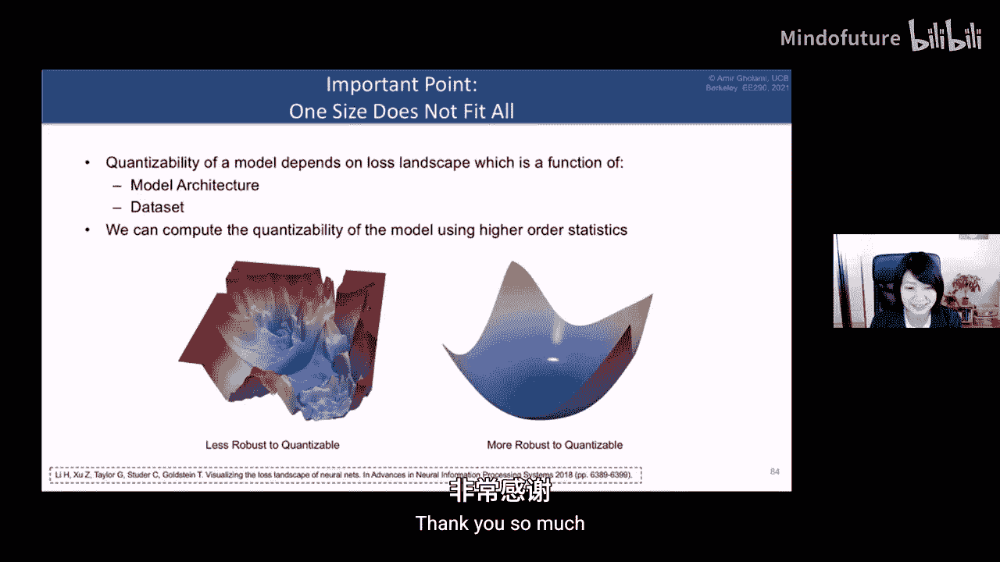

# 【加州大学伯克利】机器学习硬件技术课程 ｜ UC Berkeley ｜ EE 290 ｜ 2021 p08 P08 Lecture 8 Amir Gholami on Quantization Methods for Efficient Neural Networks -BV1XfM4zKETU_p8-

Great and good afternoon everyone， Great to see you again and welcome to E290 hardware for machine learning Before we start two quick announcement。

 first lab two is due this week I hope all of you should have already started lab2 this one is fairly involving with hardware implementations and also you need to do very long simulation So it will take a while so if you haven't started you really really need to start now and if you have any questions feel free to use PA to actually us directly Abe and I will also be monitoring the PA questions if you have any。

 and second on the project from some of you already reach out with your own project ideas and we also have a set a very interesting projects that we have in mind So Abe will organize two project meetup one next week and one the week after will be using the Ga tongue。

😊，tform so that students can also interact with each other if you like to pitch your project idea or just interact with others and get a sense of what other folks are interested and maybe team up to work on some of our proposed projects feel free to use that as an opportunity to interact with each other so that's two announcement again like to is you this week if you have any questions reach out to us and we'll have more details about the project next week and using the platform。

 the Galtown platform for everyone to interact with each other。

So with that let's get to our today's lecture so I'm really excited today this is our first guest lecture of this semester。

 it's really great to have Amir Golaami joining us Amir is a research associate at Berkeley and he has done a lot of really interesting work in really understanding the challenges of deploying machine learning across different platform。

 especially from quantization perspective， which is a very important metric in today's deep learning deployment。

 He has been doing some really influential and exciting work in developing systematic method to explore the quantization space so I'm really excited to have Ammir joining us today I'm looking forward to a fun discussion Again if you have any questions during the talk feel free to just either on mute yourself or use the chat window to post your questions there I will also be monitoring the questions there with that Amir feel free to。

😊，だけどうん。Thanks so much Sophia thanks so much everyone I'm very excited to give this lecture This is a great great course。

 a lot of really good resources feel free to ask any questions know during the talk this is supposed to be interactive if anything was not clear you know there's no wrong questions so anything if it was not clear either it means I didn't explain correctly or the slides were not clear so please do ask questions so I'm going to stop the video because of my internet connection but you know if it was questions。

😊，All right， so let's see what are the different quantization methods that are currently used for neural network inferences。

 the majority of the focus will be on inferences， although I have to say that training is being you know one of the biggest biggest successes was in training。

 but we haven't been able to go below efficacy I'll briefly mention it in last year's lecture I went into more details of training but this lecture will focus more on inference because。

The methods that we have today have showed that we can go to low precision for inference is still an open problem istrain。

But let's take a step back and look around and see what is happening in AI so this is a very famous blog post from open AI where they're showing how much compute is needed to train different types of neural networks so the Y axis the way they're reporting it petddleflop days you can just think of it as like compute it's not a standard way of reporting petalflps days but the Y axis you can think about it as the amount of compute that you need to train the network and the X axis is the years so here we have AlexNe and then the rest of famous neural networks up all the way to Alphago。

And you can see that the amount of compute needed to train on method models has exponentially increased。

 so you can see that the increase has been 35x over 18 months。

 whereas if you think about Moore's law， if it was alive， it is not alive， but if it was alive。

At its max scaling it's 2 x over 18 so we need faster methods of train and this was in part enabled by new hardware innovation you know we have we've been able to get here because of hardware you know the one of the reasons that we were able the learning succeeded we essentially AI accelerators。

But this is not the entire picture。So actually， if you look。

Memory wall has become a major problem these days it's not just compute you know this memory wall has created a big problem so now instead of looking at compute let's look at the number of parameters that these neural networks have and the axis is here and now you can see that starting from 20 late 2017 when transformer models were invented you can see that there is an exponential growth in the number of parameters of these models so this has become now a very very big problem。

So if we now do the same analysis， if we go from Resant 50。

 which we got from Microsoft Research Asia in 2016， going all the way to the Gsht model from Google。

 which is now used for translation， you can see that every 18 months the model the slope is 200x。

Whereas if you look at GP1， which was introduced mid 2018， the slope is 450x。Much， much。

 much higher than how much the accelerator memory is increasing， which is roughly 1。

5 x every 18 months so this has become a big problem Quaization actually can help you here reduce the memory footprint of these models。

 reduce the memory footprint of communication， reduce the memory footprint of activations when you're training very very powerful method。

And importantly， lower precision means that we are going to consume less energy。And more importantly。

 we are able to do things faster with higher throughput because if we have floating point logic。

 the logic is going to consume some area and it's going to consume some energy。

 So if I have a floating point logic and instead of doing floating point precision I started to go down in precision I can pack more logic into that fixed area and that enableds me to have higher throughput for less energy so that's essentially what has enabled us to do a lot of great work so just a little bit of a history around 2015 people knew that you know if we go to do FP16 orient people knew that we can we can have。

 of course better hardware higher throughput， the problem was that the algorithms were not there So if we were trying even FP16 training at the time you couldn't train even Alex that so in 2015 major breakthrough happened at NviDdia and at Google we found how to resolve this problem and that really catapulted the accelerators。

 it enabled us to do a lot of great things。Going in training from FP 16 to into8。

 five years later has still been very challenging， so we haven't been able to solve that problem yet。

There is a couple of papers but unfortunately the methods are very brittle。

 so it doesn't work for new problems， it requires a lot of tuning so this part is still an open area and if somebody can resolve this it's going to have a massive massive impact but for inference we've been able to do that。

So for inference， it's much easier than training， we've been able to go to in4 and we've actually been able to go all the way to binary。

Wineary precision， basically。So let's let's look at how does this help us so this is an actual measured result that quantization shows that you can get better latency This is from Tensor RRT 7 and actually you can download this you can test this for yourself there's Docker images so these are all reproducible numbers you can see that for different neural networks so here on the left we have different neural networks mobile Ne V2 is a very popular network you can see that if you're running the network in floatinging。

32 you get some latency let's just normalize this with 1。0。If I run this with reduced precision in8。

 I'm going to get 1。9x speed up， so if this was， for example， let's say 20 millisecond。

This is going to go down to 11 milliseconds， let's say。

 goes down essentially almost by a factor of two。And if I increase the workload。

 this is the number of images that I am inputting， if I increase the workload。

 the problem becomes even more compute bound so I can essentially benefit even more from quantitization。

 so I'm going to get 4。0 speed up。And for more compute heavy networks like Inception V4。

 we can actually get super linear speed up。So going from FP32 to info intake date is a factor of four。

But I'm getting 7 x speed up， the reason for this is that hardware for intake8 is smaller。

 it consumes less area so I can pack more intake units in a given area and that enables me to have more intake intake units in the logic and that gives me super linear speed up if the problem is compute bound。

What about energy this is a slide that Professor Shao showed in the earlier quantization course that I'm borrowing that shows that quantization arithmetics is actually orders of magnitude。

 more energy efficient and also consumes orders of magnitude less area so if you're designing a chip if you're allowed to do8 bit multiplication you can pack more8 bit multipliers in your chip and this is again not something new this was not invented in machine learning this was already known in back in DSAs but what changes that we found algorithms that can actually use this so this is really important so。

Essentially， performing8 bit addition uses less， much， much， much， much smaller energy than。

 for example， performing floating point addition， orders of magnitude smaller energy。

 and also in terms of area of your chip if you're designing the chip。

 orders a magnitude smaller area。Which means if I， for example， just look at this。

 this is a 100 x difference， ignoring the energy cost。

 I can pack 100 times more8 addition logic as compared to one per per 132 bit floating point header。

And you know the thing is that this is extremely important a lot of the work has shown that we need to be careful about the energy footprint of training these models because there is some predictions that in the next 1020 years this is actually going to be a noticeable factor in global warming it's also important today in edge you know at the edge you have very limited energy available so we need to be very mindful of how we're using this energy because if you're not the energy is going to go down as soon as you're enabling these AI applications there so this is actually one of the main lat is not just the important factor energy is actually really important。

So now that has given birth to a new approach in neural network design。

 so if you look at machine learning， traditionally we've been looking at ways that can give us networks with higher accuracy that can better match human behavior that can win games and that's a very。

 very important area but we are now seeing another branch which is given the resource constraints that we have can we rethink the design。

 training and deployment of these models so that they can satisfy latency or energy budget and for that we need to actually rethink the very design in the neural network we cannot use Alex that we cannot use GPT3。

We need to think about how we're training this， for example。

 the work in FP16 that NVDdia and Google enable with different approaches enable us to do much。

 much faster training。And inference France is essentially enabling much， much。

 much more efficient deployment of these models that are faster， more energy efficient。

 and more accurate。So for now let's focus on the last one。

 which is deployment and if there was time we're going to discuss the others。

So this will be the outline of today's talk we first will discuss the basic concepts of quantization。

 I think this is really important if you're reading papers you know it's good to know these differences but so these are basic concepts but I think are really important then we're going to discuss advanced topics openend problems some new results and at the end there is a very very exciting line of research work if you guys are looking for research problem I think this is a really important problem of codesign in neural network and hardware accelerator there is a lot of work we do here very very high impact if we can solve some of the problems here。

So let's get started with basic concepts these are the things that are typically in the papers so let's briefly discuss them we don't need to go to you know the small details but but overview it's very good if you notice these details so first let's discuss uniform versus nonunform quantization what is the mathematics of quantization how does these algorithms actually do the quantization and then we're going to go into a couple of other differentiators。

So what is quantization well quantization maps a real value in single precision or higher precision to lower precision quantized precision。

 so for example， if I have a range of values， let's say from minus 2。5 to let's say 5。0。

I want to quant this with8 bit， I'm going to essentially partition the real line into a couple of components and every number that falls in between these partitions is going to be mapped to an integer number。

For example， if I have an array， let's say three by three matrix that has flowing point values。

 let's say 034 3。75 5。64， I want to map this into quantized quantized format and if I'm using a precision that means I want to represent this with numbers between zero all the way to 255 So for example this will be the way that I would represent this Why do we want to do this again we can have better hardware。

 faster hardware and more energy hardware more energy efficient hardware if you're doing intake quantized rather than floating point so that that's the that's the goal。

So what does the mathematics look like Well， it's pretty easy， so I have some real value。

 let's say you know the value 3。34， that's my real value。And what I want to do。

 I want to first determine the range of my real values， so in the previous example use minus 2。

5 to 5。0， let's say that's the max and mean of my real values so I compute what's the max of my real values alone it's five。

Compte what's the mean of my absolute values actually let's use this example so here the max value is 5。

64 so let's use that and here the mean value is minus 4。

7 so let's actually use this example so this will be 4。7。And let's say I want to use8 bit precision。

 so that means that I'm going to partition this range of 5。64 to minus 4。

7 into 255 buckets that gives me the scale。And then once I do that。

 I will need to determine a zero point so that I'm perfectly perfectly representing zero。

 this is really important in quant so if I have a value zero here。

 I want this to be perfectly mapped to an integer value let's say 120 this is really important so that's the goal of the zero point once I have this I will have my linear mapping。

Real value will be equal to this scale times my integer quantization minus a bias。 This bias。

 this zero point is only there so that when I go back。

 this zero point is perfectly represented with no approximation。 This is really important。

Is this the only way to do this not really if you think about it why do we do uniform quantization you know the distribution of the weights is not uniform you've actually looked at your lab's weight value I'm sure that you've seen that the distribution looks something like a Gaussian for example this is a very simple histogram for the y axis is the number of weights that have a certain value for example。

 let's say for zero count how many values of zero is in our array let's say you know this many of them is。

Is zero and then we look at all of the other ones and we see that the distribution actually is not uniform。

 so the first question that people asked was why do we do uniform con well you don't have to do uniform。

Uniform is actually very suboptimal for this problem because it misses the fact that most of the values are essentially between this area and this area and this area and this area。

But the problem is if you do nonuniform quantization which means you assign more components in these ranges。

 essentially say hey I have more parameters here let me assign more bits there The problem is that when you actually deploy this in Harvard it's not efficient to do this you need to look up tables and you know it's going to be very difficult to do this efficiently in Harvard so that's the reason you're focusing a uniform quantization。

And there's other ways of doing this， for example， there was this paper from Facebook in 2018 that they proposed this value of their quantization。

 which was a mixture of uniform and non uniform but，But you know， the research has shown that。

It's very difficult to get benefit from this when we are executing it in hardware and still it's open there is some tricks that people are proposing。

 but so far uniform quantization has been the one that has shown the biggest success so we're going to focus on uniform quantization。

So the next differentiator we're doing uniform quantization is symmetric versus asymmetric quantization。

 so the question is you know we looked at the previous example right the previous example the minimum number was minus 4。

6 and the maximum number was something like 5。6 I believe。So for this case， the first question is。

 do we actually have to use this range， do we really have to use Armin and Rms？

What if you have a big outlier， what if in one of my data points， you know， for example。

 my max is because of noise is you 12 or is 120？That's going to increase the range unnecessarily right I'm going to go from minus4。

6 all the way to 120 because I have a single outlier well you don't have to use that you don't have to use that。

Actually， you can use any arbitrary alpha and beta for this range。

 so instead of using Armin and R max， I can choose any range that I like beta and alpha。

 let's call it， so I'm going to choose beta and alpha。

And then depending on whether beta equals alpha， which is this case， beta equals alpha。

This will be symmetric quantization because my range is symmetric。

 and if I'm choosing different numbers for beta and alpha， this becomes asymmetric quantization。

So if beta equals minus alpha symmetric quantization， beta equals not equal to alpha general。

 it becomes asymmetric。The good thing about symmetric quantization is that the zero point will be automatically zero。

 so that significantly simplifies the calculations so that's why people actually like to do symmetric quantization。

 but it's not really good because。You know， for example， for cases like after Relo。

 you know if I have after Relu all of my signal is strictly positive so all of my signal have positive values after Relo and if I use symmetric quantization I'm unnecessarily partitioning negative numbers even though I don't have any negative numbers so for certain cases like after Relo people use assymmetric quantization and the good thing is that in that case also zero point will be zero that's a very special case though。

The next important differentiator is layerwise versus channel wise disctization。

So let's say this is my neural network， I have my input X， an image， language input， you know。

 let's say， you some signal input for RNNs and I have some output。

And if I look at inside the neuralle， I have different convolution channelss or fully connected layers。

The other question is that， okay。We are allowed to use any range we want beta and alpha that's good。

 but are we going to be allowed to change this for different kernels absolutelyly so there is two different versions here either we do layerwise quantization which is for a given layer I look at all of my convolution kernels and for all of them I choose a fixed values of beta and alpha。

For all of them。So this means that I'm going to use the same range beta and alpha for all of the convolution kernels in layer。

 but if you think about it， this is very suboptimal because different convolution kernels definitely have different ranges。

 so there's no need to do this， actually very suboptimal to do this。

The other differentiator or the other way of doing this is channel wise quantization。

Which allows you to use different clipping range beta alpha for each of these convolutions。

 there is almost no overhead to doing this。And this is actually usually better in terms of accuracy because it correctly captures the range of values that each of these weights have。

 so this is essentially what people use channel wise composition。

The other very important differentiator is whether you do dynamic or static quantization。So。

Beta and alpha can be calculated a prior for weights because we know the weights。

 the model is being trained， we know the weights， so for weights we can precompute beta and alpha statically。

But what about activations？For activations， we can either use static quantization or use dynamic quantization。

 and there is a very big difference between these two in terms of performance。

Static quantization uses predetermined ranges， you look at all of our input or a sample of input we calibrated。

 you look at okay， the range of the activations looks like you know from for example。

 let's say minus 22 doesn't change that much or changes a little bit so let's you know go you know 10% higher 10% lower and use that statically。

Dynamic quantization determines this range in real time。

 so essentially when the activation is coming to a layer。

 it computes whats strange and based on that performs the quantization， it's typically more accurate。

 you get much better accurate quantization results but it's very very slow because computing range of an array is very。

 very slow process， you cannot do this efficiently on hardware。So。To summarize this part。

 if you look at just one layer。Multiply W with x x is our input activation。

 and y is our output activation。If we are determining the range of x in real time that becomes dynamic quantsization。

 if we use a predetermined range， that becomes static quantation。

The other difference is post training quantization versus quantization average training。

So this is also a very important differentiator quantization aver training is where you're allowed to retrain the model。

 it's very important when you're going to low precision， so for example。

 when you're quantizing the model parameters the parameters are no longer the same as the floating point that that's obvious right you're doing quantization。

And quantization of training enables the neural network to adapt its parameters so that it can reduce the impact of quantization on accuracy。

Essentially the network is now allowed to retrain or readjust its parameters so that within the constraints of having discrete quantized values it can reduce the loss as much as possible this is really important for low precision but it's very slow because you have to do sometimes hundreds of epos of fine tuning it's a very slow process。

Pot training quantization on the other hand doesn't do any training。

 so the input model is given to you， you're not allowed to do any pretraining。

 you can look at the ranges， you determine the alphas and betas。

 you determine the precision and you give the quantas model to the user。It's very。

 very fast or is magnitude faster， but for low precision， its accuracy is really low。

And so if you want to compare these two methods， first training quantitization is typically very fast。

 quantitization of training is very slow because we need to retrain a network。And importantly。

 PTQ is really plug and play even without data， even without providing input data。

 you can do the quantitization， whereas for quantitization of training。

 typically you need to have a good amount of training data to retrain the network。

 but unfortunately PTQ doesn't allow you a lot of knobs to retrain the network or readjust the accuracy。

 readjust the parameters to reduce the accuracy。All right。

 so let's review the basic concepts we discuss uniform versus non uniform quantization we said that non uniform interesting idea。

 very hard to deploy it efficientlyly on hardware so that's why people have been focused on uniform quantization。

We discussed an important differentiator symmetric versus asymmetric。

 this was related to what is the range that we're using。This beta and alpha。

 this range that we're using to clip， Are they the same， if they're the same。

 we're doing symmetric consization， if they're not the same， we're doing asymmetric conization。

Then we talked about layer wise versus channel voice colonization。Well。

 there is almost no overhead to doing channel wise， typically people use channelwise quantization。

 which means for every matrix for every matrix W times x， you're using a different beta and alpha。

Dynamic versus static quantization this is really really important if you're reading papers on quantization and you see somebody's doing dynamic quantization。

 the first question to ask is yes you're getting good accuracy。

 but are you even able to get any speed up it's very。

 very difficult to do this dynamicy quantization computes beta and alpha under fly of your activation versus static quantization which has the value statically stored。

And then we have posttrain quantization where you're not allowed to do any retraining of the network versus quantization of training where you're allowed to retrain the network。

 typically the accuracy here is higher， but the cost can also be orders of magnitude higher to do the quantization。

All right， so Air a quick question when you mentioned the layer sorry channel wise quantization right so you use the example of the different kernel。

 different output channels there like is there also a corresponding funding yeah this one like this looks like more like thinking about kernels different output channels we can have actually different precisions What is a state of art in terms of the input activation for different input channels do people also explore like the like fine grain quantization for input there or still typically the entire input activation share the same the same range That's an excellent question that's an excellent question So if you look at the input activation So this is essentially in computer vision we have high times with times channel input right the simplest thing to do is to use the same be and alpha for the entire activation but if you look at the activation。

 different channels actually have different different ranges So if you're allowed to change the ranges for each of these。

To get better results。 So there is some work on groupwise groupwise quantization。

 So if we take this to the extreme of using a different beta and alpha for each one of these guys for each one of the channels here。

 then when we are multiplying the。The do times x， essentially if when we're applying a convolution to this image。

 we have to take care of the fact that each of the channels has a different scale and that creates an overhead。

 but an interesting idea is to do groupwise groupwise quantization see for example。

 you've seen in equals， let's say 2000 let's use a scale for the first 1000 and another skill for another 1000 we actually try this inquer so we use different。

Beta on alpha for like groups of groups of activations。

 it's definitely possibility if we can resolve the hardware speed up。

 it's definitely a very good idea。Interesting， thank you。

So now let's go to advanced concept of quantization。

 fake quantization versus integer only quantization。

 I really appreciated this when we went to actually deploy the quantization in hardware。

 the salt is really really matter here and then we're going to discuss how much what's the limit you're doing intake quantization all day。

 what's the limit can we actually go to lower precision that has a major major impact but the result is here if if you just go to low precision you lose a lot of accuracy so theres some work of mixed precision here that enables you to go to lower precision but but don't lose a lot of accuracy。

So now let's actually look closely at a layer to understand fake quantization or inly quantization this fake quantization is you know I don't like the name but the some people using it in the literature is usually typically you know I like the name simulated quantization we'll discuss the detail Intely quantization is also known as fixed point quantization or diic quantization which is a term that we are using。

Let's take a close look at layer and we'll understand what's the difference。So in a neural network。

 we have some input X， and we are performing a bunch of matrix operations， right。

 and we're getting the output。So for one layer， we have W， which is quantized， we have x。

 which is quantized and we're getting an output which is quantized let's actually take a look and see how does the calculation look like。

So for simplicity， let's assume that we're doingsymmetric quant。

 which means that I don't need to worry about the zero point。So if I look in the hardware。

 what does my hardware hardware see？It see that I have a W that has been stored。

 let's say in four bit quantization， so it's been stored in bit four bit in teacher quantization and has a scale。

If remember， R equals S times Q minus z。 We don't have z anymore。 You have S times Q。

 and I'm representing S with alpha。So I have one alpha for rates。

And then my x also has another alpha。It's parameters are starting in four and computing the output y。

 how can I compute the output y， but very simple， right？

The output y in in4 is going to be equal to multiplication of the scales of x and W。

Divided by the scale of y， right？Well that requires multiplying W and x together。

 how do we multiply W and x together， as Professor Shao mentioned in the previous lecture you perform the multiplications in low precision let's say in4 and you accumulate in higher precision so let's say 32 bits so I have those values in 32 bits。

And this will give me the info results back， right？Actually no。

 it doesn't because this value is a flowing point value， I need to do a quantization。

I need to do some rounding for example， if this result gives me 2。03 I need to round this to 2。

0 I should know no point it's essentially I need to round it to2 right so essentially I need to have this rounding operation So this is essentially what we do or what we expect right。

But actually， if you look。It's this。Actually， if we look at the quantation algorithms。

 many of them don't do this， many of them don't do this。So。

There is this algorithms called fake quantization or simulated quantization， the idea is as follows。

You have your weights that come in in four with the scale and you have your activations which comes in in four with the scale。

 but when you're performing the arithmetic， you're actually performing the arithmetic and floating point precision。

Not not in teacher Con and this is not mentioned in most of the con papers。

 and I actually thought it's not a very big deal， but it is very， very big deal。First of all。

 if you're performing this operation in floating point。

 there is no way that you can take advantage of faster hardware because you need to do floating point here。

And second of all， there is a lot of important components in the neural network that are very。

 very sensitive to whether you're doing integer accumulation and integer multiplication versus flow point。

 for example， batch normalization parameters， for example， residual connection。There is a very。

 very important difference。Whether you're doing fake quantization or intertely quantation or fixed point quantization。

As Professor Shao mentioned in the other lecture， in inional equalization。

 we are performing multiplication in。Fix point or integer， which is much。

 much more efficient than floating point， and we are accumulating in integer arithmetic。

Higherbit precision integer， but's still but much more efficient than flowing point and then finally once we have the results accumulated in in32。

 we can perform a very simple downscaling or rescaling back to info and continue。

And so one of the ways that you can do this is what we're calling diyadic quantization。

 which is a very， very simple idea， The basic idea is that you have your results accumulated in 32 bit precision。

 you want to go back to four bit quantization， you need to rescale the results with some factor or some factor you know this doesn't you know basically weight times activation divided by the output scale some sum factor。

You can essentially enforce this number to be some integer divided by a power of two which is diic numbers。

 we're dealing with diic numbers everywhere one over two is a diic number。

 it's three over four is diic number if the denominator is a power of two that's a diic number right all numbers representing in IA or diic numbers。

If you represent it this way， then you just perform integer multiplication and be shifting， so very。

 very fast compared to floating point reconciliationconssideation。

And there is a big difference between doing floating point arithmetic and integerrithmetic and there is a book chapter by Goldberg in 91 that's a very important。

 I think discuss very important concepts that I recommend people to look at what every computer scientist should know about floating point arithmetic versus the non- floatinging point arithmetic and you might wonder you know I get this question that in the difference is really small right unless you have very。

 very， very large antigen numbers， the difference is small， but actually the problem is。

In this rounding operation in this integerization operation， for example。

 let's go back to this slide。Let's say instead of 2。03。Instead of 2。03， I had 2。499999。

Where is this going to get rounded， it's going to get rounded to 2。0。

But if I have a little bit of a noise， this is going to be， let's say 2。500001。

 what is this going to be map 2， It's going to be map 23。0 or there's no point sorry。Makingism mis。

It's going to be map23 now you have order one error so that's where things actually matter so if and this was something that you know we were deploying this in hardware using fake quantization you're looking at the output completely different than what we expected because of this。

So fake quantization helps you with accuracy， but it's not possible to map it to hardware。

 sometimes you get the same accuracy， sometimes there is a little bit of an accuracy degradation for intake but as soon as you go to low precision this accuracy difference will be huge。

And the errors are actually not not small。 So for example。

 if you go to four bit quantization and we look at how much is the the activation changes from what we expected。

 you know， I ran something in Plytorrgia， look at the output。You know I see one output。

 I deploy it in a hardware that's doing fixed point I look at the output and I see 65% difference when I'm doing info so this actually matters。

 it matters a lot。I think there somebody has a question Dan raise his hand Yeah。

 would you mind going back to the comparison slide？

So it doesn't quite jump off the page how these differences are not just small but even non zeroro。

 if the inputs at top left are all integer valued， should we be reading that as the activations are turning them back into FP32 kind of along the way。

So for this case， if you actually have on the top side if you're just doing convolution if you're just doing convolution and you take the scale out right。

 so essentially instead of performing the convolution using floating point FP3 to an activation FP32 if you just take the scales out and you still do floating point multiply accumulateulate。

 the result will be exactly the same。But the difference will be in residual connection。

 the difference will be in batch normalization， so we have a figure in the appendix of Howe 3 paper that explains this。

where the idea is that if you for example， have a residual connection let's do this so what is a residual connection let's write it here residual connection is basically you perform some operation to the input X and you know you do some f of x and the output result is x plus f of x right？

If I'm performing this using floating point operations。

 so I sum these two numbers up with floating point operation。

 the result will be very different than summing them up using quantization。Because quantization。

A plus B is equal Q of a plus B is not equal to Q of a plus Q of B。Right for example。

 let's do an example， let's say A is 2。3 and B is 2。4， for example。So if I quantize a。

 this gives me two， if I quant B， this gives me two2 plus0s 4。

 but if I first sum this up together I'm going to get 4。7 and if I quantize this I'm going to get 5。

0 if my rounding is around to nearest。The difference will be very high。

 so essentially because of this， whenever you have residual connections or， you know。

 similar or similar thing need even in other operations， there will be a big difference。

So if then you have a follow up let me know if this is not clear。

 but essentially if you're just doing a very， very simple convolution operation。

 we can take the scale out of the WFP 32， HFP32 and of course when you're doing integer operations with floating point。

 the result will be the same unless you have extremely large integer values。

 but if you're doing more complex operations there will be a difference between fake quantation and integer only quantization。

And typically it's harder to do in convol。So does this work so let's say we want to do inal equalization does this actually work yes it works there was a prior result from Google that showed that actually you get like four5% accuracy degradation we found that if you're dealing correctly with the residual connection if you're dealing correctly with the batch normalization actually there is no accuracy degradation so let's take a little bit of a look at this result this is usually the way people report results of' let's become familiar with it。

So here let's go over different columns， so we have different models here on the first column。

Different quantization methods。We have whether they're using integer only or not。

Whether they're using uniform quantization or not， this one's not important。

 whether open source or not， precision is usually reported in the literature as WX。AY so this Wx。

 this x reports refers to number of bits that you're using for weights and y refers to the number of weights that you're using for activation。

So W32 A32 means the baseline I'm using 32 bit precision for weights and 32 bit precision for activations。

 and this is the size of the model in single precision。

This is another important metric that people have started to use which is called B ops or binary ops。

 it's essentially a different way of looking at the operations when you have different x and y the way this is calculated is I look at the operations or ops of a single layer。

in binary and then I multiplied with how many bits I use for x for W and how many bits I use for activation its essentially the way they're reporting it it's important when you have。

 for example， W48 for example。And then this is the top one accuracy on Inet， so higher is better。

So here the baseline model， bring this up。So here the baseline model is getting 71% accuracy If you look at the RV quantum method from Facebook which is using nonuniform quantization the accuracy goes down to 70。

 but if you're doing this intertegen calculation in the correct way you actually are able to get the same almost the same as baseline slightly higher that's slightly higher as a bit of a noise。

But the model size goes down a lot， model size goes down by factor of four。

 and the B ops goes down by a factor of 16。If you look at Grsland 50。

 which is another popular network， the baseline model has an accuracy of 77。72%。

Prior intely work from Google showed that we can do in quantization， but the accuracy would begrade。

To 74 But if you actually treat the batch normalization and residual layers correctly。

 you're able to resolve that so what we're getting is 77% accuracy so you can actually do interjonally calculation you can do interjo quantization and it actually works。

And same thing for inception。But the big question in intake works almost across the board for natural language processing for computer vision。

 you know for even reinforcement learning I've seen some works that have shown quantization scientific ML is a little bit different because they really need higher precision there but for classical ML problems intake works but the big question is for these tasks。

 can we actually go to lower precision。What happens if it go to the limits？

It can definitely help us improve the efficiency， but does the accuracy degrade or not？

So a quick question。 like go you go。 Yeah。 So in this discussion。

 just making sure understand like the so the fake quantization you mentioned earlier is actually doing at the high higher precision right。

 doing at the floating point。 versus the integer only quantization。 So is a fake。

 fake or simulated quantization is actually accurate baseline and is a is a improvement is actually to modulate the integer only quantization so that it actually works or the simulated quantization is actually wrong because of the quantization issue that you mentioned earlier with the accumulation。

 That's an excellent， excellent question。 So that's a very important question。

 So fake quantization approaches。Let let me clean this。

 So fake quantization if you have a problem that is not arithmetic bound。

 you can actually do fake quantization。 for example if you have recommendation systems。

 they're not arithmetic bound so that's where the bottleneck is not how fast you performing a multiply accumulate how fast are you loading the data to your processor So for those problems it's easier to do fake quantization probably it has even higher accuracy but if you have a problem that the bottleneck is not loading memory but performing fast arithmetic then using intely quantization is the one that gives you the fast arithmetic and so for intake we have found that for intake the difference between fake quantization and inte quantization is little。

So if you do fake quantization in your Pytorrch or tensor flow and you deploy it。

 there is a slight mismatch。Andistic mismatch， but it's acceptable。

 but if you're going to lower with precision， then that's where this difference between， you know，2。

3as quantas this guy plus quantas this guy matters And the reason for that is。

Getting four versus five。In four bit quantization is a very big error the error size will be one over 15 because four bit only has as two to the to the four buckets。

 whereas if you have8 bit quantization， this is the difference of one over 255 so very。

 very little error and that's wherere actually doing engineering quantization really matter。其先。

So the challenge is actually to get inly organizationization works。For those scenarios。

 especially with lower precision so that they can get efficient exactly and for the eight big con that we have here。

 the reason we're getting higher accuracy， I think is because the way Google's in only paper was treating batch normalization and residual connection I don't think that was an optimal way of dealing with that batch normalization is a very sensitive layer so if that is not correctly quantized then then that can lead to accurate degradation。

Great， thank you。So now can we go to lower precision this is I think the biggest question for training we want to go to intake because you know if you can go to intake。

 we're going to get super linearly faster training still open open research area for inference。

 can we go to lower precision yes， so this we've been able to resolve a lot of problems here。

So the way to do this is if I have a neural network， let's say Resnet 20 here。

 I have an input image of a cat here and the output is here you know whether this is a cat or duck。

 right， you can think of more complex examples。If I perform and here we're showing different layers。

 right convolution 1， convolution 2 and so forth。If I use low precision for all of the layers。

 let's say I use four bit。All of the layers of forbid there will be an accuracy degradationdation very difficult to resolve you see some papers that claim there's no accuracy degradationation but typically a lot of hyperparameter toning is involved or they do quantization average training for 400 bucks right so it's really difficult to get this right。

But what if we use mixed precision？What if I'm allowed to do mixed precision， for example。

 let's say con1， I use Con1 with aI precision con do comes to also use aI。

 but the rest of them I do for bit， can I get better accuracy definitely definitely。

That's the idea of mixed precision quantization。So let's see how this works。

Question is which one do we use4 bit4 which one do we use 8 bit for right if you think about this this picture here。

 let's say I have two choices for every layer so this layer I have two choices。

 second layer I have two choices，ter and so forth how many choices do I have I have two to the L choices。

So that's an exponentially large air space， so we need a way of determining the bit precision for different layers。

 we don't want to try all of them at the same time。

 right it's impossible to go through all of this all of this for deep network。

So one idea is that if I have a flat loss landscape。We're going to discuss what that means。

 I'm going to use log precision。 So what is a lost landscape。When were training a neural network。

 what are we actually doing， when we're training a neural network。

 I have some loss function that I'm minimizing， right？Say the loss function looks like this。

 I start from this point randomly initialize the network， I compute the gradient。

 the gradient looks like this， take a step， compute the gradient again。

 take a step and so forth right and I do the training and I finally get convertged to here。

Now I have different layers in the network right， for some of them if I had a way of looking at the lost landscape。

 if you gave me， how does the lost landscape actually look like？

If I had a lost landscape that looked like this。是以。

So if I had a lost landscape that looked like this really flat lost landscape right。

 so here what does lost landscape mean？I have my parameters W。 This is where I converge。

 This is the point star。 I'm perturbing this W。 Let me perturb this w and see how much does the output would change if this w is not the exact w that I that I had and I when you give me them all If it really looks like flat。

 right， it means that no matter what you do to this w， if you perturb it a little bit。

 the lost landscape is going to remain the same loss is not going to change。

Well this means that this is an insensitive parameter， so use low bit precision。

 so instead of using8 bit precision， you can use four bit precision for this。

But if I have a lost landscape that's really sensitive， it's very sharp。

 it changes a lot if I'm deviating a little bit， if I'm deviating a little bit。

 let's say this much just。Instead of here I'm here。

 this is a big difference for this layer it's sensitive， I don't want to move this。

 I don't want to perturb this use hybrid precision。

So that's basically the idea of a loss of or hesian ever or sharpness severe quantization。

So that's basically the idea of ho， how do we use this lost landscape to guide the choice of beat precision？

I look at the shortness。In 2D， so that was a very simplistic example in 2D。

MyMy my convols are in high dimension I have many parameters it's not just one in 2D。

 if I were allowed to look at the lost landscape， let's say look at con1。

 I prepared the con one is some。Given direction， so give me a vectorate per turb another direction per turb I look around。

 How does the lost landscape actually look like？I mean we have to see what is the problem right how does the how hard is this problem we see that for co1 the lost landscape is very very sharp a slight preturbation to this convolution is going to lead to very very high preturbion to the output and that kind of makes sense because if you're getting the first convolution incorrectly means that you're getting the edges incorrectly for computer vision you're getting the shapes incorrectly so of course this is very sensitive。

But look at the output at the very last layer and perturb it in two different directions and I look at the lost landscape it's really flat。

 it means that I can choose lower width precision for this layer but for this layer use higher bit precision。

The basic idea here is that for every problem， for every model， the lost landscape will be different。

 and instead of naively looking at 2 to theL possibility。

 we can just look at the lost landscape and based on that perform quantization。

So this is the basic idea of hog or hasten over quantization。So but we can go even a step further。

 so this was what we presented last year， but we can go a step further， what about hardware？

What about hardware， do I really want to quantas all the layers to forbiit。

 even if it's not giving me so this was a bit， this was forbi。

 what if there is no gain in quantantizing in this layer to forbid？As you all know。

 unless your network is arithmetic bound， there is no benefit。

 there is no benefit in going to low precision， so why would I even want to do that so can take you can go the extra mile and make this not only model dependent but also hardware dependent。

And that's the basic idea of Hawk Q3。嗯。So what we're doing here is that， yes。

You want to only quantize layers that have a flat loss landscape That's correct。

 But don't do it if it doesn't have any return for you， How do you measure the return， Well。

 how fast are you becoming， Like if you want to get fast net for， how much faster am I getting。

 So the first question I ask is。Is the last landscape flat or not， yes， okay， good。

 so I'm allowed to do forb quantization， but how much am I gaining？I deployed a model in hardware。

 sorry I deploy a model in hardware， I measured the latetencying， this is the orange curve here。

Let's take a look at this here。So this is the orange curve here， and I also measure the latency in4。

 this is the blue， the blue bar here。Well， if I'm getting only like five person speed up。

 don't even bother quantizing this。Right if I'm getting a good speed up， let's say 50% faster。

 then it's worth quantizing this layer because if you're quantizing you will perrb the model right so you don't want to per the model if there's no return。

And so that don't， you know， let's not go over the details here。

 but that basically gives you a way of determining a trade off。What is the trade off。

 The trade off is I want to get。I want to become as fast as possible， for example， you tell me hey。

 a mirror。I only allow I'm only allowed to get 100 millisecond， I'm doing autonomous driving。

 100 millisecond is the the worst I can do， you cannot go beyond 100 millisecond。And then I say。

 okay， does your hardware support four bit and AP say yes， then what do I do？As I ask。

 do you have a model size limit， you tell me yes， you know。

 my hardware only allows me to have four mebyte4 megabyte footprint okay。

 great4 megabyte footprint Now let me go over all the bit precision for L layers that you have。

E layers that you have。 and my goal will be to choose these big precisions such that I minimally pertturb the model。

 minimally pertuurrb the model output。Minim groups that them all up with。

And still meet the latency and the model size that you specified for me。So this is a very。

 very simple integer linear programming and you can solve this very fast for just two。

3B precision settings it's possible to solve this quickly。Does this actually work yes。

 we actually measured this it works you can get up to 50% faster with very little accuracy degradationdation。

So let's look at， let's say Reant 50。So residents if we looked at it before。

 based on accuracy in single precision was 77%， if you're doing quantization with a bit quantization。

 we saw that the accuracy was 77。58 but now tell me a I need to go lower because 24 megabyte my hardware cannot handle 24 megabytes I have a FPGA that at Max only I can put like a 20 megabyte model and then we can say。

 okay fine， I'm going to perform mixed precision quantization。

I'm going to perform 4 bit an api con for weights，4 bit con and api conition for activation and this way I'm allowed to reduce the model size to 18。

7 megabyte and still minimally impact the accuracys， the accuracy goes down to 76。

And this is still ingenally so this is essentially the idea and so if you're seeing a lot of research here that depending on how much energy you have available on your device。

 depending on how hard is the problem， you know， depending on the input distribution of the data and so forth。

 you give the practitioner the knob to choose。I need to be dis compact because of my hardware。

This is only 19 mebyte， but now I have a better hardware or I have a bigger hardware。

 you know I can go to8， so this essentially gives the hardware the practitioner anob to play。So Air。

 a quick question here。 Really interesting to see the hardware aspect here。

 I'm wondering whether you can comment on you have an example where going down to four bits precision only get you like5 or 10% and better performance versus like2 x performance you observe in other layers。

 Do you have an example or some theory like why going down to lower precision actually doesn't bring for this layer significant speed up。

 That's an excellent question。 So that quite separable。 I have a slide on this。

 that point separable is one of the hardwares。 one of the If you're not arithmetic bound not want to get speed up。

I see so it's really how I see it's really what how how like the memory and compute and it solves the compute side but not significantly improve still memory bond even it's already forbid so not a lot of benefit there for themselves size exactlyact exactly interesting Thank you Sure And I think Vima has a question。

Yeah yeah， so I guess one other thing I'm wondering about like determining if it's a good idea to quantize。

 I guess I'm wondering in the cases with assymmetric quantization if you're on a layer with which is exhibiting a lot of sparsity。

 especially if to activation。Is like rail or something and you normally have lots of zeros if you do asymmetric quantization。

 it seems like a lot of those zeros。Now become non zero numbers like are there situations like with hardware where。

 which is optimized to work on far as data where applying quantization can just。

Increase what the computation needs to be done or excellent excellent question this is a really good question If we go back to the slides that's exactly why we want the zero point to be perfectly representable that's a very important question so if some people actually we didn't know this right so in early 2015 we didn't know this but but people then figured out that yes exactly because of the reason that you mentioned if you're doing quantization then you know if I have a you know activation that looks like you know00122。

5 something like that right you know minus1。5 and so forth but do the quantization and these zero is become minus。

5 sorry minus1 you're doing quantization。And this minus1 represents not zero， but represents。

 for example， 1。2。That's going to give a S make we create a lot of trouble for us。

 so that's why if you look at the quantation， that's why we have r equals S times q minus this z。

 the role of this C is to ensure that if I have a minus one if I have a1 here for 0。

 this perfectly maps to 0。0 floating point。So that that exact scenarioity doesn't happen。

 that's a very good question。Thank you。😊，是。So this one let's not go over the detail。

 basically this slide just says the following I'm a practitioner I look at intake I'm doing autonomous strain let's say I have some speed let's say this speed is 200 well let's make this speed 140 millisecond right？

And now I look at you know I talk to people and they tell me look you have the mirror you have to be at least 120 milliseconds well I can't do anything I have an intake model right so what I do if I had this knob of mixed precision I can make it a little bit mixed precision so I just quantas a couple of layers with four bit and make it for 12% faster I have that knob。

And the accuracy minimal it gets impacted with the formulation that we have and if I even have a more stringent constraint。

 you tell me a mayor， look， there is the new constraint that we tested you 120 milliseconds still we cannot detect the pedestrian in time to perform maneuvers we need to be even faster。

 can you do something for me without changing the neural network for yes I can perform a more aggressive quantization where I'm assigning more layers with four bit quantization and this makes my neural network for 35% and faster so this givess the practitioner very easy to use knob that he can use to change the model footprint and speed。

Does this actually just work for CV I just showed you results for CV no。

 actually you can also quantize bird models like this with intertegerural quantization。

There is a very， very interesting thing here， I really like this work。

 you know there's a couple of interesting things here that goes back to like 20 30 years ago。

 which is if you look at computer vision， most of the networks are only using relu activation。

So Re doesn't require any computation right you just look at the sign if the sign is negative you key the signal if the sign is positive you just pass the signal。

 but if you have operations like softmax， softmax requires computing an exponential of a number。

ThisThis is a floating point operation or they use nonlinear nonlinearities like yellowlu， so Galu。

 if you look at Relu relu looks like this， yellowlu looks something like this。Actually。

 it goes through rather end。So this requires flow point calculation because Galu is essentially required a function of error function。

That requires an integration requires full competition so actually it's possible to perform inter general quantization for these algorithm for these nonlinearities as well how do we do that you approximate them with a polynomial so it goes back to you numerical analysis and you know how do we feed a polynomial very simple right you just reduce their L difference so it's possible to do it even for non real networks and in particular natural language processing。

Let's move on to core designign。 I think this is a very， very interesting idea。

 a lot of open problems。In review， advanced concept of quantization。

Fed quantization works for problems that have low arithmetic intensity that you don't actually are not bottledne by arithmetic you're bottleling by how fast you can read the data go ahead do fake quantization。

 but if you want to get speed up for problems that are arithmetic bound and you want to go to low precision you should perform intogen quantization and then we also discussed uniform versus mixed precision If you want to go to low precision uniformly you're going to get a lot of accuracy degradation What's the solution you can do mixed precision。

But now let's go talk about a very， very exciting area。

 very exciting and open area of codesigning the neural network and hardware think this this。

 there is so much interesting things that can be done here that if you can figure out any of them。

 it will have a lot of impact。So what if I told you that now you're allowed to change the neural network architecture？

As well， so you're no longer fixed， you no longer have a residentnt 50 that's fixed。

 you're now allowed to change the neural architecture， what can you do？Well。

 one of the things that we can do is perform hardware aver electric design。

 you have like exactly the same way as what we did with quant。

 look at how much speed up am I getting for a particular layer。

 choose them smartly so that it's tailored to that particular hardware。

We have done some work here that I'm going to go over。

 but the exciting the more exciting approach is to codesign both the neural network and hardware。

 both of them together and if somebody can do this I think it will have a major major impact。

So why does this actually matter？Well， there is this concept of arithmetic intensity。

 So what is arithmetic intensity， arithmetic intensity is a metric。

Is a metric that measures that the ratio between the number of floating point operations that I need to perform versus how much memory operations that I need to perform。

So this flop， you know， if you're doing lower precision becomes ops right。

 so essentially this could be thought of ops divided by memory ops， right？

Why is this important the hardwares that we are designing today are really good for high arithmetic intensity。

 which means if I have a layer that for every bit of memory that I'm reading so if I have DM here。

You know， I'm reading a bitte of data to my processor， this is my processor。For every by。

 if I have to perform a lot of operations， then this enables me to fully utilize that hardware。

 why is that the case because we haven't been able to increase the bandwidth and reduce latency as much as we've been able to increase throughput。

So this is essentially what they call the roof line model where the X axis here is this arithmetic intensity higher means that you're more arithmetic bound。

 lower means that your more memory bound and the y axis here is what is the ideal you know case for you if your banditage bound it doesn't matter if your hardware has like you know four petta ops of peak。

You knowYou're going to be bounded by how fast you can read the data。

 so this gives you the ideal case， you know if you were able to ideally utilize all of your bandwidth。

 how fast are you going to be？Well you're definitely not going to be4 up。

 you're not going to get the your time is not going to be proportional to how fast is your compute pick is going to be proportional to how fast you can read the data。

But if I'm performing operations that are arithmetic bound， like dense matrix matrix multiplications。

 with very big sizes， then I'm going to be bounded by how fast I can perform computations， right？

And there is a very good paper by Professor Patterson and other faculty in Berkeley。

 it this paper was written in 2004， describes why latency lags bandwidth and still the ideas hold。

 we haven't been able to resolve the problem， we haven't been able to the scale this memory reading this memory operations as much as we've been able to increase computational peak。

Because of that。Not every， not every operation is the same。And more importantly。

 every hardware will have a different roofline model。

 maybe I have another hardware that looks like this。So it's really。

 really bandwidth balance even even for operations， my operation has to be very， very dense。

 otherwise I'm not going to get the full utilization。

So this goes back to the question that was asked earlier。

 you know what is a good example for this that why suparable。

 so we actually looked at the how much speed up are we getting。

 how much speed up are we getting when we're going from floating point to intake。

If you have dense one by one convolution， you're almost going to get like a linear speedup almost。

 you know， it's like， you know， if you have enough computation。

 if your number of channels is really high， so if C is really high and resolution is really H by double is also very high。

 then you're going to get a good speed up。But if you're looking at depth voice separable。

 you look at the same speed up， almost nothing。Because the problem here is not how fast you can perform computations。

 the problem here is bandwidth bound problem。So what we thought was that okay。

 what if we perform this hardware ever neural net design， you look at a particular hardware。

 you look at its layers and if it has layers that don't perfectly utilize that hardware's resources。

 we change them or we reduce the number of layers that have that characteristic。

 so this is essentially hardware ever neural network design。So for this， we partnered with Samsung。

 so we had one of their engineers in our group and one of the things that we were getting from them was for every layer。

 looked at what's the latency of this layer， you know， what's this energy cost。

 what's this utilization？And this is the result that we got from mobileNe。

So mobile is mobile E v won at the time was out， and this was a network that introduced depth by separable convolutions。

So we looked at the utilization of different layers。

 so we have to speak hardware and this dotted points shows the accelerator efficiency higher means that all of my cores are busy。

 lower means that several of my cores are sitting idle。

And at look at there is a very interesting behavior here for depth voice separable because it has very low arithmetic intensity。

 it's getting very， very low utilization of my hardware so if I had a hardware that had 10 times computational peak the time for executing these layers won't reduce by a factor of1。

😊，So then we said okay， that why is not really good idea， what if we do something else？

So as a background， for people who may not be familiar with Dev voice or full convolution。

 full convolution has all the channels for every kernel。

 whereas Dev voice has only one channel per kernel， so you can review this later。

What we discussed among ourselves was that you know what if we do something very， very simple。

 what's the most naive thing we can do is that okay， instead of using depth voice separable。

 let's use spatially separable。You know spatially separable instead of having a three by three you know for example。

 times the number of channels， you have three by one you're not reducing the number of channels。

 but you're getting a factor of three less parameters so very simple idea just just see how does this work and let me say okay we have this result back from Samsung but if we look at the utilization of these different layers and manually tune these layers manually change their order or you know increase the channel size you know the number of layers that we have with that particular particular configuration and see if we can get a speed。

So that's what we did same plot from before we look at the utilization from Samsung and we say okay。

 some of the layers have very， very low utilization， let's use less of those layers。

 completely manual， completely brute first manual approach。That's something I recommend today。

And we did this and we found that yeah actually it kind of works compared to mobileNe。

 we were able to get almost the same accuracy， this was mobile E we won this is top one accuracy almost the same accuracy number of parameters was less。

So we were getting 3。2 million versus 4。2 million。 and actually it was faster。 It was like。

 you know 10，20% faster。 I don't have the exact number because Sasung didn't want to。

Opens source the exact number at the time， but it was like 10 to 20% relatively faster。

 I think we have some relative numbers in the paper。But this was a manually manual approach。

 not really something that you can do， right， you can do this， look at one of them。

 try them or CD acress。So one of our colleagues Been Wu went to do an internship at Facebook and he did this very interesting work of hardware Ever neural architecture search which automates this approach and today this is the state of the art approach that people are using when they're designing enrollment for particular hardware so if you go inside these hyperscalealrs to be companies and you see what they're doing they're not using GrsNe 50。

They're adapting Resite 50 for their specific architecture。So the basic idea here is very。

 very interesting。😊，Basic idea here is don't do something manual instead of doing manual design。

 what if。What if you give me these layers that you have， let's say you know your depth files。

 your three by three， your spatially separable convolution。

What I'm going to do is you give me your target hardware， you give me your target device。

 let's an Apple a 14 chip。I'm going to benchmark the latency of each of these operations or power。

 you know， depending on what's your target， going to measure the latency of each of these operations so I have for depth separable latencies。

 let's say 10 millisecond for given channel size for three by three。

 let's say the let's say one millisecond has higher parameters and so forth。

And then I'm going to design and train this stochastic supernet， what is this stochastic supernet。

 think about a neural network that has all the possible configurations that you can have with this search space。

Meaning that for example in layer one， instead of just having the one by one。

 let's say have one by one， instead of having just the one by one layer， what you have。

 you have a probabilistic neural network where you have one by three as well。

 you have three by one and you have three by three。And then what you do is you train a supernet。

 a stochastic supernet， which essentially changes the probability of sampling this one by one and one by three and three by one so that you can reach your latency target。

 can reach your energy target or your model size target。

 depending on what what's the application use case。And it's hard forever。

So what happens after training this stochastic supernet is that。You know， if you have a one by one。

 let's say this is one by one， this is three by three， this is depth files。

The probability of sampling this becomes 90%， the probability of sampling this becomes 5% and the probability of sampling this becomes 5% it's a stochastic supernet has all the possible configurations and then I sample an architecture from this then I sample an architecture from this with 90% probability and I'm going to get the one by one。

For the second layer， let's get that three by3 and so。Autoomatically captures that， hey， look。

 if you're using depth separable， I have to pay a very。

 very high loss because the latency is too high。And what does this actually work yes。

 it actually works very well， so this is a design case that Vien did。

 he designed two different models with same accuracy， but targeted two different chips。

 Apple 11 and Snapragon 835。You know， these are two， you know。

 at the time they're popular or popular mobile processors that people were using。

And he designed two networks that both of them had almost the same accuracy， 73% accuracy on INe。

But if you were targeting， if you were targeting a particular hardware。

 you were able to get 40% speed up just by doing a hardware of design。So here。

This shows the Y axis shows the latency， so here we have latency。And the X axis shows the hardware。

If I targeted the model for iPhone， if I targeted the model for Apple A 11。

 this is the latency that I'm going to have 20 millisecond。But if I didn't do that。

 I targeted the model for Samsung and deployed it on Apple phone， I'm going to get 40% higher lats。

So essentially by doing targetrg at our hardware every design。

 you can get some 40% speed of for free right the same acress， very。

 very interesting idea and this is actually what people are using now and there are different ways of doing this neural architecture search。

 but the big concept is that you're now allowed to change the neural net architecture as well。

But the big question， I think this is a really， really exciting area。

His can we co design the hardware as well。 So if you were Apple， you know。

 you' were the Apple architect right or Samsung architect。

You would ask that for these ranges of applications that I have。

 what if for example I'm allowed to also learn what is the right systolic area configuration that can optimally perform a range of operations essentially don't just do hardware ever design of your neural network for architecture。

 but also at that both of this at the same time， for example。

 this is an open problem but just just giving me an example。

 the number of registers on these PEs right if I could make this somehow differentiable and learn what is the optimal number of registers that I can have in every PE for a particular range of tasks right in CV I'm only interested in object detection that would open a lot of interesting doors for us。

And Professor Shao has done very interesting work here as well on time loop。

 and if you have some way of having a differentiable way of getting metrics from the hardware。

 then we can essentially codesign both of these together。So in summary。

 there is three different ways of doing efficient neural network today。

We discussed most of the today's lecture was about quantization。

 You can also perform pruning and installationtill。 We didn't discuss this pruning。

 you can think about it as zero bit quantization， essentially removing the weights。

You can also find new neural network models today most of the work here is hardware co design。

 hardware neural network design， but we can possibly do codesign， and then of course。

 when you're talking about hardware it means that you have a specific processor in mind and you're targeting that processor and this is essentially the ecosystem of what people are using or the three main elements of what people are using for designing efficient models。

And a couple of open problems， if you're allowed to go to even lower bit consization without accuracy degradation。

 that's going to enable us to much more efficiently use the hardware。

 so the majority of today's lecture was on that， but this is the big picture。All right。

 thanks so much everyone for listening。 It was a great pleasure to give this talk and if you have any questions。

 you know for people who are not here today live， please feel free to send me an email。Great。

 thank you so much Amir thank you very much I really enjoy your talk today very informative and going to a lot of depth with different topics so thank you very much Amir we do have a couple more minutes so if anyone have any questions feel free to either post on the chat window or or just unmute yourself feel free to askRP maybe just to get the question started。

 I have a quick question for Amir I'm wondering whether you can talk about what hurts future maybe your vision in thinking about the compensation right you mentioned like the training with lower precision is still a fairly open question with a lot of challenges putting ahead and it seems like we have done pretty good job with inference like to come to four bit and there's also recent work like two bit or even one bit there right so what where do you see。

What are the next steps for in thinking about the content card。

 both in terms of maybe absolute resources， but also could be also different applications you also handed earlier？

There is some interesting things that we can think of are still open problem so that you know mostly brainstorming one idea would be to do mixed precision training so we've seen that you know if you go to in8 for training we can't really train sophisticated networks there's a couple of papers from IM on this but it's very difficult to get this running for new normal so one possibility would be。

And if you're looking at the lost landscape of the network， see maybe I have a slide on this。

 we you're looking at the lost landscape， if we're getting into very difficult lost landscapes use Har Christian you know intuitively speaking and if you have like a simple lost landscape then you。

 for example， perform you know perform。Low precision right so you do trend precision we are already doing this for communication So if you think about communication you say if your gradient values are small don't worry about sending them if your gradient values are large and send all a quantized version of them depending on your gradient size you you essentially decide whether to communicate or not we can for example。

 if you had a way of having the reconfigurable hardware that sometimes we can perform in date sometimes you can perform a6 I think that's definitely possibly。

Another area that I think I'm personally very excited about is this code design。We for example。

 perform co design on hardware for a range of applications that would open a lot of really interesting real interesting tour Another thing that we didn't discuss today was about sparsity so sparsity think of it as having zero bit for representing a number right so if you have zero bits that you don't have to do any calculation for that。

Sparrsity works very well if you have low levels of sparsity。

 but if you go to high levels of sparsity， especially unstructured sparsity。

 it's very difficult to retain accuracy so there is a very good paper from Trevor Dale and Sara Hooker on the current state of sparsity that discoveres these challenges combining sparsity and quantization another very interesting thing is that if you're doing both quantization and pruning at the same time it's very difficult to compress the model so this is still an open problem。

Finding ways to accelerate unstructured sparsity would be an interesting thing going back to Professor Shao's question of you know enabling quantization for every input channel。

 if you had ways of accelerating this in hardware that could open new doors to us。

 these are some of the some of the high level high level problems that comes to mind mind。

It's very interesting Ammiir， yeah definitely a lot of open and exciting questions and especially as the intersection between algorithm and Hard of great we're a little bit off of time already 330 pm Pacific so thank you Ammiir of for this very informative talk and we really all of us already enjoyed it and we hope to all stay in touch and we're looking forward to exploring more exciting research together。

😊，Thanks so much for having me， Sylvia。Great， so we'll end today's lecture here and for all the students we'll see you again next week。

 pick here and everyone。😊，但系乜。

Thank you so much。