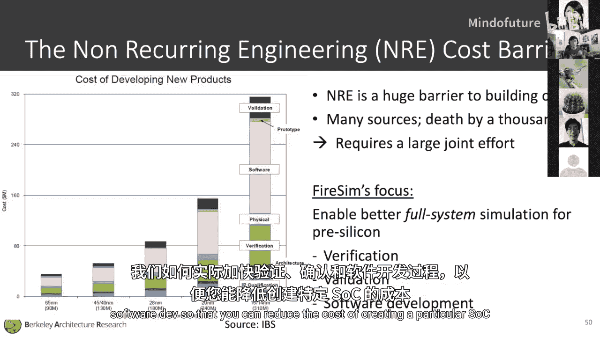
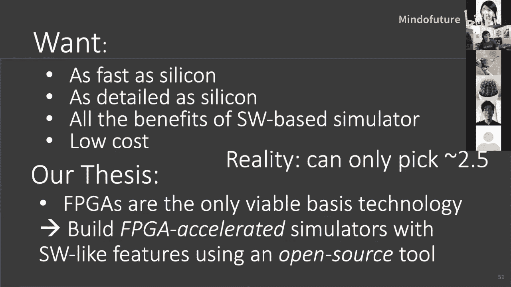
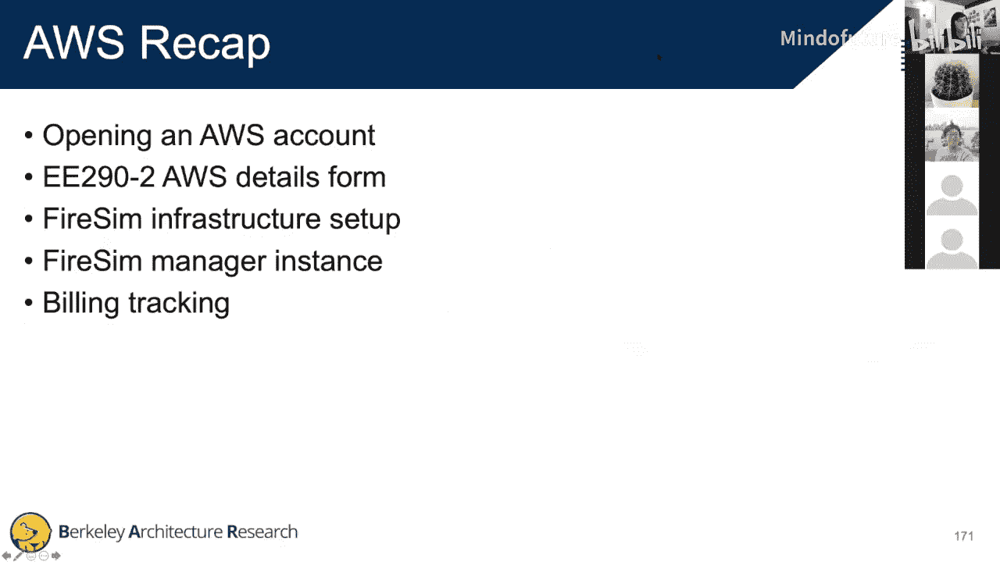

# 【加州大学伯克利】机器学习硬件技术课程 ｜ UC Berkeley ｜ EE 290 ｜ 2021 p09 P09 Lecture 9 Chipyard & FireSim -BV1XfM4zKETU_p9-

You our tutorial today。

Yeah。I guess if you want to do the announcements first go ahead Sophia Okay great good afternoon everyone。

 welcome to hardware for machine learning today So today we are actually having a special session today。

 our GSI Abraham Gonzalez is going to actually share some of our research infrastructures that can be used for hardware for machine learning many of you have already used that for lab two and in lab3 will also get into FG accelerated simulation infrastructure so we hope to use this tutorial to actually prepare all of you for both your labs and also your future projects before we get into the detail before A starts a couple announcement so first lab two most of you have finished lab two great job its certainly one of the most challenging labs so it's great to see at least most of you have finished that for folks who haven't finished that it's still okay。

😊，We did actually allocate seven late days this semester so you do still have time to work on that so definitely hurry up and if you have any issues reach out to either me or Abe or other students on PA so that we can actually help you to resolve some of the issues so good job for folks who have finished lap two and if you haven't finished it already this is opportunity to use your late days to get it done so that's lab two and lab3 A has already posted lab3 online so La3 starts today and with in today's tutorial A actually also going to talk about the AWS setup so you will actually need to。

Ne the information presented today to actually start your lap3 La three is also very involved。

 so definitelyhanie follow the tutorial Abe is going to present today and also start with going through the document which has already been posted on the course website So start lab three and finally Project meetup we will also have we'll have one meetup actually this week right abe and another one next week。

 we'll provide more details very soon it will be using the Ga town platform so that folks can actually interact with each other so be prepared and we're looking forward to see all of you at least in one of meetup session this week or next week so that's all the announcement I'm planning to make today Abe is there anything else we're missing or you want to mention Yeah so I want to mention two things by the end of the day today the information about the two meetups one this week。

When the following week will be posted up on Piazza as yeah just on Piazza for right now。

 so stay tuned for that and then the second one is a little bit of a clarification on the late deadline for lab from Sophia so she mentioned that there's seven late days but according to the syllabus it's。

You have three days after the deadline， I don't know Sophia you want to change that for lab too。

 three days after the deadline to submit it。Oh， switch that around， I see。

Let's actually let me think a little bit more about it。

 we'll see how many submissions we got actually tomorrow or by the end of today which is the third day and we'll make the final announcement of how you could potentially split the seven8 days。

All so yeah， so we'll get back to you hopefully by early tomorrow or afternoon tomorrow on on that。

 so just to be clear for people who might to be confused about that。Okay， great， great well。

 with that， feel free to take it away and are looking forward a discussion on Tripyard and fire him today。

😊，Yeah， so thanks Sophia so as Sophia mentioned the main topic that we're going to be discussing here is a lot of the research infrastructure that's built up here in Berkeley mainly tripyard and Fireson and the tools that are involved。

With those big projects but we're also going to be discussing a lot I should switch to the next slide we're also going to be discussing the lab three setup so how do you actually set up fire and since it's a fairly involved process the tool itself is very useful but you pay this one time penalty of setup to get everything started up create an idea account set up the proper credentials etc so we're going to go hand in hand。

Through that latter part in this lecture too。So to start off。啊。

You may have seen kind of the Dave Patterson talk about it's the golden age and computer architecture and really a lot of our tooling is based around this so we see that traditional scaling is over there's a lot of custom microarchitectures out there where you create this nice hardware software stack to get high performanceform gains whether you want it for something like an ML for crypto whatever the application is right you need of some set of custom hardware as well as custom software to make this application go very very fast。

However， it's also golden age and open source computing。

 so not only do you have open source software， for example。

 Linux or you have your open source operating systems and your compilers and applications。

 but now we have something that's called R5 which has been out for a while now。

 so you have actually the ISA or the intermediate layer between the hardware and the software。😊。

And with this， this actually enabled a lot of open source hardware to come out。

 so now that you have the entire stack open source from the hardware all the way up to your software。

 you can do a lot of interesting things where you just reuse things and you create custom IP to speed up your particular application so you reuse a lot of the open source components and then you create your interesting nugget or your differentiator。

So there's a lot of different challenges with this， but to just。

Briefly sum it up there's a lot of open source IP in this field。

 so you have a lot of different universities as well as industry groups creating different types of open source IP so how do you actually combine it all together integration is a big struggle in industry as well as in academia how do you actually combine everything together。

😊，And then the next thing as researchers is how do you actually get performance measurements so we want to write our next paper for ISA and microcro and all these other VLSI ISCC those type of conferences in the world so how do we actually get performance measurements so we can compare against you know a chip that was made in the past or a design that was made in the past so how do we actually do this it's hard becauses software simulators while they're very accurate they're still very slow。

Hardware emulators like palladium are very expensive and hard to use so how do we get these results very quickly these performance results？

And then finally， if you're making hardware at some point you probably want your hardware to actually be put into silicon。

 you don't want it to live in， you know this abstract simulation world。

 you actually want to have some physical silicon back。

 so how do actually tape out this thing very quickly with small amounts of people。

 which academia normally fits into this category。So this is where we bring in Shipyard and FireSim so Chipyard is kind of targeting one part of this question and Fire Sms targeting the second part so Chipyard is just a bunch of different I different cores accelerators。

 caches etc and tooling that's all combined together into nice package and then you have FireSim which is kind of the performance measurement side so how do you actually quickly get your performance measurements for your particular system。

And。And if you haven't already noticed， you've been actually using chipyard for your lab two component and we're going to be using Fire Sim in the La three component。

And so the way that we like to view this is that we're able to get our full PPA metrics so our performance fire and area metrics for hardware and software systems and so we view this combination as kind of like the tensorflow equivalent for hardware design if you want to create this complex hardware design you're going to go ahead and use chippyard and FireSim to do everything and all you have to do is make small modifications to what you actually want to create。

So。I'm going to dive into a little bit of chipyard basics here。

 there's a lot of different things that go into Chipyard。And。And it's。

Just plenty of different things that are kind of confusing i'm going to quickly go through this。

 I don't think the nitty gritty is important here， but basically is we have cores we have accelerators。

 we have interconnects， we have simulation systems our lab。

Does basically everything across the entire stack， but it's hard to actually put all these things together and so what we did is we actually create a chipyard which organizes everything so we put our tooling into kind of one category we cleaned it up we put all of our generators which is what we call our IP together into one particular area or one distinction and then we have a bunch of different flows that target the generators and IP that we have。

So。This is kind of the flow that we've been doing currently in software simulation so when you created your Gemini accelerator and you。

You had your RTL and you modified it you went through this flow so kind of the first part at the top is your IP here so this is what we call RTL generators where you're modifying your particular RTL to do what you want and then you go through the build process which is going through this fertile compiler into behavioral error and then you're able to pass it into different types of RTL simulation whether it's VCS avariilator。

So this is kind of the main flow that you used for lab two if you looked on piazza I kind of bypassed part of this flow to speed things up。

 but the basics is here right you create your design you run it through some sort of compiler or transformation flow and then you and you actually run the simulation at the end。

Now in lab three we're going to be doing something a little bit different we're actually changing the bottom half of this where we're changing the build process to do some transforms that are specific for FireS and I'll go into what those actually mean later on but the basics is still here you have your main design your single source of truth you pass it through this build process which is going to do some transformations and then you actually send it over to Fire Sim or Fireim is going to let you do the simulation and debuunkgging that you need to do for your design。

So I briefly mentioned what Fireim was without even actually going into the details here。

 but FireSim is our FPG accelerated simulation platform so you can think about it as a cycle accuratecur architectural simulator so you're not working on FPG prototypes you're working on ss here and we use a lot of AWS cloud FPGs to do this and the reason that this is really nice is that we can kind of scale up simulations to create these large data center simulations with FireI and I'll go into this little bit later on but for all intensive purposes you can just think of this as。

Much， much faster hardware simulations。Or a much faster VcS。So。

That was kind of the fireim flow and the last flow that I would like to go into here is VLSI flow where again you're just switching out the bottom portion here where you're doing a couple transforms related to a tapeout and then you're passing it to our particular tapeout flow。

嗯。I'll quickly skip over this， hammers our VLSIF， it's nice if you're interested in doing one project around kind of the physical design side about creating one of these accelerators。

 I would urge you to look into hammer， it creates a lot of really nice abstractions for the VLSI flow。

So。As the big picture， we have a bunch of different flows that when come together。

 allows you to target all the way from software simulation all the way up to doing an actual tapeout。

So now I'll go into tooling。Yeah。So tooling so all of this infrastructure most of this infrastructure is built off of chisel so chisels are hardware construction language built inside of scala that was developed inside of the depth lab and prior versions of it it's not hls it's not tool oriented but instead it is a。

It is a language to create these generalized parameterized generators。

 so instead of creating a particular instance of a design。

 you can create a family of designs using it。And I think the best way to describe this is in terms of an example。

So here you have a chisel example。Here this is a moving average circuit so fairly simple if you're familiar with their log itself。

 this might look kind of familiar you're kind of specifying IOs here at the top 32 bit input 32 bit output you're specifying that it's a module of some sort and then you're putting some sort of registers here we're denoting it as Reg next and then you're giving the output。

So if you look at this， this is much less verbose than a typical very log file。

 but the true power of chisel actually comes into parameterizing it so here you're stuck doing this particular type of filter。

 well what happens if I want to do something more intricate or if I want to change the type of filter that I'm doing？

So we can actually write this in a highly parameterized way， so for example。

 this is a generalized her filter and by using a bunch of scholara constructs we can very quickly create。

A family of designs right so depending on the coefficients that you pass in you can create a different type of filter。

I won't dive into the details here， but。These slides are up on the website。

 so if you want to dive into this example a little bit more， you can go ahead and do it。Now。

 Chisel gives a particular output file called fertile and the great way that I like to talk about fertile is give an analogy to how you do some normal software here。

So if we're using an LVM type compiler， you can think about this analogy。

 you have some some sort of C code， you pass it to LVM， the compiler。

 and LVM is going to run a couple passes on it， whether it's deadcode elimination or some optimization。

And then it's going to dump out the assembly， whether it's for arm X86。Mps， et cetera。

Chissel and fertile are kind of the same thing where chisel is your C equivalent and fertile is both the compiler and that intermediate representation equivalent to like LOVM。

😊，So here you're going to take your chisel， you're going to pass it to the fertile compiler that's going to do a couple different passes。

 whether you're manipulating the netlist， for example， moving modules around。

 doing dead code elimination， and then you're going to actually output the ver log so the assembly equivalent in the hardware world。

And so by doing this， we can do a lot of interesting things where we can target FPGs。

 we can target Asics， we can target software simulation。

 we can target many different things by just changing the types of passes that are run inside of fertile。

I should also mention， I should have mentioned this earlier at the beginning that you can feel free to stop me at any point。

 I'm breathing through this really quickly just so we can get to the actual hands on portion where we're setting up accounts and stuff。

Because that might hit a couple snackags。So to continue on we have a hardware story built into chippyard but we also have a software story。

 so we also provide a lot of compatible risk five tool chains and tool chains per Gemini and Hucha or particular accelerators and it's all built into chipyard into this nice tool called Fire marshal where you can。

Quit createreate these different workloads， whether you're trying to do something like spec or you're trying to just run a particular neural net。

 you can package this all up into fire marshal and it keeps track of everything and is essentially a one click button to build everything。

So that's kind of some of the tooling， whether it's the languages that we're using or the particular。

那。The particular flows and in this case fire marshal for some of the software work。

What are we actually building， what are the designs that we're actually building？

So one of the things that I would like to go into is rocket ship。

So rocket chip is our SC generator not to be conflated with the rocket core and rocket chip provides a library of reusable SC components as well as a way to create these interesting SCs so it provides a lot of buses and essentially an API to create。

These different types of SCs。It serves as the largest open source chisel code base。

 this was one of the initial reasons why Chisel was developed and while it was developed at UC Berkeley it is now maintained and used across a variety of different companies。

 I believe Google has a variant of chisel not necessarily rocket chip but Rock chip has been used in a couple of different internships。

 including Scifi， and there's a couple different industry organizations such as Chips Allance that use Rock chip。

The basics here is that it's more than just a university project that's used in industry as well。

And it is silicon proven。We're able to actually create industry SCs， for example。

 the Scifi Freedom E310， as well as academic SCs AsIs that have been taped out。

 so one example of this is the Hurricane one which was done quite a while ago。

 but we have many new chips that have been using the chipyard and rocket chip based platforms。

So this is the generic。Slide about， you know our lab does a lot of different takeouts。

So if you're interested， I can talk about those a little bit later， but for the most part。

 all this infrastructure has been used a lot and it's been dog fooded。

 I don't know if that's the right term， but it's been used within the lab fairly often to iron out bugs and things。

Tos diveve into a little bit about how this SSC works。

 which you've been working in for the most part is within the tile so this is where Gemini lives as well as the CPU Alan Ca is in the PTW。

But as you can see there's a lot of different things on the outside， you have your memory system。

 whether it's an L2， you have different types of buses to connect off chip to different things。

 you have your particular core complex devices， whether it's your boot rom， interrupt controllers。

 debug units， as well as ways to connect to external devices。

 so if you' were to connect an MMMIO accelerator such as NVDLA you might add it here on the Per freebu。

So。It's a complex system with a bunch of different things put together。Oh yeah。

 and then the system bus that ties everything together。

Now to dive into a particular piece of the IP here， we'll talk about the Rock in order core。

 so this has been the core that you've been using inside of class and you'll use inside of La three as well。

 but it is our default in order core。嗯。It's basically an open source risk size CPU that supports their RV 64 GC extension。

It has basically all of your default things that you'd want to do in software， such as booting Linux。

 supporting accelerators， and it's all parameterrizable。

And this is the baseline core that we use for virtually everything inside of the lab。

 but if you want something that's a little bit more high performance。

 we have something called the Berkeley Auto of order machine or boom and and this is a high performance version of a core。

 it's a superscalear out ofor core it's been tiped out a couple times already and it basically supports the same software as rocket so it serves as a drop and replacement for it。

You're able to connect multiple different accelerators to these cores through this particular interface that's called rock。

 so the rocket coprocesor interface and allows you to essentially execute customer spot instructions。

I won't go into too many details， but this is what Gemini does。

And a couple of other accelerators in the lab do， it allows you to send an instruction through the pipeline of the particular core and then send it over to this particular accelerator and this accelerator can interact with the memory subsystem as well as access things like your L1 cache and your PTW within the tile。

And Jim and I uses this， which is I guess the most important point of this。

We also have a lot of different things here in terms of the memory system。

 so not only do we have a shared L2 that's fully parameterizable。

 but we also have ways to get rid of the L2 so if you just want to do a nonL2 design you can do that。

And then of course， if you want to go out into some sort of DRAM。

 we have conversions into an A4 interface for DM controllers。

Core complex devices so as I mentioned there's a lot of different core complex devices you have your boot ro。

 which serves as the initial way that you start up the core you have your different interrupt controllers so you're clicking your clint and then you have your debug unit so if you want to attach with。

And do something like JTG or DMmiI， which is another debug protocol， you can do that。

Most of this is invisible to you all so you shouldn't care。

 but it's just speaking to the functionality and the variety of things that you can have in the system。

And of course。We have plenty of other blocks that I do not have time to go into in this particular discussion。

 but you have things like ways to create floating point units， custom mixs。Offturere peripherals。

 ways to do testing。Different types of accelerators。

 so instead of a systolic array based machine learning accelerator， you have a vector accelerator。

There's your Geni， which we've been using as well as shot three accelerators。

Many more blocks and we actually have much more in the newer tripyard version。

How do we actually connect all of these things together and this is again a little bit behind the scenes。

We do this all through Tilling so Tilling is a。Free and open source interconnect standard that supports everything from memory to cores。

 peripherals， eta。Again， you you don't need to care too much about all this。

 but the nice thing about it is that it does give you。A deadlock free system。So。

It comes in a variety of different flavors， whether you want something to be cash or not。But。

A lot of this is abstracted out inside of rocket chip through a bunch of different types of converters that allow you to change sizes。

 connect to different types of interconnects so convert from T length to axie to AHB， APB， etc。

 so this is。fairly all behind the scenes inside of rocket chip。

 but if you're looking to use some of this infrastructure。

 you might end up touching a couple of tiling things to interact with memory or interact with a peripheral。

In terms of integration。As I mentioned， there's three million things that are inside of Chipyard。

Probably a little bit confusing， but we actually need to combine them all together into a particular configuration and then get our RTL。

And so there's a lot of challenges。Around doing something like this specifically about， you know。

 one part of the system requires parameters that are。Let's say parameters X。

 and the other part of the system requires parameters y。

 there needs to be some sort of negotiation or some of sort of agreement between the two components of the system to choose the best parameter。

And so this is what we call diplomatic parameter negotiation。

And then the other thing is how do we actually flexibly interchange these things what happens if I want to quickly swap out a swap out a boom core for a rocket core or swap out a gemini for a watch or vector accelerator so how do I do these things very quickly and these are essentially rocket chip configurations。

So to dive into kind of the diplomatic negotiation that I was describing。

 this mainly is based on interconnects and how hard they are to parameterize correctly。

Skipping through this we have something called diplomacy。

 which allows you to negotiate parameters between multiple different shippyard generators。

 so kind of the first stage is specifying the graph or the flow of information inside of the SOC and then the second phase is actually hardening or choosing all the parameters inside of your system。

Based off the flow that she gave。And I think the best way to show this is an example。

So here the first example is you know showing caches and Off memory link and how we're actually dealing with it with like accessing boot Rom or L2 caches。

Here we have clients， which we'll consider the masters here and then the slave， which is the yellow。

 is what we call the manager。And。To describe this in a little bit more detail。

 here you have the masters have a couple of different inf requests， so here， for example。

 the L1 can provide up to two different transactions。

So it can send two things into the system at once。And then。

Something like the memory in this case the boot rom has a particular address space so somehow the L cache needs to know about the address space and the boot rom needs to know how many things are in flight so we need to do some some of this negotiating。

So here， just showing the amount of things that can be in flight。And in the first phase。

 you're essentially sending this information across the entire system， so you're saying， okay。

 bootot ro， now I can access or I can have this many things in flight。

 the L2 crossbar can have this many things in flight。

So you're you're sending things down the example here and then going on the way back。

 we're sending up the addresses so we're sending the address ranges that each component can access kind of in another phase。

So two phases as sendingending。You know， the amount of transactions it can have down and then sending the addresses that it can access on the way up。

Again， a little bit behind the scenes， but we can create these really complex graphs with a ton of different parameters inside of rocket chip。

You don't really have to think about this， this is kind of done for you。So for example。

 this is a fairly simple SFCC here where we have our different buses and tiles， but you。

You don't see a lot of this complexity behind the scenes。So that's kind of the diplomatic side。

But how do we actually view things from the configuration side？So rocket chip has。

A lot of different config and there's a lot of ways that you can change up your system。

 different cores， different accelerators， so how do we actually build up something like this。So。

This is an example of kind of a custom configuration it's a little old now but the important points still stay where you kind of build from the bottom up so you add a couple of these one line statements。

To build up a system， so for example， you add this base configuration。

You add some notion of a hierarchy。You add the types of cores。

You configure the course to be a particular size。You add a cache potentially。

 you add accelerators to your system， you add a boot ro。You add GPIOs， you add simulation devices。

 and by essentially continually adding and adding onto this configuration from the bottom up。

 you're able to create this full SOC。嗯。An example of this if you were actually looking inside of the lab two code base a little bit was the Gemini configurations that you were seeing so if you look at it they're much smaller than this but it's essentially the same concept we had some sort of abstract config that set up a lot of things by default and then you add it onto it by changing your systolic array parameters。

Adding a rocket core， et cetera， so you're you have the space configuration of an SOC and then you're just adding things on top little by little。

So if I end up。Doing this I can change different parts of this， for example。

 I can create heterogeneous systems I have。Out of order cores within order cores。

 I have different types of accelerators so I can assign accelerators to different things I can。

Create different cores that have different ISAs， so not only do you have RV 64 GC。

 but I can have an RV 32 rocket。So a lot of different ways to configure the system to make it your own。

So。At this point， I have given you the ridiculously fast introduction into Chipyard and kind of all the different flows。

 whether it's。Fire in the hammer flow or the software flow as well as going through a couple of the different pieces of IP。

Now I'd like to actually dive into Fireson， which is the。

Kind of just one sliver of what Chipyard provides。So first I would like to。

Acknowledge a bunch of different people who work on the Fireerson project。

 these slides have been taken from them， so hopefully I'll be doing them justice。So。

The basics of firesome is that we want to try to provide full system simulation for pre silicon。

Pres project so we want to once you create your SOC we want to provide a way to fully simulate it and simulate it accurately and a lot of time you're spending in an industry a lot of time you're spending money on verification validation and software development so we want to try to accelerate this or this is our particular research focus how do we actually speed up the process of doing verification validation and software dev so that you can reduce the cost of creating particular soOC。

So what we want is a simulator that's extremely fast， we want it to be as fast as silicon。

We want it to be very detailed。And we want to have all the benefits of a software based simulator so what you've been doing in lab two has been using VCS that allows you to quickly dump waveforms for a particular simulation。

Which is extremely useful， allows you to debug things very easily。We also want it to be low cost。So。

In reality， you can only really pick about two and a half of these。

 I won't go into why this is the case not much， but what we believe is that FPGs are the best way to kind of combine as much of these things as we can。

And so we want to create FPGA accelerated simulators。

That allow you to have a lot of tooling and debugging capabilities relatively equivalent to a software simulator。

But all open source。

And a lot of this is enabled by open source things throughout the stack so maybe not open source。

 but just。Useful developments that have been occurring so one of these is Amazon's F1 instances or FPJ enabled instances。

So having that is very useful， built on top of that we have open source tooling like Chisel and Fertile to create these interesting SC designs。

We have things like Rocky chip to create the SSC based off of chisel and fertile。

 we have the ISA so that we can run nice open source software。

 so the combination of all of these things allows us to create these interesting simulations in this fairly complex stack。

So。At a very high level view， we are providing FPGA accelerated hardware simulation for performance validation。

And it's able to ingest a particular SOC design， and then it produces a psychoaccurate simulation。

So that's essentially what Fireson is in a nutshell。It's a way to simulate your SC design。

 get performance measurements， debugging characteristics out of it。So here。

 what are the distinguishing features？As I mentioned before， it is not an FPG prototype。

 it's a FPJ accelerated simulator， it's akin to something like palladium。It uses Cloud FPJs。

 it's using the AWSF1 platform。And it's all open source。So。

Kind of going off the first point why do we care about fPJ prototyping versus fPJ accelerated simulation why why have I emphasized that so much so instead of just quickly running vvado and getting a bit string out and flashing it on。

You know， some F PGA board that that's actually not sufficient。 And so let's think about why。

 So if I have a particular。SOC， let's say I taped it out to run at about one gigHtz so I wanted to run it one gigahHtz and DM has a latency of about。

100 nanoseconds。The difference between the two。Is。It is here is fixed。

Here you see about 100 cycles of DM latency well， okay， that makes sense because if it's taped out。

 everything's stuck。And in the sense that the RTL is forced to run at about1 gigahertz and DRAM has about that latency。

But in FPGA， you're maybe not able to hit that1 gigahertz。Timing that you wanted。

 you could maybe only do it a factor down about 100 megaittz。

So what's the view of the SOC in that case？Well， in this case。

You know things are much much faster you'm able to access dra in 10 cycles that's great well the problem is is that you're getting。

Wrong performance numbers when you're viewing something in this way。

What you want to get is the performance numbers from the tapeout silicon you want to see you want to see performance numbers from the one gigahHtz timing。

 not the 100 megaahhertz timing。So。This is where the firesome comes in so every every FPJ clock is one simulative clock cycle。

 which is incorrect， we actually want to have some sort of decoupling between the two。

And this allows you to see a lot of the latencies。Of FPG resources in the simulated world。

So as I mentioned before， it's not an accurate model you're not actually measuring your tapeout silicon。

Simulations are actually nondeministic， although that's a little bit of an artifact that I won't go into here and different types of FPGs create different results right if you have different types of DM you're going to have different types of results or if you have an FPGA that can maybe run faster than the other you can get different results。

So we need to do some sort of decoupling， and this is what Firesome does。

To give a little bit of jargon here， target is what we call the machine under simulation and host is like the X86 machine or the machine executing the simulation。

So for example， your target is your RTL that you taped out。

We're going to close it around in the simulation world。

And then we have the machine executing the simulation， in this case， like an x86 machine。

That's connecting to that PGA fabric。You can think of the software that's running on the X 86 as a host and the FPJ itself is the target。

So this is just saying， okay， you have。嗯。It's a max 86 running。So。

FireSims generates these types of simulations with a host and a target。

 so similar to how you would create an SOC and run it through veryilator VCS to get a nice simulation。

 you're going to run it through fireSim to kind of map it onto this FPJ fabric and CPU altogether。

And this is done by decoupling。So here you have your RTL design and your DDRD RAM。

So I need to create this intermediate layer。嗯。And these set of cues to decouple them again。

We't go into too much detail， but essentially you're doing some sort of decoupling here。

So you're creating this model。You're adding your RTL design。

And this is all done automatically for you。So in this case， when you do this。

 you're able to see realistic DM latency。So there's plenty of benefits I'm running a little bit slow on time。

 but you're able to do a lot of different things， you're able to simulate a lot of these large targets。

 you're able to add a lot of debugging capability into a system like this and you're able to do optimizations that you might not be able to do on like an FPGA prototype。

嗯。Since I'm long time， I'll glide through this， Firesome is creating to do different parts。

 you have the compiler and the manager。The compiler you can just think about it as like a VCS。

 you kind of run it and it generates all your simulation collateral and then the manager actually does the simulation。

So。To skip through this。This creates all your FPJ collateral。

What should matter more to you is actually the manager。So you can think of this as like sLurm。

And it's a way to essentially。Have one node that serves as a manager and then you kind of farm out everything or you send out your simulation to to everything else so in the fireimy you have a manager instance and and by running a couple commands on the manager instance which you're interacting with you're able to actually build a bunch of things or run simulations。

So we create these build farms and run farms。So here， if you want to build your artill。

 we spawn like a build farm。And if you want to run your RTL on an FPJ， we spawn up a run farm。

 and so this involves a bunch of FPG instances as well as other compute instances。And as I mentioned。

 your manager instance is the thing that you're interacting with， it is your head node。Cool。嗯。

You will learn about all these different steps inside of the lab document about build AFI and run workload and Inra setup。

So I'll quickly go through this， but you'll be going through this in the lab where you're essentially launching these different types of instances you're setting them up and then you're actually running the workload or running Linux running。

A neural net inference。So if you're interested， I would urge you to look back at this。So。

Again kind of complicated but what does it enable so it allows you to get realistic performance results and it allows you to do a lot of design space exploration so you're able to view how your accelerators work in the system how do you actually run a complex hardware stack what like what are the phases that your SSC goes through during the Linux boot you're able to measure a lot of these interesting things and get fairly interesting results so。

We've written a lot of papers that use FireSIM， so if you're interested I can point to you。

 I can point you to some of them， but it enables you to do a lot。It also enables you to do。

Interesting research so we did some security research in the past on boom so how do we actually analyze boom for Specter style attacks how do we actually do accelerator prototyping so Geminis primarily developed on fire cementim and shippyard。

It also allows you to debug things， so we have ways to。Well， since it's a lot faster。

 you're able to get to more interesting phenomena much more quickly than in software simulation。

And we're actually able to debunk the design a lot easier using different types of integrated logic analyzers to kind of find bugs。

And of course， we have basic things like assertion synthesis and print print f synthesis so you can actually。

And dump out particular parts of your system during runtime。Again。

 I urge you to look at these slides later on since I'm。Jumping through them very， very quickly。

More debugging capabilities that I'm not going to go into here。嗯。

The original reason that Fireson was created was really to scale out designs。

Here we wanted to create a data center a data center simulation and basically we use fire S for this purpose。

 so fireSim allows you to scale it up and create these really complex systems so for people who have seen firesome slides before。

The simulation might be kind of boring， but for everyone else who hasn't。

 we're essentially scaling up the simulation by adding more and more cores。

Different types of switch models to create really large racks。

And then creating these racks and creating the larger systems by just duplicating this over and over and over。

 so here we create a pod and then of course we can actually go even a step further and create 1K node data center simulation and we can all do this in farson fairly quickly。

So we can simulate these huge， huge systems with only about1 hundreds of dollars per hour。

 which is much， much cheaper than you actually trying to build something like this from scratch。So。

The quick recap here is that we're able to create we're able to run arbitrary RTL on FireS and do this at scale。

 we can create these huge data center level simulations it's automatically done with a couple of different commands and we're able to get real results。

Real debugging。Real debugging output， root performance results。And of course。

 in the classic Berkeley spirit， it is all open source。So with that。

 this was the the brief I tried to end in like about 50 minutes， the chipyard side story of。

The Chipyyard and fire inside story of what our lab does I went through this very quickly。

 but I hope this just shows you a little bit about how useful our infrastructure is so if you're interested in doing some of your class projects with some of this infrastructure i'd be happy to help it is extremely useful。

Industry loves it。So yeah I would urge you to look at it I put a bunch of links to documentation and reos here inside of the slides which are up on the the class website so if you're interested。

Again， go ahead and click a couple links there。So with that。

 I'll actually dive in into the AWS section。And getting things set up。

 this was done in person last time and was interactive。诶。Hopefully you guys can do it interactively。

Right now with me so that this is useful and this isn't just done later on when you might hit some issues。

 but so I would urge you to kind of follow along with some of these instructions and creating an AWS account。

During a particular section of this。Well， when we get there we'll get there。

 but during a particular section of this， I'll talk about kind of the payment setup that you need to do for AWS and that you should be focusing on and paying attention to。

So as we mentioned before， AWS is used for Firestone， it's pay per use。

 so anytime you launch up an instance you're going to have to pay money for it。

 but it also allows us to share a lot of this lab infrastructure with you so our lab three infrastructure。

If you are already part of a research lab that has access to AWS credits。

We would like you to use that if possible， but if not。

 we do have AWS promo codes that we're going to hand out to you。And then finally。

 this this last section is going to go through the firesome setup it is a one time cost， but it is a。

There's a couple things that can be a little bit tricky if you're not guided through it。So to begin。

I'll give you all a little bit of a chance to。Go ahead and get things prepped。

 but I'm assuming you're going to be following along with me if you want to open up the lab docs。

 the lab doc is up on the website and I'm going to be going through particular steps here。

So if you want to go ahead and do that， we're going to start。Going through the setup。So。

I'll give people。coupleup seconds to do that， but what we're going to do first is we're going to create an AWS account if you don't already have one。

嗯。So。And again， if something comes up， feel free to reach out。

This is going to be hopefully a little bit more interactive than the first 50 minutes which were just me lecturing on Chipyard and Firestone。

 but if you have any issues with the setup process let me know this is a good。

Collaborative debugging session that we can do。Right now。So。Let's create an AWS account。

 so if you've gone ahead and went to AWS， you can see that there's a create an AWS account at the top。

Go ahead and click on it and you're going to see a bunch of sign up details。

When you get to this point， go ahead and fill out things like yourke Berkeley email， your password。

 kind of the generic stuff。And then when it says the type of account， choose a personal account。

 do not choose a professional account， let's keep it personal。

And go ahead and fill in things like your name， phone number， address。The the typical。So I'll give。

People a chance to do that。I guess when people are ready， why don't people click on the。

Let's give like a thumbs up reaction。And people are done with that。Or if you want to do this later。

 you can just click thumbs up and that's also fine， but there's one part that you should say。

Stay tuned for。For sure。嗯。Yeah。Okay， I see a couple people have already done this。

Has anybody not finished and wants me to not move on， so thumbs down， oh， okay， wait。

TsTumbs up means wait， okay。When you get to the credit card portion。

For those who have not made an AWS account before， stop， do not fill in credit card information。嗯。

Okay， I'll give people a couple more seconds。It's do 15 seconds。Okay。

 hopefully everybody can see my screen again on the main screen after you fill that out。

 you should get to just some identity stuff。Like the classic get a text or email so go ahead and do that and then you should be done setting up your AWs account and then we're going to actually go into。

A little bit more of the nitty gritty about launching some instances and setting up firesome。Okay。

So at this point， I'm going to assume you have AWS accounts。At this point。

 you should sign in and access。Your console， so。Go ahead and go back to AWS， click sign in。

And then you want to make sure that your region is set up to US East One so if you go to the top right hand corner。

 you should see something like North Virginia or some other location。

 if you click on that it should bring a drop down or you can click on US East one and this is the only region where you have access to FPTA instances。

So go ahead and。And click that， click on US East one。Give people a second。

And then we're going to talk a little bit about credits here。U。So or actually， well。

 I'll do the credit part later， I think。I'm misorganized part of this。

I'll give you the promo code a little bit later， but let's actually go through requesting limit increases first。

So by default， if you created a new AWS account， you don't have access to F1 instances。

 so we're going to go through that。So。Inside the the fire and docks， there's a link to increase your。

呃。Increase your F1 incidence limits。But we also have a link in the slides。

 so if you go to your console and then if you go to the limits。

 so on the left hand side on this dashboard， you see limits， you're going to go ahead and click that。

So this is the EC2 dashboard。Hopefully people have found that。

You can also click services to get to the EC2 side。And then you click limitss。

Once youve clicked that， you're going to click on request limit increase， which is at the top right。

 I believe。Was there a reason why that might be grayed out？The limit increase yeah。诶。

It shouldn't matter， I think when I because I went through all these setup。

Setup steps last time it was automatically grayed out， but I could still click it。

Can you not click it？No， I don't know if anyone else is having it。

I's like that type of instance first。Okay。Yeah， so it's going to be。Here also。Do part of this。

Do here。😔，Yeah， so did you click launch configurations？Then click request limit increasere。Yeah。

 no that's good， thanks， yeah。So yeah， once you click that。Then。

You'll get into the particular limit types， so here you'll type in EC2。E two instances and then。

And then we'll actually choose the F instances later。嗯。Once you've done that。

 click service limit increasere EC2。And then later on， this is what you need to fill out。

 we're going to fill in US East， all F instances because we're giving you access to any type of F instance。

So go ahead and click that。Fuill out that portion。Remember， you should be part of US East。

 Northern Virginia that is equivalent to US East one。All of。

For FPJ instances and then go ahead and put 64， they will probably reject you on 64 but give you 16 instead。

We put 64 just in case they give you more。And then once you've done that。

Go ahead and fill in the use case description。With this kind of generic blob of I'm doing it for this class。

I'm using fire Sim that needs F1 instances。And then once you're done。You'll hit submit。

I'll give people a couple seconds。Give you 30 seconds and then。Ping you on how things are going。Okay。

 thumbs up， thumbs down， how are people doing？Okay。All thumbs up。Any he thumbs down， going once。

 going twice。系。Cool。So to move on， this will open up and you'll get a couple this will open up a case。

 you'll get a couple emails， but more importantly within。Within a day or so。

You'll actually get an email saying hey， you actually got a bunch of F1 instances allocated to your account。

 so in this case our limit got increased to 64。You're not going to see this probably until the end of the day today or tomorrow。

If anything wrong happens here， let us know because you need access to these FPGA instances to run Lab3。

是水。So now is a good time to fill out this form so we can give you promo code。A promo code。

I have the link here， but it's also in the lab document。

 but go ahead and fill out this Google form with your name， your student ID。

 email and your AWS account。If you're not sure where your AWS account is。

 let me know and I can tell you where it is。You can basically see it in the top right corner if you click your name。

 it should say my account and then the number and you're just going to copy paste that number down there。

And this is important because we want to send you $200 worth of beta credits。

 as well as the prebuilt AMI image。So that。You don't have to do any more setup than you have to。So。

 I'll give people。Some time to do that。Give you a minute or so and I will let me actually post this。

Link here in the chat。对。There you go。The link is in the chat。

 so go ahead and click on that and please fill it out。Over here。I see one response。

I'll wait until tell a couple people。A couple more people do it。awesome什么。More people。

And unfortunately， the person in the loop for sending you AWS credits is me。After this class。

 I will send an email out with。Your aid of US promo code。And share with you the damage。

As a show of thumbs， who is still waiting on。Fillling this out。Thumbs up， thumbs down。Okay。这。

Okay 30 more seconds and then we'll go。Go to the next step。How are we doing on time？12 minutes。

I think we can do it。 We have another 30 slides。Go fast。O。So while people are potentially doing that。

You will not get as nice of a formatted email as this one。

 but you'll see something like this with an AWS Provo code。So stay on the lookout for that。

And so once we give you the promo code。This is just how you would fill it in。

 go to credits inside of your billing dashboard， so inside of your billing dashboard click credits and then you fill out the promo code and then you redeem it and you'll get 200 into your account。

So these next steps are I'm just going to talk through it if if you have access to credits already。

 go ahead and follow along with me but if you don't have access to credits and you're waiting on my email go ahead and refer to this video later on to do this section because you don't want to。

Add money to your credit card or add money to the gift card until you have the promo code credits。

So here。The next setup is specific to FireM， so all of that was AWS set up and now we're going to do FireM setup。

So here。We've already selected a region， we' already selected US East1。

 but now we need to do some key setup， we need to create this dot10 file。

So here what you're going to do， you can actually do this right now， I'll tell you。

This the part where you should stop so that you don't use promo credits if you don't have them。

 but for everybody you can go ahead and do this right now。

 you can create a key pair so if you go to the left hand side you click on key pairs and create key pair at the top。

If you do this， you're going to create a key pair called fireson， all lowercase， FIR， E， S IM。

And use a pen format。So you're going to create this and save it， store it， back it up。

 whatever keep it， you need it for the labs this is very important for you to have。

So I'll give people。30 seconds to do that。嗯。Any issues so far？I can also go back to the other slide。

Case。Okay， thumbs up， thumbs down。Yay， I'm done， I did it， no， I have not done it。三十。Wow。

Gus are AWS Pros。Okay。😊，I mean， I assume most of you guys have done this in。Okay， next。

We would check that we have our EC2 limits already set up， we already have access dollar F limits。

 but for this case we can ignore it。For those that do not have access to promo credits。

Or I' not part of a like a lab billing pool， go ahead and do this later when I give you the promo credits。

 so hold hold up on this。For everyone else， you can follow along。

What you're going to do for people who have credits are willing to charge whatever they're。

Card is in this case， or credit pool is。Go ahead and start a T2 nano instance。

 so how do I actually do this？So I'm going to launch an instance。

 so if I go to the instance tab on the left hand side of the instance。

Mnu optional on the left hand side， click launch instance。And then you're going to select。

Amazon Linux or Linux 2 AMMI doesn't really matter， either works。So。

You're going to just launch an instance， click on this particular AMI。

Then you're going to click on this T2 nano。And once you've done that。

 go ahead and click review and launch to actually start the instance。Once you've launched it。

 see it in you should see something that says select a key pair。When it does that。

 you're going to select the fire Sim key pair。So that drop down box is not going to be choose an existing pair。

You got to change it to that and then you're going to choose Fireim click acknowledge and launch instances this basically makes it so that you have to use that fireim do pen file that you had before。

To access your instance。And then at that point， you should see your instance。And the console。

 So if you click view instances。You should see something like this， this is the old view。

 so it won't look as nice but。How are people doing on this stuff？Thumbs up， thumbs down。Okay。

Goodive people a little bit。So remember you are。Using the Linux AMI。

T2 nano and then when you launch the thing， you need to choose the fireim。Tey pair file。

 so choose an existing pair。Bire some about him。How are people doing thumbs up， thumbs down？三十。

If you've already set up firesome before。You do not need to set this up again。

But for people who made new accounts， never used Fire S。You need to go through this process。嗯。

We'll give it another minute。See how many slides do I have left？😔，Oh， I did not mean to skip。

There we go。We have a lot more okay。No， but it's really cheap。嗯。

I've never used anything other than the teacher nano， it's literally going to take you。

Five minutes on it and then you're going to terminate the instance。So。

You can maybe use the T2 micro part of the free tier， but like I said， if you don't have any。

Cromo code。You don't have a prommo code or you don't have anything to build to。

 just refer to this video later on。When I send you the promo code。Okay。I'm going to go ahead and。

Speed up a little bit。But here the next step is we're going to actually run things on the instance。

So。Before running things， anything you're going to SSH into your instance。

 so you're going to C mod your Fire and P file lets you you download it and save to nice spot you got to change its permissions and then you're going to SSH using it so you're going to do this SSH。

Minus I。Point to your fire and pen file。And then access EC2 user with the IP address。

That was given now if you're not sure what your IP address is。嗯。呃。

I will tell you what that is in a second。Yeah， so here it is， essentially。This IP before public IP。

 you copy that and use that。Sorry， this is going a little bit slower than intended。ok。At this point。

 hopefully you've logged in。I'm going to assume everybody's logged in for a long time。

 go ahead and run this AWS configurefi command and before you put anything into this AWS configure command。

 you actually need to set up an access key。So looking back at the console。

If you want to follow along， great， I might be going a little fast。If you go back to the console。

 there's going to be something at the top when you click your name that says my security credentials。

 you're going to click that。And then you're going to find this access key drop down。When you do that。

 you're going to create a new access key specifically for fireson。Once again。

 if you've already set a pierson before， you don't need to do any of this。

At this point you're going to create it and download the key file。

 this should be a CSV file with two different fields， one is the access key and the other is the ID。

So you're going to download this。And use this。And so basically。

 you're going to fill out this AWS configure section。

With your credentials so in that CSB you're going to put the ID in that first slot。

 you're going to put the access key and the next lot and then you're going to give the the region name and then the output format。

Which is JSON， so US used to one and JSON。So， for。Since we're low on time。

 we only have a minute left。I'll go ahead and continue。This particular presentation。

 at least until the end of this section。But if you need to hop off。

 I completely understand the video of this will be up later today， I just need to do a little bit of。

Editing around it and then send out everybody their promo codes。

 but you'll be able to see this later today so you can follow along。So if you need to leave。

 I understand， thanks for coming。This lecture went a little bit long。

But for people who want to stay in， I'll be doing this for a little bit longer。ok。So with that。Who。

 who's gotten to this point， thumbs up， thumbs down。So no thumbs down。Okay。I assume that worked。

 okay， so then at this point。Then you're going to run the setup scripts。

That were dictated in the fire and docks。 So if you have the firesome。ああ。

The fire and first time setup open。呃。And you go to the T2 nano area。

 you're going to see some lines that start with like pseudoyum install Python P。

And you're going to run all that。嗯。So。If I were you。

 I would just go to the fire and documentation and copy that。嗯。I guess I can also link。

copy it in the chat。So there's it copied into the chat。And once you do this。

 it's going to say success。Hopefully if everything's done right， it's going to say success。嗯。

ItGive people a little bit of time to do that。Let's see。Oh， hi。 it can ask a quick question。

 Of course。 So like actually Mc says I have set up very same in a different region。 And like。

 I just wonder， which do I need to like like request a new key pair order so I can use the same key pair to。

 Yeah， if you want fire some setup， you don't need to do anything else。 You're pretty much good。

I am trying to think of anything you have to do related to the AMI sharing。No。

 because your air I shared with your account。 Yeah， so I'm pretty sure。Yeah， cause like my， my。

 like my current， first is like said in like US West， not in the east。 I'm not。

 I'm sure if that's a problem。Was there a particular reason you did it that way in the past？No。

 cause just like。Its that like on the firstens bag， you could do that way。Yes， okay。Yeah， so I mean。

 you should be fine。I think by default， we set up everything on east but。I mean， if it works。I guess。

That's been an update that I didn't know about that you can set it to West or something， but okay。

 so I mean， you should be fine then。Just use the region that you said you were going to be in。

In the AWS Council here。go sir。Right cool。Okay， so hopefully this is all done here。

Now we're just going to， if you see success on everything。

 we're just going to terminate the instance now there's no need you can log off and terminate the instance。

So how you do that is you right click it， click instant state。And then click Terinate。

I guess a poll for everyone who is following along at this point。Like actually doing this。ok。Soll。

 I'll make sure to。Keep on track。明。呃。Thumbs up， thumbs down。 Good to move on。Okay。Okay， once again。

 feel free to unmute or send something in the chat。And I'd be happy to respond。系。

So at this point you terminated and now you just have to subscribe to the FPJA AI so here。

Or in the fire and documentation， you can go ahead and click。

Click that link which should lead you to a page that looks like this。You could continue to subscribe。

It's not going to be the same wording there for you if you're brand new to this。

And then click accept terms。So go ahead and subscribe to this。Once you subscribe。This。

This gray box at the bottom is going to be spinning for a little bit。

But it should resolve in about 30 minutes to hour， if I remember correctly。

 it should be done within a day and you should have access to that particular AMI。

And AMI is Amazon machine image， correctly， basically just the virtual machine image。啊。

To avoid bunch of jargon。酷ol。At this point， I'm just going to talk through this other section。

 don't have to don't follow along with this until you're ready to start the lab。

 but basically we set up a lot of things for this particular lab that you should follow along with and it's all in the documentation。

So at this point， you should have no instances running， bies should be fully set up。

And now you can actually start instances like your manager instance。

 your head known instance to run simulations。So again， this is not a follow along section。

until you're ready， so once you're ready， you would do something like this if you're going to set up your manager instance you're going to launch an instance。

You're going to type in and search for this Berkeley Fire S manager AI， this is in spring 2021。

So how do I actually find that， you would find that inside of the quick starter in the my andI section。

 so you're going to type in that string， it's going to be 2021。And once you find it。

 you might notice that you need to。Choose shared with me me because i'm going to share it with you。

 that's why you pulled part of that format。Once you find it， you can select it。

If you cannot select it， then you need to fill out the form or contact me。

And then you should choose a compute instance in this case we choose R5 large just because it's a good balance performance and cost。

 but you can go with something that's beefer like a5 by4 x large C5 by 4 x large。

 but that costs more money even though it's a lot faster。for our case， using an R5 large is fine。

But you do not click review and launch， it's not as easy as the T2 I was before。

So you're going to click Configance and details。In this in this box。

 you're going to choose the Fire S network， so you're going to click the drop down and choose the fire Sim one。

And then if I are you， I would also click the protectect against accidental termination。

This just prevents it so that when you right click on the thing and you say instead of stop instance you click terminate instance it doesn't automatically terminate there's like an extra step you have to go through so it's it's a little bit of like a。

A safety for you。So once you set up the network。Go ahead and click add St。

 don't need to touch anything in this area。Go to the next page。Tags do nothing。Then here。

 when you go to security group， you're going to select the Firesome security group so you're going to select an existing and click Firesome。

Once you've done that。You can go ahead and review on launch。At this point。

You're going to see the launch button， you click it。

 you're going to choose the fireson key pair as as we used in the past。And then you can launch it。

And then at this point。You can log in like you did in the past。And do all your work。

The one thing that you should do before is you should actually copy your FireO P file on to this instance it's needed for FireO。

 just mention the documentation， and then anytime you're going to do anything in the lab you're going to do two sources。

 you're going to source this M file inside of Gpyard and then the source me F one manager file inside of FireO。

Again， mentioned in the lab docs。And then once you do that。

You're going to run something like managing it， which just runs AWS configure within it。

 so you're going to do the same thing you're going to save that CSV file that you had before。

Input its particular fields， input the region， JSON， and email if you want to put an email。

And then you should be good with all the setup。Okay， and then at this part。

 you actually run the fireson part of the lab。Um so。Yeah， at this point， you can。You can stop it。

 you can run the lab， you can do whatever you want。

One thing that I'll mention before I end is billing。

 so you want to double check that you're not wasting money since you only have $200 in credit。

So if you go to the billing dashboard。You can see how much money you've used and you want to make sure that by the time you get to about 150 credits。

You should probably be very careful and reach out to the TA me for either extra credits。

Or figure out some other solution。We do not want to give you extra credits so be very careful about how much you're using you should have plenty of credits for the lab。

Yeah， so here you can see you have credits。So yeah。

 you can also get more credits through AWS Educate if you sign up for that。

 I would urge you to do that and you'll get 100 extra credits， but you should not start up。

 you should not use the starter kit or else you want to have access to for one instances。

So with that that's it for the presentation， this is just the AWS section to set up lot three a little bit involved。

 but this is a one time setup。嗯。As always， thanks for you know staying an extra 10 minutes and listening throughout the entire lecture I will post the recording of this for anybody who wasn't able to reach or make the lecture so with that i'm going to stop the recording and i'll take any questions。

If anybody has some。

