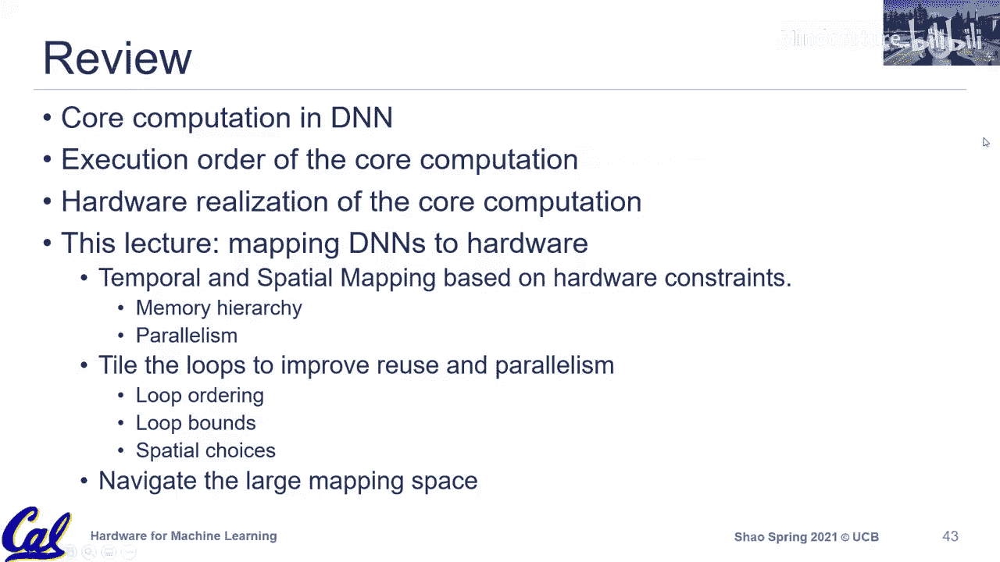

# 【加州大学伯克利】机器学习硬件技术课程 ｜ UC Berkeley ｜ EE 290 ｜ 2021 p10 P10 Lecture 11 Mapping -BV1XfM4zKETU_p10-

嗯。

Okay， good afternoon everyone， Welcome to E2902 hardware for machine learning。

 They we going to have our 11th lecture this semester time flies So so far we have talked about a different aspect of machine learning from the foundations to core execution primitive and also the hardware designs and in your lab2。

 you have already experimented with sto arraybased architecture for machine learning and from the AWS talk were just discussing earlier。

 you also see the similarities of how something actually very similar to what you have implemented in lab two can actually be incorporated into a commercial setting and started serving actually millions of customers actually in the world。

 So this is a very active research we have been thinking about this for decades， especially。😊。

Think about specialization and machine learning as a driving amputation really make it feasible to actually deploy large scale specialized hardware。

😊，Both devices and also in the cloud。 So today we're going to transition a little bit。

 You may already notice that during the AWS guest lecture。

 there are two pieces of thinking about accelerator deployment。 both the hardware part。

 but also the software part right So that lecture is a good guest lecture is a good transition as were also moving to a little bit more on the software side of the story and specifically how our application can be mapped or sometimes people will say tiled or compiled onto our specialized architecture。

 And this is also very related with your lab3， you will see how we you also see how we organize our lab。

 that lab2 give you more hardware perspective and lab3 give you a more software or mapping perspective。

 So in today lecture was get into the mapping discussion and talk about what are the common optimizations or constraints。

 actually when we think about mapping computation。A specialized ML accelerator。

Well since we're talking about mapping， we have been using this beginning of lecture。

 talking about a lot of exciting development both right now or sometime like in the history of computing。

 even like when we say history is actually relatively short but very infferential part of the history so since we're talking about mapping and also like to talk about some like if possible talk about exciting research or PhD projects actually happening in the past few decades in this space right so whenever we talk about mapping or compilation a very inferential PhD thesis and also started it as a research project from University of Illinois Noola UIUC it' really thinking about how can we have an open source and also high performance compil infrastructure compiler infrastructure for a range of different back end so one of the project from that。

😊，Research effort is this LLBM project， which has been widely used these days in a lot of。

 not only just research， but also commercial project。

And back then this project was really started at research project and Chris Laner。

 the figure on the left here was actually the lead student working on that project and after the successful initial effort of the LBM project back at UIUC and after he graduated。

 he also transitioned to Apple and really deployed LVM based infrastructure to the Apple product line。

 a lot of his effort together with the beginning of the open source effort really enabled not only you can use GCC。

 which is fairly complex platform， but then people have this alternative of LVM to really think about a really clean interface when we think about frontend and backend compiler and also make it usable for a wide range of different the project and more recently in the machine learning discussion some of you may also have heard。

No。IR well not specifically to machine learning， even it has M there。

 but the intention was actually really multilevel Inter representation that was also initially Chris Lener was also initially involved in that project from Google and now as he also transitioned to scifi this days。

 it's also interesting to see projects like M IR， whether hardware designers can actually be potentially using using that to improve the hardware design productivity。

 So now you see all the different projects， how they actually connected together。

 starting started from LBM and then more recently with the M IR development for a lot of actually not only just in machine learning。

 but a lot of different compile infrastructures and then with Chris Lener's recent efforts in really adopting this kind of approach to hardware design。

 So this。😊，It's been very influential， not only just the initial LVM part， but also all the exciting。

Projects actually from LBM。 So when we think about research projects。

 sometimes people like try to think， oh， it's just a couple of PhD students working together。

 trying to create a prototype， but the influence of those prototype can go a long way。

 not only just on the research side， but also how it's actually deployed in real world and real world and also how it's actually impact not only it just the current generation or the specific areas。

 but a lot of other areas and and the for generations of software and hardware design。

So since we were talking about mapping， this is a good time to remind ourselves of a successful story from LVM and we're also looking forward to observing maybe similar successful story in when we think about the mapping space of machine learning or just any kind of domain specific system。

 how we can actually better structure our compilation infrastructure to make it more reliable and also more adaptive for different。

😊，Applications。With that let's move on to today's ME topic， so as we mentioned briefly。

 we have covered several topics related to hardware for machine learning from the core computations。

 like we have the same terminology and how we actually described the execution behaviors of the specific parametersmeteritive that of interest and around the time when we are doing lab2。

 a lot of discussion and being focusing on how we actually implement hardware to support all those core computation and we talk about important optimizations。

 especially when we think about parallel optimizations to leverage like different parallel dimensions and one of the good examples is basically a systolic array like architecture it is the architecture being adopted in Google's CPUU and as we discussed last week it is a similar architecture。

Also adopted in AWS infrential architecture。So in today's lecture。

 we're actually transition more to the software side of the story and really thinking about okay。

 here is a piece of hardware and here is the execution order we discussed earlier how we can actually map that computation to the specific piece of hardware。

 what are the different alternatives and how we can actually improve the performance in this process。

So specifically we'll start with what are the different things we need to consider。

 we think about the mapping problem， we talk about the loop nest representation and specifically one of the most important piece of this mapping problem is actually you need to consider the specific hardware constraints that actually available in the system after that we'll talk about the space of mapping what are the different alternatives。

 how they actually impact the execution order and especially in the context of efficient execution with post performance and also energy efficiency。

And finally， we have time we'll also briefly talk about some of the effort once you see this mapping space。

 you while you will discuss more there， but you will realize that it to turn this mapping。

Problem really into a well either a design space optimization problem or just any kind of optimization problem in general。

 where are where you have a large number of different alternatives and the challenge is really how we can find an efficient version of the execution but also not only find it very efficient so that it can lead to good performance but also need to but also find it fast enough so that we have a good time to solution behavior as well。

 so talk about some of the efforts in the tuning space it is pretty state of art and it is also very open endeded we'll see a lot of research efforts in this space as well so we're mostly talking about the problem space and what are a different alternatives and why they matter and briefly will'll talk about some of the efforts in the tuning space to make it faster to discover good high quality mapping alternatives。

So with that let's get started so first just a quick recap right so when we talk about data data flow right when we talk about execution order。

 we really say this is a very clean representation to define both the execution order and also the data movement order we'll see both showing up in actually our loopest representation in a minute。

😊，in addition， two specific things we want to keep an eye on is basically different。

 the temporal for and also the spatial for loop here， right。

 so we already talk about the loop nest It's a very concise way to represent the execution behavior of our DNA operations So well we will be using in this loop nest representation moving forward。

 but specifically， you will see a lot of discussion is actually how we can manipulate this loop nest so that it's still actually execute the specific functionality that we designed but at the same time。

 actually by manipulating this loop nest， we can either create different execution order and hopefully they can actually have different implications on the performance and efficiency or create different types of hardware so that we can also。

Illustrate the hardware design space in today's lecture will be mostly focused again。

 this will be mostly focused on the mapping parts So we talking about how we manipulate the temporal4 so that we can actually map the computation differently。

 but we' also briefly talk about the spatial for and whats implication。

 especially in terms of different kinds of hardware that will be designing。

So another just a quick reminder， like this is different the terminology that we'll be using again。

 an easy way to remember just will be always using blue to represent input activation grain to represent weight and red to represent an output activation I personally find it a lot easier to associate color with the different outputs and for simplicity will mostly be focusing on the fully connected layer as we discussed fully connected layer can be viewed as a special case where some the some of the parameters actually one here compared to convolutional layers right theyll be mostly using fully connected layer to illustrate the design and mapping tradeoff but a lot of our discussion can also of course can also be applied to convolutional layer just even more complex than what can be covered for fully connected layer as a clean matrix multiplication。

😊，So we also mentioned this last time a fully connected layer fundamentally is basically operating。

 executing this matrix multiply operation again the same color。

 we basically take an input activation of M times K dimension and then multiply with weight matrix with k times n dimension and K the dimension will be reduced in this multiplication and then we'll get an output activation with M times n dimension。

 So this will be the dimension that will be using consistently for the rest of the discussion today。

 again will be mostly focusing on the matrix multiply or fully connected layer because it simplicity and to reduce number of opera or dimensions。

 reduce the number of different dimensions that we need to worry about。

 but the general discussion about the different alternatives can also be extended to convolutional layers。

So it matrix multiply so we talk about the behavior earlier and we also talk about in general。

 when we talk about execution， we like to use this a loop nest。

 basically a nest loop representation to represent the computation we discuss when we discuss the data flow part So again this is a very straightforward Christmas way of describing the matrix multiply with three nest loop and the innermost loops and the innermost loop is basically our convolution or matrix multiply window where we go through the K dimension where K dimension is actually being reduced and then for each of the output each pixel of the output activation start from n dimension and then goes to M dimension so that we can actually calculate each of the pixel there So this is a default clean ourmic representation of the matrix multiply so when you。

Actually write a matrix multiply。 This is probably something you will write in your first trial。

 And as what you have done， probably a lot of other classes。

 you may actually want to either tile or restructure this matrix multiply differently based on the hardware requirement。

 So that that spirit is still here。 We're actually talking about the same time same type of optimization that's related to mapping computation to hardware accelerators。

 some parts are actually more unique because we're dealing with specialized hardware。

 but there are a lot of similarities compared to some of the tiling experiments that you folks have been already been doing in other classes or in other contexts。

So just a quick recap， like in your lab too， all of you have actually done this pretty looks actually once you finish it makes actually looks pretty intuitive。

 but this is actually one of the mostly one of the widely used actually architecture in today's deep learning space this kind of TPU like or also similar to AWS infria。

 like systolic array design and whenever you see all like remember all the registers。

 you add in your designs or whenever you see all the different registers。

 this is basically implementation of systolic array based architecture and when we talk about data flow。

 we actually talk about。😊，We actually introduce the two spatial four here to actually specify the parallelism that we have in both。

 We can do the simulation spatially。 We can also do the multicast specially to actually create more parallel execution。

 orre still in this particular context， we need to add all those registers to have better scalability。

 We also talk about a more NDL like architecture。 you remember there it's still the same data flow representation with the two spatial for。

 but instead doing。Cystolic accumulation， they were actually using an add tree with wire directly and also instead doing this kind of systolic multicast with all the blue input activation registers。

 they are basically also using wires directly So in that implementation。

 a very easy way to differentiate those to implementation， just look at the register。

 they have whether we have a a bunch of register like we have in this case or a bunch of wires in the other case but and we discussed before in this case they're actually a lot more。

 even we're paying the overhead with a register， but especially when we get to more scalable hardware it's a lot more scalable will get to the larger scale implementation like especially for data centers in both the case of Google CPU and also AWS inent。

 also them are a lot more scalable because we can attribute large。Rise like 128 128， even 256 by 256。

So this is just a quick recap of both the loopness representation and how this。

 what are the different ways of organize this loop nest and especially in the context of hardware behavior we talked about those two spatial for in the hardware implementation。

 and this is very similar to D or infria or the one that you actually implemented in your lab too。

So next we're going to see how the different hardware constraints actually have an impact in the way we actually map the computation so far we are looking at very small parameterss。

 but now we are actually need to map a big either big convolution or big metrics multiply onto those parameterss。

 So how would different hardware factors actually effect the way we can do the mapping。

 so now we are actually introducing different hardware constraints to our original clean loop nest representation and to see what's the impact。

So first just in general， when we think about the DN mapping problem。

 the way at least I like to think about it， especially we take a particular problem dimensions or DNA configurations as we put it here。

 it could be a different convolutional different convolutional layers or different fully connected layers or like thatwise convolution we talk about how to actually represent them with the same semantics but different values here so first so on the one hand it is first problem dependent right so because different DNAs different layers will have first we' have different layer types。

 second we'll have different actually layer dimensions right so all of those are actually very problem specific and we think about the mapping problem we actually mapping the mapping process it is a very problem specific or DNA configuration specific problem we need to take into those into consideration。

And second， very importantly， we also need to actually consider the hardware specifications。

 So let's say this is a very simple hardware template that will be using for the rest of the discussion。

 We have like a sto array like architecture mesh here。

 and then we have different buffers to actually hold the intermediate values or those operating so that we can capture some of the reuse opportunities in this process。

 right， so again， we look at the mapping problem。 It has two inputs。 Both inputs are important。

 The first is the problem specific input。 the DNA configurations。

 The second is more hardware specific input。  different hardware specifications。

 I will talk more details about what kind of hardware specification need to be considered。😊。

So we'll be using mapping in this class just to be consistent。

 this is a particular problem that we're talking about specifically map。

 different DNA operators to the specific hardware in different contexts you'll also hear people using either blocking tiding。

 compiling like all terminologies are used to describe the same problem or scheduling。

 so all those terminologies are used to describe the same problem。

 basically map or specific problem dimension onto a specific hardware。

And the solution or the outcome of the mapping mapping search or mapping optimization is basically come up with an execution order so that this program can run efficiently depends on the metric you're using could be performance efficient and efficient on the performance dimension could also be efficient on the energy dimension。

 but a particular execution order that can run successfully。 Of course， it always need to be correct。

 correctness is the first important guarantee there。 besides being incorrect。

 It also can run actually efficiently on the target hardware。

 So this is a general again mapping problem will be using， again。

 will be using mapping Youll hear people using either scheduling， blocking， tiing。

 compiling It's the same problem。 We'll just use this particular terminology in our discussion。

So what kind of we talk about this loop nest and execution， and we talk about， okay。

 for a particular the a lot of time， the mapping problem is actually how we can take for particular DNA dimensions and also for a particular hardware dimensions。

 how we can combine those two together to actually find the execution order that can run efficiently on those two。

 right， So let's say what kind of interactions that we may actually run into in this mapping problem discussion。

So first， what if the first dimension we'll briefly talk about here is what we call sto array size。

 It basically the matchsh size， as you did in your in your lab too right so we talk about different depends on the target scenario thats this piece of hardware design for。

 which is very important because different， you will see actually different area budget when we think about different design scenario。

 right， so PP start it with a 252 by 252， a fairly large mesh and then the second generation down trick down a little bit into a 128 by 128 right so so that's very typical dimension is actually we will think about data center scale accelerator。

And versus like a smaller design， when we think about like edge accelerators。 like， for example。

 NDLA， it's more like a 32 by Well depends on how you look at it。 It could be a 16 by 64 or 32 by 32。

 because it has roughly 1000 max， right also have different dimensions。

 but roughly 32 by 32 scale design。 We also see smaller or bigger。

 but that's a roughly a dimension that's actually very commonly used for mobile S OC。

 maybe also in an automotive space。Right， so those are the systolic array。

 So it depends on the target use case。 You may actually get different mesh dimension or systolic array dimension there。

 So now the question is that what if the problem dimension that we mentioned earlier。

 M and K is actually a lot bigger then the sstoic array dimension。

 the mesh size either 32 by 32 or 256 by 256。 I would say is's actually very common So this scenario where the problem dimension are a lot bigger than the hardware dimensions。

 because typical even for the data center once we talk about right， it's like 128 by 128。

 is still fairly small compared to a lot of the n dimension that we're talking about get to like256 by 256 even by 12 by5 12。

 and sometimes even in the thousand0 range。 So this is a very common scenario is basically the problem dimension is actually turn out to be a lot bigger than the hardware dimension。

 So this is basically the。First place we need to actually restructure the loop， in particular。

 adding more temporal loops to actually make sure that we can still execute this particular problem efficiently。

So just a quick recap， like just remind ourselves like the spatial four notation that we have been using as a way to represent the hardware dimension。

 right， So let's say， for example， for illustration purpose。

 as say we're building a super tiny scstolic array with only2 by two sstoic array size， right。

 so the specific implication of that is basically the spatial four dimension dimension or loop loop loops。

 The two spatial four loops here， as we discussed earlier when is across K one is across N。

 the loop band is basically two， because we're talking about the two by  two。Aray。

 But the problem is actually a lot bigger， right。 So how do we actually still execute this particular problem dimension。

 even on this super tiny static array here。 So a natural way to do that right。

 where we talk about temporal tiing。 And many of you probably are also try this。

 maybe also tile a matrix multiply onto let's say a piece of hardware。

 So a very natural way to do that is basically adding more temporal loops here。

 So instead of actually assuming everything can be done spatially。

With only the two spatial loop that we had before， we actually adding temporal loops here。

 So before we having n 0。 let's use a0 dimension as a hardware dimension here。

 But then we are basically by adding this two more dimension。

 both N and the K so that we have actually more temporal dimension here。 So for the N1。

 the K1 dimension， they will not be executed in one shot， right。

 So spatial one is actually just you allocated， you let the hardware handle it。 then you are done。

 right， So temporal one is actually you need to manage that you need to make sure its follow this temporal order。

 and it's not actually done in one shot in hardware is actually takes multiple invocation of the hardware primitive here。

So this is basically a natural way to like we talk about what be mostly manipulating temporal 4 earlier。

 right， when we talk about the mapping problem， So this is basically one of the most straightforward way of actually introducing temporal 4 basically more temporal execution in your loop nest because the hardware actually cannot just execute the original problem dimension in one shot。

 So this is basically we have we introduce two more loops here we always use the capital letter here to represent the loop bands here。

 So n0 K0 capital n0 K0 represent the two by two the hardware dimension and here capital N1 and the K1 represents a temporal loop bands when we create these two more temporal loops。

Any questions， comments， was our discussion so far？Again， if you have any comments。

 just feel free to unmute yourself directly， or you can also leave a comment in the chat window。Okay。

 so this is basically the first step right we talk about willll be manipulating temporal for mostly in temporal for in this discussion and one thing you notice that when we talk about the hardware side it's mostly spatial for I now want to talk about the software side mostly temporal for but we are having staying the same Lo nest representation for most of the discussion。

 so that's why I personally like the Lo nest representation because it's a very clean way to represent all the different tradeoffs people have been discussing in this space。

😊，Okay， so this is the first case that we talk about right， the hardware specification。

 we have a small， typically the syto or array size is much smaller than the problem size。

 so this temporal loop addition or basically tiling is actually very commonly used when we think about mapping applications onto hardware。

😊，That's of first， very commonly used and also need to be considered in the mapping decision is the hardware dimension versus the problem dimension。

So what else also need to be considered？So oh， I have some animation here。

 So it basically now we talk about we are doing the gray part。 It's basically hardware in one shot。

 And now we actually can go go through the additional K1 and N1 loop actually temporal。

 So here is the first time first second。 and then we finish the K dimension。

 and then we move to the n dimension。 the N1 dimension。

 and then we finally we move to the outermost loop， the M dimension。

 So then the entire matrix multiply is done So the gray one is a hardware1。

 and then the three additional loops are actually done over time。So what the second。

 what are the other considerations we need to think about？

So another thing actually very important when we think about the first one is actually very intuitive。

 right， The second one is a little bit less intuitive。

 and we'll talk about especially from the buffer size implication in a minute is that for a lot of hardware accelerators most of the time these programmers actually also need to manage the data movement。

 very explicitly。 So when we actually think about what actually need to be done in hardware when we run this。

 one thing we we briefly covered I think two weeks ago， we talk about Is in hardware accelerators。

 one of the mostly commonly used IA besides Mamo that we have as a basic primitive。

 especially read and write memory we think about you're doing a CPU program。

 typically you assume actually the data movement is actually handled implicitly right so you just。

referenceference a particular memory location like Magly。

 this particular memory this the target memory elements。

 her elements at the specific memory location is actually brought to you through the hierarchy through your memory hierarchy in the magic fashion that's actually all hidden the cacheier hierarchy is actually hidden beneath beneath what's actually visible to the programmers and then they actually show up in the register。

But most of the time， we'll talk about the data orchestration more next week about the general trend in thinking about accelerator design。

 but most of the time for specialized accelerators programmers actually need to handle data movement explicitly。

 So that's why another very important I that you will see in most of the actually hardware accelerators。

 especially in the ones for machine learning is basically I say that's explicitly used to handle data movement。

So what do I mean by that。 So this is really just part of the program that's actually being run on our hardware on our systolic array。

 More realistically， you will actually see something like this。

 and what's actually being added here is like explicit here I'm using moving and move out as moving into the accelerator and moving out of accelerator。

 you will see different terminologies sometimes some I say still use like load or store。 But not。😊。

The typical store that you will consider in actually in in CPU design。

 but actually more this kind of core grain load than store。

 Or sometimes people say read and write and read memory。

 write memory as I will just use moving and move out consistently to represent in general。

 the data movement， I says here。So what's being actually managed by the programmer is that instead of assuming all those different pieces of data will just show up magically。

 we actually need to explicitly say which piece of data is moved into which specific memory hierarchy。

 So here when theyre moving， we're actually moving weight the green whenever it greens weight to the weight buffer and whenre moving the input activation to the input activation buffer and move out is actually moving data from our output activation buffer to back to the main memory。

So all of those also need to be explicitly managed by the programmer to make sure that they are actually run correctly。

 Like we talk about functionality right correctness is one of the most important issue。

 Although a lot of time is about optimization， but correctness。

 is' also one of the most it is one of the most important also fundamental issue。

 We need to make sure that we have the right pieces of data in our buffers so that we can actually execute this convolution efficiently。

 right。😊，So what need to be considered when the data movement is actually managed explicitly。

So in particular， one thing we really need to consider here is just the buffer size。

 This is another analogy。 I think a lot of students also find this also similar to a lot of tiing experiments。

 folks have been doing actually in the cache hiarchy。 when have a hierarchy of memory caches。

 you need to make sure whether you're tiing specific to L1 and ti specific to L2。 So two sides。

 two parts of it first。 it is true。 this is actually very similar to the tiing optimization。

 you always want to actually reuse the local memory or the smaller memory that is actually closer to the compute as much as possible。

 So the spirit is the same。 So we always want to make sure we bring in data and also reuse data as much as possible。

 But on the other hand， one thing。Want to make it clear to be actual careful here is that this also in the traditional cache hierarchy。

 even it's like tiled， like not in a perfect manner。

 It's actually still have some overlap or is actually bigger than the cache capacity。

 you will only have the performance impact you will get a performance hit because it doesn't actually meet the requirement of a cache hierarchy。

 but it will typically you won't have a memory correctness problem。

 But here for a lot of accelerators if the way we tile this actually does not meet the particular buffer size requirement。

 it always need to either incorrect results， you will be using still data again。

 because all the data movement need to be managed explicitly you actually get incorrect result。

 or some you will actually get。😊，That you cannot actually do the execution correctly。

 You will just aort the execution because we are actually touching an initialized memory or just like we haven't actually allocate the data explicitly。

 So here it's not just performance hit。 We're not talking about performance hit iss actually whether this is a valid execution。

 So here we really need to make sure this is actually meet the particular buffer size requirement。

 so that it can execute。 It is a valid execution that can be executed Otherwise， it's invalid。

 it cannot even wrong。 actually on this piece of hardware。

 So that's why it is so important for a lot of the general purpose discussion。

 it's actually very tall tolerant in the sense as long as you get a good enough design。

 you will get performance hit， but not necessarily an invalid execution。

 but here for a lot of discussion。 this need to be very carefully considered and。Treated。

Especially regarding the buffer size， because you may actually just get invalid design that cannot run on the hardware。

So here just more specifically， you will actually see this particular loop nest and the way we are moving data in and out of the local buffers here。

 implicitly it basically assumed that all the buffers actually can hold the data that we' are moving in and moving out right so those are the basically the requirements to our hardware that the buffer。

It's large enough to hold all those different pieces of data。Then the natural question to ask is。

We talk about how important SM is and typically it's actually the number the size of the SM is one of the most important differentiating factor across different pieces of hardware right not all the hardware are lucky enough to actually have a large on chip SM right so a lot of cases。

 a question you need to ask is it both are the programmers and also the hardware designer yourself。

 like oh this is a particular budget I'm allocating to put to my hardware。

 whether it can be how it will be actually used when the programmers need to program it because in a lot of cases。

 I would say in most of the cases， no matter how big your buffer is you always need to consider that the weight size I say will focus on the weight。

 the the green is and times the weight size is actually bigger then then your weight buffer。

 you cannot actually have megabytes。Especially for the edge scenario， right， Typically。

 you don't have megabytes or even tens of megabytes of un chip buffer， just for weight。

 So if your weight size is actually much bigger than weight buffer size。

 So now we actually need to tell it more， not because of the array dimension， the mesh dimension。

 is's actually because of the the buffer size， which is a very important magic in rear design And also if we don't do this carefully。

 you will need to invalid execution here。So this is just a problem its a problem part spend most of the time talking about why it matters。

 the solution part is actually really straightforward you may notice a pattern here like most of the time we're basically doing loop manipulation here but I really wanted to make it explicit that first we do explicit data movement and the second buffer size。

 this need to be actually this constraint need to be respected in a way a lot a lot stricter than the way we think about the cache size constraint when we think about tiing problem because you don't respect this constraint when it will lead to embedded execution。

😊，So with that to actually in this scenario， we actually have a smaller buffer to work around it to make sure that we can still get a valid execution。

 What we do is to actually manipulate this loop by adding another layer of temporal loop here。

 So instead of moving the entire n times K weight buffer weight to the weight buffer。

 we basically add another temporal loop you may notice instead n1， we started from a0。 right。

 then we move to n1 in the last expression Now we are moving to n2。 I mean like higher higher level。

 So we basically add another level of temporal loop。

 and instead of actually moving the entire weight matrix into our weight buffer。

 we only move part of the weight matrix here。 So this is actually a subset of the weight here。

 So with that our weight buffer only need to hold the subset。Of the weight matrix。

 instead the entire weight matrix， in this case， it will actually meet our S Ram size constraints。

 but we basically just need to execute this。 loop this multiple times and。

 and moving smaller chunk instead of moving a big chunk。In one shot。

So that's basically another constraint here when we talk about weight buffer。

 specifically buffer size here。 and similarly， there is also input buffer here。

 just for the sake of completeness， I actually structure this to be a slightly different experiment that experiment in the sense that what you you so so far。

 we mostly in this case， you look at the picture， which is more intuitive right we basically always say would just load one role or depend on spatial dimension Oh actually we always just load one role at a time here right。

 but what if actually the input on chip input buffer is actually larger instead of just loading one role。

 you could actually potentially loading more role so that you can cache more data and even potentially overlap the data movement with the execution。

 So while you're executing， I could actually load more data because I have the capacity to cache it。

So for the completeness， I also have this example here where we could actually move in。

Like instead moving smaller and just one role， actually moving multiple roles in the inner loops so that we can actually better utilize our on chip buffer capacity。

 So with this is just two sides of story right So if actually my on chip buffer is actually smaller。

 then the required size， I break it down to actually moving smaller pieces。

 But if actually my on chip buffer is actually bigger than the current tiing size。

 you may also want to consider how it at the coarser granularity， like what we have is a blue matrix。

 so that we can actually load a coarser chunk and potentially also overlap computation and communication better。

 So just the two sides of story， you consider both of that。

 But for correctness issue a lot of discussion is actually making sure you have enough buffer to hold the data that you want to move。

 That's actually the single most important thing。 And after that。

 it become a performance discussion in terms of how。

Can be better overlap what is the right granularity to actually have a more balanced pipeline。

 So that's actually also important problem。 it doesn't involve correctness。

 mostly just involve with or affect performance and also energy efficiency it's also very hardware dependent in the sense that whether hardware have good overlapping mechanism to actually load more data and and hide the data loading latency by doing computation。

 but all of those are regarded are related with buffer size optimization depend on whether it's actually bigger or smaller。

 we can actually add lookness different level to first or first guarantee track execution and second maximize data reuse opportunity as much as possible。

So in this case， if we think about execution， we basically execute the left upper left chunk first。

 then upper right， the lower left。The lower right， to finish the execution。So this is。

 I guess the second category we talk about the matchsh dimension and now this is actually buffer size we talk about why it is important to make sure we generate a valid schedule。

 making sure that we have enough buffer size to hold the data and on the other hand we also want to maximize the buffer buffer utilization because also we really allocate a big S want to make sure that we utilize those and that to improve the performance。

 so that's how the buffer size actually interact with also the tiling or the mapping decision in this process。

So before we move on any questions or comments that you have。For this part of the discussion。Okay。

 well， again， feel free to unmute yourself or just use the chat box directly。

So finally I'll just do this very briefly just one thing like so far we have been considering this like very simple single level buffer hierarchy recently we also see some architecture either have this shared buffer there or like if you remember the one from the AWS the guest lecture。

 they also talk about the neighboring buffer so it's not only just for each of the tile not only accessing the its local buffer but also neighboring buffer and that's another data sharing opportunity and that depends on the physical locality of each other a different tiles。

 it may also have different latency and also bandwidth problem。

So I just want to make sure we also show this part beside the simpleimplistic way。

 with whenever we have shared buffers， very lucky， you will have another， another layer。 again。

 a lot of manipulation here is's basically adding more layers of loops。 and here。

 But then it depends on whether it's actually shared with all the opera or just some of the opera or whether it's like shared with all the tiles or just the neighboring tiles。

There could also be different implications， but in general。

 the memory hierarchy can be also more complex。That's a simple example we have here。

So those are the different different dimensions of the mapping problem。

 especially how hardware constraints actually get to impact the design。

 like we talked about mostly two sides the first is really just compute or the parallelism we discussed how much parallelism the hardware has and second is really memory capacity so that's why else。

have joking that SR is a lot of a lot of time when you look at those kind of specializedccelerators。

 basically how how much SMm they have and how they allocate their Sra， right。

 so memory on SR is actually very important in a lot of discussion。 And as a result。

 it's also very important when we think about how we do the making decision to get a very efficient design。

 So a lot of time besides the parallelism， which is very straightforward。 a lot of time。

 the optimization or the quality of the software stack is related， how good they can actually use。😊。

The on as Ram efficiently。 Of course， this is related to the memory capacity and the memory。

 the main memory bandwidth。 But in general， just data movement is a very important factor when we think about the mapping problem。

Just a quick， I guess a quick some of the implications in thinking about the mapping problem， right。

 So we mostly talk about this in the in the context of specialized accelerators。

 but this is a very common problem in not only just accelerators。

 also a lot of startup or lot of companies with their own accelerators need to think about this in their software stack。

 but also for。General proper CPUUs or GPUs here。 So there are lots of discussions there in thinking about the memory machine learning system here and in particular a very important machine learning system factors in machine learning system is just how efficiently they can run they can solve this mapping problem here。

So this is one of the results。 This is maybe actually from a couple years ago。

 so they were actually using TC which then for tensor comprehension， was a big effort from Facebook。

 I believe and also other members but it's getting a lot quieter these days so in general。

 we'll just use this just to see some of the consideration here and some of the consideration here in this space。

 So we talk about two dimensions when we think about the mapping problem first is that we need to lead to good and to end performance right so that's basically the kernel execution time here and the Y axis。

 we need to actually the kernel need to finish。Reasonably fast， as fast as possible。

 And second part is basically the compilation time。 compilation time。

 basically meaning that we also want to get to the solution， Basically the time to solution time。

 We want to find the mapping， but also want to find it as fast as possible。So in general。

 a lot of today's deep learning machine learning system。

 they have some either tuning or optimization capabilities so that they can actually search because this is very hardware dependent and also problem dependent right now。

 that's straightforward。 right So typically it has some search capabilities will'll also talk about later。

 you will have time。 Basically the tuning part。 So they basically use tensor comprehension with two different data layout。

 you will see the letters is actually the same as the letter we are using in this class like H and W is the image height and width dimension and C is the channel dimension。

 So with two different data layout where either C is the innermost or C is the except N C is outermost。

 the two different data layout。 We'll talk about data layout also in later part of the semester。

So they use tensor comprehension to actually see how they actually go through the search process。

 You I remember correctly it's using some kind of genetic algorithm search。

 or maybe it has some internal search mechanism to navigate the space here。

 So with two different data layout with if we actually compile it longer so that we can run more searches。

 we actually get better performance。 So the performance is lower。

 the better the compilation time It also like the smaller， the better。

 So what we really want is basically some somewhere to the lower left corner。

 So this is basically lower execution time and also get to the solution reasonably fast。

So this is basically the large search space right so again。

 first it's a fairly big searching problem just looking at all the different combinations and it also have some actually either from different framework。

 they have some manually tuned manually tuned implementation or from QDNN it also have a dedicated tuned implementation for this So even with this search。

 it's still a little bit far away actually from the within like at least one order of magnitude actually from the manually tuned approach but well so first it's a big space。

 it's really hard to get to that but then with a manually tuned approach it just require it it doesn't scale because again this is a problem dependent and also hardware dependent problem right so how would we actually navigate space Exp space so that we can get to this as fast as possible is still an open problem We'll talk about some。

😊，existing solution towards the end。 but this is basically the problem space that we are talking about here and this is on GPU。

 but specialized accelerators， you will see the same at least similar problem and like the difference the perform differences typically at least two orders of magnitude in thinking about the performance different。

 So even you are as let say your hardware designer。

You may only care about how to get an efficient hardware implementation。

 but there is another layer of big space that will actually change the end to end performance on any piece of hardware that you designed。

OkaySo keep that in mind。Okay， well any more questions， actually before we move on？Okay。

 let's see on the logistics side。 La3 is still this week。

 So hopefully all of you are having fun with your AWS setup and your fire setup。

 it put in a lot of effort this time to actually get this ready。

 So you definitely need to start early， you probably already learned that in your lab too。

 So this one you definitely need to start early。 get all your AWS setup I done as soon as possible。

 So you can actually finish that。 And as we discuss。

 And even the AWS guest lecture also mentioned there's a very important software piece。 right。

 So we think it is very important for all of you thinking about。😊，Like hardware in this space。

 but also have some hands on experience in thinking about the different mapping decisions and these implications on hardware。

 So this should be， it is a very important lab， mostly on the software part。

 but should also also important and also should also be a fun experience just to see both the software side and also how you can actually use this kind of large scaleG FG based simulation to do this long do wrong this kind of long simulation on your end to evaluate the software implication。

So I think most of you， all of you will be very busy with this lab this week。

 so I still posted the paper there， I personally really like that paper and it's also about a tiring discussion but for much older generation the hardware and also have a more generator style approach in really thinking about how you could actually potentially tile application flexibility so I personally really like that paper but I also don't want to actually add too much load to your already very busy plate。

 so the paper reading is not required this week， it's related to the lab and discussion if you have time I would encourage you to take a look at that paper is's relatively older paper but very relevant to the discussion but the reading is not a review is not required。

And once lap three is done we'll start the project part so that should really be the fun part there's no specific things that you need to do but you actually get to explore a more open endeded problem Abe also set up the meetup we had one last week a few of you showed up last week thank you for being there and we have another one this week if you have any questions or want to have on to either discuss your research your project with the teaching staff or with other fellow students feel free to join us and you can also join our office hours or just using Pia to share your ideas so that we can also give you our feedback。

😊，If anything， the only critical deadline I want to remind you is the proposal due deadline。

 The only reason that we set up a proposal deadline is really want to force you to actually think about it。

 The deadline is right before the spring break。 So really want to you to actually have something in mind uses opportunity to explore different topics and and decide what you want to do so that for the second half of rest。

 it's mostly just in execution mode。 So after that three。

 only hard deadline is really just get your proposal get your proposal done。

 it doesn't need to be long。 just one or two pages。

 and really what you want to see that you have thought about what you want to do I've done some literature search to see the prior work in this space and see how your particular project。

 your particular proposal can actually improve your project。 And I also mentioned earlier where open。

We're very flexible。 we're open， if you want to。Actually consolidate this project with other of your course projects and also with your research。

 we actually encourage that because that could make it possible to do something。

More substantial instead of doing too。Two smaller projects。Okay。

 so that's logistic related topics for the class， any questions， comments。You had。Okay well。

 if things are clear， let's well enjoy last three and feel free to reach out to us if you have any questions。

😊，So we talk about how those two factors that's like the problem and also the hardware actually interact with each other and some of the state of art challenges in this space so that's really the most important part when we think about the mapping problem next we're going to at least enumerate a couple of specific decisions that we need to make when we think about this mapping problem otherwise it looks like oh there's all the different loops and being added here and there here it's more like a taxonomy in a way to break down all the different temporal loops actually being added。

 temporal spatial loops being added and what's the implications there so this is more like thinking about taxonomy of the with the mapping space what are the different factors instead of just thinking in all the loops being added let's make it more structured。

 what are the different dimensions。I think about this problem。

So here I personally like those three dimensions， those are actually valid across a wide range of hardware that we interacted so far。

 so Ill mostly talking about those three， of course。

 there are always like other factors here and there。

 but I will mostly talk about those three and also have some examples of how it actually manifests performance。

So the three dimensions that we'll be discussing today is basically the three thing that loop ordering。

 loop bounds and a spatial choice。So loop ordering as the name suggests is basically what's the order all the loop nest right So you may wondering okay。

 so you showed me a bunch of the random temporal loops that's been being added here and there right so what's the implications that they matter the particular order that can matter across those loops and what's the implications so this is basically not only just adding those loops also consider the orders of those loops and different orders would actually have different implications in performance especially on the data movement side。

😊，Another one， we already briefly talk about it。 if you remember like all the capital letters that we have either N1 and2 or K1 K K2 we had earlier we talk about the loops。

 basically what are the loop bumps right， what are the bumps of those loops that's related we discussed earlier。

 first need to meet the buffer size requirement And second。

 we also need to like balance the data movement and and and computation there and typically also maximize the on chip buffer utilization。

There， so so finally， I also like to I also like to talk about the choices of assigning some of the loops to be spatial or temporal。

 So so far we have been mostly like the spatial for loops are basically hardware related。

 We're mostly using the N and K dimension there and all the rest of the loops are actually temporal loops。

 here I want to actually using using still the same spatial and temporal loop representation。

 but introduce another topics people are talking about this is like this data and model parallelism and and this is typically showing up when we have parallel hardware。

 So spatial loop is typically always related with parallelism。

 So in that context is not the parallelism of the math unit。

 but is actually a coars green parallelism， multiple pieces of hardware。 So that's why it shows up。

 So I categor that into the spatial loop versus temporal loop discussion and。

use that as an opportunity to introduce the model and data parallelism。So again。

 this is our fairly complex loop nest in the end after we went through the different constraints and the exercise here。

 so this is a fairly complex loop nest we have So a loop band we already discussed is actually fairly straightforward。

 right， just like what are the capital letters here。 how do we decide that。

 And we talk about it's very related to the buffer size and buffer utilization。

 So you want to make sure it's actually at least meets the buffer size requirement and typically maximize the buffer utilization as much as possible。

 So that related to loop band discussion， especially lots of tiling really discussion are mostly associated with loop bands。

😊，The second part is actually loop ordering。 So instead showing that complex loop loopness。

 I'll just use this compute map mode to represent the innermost kernel here。 So here。

 if we look at this， we have two loops here。 right， One is M2， the M loop here。

 the current outermost loop。 Another is the end loop here。 the the second loop here。

 So M here related to input activation and N here related the N two loop here related to weight。Here。

So specifically look ordering beside just really changing the execution order。

 it has some implications in really thinking about data movement。 So again。

 you will notice a lot of discussion here is actually depends on how you structure your loops and one thing we notice that most of the time it's related。

 either parallelism or data movement。 and build parallelism is actually fairly fixed once you have a fixed。

 either a single hardware or fixed settle hardware where it's more or less fixed。

 So a lot of discussion it turned out to be actually how you it change。

 The amount of the data that need to be moved。Here， so in particular。

 if you actually associate the input buffer。 We're moving in the input buffer here。

 So every time we moving M1 times K， and then we move this M two times。 So the total。

 let's focus on input activation for this discussion。

 So the total amount of input activation is basically M times K here because M is actually the uppermost loop。

Alternatively， if we actually put n to be the outermost loop and become the innermost loop here。

 right， So you we look at the data movement that we need to do here， again。

 every time we need to move in like M1 times k here。

 whenever we invoke this moving in and then we do this n two times。

 but because there is another outer loop here。 we do this execution。

 we actually need to also move in input activation n two times because N is a outermost loop in this space。

 So again， this is a fairly simple and also artificial example。

 but this is to show how the different loop next order would also。

 especially when need to execute based on this order would also change the amount of data movement。

 we need to do and typically in in both input activation and also weight。

 So that's why loop order also matters。Not only just the loop bump， but also it also depends on。

The on chip buffer size and also the relative dimensions of N2 and N2 here。

 which may give us different trade off here。 So that's a look ordering aspect。And finally。

 for the spatial choice here， so I mentioned like whenever we talk about something spatial。

 it's typically related to more parallelism actually being discovered in hardware and we want to leverage that parallelism here So for here a specific scenario here is that instead of thinking about a single accelerator let's say we have two pieces ofcc two accelerators here if you remember like we call the AWS talk。

 they also talk about the multiple tiles and you can also access the neighboring tiles there So let's say we have two tiles there right and in their second part part of the talk when we talk about parallelism。

 they actually talk about how they distribute things actually across tiles here。So here。

 like when we have two tiles here。 and then besides what we had before the spatial loop dimension for either the n and K for the systolic or array dimension。

 now we have another spatial dimension like what need to be actually map spatially across those two accelerators or two tiles there。

 so that's another spatial choice here。 So let's say if we actually flip the outer loop here from a temporal4 to a spatial4。

 So this is basically the N loop here。And then in reality。

 what's going on here is that we divide the weight into actually two pieces， right。

 one to the first accelerator and the second the other to the second accelerator。

 So this is basically what people say， model parallelism。

 because we're leveraging the parallelism across the model or the weight up。 So when again。

I think what I am a little frustrated is people using different terminologies for different things。

 so just for the terminologies sake model parallelism is basically another way of organized spatial loop and here the so called model parallelism is basically leveraging。

Flipping one of the weight dimensions spatially so that we can actually allocate different parts of the weights to different weights to different accelerators。

 get more parallelism。 So this is when we hear people talking about model parallelism is basically leveraging breaking down the weights。

 for completeness， I would say this is a quite extreme of model parallelism。

 because we're actually even for single matrix multiply。

 we also break down the break down the weights。 in a lot of cases。

 people are talking about a more relaxed model parallelism where they basically break down different layers。

 maybe for a network half of the layers is the weights of the half of the layers actually in accelerator1。

 the weights of the the rest of the layers still within the same network actually on accelerator2。

 So that's more like intermediate way of breaking down the weights。

But when we're talking about modelparlyism， it's always breaking down the weights and one extreme of modelparly zone is actually to break down the weights for a single layer。

 as we showed here， just half and half and each with this spatial four and each its gallery only have half。

😊，Of the weights or half of the model。And now you might be wondering what do we mean by data parallelism right so data here just means the input activation right so instead of flipping the N loop。

 we're actually flipping the M loop here so instead of distributing half the weights onto different accelerators we're distributing different parts of the input activation onto different accelerators and that's basically。

😊，Another spatial choice we make， and that's what we call data parallelism here。

So those are the different alternatives in the loop but we talk about the loop nest discussion。

 we talk about the mapping space as a simple taxonomy。

 we organize into the loop ordering loop band the spatial choice。

 those are basically another way to organize the particular mapping space we see all the different dots in the tensor comprehension exploration。

 so a good mapping alternative is actually to balance those concerns and also potentially navigate this mapping space efficiently to find a good enough mapping choice for the target hardware。

So those are the basically the discussion we have both the general mapping and also what are the different a more structured way of thinking about what are the different dimensions we going talk about mapping so before we move on to the cuing any questions。

 comments you may have。Okay， well， many of you probably already realized there are different decisions it may be made。

 and we also talk about the cancer comprehension。 example we already see actually all the different doess here need to be evaluated to find a good one。

 right， So that's why a lot of the mapping discussion， maybe five。😊。

I would say four or five years ago people are still talking about how to manually understand the tradeoff and pick a good mapping and some mapping can be universally good。

 some mapping can be universally bad but at this point as we have seen so many different networks and so many different pieces of hardware the mapping or the compilation problem is basically become not scalable at all so that's why we need another alM project for this space and then it's become clear it's really hard to find actually anything universally good If someone say。

 oh， I have a particular way of building either my hardware or my mapping solution that's actually always good。

 universally good you always need to be。Be more skeptical about that kind of claim， right。

 because this is a very complex space。 Even maybe you're doing fine on this one。

 you may need a different solution on a different， either a different piece of hardware or different problem。

 So be skeptical if someone say some kind of solution is universally good。😊，So naturally。

 a lot of the mapping discussion， basically， especially more recently。

 turned into a tuning problem instead of finding an universally optimal solution problem。

 So more recently， this is a lot of activity in this space。

 how we can navigate this space efficiently。 how we can tune this。 I'll just give you some pointers。

 some are working in this space。 but there are more in this area。

 and I'll say this is pretty open ended how we can actually do this efficiently。

So as we discussed now the problem is basically turn into an optimization problem again。

 the two components right at the end dimension the hardware specifications find a loop nest ordering representation that actually minimize get good performance and or also good good energy efficiency here so that's basically the optimization problem we see and you you look at a lot of those startups。

 a hardware startups is very interesting maybe when they first started a lot of higher they do is actually they're looking for hardware engineers like hardware engineers with good design experience and then after a year or two。

 if you look at their job posts and then they're looking for compile or software optimizer because now you have their hardware they get to this kind of mapping space。

 then they need people to actually program their hardware so you also see this kind of interesting。

 you follow some kind of it's very startup in this space。

They started with hiring hardware designers and then gradually they start actually hiring more。

Software， especially compiler designers here。 So what kinds the approaches here。 Of course。

 we can do exhaust search。 Just evaluate all the different choices。 But then we see our disease。

 is a huge space， right， millions or even billions of parameters there。 So exhaust search on scale。

 And then like a different ways of doing the search as a way to solve the optimization problem。

 and also more recently， there's lots of effort in actually more learning based algorithm。

 We probably won't have time to actually cover those algorithm today。 those are also。

 if anything I would。😊，Highlight theres actually two goals in this space。

 First is actually find the optimal performance mapping that actually get good performance and efficiency and another problem is actually get to the solution fast enough right this is like hardware dependent and network dependent We cannot really afford to do a lot of searches every time。

 So in general， there's actually a lot more activities in the learning based algorithm very interesting。

 We're also personally where un personallyally also interested in that。

 but always make sure I think theyre both there are two sides of story。

 you need to you want to find a good solution。 but you also want to find a solution actually fast enough。

 both are actually both metrics are important when we evaluate those alternatives。😊。

So I will not get into the details given we're running out of time。

 but you will see a lot of the research in this space just basically using a different search algorithm to actually navigate this space efficiently efficiently to find a good reasonably good strategy and yeah this is also I think this is using yeah this is from HA using tree search and this is a TM based approach and they also have some learning based algorithm to actually find the design learning to optimize and search a learning based algorithm to find。

a scheduling fast， a schedul fast signal。 So if you have time。

 feel free to look into those very interesting research work to navigate this space。 Again。

 the major takeaway of this space。 this structure is there are two factors。

 the problem size and also the hardware side and specifically on the hardware side。

 another two sub factorss， and parallelism and also memory capacity。 And this is a fairly big space。

 And now a lot of open question is actually how to navigate this space to find both a good solution and also find it fast enough。

Okay， so with that， we are already a little bit over time。

 Great to see you all here and we'll continue our discussion this Wednesday。 So good。

 enjoy Monday and enjoy live three and I'll see you again this Wednesday。 So take here bye。😊。

