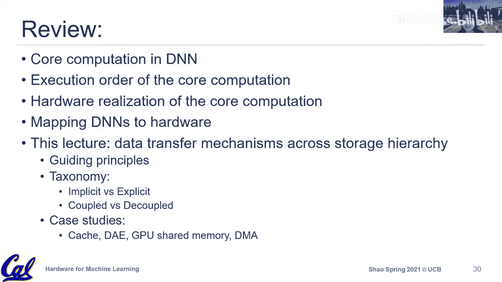

# 【加州大学伯克利】机器学习硬件技术课程 ｜ UC Berkeley ｜ EE 290 ｜ 2021 p11 P11 Lecture 12 Data Orchestration -BV1XfM4zKETU_p11-

Okay good afternoon everyone welcome to hardware for machine learning today we're going to have our 12th lecture of this semester in particular。

 we're going to talk about data orchestration we talk about the mapping last time and we also discussed data movement is very important in general in hardware design and especially in the context of deep learning accelerator data movement actually plays a very important role one thing I personally feel like in typical computer architecture education we talk about data movement in different context and use different terminologies to describe maybe similar or maybe different things I feel like it's actually useful to have a more concise and also uniform terminologies or maybe a taxonomy to actually discussed different strategies。

 different ways either hardware or software we have been using to。😊，S data movement。 So with this。

 we're going to have a very focused discussion on data orchestration and basically how we。

 what are the different consideration or different factors that involved in data movement and what kind of architectural mechanism people have been using to support data movement and how they actually either similar or different from each other。

 So we'll do a very focused discussion on data movement。

 So that's why here we are thinking about data orchestration。

So while I was putting together today's lecture， I realized this is exactly one year since we transitioned from in person learning to online learning。

 I used the same opening slide last year for this lecture for the 12th lecture and I believe that was the last in- person lecture I have given since since last year。

 last March， basically， and back then like the risk of coronavirus already started。

People are becoming aware of that and there was also a lot of discussion back then and as I mentioned earlier。

 this was literally the edge of conversion were basically converting。

 we were converted to online learning right after this lecture and looking at the message I shared with students I feel like I was pretty optimistic overall and the and I also use the Newton story where was also during a pandemic he was able to actually while still focus on what he has been doing and find made important discoveries while he was working from home remotely。

😊，And at this point， I feel like a lot more， I was more optimistic in the sense that the past year has been fairly challenging overall。

 I'm sure many of you have your own set of challenges with working from home even for me I feel like there are good times。

 but there are also challenging times and then this remote mode and it's definitely that easy at the same time。

 I'm also personally very grateful with all the support people have and also the creativity people have actually during such challenging time and it's hard to imagine back then that after a year there are actually vaccines and also multiple different kinds of vaccines available and and many of。

😊，including the education sectors， many of the faculty。

 staff and students are in the process of getting vaccines right now。

 so at this point I feel like again the same message stay calm stay creative this is very important for many of you either undergrad students or undergrad students or graduate students this is a very important part of your life one of the most creative times of your life as well to working on increasing problem challenging yourself and learn new things at the same time this is definitely very unique we are in this pandemic we're still in this pandemic but hopefully things are moving in a better direction and at this point I'm also hopeful but。

After realizinging the challenges in the past year。

 I'm very grateful for the opportunity that we have and also。😊，Well many good things。

 hopefully coming up soon while we're getting vaccines and things are getting better。So with that。

 it's exactly one year again， time flies and well it has been a challenging year for many of us。

 I hope you and your family were able to actually have a safe and also healthy year and hopefully moving forward all of us can get to interact a little bit more and moving forward from this pandemic。

😊，Okay， so with that， let's back to the main topic。Of today， so just a quick review。

 we have been talking about the core computation in deep learning and also the execution。😊。

Orders of those different primitives and how we actually realize that in the hardware。

Especially in a stoic array contest as what folks did in their lab too。

And then last guess last lecture this past Monday we talk about the challenges associated with mapping computation onto the hardware。

 What are the different options， What is the overall mapping space and what are some of the techniques people are exploring to intelligently navigate this mapping space So as I mentioned earlier in today's lecture。

 we're going to do a deep dive in really thinking about data movement。

 which is actually a very important concept in general for hardware design and over the past few decades。

 actually we have been actually trying out different data orchestration mechanisms traditionally more in the general purpose processor context and now these days with the emergence of domain specificccellerators there are some other techniques being also widely used and adopted So in today's lecture we're going to talk about what are the differences what are the similarities。

How we can actually group them together and think systematically to reason about pros and cons of different data orchestration。

Method left will be the main discussion today。So in today's discussion。

 we'll first do a quick overview of different particularicular thinking about design principles when we to they come to data movement or data orchestration。

 well get to the taxonomy which I personally find it actually very useful to see different computer architecture proposals in this space overall it has been fairly scattered。

 you may hear people actually proposing new ideas or new concepts。

 but in a very ad hoc or self- isolatedol manner， what were trying to do with this taxonomy to actually organize them together and to see in a very clear way to see the similarities and the differences across them so do a discussion on the different taxonies in this space and also discuss using some examples with。

The existing architectural proposals in thinking about data orchestration。So just a quick recap。

 we have already been talking about this before data movement is very important in general when we think about hardware design。

 but in particular we get to machine learning hardware。

 like this is one of the most inferential actually academic deep learning accelerator I and when they actually share their experience。

 one thing definitely stands out is that data movement across all the different memory hierarchy from DM to local buffers to like P to P registers and to local registers。

 all of those actually take a significant amount of energy compared to ALU with the compute energy。

 so even we're thinking about all the different computations that's required to support deep learning operations we also need to be aware all the different memory hierarchy that's associated with this。

And all of them actually contribute to。Energy consumption in a very significant manner。

So before we talk about energy and another side of this is basically area。

 one thing you may notice is that we look at today's deep learning accelerator space。

 especially when like startups actually marketing their ideas a lot of times is basically you will say not only their impressive tops number performance number but also how much memory they have on chip and with either megabytes memory tend of megabytes memory or even more than that。

 so that become a very important differentiating factor across different hardwares。

 just how much they can save on trip， which means that it safe like we discuss3 potential energy consumptions but at the same time they are also paying a significant amount of area cost like we see some of the breakdowns of today's accelerators typically pay like at least 30。

To even33 to 60 is pretty reasonable， some of those especially spars accelerators has even more like provision even more onchi area to asRMS。

So like buffers in general， actually not only consume a lot of energy。

 but also take a significant amount of area budget of today's deep learning processor olderderman specific processors in general to actually sustain the target performance required for the application。

So with that since data data movement is so important and it's also if we don't do that efficiently。

 we need to pay a very high both energy and area cost to support data movement so in today's context we discussed data orchestration right what exactly is data orchestration。

 what kind of factors we really need to consider when think about particular memory hierarchy for different either processors or domestic specific survey accelerators。

 what kind of considerations we need to think about when we think about data movement。

So here we like to use our data orchestration because it seems like it had this intention there and instead of just passively moving the data。

 data orchestration had this intention of trying to either optimize or trying to manipulate the data transfer so that it actually achieve a particular target that we have in mind。

So in particular， in any kind of data orchestration scheme。

 there are two sides right so first we want to feed the data to to whoever the consumer is。

 whoever the functional unit actually needs the data and we also want to feed this data in a way。A。

Fit the data in a way that it's actually very timely。

 So whenever the function unit actually needs this data， whenever it needs the data。

 the data should already be there or very close to be there。

 so that the functioning unit doesn't need to be idle waiting for the data So that's basically the feeding part right when we're actually providing the data。

 we need to know where the data needs to go and way the data is there when the functional unit actually or when the consumer actually requires the data。

 hopefully the data is already there right so in a very timely fashion to actually feeding the data。

Another side of the story is that when the data is actually not used anymore。

 you also want to release this data or remove the data from the buffer because if you don't remove that it still takes the space and then it will may actually hurt the available capacity that you have in the system right so another part of the story when we think about data orchestration。

 one thing is actually when we need it we want it to be there in a timely fashion and the other side of the story that if the consumer actually doesn't need it anymore。

 we want this to be released as soon as possible so that I can use that space we talk about the on memory buffer is actually very important from area perspective as well so we can reuse that space to save something else so those are the two side of the story that we。

alwaysways need to consider is how we can actually fit data in a timely fashion and also release data。

 release data in a timely fashion to get a good data orchestration mechanism。

This is a general scope when you think about data orchestration。

 some more specific question you may also want to ask yourself when you actually think about your hardware or think about what's specifically how the data is actually orchestrated in your system。

Some example questions that you need to think about related to the two core topics that we just discussed。

 let's say first we talk about in a timely fashion right so a very important question is that whenever we initiate a data transfer when we should initiate the data transfer you initiate it too early。

 then even when we bring the data there， it will take actually my local buffer space even though I'm actually not using that but it will actually occupy my buffer space until it is being used right or if the data is actually being moved too late then my data pass is actually waiting for the data which is actually very very common problem in a lot of architecture and then it actually also hurt performance。

Right， so the first part is actually。Use a。Right， so is's a when question right when the data actually shows up typically not too early because we will waste the staging buffer or waste the spacely allocated。

 but also not too late because otherwise my data does need to actually wait for the data without making good progress。

That's one example question that you may want to ask yourself。

And another question is where data actually need to be placed so we'll talk a little bit more about the implic and explicit data orchestration data in the sense that whether actually programmers actually need to care about data placement。

 but in general when you think about the efficient orchestration。

 you also want to make sure when place the data， the data is actually reasonably close by so you can get the data in an efficient manner instead of to like some other like not relevant。

Places， which doesn't help with efficiency。So we'll see more less later。

 especially when we get to explicit data movement， but when we move the data。

 we also need to think when it starts and second where it should go。

 right which level of the buffer it should go。😊，A certain times then to actually get to good locality and also good performance。

Another factor here we're mostly thinking about producer right how we initiate the data transfer right so on the other hand。

 when we think about the consumer end or how consumer is actually consume the data and we always need to also think about who is the consumer where the consumer is and that's because that's related to where that we are sending the data and we also talk about multicast we recall earlier we think about hardware design。

 whenever theres a multicast like scenario， they basic means multiple consumers and then they also need to synchronize with each other making sure where actually getting the right data in the right place it also at the right time so synchronization is always very important typically always being overlooked when you think about design but whenever you have a multiple customers or consumers sorry consumers that need to consume the data we also need to have a particular synchronization mechanism。

They can actually synchronize with each other。Another important thing and consideration also on the consumer end is that when the consumer consumes the data。

 what kind of pattern actually being accessed is that very like just a simple streaming pattern we just call element by element or is's actually str it。

 which is also very common we talk about str convolution and or tile convolution you always need to do some stride access so those access patterns is also important because that's how consumer is actually consumes the data and there could be some optimization if you know a particular access pattern that we have in mind。

Another point is what we discussed earlier when to the release the data right so if the consumer actually doesn't need the data anymore。

 feel free then we should actually release it as soon as possible instead of still occupying this particular space right so again。

 we talk about data orchestrations about how we actually need data to the consumer and how we actually release data from the consumer but there is a lot of questions about when certain transaction happens。

 where we should place the data， who are the consumers and how they actually synchronize with each other and also how data is actually accessed and when we can actually start releasing the data。

And in general， for domain specific accelerators， they always need to answer these kind of questions。

 a lot of optimization in general again as we're talking about a general sense。

 whenever you hear someone have say they have a particular idea to make data movement cheaper。

 typically they are leveraging domain knowledge and domain expertise to custom corners or to make things simpler so that we can achieve reasonable complexity in our data orchestration but also meet their application demand。

So there is a general scheme of all the different considerations and when you come to domain specific accelerators。

 there are cases where we can leverage domain knowledges。

 especially if the behavior is actually very regular and deterministic those are always opportunities to do more customization or optimization to make things simpler it may feel a little bit abstract at this point。

 which is okay that we'll get to more concrete examples later。

 but at least as a very high level I like to get you start thinking about even this is very high level。

 most of the time we're looking we're actually doing specific implementation about a particular data data orchestration scheme already but we like to see the general scope of data orchestration and why it matters。

So before I move on any questions or comments you have or our discussion so far。Oh。Okay， well again。

 if you have any questions， feel free to just unmute yourself or type your questions or comments in the chat window。

So here are the different considerations。And and the guiding principles。

 so this is one of our our my former colleagues at Nmedia they have to call these really nice figures and also those principles here will to help help we think about the overall the of data orchestration。

 which I personally find it actually very， very useful will not go through them in too much detail。

 but just maybe briefly talk about those because these are make intuitive sense we' will think about it。

 but maybe we typically don't have this opportunity to think specifically about data movement。

 but those are the things that you should care or when you actually evaluate other proposals。

 you also need to ask yourself how they actually deliver certain。😊。

How do they actually execute or apply those principles in their design？

Let's say the first is basically local reuse， so this is basically using locality and we talked about the data flow and memory hierarchy earlier right so you want to have like this memory hierarchy so that you have local buffers that have to catch those frequently use data so that you don't need to actually go far away frequently to actually fetch the data so local reuse is always very important。

😊，And we also talk about spatial reuse earlier， like so especially multicast。

 this is basically what we said the cross unit use。

 if you have multiple consumers how they actually use a particular piece of data in an efficient manner to actually reduce the memory reach cost of accessing memory。

 but also one thing need to make sure is that they are also synchronized in the right way so that there is no violation about consumer produce a consumer relationship。

Again， we also want to make sure we use the bandwidth very efficiently， we talk about capacity here。

 we also want to use bandwidth， very efficiently so that we can leverage the available both off and entrepreneur bandwidth in our data delivery past。

Another one is actually delivery and use overlap obviously this one is actually very important you will see a lot of hardware optimization just to make sure that we're maximizing reuse opportunity or this overlapping opportunity basically while we're executing certain things our memory system is also busy so that we can actually fetch things into our system so always trying to overlapping or hiding sometimes you'll hear people saying hiding the memory latency that's basically using enough compute that they can actually go independently while you're trying to fetch data into your local memory hierarchy so this is actually very important to get good efficiency and a lot of hardware experience or hardware tricks actually being very focused on this area and also very effective overall if theres a good mechanism to achieve this overlap to get good efficient for example。

 double buffering is a very simple example to achieve this。And synchronization。

 we talk about synchronization already， but before in the context of cross units used when you have multiple consumers。

 those mostly just from a correctness measure， so here synchronization like we mentioned synchronization is important when we actually need to have multiple agents that they need to synchronize each other and second。

 and we also need to make sure the synchronization mechanism is now too expensive so that's why this is precise synchronization come in so that we only synchronize specific events that need to be synchronized instead of doing a lot of global synchronization which could potentially hurt performance。

 so need to explicitly reason about your readr dependencies and what need to be synchronized instead of using a very co screen mechanism to synchronize everything。

And finally， this is very intuitive， especially for our hardware designers the cost is a cost in terms of area and power is always very important。

 when we think about those complex schemes to achieve good data orchestration。

 always trying to use a simple structures instead of getting things to complicated it and we'll see later when we compare different structures。

 the cost is actually a very important factor， and that's a huge reason why today's deep learning exccelerators or exccelerators in general is using what we call a see later direct memory access or DNAA based data orchestration scheme。

 especially from a cost perspective。So those are the guiding principles， again。

 if you find this two abstract which is completely fine。

 I do want to actually put this discussion out there so that you can always think about it。

 when we get to actually more specific examples， but at the same time。

 instead of thinking about data movement in isolation especially one or two at talk techniques。

 I personally find it actually useful to have high level what kind of things data orchestration and really care about I really cares about and what are the tradeoff and what are the principles。

 guiding principles in this space。So's so far mostly talking about the principal side and the second let get to the taxonomy right。

 we talk about all the different factors， how should I actually reason about it。

 what are the different agents in the system what are the examples actually of how today's system using maybe a particular data orchestration scheme to support their own architecture。

 so we'll talk about a taxonomy and then get to the case studies。😊。

So I think about data orchestration， one thing I like to do is to highlight different agents in this discussion and what are their responsibilities and how by actually organizing them in different in different men in different fashion。

 we are able to actually resemble the core message or the core mechanism of specific data orchestration scheme。

What do I mean by that。 So if we think about the data orchestra。

 we talk about how we feed data to the consumer and how the consumer release the data， right。

 so what are the different agents in this transaction if we think about the data transaction here。

So first this pair is producer and consumer right so we already talk about producer and the producer and producer need to figure out when to initiate the transaction where we push this transaction for two and the consumer actually needs to figure out when exactly the consumer actually needs the data and how the consumer actually access the data so the first two agents actually when we think about data orchestration is basically producer and consumer producer here in in blue yeah consumer here in grain right so as the name suggests producer is the agent。

It currently contains the requested data。And the consumer is agent that actually will consume the requested data when the data gets there。

 So those are the very intuitive you at least need to have this pair produce the data and consume the data right。

 so that's the first pairer when we think about data orchestration。

Another pair may be less intuitive but we can actually go through that one by one。

 so besides producer and consumer， another agent when we think about data orchestration system is what we call data requester again。

 the name suggests is actually the agent that actually really request the data request to the producer to send out the data。

You may not feel that's very intuitive， because for a lot of our system。

 especially we think about cash based the system， the consumer。

 the data consumer is actually the same as data requested。

 We'll talk about that in a minute as consumer is actually the one who requests the data。

 So that's why we never have a very explicit。Definition of data requesters。

 but in a lot of actually other architectures maybe not as commercialized as what we have before。

 what we already have or maybe in a more isolated cases that we never think in this way。

 but there are scenarios where the agent who actually request the data is different from the agent that will actually consume data consume the data。

So we'll see an example in a minute， but at this point， let's actually separate those two。

 there potentially could be someone is actually requested data on behalf of someone else。

 the requester is actually requesting the data on behalf of the consumer。

 and then producer once they get the request producer actually send the data to the consumer instead of the requester。

 So there could be a separation of power or responsibility。 If you put it this way。

 and there are some benefits of doing this way。 So the first agent from different from the producer and consumer pair is this requester。

 who is actually requesting the data， it could be the same as a consumer。

 but it may not be the same it could also not be。 it could also be different from the consumer。

So this is a requester here and another agent Id like to introduce in this system is what we call distributor as the name suggests again。

 is this actually the data agent who actually distribute the data we'll also see in a minute in the sense what it actually exactly the distributor do。

 but a very simple example is that let's say in when loan program like in the cache or Iraq when we actually request to a load load the data。

 a lot of time actually we don't know whether this particular piece of data is in actually a one or L2 or like last double cache or even in D。

 we don't know right so if our cache system you can think of this as a distributor which actually figure out where the data is and distribute the data to the consumer here so you can think about distributor a very complete example will be someone that the cash。

 something like a cash。To figure out where the data is and how we should actually distribute the data because in some schemes。

 the data distribution might be actually hidden from the programmer that we're not like hardware actually put a dedicated distribution agent and more concretely basically cash。

 but instead talking about cache directly that's just think abstractly。

 there is a distributor in the memory system figure out where the data is and return the data。

To the to the consumer so that's another agent in the system that actually participate in the overall data orchestration problem。

So we talk about the forward agents， so again the first pair is very straightforward producer and consumer。

 another one is requester in the case that some requester requests the data make different from the consumer who is actually consuming the data and another one is actually distributor who is actually responsible to figure out where the data is。

 connect producer and consumer together to actually return the data。

Not all the data orchestration to use all the four agents will see examples in a minute。

 but at least in the。When we think about the different responsibilities involved in any data orchestration is's not okay figure out the producer and consumer pair。

 what's also very important is figure out the requesting mechanism。

 who is actually really sending out the request and also the distribution mechanism。

 how we actually distribute the data， how we can connect producer and producer。

 how we actually distribute the data eventually to to the consumer。

 like those who are also very important and in some sense we'll see later those who actually differentiate。

Different communication protocols were data have movement protocols in our system。

Let see some simple example here， so this is basically what we discussed earlier potentially data requester requesters send out request to producer right and the producer is the one who has the data who has a requested data and then producer then sends the data to the consumer。

 consumer is who the agent actually consume the data right we talk about they could be separate entities or they could be the same entity。

 it will see the differences in a minute， but in any kind of data transaction we needs this request and also respond mechanism to get the data from producer to consumer。

And the distributor is basically someone in between when requesters send us data。

 remember the load example we discussed earlier we actually don't really know who is the producer or how the producer or is actually Dra right we don't know who the producer is so it's actually the cash system or more general the distribution is actually figured out who the producer is and send this request to the target producer and then similarly producer leveraging the distribution system to actually return the data to the consumer so those are the for agent in the system again not all the data orchestration scheme required how the four agents we could potentially consolidated those but in the spirit of understanding the different responsibilities there are four different unique tasks actually involved in data orchestration or in the data movement transaction。

So before we move on to more specific scenarios， any questions and comments。有没哈。O哦。Okay。

 well feel free to unmute yourself or just have your question in the chat window。Okay。

 so we talk about those four agents in the data orchestration system， right。

 so how they are actually organized together。So first。

 some of you may have already heard about one flavor of architecture people call decoupled access and Ex architecture。

 if you're not， I would recommend you to actually search for that。

 that's a very inferential paper and also concept when people think about data movement or data orchestration in general。

So with that， I'd like to first introduce the first part of the taxonomy when we think about data orchestration is the notion of coupled architecture versus decoupled architecture。

 most of today's General Hoer's processor， CPUUs， especially CPUs or coupleled architecture。

 the paper I mentioned decoupled access execute architecture， if you have time and search for that。

 I' also post a link later actually onto the slides。It's a really important concept。

 also very inferential in thinking about architecture scheme it's actually more in the notion of decoupled architecture。

So before we talk about get there， So what exactly mean here people use this terminology。

 So that's one of my frustration before people use this terminology feel like they are completely scattered right。

 but what exactly they want to do So in our setup in our this four agent set up what this coupled versus decoupd trying to differentiate or distinguish from each other is whether we actually need a dedicated requester or whether the requester is basically the consumer or the requester is actually different from the consumer。

😊，So the coupled architecture that that basically is the mainstream today for mostly of general core CPU design is basically the consumer is the requester request like the core the pipeline CPU pipeline actually the one requests the data let's say send out send out the load instructions and it is also the consumer of the data right when we do a load。

 we load to the register and then we consume the data by performing other type of operations on top of the data that we request so a lot of like the way we think about today's architecture is a coupled architecture。

 a coupled is basically producer not produced sorry requester and consumer is the same Our processor pipeline requesting the data。

 our processor pipeline also consuming the data。So this is very well easy and also very intuitive right we requested。

 we consumeum it， this is the same agent， the same same agent who actually needs the data and and request the data some of the downside this of this is basically whenever we request the data if you think about the load instruction right whenever we perform a load。

 we actually already reserve a register， let's say we load this particular data to register one R1 so we already reserve this register to actually store the data once the data returned but during the time when we actually request and return the data。

 let's say the wrong trip latency is let's say 20 cycles during those 20 cycles before the data actually has arrived load in my register my register is actually not doing anything。

I reserve that register， but that register doesn't have the data。

 but I cannot use that register for anything else because I already reserve this register to save this data right so during this round trip time。

 my data is actually wasted or sorry my register space is wasted because the data is actually not there but I need to actually reserve my register space because as a requester I'm also the consumer I actually need to allocate the space whenever I send out the request。

So those are the notion of couples architecture， which is actually fairly easy and this is actually widely used in most of today's design if anything。

They basically consolidate requester and consumer together。

 so we don't need to actually synchronize between requester and consumer， it's the same pipeline。

 it's the same same instruction pipe that actually issuing those instructions but we do need to actually reserve some people call this lending zone right so this is well actually we are loading the data but the data is actually not there yet so we need to allocate or reserve lending zone to actually store the data for the coupled architecture。

Well， after we talk about coupled， the next one should be actually very straightforward it decoupled the notion of decoupled is really talking about the separation between the requester and consumer and specifically kind of mentioned this decoupled access execute architecture。

 they basically separate the processor pipeline into the node slice and compute slice where the node slice is basically the requester doing the data request and consume the compute slice is basically the consumer that actually consume the data。

 but they are actually two separate agents in the system and they can be synchronized actually using。

Using like five holess。 we'll talk about different synchronation mechanism data。

 So what are the benefits actually separating those two。

 So the goal here is something we mentioned earlier。 data orchestration。

 we need to deliver data in a timely fashion right the ideal case is that whenever I need the data。

 consumer actually realize that I need the data magically the data is there， I can describe the data。

 right， so that's a ideal scenario So what this data architecture in general want to do is to actually have this requester to run ahead of time because we talk about the wrongtri latency。

 which has a big factor in the overall latency right。

 So if my requester can actually run ahead of time so that I can start requesting data early on。

 And then when my consumer actually get to that part of the execution where the consumer actually needs the data again。

 we get to the ideal scenario。 the data just already there。 I describe the data and。

And consume the data for my computation right， so that's just a goal to actually separate it to have the requester naturally run ahead of time instead of doing complex instruction。

 ordering either as a compiler level or even at the programmer level to actually achieve this kind of like delivering data in a timely fashion。

So is coupled architecture has has been explored actually generations like in the past few decades。

Generation computer architects really passionate about this idea because you can have a two separate pipeline。

 One pipeline can run ahead to actually try to hide the memory latency send the request early。

 and another pipeline can actually grab the data when is needed。

 We'll talk about some more recent version of this。

 trying to actually achieve that also in a very efficient manner。 But it has been。😊。

Challenging to actually adopt this in the general purpose pipeline。

 a lot of because of the its complexity， just making sure it's both effective， it' still effective。

 getting the requester run ahead of time， but also making sure the synchronization between requesters and consumers actually。

Being handled correctly we got done if we have actually two different agents。 now。

 right request are requesting the data。 It has a particular order requesting this data。

 consumer is consuming the data。 it also have particular order of consuming the data how do we how do we make sure that the data is actually being request It is indeed the data actually being will be consumed the data and and then even it is will be consumed。

 how do we actually guarantee they are actually in the right order。

 The requesting is and requesting data order is actually the same as a consuming data order。

 So those are the complexities that gets we need to consider we think about this decoupled architecture。

 So again， you will hear this terminology showing up again and again it sounds very fancy like all different pipelines different slices those slice or computer slice but fundamentally the goal or what people are。

Trying to do is to really separate the requester and consumer so that the requester can run ahead of time。

But still in a still run correctly for the target execution。

 Well for the coupled architecture is basically the architecture that we have for today's CPU。

 we are requested and consumer are the same agent。 So that's basically the distinctiont between coupled and and decoupled。

 It's really whether we have two agents for two separate agents doing requests data request and data consumption。

 or we have the same agents for data request and data consumption。

Any questions for coupled versus decoupled architecture？Yes。

 so I guess this notion of an agent in the taxonomy here where you delineate between those is whether there's some other。

Local data， whether it's synchronization or some local。

Set of data between them is how you're delineating between these cases。

I don't get the question part what what is there I suppose it boils down to what do you mean by agent in this throughout these pictures and it sounds like something that needs to be synchronized is what I'm hearing and。

is that right？I see so also that's a good question what do I mean by agents in the system agents here well one thing actually need to be synchronized and more specifically I would just put。

Not a lot of physical meaning， but more about their relationship with data who has the data is basically what I mean by producer who consumes the data is what I meant by by consumer and there could be synchronized well for synchronization is typically for correctness issue so in this particular case。

 it need to be synchronized because we need to make sure the requested data is the the consumed data。

 so those are more like mechanism to support those agents to function correctly but just purely in the definition of what I mean by agents。

 those are more just responsibility associated with data transfer it doesn't have particular physical implementations in terms of whats needed to support to support those functionalities there。

Does it mix us in。Yeah， thanks。And if we actually get to the physical meaning。

 I think we already talk about maybe some of those that typically for data consumer you need to have some local register or local buffers to actually buffer the data and also the same for producer you also need to have some local storage to actually store the data because you are the one have the data right now and the requesters need to either execute some instructions to actually be able to send out the request in a programmable fashion and the distributor also need like for example in the context of cache you need have some structure to track whether things at this particular memory hierarchy and if not how we actually track misses so that we can actually grab data from other hierarchy so so far when we talk about agents we are still in a fairly abstract sense。

 mostly just thinking about their responsibility but then when we actually get to more concrete typically there are physical structures actually associate the wisdom。

To actually get things more， to actually get things functional。

 but so far our discussion has been fairly high level。

 mostly just thinking about their relationship with data transactions。😊。

We'll see maybe we'll get to case studies， we'll see actually physical structures that will be clear like what kind of physical structure is actually required to fulfill those functionalities。

😊，Good question。Any other questions？Okay， so this is the first like coupled versus decoupled。

 another part of the taxonomy or another distinction we'd like to make is what people call implicit data transfer versus explicit data transfer。

So here is related to basically the notion of the distributor that we discussed earlier and the reason we use implicit or explicit is in particular when we actually request the data whether the requester actually know who the producer is who actually currently has the data。

 whether we need to actually leverage this distribution agent。

 as Dan mentioned like there should be some physical we'll talk about the physical structure about the distribution agent later。

 but whether whether we actually need some kind of distribution agent to implicitly match the data request to the producer or it's actually the request is sent out in a very explicit manner so that we get to the producer directly So that's a distinction between implic versus explicit so as the name suggests it is implicit means that when we send。

Request， we actually don't know where the data is。 We need to rely on some kind of distribution and structure to actually figure out where the data is。

 who is a who the consumer or who the producer is to actually set up the transaction。

Versus explicit is when we send out a data request。

 we know where data is and it's a very explicit data movement from the producer to the consumer。

So a very good example， like I already mentioned about data distribution or distributor。😊。

It's basically our cash system is basically when we send out the request we are actually not aware exactly where the data is we do a load it could be anywhere in our cash hierarchy right we just say okay bring this piece of data to my register and it's up to then cash need to figure out where things where things are so this has been very widely used in today's general purpose programming we are very easy to program and we actually don't need to care a lot about the hardware structures。

 of course when you need to do high performance programming。

 we still need to actually liketying all these structures still important but in general right so a load is a load I want to send out a load we're expecting data back after certain cycles and it's up to different workloads or different processors to actually figure out where the data currently is in our cash hierarchy。

So the main benefit is actually very easy to program the right program。

 We don't really need to specify where the data is。

 but the other side of this is we need very expensive hardware structures like today's cache hierarchy has been very complex to actually be able to handle all those implicit request under the hood to track to figure out whether data is as a current hierarchy or not and its not to track the mis data and then refuse the data when we actually figure out which level memory hierarchy it is so cache system is a very good example of a hardware managed data distributor that actually figure out where the producer which where we should where the producer is to return the data。

 so it's very easy to program very easy to very portable across different platform。

 especially from programming point of view。At the same time。

You always need to actually support the cash hierarchy with cash overhead to support this way of doing implicit programming and we'll see in a minute it's actually very rarely been used in today's accelerator mostly because the cost side of supporting this distribution distribution to figure out where data is that has been very expensive and。

And hurt the overall efficiency when we think about accelerators。

So Yongxuan is wondering can the distributor act as a synchronization mechanism in a decoupled system So that's a really good question。

 So so far we have been actually separating those two like were coupled and decoupled and then there's implicit and delicit right so those two are really orthogonno right so we'll see actually example later you could have a let's say。

 an implicit system actually doing decoupled access or you have you could have actually coupleupd system and sorry explicit system actually doing coupleupd accesses So those are all possible and specifically it actually possible to the specific case that yongxuan wondering distributor acts as a synchronization mechanism in in a decoupled system and then we need to be more precise into what kind of synchronization that we are considering So so for example。

 in the multi course。And we could actually also make the case that one core is a produced。

 one core is a requester and another core is a consumer and then the cash coherence protocol as a distributor cash as a distributor leveraging the cash coherence protocol we actually achieve some kind of synchronization there right but to the specific synchronization that we discussed。

 let's say between the load slice and and compute slice where we need to make sure the request order and the compute order is actually matched with each other。

 that's actually a very specific synchronization。Synchronization that need to be handled correctly。

 the default General cash would not actually handle that correctly because there is no particular order。

 you can actually synchronize the data there making sure we get the right the correct piece we are not getting the sta data from the cash coherence protocol call。

 but we may not actually get the level of synchronization that we discussed between between requester and between requester and and consumer so those two are actually decoupled in general and depends on what kind of distributor cash may not be served as a specific distributor that we need and and the synchronization between and the synchronization we talk about is really between requester and consumer while the distributor is actually more about the relationship between consumer between requester consumer and producer so they are actually handling two different。

et relationship， so I would do that in a case by case manner instead of talk generally about whether a distributor can do certain things。

 I think we would need to consider what a specific distributor that we're looking at and what a particular synchronization that we're looking at。

But in general， at least a high level， the implicit versus or explicit discussion with the distributor is indeed orthogonal with coupled。

Vers a decoupd discussion that we had before。Yes， that's a very good question we never make it very explicit。

 but those two are actually orthoal， but to the specific question you're asking。

 we really need to do a more case by case scenario。

Right so we talk about implicit and then the other side of the story is basically explicit。

 we already talk about actually most of today's accelerator system actually go down the path of explicit data movement。

 we'll see more later is' basically requester is actually explicitly interact with a producer。

 we don't actually rely on this kind of distributor system to do this match。The benefits of course。

 is overhead， low overhead， that's what we're looking for。

 especially when we really care about efficiency， the downside in general is actually the programmability because now the programmers actually need to figure out where the data is and make the tradeoff to the explicit data transfer there So this is one of the core reasons why people think accelerators are hard to program besides other reasons mostly from engineering efforts point of view。

 but fundamentally we think about challenges of programming。This kind of explicit system。

 there are also prior system like a good example， when we look back to the history of the IBM cell processor。

 they basically have a explicit managed explicitly managed that un chip storage system which turn out to be actually really hard to program。

 that's why eventually that kind of architecture faded faded out when we think about general architecture。

 but this kind of really showing up again when we think about accelerators and the reason we're still stick to this even well it's actually still understanding the programming challenges but the low overhead from the hardware cost perspective is actually really appealing for accelerator design so that's why also today's accelerator is still doing the explicit architecture and then one natural question will get there is how to we make it programmable。

 at least easy to program because there are some program。I mean， implications here。

So that's a second part of implicit and explicit again this is more so before couple the coupled is more about relationship between requester and consumer and here is more about relationship requester and producer。

So as Yongqian already hinted earlier right so we talk about two taxonomy they are really orthoal with each other right so you say like so first we look at couple decoupled and then implicit and the explicit。

 we could actually for each of the pair， we could actually find today's example that actually execute or meet the particular behaviors or characteristics of the specific system。

So like for example， one thing we have been discussing so far is basically today's general Cooper for the cash based so is a very good example of a coupled。

 we have the load and have the same pipeline that issuing load and compute instructions。

But also doing implicit accesses where the programmers don't need to know where the data is。

versus the decoupled access and execute scheme that we talked about earlier and you have time。

 I would encourage you to actually read the papers a little bit old paper。

 but the idea has been actually really infferential in a lot of even more recent ideas in thinking about data orchestration architecture is basically separating the low size and the control low size and compute size。

 but still in that discussion still using a cache based still using an implicit memory system where you don't really need to figure out where the data is。

You will see actually more explicitly managed data orchestration scheme in general in specialized architectures。

 either in a coupled manner， we'll talk about GPU share memory in a minute or in a decoupled manner decoupled and explicit that's basically the direct memory access engine we'll talk about that in a minute so you may also already hear DMA and even in gized code you'll see there's a DMA engine there。

 so DMA is basically specifically doing this decoupled and the explicit data orchestration so that we can separate not only just a requester and the consumer but also the requester and we don't need to rely on a distribution system to figure out where the data is so it's actually doing an explicit system。

So from a program validity point of view， the upper right corner， this kind of cache。

 general commerce cache region is actually the most program or less easy to program region versus the lower right corner the DNA based couple and explicit system is typically built as harder to program and you may hear a lot of the discussion about programmability of today's accelerator that many of those discussions are related with data orchestraration unfortunately。

Okay， well any， before I go to the logistics side， any more questions， comments that you have。

About the taxonomy。Okay， so Le three three is due this week。

 I hope many of you I hope you have fun and I know Le three is also fairly involved but we do think it's actually very important for all of you actually to get the experience understanding mapping space but also play with our FG based emulation system to one actually large scale simulation and to end application on your end so of course continue working on that we do decide to extend the deadline to this Sunday so instead of Friday deadline that we have been doing the deadline will be this Sunday。

 midnight， Sunday Pacific so you have two more full days to actually work on this again you really need to start now if you haven't start it already it's already late so start early we do extend the deadline to help you to actually to spend more time on this and also you remember。

We also have the seven late days you happen to use that also this is the opportunity to use those to actually get more experience with both the concept of mapping in particular but also with our FPGA based infrastructure so its still due this week but instead Friday it's still Sunday and you can use your late days but at the same time we do encourage you to start early because the project is coming up very soon starts next next week so there will be a new set of checkpoints and goals that you need to hit so if possible to finish this on time that's three on time。

And project starts next week， so we'll have another meet up this week it's tomorrow 2 to three Pacific you can find the gather time information on Piazza and it's a good opportunity to talk to both your fellow students to find common interest or just talk to the teaching staff to see whether the project you have in mind actually meets the project scope and how to potentially like extend your project idea to do something even more interesting so if anything the particular if anything we have a deadline we said right before the spring break still in two weeks is basically the project proposal deadline。

 this is in any way just help you to force you in some sense to really think about your project what need to be done what are the related work and what are supposed concrete times next steps you like to take for your project so start thinking about that like reach out to。

the he staff or and your fellow students to see potential either collaboration opportunities or potential ideas。

 potential ideas to do a substantial project in the timeframe and if you have anything also feel free to reach out to either A and I during the process。

Any questions you have regarding projects or that week？Oh。Okay， great so we talk about the taxonomy。

 Well then we'll get to the case study。 We already talk about some examples earlier， right。

 so here we'll just make things more concrete and also to dance question earlier。

 what are some of the physical structures right so far we're most just talking about responsibilities in the data transaction。

 but what are the physical structures that actually involved in the different transactions here。

 So we talk about some of the case study and just a recap the two dimensions that we're talking about is coupled versus decoupd and implicit versus exclusive。

😊，So the first one is what we call this implicit coupled data orchestration right it's implicit it's because the request and the requester in consumer sorry it's implicit because I also get its compute it's implicit because actually we don't need the data we need a data distributor is actually handled implicitly to figure out where the data is it is coupled because we have the same requester and and the consumer right the same agent is actually requesting the data and consuming the data right so we talk about in today's general purpose course especially cache based system。

 we are basically using this implicit and coupled data orchestration it's implicit it's because when we send out our request we basically only send out to the nearest cash hierarchy right for example L1 cache and then we leverage the cash hiy to figure out whether the data is here or not if not at this level。

Carchy go to the further to eventually figure out where the data is and then bring data back to our consumer。

 so it's impressive。It is also decoupled because we have the same pipeline right so our pipeline who send out request is the same as the pipeline that actually will consume the data there right so as we discussed earlier。

 so this cachebased system is actually very commonly use one of the most invention actually important invention in computer architecture。

 very reusful and also general purpose and also compulsible we can also do levels of memory hierarchy。

 very easy to construct， but again like we cover a lot of cache related topics in either computer architecture。

 in computer architecture， especially in advanced computer architecture。

 all the different tags and MSHR， all the different agents actually doing the housekeeping to manage our cache function correctly all involved high area and energy overhead。

For a cache based system whenever like with send request you don't really know where the data is and then you have a unified requester and consumer with the same pipeline so this is our implicit implicit leveraging the cash hierarchy coupled have a unified pipeline this is the first example of implicit and coupled data orchestration this is also one of the most commonly used example in general purpose computing。

So then next we get to what we call implicit decoupled architecture is still implicit rather we started using this cache hierarchy。

 we send out a local request and then using the distribution structure to figure out where things is and then get a global response。

 but it is actually decoupled in the sense that we separate the low slide here。

 we use the access generator who represent that and also the compute slide。

 which is actually consuming the data here。 So compared to the cache like the what we have seen before we're still leveraging the cache hierarchy to figure out the data distribution。

 but。We actually separate the requester and consumer here。

 so this is what I mentioned earlier that a coupled Access execute architecture very famous paper。

 there's a lot of follow on research in this area originally still very hard to be adopted because the challenge actually for targeting towards general purpose computing we see actually more discussion about this architecture this this because the relaxation like we talk about the general data orchestration and then we never get to specialized architecture。

 there are possibilities of doing specialization or relaxation。

WToho makes things more efficient for the particular application。

So we see this kind of concept being brought back again。

 which has demonstrated to be challenging to be adopted for general purpose computing but may have an opportunity for specialized accelerator。

 so this is another category of discussion and people have been thinking in internally explicit but decoupd data orchestration。

The next one we have most have been most design explicit。 right。

 Next one is actually explicit where we actually explicit manage the data data movement there。

 so one of the most commonly used example， actually is GPU programming。

 I think a lot of people are not doing your GPU programming these days。

 I remember when I started my PhD roughly a little bit more than 10 years ago。

 GPU program that coulda courses is always one of the most popular courses actually being in computer science in general。

 because people are really interested as a very emerging platform。

 very interested to leveraging GPU to program it。 And one thing。😊。

I remember back then people already complain like Car2 program is that for shared memory we actually need to do explicit data request to explicit move data from DM to actually to the shared memory as a very explicit transfer instead of doing the simple do and store people have been doing so this kind of shared memory architecture in GPU is a good example of this doing the explicit data management but it's still coupled right so once you actually bring to the shared memory。

 we still have this unified pipeline in our SM streaming processoror multiprocessor to actually processed the data so it's still coupled but when you send out request we actually explicitly copying data from GPU midmemory to actually to the shared memory later GPU also have also adopted cache more cache like behavior so that。

Don't need to do this kind of explicit copying but there is also areas is efficiency and programmability tradeoffs there。

 so this way of managing shared memory still exists in today's GPU as a way of explicit data orchestration but coupled in the sense that we have the same requester and consumer。

So finally I'd like to spend a bit more time this explicit and decoupled data orchestration here and or EDDO some people like to call this。

 this is basically one of the most important data management scheme in today's domain main specific accelerators in general again it it is decoupled because we have this separate requester and and consumer right but it is also explicit because we're actually explicit send out request and copy it to our local memory so if you remember the moving instruction in Gemini or the readI memory instruction that we discussed in DU。

 those are all basically explicit DMA instructions that to actually move data explicitly from a memory to local。

To local scratch pad right so with this， we basically first。

 we do still have this separation of concern。 We actually have a dedicated address generator in our DMA engine。

 and sometimes you will see a lot of work actually basically making this address generator fairly complex to handle different access patterns because you have a lot more opportunities to actually customize it right so you can actually customize this address generator to actually capture different access patterns and then send out request and then data is actually being pushed to the consumer to the consumer to to the accelerators in this case。

 So sometimes you also hear people talking about who or push based memory memory access that's also similar to our implicit and explicit。

 explicit in the sense that data is actually pushed to the memory here versus implicit we are actually requesting the data implic We are requesting the data。

Heerarchy actually handles the data request implicitly。

So this is actually one of the mostly commonly used like we talking about cash is one of the most commonly used in general purpose processor。

 this kind of explicit decoupled access decoupled data orchestration is one of the mostly commonly used in any type of today accelerators so whenever you're building accelerator very rare I would say do a research topic to actually think about how we can do cachebased accelerator very efficiently but it's very rare to see people actually adopt cache based system for the complexity especially like tracking figuring out where data is and tracking out all the individual data accesses here at the same time we are actually building dedicated access generators or requesters to request the data。

From the main memory to explicitly manage the data and also do what I mentioned earlier。

 do the request request for ahead of time and then so that when we consume the data。

 the data is already there， do the data access and compute overlapping so by figuring out the right mechanism and also making sure that we can send out the request early on we see a lot of efficient design to actually keep the compute unit busy and whenever it send out this kind of local request the data is already there。

So this， I like to go through this， just see all the different alternatives and instead of talking about cache and versus DNAA as two completely separate entities there they are actually following the same principles in doing data orchestration but just when we look at the spectrum at the two end of the spectrum we think about the complexities and also flexibilities in doing data orchestration。

IAlso have some slides for the end in thinking about some kind of synchronation。

 like Yong Xan asked about a different synchronation mechanism。If you have time。

 feel free to take a look at。The synchronization mechanism。

 this is fairly low level details to actually get synchronization right there。

 if you have time feel free to go through the slides we' will not cover that in today's lecture。

 but in general we like to talk about the data orchestration mechanism。

 what are the guiding principles and in particular this coupled versus coupled and implicit versus explicit taxonomy to organize different topics together in this fairly scattered space。

So with that， this is the end of today's lecture， great to see you all here and hope you again have a safe and have a safe and also healthy week and and enjoy your last three feel free to reach out to us if you have any questions and enjoy the rest of your week。

 we'll see you again next Monday， take care bye。😊。

