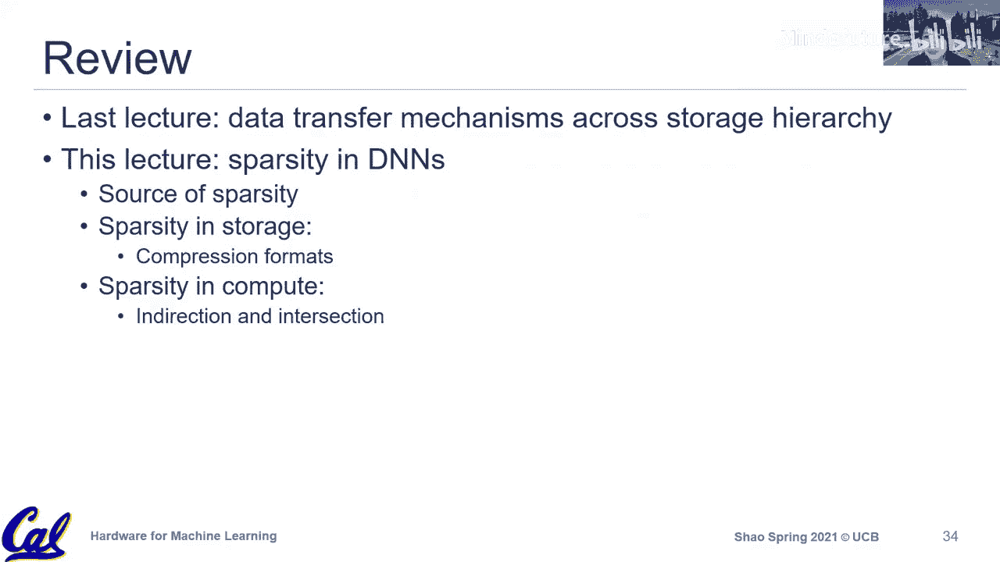

# 【加州大学伯克利】机器学习硬件技术课程 ｜ UC Berkeley ｜ EE 290 ｜ 2021 p12 P12 Lecture 13 Sparsity -BV1XfM4zKETU_p12-

。

Okay well good afternoon everyone， welcomelcome to E2 20 hardware for machine learning so today we are having our 13th lecture of the semester so almost halfway through the semester hope everyone is having fun and also having a safe and healthy semester so far so today we're going to move our discussion a little bit this week overall more as the intersection between algorithm and hardware codesign front and one of the both like really exciting area。

 especially a few years back once get to the machine learning at the intersection of both hardware and software is how we can leverage the sparsity basically large amount of zeros existed in the machine learning algorithm to build more efficient hardware over the past few years this has been it has become a really crowded area a lot of efforts in this space。

😊，Many of you probably also have heard different。PR in really supporting or advocating how they feel there。

Sparrse accelerators there。So today in our discussion。

 instead of getting into the specific techniques， we'll basically just share some overview about why this is actually important and maybe some guidelines in terms of actually when you need to either evaluate different either paper proposal or Steven startup proposals。

 when they come to you and propose another as spa as accelerator。

 either in the context of machine learning or in general。

 when they move to in the context of hardware， domain specific hardware。

 what are the important guidelines that we need to actually consider in this process。

So since we're talking about Sprsity， actually we have a lot of local expertise here again at Berkeley and one of my favorite projects actually thinking about Sprsity or Sprsity in general not less in the hardware space but really thinking about how we can take advantage of sparse kernels and build efficient softwareware stack or libraries to support this is actually the ASI project led by Professor Jim De and Cassik both of them are very very experienced in algorithm design。

 especially high performance computing and scientific computing and one of their projects I believe this is probably 1020 years ago again。

 you may see a lot of patterns actually in our class that。

The particular concept is actually not new just but in the context of machine learning because it actually fits really well with the machine learning applications。

 it become really popular and also really important again these days。

 but in general when we talk about linear algebra， there are also a lot of sparseity actually and also sparse algorithm as sparse kernels in those applications even before machine learning and very early on Jim and Caty has to actually identify have identify this problem and start thinking about how we can systematically improve the productivity for algorithm developers and also for system developers to deploy those sparse kernels efficiently so if you actually look at some of the techniques they are optimizing we'll actually also talk about some of those in today's lecture and some。

The auto tuning steps that they propose， you see a lot of similarities。

 what they were doing back then in the general concept， general sense of Srsmania algebra。

 and then how people are doing that again， this days， of course， more specifically for deep learning。

 but also getting really getting into a really like crowded in the sense of a lot of engineering efforts actually in this space。

 but but applying a very similar principle here。So with that let's get started so just a quick review of what have we been covered so far we start from the I guess more the algorithm from thinking about what are the core computation and talk about the execution orders that actually covers both the hardware realization we talk about different data flows。

 what do people mean by that when why it matters and also how we can potentially map the application onto the hardware。

 especially some for your experiments in lab3 it's really focusing on that and you recall a significant part of the AWS can structure their efforts it's really also thinking about not only just the hardware side but also how we can potentially map the computation efficiently to the application。

😊，Sorry to the hardware and in last lecture what we discussed we actually down too specifically in thinking about data movement。

 what are the guiding principle white matters， what are the different agents actually involved in orchestrating a data movement and we use this taxonomy to organize some of a very important disciplines or principle or mechanism actually in computer architecture including caching caches decoupled access executed architecture and also also DMs right it looks like like a scattered concept。

 but we are using the data orchestration taxonomy in either thinking aboutcoupled versus decoupled execution。

 and then implic versus explicit where whether the data movement is actually exposed to programmers。

 this is a nice taxonomy to actually organize。different data and movement mechanism together so that was our discussion last week and today we're going to this week overall we're going to actually move at the intersection between algorithm and hardware so now we have done a deep dive from algorithm to hardware we're going to focus a little bit more on the intersection between algorithm and hardware and look at some of the opportunities people are exploiting again those especially in the context with start sparsity。

 again very important area， lot a huge amount of efforts in both research and development in this area again willll be less focusing on a specific proposals but more focusing on the principles behind it and what are the challenges in adopting those especially we look at today's hardware commercial hardware space。

 given how popular sparsity has been as a research topic in the past couple years。

We actually haven't seen a wide adoption of hardware support for parsity yet。

 so why is that what are the fundamental challenges so that will be the focus of today's discussion。

So with that'll in today's discussion we again serve from briefly start from the motivation。

 what are the source sparsities and then looking at two categories of sparsity or how people actually leverage sparsity in hardware design and the first is in the storage。

 how we can actually do compression to reduce the memory data footprint and another one is actually in compute。

 how we can actually skip some of the computations， especially when one or both operates or sparse。

 we'll get to some of the case studies， just looking at some of the proposals being developed in the past few years again very crowded area。

 a lot of interesting proposals will be mostly focusing on the challenges and guiding principles in this space。

What that let's get started。So again， this is our loop nest we have been discussing and talking about this for guess at least the past month right how what they mean and how we realize that both in hardware。

 typically the innermost especially the distinction between foreign spatial for how we leverage the parallelism in hardware to support it and then in the mapping space。

 how we actually organize those outer loops so that we can still map our computation efficiently on hardware and also get a high productivity in terms of finding those good mapping really quickly so that has been over discussionsion so far and now in the concept of sparsity as the name suggests right so now instead of just looking at the execution order。

 we actually get into the space to at to look at the extractive values in both input activation in the opera specific。

We use the input activation and weights。So sparsity basically means there's like some of the values are actually zero and because we're actually doing multiplication right for each either convolution or matrix multiply the fundamental operations is basically a that product we're doing element wise multiplication and then accumulation right so in this case we think about sparsity only if just like one of the opera is zero。

 it could be either input or weight the multiplication is actually useless right because if any of the value multiply by zero we'll get a zero right so you may also hear people saying like ineffectual versus effectual right so only effectual work is that when both opera or nonzero if any of the opera is actually zero we don't the multiplication is useless because we're multiplying by zero。

The reason it is actually important is that this is。

 I think this is at least at this point fairly well well known， but maybe five。Well six7 years ago。

 like early 2010 ish right， so this is also of important concept was being introduced and being also exposed is that a lot of the networks if you look at the values of both weights and the input activation here there are a lot of zero here so here we're ploting density Ra is actually nonze so we see roughly 40 to 50 ish% of the data are actually dense meaning that there are the rest of the data recipe a be another 50 to to even 60% of the data。

 either weight or input activation is actually zero so this means this was actually really exciting in fact then from both algorithmic point of view like oh we train the networks for so long but a lot of values and up we train is actually just zero that's typically from the algorithm developer there。

Ppective and for hardware developers like oh， we actually keep so many multi multiplication in addition and then they turn out to be zero completely useless and they seem to be actually very intrinsic in a wide range of networks right so then the natural question。

 especially for hardware developers is how do we actually take advantage of that。

Before we get to how do we take advantage of that， we just like to add a little bit rationale like why it shows up and sometimes it's actually very natural。

 it just shows up and then again five， six years ago。

 once people realize that there's also a lot of work you may hear the word called pruning we talk about quantization early on as really just context lower precision and then another category of efficient neural network deployment iss actually pruning pruning basically making more。

Either weight or activation to be zero， so more zeros typically need more opportunities for efficient execution so what are the sources Sprsity。

 how do we actually introduce。Theeros in those values。So the first one。

 especially if we look at activation， we' talk about two opera right one is weight and the other is actually activation。

 so we already talk about the R operator as a non nonlinear function that actually a very natural way of actually introducing zeros into our execution。

 basically me of the negative values will be naturally climbed to zero and we only have the positive value here right so in this case we we look at the number of actually nonzero activations here after value but basically see a significant amount of zeros actually being introduced because the value actually clamped basically all the negative values in activation turning to zero here。

嗯。Okay， so that's one source of sparsity right so with a ra operator we actually clamp a lot of value to be zero and this is actually very effective very and given just the popularity of Ralu right this is a very natural source for activation。

So this is in the inference space and just a little bit more on the Ra operator。

 people also have done characterization actually even in the training path。

 so here is actually plotting the activation values and the density of different layers during the training so each of within each layer each of the small bar it's very narrow。

 but each of the small bar is basically the training path or epoC during the epoC whether the value is actually zero or not。

So we see that actually even during turning， especially for some of the layers。

 the density is really low so density low means actually sparsity is actually really high right so this activation beyond rail will actually show up actually introducing quite a lot of zero roles in activation and that's actually fairly intrinsic to neural network both in their forward and backward paths。

 there are opportunities to take advantage of those zero roles。

 we'll talk more or later in both compression and computation but that's actually a very common of common source of sparsity here。

So that's activation here for RE value is actually a very natural way right because it designed to be that if it is negative。

 it is zero and next I'm going to talk a little bit more about what I meant by pruning early on so that's not actually naturally the network has zero through or through re to get zero this actually means more an postproces path or optimization path to actually clamp like small values also to be zero so if the small values would talk about quantization and in some networks we realize actually very insensitive the overall accuracy is very insensitive to the precision loss so the natural question again this was very popular five six years ago as a research topic is pruning in the sense that if the value is actually very small instead of actually still store those small values which cannot be treated at zero what if we just make it at zero。

How that would change。So this actually turned out to be also fairly effective。

So here is also some of the optimizations people did back then by actually claim some of the small values or basically doing pruning to be also zero we were able to actually introduce more zeros more spars in general in the execution and that also turned into to actually better performance basically better speed up so again。

 for activation， both the natural activation from rail and also this kind of introduced or induced zero in general from quantization if the value is actually too small。

 we just also take it convert it to be zero。So that's activation。 And we talk about two offerings。

 right， There's how about weights， What do people do with weights。

One thing is actually the same as what we discussed with screeninging is the weight value is also pretty small instead of still trading that as a nonzero value。

 what we actually just climate to be zero， again， this also turned out to be actually very effective because especially for the weights are actually not very sensitive the not contributing a lot to the overall efficiency。

Another way to actually introduce zeros is its more like ping maybe it feels like more ad hoc really and very sensitive to which weights you're picking and which threshold that we're picking right a slightly more systematic way of also introducing more sparsity or more zero in the weights is actually through regularization or weight decay if you remember we talk about regularization early on when we talk about the four components of the machine learning pipeline and one of the components is actually regularization in the sense to tell optimization functions what kind of values or what kind of weights that we prefer and the one of the general principles is actually to prefer a smaller weights and also likers spars weights so that the network is not to。

Overfetting， not overfetting the data that we're seeing。 So it can be actually generalized later。

 So that's basically the idea of regular and the way we do regular is again， as we discussed。

 expressing preference or smaller weights so that they can be actually more generalizable we talk about both L1 regular and L2 regular back then one or two months ago but in general is prefer smaller weights and in especially for L1 regular and turn out to be actually by applying this preference we also get more zeros actually as another way to compress or suppress some of the the small weights So boths as both two techniques this is actually very naturally to get a lot of also sparse data in weights before talk about activation right but now here is actually weights here。

 especially for fully connected layer so。We look at some of the reports。

 some of the paper that we saw again， this was a really popular topic five，6 years ago。

 like for example， for fully connected layer， the density is really 10%。

10 to 20% so here is a density of the weights this basically means 80 to 90% of the weights are actually zero and we look at the weights ten volume like tens of megabytes of data and then we're saying 90% of those those values are actually zero this is very significant in terms of both like storage reduction and also flops reduction because if they're zero we don't need to actually calculate that anymore。

So this is really exciting back then because seeing those values can be turned into small values and also meaning really important opportunities for both。

Like storage reduction and flop reduction。same and ways is also really important。

 especially for deployment right because activation is actually data dependent when we actually fit in different inputs or different images。

 we might get different values， but ways once the model is actually trained it's always there right so it's actually more static in the sense once we trained it's static not going to be changed so there areE we can actually exploit those opportunities we could actually also leverage the static nature in the optimization。

So this has been really exciting in general， especially for the hardware community but so far not a lot of adoption of Sprse hardware。

 there has been a lot of research work in this space but especially in product deployment overall pace is actually fairly low and if we look at today's most recorded architecture and the way it's being deployed is still using like a dense architecture we'll talk about some of the reason behind it and maybe some of the potential interesting directions towards it and we'll see more later on。

 especially why that happens。So the first part is this differences and the distinction between what people call unstructured sparsity versus structured sparsity as the names suggest right unstructured sparsity basically all。

 it's just like it's random if it is happened to be zero。

 it is zero if not it's not right you will have the rail operational or the pruning that we're doing。

 there's not a lot of pattern going on right， it really depends on the values and we're basically just doing unstructured pruning。

 not a lot of regularities here。And in general， unstructured sparsity does not directly translate to performance and in a lot of cases you could actually it could also lead to actually slowdown in some of the hardware so as this is again。

 I mentioned a very important topic five or six years ago if we look at the performance of a range of different architectures to give architectures and and four different sparsity level the sparsity level is pretty high so01。

 we're talking about roughly 60 to 90% of sparsity right so very high sparsity but overall we're not getting a lot of performance benefit and in most of the cases you look at the Y axis on the left in most of the cases we're actually getting performance sold down right so it's actually worse if we are doing like this sparse computation because there's not a lot of structure。

That's why it's called unstructure sprsity we are doing a lot of very complex indexing to figure out how to skip where the zero data is and how to skip the zero data there all of those actually need to overhead instead of performance。

So that's why this is still built as very expensive and not a lot of direct adoption there。

 If anything we see more adoption of what people call structured sparseity you look at the newest N media GPU the NP generation at least the advertise right so the NP tensile core actually support structured sparseity for weights。

 if I remember correctly here， again， when we get to structured。

 it means that there have some structure have some pattern here but different people have different definition of structured sparseity here so in what's the most tensor core support is actually more a fixed compression ratio like for let's say a vector or for array element。

 the compression ratio is always two to one maybe basically half of the value is actually zero or four to one like quarter of the value is zero so then。

There are some structures there so that the hardware we can attribute efficient hardware to support that kind of structure there。

 so that's like one of I would say one of the very few adoption of sparsity in commercial hardware and even it's being adopted。

 it's actually not the general unstructured sparsity that we discussed here is' actually for particular patterns structured sparsity。

I haven't seen a lot of more recent work in this place， one of the earlier work again in the 2016-26。

 2015-2016 timeframe is also trying to actually add some structures to either get let's say this get some structure sparsity。

 not exactly in the like what we talk about 50%， the target sparsity values。

 but maybe actually in the concept， a particular future is completely zero or particular points of the heightened weight dimension in zero or a particular channel is also completely zero。

 how to actually get the network to behave that way so that we can have some structure sparsity to support that。

This is definitely if this actually works very promising。

 at least can lead to interesting hardware optimizations because the mechanism to support those will be cheaper compared to the general sparsity mechanism that will discuss later but at least now even it's actually very important very I really like this line of work。

 I haven't seen actually more recent followup in this space for a general network that we can always find out some structure structure sparsity to make things easier to make it easier to be supported in hardware。

 so a lot of still unstructure sparsity which is actually very challenging to do in general for hardware that's why no wide adoption structure sparsity there's some initial adoption in media sensoror core see we'll see whether we have more if we have this kind of more either filter wide shapewise or depths why。

 this could also be。Potenenttially interesting erupion if this can be generalizable to be a broader scope。

So。😊，When we talk about the source of Sprseity， again。

 there's tremendous opportunity just looking at all those zero old yet。

 but unfortunately we haven't seen a commercial adoptions mostly related to this unstructured and the cost of supporting those is actually pretty high or pretty expensive hardware cost。

 even doing this in hardware， not mention actually thising software and the tipping point we haven't reached the tipping point where it makes sense to do this in hardware yet。

So this is of just open up discussion， there are a lot of sparsity， but you look at the state of art。

 typically still thinking about unstructured sparsity。

 not a lot of adoption of structuredd of unstructure to support unstructured sparsity unstructured sparsity。

 there are some initial hardware support， but we'll see whether the community actually adopteded and whether that actually come in general when we think about different application。

With that， before we move on to the specific mechanism to support Sprsity either in storage and compute。

 any questions， comments you'd like to share。Again。

 feel free to just unmute yourself or use the chat window。Okay， well。

 if you have any questions feel free to share or just if you have any thoughts you'd like to share。

 feel free to unmute yourself or in the chat window。So with that。

 we're going to discuss some of the common mechanism in support forceP in either storage or and compute。

 and we'll talk about some of the more intrinsic overhead in those space as well。So first in storage。

 this is actually， I would say less controversial like even when I said not a lot of adoption。

 like supporting compression format actually has been actually widely adapt because this is more software optimization or software there or library optimization instead of hardware changes right so supporting hardware like compressed format has actually being supported in different hardware and the different software there the goal is very intuitive right so there's sparsity and we talk about how important it is for data movement to reduce the data movement cost right so we can reduce the value of the data that's actually being moved around than we're doing that right so compression is a very natural way of actually taking advantage of the sparsity in the network。

Just a quick overview of Sammo of the commonly use compression format。The first one is just bit math。

 but'll talk about in a minute， this is actually being adopted in NVDOA。

 one of the deep learning accelerator open sourced accelerators， open sourced dry NVDdia。

 we also briefly talk about Roman including this is a mechanism actually being adopted in AIS。

 one of the early academic， very important one in understanding the tradeoff in the deep learning accerator space。

We'll also talk about some of the very commonly used ones like CSR CSC。

 this has been almost like standard in supporting compressed format and there's some of the recent generalization of CSR and CSC to support a multidimensional array or basically tensor compression will also briefly talk about that those two are more in the say in the software space。

 the first two are more in the hardware space。So big mask， idea compressions。

 the idea is very straightforward right so this is basically have a mask。😊。

To actually indicate whether this particular element is zero or not mentioned earlier。

 this is a hardware mechanism actually being designed in a videoA so how does this work really quickly so this is my original R original matrix here and for all the nonze values we use the capital letter ABC DEF to represent and for the zero values or sparse values we just put zero here。

So what does bit mask do So in general， So for any compression format。

 you will always have at least two arrays。 you'll see more。 youll have multiple arrays。

 One of the arrays is basically the value right so nonzero value we need to actually keep track of those are the nonzero values and another one is some of the metadata that's actually being used to support the compression and hopefully the metadata is actually doesn't introduce a lot of overhead compared to the to storeoring zero directly So so typically there are two arrays or could be even more associated with any compression So here the idea with bitm is very straightforward again。

 we only store the dense data So here for the value vector or value array we basically only store the ABC like the dense data。

The metadata that's actually been stored with this bit mask format is for each individual element so here we have three rows for column 12 elements。

 so we have a 12 element bit mask and to indicate at each location whether it's nonzero element represented as a one or zero element represented as zero。

And with this speed mask， we can actually reconstruct the original matrix because for every non zero element。

 we know exactly where it should be in the original format right。

 so that will be the reconstruction format。So this is actually very simple and also very regular right so you always once you know the array size you actually always know the exact one or0。

 you actually know how to actually access the bit mask because this is actually deterministic and then by looking at each one or zero we can actually reconstruct the original format。

😊，The downside of this is basically the overhead right especially when the bit when the precision is actually already pretty this acting makes very good if we are talking about 16 bit values and and if we look at the early days when NVA was designed 20142015 right so that's actually 16 bit integer was actually pretty standard and now this is like we are talking about8 bit integer is actually standard and you can also even support4 bit integer right so if the bigway of the value is actually decreased and then this one bit overhead could actually be very pronounced so here let's say every bit is actually every value is stored in8 bit now instead throwing the original zero。

 we're using one bit to storing the bit mask we are actually introducing 12。5% overhead right。

ToTo the compression。And then with four bit in four perception。

 and then we've introduced 25% overhead right， so this is a fixed overhead that is independent of sparseity。

 so that could be actually fairly very expensive and then you will recall like one of the F layers。

 the overall density is only 9% right so now even with8 bit。

 our overhead is actually more than 10% or 12% just for the overhead right and then this overhead become actually fairly significant compared to the dense value that need to be stored。

So bitM works really well for a higher precisionion， but now it's actually getting。

 that's why it's actually not being used anymore when we look at the general exccelerator space because in general we're pushing。

 especially for inference to aB per even for bit process and this overhead it's actually become more more pronounced。

Here。So that's a bit mask compression another one is the Romanness encoding and this is I mentioned also a very popular mechanism this was adopteded in the iris chip design here and the idea is also fairly simple especially it's really designed to capture continuoustiguous number of zeros so in particular we look at our original format between C and E those two dense value right we have a continuoustig four zeros in our in our sequence or this we can see like runs of zeros right runs of zeros in our sequence。

So here the ideas here is like instead of。Just count treating each zero individually。

 why not we're actually trading the sequence actually together and to have another counter to indicate how long。

 how many consecutive zero that we observing in a sequence。

So what does this mean is specifically try to say for each not dense value。

 we actually always need to store dense value right but between dense value we actually see whether there are zeros。

Actually in between， it could be no zeros， I' say between B and C， there's no zero at all。

 but between C and the E we have four zero here， so now we actually have a counter to indicate there are four consecutive zeros actually showing up between C and the E。

So this is another compression compression format。 But again， this is very data dependent。

 This this really shy when we have actually kind of consecutive zero here。

 And then there's also a trade off whenever adding a counter， right。

 from hardware really standpoint point that we need to be aware of how many bits that we need to allocate for the counter。

 and it's not only just this counter， right， this need to be actually shared across all the counters。

 So we we are， of course， looking for long consecutive zero。

 but we do have the long consecutive zero， we also need to allocate enough bandwidth width to store to keep this pattern。

 right， and all of those actually could be could be actually overhead。

 especially the pattern is actually not very balanced here。 So we still see。😊，I would say the。

The jury is still out on this one compared to bigmaster is actually very clean overhead。

 this is less clear it's really data dependent and there could be workaround to actually cut the overhead of this pathwayways for the for the run or for the counter here so this is another very commonly used mechanism。

 especially in early days like video or image compression it could also work well for this but again very data dependent some hardware use that but there is always this tradeoff here。

So this is Romanness decoing， encod and decoding in ours。

So what we'll briefly talk about next is a standard CSR format。

 This is actually being adopted very widely almost all the frameworks this days actually support CSR or or CSC or and you look at some of a more at least generalization approach we'll talk about tackle in a minute it's actually using this spirit of CSR CSC to do story。

 so this has been a very mature compression mechanism。

 It has high potential disparity in the sense that it has been embedded pretty and evaluated comprehensively in the algorithm space for a wide range of compression rate and has a potential to be generalized to multidimensional array again。

 there is always。Not necessarily pushback is like there's always a tradeoff whenever we settle down onto a particular format and whenever we need to make things move things to hardware。

 then we need to understand what is whether we're willing to actually only support a particular format in hardware or just leave it。

Generaliz validity in the software space I think I'll talk about the tackle result later that at least that direction looks very interesting just as a potential way to generalize that and then and if theres a general that can be a generalized way to think about any kind of compression which could be useful from a hardware perspective to also support that kind of generalization so we'll talk about that in a minute。

ll brieflyefly talk about the CSR format， many of you probably already very familiar with with this format again back to our original discussion。

 this is another compression， and either way we basically need to store the dense value。

 that's basically value array， non zero values， but we need some metadata to actually indicate which element or which position of the original array is actually is actually zero。

So both CSR or CS and C we'll talk about later are basically using two additional arrays to actually store metadata。

 the first one I like to really think about as the fundss for the role the first basically each array is focusing on either role or column right so we'll see in CSC is basically flipped。

The way I like to think about ESR， especially for the role to indicate which role that we're operating on。

 we actually store the bonds so that we know which role we are operating on and for the column we are storing the index for each element which column with a column index for this one。

So what do I mean by that so let's say we're using the same example ABC somehow I missed the D so ABC EF that's the example that we're operating at so first we need to figure out which row right we are storing the row order so here we use the bound to actually indicate the for each of the row right so here for the first row we start with element0 and end before element3 so that will be the first row so have a pair to indicate the start and the end of each row and then the next pair of the first row and the next pair similarly to indicate the start and end of the second row right so here for the second row between C and the E right there's no element in the second row so we're not storing any element in our nonzero in our value array for the second row so the starting point。

And the ending point I' say， so it's three in that we're not storing anything in the second row。

And then again the start and the end right so that's why it's a bond so the start of the third element is。

Start of the third row is the third element， and then it ends before the fifth element。

So we use the row actually indicating the row boundary of our value value array and for index。

 we are actually just stor the exact index column index。

 so a in the column index because through the bound we already know a is in row one。

 the column index is zero， the zeros row and B， the column index is two。

 so this is the direct decocode as the column index。

So the benefit of this is whenever we' accessing the role access is always continues。

 We grab ABC and all of those are in first row and E and F are in the third role here。

 So that's basically the dense element in CSR， a very quick。

Overview of this element in CSR and the bonds to indicate which role we are operating and also a column or the index array indicate to indicate which column we are currently operating at。

This is fairly quick， any questions， is that clear any questions？😊，Yeah。

 and you mentioned the popularity， so this and CSC。

 my impression is are kind of the standards going back to a lot of prior software。

 is the tied the popularity to that or to like more direct utility to the accelerators？

So I would say at least in our discussion， that's a really good question。

 the popularity is more what you mentioned the first one just because people have been using that for a while and have a lot of experience in not only just the machine learning context but also in in other handling sparse data in general either like a graph format also using the CSR compression and a scientific computing applications are also using that so that's why this is actually fairly mature and has the potential to actually be even widely adapt and there are actually opportunities and also attempts to actually build this in hardware if anything in of how this would transition to the machine learning space it's more like for most of the CSR and CSC discussions mostly focusing on the matrices or two dimensional array and we'll talk about maybe later a lot of machine learning discussion already see we have already seen that in earlier discussion。

the machine learning is actually more like a multidimensional array。

 how would we actually use this in a multidimensional array context， how to actually generalize this。

 that's also some of the today's software framework is also trying to do that。

So I would yeah in terms of popularity and'm more thinking about people's experience of actually applying this handling data instead of other like and then there's like software infrastructure already supporters so that could also make the hardware adoption easier instead of some new one off mechanism that require not only hardware change but also reshape the way people think about data storage format yeah that's what I meant by。

The popularity here。Any other questions， comments？Okay， great。😊，SoSimilarly。

 there is also CSC format I will not get into too much details and use the same example。

 so now you will notice the value or raise order is changed because we're actually doingroll first and start column first order so a we start with column one and skip column two then column three and then column four。

Here， and then we also basically swap using the first array to actually indicating the column boundary now because the value actually stored in column order and then index。

 the raw index actually being stored at directly。So that's a ESC format again。

 it's actually work best for way actually like to do the column。Access more frequently。

So this is like then what then asked earlier and also hinted earlier。

You look at a lot of machine learning discussion， one general。

Pinipple that we see a lot is actually instead of looking at matrix data。

 even we do a lot of matrix data matrix computation as matrix multiplication is one of the most important primitive these days。

 but it will look at a higher level how data is actually represented instead of in a lot of framework they are actually typically represented as a multidimensional array and sometimes people also call tensor again。

 there are lots of different definition tensor but in this context we basically specifically say tensor is a it's a multidimensional array right so instead of vector one dimensionsal or matrixes and two dimensionsionalals tensors are represented a multidimensional array which show up a lot in。

In machine learning， in general， and also machine learning framework has also been adopted adopting this tensor notation here。

So here basically if we have actually multiple dimensions when we actually think about tensor storage。

 we could actually potentially differentiate actually different dimensions into whether for that dimension。

 whether we like to store it in a dense format or sparse format， so here instead of just oh。

 we only have two dimension to operate on and why is' dense and is sparse。

 like that's basically the principle of CSR and CSC。

 some of the more recent discussion especially from the software stack is how to actually generalize that in thesor in the multidimensal space。

 and ideally you want to actually separate all those dimensions so that you could actually do random combination in terms of sparse and dance。

 like for example if we have four dimensionmensal tensor。

 it could be it's actually sparse in the channel dimension。

 but in the batch dimension or spae in the image height and waist dimension but dense。

In the channel dimension， all of those are actually possible。

 so how we would actually express that to capture different all the potentially different behaviors in machine learning。

So there has been actually somewhat really interesting work if you are interested in this space。

 I would strongly recommend you to take a look at this tackle paper。

 this is more in the compiler space but actually expose some of the discussions。

 how we can systematically think about sparse data。

 especially sparse multi-dimensional data instead of being constrained in either CSR or CSC format generalize it so that any of the dimensions can be independently viewed as either sparse or this and think about how we can actually represent those in the consistent manner this is also the reason I personally find it interesting because this can also be too interesting this kind of generalization can also lead to interesting hardware efforts because in general hardware efforts is or hardware designer in general reluctant to actually picking a particular format and develop into hardware because eventually you need to actually be adapt。

By different different end user right so we are actually limiting the end user selections that could be actually potentially hurtful for for the end adoption overall。

 but if there's some kind of generalized format that hardware can also adopted as a common primitive so that we can support a diverse set of patterns。

 this would be actually be more interesting from a hardware design perspective。

So that's a tackle style approach is actually interesting and again。

 I won't get into too much detail there， but you could actually and even this kind of representation actually start you can trace all the way back to some of the Jim like Jim McKy's earlier work in more embedded representation to represent sports mates here So basically it's another way basic separ role and the column and then for every dimensions。

 we could actually separately compress it in a particular fashion and also and or just choose a dance fashion to actually compress it to represent it So this become actually really interesting as a more generalized approach to represent that but eventually it's actually you can stuck to the CSR and CSC format。

 basically for every dimension you have a。To actually represent that。

 but now its actually be more nested， even one of the dimensions can actually be even nested and then use a metadata from another pair to actually be called the dimension here。

So that's a tackle approach I personally find it actually very interesting。

 especially with the idea that can be generalized and has a potential to become a hardware primitive that's why I feel I find this interesting and the tensor notion is in fact different from the matrix notion so how we actually can come for this multi-dimensional array accesses efficiently will be interesting from both storage point of view。

 but also from hardware point of view I don't think this has been actually adapted I'm looking for I know those authors are pushing very hard of adapting this way of thinking in to have a more generalized theseRNCSC format in those frameworks would be interesting to see where that effort is and potentially that could have interesting implications on the hardware front。

So that's the end of the storage format， we'll talk a little bit more how things would work and some of the challenges in supporting sports format in compute before we move on any questions。

 comments or any thoughts that you want to share。Okay， well if you have any。

 feel free to share slacks through chat or chat window or just unmute yourself of the。Again。

 some announcement will have a guest lecture next Monday， not today。

 one week away from today actually from Microsoft， I'm very excited about this guest lecture。

 they will talk about where we talk about some of the RPT deployment there and also they also have been pushing really hard in thinking about custom Zing point format。

 we talk about standard format right and they have also some interesting work coming up with their format and how they support that with their RPTA based cloud infrastructure。

 so we'll get to see the Microsoft perspective in deploying machine learning in data center and what their experience like。

😊，Most of you have finished La three congratulations that's very important that's a very important milestone。

 both lab two and lab three are fairly involved so if you successfully finish both very good job that's a very important milestone if you haven't it's also okay you still have late days I believe quite a few of you you have late days unused。

 definitely use that opportunity to finish lab three。

 lab three is very important both from infrastructure perspective and although understanding the tradeoff and you may also want to use the AWSF1 infrastructure for your project right so spend time on it。

 you still have time you haven't if you have finished it already great job we're looking forward to actually to get to working with you into the project we're moving on to the project phase if you haven't finished it continue working on it。

 there's still late days。😊，Available there and use those as opportunity to。To finish the lab。

And were also moving to the next phase of the basically the second half of the semester time really flies and the project starts this week and there's nothing in particular that we're asking if anything we really just want to see。

 make sure you have thought about your project and many of you have either through individual meeting during our office hours or through the project meetup many of you already have thought about project and have particular proposals in mind。

 I'm personally really excited about many of the project that you propose。

 if anything we just have this proposal deadline， right before the Friday before spring break to make sure that you have thought about it。

 you have done look at related work and have thought about your milestones。

So what we are looking for for the project proposal。

 it doesn't need to be long one or two pages are completely fine I would actually suggest。

Even you already have a breaker topic in mind， at least try to find one or two research papers in this specific space and think about what that paper or those papers have done。

 what's really missing from that work or how you could potentially actually extend that work to do something on your own something interesting there。

 so it could be extension of those work from those papers or or you want to fix some issues or identify some challenges to further improve their proposal that's also within scope of the discussion。

But instead of being fairly abstract， let's use this opportunity writing this project proposal to get some actually more solid actionable item that you can do right so definitely pick a couple papers。

 highlight what they have done with your idea and also really how you could actually extend either extend it or fix their problem。

 have very concrete to do items to actually make your project more concrete。

And I will also include a short project plan planning phase or just to discuss describe the milestones to achieve in general。

 I'd like to do a two week like what we have been doing like two weeks spring of the labs now you get to the two weeks spring of the project right so starting the first two two weeks its really just brainstorming and thinking about the project many of you have already started I'm really excited to see some of your project and then the next two weeks from before spring break to the early April will be the first checkpoint think about what you want to deliver by then and then two more weeks get to late April that will be the second checkpoint hopefully by then you should budget that's by then you have at least the majority of the execution or implementation done and then the last phase is achieved and thinking about a final report and collect prepare your final presentation so that's a rough time。

In a two week sprint， use that to organize your project。

 how you how how you want to plan to actually adapting。

 adapting different or look at different ideas， focus on specific。

Two or three well two things be very concrete right what's the deliverable from your first checkpoint。

 what's the deliverable from the second checkpoint and also budget sometime because things won't typically things won't go exactly as you expect right so don't keep your like schedule too busy with new deliverables every checkpoint you also need to budget sometime if things actually don't go well if you run into some major roaddog what are the alternatives。

So those are the things that you should think about in your project proposal and again this is not we're asking for proposal is not not really to like read your essay in any way。

 basically is really to force you to think your project through what you want to do how you plan your project and whether you see any potential issues and how you work around those issues。

 so that's what we are looking for in the project proposal again to help you organize the way you think about your project。

Any questions about project or lab or any comments？Great， what's the maximum group size again？我操。😊。

What's the maximum like number of people in the group for projects That's a good question so typically we recommend two well even solo project is fine I understand things are actually challenging during the remote instruction but by default we typically recommend two three is also fine but for a three person project I would expect something quite substantial from a twoper project so in your project proposal you should also describe each individual's responsibility especially for three person project how you would like to split the task between three person so three person of a fine if it's a four-per project you you need to actually talk to either me and a before you actually submit your project proposal I haven't seen any but it three is fine but it is for we need to you need to talk to us just so that we see what exactly you're trying to do and whether it's。

A four% project， but one， two three are generally fine。Any other questions？Okay great。

 well I think many of you have already either discussed with me or abe separately or talked during your project meetup。

 I think at least for all the folks that have talked to me。

 I think it's actually the project very exciting and also leading scope so I'm looking forward as we move to the project phase。

😊，Okay。So now we talk about compression， this is a little bit blurred more between software and hardware and also very open ended right we talked about what would be a format。

😊，It has more opportunity to be adopted and what and hardware is actually more in a more passive role in the sense that we wanted to go on to support。

Supports the potential ones but also don't want to be too specific or dropping the opportunities by only support a particular pattern so either BiMs or arounds。

 it may work well for certain things， but theyre also problems that require a different software stack and also may work differently if actually the tradeoff in the sports day patterns and also in the data value representation actually change。

Second we're going to move to the compute discussion so so this is actually more in the hardware space and I mentioned earlier this has been a really popular research topic in the past few years across different communities not only in the hardware community you will see experts sports accelerator for deep learning in like for some traditional circuit community or like architecture community you also even see that in some of the more systems see community and also in the machine learning community this is like a topic magic actually through throughout the community together which is exciting on its own but also me just like see how crowded it is how many like new ideas has been actually being proposed and again we also talk about not many of them have actually been adapted right so it's also。

😊，To some extent highlighting the challenges in this space。

 so you talk about the typical typical challenges or mechanism in this space。

 which I think I find it very useful to actually group different proposal together because fundamentally either you're exploring sparsity for one opera end or to opera and there are some very common challenges。

 you need to work you need to actually specify and typically their people's proposal are focusing on how they actually work around and those problem or how they can actually support those challenges in a more efficient manner。

So they typically are solving at least the same category or categories of problems。

 so I will mostly focusing on those category in this discussion instead of specific solution I'll show some of the solutions there。

 but again mostly the problem category and then there is like a large a huge amount of work actually in this space with different solutions。

 and typically they always share some similarities with some differences but we be more focusing on the problem perspective instead of solution perspective。

Partially because just how crowded this space is。So again， well get to compute， right。

 So the goal is clear， right， we already talk about that either if either of the offerings。

 either weight or input activations， either of those values are0，0， we want to skip those in factual。

 basically useless computation here。 right， So here。😊。

WellThe way I personally like to action categorize those is put this into。

A two dimensional taxonomy here， one of the dimension is whether we're looking at a single operant or two opera right so that's straightforward right so either we're only skipping zero weights or zero input activation or we are skipping both input weights and input activation。

What does this mean is that basically we're looking for either sparseity in one of the opera or sparseity in two of the operas here。

So that's one dimension and another dimension is how data is actually aligned Ill get more example about alignment。

 what do I mean by alignment later， especially whether were actually enforcing orders for either weights for the inputs data specifically weights and input activation or where enforcing orders for the output data specifically output activation。

Based on those different dimensions in taxonomy， the hardware mechanism could be either doing some sort of interactiondirect for a single operant sparseity when the inputs are actually aligned or doing some kind of intersection here intersection because we actually need to to find cases where either of those are actually zero。

 So doing some kind of intersection， Okay to find the cases where both are nonze again。

 so you look at two operant sparse， we only do useful computation， right。

 so the useful computation is when both inputs are not zero， right。

 so those are actually useful computation。 So here with two operant sparseity。

 a lot of fundamental hardware people are building again， different flavor hardware。

 but what they are eventually building is basically some sort of intersection unit to find dense data in both opera that's when they actually trigger。

Computation otherwise will escape。Compplication。So those are the intersection mechanism and then one of the very interesting proposal actually very different。

 so I would say those two actually dominant for most of the proposals and the very interesting proposal showing out a few years back。

 this is also the paper we are reading this week SEN is actually don't enforce order for weights and inputs but actually enforcing orders for output and then that leads to an important arbitration unit in the design and that's SEN approach will discuss more when we get there。

So let's see what do we mean by introduction， the first。

The first corner where only one of the opera is sparse。So here， if only one those opera is sparse。

 the trick， what we want to do is actually use the nonzero element。

 the index of the nonzero element of the sparse tensor to index the dense So basically one so here because one if one opera is sparse。

 right， we only do computation if this opera， let's say weight is sparse。

 then we only do computation in the weight is dense right， so weight is zero。

't we skip it and it is a particular weight element is actually nonze we perform the operation。

And then in this case， it basically depends on whether well we need to actually figure out the dense or the nonze element of either weight or basically the sparse tensor to trigger the computation zone basic whether we do computation is actually triggered by whether we find a dense element in the sparse tensor。

 so this pass is what we mean by indirect because we use the index of the sparse the nonzero elements of the sparse tensor to index the dense tensor。

It may seem a little bit abstract， let's look at the physical example， just see what we mean by that。

So here we are still doing a matrix were doing a matrix vector multiplications as a result is y right so here a is a sparse tensor sparse matrix and x is a dense matrix here so to calculate Y we see this that product the right element y multiply and then simulation going on here one thing is the index in the little bit trick here here is that the index that we' index in the dense element。

 the x， the J index is actually dependent on the value of a。

 whether we're looking at a dense value of a or sparse value of a because a is a sparse tensor right so in a is then we only trigger this computation when a is dense so with this there is a level of indirect going on is that to figure out the right value of x we want to retrieve。

Or to trigger the computation， we only we need to actually figure out whether we're operating at a dense a or a sparse A。

 So this is what we mean by in direction， basically use the index of the sparse opera to index to figure out the index that we need to do for the dense up to trigger the computation。

Is that clear any questions？Okay， I hope it's clear。

 but the idea is simple right so if you have a sparse one， you have a dense one。

 you want to skip some computation right you need to figure out which part to skip。

 and that's basically that's an indirect going on based on the sparse tensor to skip it and then you will put in a code format is something access So in general if for the hardware grid。

 they are only focusing on one of the opera they are basically building some indirect piece of hardware indirect mechanism in their hardware so that they can see which and for the sparse tensor。

 which value is actually nonze and then access the same a corresponding element in the dense tensor so that they can trigger a computation here。

😊，啊。And this can also like I use a matrix structure， as example。

 this can also show up in matrix matrix and operation again to access the dense sensorsor it actually instead of just depends on the array element IGK。

 it actually depends on input on the sports data， the sports representation to figure out which value to fetch。

So indirect piece of hardware。 So this is an example that we see in for example。

 if one of the opera is is dense is sparse， at least convolutant is actually looking at the sparse input activation。

 So activation can be sparse。 So here， if you look at general this hardware。

 they always have this indirect unit， looking at one index。

 looking at the neuron index and figure out whether they actually skip neuraln here。

 means input activation and figure out whether they want to which specific synapses or which specific weight that they need to actually multiply results。

 So there is always some some form of indirect going on to look for corresponding elements in the dense and the elements that。

Cresponse to the zero element。So even in direction that's not easy hardware to build。

 it's not that straightforward， you need to read the element and then use that as an address it's like a formal pointer chasing right so this is basically how people actually turn this support in direction in hardware。

And the second one， we'll talk briefly about intersection in general as happens actually when both our friends are actually sparse。

 and then we again， as I mentioned earlier as micro correction earlier。

 lets use intersection to actually find the dense element so that we can actually perform computation here。

So as yeah the intersection is to find the nonzero elements of both opera here。

 so again we're using a matrix and vector multi as example here and basically you see this in a lot of cases when we handle actually both elements。

 both opera are sparse， you see this kind of if statement here they basically if the indexing actually match with each other。

 meaning that we find the corresponding elements that both cases or both are this there。

 that's when we actually trigger multi here so instead always just trigger multi we need some if statement actually checking those indexes making sure those both the indexes。

 both of the corresponding elements of those index indexes pointing at。

arere actually best element or nonze elements here so this is a c code representation and when you turn this into into heart where typically you will see this kind of intersection unit looking at the indexes of both input activation and the weight activation indicating whether they are zero or not and you're looking to do basic perform massively parallel intersection to figure out what are the nonzero。

Weights and non zero activation that you want to multiply together。

So this is this kind of parallel comparator array， you will see a lot when we actually have two offerings。

 both of them are spars。So this is another approach when we actually talk about tool opera when both are spae。

 so far we're mostly talking about focusing on from input and black indexing from input and weights。

 for example， indirect is using one of index to figure out the other while intersection is actually comparing the indexes of both weights and input activation。

The next one is a little bit rare。 So that's why we put SEN as the only reading actually this week。

 because it's actually fairly different from the other approach instead of actually figuring out the matching one。

 it has have a fairly bold proposal in like oh what if we actually don't care why spend so much time and energy to do either interaction or interaction just to figure out those matching index。

 What you would just let those weight and input actually go through our our pipeline and instead of getting those aligned。

 we could actually just figure out the corresponding output index and just to align output whether it could actually save some performance and maybe even energy。

 So that's idea there。 And in this case， it will not really getting inputs and weights aligned。

 there needs to be some arbitration mechanism because the input is actually the front end is fairly。

Rendom amount of order， there need to be some arbitration mechanism to make sure that the output are actually aligned。

So we'll briefly talk about this proposal， we include that for both completeness and also it's just very different from the typical approach。

 either in direction or index or intersection that we talk about to guess things aligned here。

So what's the idea with arbitration so this the idea here is that when we think about multi here is basically even when either like one of the operating zero or both offerings are zero can be zero。

 basically all the non zero activations must here， not always at some point in time be multiplied by all the zero weights。

Again， there is some caveat here it works for matrix multiplication。

 it also works for conclusionvol with Str1， theres some work around for non Str1 conclusion we not talking about that in this context but in general the idea here is that you have non-ze input and non-ze weight and a lot of discussion we have discussed so far is to make sure that things are perfectly aligned but we know which one need to be multiplied with each other right but alternatively you look at this。

 you have non0ro ways and non-0 activations they always need to be multiplied with each other the multiplication always happen what's actually unknown is where the multiplied result should go right once they multipied with each other they could actually contribute to this output activation maybe a different output activation it's completely out of order we don't know the output ordering。

They will meet with each other at some point and to produce an output for some element may not actually be the same element could be a completely random element。

 it depends on the index weight and input activation， but they need to meet at some point。

 the multiply always happen， we just need to arbitrate the multiplied result to the right outcome here。

So in this case， this is basically dropping any alignment in input and weight。

 we just produce all the possible actually partial sum are very scattered and then we use an arbitration logic to send the corresponding partial sum to the right output and activation so that's a fundamental idea of SEN and well see the paper you'll see what that what's an implication there。

 so this is a completely different we all talk about indirect intersection to final alignment here that we don't care about alignment。

 we just produce a partial sum and then we try to find alignment in the output side using arbitration logic to actually find the corresponding output。

So if you look at their design， when you do this paper really thinking about how they actually do arbitration and I won't get into the detail also here thinking about the cost of doing this arbitration because they're input actually the front end is very straightforward。

 there's no indirect， there's no intersection unit that we discussed so far but focusing on the back end it's basically the red part of the design and see what are the cost of supporting this kind of arbitration here。

And there is some more analysis we won't get into this lecture。

 but think about from a cost perspective， what is arbitration cost for both the CRpar and also the SRM here。

So those are the three approaches we think about compute again。

 so this structure is mostly focused on sparsity， we talk about source of sparsity and some of the consideration in support sparsity in storage not only from hardware perspective but really thinking about the ecosystem as well and to navigate sparsity in compute especially with large proposals we generalize into the three categories typically in most of the cases I would say is basically either in direction or intersection any kind of hardware basically fall into those and there could be smart in or intersection mechanism。

 but they really need to solve that the only outliers I see very interesting proposal have this arbitration mechanism but also could be expensive to support the arbitration mechanism。

Okay with that this conclude our discussion now Sprsity great to see you all here if you have any questions feel free to either stick around or go join us in our office hours to share your perspective and I'll see all of you again this Wednesday for more discussions with that take care everyone see you this Wednesday。

😊。

