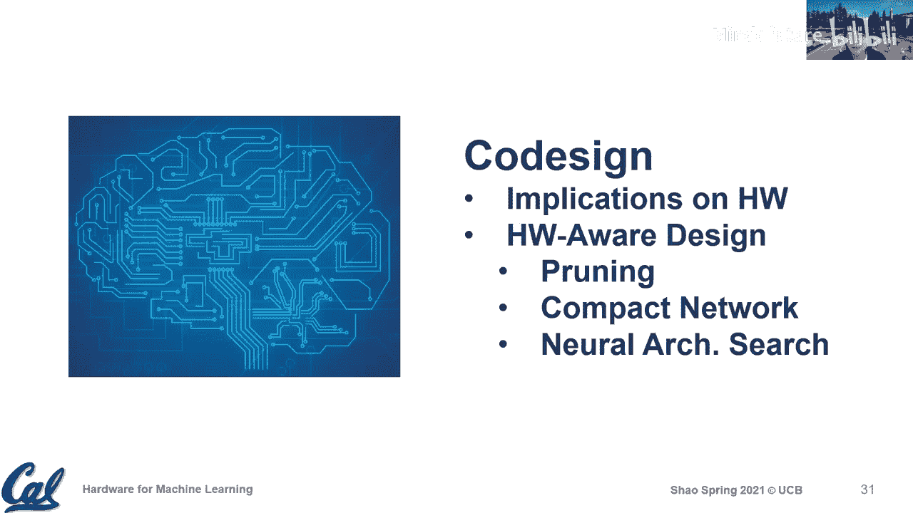

# 【加州大学伯克利】机器学习硬件技术课程 ｜ UC Berkeley ｜ EE 290 ｜ 2021 p13 P13 Lecture 14 Co-Design -BV1XfM4zKETU_p13-

Re。

Okay， good afternoon， everyone。 Hope everyone is doing well。

 Welcome to E2 90 hardware for machine learning。 we're almost halfway through the semester。

 So say we have our 14th lecture in today's discussion。

 we are going to talk about some of the topics related to code design。

 This might be a word that you heard a lot， you have been hearing a lot these days in both software community and also hardware community。

 and whenever people started talking about Okay， the main specific salary areas。

 there's some notion of co designign actually being part of it。 So in today's lecture。

 we're going to more like thinking about what's really behind it。

 what are the implications on both hardware and software。

 and especially in the machine learning context。 What are the different maybe not exhaust looking at all the possible co designign options people are pursuing。

 but at least have some。😊，Pincipleles or some kind of areas where active research is going on when people actually consider codesign for hardware for machine learning hardware。

 so then when you again like a lot of topics what we're trying to do is like when you were approached to evaluate a particular like machine learning。

 hardware proposals or' like reviewing or just reading like general machine learning papers related to hardware or system in general how to actually navigate the space。

 what are the existing work prior work and how can we actually better understand the novelty of those and also the significance of those proposal。

So before we start， since we're talking about codes。

 there are like a lot of different definitions of co design and and depends on how you how you see it like different systems have been actually doing the so-called codes process for a while what I like personally what I like most is actually thinking about the HPC system high performance computing。

 and because typically their workloads is again still need to be in a lot of cases。

 general purpose because there are like a lot of different applications need to be running out those system。

 but the system designers have been really thinking about codes for a while because mostly because of the scale of the hardware that they are building that they need to consider and also the skill of the software。

 even it need to be general purpose， but they really need to consider scalability of the software。

 how they actually map to this large。Scale of hardware they want and four different goals。

 optimization goals they have in mind。So a particular good definition of code designs is we're talking about in the context of machine learning。

 but when we think about the high performance computing HPC designs。

 this is one of the definition that I like I personally like most and can the highlight here So what does code design do it's really talking about this concurrent design and optimization process。

 including both hardware development and software development。

 once we have a particular goal in mind we're actually doing concurrent hardware and software optimization here and with this optimization the general goal is to actually achieve a target。

Achve a particular target can be either in of performance throughput， latency。

 power size or a combination of a multiple of those。 So then there are two things here。

 So first really involves both hardware optimizations and software optimizations。

 and second as what we have seen this is really a multi objective optimization problem where of course performance is important。

 and we'll talk about scalability throughput in particular。

 but there is also other system level considerations。

 So a lot of time it is it eventually become a multi objective optimization problem。

 So then we'll talk about some of the recent words this days formulating the codes problem and then you can also see why a lot of time actually people really thinking about how to modulating or navigating both hardware and software design space。

Optimize towards maybe one single objective， but a lot of times it becomes a multi objective optimization problem。

So just to start with co designign， what we mean by codesign in this particular context with both hardware and software。

 we're going to narrow it down a little bit more compared to what people typically say in the HPC community will basically more specific。

 specifically talking about machine learning， but again。

 it is a concurrent process and seconds in most of the cases it turn into a multi objective optimization problem。

So with that just a quick review， we have been doing more you can either think about bottom mark up or top down and depends on the level of details but we talk about different primitives and how we actually realize those different primitives in hardware and very related to the lab tools style exercise really building the hardware and then we move up a little bit。

 thinking about not only just building hardware and also thinking about how applications are actually mapped to hardware so that's a mapping exercise that we' have been doing in left three。

We talk about generally about data transfer mechanism so that we have this general taxonomy in thinking about either DNA cache or decoupd access execute mechanism。

 again， very important and a lot of design or interesting optimization still showing up because data movement or the data orchestration just so important in this kind of domain main specific accelerators these days。

And last lecture we started talking about sparsity and inect sparsity is one of we'll see a little bit more we'll mention sparsity a little bit again today so sparsity is really also sit between hardware and the software codesign that's why I also mentioned it was a very crowded area because you see people talking about sparsity will go to a more algorithm。

 machine learning conferences just trying to think about what is source of sparsity。

 how we can actually introduce more sparsity there。

 and then you also see that being discussed in more hardware context。

 how we actually support efficient execution of sparsity in particular do either in direction or intersection in a very efficient manner to actually make it feasible in hardware。

We have some discussion lot yesterday and after class some students also ask very good questions in general。

 especially when we get to the sparseity in hardware side。

 we mentioned that we haven't seen a lot of commercial hardware yet because there is always overhead and one thing really important when we evaluate different proposals is to look at where the crossover point is crossover in terms of in what degree in what sparse if how sparse the data need to be so that the benefit of supporting sparse hardware in particular either indirect or intersection or could be even arbitration for the S and paperer you have seen those overhead in hardware actually can be can be。

Can be mitigated by by the sparseity that we are observed and like the general rule of some。

 I would say it's like I need to be as like 50% sparseity So thats the crossover point need to be there。

 And we haven't seen a a lot of proposal need to be extremely sparse like 70%。

 even 90% sparse to actually to beat the dense architecture。

 So that's why that's a lot there's a lot of challenges in adopting sparse architecture。

 But there's again， there's a lot of work in this space from both hardware side making those hardware more efficient and also from optimization side algorithm side。

 making things more regular。 So we'll keep an eye on that to see whether there's new interesting proposal coming up。

 But again， that's also a very important dimension。Both sparsity on its own。

 but also the sparsity in the context so hardware software will design。

So in particular in today's discussion we'll be more focused on codesign again this will be a more general discussion I'll talk about some of the trends in both hardware optimization and also some of the trends in in like what I mentioned hardware aware design。

 those are actually more software oriented optimization feel free to ask any questions or share your thoughts。

 your experience or what you observed will see this line of work in either machine learning or general in any kind of specific hardware design。

 how do you see those two different factors actually interact with each other。So with that。

 we're going to first start with whats the implications of why it matters。

So so far we talk about a domain specific hardware we mentioned like a lot of design process is actually thinking about what's the requirements of the applications of this domain or application of this domain or particular predators and how we can actually improve the efficiency there so far we have talked about the specialization or being more customization depends on the terminology that you like to use in either thinking about control we talk about the instruction granularity right we talk about typically we see more course grain instructions going on that actually map fairly naturally to the algorithmic algorithm API that is actually exposed to algorithm developer。

Also also talk about the compute part very importantly is just how we can actually use parallelism either。

A parallelism especially spatially and in terms of matrixlecttensor operation in general。

 both the reduction dimension， the K dimension we need to reduce how we can actually reduce efficiently and also either the N or N dimension。

 the parallelism dimensions so we can actually multicast or even broadcast efficiently。

 so there we talk about the systolic based computation or the more vector and wiring direct wiring based computation showing up for things like VA。

And then we also talk about data orchestration right。

 a lot of times actually we are leveraging the domain knowledge。

 especially the software managed data orchestration。

 we talk about the explicit management to make explicit management feasible programmers need to actually have the full knowledge of both hardware and also the algorithm behavior is the algorithm that be very regular。

 it's actually now not too challenging， actually to do a more explicit control there。

We briefly talk about compression that's also the data format and we also talk about this is the large space right and then the tradeoff hardware designer need to think about it whether we just support one or we support many and to support it will do want to be more flexible whether we actually need to build all the different small pieces of hardware or there's a more general representation so that we can build a more general engine to support more of those well need to see more。

 I feel like this compression， especially in the if learning context is actually very different from the way we think about compression that's for for example。

 for video encoding or decocoding which is actually even earlier one like one of the earliest generation of domain specific hardware those are actually very as we say like application specific and this is a format we like to use。

 this is vendorer that's build this into hardware so that's the way people think about it。

But now once we're actually getting into this socal domain specific hardware and understanding even within the domain theyre like different tradeoff so there's a nice and also subtle balance in general。

 doing more specialization for this domain but also realizing the differences actually for。

Primitives or applications within this domain。 So we talk about some of the subtleties。 Again。

 this is get to a very subtle space。 We're talking about already start doing specialization。

 But now we're saying， oh， let's take a step back， like seeing all the different scenarios and whether we want to go too far with our specialization strategy。

 So let's see a couple examples。 What do we mean by that。 What kind of like。

Like optimization people are trying to do these days after going to going to do very specialization。

 if like we also want to support more general form of optimization。

 what kind of generalization people are trying to do with this days in this space。So first。

 let's let's use data flow as an example right we already talk about data flow and especially using the notion terminology of stationery the weight upfront。

 it is' being reused and also at which level of memory hardarchy so we talk about the two commonly used data flow。

 especially wave stationary and output stationary as the name suggests one is's trying to at the innermost register level。

 trying to reuse weight and the other actually reus output and also interestingly two of the most commonly used at the example when people talk about domains especially machine learning hardware。

 TU， since they're processing unit from Google and N DLA NVD is open source deep learning unit。

 we talk about those two when we discuss the accelerator。

 both of them are actually using a waste stationary and data flow。

And one of the very infferential work actually in this space in thinking about machine learning hardware is the IIS work and one of the very interesting and novel contribution from IRS is this role stationary data flow。

 and we don't have time to actually get into the details of the role stationary data flow。

 but instead of thinking about for data flow in individual element。

 and they actually formulate the problem to actually thinking about reuse at the role basically a vector level。

So here is one specialization people are doing or deciding like let's say， oh in my hardware。

 I'm going to reuse weight and or someone else hardware。

 we're going to reuse an output and at the very beginning there's like a lot of like strong justification trying to find。

 okay， my data flow is always better than yours because A and B and the C you see that line of work maybe five。

 six years ago just really trying to figure out which data flow is better or is the best。

But nowadays， you don't see that kind of discussion because well people realize that it's actually really hard to and almost invisible to actually to say one data flow is always superior than others because there's like a lot of factors actually dependent and also impact the decision。

Just some characterization and that we see once we think about this discussion right so let's say if we have a hardware template。

 everything else is the same， the buffer size， everything else is same the only difference is let's say weight stationary。

 whether we're doing a waste stationary data flow like PPO and theDLA or doing an upload stationary data flow like shouldna or some other work in this space。

So in general with a weight stationary data flow because we're using weight it's actually really good to lower the cost of accessing weight buffers for example。

 here the orange slice is represents weight buffer of the pie because we're doing a weight stationary data flow we actually most of the weight accesses is being eliminated because we're accessing the weight register instead the weight buffer right the asR so here you would do a weight stationer data flow for this application it only takes from 35% of the total energy because it's like very small but then we see the dominating factor is actually the accumulation buffer energy here it's like more than more than 50% because you we do weight stationery we actually need to access output or partial sum from the accumulation buffer every cycle and if you recover discussion accumulation buffer is' actually very expensive in the sense that it's typically at a higher precision。

And then either input or output， input or weights， right。

 because it needs to actually being accumulated to a higher precision。

So this is an example if we optimize for weight， of course weight buffer becomes smaller。

 but accumulation buffer actually becomes dominant。

And alternatively you will do what is so called output stationary data flow here。

 we are breaking down this pile again total energy。

 So here it we look at a gray before it was for weight stationary it's more than 50% now it is only 10% because were not we're filtering out the accumulation buffer access at this point right every access actually go to the register instead of go to the astro So this become less significant but then we don't have our weight we use anymore right so we are actually accessing our weight buffer every cycle Now there is also a tradeoff depends the size of your weight buffer sometimes people actually like to build a bigger weight buffer。

 especially for inference accelerator。You will hear people trying to say like fit model on chip as much as possible with that you actually need a decent size weight buffer so that you can actually put enough weight on chip to reduce the off chip memory accesses So weight buffer is also fairly big is's not the small buffer and now we're actually accessing weight buffer more regularly with an outputpost stationary data flow。

So again， this is not to say which one is always better than the other just understanding the tradeoff right so this definition of stationery really trying to optimize one axis one buffer access but then once you actually get to optimized with that buffer access the other accesses become also dominant so thats that's why it's really hard to say which stationary strategies is really good because even just for a single application we'll talk about different application in a minute。

 even just for a single application we see the tradeoff between accumulation buffer between the buffer size again also relating to the bitways and which one is actually being optimized more。

So virants is wondering how are these percent computed are this generally true when changing just a stationary type that's a really good question so we can point to we also point to this paper this is one of some of our own work actually a couple years ago so this is this pie is the energy breakdown so here this is actually computing the energy breakdown in both cases so those are actually basically design hardware like the way you did in lab two and then synthesize it and then run a particular application so this is for the same application but two different hardware and in those hardware where the buffer sizes are the same and the only difference is is a stationary it basically where you allocate the register either to the weight or to the output so this again this is for a particular sizing I mentioned earlier。

RightThis depends on how big your weight buffer is right you have a relatively smaller weight buffer。

 maybe this weight buffer energy is also not that significant so it's a lot of factors going on this particular data point is first energy breakdown and second with four particular layer with a particular sizing for those different buffers but fixed and then the only thing difference is the only thing that is different is the register。

 whether we're doing with stationary or output stationary register so that's another thing I think difference maybe you're hint at is you will have a different buffers sizing or you will have a different memory hierarchy we also need to do this analysis again and then you will have different applications we need to do this analysis again to actually understand the caveat here but the general message a lot to communicate。

This analysis is that it's hard to do this very uniform， which data flow is better or the best。

 because there are a lot of dependencies with other factors including applications。

 buffer sizings and a memory hierarchy， like all those play a factor when you do the when we do the design space。

 design exploration。M sense， any other questions？Okay so the setup we can point to this paper that has actually more details here。

 so this is what we talk about how to actually trade off different data flows directly and so here the different sizes of the pie the total energy so in this particular case the weight stationery is actually still more overall more energy more energy efficient compared to the output stationary because this is actually smaller but then we are actually observing a different breakdown here。

And another message， I think I find it very interesting is specific compute is only a subset like probably a quarter of the total energy is so overall when we think about this kind of。

 especially dense in your algebra， there there's quite a lot of energy are spent in data movement。

Yeah， so should we take the denominator of those pie charts to just be energy inside the accelerator。

 is that including like outside stuff like getting data from the DRAM？

Right that's a good question so it doesn't include the DM energy。

 those are just the on energy breakdown here for this particular analysis。Yeah。

 so those all those are like un chippped energy breakdown and I believe actually in this analysis。

 this is actually prepopulate all the data into a global buffer and this is doing PE level analysis so so everything' is on chip we're actually focusing on doing this is actually doing a version of the processing element a single PE like in maybe in the Geminized that you can imagine data is already on chip in L2 and now we're actually doing the breakdown of how Geminize different buffer the energy breakdown gize different buffer with different data flow but it also support different data flow while the data is already on chiped。

Good question， any other questions or comments？Okay yeah so we also include off data access that will be well make things even more interesting。

 but at the same time there is also quite I think that would be interesting just to see that depends on the again the parallelism again theres like a lot of dependencies there even with it we actually consider the DM breakdown which will be DM contribution which would be off contribution which would be even more significant but at the same time there's also more reuse opportunities if we have a decent size on offer so that's what I meant by memory hierarchy right so that also play a factor when we think about the data flow analysis so there are multiple factors going on that's why it's really hard to say some things like universally good this is always good without considering all those dependencies and related factors there so it's really need to factor all those considerations into the analysis to think about what is a tradeoff。

And instead of simplifying this into oh， this data flow is always better than they are。嗯哼。😊。

So so a follow up based on that analysis I just going to quickly go through this is while realizing these kind of complexities。

 a direct outcome from that study from this work is really trying to think about whether we can make the hardware a little bit more flexible to actually support all the different data flow and one of the methods here is actually instead of say we only have one register and trying to figure out where the register should be。

The whyNot is actually register is actually relatively cheap right compared compared to SRA so we can actually have a small set of registers that we can allocate it either right before the WI buffer or right before the accumulation buffer so here we're using collector you can you think of a collector as a small array of like4 or8 entry register and then we can actually have a more flexible data flow and depends on the scenarios we could actually either we could actually do a multilevel data flow and also thinking about data we use at the register level within different multiple register level instead instead as fixating a particular single register and this can actually turn out to be fairly efficient I'm not sure whether I don't have a data there but if you go to this that 2019 paper actually ICC 2019 paper。

You will see actually the analysis there and we see actually pretty positive results in adding this kind of another layer of memory hierarchy。

 especially flexibly and then you can size them differently depends they talk about the multi objective optimization depends on your objective。

 this turn out to be actually a lot more efficient than just thinking about a single layer of memory hierarchy even we're already talking about so so small and so microarchit。

 this level of data data flow。So this is really just from even for we talk a particular application right。

 so there's very a lot of subtlety here at the microarchitectural level and we we see this kind of work actually showing up at the very small。

 you can basically think of this as a tensor core or at the core of let's Germanminized PE level doing this kind of microarchitectural optimizations to support some of the flexibility in terms of choosing a data flow based on the design scenario could also potentially improve the efficiency as a microarchitectural optimization。

So and think earlier we already discussed whether it's actually so so far it's like well assume a particular layer particular problem set right and then talking about hardware diversities and trying to say it's challenging to say something actually universally good that there are so many different factors there and now let's say what if we actually bring in the diversities of networks right there could be all the different networks and even for single networks there could be all the different layers right every layer have zero particular layer dimension and what we see is that even for for a network if we look into actually individual layers。

 they may actually also prefer different different data flow there so here it's a paper like so you see this kind of tradeoff doing this kind of more subtle tradeoff analysis this line of work actually start showing up a couple years。

I'll just like don't just we talk about maybe five years low it's more like oh which data flow is good let's do this data flow but then over time people start realizing there is a very complicated tradeoff there and then trying to take a step back so that we can actually optimizing and early support for all the different scenarios so in the。

Like 2018， 2019 time frame， you see this kind of adding some flexibility there to say， okay。

 sometimes maybe actually way stationary is better。

 but sometimes like up stationary is sometimes like I' say this is time。

 So the lower the better right So sometimes like way stationery is better but sometimes like orange is up stationary it is better for different layers。

 So that also important and another motivation just really talking about this kind of subtle right there is not a universally good heart where you really need to consider I we talk about the different microarchitectural optimizations and now we're talking about application diversities Now when we look at different layers。

 different layers may also prefer different。Different data flow that could also imp。

Have their implication on the way you think about hardware design instead instead of being too specialized to support only one mode but adding some flexibilities to to support at least more diversity and exposed that to the users so that they can configure that based on their demand in a more efficient manner here So we see this kind of words start being introduced and also being adapt like a couple years ago really understanding the subtle differences and instead of trying to say my architecture is always better than yours so that kind of argument with what if you will still hear people making those arguments。

 but definitely less。But people definitely start realizing and recognizing the diversity of both application and hardware in this space。

So a little bit more on this is it's not only the microarch。

 we talk about different applications we talk about different data flows。

 it's not only just data flow right when we think about this design space like the vector size how wide my is like maybe in the systolic array terminology is more like the mesh the mesh dimension。

 how big is my mesh， how many parallel P processing elements I actually want to support in my hardware and then we also talk about quant right it's a precision that we like to support all of those actually have some implications on the tradeoff between hardware and when we actually doing really doing the codesign when we actually trying to figure out which set of hardware parameters to choose again you recall we talk about this become a search problem or optimization multi-object optimization problem there are。

Differentffer parameters and each of them have different implications in terms of even a final accuracy from algorithm level。

 but also the hardware cost and understanding those and how they actually interact with each other is also getting very important。

Like let's say for example， you would just focus on the first two data flow blue and orange。

 either way stationary or output stationary again with this。

 like let's say the PE the match size is8 by8 and even precision were doing a four bit precision。

 the output stationery is actually actually better versus actually we do again。

 the match size is the same， but if the precision is actually higher we're doing8 bit instead of four bit we see actually the waste stationary data flow starts getting better is actually more optimized more efficient than the output stationary because all of those actually change the relative cost of memory accesses and also even compute accesses and then because those either data flow is really optimized for one thing instead of both and then you will actually get different different efficiency and this is actually very significant。

about 30 to 40% energy efficiency different and especially。In inference。

 when we are actually trying so hard， like to say my energy per up is actually much better than your energy per up。

 like this kind of microarchitural difference is really important to decide overall efficiency of the hardware。

Before we move on like thinking about is the space big enough or confusing enough like before we have been just talking about oh here is the way we do this right so now were introducing some of the subtle here and this is become more important in the especially for the inference market people are actually really optimizing for slightly better performance or slightly better energy efficiency and understanding those tradeoff and how they actually being factored together really change the way people think like I think before it was like。

 oh， I want to find the the single one that is so good and then I'll convince you my so much better than yours but now is like people recognizing all the different factors actually playing into this and it's really important to be either focused know what you're optimizing for or make it a little bit generalizable or flexible so that you can actually handle different scenarios but again every。

😊，All those factors are related with each other so those what we're looking at so far is more related to the mesh right the compute part and there's also really interesting study actually looking at the memory hierarchy。

 different memory hierarchy， different memory sizes will also change the tradeoff so it's really become a fairly complex design space exploration and also multi objective optimization problem these days。

Any questions or comments that you'd like to share？Okay。

 so so far we're mostly just really talking about the complexity really on the hardware side right。

 this kind of subtle that's why it's actually making doing design space exploration and making it actually figuring out a reasonable design region that you like to operate for your design is actually getting very important now this days I think before a couple years ago is more like oh here's my design my design is actually so much better than yours。

😊，Now we see more reflection in this community and trying to see more from。

 especially more from a design methodology point of view to actually。

Really navigate this and this is what we discussed so still in the digital space where we haven't even get to the mix ignore analog space that will actually involve even more tradeoff analysis and also different individual component how they actually fit together and how that would actually change the overall design profiles or the final design objectives。

 So I think this is a realization of even being specialized to a predictor domain is's not only just a single design point。

 there's still reasonably large design alternative that you need to that we need to actually navigate understand the subtleities in hardware and also the diversities in the from application front。

😊，So the first part is more talking about just the subtle in hardware。

 like don't actually simplify the way we think about hardware really actually make it more understand the subtle differences there and so that's more like still in the area of hardware optimization。

Next we're going to briefly talk about some of the trends actually in software optimization by considering the cost of hardware and also considering the diversity of hardware how we actually to design better software or design better algorithm in general to make things running more efficient so here I list three very commonly thing if you see any kind of co-design topics or co-design talks so they will typically from either of those one of those three angles I think pruning was more popular maybe a couple of years ago is still important。

 still popular but getting a little bit crowded or pruns one and second one is more like compact network development。

 you may hear like the efficient net development those are getting also more。

Important these days with different， especially like algorithm developers trying to actually figure out more efficient network instead of just designing network from a pure algorithm or accuracy consideration and finally one of the very this very popular topics these days they do neural architecture search understanding there are different alternatives in in your network not the hardware architecture is actually in the neural network the layer architecture and how what kind of different layers。

 the layer dimension and how layers are assembled together whether we can do the search actually more more efficiently so I'll briefly talk about some of the work in this space and mention some some examples。

 but in general， if you look at today especially from a more system and software algorithm perspective when when they discuss。

ACo design topic typically is from one of those domains， one of those angles。

So'll start from pruning， so pruning again is not a new idea。

 this is also a very old idea and related to the sparsity discussion that we discussed last time right so sparsity having introducing more sparsity could be useful in final execution or actually deploy the network from reducing the memory footprint point of view and if the hardware also supports the sparsity we could also potentially get more efficient execution。

😊，So here the idea is basically by pruning is basically how can we actually proverune the network to actually get more zero。

 get higher sparsity So the general idea is basically how we turn either the weights or activation to be zero so that we have a sparse network in the end where we talk about that when we discuss sparsity right I think we mentioned one of the technique is just oh if the value is too small。

 we make it zero there and then there's more structured techniques to actually use regular or weight decay to also turn some of the weights to be zero to actually avoid overfitting right all of those are actually introducing zero that were not originally presented in the original network that could be introduced in the network in the train network and without hurting significantly hurting accuracy so that's a general idea of。

runingAnd that has been actually used very frequently and has been around a lot and we talk about sparse disease has been a very common idea and people have been actually putting in a lot of effort to do pruning here。

And as we mentioned earlier， just we can prune a lot of parameters away and sometimes interestingly。

 even we do actually prune 90% of the parameter away。

 we're actually not actually getting like what axis here is the accuracy loss right you can think about the performance we're not getting a lot of accuracy loss here。

 if you remember especially this is actually really true for the fully connected layer。

 you remember we talk of fully connected layer， especially in EGG。

 it's like less than 10% density basically more than 90% sparsity， right。

 a lot of zeros actually being pruned a lot of parameters actually being pruned away and become zeros to bring the bring the density done so low and and surprisingly still not heard getting。

Not getting not hurting actually accuracy there。 So this is a very useful techniques and and this is also very easy to measure from the algorithm optimization point of view。

 just like count the zeros and to see how many zeros are actually being induced being introduced to see the benefit。

 And we also mentioned earlier。We also mentioned before we again。

 we also mentioned earlier that getting introducing more zeros is actually doesn't help doesn't always help a performance right。

 so now the question I think after the initial rush of getting the pruning or getting the sparsity out there the questions people are starting。

 people start asking is if we just prune the number of parameters right。

 just reduce the number of parameters getting more zeros。

 is that really the right metric to use right so。When we think about the metrics。

 we talk about last time right you would just get rid of those parameters。

 they actually go directly translate to performance right because all those caveats。

 all those challenges of handling sparsity in both storage and compute in most time actually if the sparsity is not high enough。

 we are not actually even getting performance benefits， you remember the GPU measurement。

 some folks do a few years back。The more direct metric when we actually think about optimization。

 so that's become what we mentioned as a multiobject optimization problem right is optimization objective is really should really be the number of parameters or the number of max or number of flops to also like to use that or the metric should actually be more direct metric in terms of end to end latency or energy。

 that's actually more tangible， that's actually the the final result or final measured result that we can get from the hardware to see whether it's we get performance or energy efficiency gains or we are actually losing performance or energy efficiency。

So here when we actually think about those direct metrics， these are latency and energy consumption。

 those become actually hardware dependent right so that's why we talk about this in a codesign concept。

 like what we mentioned last time， whether it actually support sparse metrics， sparse operation。

 either in compression is either in storage format or in a compute。

 and we does support sparse compute， whether it support one sparsity or two opera sparseity how efficient is there mechanism。

 all those are actually very hardware dependent。So after the initial rush of pruning of getting the number of parameters done or number of math operation done。

 if you look at the paper maybe around 2015 time frame a lot of work。

 very interesting work and very surprising that's what I mentioned like oh。

 so many parameters in many ways are actually useless right so that's really surprising and infferential work。

 but if you look at the way they report the performance or report the benefit。

 they're not actually reporting the direct metrics we are mentioning here。

 they're actually reporting those indirect metrics。

 the number of flos the flops reduction or the parameter reduction and they are valid parameters。

 but they are valid metrics but they are just indirect meaning that they don't always translate to improve performance or efficiency。

So we do see some work actually showing up， especially across suppose both the hardware and software community。

 and now these days you go to a new conference called MLS machine learning system conference。

 you actually see this flavor of work actually more both internal pruning and when we talk about compact network and neural architecture search。

 there's kind of a hardware where optimization actually start showing up more recently。

 in the sense that instead of optimizing for those indirect metrics。

 whether we can actually optimizing for those direct metrics。

 so that we are getting performance or energy benefit。

So so you you look at the timeline right so the first wave of work we mentioned like 2015 very important。

 very infferential just highlighting the opportunities in doing pruning and then they later on a couple years later again this is always a very crowded area you always see people are working a interesting problem in this area very quickly and then you see starts in this kind of energy where pruning line on work we're not going to go to the details of this but basically the idea here instead of pruning just to reduce the number of parameters pruning here is actually go through a hardware estimation flow to actually figure out whether were getting energy benefit or not and we prune certain things away only we are sure that actually were getting energy benefit so now。

So it's it's the same optimization problem in the sense that we're using the same strategy in terms of actually introducing zeros in our network or turning something to be zero。

 but now the objective is different instead of counting the number of parameters。

 there is a hardware some hardware involvement using this estimation tool or estimation flow to actually get a more accurate or representative energy estimation and then only apply certain behaviors if we actually have energy energy game here。

So that's energy ofware pruning， I'm using this as an example。

 but you will actually see a similar line of work and we get to actually neural architecture search you'll also see this kind of thing start showing up。

 but instead using general thing here is instead using the indirect metrics like the number parameters or number mats。

 we're actually using more direct hardware parameters。

 either through hardware management and hardware measurement or through this kind of energy estimation here。

And then with this， you will see actually， because we are introducing energy here and then when we look at that accuracy and energy trade off。

 I believe is the red one are actually energy were pruning。Vsus the triangle。

 the blue wine is actually not energy aware just based on the magnitude then we see actually more fairly significant。

Energy benefit by using this kind of pruning techniques。

 So these kind of things actually start showing up。 And we， we see more。 actually these days。

 So this is 2017。 right， So we see more these days。

 people realizing it's now that reliable to actually rely on those indirect metrics。

 And they don't always translate the performance or efficiency gains。

 and we really need to use more direct measure of performance and and and energy in the in the software in the in the optimization flow here。

And so here this is what we already mentioned again like the sparsity discussion and then structure sparsity is also related to pruning right so it's actually doing a more structured pruning so this is I mentioned last time again 20 second you look at the timeframe here you see the trend and you also see people are moving really fast right so if you have a good idea you really need to get it out because like every year people are pushing those results out right so realizing this structured sparsity or structured pruning is still interesting and and this could also bring more not only just indirect metric improve the indirect metric but also improving the direct energy and and performance we'll see whether this is promising but there's also some general discussion related discussion in the space。

So before we move on， any questions， comments that you'd like to share？With pruning or。

Sparity in general。I guess maybe in DNNs， it's a bit easier with CNNNs， but like。How often like you。

Especially if it's just a Mac operation， like the order of which some of these。Layers go in。

 might not。Matter in all cases are there case where you might want to rearrange with where the indices are for the weights're using to like get it into moreica。

Regular formats。Co， yeah， interesting， Ima， you're talking about the order of accumulation or is it just order of operation。

 whether by reordering things， we can actually add more structure there。Yeah。

 like if you like have like a few sparse arranged supported formats in your accelerator and you can force the pruning to be just in those like only from certain type indices or something like that。

 right， yeah， so I think there's actually those line of work I'm trying to think about the specific example。

 but like for example， pruning， like even for the structured pruning like one of this is particular dimension is0。

 like either a role is0 or column is0 or maybe more specific to hard or talk about the mesh dimension the vector size right So if we have a vector of zero and that's actually adding more structure there and that can be useful So that's more just on the pruning side there's also some work if you look at I think also a couple years ago in architecture community what they are doing is especially for inference。

The accumulation of order actually doesn't matter right the flow point the accumulation order actually does matter。

 but for integer fixed point of arithmetic is's actually fully associative so we can actually reorder things So what they do is actually then reorder the values so that you could still have a continuoustiguous of zero。

 for example， in your weights by actually changing the weight order。

To add some structure there that could actually potentially improve the efficiency。

 but it also adds overhead in the sense that you actually need to figure out which which reordered weights need to be multiply it with which input actually there's still a matching problem index matching problem if you actually reorder that So if you do the index matching can be done fairly efficiently after the orderdering。

 then there is still benefits because this is actually fully associative then you can actuallyorder that I think it's like maybe 2018。

2019， there's like a couple and HBC papers using this ideas that you can reorder things to create more conious zero you can skip in a coarser chunk but then the challenge after that is how for the rest of the chunk for dense calculation how do you actually figuring out which weights actually map with which which。

So there's， again， index matching problem towards the end。

 but then you can actually do this kind of reordering tricks there。Okay， thank you。 good question。

 Yeah。 but very， I think the reason I bring up the structure sparsity is that so this one is this what they have here is still pretty optimistic。

 They're basically saying either the entire channel is0 or entire row and column is 0 or entire input channel is 0 or entire output channel K is0 or entire row and column or0。

 But if you think about things， how things actually boil down to hardware is actually more like the vector granularity。

 So if a vector is0， that's actually a lot easier to generally to actually controlling hardware。

 this year， MLl is actually have the paper they're not doing this structure sparsity。

 but they're doing structured quantization。 in the sense that like if we do a vector。

Every vector map to the hardware vector in the basically the mesh unit。

 they actually have a particular skating factor instead of having a universal skating factor as what we did in our lab one if you do but not as fine grained as like per element or irregular scalingkating factor。

 but if you do actually a vector wide skating factor there is actually possibility to even trim down the precision requirement for each for each element but then were skating at a vector granularity but again it is regular so it's actually not too expensive so you starts we also start seeing this kind of work doing more hardware oriented again。

 this is actually really need to understand the hardware dimensions， the vector dimensions。

 sometimes even your memory size， those kind of dimensions and then bring those to the optimization process。

So we also see that line like vector wide sparsity or vector wide quantization。

 they also start coming up more recently， even more hardware aware right so even this line of work it's like you have some notion of the hardware but we're using this estimator as a proxy and for hardware but for this kind of vector aware either quantization or vector aware sparsity that you really need to understand the vector dimensions and some of the hardware dimensions and start tuning or optimizing your layers。

 your network for those， but this kind of thing very hardware aware so again people commit in this kind of work actually from lot more from groups that with hardware background。

 so we definitely see a shift especially even doing this software codedesign but people really need to have a reasonable understanding of the hardware to actually do this。

Kind of thing instead of trading hardware as a black box。

 that's getting more challenging to find interesting opportunities these days。Good question。

 any other questions or comments that people have。Okay。So there's not a lot of announcement again。

 we do have a project proposal deal。 I'll talk a little bit more next。

 some of you actually reach out。 either you already have your ideas or just wondering what are the X sample projects that we have。

 So here is a link like A also have already posted on PiazA。

 so feel free to use this link and some folks already sign up for the project and they're looking for partners。

 they also express that on the spreadsheet， So if you are also interested in working with others feel free to actually reach out to them and see whether you folks can actually came up together and there are questions about size of the team come up last time。

We are very flexible if you like to do a solo project it is fine we typically recommend like two of you working together just so that you can get some collaboration going on and also some interaction going on but or so one or two are all both fine if you actually want to do a three person project I would strongly recommend you to actually talk to either me and eight so that we know what you're trying to do and really have a clear plan how youll try to divide your workout across three of you we we not recommending actually more than three people so between one to three iss fine for three if it's a threeper project we're expecting a very substantial project in the end so please talk to us just how you plan to organize your team。

So Vi is asking what's needed in a project proposal as a good question so this is what's needed it doesn't need to be long just one or two pages what we're looking for is mostly you have thought about your project you know what you're doing so since it still we like to structure it to be a research project again what or two pages in your project you should mention at this point were to very relevant research papers on the topics that you're pursuing here and write a summary of that research paper what they have done what they have achieved and then describe how you like to actually improve based on what they have done you could actually extend their ideas in a different scenarios maybe for example they did some optimization hardware optimization for different application you would like to do this for your own application that's perfectly fine or they did a purely software only approach。

Like to see how this actually can this can be adapted actually in hardware that's also completely fine so find a relevant research and making sure we understand the state of art。

 summarize that and then describe how you like to extend that and also improve that or improve that in your final project。

So those are the three basic things， just really crystalize the problem that you want to do。

 understanding the prior work or the state of art and clearly state what you want to do and how。

And how you want to how you want to improve。We are also looking for a project plan or milestone at the end of your project proposal specifically I like to。

Divvis things up into two weeksek sprint， you may notice that in our lab the way we do our lab and this is also how we like to do with our project so in one week so both this week and next week is a project proposal week and then think about the checkpoint we are planning to do two checkpoint for the second half of a semester and then the final report and final presentation so think about how much you like to achieve every two weeks break down your project so before that you already know what you want to do how you want to extend it this part is break down your project into three phases phase one。

 phase two phase three what you like to achieve for each individual phase and we will actually have a group a team meeting with teaching staff both A and me during the checkpoint time so that we can actually help you to see whether you're on track if you're not。

What are the work around how you can actually still achieve a reasonable plan so the project planning and milestone part I like you to break down your project into three phases and budget enough time right don't be too ambitious you're taking this class。

 but you're also taking other classes factor that in what is the realistic timeline that you can achieve。

In every two weeks and then towards the end， we will get to the final presentation final report that you should get to what you want to be when you think about your when you describe your project。

Will you describe your project goal， so again doesn't use speech along just one or two pages。

 one page is also fine one or two pages。Talk about the prior award， understanding the state of art。

 talk about what you want to do and start thinking about your project plan in two weeks print for the rest of the semester。

So that's what we're looking for again， this is more just help you to understand what you want to achieve with this project instead of writing long essays for the proposal。

So is that clear， does it answer your question， Vi。

 any other questions or comments with the project proposal？对。Okay， if you have any。

 feel free to either email Abel or me or just like post on Piaza so we're happy to help you to navigate this。

Okay， so we talk about pruning as a hardware design， we already talk about the trend。

 like every year new research going on and there's definitely a more importance more is getting more important to actually at least understand the hardware when even its actually pure software oriented optimization work。

 it's getting to the point that you really need to understand your hardware。

 understand the behavior of the hardware to more to do more optimization。

So we'll talk about two related lines of work so first pruning is still the network structure doesn't change right where it's just like getting more zeros from the network those next two are really talking about the possibility of actually either changing the network structure。

 either manually having more efficient operator and efficient we'll get that in a minute what do we mean by efficient but by thinking about more efficient primitive or more compact primitive in the network design either manually or actually doing a more automatic search from a new architecture search or NAS problem so those are actually also getting really popular these people have move on from pruning to actually thinking about more structurally how we can design better networks。

So here so what do we mean by by actually designing network compact networks or efficient network I mentioned like potent and called efficientff right so this is the transition as we already mentioned instead of actually stick to the current network structure just getting more zero now we are seeing more work actually changing changing the network so that the network become actually more efficient so typically the efficiency is still calledd here remember we talk about indirect and direct metrics barrier again at least the original lie work still were thinking about indirect metrics。

 but now I think we'll get to the NAS part we're also seeing more actually direct metrics showing up。

But we can talk a lot。 talk a little bit more there。 But in general here。

 we are opening up the space。 Instead， stick to the network and say this is a network that we' are operating at。

 But now we are actually make it more flexible。 We are actually changing the network structure with more。

With at least simpler primitives that actually have a lower compute requirement。

 but actually not significantly changing the accuracy。

 so that's why people get really excited in this line of work。

So the first part is what people call mobile net line of work。

 mobileNe and then later it becomes efficient net， there's like a line of work actually thinking about optimizing for like either mobile scenario or efficiency scenario。

 but in general just trying to reduce the compute density and also the parameter。

 the model size to so that potentially things can actually more efficiently。The first thing is like。

 let's say mobile net。 a very important operator actually introduced in mobile net is what people call like depths wise convolution。

 So this is our regular convolution that we have talked about before with all the different dimensions。

We also talk about that wise convolution。 Just a quick recap。 you compare what we have。

 So here the height and width dimension is the same。

 The focus here is really the channel dimension the input channel and output channel right we know in the standard convolution we have input channel C。

 and then we have output channel K， right， So output channel it actually become turn into the。

The depth dimension in the output activation， that's how we do actually do a convolution here。

So what depth convolution trying to do is actually trying to reduce the model size instead of having both C and K。

 both of which can be actually very high like some of the C and K。

 like typically to power two numbers to 56 by 12， but both C and K can be actually big values in general。

A question is whether we can reduce again thinking about the indirect measure right reduce the computation input and also reduce the memory footprint rate so here is that instead of introducing both C and the K whether we can just use C only have C basically your weight size becomes significantly smaller right we only have a single output channel instead of K output channel here and then instead of turning K into the output depths。

 we're just keeping C so the depths of the convolution actually stay the same from input activation weight to the output。

Occuration here。So in this case， like I mentioned here。

 the width size is actually being reduced fairly significantly。

 I would completely throw away the K dimension instead of KC KSC。

 it becomes RSC only you don't have the K dimension。

It also reduce a number number of operations or flops or ops in general we need to do right so now for each of the convolution because now every channel is actually map with each other。

 we are actually basically just doing a 2D convolution a very standard like the convolution that we're doing for image for traditional image kernels right so you' just doing an R and S。

Convolution for each other image to get to output so before we're doing a three dimensional RSC number of multiplications for each output now we're just doing R S for each others output and then we have C output here。

So this is if you remember what we discussed with the indirect metric so this both significantly reduced the weight size and also the parameter size and also significantly reduced the number of operations here because we don't have the C factors。

 for the operations and don't have the K factors for the weights for the parameter size and we mentioned both are actually pretty big values so this is fairly significant。

And this becomes the main operator in actually mobilenet sorry back on that。

 if this reduces the weights by a factor of k， what is that dimension labeled C on the weight cube？

Is that like repeating when to3 equal56 79 going back？What's the dimension C， you mean。

 this dimension here？You mean how the operation a works in this case？

Your bullet reduce weight size from K RSC to oh， I see this K is addition in addition sorry that back Okay。

 Okay， yeah， this K is completely here。 So we don't have K anymore。

 So before K is this this is a K K number of output channels sometimes it say K kernels。

 So we throw this away。 This is only weights。 That's why weight is significantly smaller。

 But before because of the K， we are actually reduced around the C dimension for each of the capital A。

 We do RSC turn into a capital A accumulation， But now since C is the same is basically become an image。

Like image filter， like the standard to the stencil operation that we used to do is become an RRS operation。

Yes， so that's professor。In this case， like like in the original 3D convolution， like， for example。

 if your inputs were like the RG and B channels of an image， like I guess the weight would。😊。

Take information from all three of them， all three channels and like。

 calculate some output activation。 But in this case now you can only like each kind of channel stays very independent of the other channels。

 right， right， and so。Like I guess it's not like that this depth bias convolution can be a replacement of the 3D convolution。

RightYeah， that's a very good question。ong。 Yeah， you hit really the cross of the challenge here。

 So you're absolutely right。 So before， as we mentioned。

 we are actually doing this cross channel reduction right So that's a way of actually combining cross channel information onto the output and now we're doing basically the standard image processing per channel there's no cross channel interaction at all right So how how would this actually change as the way we think about network So we look at the mobile net or in general for the family of efficient architecture What they do is that。

They split the standard， let's say a 3 by3 convolution with actually two component。

 One is what we just introduced is steps wise convolution is still 3 by3。

 but missing one channel here。 right， So this a  three by3 stepswise convolution。

 But what they did again。Its whenever they introduce a Dewise operator。

 they always introduce a one by one convolution after that， so it's always up here。

I haven't actually seen just a single depthwise convolution。

 at least in those actually popular networks it's always a pair so what they do is actually they separate the step that would we typically see doing actually the combined cross channel reduction there they actually separated so that we have this very lean。

 very simple depthwise convolution， very small operations and then we pair it with again it's not also a simple convolution it's become a one by one convolution here and this layer I think the name for this layer but this layer is basically doing。

What you and you were talking about earlier， combining actually cross channel information into one into the new output。

 so we still need to do that otherwise we're losing that particular dimension。

 but instead of doing this big three by three or even5 by five convolution。

 always doing that it turned into this this pair like a depthwise convolution with one by one always a depthwise convolution with one by one and then if you look at now the resource breakdown in both number of labs and also a number of parameters。

Again， that's why it's actually pretty cheap and we mentioned。

 it's actually significantly smaller because we get rid of K and the C right those are big factors。

 but then it's actually being mored dominated by one by one convolution that's actually being introduced but still trying to do the cross cross layer cross layer reduction there。

 but even this this is more is cheaper from both parameter size and and count size compared to the original combined one。

 but yeah there is always a one by one convolution need to be introduced here。

Makes sense very good question so if you just go through the mobile net architecture there's always this one by one convolution like whenever they have five puzzles but there's always aized and then a one by one convolution here still trying to do the cross channel information。

Okay。So that's basically this new line of work of trying trying to do the more efficient architecture cut again the fls and parameter very very significantly we don't have actually time to get into this but in general this is actually turned out to be very challenging to get high efficiency in hardware because we actually reduce amount of reuse that we have so there's also a lot of discussion related how that indirect metrics actually can be translated to direct metric gain so that we can get higher efficiency but this operator again overall it's a net gain overall so that's why it's still being being widely used and deployed but it actually has a lot lead to a lot of interesting challenges in hardware internal how to get that done very efficiently so you may see some of the work actually specifically talking about how to get mobile net wrong efficiently or。

even discussing whether XY convolution is a good， very hardware friendly operator in the end because it's actually not very efficient because it's cuts a lot of reuse opportunities the hardware is actually done getting underutil。

Yeah。So I don't have time to talk about that。 The slide is here so feel free to take a look at this。

 This is another line of work。 you're really talking about tensor decomposition。

 It's a more systematic way to actually rate cut transform a matrix into two vectors with other product so that we can actually also again reduce the parameter size and reduce the computation。

 There is more formalism here and we also see more actually recent years in both hardware software conferences we see a lot of work actually doing all the different tensor decomposition I don't have time to go into that。

 but feel free to take a look at those slides later。

We'll pick up next time from the newer architecture search and briefly because this is actually getting really popular these days again。

 the idea from compact networks we're doing this manually and new architecture search trying to see whether we can do this discovering efficient network more automatically with new architecture search so pick up from here and next time good to see all of you hope youll have a safe and and and healthy week and also enjoy as the weather gets a lot better hope you enjoy the weather today and feel free to reach out to us if you have any questions and we'll see you again next week。

 take care。

