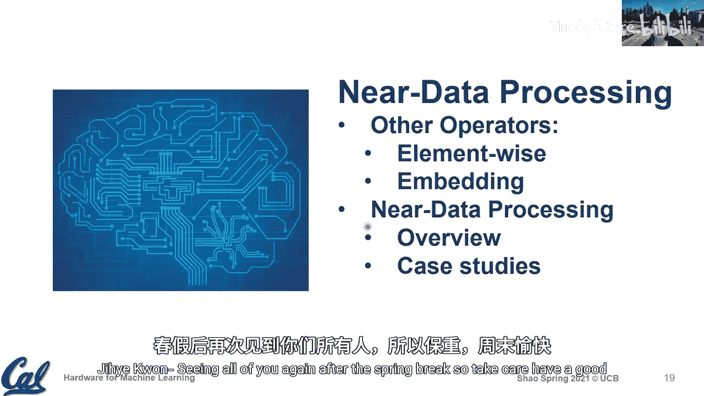

# 【加州大学伯克利】机器学习硬件技术课程 ｜ UC Berkeley ｜ EE 290 ｜ 2021 p14 P14 Lecture 16 Other Operators & Near Data -BV1XfM4zKETU_p14-

Okay， good afternoon everyone， Welcom to E220 hardware for machineine learning。

 It's great to see you all here and we're having our 16th lecture today。

 we're going to finish some of our discussion we started with codesign specifically on the new architecture search front and we're also talking about some of the other operators that we haven't actually discussed too much yet and why they are actually pretty significant when we think about end to end optimization and many of those operators actually have very low compute to memory ratio so that also bringing another topic near data processing and so far most of the accelerator that we have discussed and also explore ourelator for applications with very high compute density and those are a natural fit for actually thinking about dedicated logic dedicated accelerators to make those faster but what about those like those like operators with。

😊，low computer memory ratios， what are some of the early work people have done in actually thinking about potential for acceleration and the improving performance we also briefly discuss that line of work。

 we haven't seen a lot of commercial deployment for that line of work yet but it's always good to keep an eye on when we think about accelerators' not always just compute intensive ones but also those like like low computer memory ratio。

 but there could also opportunities to lower the overhead of general purpose processing。

Since we're talking about near data processing this might be a good time to actually remind another very important Albert ourselves。

 remind ourselves another very important project actually happened here at Forky in Forky architecture。

 so this project is more like。😊，At this point more than 20 years ago。

 so I think I believe this like Patterson started this project roughly more than 20 years ago late 90s when really thinking about similar concerns。

 really thinking about the。The memory bandwidth constraints and how we can actually potentially connect having higher memory bandwidth to support compute。

Operations and as a natural way of thinking about architecture research in general。

 especially Bke these ways of doing architecture research。

 There is always a very important focus in doing like this kind of full stack approach not only just thinking about architecture in isolation。

 but also thinking about what kind of technologies are available and can be potentially used for for future generations of architecture。

 So this is really cool projects imagine this is actually in the late in the late 90s， right。

 we have we start were still talking about war as well， General power processing。

 But then but the very early on， I think。😊，A lot of architects and also circuit designers are realize this kind of memory bandwidth requirement between general Cooper course and Dr and trying to think about what would be a more fundamental way to actually improve the bandwidth through there。

 So one of the pretty crazy idea even now， actually。

 and it was also pretty crazy back then is really thinking about whether。

 instead of separating the logic or our CPU processor and D onto two separate chips。

 whether we can actually put them together so that we can actually fabricate both D and logic on the same chip So with that instead doing off chip communication between D and the core。

 we can actually put them both on chip。 So this become on chip link。

 And then if the technology actually allows， we can actually fabricate both the memory side and the computer side。

 So that's basically the。Fundamental hypothesis with this IM or intelligent runM project is to bring compute all the way to memory actually on the same chip。

And from that， there's a lot of compute interesting actually architecture explorations。

 So one of the earliest like quicklyley vector architecture actually started back then because there's like a lot of memory bandwidth that you can use everything un how we can preesign parallel in particular vector processors to make things run faster。

 so that was the hypothesis there like very interesting work back then also like generations of chip tap out actually involved with this project so really cool and really。

 in some ahead of time in thinking about near data processing moving compute and memory together。

 this kind of ideas still showing up and being constantly evaluated these days。😊。

And you may wonder right now it's like 10 years later。

 right so but we are still having like two separate chips。😊，For for our memory and and the computer。

 right， we haven't actually really combined those together。

 I think that's also part of either the risky side or part of the dependency of a research in general。

 right， we have a vision for technology technology may go one way or the other， right。

 it's really hard to predict technology， And I think what we can do。

 especially from research perspective is to think about if this technology actually pan out what kind of implications here。

And part of the challenge with this kind of integrated logic and D on the same chip is actually over time the DM process become like so specialized and the way we actually fabricate logic is completely different from the way we're actually doing D fabrication so those two actually fabrication process becomes so different is actually really hard and almost impossible again with the current generation of technology to integrate them together to fabricate both logic and and D on the same chip。

 so now we're still having basically on the two chip kind of different fabrication flow one for logic one for D so this kind the grand vision of I is like putting everything together on the same chip is actually we're still not there yet。

 but at the same time like the part of the I project really started the exploration of vector process。

Think about that。 So one of them。30 generations of parallel computing and really thinking about how we can build scalable and also flexible vector unit for future like generations or applications。

 which turn out to be actually super useful because a lot of today's like even basically after 90s a lot of applications are super parallel right and another note on this kind of bring things together or do we hetero Virginia's integration。

you may also hear these days when people talk about chiplets based architecture， multi chip。

 module based integration， it's similar idea， but instead of actually fabricating multiple different components actually on the same chip and there is opportunity to explore as a package level right so even each chip is actually fabricated in the different technology could be DM chip could be logic chip but then whether we can actually assemble them together with on chip at a package level with steel reasonably high enough bandwidth but actually can accommodate different fabrication technology。

So that kind of thing also showing up and and also actually being commercially realized these days so this kind of heterogeneous integration would be very interesting and just the interaction between technology and and architecture there's always this kind of constant feedback and the drive between technology and architecture sometimes you need the research somewhere。

 but sometimes throughout this research they are also very interesting other components actually come out of this research the vector processor architecture that's also very interesting not directly related to the。

I run project， but really thinking about how we can support general purpose parallel processing。

So well thinking since we're talking about near data operation and then this kind of IRA project is actually a very interesting like early effort in actually exploring this space and again you'll see ideas coming up again and again depends on the technology also the market。

 some ideas actually maybe originally it didn't work out but then it may actually turn into a really good idea later。

 so it's always good to actually see some of the ideas and that has been popping up in the history of computer science in general or especially hardware and see how it actually interact with not only just architecture component but also the underlying technology and sometimes actually higher up with the software with the software stack。

So with that， let's get to today's topic right so what are other operators and why your data processing bring data and memory content closer together has always been this great vision for generations of hardware designers right because they actually this kind of architecture would be very useful will talk later this semester also touching on some of the more recent effort in actually even doing in memorymory processing what are the opportunities and the challenges there。

 but this kind of general quest for bringing compute and data together and explore and leverage the high bandwidth bandwidth available once we actually do that has always been a very important topic throughout the hardware design history here。

So with that， see， just a quick review。 We have been doing this kind of it dive from。Hi。

ello in thinking about different parametersmeters and then how we can actually realize this in hardware。

😊，and potentially also map computation onto the hardware efficiently together with our lab assignment and we have been actually doing this kind of deep diving specific topics。

 thinking about data transfer mechanism across memory hierarchy and also very important codes topic one is related to the sparsity again。

 this is a very very crowded field， there are a lot of very interesting and also even mature research in this field。

 likely this kind of discussion will will still be happening and the challenge we talk about is really how we can deploy that efficiently in hardware with both flexible to support all the different patterns but also don't sacrifice our efficiency because all of those indexing handling logic associated with oil sparsity there。

Well， this should be last lecture， we also talk about the coal design example really thinking about implications on hardware。

 different data flows， different efficiencies， and in general we see this kind of more the good things a good side actually we see a lot of interactions between hardware and software this is actually really important for any kind of co design work and specifically I think a general scheme is related to either pruning and designing compact network and especially through like more systematic way of actually transform a less compact network to more compact network tensor decomposition and then today will wrap up our discussion with neuroarch search which is also a very important area and it's actually being deployed in a lot of scenarios。

 a lot of today's efficient network models actually being found actually through neural architecture search。

Wwhich is really cool at the same time， what are the common challenges there and especially what kind of roles the hardware architects play actually in that dimension。

So start first start just covering the newer architecture search briefly you will hear that quite a lot these days and and as I mentioned。

 especially from big companies， a lot of their some of there actually especially the network with more publicity and they have been actually announcing this is actually instead of being manually designed actually in fund through new architecture search。

 which is a pretty expensive process we think about the iterative nature not only just a training。

 there is also a lot more hyperprimeter tune in the new architecture search space so this is a very expensive procedure and overall like you may read some articles I like to find this kind of efficient network or this kind of large scale network it actually you will just transfer that either in energy or in dollar that actually consume。

A lot of like resources， either energy or just in dollar prices。

 but it actually consume a lot of resources there， so we'll briefly talk about what they what they are。

 how it works and as I mentioned earlier， what kind of roles that hardware designers can get involved in this。

So what what does interactive architecture search or NAS mean So here this architecture is very since we're being an architecture class this architecture may seem a little bit confusing here。

 So it's actually not about hardware architecture， this is actually more about network architecture right。

 So when we say a network like what we have been doing is this kind of CA network or Alexnet or Resnet。

 those are actually different topologies or different or also people call this different architecture。

So the search part is actually how do we design different architecture。

 different network architectures that can actually improve accuracy， that was the original goal。

 but more recently it's also related to improving the accuracy but also lowering the cost of hardware execution could be latency cost。

 could even the area or power cost。There。So what this is trying to do is instead of manually actually to assemble different networks right so this actually requires a lot of domain expertise and really thinking about what kind of network。

 what kind of connections actually makes sense to get better efficiency a better accuracy in the execution instead of doing this manually which can be actually a fairly tedious process。

 for example， different channel size， different number of layers。

 different ways of connecting different layers together all of those can be viewed as a hyperparameter right where basically relying on designer interaction to actually pick those hyperparameters and and try it out and again。

 when we try it out is actually involved a fairly complex training procedure to actually train this network first and after training to see whether it actually works or not and then changing changing this hyperparameter again and then do another run。

Of turninging to see how accurate it is。So the general idea of NAS is basically again very similar to the general idea of people when people say like autoML right。

 whether we can actually do even do machine learning more automatically so that we can do this search figuring out what would be a good architecture also automatically so instead of having a human actually involved doing this kind of manual design。

 whether we can do this search more intelligently either through different search algorithm and even like sometimes actually different learning algorithm to do this kind of sampling to pick a different subnet that we are interested in exploring and then go back to the training and evaluation process to see how good this is and use that as a feedback to pick different different network architecture。

So this is basically the idea instead of doing this design a network architecture manually。

 whether we can actually do this more automatically to figure out the nice or like the performance architecture that leads to typically good accuracy again more recently。

 I think there is also another cost factor being combined there， so not only just accuracy。

 but also lower latency， lower power consumption and maybe even actually lower area budget。

So what are the different components actually involved in the mass process or neural architectureect search as we discussed earlier。

 there is actually quite a lot of different parameters involved here right so this is what I meant by like search space so the different different layers different layer types and then even within the layer they are different dimensions and that actually need to be considered and then cross layers whether you do actually residual addition。

 whether you're bypassing what's across layer relationship and then what are the different operators like the layer type we mentioned earlier all of those can be actually part of the search space。

 those will actually determine and also the depths of the network and all of those are actually part of the search space that will actually determine that where we are actually sample potential candidates from to see whether we can build assemble actually are fairly efficient and I have。

High performance， high performance network。So a core part of you look at a lot of new York architecture search paper these days。

 a core part of the new idea， especially from a more machine learning conference。

 even machine learning and the system conference we also see even hardware conference where actually see a lot of NA paper popping up a lot of innovation at least for now is actually centered around this search strategy so what we my search strategy is basically this search space is huge so we can just exhaustive search。

 all the combinations that's just become infeible well unless you have unlimited budget but even that it's a huge search space is's basically infeible to actually exhaustively search all the combinations and all the different mixes to see what would be a good model and also this part is actually a nasty space when we search find a set of search parameters。

 hyperparameters we actually need to do around the。

Traing we actually need to train that network to see whether it gets to a full accuracy there。

 so this is super iterative process and the exhaust search is almost basically invisibleible at this point just given the cost there。

So a lot of the innovation this day is actually coming from how do we actually navigate the search space right we cannot do this exhaustly so how do we actually assemble a small number of hyperparameters in this space and then based on the small numbers that we actually have a good idea what kind of combination of networks are likely to win so you look at a lot of papers most of the time they actually focus on the search strategy parts and this would involve theres some work using like reinforcement learning。

 a lot reinforcement learning actually is very popular here as the part of search strategy because you can actually get use this reward and feedback to get to construct a circuitgate model of the search space and to see what would be a potentially good candidate there There's also briefly talk about in the next slide like here quickly there are also many folks actually working。

なんです。And one recent line research from Ki P's group is actually using basically doing differentiable search to actually figure out different。

Different search to figure out different subnet networks as part as part of the result from the NAS so that's also another part of the search strategy and there is also people actually doing Beijing search we also talk about Bay optimization briefly when think about the mapping space and we also mentioned that that's basically become another search problem right so this kind of search strategy actually showing up very frequently when people discuss the NAS the general NAS strategy。

One thing I will briefly talk about here is I think one thing in general people overlook is actually there is also a feedback pass here so whenever we have a search basically a sample holdinging strategy。

 we need to actually as we mentioned earlier train this to see how it actually perform again most of time this is actually more or less focusing only on accuracy we basically get to as accurate as possible and then more recent there is also this push in not only focusing on accuracy but also focusing on the latency and the resource consumption like area and energy cost so then I think more recent word especially when we get we talk this is as part of context in the hardwares of their codesign right so if you look at more some of the hardware company in the way theyre pushing for their NAS strategy also involves actually how do we provide performance and energy estimation for this specific architecture。

Really quickly so that we can also better and also more efficiently navigate the search space right because whenever we pick a particular architecture。

 we need to actually network architecture， we need to see how this architecture will perform on this target hardware and we can incorporate this kind of performance metric performance in the sense of latency not only just accuracy but latency and energy consumption and then we can actually incorporate it into the into the search strategy so pure machine learning is more thinking about accuracy。

 but again。A lot of recent work， especially up to the hardwares after a boundary also thinking about for different hardware。

 how do we automate that and how we actually provide a scalable hardware estimation methodologies to give feedback to the search process here So those are general trend when people start discussing NAS these days again。

 one thing to notice is that especially when you evaluate different proposals or or papers in the NAS also take a look at a search space。

 sometimes people actually have a very small search space and if you have a small search space。

 a search strategy is actually less important and then with a straightforward search strategy you we can actually get reasonable result but always look at how big the search space is but that would actually。

Impact the scalability of the search algorithm here， so the search space is also very important。

 so those are the three main components here involved in a general NAS pipeline here。

So I mentioned one of the more recent work is really getting not only accuracy but also most of times actually latencies。

 energy and areas still a little bit hard to quantify or getting direct measure here so most of times is actually latency and this is pretty interesting work from Facebook and Berkeley where they're basically again doing this mass process。

 but then they're actually having two different kinds of devices， one is iPhone 10。

 another is a Samsung S8 so what they do is actually again they're doing this sampling but then when they do measurement。

 they actually also optimized for latency here so here what's really interesting is that when they search on the iPhone 4 an iPhone 10 device。

The network you're getting is actually different from the network that they get actually when they the target the target device is actually a Samsung device。

 the parameters are actually pretty similar the network size is pretty similar the flops are comparable right it's like 10% differences but if you look at the network actually if they actually search for an iPhone。

 the network they got for an iPhone actually performed much better on the same network but actually executed on on a Samsung device。

 So this is some of the pillaring like remember the feedback pass for the target hardware right so this is designed for this hardware So it actually performed better on the target hardware compared to like another hardware that's not part of the target。

And similarly， we look at the model that we design for the Samsung device。

 it also perform much better compared to the same model we actually run it on on the iPhone device this is pretty interesting and really interesting information especially from hardware vendors in the sense that now they can actually well and the accuracy is actually comparable right so there's another layer of operation that actually can be within the control of the hardware vendor in the sense that we can actually tailor those operators and when they actually map to either like a particular vendor device and even within the same vendor they have a a diverse set of portfolios of different different products right theres another layer tailoring that they can potentially do to actually have more specialized network for the target hardware and look at the performance differences it's actually。

Veryty significant right we're looking at like 20 roughly 20% differences in terms of latency here for different network。

 but a similar accuracy here， so if there is another control that's a network。

 the hardware vendors can potentially actually incorporate into into the NAS into the network design process。

 this could also be very interesting from a hardware vendor point of view。

That's why it' kind of new architecture search， definitely is showing up for a lots of very machine learning ecentric discussions but also showing up in a lot of hardware discussion。

 like for example there's lot of work these days from Google in doing TPU specialized network and most not all I think originally there was some like manually designed TPU efficient network。

 but now a lot of TPU specialized network actually be being discovered actually through NAS these days because there's a particular backend and then it's a hardware vendor。

 well Google is not only a hardware vendor but part of TPU as part of their hardware portfolio right it could actually potentially tailor the network to the target hardware they have。

So that's a general idea of NA again， showing up very frequently these days with both hardware and software discussion and I think this also become a very important component of the hardware and software codesign general codesign direction。

 but again， like three parts when you think about your if you are interested in this space。

 how big of the search space you want to start with because there's there are different sizes of search space you would go too big。

 maybe actually get very complex but you would go too small。

 maybe it's not even worse doing this search， you could actually either you develop your own intuition or manually。

AReason about the space So search space is very important against search strategy we also see a lot of work like for example the likegenetic algorithm simulated and new is also actually being used as a search strategy So what kind of search strategies are are effective and what's the cost of those search strategies。

 how efficient how many architectures they actually need need to sample to actually find important use to find a good enough new architecture in the end so search strategy is also very important and then more I guess closer to the hardware front is really how to provide the target feedback a lot of today's work in this space is really using existing hardware which is actually a lot easier to get measurement like based on a research or re have the hardware and then by benchmarking the hardware you can actually have a database of different operators running the latency on the hardware but what about the。

where either have not been fabricated or like we do not have direct access to those hardware where how do we actually expose a hardware cost for for those that's also？

The third component in the big NAS story。So yeah， with that， this is basically， again。

 it's pretty still ongoing across different communities at this point。

 but also very interesting and also important topics that you will run into in the general hardware software design space。

So with that， before we move on， any questions or thoughts that you want to share？Okay， well。

 if you have any any questions or anything you'd like to share。

 feel free to just unmute yourself or use the chat box check window。

To discuss with either me or with all the of your peer students。Okay， so with that。

 we are going to talk about some of the different operators so far。

 we have been mostly focusing on the matrix multiply and convolution as the two main operators we're going to talk about other operators in this space and then we have time we briefly talk about some of the work in the architecture space doing near data process。

So Vis is wondering so is a NAS result from one target transferable to another target。

 especially since it seems like such a such a large difference that's a really good question right so here target as assuming you mean like target hardware here right so if you look at this result with two different targets both are actually mobile devices right and the parameters are actually the parameters are pretty similar。

 but we are able to and the authors are able to actually observe fairly significant differences here So in general。

 the whole hypothesis of NAS， especially doing hardware specific with this kind of hardware model part of the search part is actually more tailored to a particular device So this is actually focusing on if there's a big well there is a target device。

 either TPU or iPhone or or。Like Samsung this is S 8 right so now it's like S 20 or something at this point。

 So if there's a particular target device that has actually large enough volume right so it's actually worth the whole search process to to think about opportunities to find better network to improve the efficiency but the whole NA promise is actually very tailored especially when we consider the performance。

 the latency cost here is actually very tailored for target device So this is part of the you can think about downside of hardware of software design is actually so specific for target device。

 but one thing I'd like to highlight maybe also I'd like to highlight here also another reason I separated into the three search process here is a general methodology is transferable for example。

 the search strategy and also the search space right both of those are actually transferable what is actually changing。

or like a performance estimation strategy， whether it's actually for a particular hardware either an iPhone device or a Samsung device or TU device so those are actually back yet so the general framework is actually transferable what's actually changing here even in this work。

 this general framework is actually still there， but what's actually changing is their database for different target hardware with different latency。

So a lot of maths work， again， the hope and I will also see good results here these days is basically the general methodology is transferable and but we need a particular especially when we get to actually search for efficiency and the performance。

 we need a particular hardware model and the whole promise of doing NAS is the hardware software design right so it can actually tailored to a specific hardware model so I don't think it's a downside。

 but that's actually part of part of the optimization， again on the other hand。

 the general framework， especially the search strategy。

 which is actually one of the most challenging part right how do we learn how do we develop an efficient search strategy to navigate this space the search space and then to understand the search space to find the good designs typically as soon as possible without going too many。

So that search strategy is actually transferable across different masks。That search。

Does it answer your question， Vi？Any other questions or comments？Okay， well very good question again。

 that's why I like to separate those different components some part of the component will be very hardware specific。

 but some kind of component can be actually transferable so and then when people innovate it would be interesting it's important to see which area they innovate here right。

Okay， so other operators， so I mentioned earlier that so far our discussion have been mostly focusing on。

Like convolution and fully connected layer right so it's not only just our discussion that you look at actually a lot of。

😊，Research in our community， peoples hardware and some of the system community。

Those two are always like the key the key elements there right but there are also a lot of other operators actually involved in actually constructing an efficient network and also a lot of different application domains after are part of the discussion there So today we're going to briefly talk about those why they matter we also see some examples。

 they actually very important in a lot of in today's this kind of like non matrix multiply or nonconvolution operator are actually very important in today's deployment and an interesting architecture implications can be explore explored by looking at those those operators。

So this is actually from a talk based on the data from Facebook data center where they actually。

 very interestingly， they profile all the different like machine learning related operators that's actually running on their data center。

 so here this is a time breakdown right how much time they spend in actually at the Facebook data center。

 the entire data center skill supporting all the different operators。

So we spend quite a lot of time actually in thinking about convolution right and today when we think about deep learning。

 I think now it's actually better with these more diverse applications and domains actually showing up。

 especially like five more10 years ago when people think about deep learning is's always all convolution is so important and it's very interesting and also actually in some sense surprising Facebook data center and convolution is only like less than 5% of the total time actually spent but again。

 this is maybe also related to Facebook， like the type of applications actually being around。

 there' another part of discussion is what are the similarity let's say between Facebook's data center to let's say Google or like Microsoft or AWS so that's another layer discussion。

 but it's actually pretty surprising to see how low the time actually spent on convolution at Facebook。

So fully connected layer or matrix multiply is actually a lot more。

 so it's actually 40% of the time actually spending in fully connected layers so we'll see later fully connected is actually showing up in a lot like recommendation model which actually very important in a lot of Facebook Facebook operations in general like doing friend recommendation or doing news or movie recommendation in general they spend ads this actually show up actually very importantly and also a lot of like more speech related applications also have a lot more fully connected layers compared to convolutional layer。

 those are actually convolutional layers which show up more frequently when we think about image based application。

So important to actually see okay， we look at convolution and matrix multiply。

 but there are also other type of operations there right so we'll briefly talk about embedding lookup this is also part of in particular Facebook context actually very important and showing up a lot in the recommendation model different learning based recommendation model do embedding lookup and also Tensor re。

 which is very important interesting， actually more than 10% of the time actually doing tensor transformation for different between different pipelines will be interesting。

 I don't think this is a talk given and by Facebook a couple years ago。

 they actually didn't break it down to actually what exactly happening with the tensor resha。

 but we do know that different data types and different memory layout and they need to actually convert between different data layout。

 So those are fairly important more than 10% and there's also a large pool of other operators will talk some of the。

Operators。That we observe they may or may not actually belong to this other operator pool and back then when this data was released。

 they also didn't give out a lot of details what kind of other operators actually are actually involved here。

 but that's also very important you just look at this breakdown Theres all the other actually non con non Ma operators also involved actually being used very frequently in data center。

So Dan is wondering didn't the TU paper make a similar claim about the proportion of time spent on convolution。

 remember something like yeah， that's that's very important I was also thinking about that So it would be interesting to see more data from Facebook I'm sorry from Google there。

 I think one thing with Google's data especially with TPU V1 I believe the data they published is more like at least five years ago there so and back then they make a very hard。

Recommendation or very hard observation in terms of how insignificant convolution is and that was also I guess five at this point。

 five， six years ago， it is the observation from the TPUV1 paper and that's why they also heavily optimized for for matrix multiplies that convolution。

 it would be interesting to see a more recent update on that data。

 whether that's still the case and how significant or insignificant with with CO that actually in Google's data center。

 so then you this is I think roughly five or 6% for convolution a claim in the TPUV1 paper in Google's data center。

 it would be interesting to see now five years later。

 whether that data still holds or it grow a little bit or lower a little bit。Well it's harder to。

Even lower at this point， but whether that observation still holds。

 but definitely I think we see a mix of convolution and。And and memo there。

 the exact ratio between those two is interesting we'll see a little bit more at least from Facebook there's a explanation in really thinking about deep learning based recommendation model which has a lot of fully connected layers and speech at NLP also has a lot more fully connected layers compared to compared to convolution So those are the like observation that we're observing from the data center scale again。

 this Facebook data believe it's like a couple years old and Google's data is six year old at this point so like hopefully we also see people actually updating those data to see whether it still holds。

There and the one cave up here is also this is actually very data center focused。

 which has their own workload or and their own way of actually doing computation and if we actually do a more edge focused or even like microcontroller focused there could be a different breakdown so we always also need to consider that。

And like my personal view at least between fully between matrix multily or fully connected layer and the convolution。

 And then people tend to actually focus on the differences too much。

 but there are actually ways of unifying those two operation at this point is actually again。

 they definitely have different reuse patterns there。

 but naturally the hardware can actually naturally support those two instead building two different flavors。

 hardware， or even highlighting that their their hardware is tailored to one instead of another。

 but it's actually fairly easy to support both in a consistent in a consistent manner。

 So the differences I would actually typically put much income in one category。We'll see that later。

 maybe Mamo is actually somewhere between calm and also other operator with low computer memory ratio。

 but they're more similar than difference than being different here。

 so that's also something to note here with a breakdown。

Very good question so and observation just be aware we talk about CAf for a while， very important。

 but in a lot of deployment is actually very， very low。

 we also have other interesting operators there。😊，We also talk about depthswise convolution。

 which is also， I think last time to last time something in between but also have the lower reuse ratio compared to compared to regular count so we look at this from compute to memory reuse ratio spectrum of course。

 come with is someone something has like highest reuse and then we get to Dswise con and then Ma and then we may actually then we get to like other operator that has even lower reuse。

So what kind of other operators are involved so here is another benchmarking effort trying to actually characterizeize different。

Different deep learning models， a big part of those。

 like other operators is actually the first group， the group A is basically there are a lot of element wise operators here。

Even for the especially for like RN or LTM based networks， so we'll talk about that in a minute。

 we'll also talk a little bit more about Texas embedding lookup。

 so those are the operators actually showing up pretty consistently and in in some of the networks and have very different behaviors compared to。

Both the common math that we discussed so far。A you any questions or comments before we move on？Okay。

 also first is element wise computation。 so as the name suggests， right。

 So so typically we just fetched matrix A and B of the same size。

 And then we do element wise computation， like either addition subtraction multiplication and then the result actually get to C directly。

 so this the outputs matrix C directly。 So A and B and C are all of the same dimensions。

And one of the example this kind of computation showing up is in LSTM it's less popular this is so this kind of thing is actually hard to guess right back then was very popular for a while。

 maybe still popular and sometimes also people say once have the attention it's become less popular。

😊，Anyway， so， but as a general， like we focus on operator instead of a the fancy name as the operator level。

 right， So the operator here actually being involved is basically a matrix vector modificationplication together with a lot of elements wise addition and also elements wise modificationplication here。

 So this is an example of doing elements wise operation showing up in LDM。

 And a lot of times when people say ODM has lower reuse。

 that's also part of the reason because has this。Element wise operation where we basically do one operation for output。

 is there additional modificationplication compared to our convolution for each of the output you will recall？

I talk about we actually perform RSC right and the kernel size and the kernel depth number of operations here。

 So that's the differences， especially from reuse point and view。

Another example that you also see residual addition。

 some of you may already notice will play with the Re9 50 layers， there is this a residual layer。

 what it does is basically doing this addition to actually add both the output from the previous layer and the identity from the input of the residual block together combining both before we actually move on to the next layer。

So will not get into the details there and how this actually help with scalability。

 especially building deeper an effort because there is a possibility that you can actually get identity and ignore the learning there but one of the reasoning actually talking about identity shortcuts here is that people typically think this is actually pretty easy and free because this connection doesn't actually add actual parameters we're not adding any parameters we're just doing addition or doesn't actually add a lot of computational complexity here right so that's one one of the reasons。

😊，This seems like to be almost a free operation， I just do one addition and then there's a benefit of actually makes a network and be able to scale deeper here。

😊，But actually from the hardware perspective we talk about the spectrum of reuse there right。

 but from a hardware spectrum， especially something like Re 50。

 this kind of residual operation is actually is showing up very frequently。

 they actually have very interesting behaviors in particular because of this low compute memory ratio。

 basically low reuse ratios， it has actually different implications on the hardware behavior。😊。

What do I mean by that。 So this characterization is actually pretty interesting where we basically use a gmini system。

 It's very similar to the system we use for your lab two and three。

 What we did is actually doing the characterizing the renet 50 layers and we separate those into the comp layers。

 the Ma layers and the residual additional layer。 So here the question we ask ourselves is that we start from a base configuration with this particular mix of memory size for scratch pad and a peopleim layer and also the shared L2 cache。

 But let's say like as a SOC system designer， right， now you actually have a bigger area budget。

 You could actually potentially allocate more as like to your system because the area the budget get bigger。

 your module can go bigger， either entire SOC gets bigger or some of the area。

Some of the other module gets smaller， so either way like as a system market that you actually get more area to play with and then you are wondering whether we should actually allocate more area to scratch pad to the inside the accelerator or actually allocate those actual area to L2 which is more like a shared resources right we can see the benefit of both right you have a bigger local memory。

 you have a more reused opportunities but you have a bigger shared memory you can potentially fit more data。

 especially between layer transitions and there's less it's less likely to actually evict data to memory。

 especially if the system is actually bottleneck by DM bandwidth there right。

So similar to what we did actually in La2， maybe towards the end of the lab2 right what you have a bigger memory。

 but we didn't do actually more systematically where we can either change the scratch bad memory or change the L memory。

So what's really interesting is we actually see different behavior with how different operators actually can benefit from this actual memory so for convolution it actually benefit significantly from having a bigger local scratch pad that it has a lot to reuse once you have bigger scratch pad you can actually tile that bigger like a lot ofty parameters also decide determined by your local scratch pad and then you basically have smaller tile like a fewer number of tiles there which also help with reuse so convolution in general actually benefit a lot from actually having a bigger scratch pad your hardware is basically design will be actually running convolution for a while most of the cases that at least you envision is convolution it can actually benefit from having a large local scratch pad compared to having a big L2 it actually already a lot of reuse going on hiding the memory latency doesn't help a lot。

Well skip MaMo for now because I mentioned earlier Mamo is more like something in between。

 but residual addition is actually really interesting in a sense a residual addition actually doesn't benefit from having a big big scratch pad because we're literally just like getting data like we're doing elementwise addition we're getting data in。

 getting data out that's about it we're having it's a pure streaming operation。

 having a bigger scratch pad doesn't help a lot。Having a big L2 helps a little bit。

 not too significantly， especially when we have a single core SOC because it's basically bottlenecked and still bottlenecked by memory。

We do see actually residual addition actually benefit a lot more from having a big L2 when we have a Du core As O see。

 this is a little bit complex setup here。 we're actually also interested in the system contention there we won't get into the detail。

 But again， if there is actually the system never content in the sense that your L2。

 you're actually competing the accelerator competing the shared memory with some other modules there。

 So in a scenario like this， having a bigger L2 actually will help significantly for layers like residual addition because then we're actually have more opportunities to catch the data on chip instead of throwing data actually after chip。

So this is just a quick example， especially when we look at the overall。

 let's say we are actually evaluating the overall performance of again。

 our two design choices as an I designer， whether you should actually allocate more memory to a your local memory or allocating memory to having a bigger shared memory we look at the overall benefit actually having a bigger shared or two wings in particular because residual it should actually benefit significantly from large shared memory。

 instead of local memory， because it it doesn't have a lot of reuse versus convolution actually benefit a lot from a big local memory。

Here， so again， even from a pure algorithm algorithmic perspective。

 this kind of shortcut or basically residual connection is almost great right， no actual parameters。

 not very complex computation just doing an addition。

 but because it actually doesn't have a lot of reuse。

 it actually post very big different behavior onto your memory system and if the networks that we're dealing with even for renet 50 are very standard benchmark and layer these days。

 having having this kind of residual connections that will actually change your memory behavior and with different scenarios you may actually want to budget your your memory differently based on the operators that you're considering here。

So that's just an example of the significance of this kind of low reuse layers。

 typically again you don't see that when you compute the flps。

 you don't also see that when you think about even training。

 well actually think about model size or flop count。

 but when we actually think about how it's actually executed on hardware。

 they may have actually very different performance behaviors here。

Does it make sense any questions or comments？And again。

 this kind of decisions right is actually showing up like we talk a lot about those different fundamentals and primitives。

 but this kind of SOC level decisions is very likely will be some decision you will make either even either as an accelerator architect or at a system architect right once you have actual area。

 how do you actually budget those different area to different different Is and what's the implications of having more shared resources or having actually more local resources。

 this require not only just understanding those like fls or memory footprint those like general metrics。

 but also understanding some of the operations， maybe they don't show up on the when we actually calculates fls or memory but they actually have interesting behaviors when we think about as a system level。

Okay， so that's a residual basically element wise computation it show up very very frequently and even when we think about this benchmarking layer like less than 50。

 this kind of residual addition also can be very important like for example as we demonstrate it here so be aware those operations don't think they are free and they can actually play a very important role in end to end system performance。

😊，We're also going to talk briefly about the embedding layer。

 that's also another like we talked about we see earlier。A Facebook breakdown， It has roughlying。

5 to 10% of the data center cycle breakdown is actually doing embedding embedding lookup right so in general。

 embedding there is basically doing this kind of mapping or transformation from a sparse dimensions to at dimensions like we can actually start process it more efficiently so a very commonly used scenario is actually in recommendation model user a recommend like like friend recommendation like news recommendation being very pervasive these days on Facebook。

 a social network in general or like like website like this is Alibaba or or on Taobao or like Amazon like doing this kind of product recommendation is also getting very popular and very important those days and in general they basically have some kind of features and sometimes the user some parties actually user dependent different user profiles and also some。

Different user behaviors， whether user have visited certain product and certain category and also whether actually user are more likely to actually hit certain product or category。

 all of those are actually part of the features and they actually typically are super high dimensions because there are so many different products there or like a movie recommendation like there's also there's so many different movies there so all of those are actually from the feature factor is a very sparse factor and typically there need to be a lookup to convert this sparse factor into a disk vector before we do actually further processing to decide how we like to do recommendation So this is especially more deep learningbased approach actually being used for recommendation model this kind of embedding layer actually become also very popular here。

So in general， this kind of the core operation here is basically a matrix vector operation to its core and so again we talk about this high level features but the core operation here is basically a matrix vector operation the vector here is basically we talk about the feature the sports feature input and we talk about it typically either one hot or multi-hog encoding right so that's how it's actually being encoded and then we take this sports vector let's say in one hot encoding and look at embedding by multiply with embedding table to actually get a dense output。

So in deployment， so of course， a naive way of doing this is basically to in matrix structure offer multiply。

 but this is actually very inefficient in the sense that it at a1H so first it's very sparse right we actually don't need the entire column to do the multiply because we only have a few entries actually being selected and it's not even a multiplication it's really just addition right because it's actually oneH encoded。

So I won't go to the detail in today's lecture， but if you're interested， so in CAfe2。

 the operator that's actually involved with embedding layer is called sparse and sum or SLS operator if you actually look into that it may be actually a bit key to read the pseudo code but if you basically look into that is basically doing a sparse matrix multiplication where the one of the matrix matrix here is actually using a CSR compressed format so it's a matrix instead of vector because it's actually just think of the batch size we have a multiple inputs actually going in at the same time as a batch processing and then since it's a sparse instead of doing a spars matrix matrix operation turning into a sparse matrix operation to do to calculate the corresponding then output。

So again this remind this becomes something we are more familiar with right so I start with this notion of embedding layer but we talk about basically doing a matrix vector operation and then we consider a sparseity and also the batching going on it basically become a sparse matrix matrix operation there and we talk about D compute on sparse data right so again some people you also see work actually doing specialized hardware for deep learning recommendation model and in general eventually they basically fall into the sparse sparse linear algebra discussion we discussed a couple weeks ago so it's again how we actually handle the operating sparseity and most of the time I have seen so far is basically simple opera sparse。

😊，Because we are only looking at the sportsrs input here and the single operating sports is basically doing a lot of interaction right because we need to as a dashed arrow indicate here we're doing this indirect accesses to the embedding table right so then become how we actually do do the embedding actually very do the embedding access very very efficiently there is also very interesting work people are start doing curization and showing there's also some like hot entries in in the embedding table like a lot of time so whenever have a large data that we need to access。

Another general line of operation is to see whether that data can be cached right because where most of the time we're not going to actually access all the data right you willt access a small subset of the data。

😊，If actually thats small enough， then we can catch it。 That can be another potential optimization。

 And then when we do this kind of indirect， it can be cheaper。 So again。

 embedding layer become one of another case for the sparse operator。

So a lot of our the trade off we discussed with sparse operator still applies here， and in general。

 most of the hardware is actually hardware or software optimization in general is actually how we can do this in very efficiently there and some part of the discussion is also if we do in direction。

 whether we can capture the locality of the sparse layer of the embedding so that we can catch those embedding in a smaller memory there。

So that's the embedding layer， so like we talk about why fully connected layer is actually showing lot a lot actually in at at least in Facebook data center is' basically in general for their different learning recommendation model we have this embedding table converting again our response input to dense feature and they typically also like some of the inputs are actually also dense input and then they also have a top fully connected layer to actually do the final prediction So in general besides the embedding table there's also quite a few actually fully connected layer operations here and the black bar here is basically the recommendation model。

 their operator breakdown and the gray bar here is a non recommendation model。

 their operator breakdown so we see a lot of SOS is we discussed earlier right so that's basically their embedding lookup by the fully connected layer is actually pretty important as well in their recommendation。

Model in both recommendation also non recommendation model so that also contribute to the overall importance of fully connected layer whatcom actually only show up for it doesn't show up for the recommendation model and given recommendation model especially deep learning based recommendation model is so important。

 especially well I guess in general in today's social network so it's not completely surprising that like fully connected layer and embedding lookup actually become more important in Facebook's data center here。

So those are the two layers that we discussed。For like we like to at least keep an eye on one is animalwide computation we talk about this actually even show up for Re 50 residual addition and that actually changed the system level design behaviors pretty significantly and then another there is this kind of embedding lookup but again fundamental basically become a sparse sparse operators there and doing indirect right so the software and hardware cost of doing indirect that we discussed before also applies here and again the diversity of operators here is very depends on applications and depends on whether it's online or offline and even there their business model right different different vendors or here actually different。

Data center service providers actually may have different applications that they have in mind that will also contribute to the different breakdown。

 so that's also important to keep an eye on。So before we move on any other questions or comments that you'd like to share？

Okay， great。So while spring break is coming up next week is spring break。

 I hope everyone gets a chance to take some time off， really enjoy the nice weather。

 especially for those of you who are in at least in California the weather is really nice these days or stay safe。

 stay healthy well guests pick take some time off and recharge that's always very important so use this spring break wisely and we actually schedule you quite a few interesting guest lectures coming up right after spring break and this partially because now we actually have seen quite a lot of different topics so now it's actually very interesting to see how this actually being deployment deployed in different scenarios so we have guest lectures from like interesting startup and Bar coming up right after spring break and personally very excited about this lecture will be very interesting to see what kind of architecture they have and what kind of challenges or。

😊，Experiences they have， especially through the startup process。

And we talk about all the different kernels， especially with this discussion right it's become really important to actually how we can consistently compare hardware benchmark hardware and understand the differences。

 So this is also a very influential work a mal curvef and this is become actually multiple generations of mal curve a mal curve training a machine learning a mal curve inference and also。

😊，I know VJ ready， who actually lead quite a lot of this kind of ML Perf related project also get into the tiny ML space。

 So there' is also tiny ML benchmarking， so we're very excited to also have VJ。

But with us to share some of his experience in actually doing consistent benchmarking efforts across different hardware with different deployments in their electronic inference and also and also un tiny amount microcontrollers。

 what are the considerations and what are the takeaways by doing this kind of multi generationeration benchmarking effort。

And next we' also have Chris Young， which with one of the lead architect of Google's TU and have done a lot of really interesting work at Google and before that at D Shao in doing specialized hardware and I enjoy every time I talk to Steve always feel like something new and he has been thinking some interesting ideas in either hardware or software and sometimes even like advanced technology。

 so he has a lot of really interesting ideas going on and we' also been to invite clickback actually to share with some of the things he has been thinking and also after generations at this point I think four generations of TPU actually being build and deployed at Google what he is a learning experience was takeaway and what kind of new insights he can share with us so that also coming up after spring break in the second half of semester and then finally it will also be。

Tal about with fact we mentioned earlier in memorymory computing and N computing。

 which also become very important in today's deep learning landscape。

 so we'll going to talk about what are the fundamental technologies there and together with our discussion in our regular lecture we also have。

😊，have Brian Zimmer from a media share with some of his perspective in really thinking about opportunities。

 but especially challenges actually facing with analog and in memoryory computing I work with Brian for a few or few years and really enjoyed working with gaming every time and he has really been thinking about those kind of turnedoff between digital and analog computing and the challenges are actually involved in advancing more analog and in memorymory computing so we have a great lineup of speaker coming up right after spring break。

 you may notice that our frequency we have we have a few but not this frequent before the spring break and most of our speakers are actually after the spring break partially because now we have basically we know the terminology now actually when you see those speakers talking about their deployment you actually see using very similar terminology that we have covered right we already have that foundation。

And another part is also this will give you a little bit more time actually preparing for your focusing on your final project and preparing for your final project report and presentation。

So on that we have already talked about this multiple times I think at this point just a quick re this please submit your final project proposal this Friday again just before spring break。

 just get it done no need to actually drag it too long I have talked to I think most of you at this point about your project and personally really excited about those projects and think it's very interesting。

 very different and and I'm just so glad like many of you have actually fund your project so it's very interesting just put it really think about the specific action item that you'd like to achieve and especially the project timeline I think that's really important to have a successful execution plan for your project and also in your project proposal also described infrastructure that you plan to use I already talk to again many of you I think I know two teams actually。

😊，require special FGA boards， physical FGA boards we're in the process actually working with the department or even just purchasinging them directly for those two teams and others either youll be using the AWS machines which is fine or actually will be using the instructional also that's also an option or if you already gets involved in a research group you also have your own access。

 all of those are fine just make sure you think about your infrastructure if anything I think is's more important for the group that actually require local FGA boards we know two groups already we are working with them to actually get the boards where very positive that they should get their boards in a week or two。

 but if your project if you haven't talked to me or a yet and your project also require special boards make sure you start the conversation early。

And we have also finalized the plan at this point again。

 when you think about your execution plan your work plan and two checkpoint。

 basically every two weeks we'll to a checkpoint so that we know how things are and and you can also maybe adjust your plan accordingly the first checkpoint will be two weeks after spring break so the week of April 5 and then two more weeks will have checkpoint two that will be April 19th there。

And we are going to have a final presentation， final report so our final report will be due basically the end of the reading week May 7th final presentation is tentative。

 I think we currently schedule this is the beginning of the reading the Monday the reading week will reach out to all of you to find a thought that works for at least for most of you。

 if not all of you tentatively it will be in the reading week so that we don't have any conflict。

Letlesss our project in any questions or comments。Or anything you want to bring up。Also。

 I know like a couple groups are doing actually more handsz project。

 which is actually really cool I'm looking forward to those groups like what kind of cool demo that we can have in the end。

For those if you are actually struggling with finding a research papers about your topic that's also fine。

 you may also look into what are the related resources specifically for your boards and all different or for your competition for folks actually interested in doing the competition so use this as more like a background section for your project right what are the available resources what are the things that are available either from the data point of view。

 from the board point of view， use that as opportunity to think about the background for your project。

 so you have trouble actually finding a research papers because your project is interested actually more hands on which is completely fine so use that opportunity to actually think about related background。

So Vince is wondering should we try to limit our credit usage to the month in last three。

 or is this possible to get more fire inron。 So that's a good question。

 And the short answer is it is possible to actually get more credits。

 We did actually budget the credit already when we apply for the AWs credits and AWS has been very generous with us in general。

 So it's possible to get more credits we will actually review that on a case by case basis So talk to us and and use this maybe use the project proposal as a way to a budget how much how much more credit you you would actually be using right so we think we can provide you a little bit more。

 but it's not unlimited right So that's also the caveat。

 Think a little bit we can definitely provide more。 we do have。Some actual here。

 but you need to tell us how much more you need and whether it's actually a reasonable amount that we can afford or if not。

 if you do think you need that we need to understand why and if there is a strong case for that we need to actually start our work with our AWS partner to get that started so there is possible to get more credit。

 think about how much you really need in your proposal and communicate with us and if it's reasonable that we can afford we're happy to accommodate that if it's not we need to actually work with a AWS partner to see whether we can get even more credit but we do have some actual offer here。

Okay， any other questions？Okay good， well if you have any questions like some of you already email me or you can also email Abe or us on Piaza。

 those are all valid channels for communication I think I already talk to most of you about your project personally really excited about it so don't think too much on this proposal this is for just making sure you're on track。

 think about the concretes that you need to do like what vi us how much credit you will be using what kind of infrastructure you will be using what kind of resources are available to you if you need infrastructure you need to reach out to us to see how we can actually help you to get those for。

We are a little bit over like we don't have time to actually get into the examples here。

 we likely won't have time because we have a guest speaker actually coming up right after a spring break。

 well if you have time feel free to go through the discussions。

 most of those actually work actually not in the ML space and also have not been actually commercialized so be interesting to think about what are the reasons about it。

 what are the challenges there and kind of what kind of codesign opportunities they were exploring by actually trying to move compute closer。

 at least a little bit closer to where data is。So with that。

 it's great to see you all here today again， enjoy your spring break。

 take some time off and get a chance to recharge， stay healthy， stay safe。

 and I'm looking forward to seeing all of you again after the spring break， so take care。

 have a good weekend and spring break。😊。

